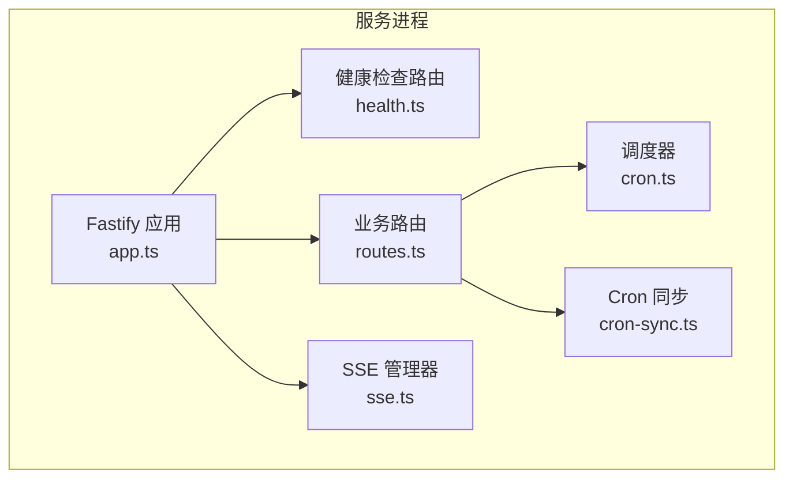
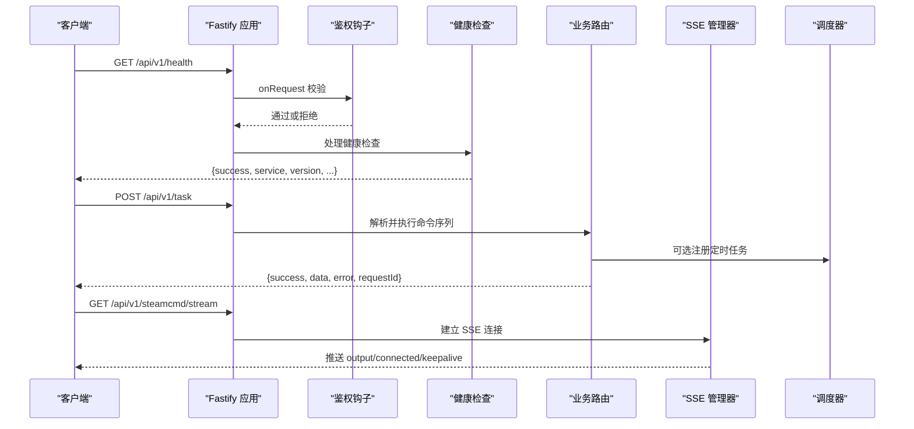
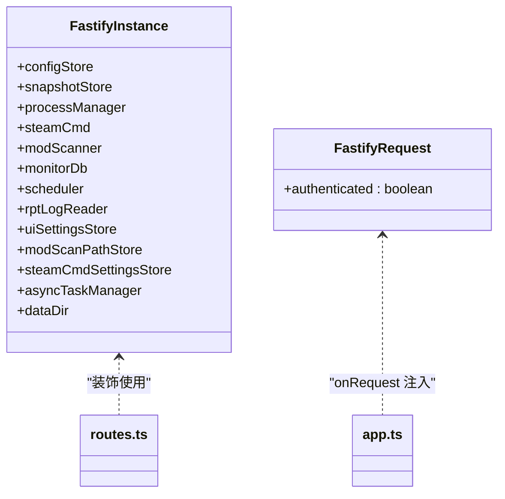

# API 接口参考

<cite>
**本文引用的文件**   
- [README.md](file://README.md)
- [app.ts](file://packages/service/src/app.ts)
- [health.ts](file://packages/service/src/api/health.ts)
- [routes.ts](file://packages/service/src/api/routes.ts)
- [sse.ts](file://packages/service/src/api/sse.ts)
- [types.d.ts](file://packages/service/src/api/types.d.ts)
- [cron.ts](file://packages/service/src/scheduling/cron.ts)
- [cron-sync.ts](file://packages/service/src/scheduling/cron-sync.ts)
</cite>

## 目录
1. [简介](#简介)
2. [项目结构](#项目结构)
3. [核心组件](#核心组件)
4. [架构总览](#架构总览)
5. [详细接口说明](#详细接口说明)
6. [依赖关系分析](#依赖关系分析)
7. [性能与可靠性](#性能与可靠性)
8. [故障排查指南](#故障排查指南)
9. [结论](#结论)
10. [附录：JSON Schema 与示例](#附录json-schema-与示例)

## 简介
本文件为 Arma3 Server Tools v2 的 RESTful API 参考文档，覆盖健康检查、服务器操作、配置管理、模组管理、监控数据、任务调度、SSE 实时输出等能力。后端基于 Fastify + SQLite，提供 Bearer Token 鉴权；所有业务端点统一以 `/api/v1` 前缀暴露。

- 服务默认监听端口：19580（可通过启动参数调整）
- 版本信息：v2.0.0-alpha.13
- 认证方式：Bearer Token（支持 Authorization、X-Api-Key、查询参数 token）
- 安全策略：静态资源与部分公开端点无需鉴权，其余 /api/* 需要鉴权

**章节来源**
- [README.md:1-108](file://README.md#L1-L108)

## 项目结构
后端服务位于 `packages/service`，API 路由集中在 `src/api`，健康检查独立模块，SSE 流式输出由专用管理器实现。



**图表来源**
- [app.ts:57-171](file://packages/service/src/app.ts#L57-L171)
- [health.ts:5-66](file://packages/service/src/api/health.ts#L5-L66)
- [routes.ts:62-1108](file://packages/service/src/api/routes.ts#L62-L1108)
- [sse.ts:9-94](file://packages/service/src/api/sse.ts#L9-L94)
- [cron.ts:11-49](file://packages/service/src/scheduling/cron.ts#L11-L49)
- [cron-sync.ts:15-105](file://packages/service/src/scheduling/cron-sync.ts#L15-L105)

**章节来源**
- [app.ts:57-171](file://packages/service/src/app.ts#L57-L171)

## 核心组件
- 健康检查与健康动作清单：返回服务版本、平台信息与可用端点列表
- 业务路由：服务器 CRUD、配置读写、SteamCMD、模组、日志、监控、快照、封禁、任务、调度
- SSE 管理器：订阅 SteamCMD 输出事件，向客户端推送实时日志
- 调度器：基于 croner 的定时任务管理与执行
- 类型扩展：为 Fastify 实例和请求对象注入服务依赖

**章节来源**
- [health.ts:5-66](file://packages/service/src/api/health.ts#L5-L66)
- [routes.ts:62-1108](file://packages/service/src/api/routes.ts#L62-L1108)
- [sse.ts:9-94](file://packages/service/src/api/sse.ts#L9-L94)
- [cron.ts:11-49](file://packages/service/src/scheduling/cron.ts#L11-L49)
- [types.d.ts:15-34](file://packages/service/src/api/types.d.ts#L15-L34)

## 架构总览


**图表来源**
- [app.ts:96-153](file://packages/service/src/app.ts#L96-L153)
- [health.ts:5-66](file://packages/service/src/api/health.ts#L5-L66)
- [routes.ts:1033-1108](file://packages/service/src/api/routes.ts#L1033-L1108)
- [sse.ts:51-90](file://packages/service/src/api/sse.ts#L51-L90)
- [cron.ts:11-49](file://packages/service/src/scheduling/cron.ts#L11-L49)

## 详细接口说明

### 通用约定
- 基础路径：`/api/v1`
- 响应体统一格式：
  - `success`: boolean
  - `data`: any
  - `error`: string | null
  - `requestId`: string
- 鉴权：除 `/api/v1/health`、`/api/v1/actions` 及静态资源外，其他 `/api/*` 需携带以下任一凭据：
  - Header `Authorization: Bearer <token>`
  - Header `X-Api-Key: <token>`
  - Query `?token=<token>`
- 未授权返回：HTTP 401，body `{ success: false, message: "Unauthorized" }`

**章节来源**
- [app.ts:96-130](file://packages/service/src/app.ts#L96-L130)
- [health.ts:5-66](file://packages/service/src/api/health.ts#L5-L66)

### 健康检查与动作清单
- GET `/api/v1/health`
  - 描述：服务健康检查，返回版本、平台、默认可执行路径等信息
  - 响应字段：
    - `success`: boolean
    - `service`: string
    - `version`: string
    - `remoteAccessEnabled`: boolean
    - `publicBaseUrl`: string
    - `platform`: string
    - `defaultServerExecutable`: string
    - `defaultServerDir`: string
    - `steamCmdBinary`: string
- GET `/api/v1/actions`
  - 描述：列出支持的 task actions、REST 端点、文件上传端点
  - 响应字段：
    - `success`: boolean
    - `requestId`: string
    - `data.taskActions`: string[]
    - `data.restEndpoints`: [{ method: string; path: string }]
    - `data.fileUploads`: string[]

**章节来源**
- [health.ts:5-66](file://packages/service/src/api/health.ts#L5-L66)

### 服务器管理
- GET `/api/v1/servers`
  - 描述：列出服务器清单；可选 query `reload=true` 强制刷新磁盘配置（受 UI 设置控制）
  - 响应：数组，每项包含 `uuid`、`configName`、`serverDir`
- GET `/api/v1/servers/:uuid/status`
  - 描述：获取服务器运行状态
  - 响应：`isRunning`, `pid`, `activeMissionTemplate`, `serverModCount`
- GET `/api/v1/servers/:uuid/config`
  - 描述：读取服务器配置；可选 `reload=true` 强制从磁盘加载
  - 响应：`{ success, data: ServerConfigPackage, error, requestId }`
- PUT `/api/v1/servers/:uuid/config`
  - 描述：保存服务器配置；可选 `writeCfg=true` 同时写入游戏配置文件
  - 错误码：`WRITE_CFG_FAILED`、`SAVE_FAILED`
- PATCH `/api/v1/servers/:uuid/config`
  - 描述：合并更新配置；可选 `writeCfg=true`；对 localMods 进行路径有效性校验
  - 错误码：`INVALID_MOD_PATH`、`WRITE_CFG_FAILED`
- GET `/api/v1/servers/:uuid/sync-state`
  - 描述：返回配置同步状态评估结果
- POST `/api/v1/servers`
  - 描述：创建新服务器；body 可选 `configName`、`serverDir`
  - 响应：`{ uuid }`
- POST `/api/v1/servers/:uuid/clone`
  - 描述：克隆服务器配置
- DELETE `/api/v1/servers/:uuid`
  - 描述：删除服务器配置
- PUT `/api/v1/servers/:uuid/rename`
  - 描述：重命名服务器配置

**章节来源**
- [routes.ts:65-273](file://packages/service/src/api/routes.ts#L65-L273)

### 预检与诊断
- GET `/api/v1/servers/:uuid/preflight`
  - 描述：启动前检查，返回问题列表与严重级别
- GET `/api/v1/servers/:uuid/diagnostics`
  - 描述：完整诊断信息，包括进程状态、模组扫描结果等
- GET `/api/v1/servers/:uuid/dashboard`
  - 描述：仪表盘聚合数据，含在线人数、监控摘要、最近 RPT 文件名等

**章节来源**
- [routes.ts:421-440](file://packages/service/src/api/routes.ts#L421-L440)
- [routes.ts:539-554](file://packages/service/src/api/routes.ts#L539-L554)
- [routes.ts:583-627](file://packages/service/src/api/routes.ts#L583-L627)

### 模组管理
- GET `/api/v1/servers/:uuid/mods`
  - 描述：扫描并返回模组列表与扫描路径数量
- GET `/api/v1/servers/:uuid/mods/bikeys`
  - 描述：汇总 .bikey 使用情况
- GET `/api/v1/servers/:uuid/mods/bikeys/files`
  - 描述：列出服务器 Keys 目录下 .bikey 文件
- POST `/api/v1/mods/validate-path`
  - 描述：校验模组目录是否有效
- POST `/api/v1/servers/:uuid/files/mod-list-html`
  - 描述：导入模组 HTML 列表，提取 Workshop ID 并下载启用；可选 `mode`、`writeCfg`
- POST `/api/v1/servers/:uuid/files/mission-pbo`
  - 描述：上传 .pbo 任务包；可选 `addToMissionList=true`、`writeCfg=true`

**章节来源**
- [routes.ts:464-525](file://packages/service/src/api/routes.ts#L464-L525)
- [routes.ts:945-1029](file://packages/service/src/api/routes.ts#L945-L1029)

### 任务与脚本
- POST `/api/v1/task`
  - 描述：执行命令序列；支持同步或异步模式；可选 `writeCfgAfter`、`restartAfter`
  - body 关键字段：
    - `taskId`: string（可选）
    - `serverUuid`: string（必填）
    - `commands`: array<{ action: string; [key]: unknown }>（必填）
    - `async`: boolean（可选）
    - `writeCfgAfter`: boolean（可选）
    - `restartAfter`: boolean（可选）
  - 响应：
    - 同步：`{ success, data: { results[], steps[] }, error, requestId }`
    - 异步：`{ success, data: { taskId, status: "Running" }, error, requestId }`
- GET `/api/v1/tasks/:taskId`
  - 描述：查询异步任务状态与步骤结果
- DELETE `/api/v1/tasks/:taskId`
  - 描述：取消任务；若涉及 SteamCMD 则触发中止

**章节来源**
- [routes.ts:1033-1108](file://packages/service/src/api/routes.ts#L1033-L1108)

### 日志与 RPT
- GET `/api/v1/servers/:uuid/rpt`
  - 描述：读取当前活动 RPT 日志尾部
- GET `/api/v1/servers/:uuid/logs`
  - 描述：列出日志文件；query `kind=rpt|battleye|console|all`
- GET `/api/v1/servers/:uuid/logs/read`
  - 描述：读取指定日志文件尾部；query `kind`、`tail`、`file`

**章节来源**
- [routes.ts:631-695](file://packages/service/src/api/routes.ts#L631-L695)

### 监控数据
- GET `/api/v1/servers/:uuid/monitoring/summary`
  - 描述：监控摘要
- GET `/api/v1/servers/:uuid/monitoring/stats`
  - 描述：统计趋势；query `hours`（默认 24）
- GET `/api/v1/servers/:uuid/monitoring/players`
  - 描述：玩家记录列表
- POST `/api/v1/monitoring/collect`
  - 描述：触发全量采集（在线人数、玩家列表入库）
- POST `/api/v1/servers/:uuid/monitoring/ingest`
  - 描述：直接入库监控消息
- POST `/api/v1/servers/:uuid/monitoring/sync-players`
  - 描述：从 RCon 同步玩家到数据库
- GET `/api/v1/servers/:uuid/monitoring/export/html`
  - 描述：导出当日 HTML 报告
- GET `/api/v1/servers/:uuid/monitoring/export/csv`
  - 描述：导出 CSV；query `kind=stats|players`
- GET `/api/v1/servers/:uuid/monitoring/assets`
  - 描述：检测是否已部署监控前端资源

**章节来源**
- [routes.ts:699-822](file://packages/service/src/api/routes.ts#L699-L822)

### 封禁管理
- GET `/api/v1/servers/:uuid/bans`
  - 描述：读取本地封禁列表
- PUT `/api/v1/servers/:uuid/bans`
  - 描述：批量写入封禁列表；body 为 LocalBanEntry[]
- GET `/api/v1/bans?serverUuid=:uuid`
  - 描述：按 serverUuid 读取封禁列表
- POST `/api/v1/bans`
  - 描述：已废弃，返回 DEPRECATED
- DELETE `/api/v1/bans/:guid`
  - 描述：已废弃，返回 DEPRECATED

**章节来源**
- [routes.ts:887-941](file://packages/service/src/api/routes.ts#L887-L941)

### 快照管理
- GET `/api/v1/servers/:uuid/snapshots`
  - 描述：列出快照
- POST `/api/v1/servers/:uuid/snapshots`
  - 描述：创建快照；body 可选 `label`
- POST `/api/v1/servers/:uuid/snapshots/:snapshotId/restore`
  - 描述：恢复快照

**章节来源**
- [routes.ts:861-883](file://packages/service/src/api/routes.ts#L861-L883)

### SteamCMD 与设置
- GET `/api/v1/settings/steamcmd`
  - 描述：读取 SteamCMD 设置视图
- PUT `/api/v1/settings/steamcmd`
  - 描述：保存 SteamCMD 设置（用户名、密码、Workshop 根、服务器安装路径）
- GET `/api/v1/steamcmd/status`
  - 描述：SteamCMD 运行状态
- PUT `/api/v1/steamcmd/credentials`
  - 描述：设置凭据
- GET `/api/v1/steamcmd/log`
  - 描述：读取最新日志；query `tail`
- POST `/api/v1/steamcmd/stop`
  - 描述：中止 SteamCMD 并取消相关任务

**章节来源**
- [routes.ts:277-417](file://packages/service/src/api/routes.ts#L277-L417)

### 调度与定时任务
- GET `/api/v1/schedule`
  - 描述：列出当前定时任务
- POST `/api/v1/schedule/restart`
  - 描述：添加定时重启任务；body 包含 `serverUuid`、`cron`

**章节来源**
- [routes.ts:826-857](file://packages/service/src/api/routes.ts#L826-L857)
- [cron.ts:11-49](file://packages/service/src/scheduling/cron.ts#L11-L49)
- [cron-sync.ts:15-105](file://packages/service/src/scheduling/cron-sync.ts#L15-L105)

### SSE 实时通信
- GET `/api/v1/steamcmd/stream`
  - 描述：建立 SSE 连接，接收 SteamCMD 输出、进度、完成事件
  - 事件类型：
    - `connected`：连接成功
    - `output`：文本输出
    - `progress`：进度提示
    - `complete`：执行完成
  - 保活：服务端每 15 秒发送 keepalive

**章节来源**
- [sse.ts:51-90](file://packages/service/src/api/sse.ts#L51-L90)

## 依赖关系分析


**图表来源**
- [types.d.ts:15-34](file://packages/service/src/api/types.d.ts#L15-L34)
- [app.ts:81-94](file://packages/service/src/app.ts#L81-L94)
- [app.ts:96-130](file://packages/service/src/app.ts#L96-L130)

**章节来源**
- [types.d.ts:15-34](file://packages/service/src/api/types.d.ts#L15-L34)
- [app.ts:81-130](file://packages/service/src/app.ts#L81-L130)

## 性能与可靠性
- 监听重试：端口占用、权限不足、地址不可用等错误自动重试最多 15 次
- 大文件上传：multipart 限制 100MB
- CORS：允许任意 Origin，便于 Capacitor WebView 与移动端 LAN 访问
- 限流与并发：当前未实现显式限流；建议在上层网关或反向代理中配置
- 重试机制：
  - 任务取消时仅对 SteamCMD 相关任务触发中止，避免误杀
  - SteamCMD 停止会取消关联任务并返回已取消的任务 ID 列表
- 向后兼容：
  - 旧版封禁接口返回 DEPRECATED，引导迁移至新版
  - 所有业务端点以 `/api/v1` 固定版本前缀

**章节来源**
- [app.ts:26-55](file://packages/service/src/app.ts#L26-L55)
- [app.ts:132-145](file://packages/service/src/app.ts#L132-L145)
- [routes.ts:1084-1107](file://packages/service/src/api/routes.ts#L1084-L1107)
- [routes.ts:932-941](file://packages/service/src/api/routes.ts#L932-L941)

## 故障排查指南
- 401 Unauthorized
  - 检查是否携带 Authorization、X-Api-Key 或查询参数 token
  - 确认 token 与服务端配置一致
- 400 INVALID_BODY / INVALID_TASK / INVALID_CREDENTIALS
  - 检查请求体结构与必填字段
- 400 WRITE_CFG_FAILED
  - 检查服务器目录与配置文件写入权限
- 400 NO_SERVER_DIR
  - 确保服务器目录已正确配置
- 502 RCON_FAILED
  - 检查 BattlEye/RCon 配置与网络连通性
- 任务取消无效
  - 确认是否为 SteamCMD 相关任务；非相关任务不会触发中止

**章节来源**
- [app.ts:96-130](file://packages/service/src/app.ts#L96-L130)
- [routes.ts:112-195](file://packages/service/src/api/routes.ts#L112-L195)
- [routes.ts:442-462](file://packages/service/src/api/routes.ts#L442-L462)
- [routes.ts:1084-1107](file://packages/service/src/api/routes.ts#L1084-L1107)

## 结论
该 API 提供了完整的 Arma3 服务器管理能力，涵盖配置、模组、监控、任务与调度，并通过 SSE 提供实时输出。鉴权简单明确，错误码清晰，适合桌面、Web 与移动端集成。建议在外部网关增加限流与审计，并在客户端实现指数退避重试与断线重连。

## 附录：JSON Schema 与示例

### 统一响应体
- 字段：
  - `success`: boolean
  - `data`: any
  - `error`: string | null
  - `requestId`: string

示例（健康检查）：
```json
{
  "success": true,
  "data": {
    "service": "Arma3ServerTools.Service",
    "version": "2.0.0-alpha.13",
    "remoteAccessEnabled": false,
    "publicBaseUrl": "http://127.0.0.1:19580",
    "platform": "win32",
    "defaultServerExecutable": "arma3server_x64.exe",
    "defaultServerDir": "C:\\Program Files\\Steam\\steamapps\\common\\Arma 3",
    "steamCmdBinary": "steamcmd.exe"
  },
  "error": null,
  "requestId": "a1b2c3d4e5f6"
}
```

**章节来源**
- [health.ts:5-19](file://packages/service/src/api/health.ts#L5-L19)

### 任务请求体
- 字段：
  - `taskId`: string（可选）
  - `serverUuid`: string（必填）
  - `commands`: array<{ action: string; [key]: unknown }>（必填）
  - `async`: boolean（可选）
  - `writeCfgAfter`: boolean（可选）
  - `restartAfter`: boolean（可选）

示例（异步任务）：
```json
{
  "serverUuid": "test-uuid",
  "commands": [
    { "action": "status" }
  ],
  "async": true
}
```

**章节来源**
- [routes.ts:1033-1065](file://packages/service/src/api/routes.ts#L1033-L1065)

### SSE 事件
- 事件类型：
  - `connected`
  - `output`
  - `progress`
  - `complete`

示例（output 事件）：
```json
{
  "type": "output",
  "text": "Downloading package steam_linux_runtime_beta...",
  "time": "2026-01-01T12:00:00.000Z"
}
```

**章节来源**
- [sse.ts:24-49](file://packages/service/src/api/sse.ts#L24-L49)