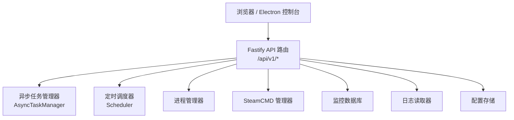
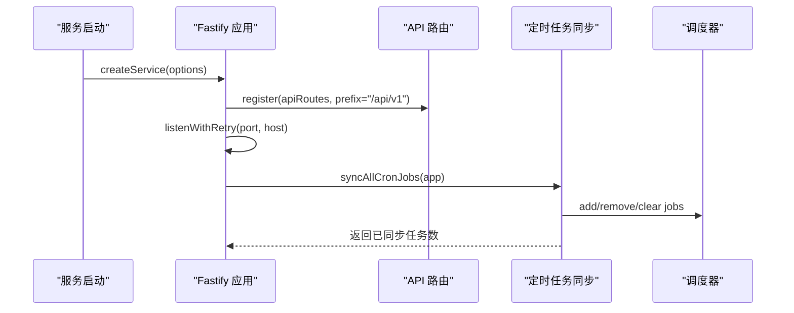
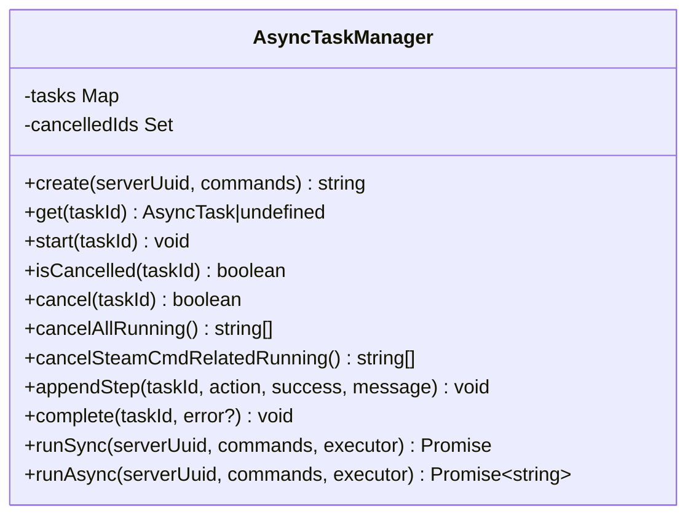
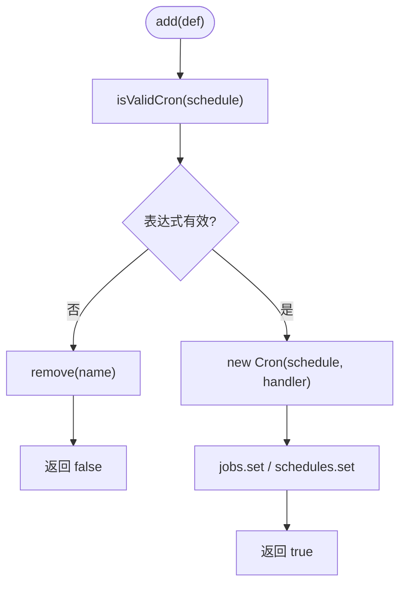
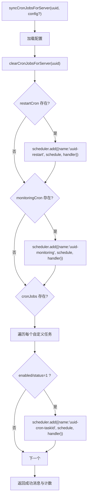
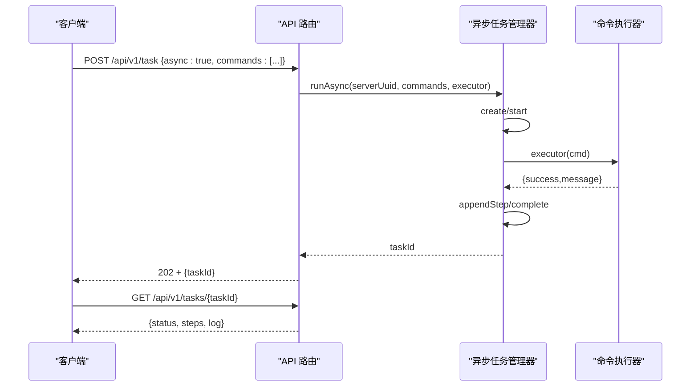
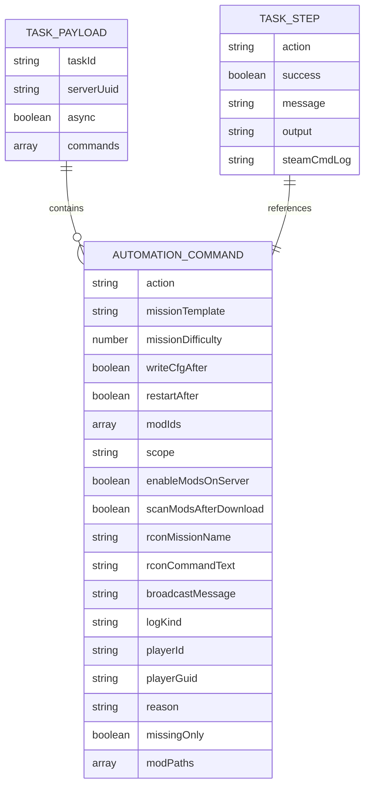
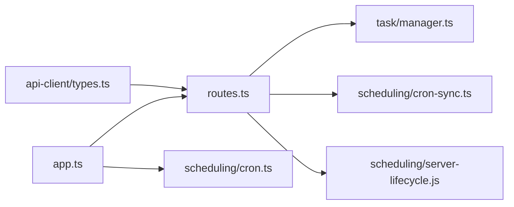

# 任务调度接口

<cite>
**本文引用的文件**   
- [README.md](file://README.md)
- [agent-channels.md](file://docs/agent-channels.md)
- [architecture-v2.md](file://docs/architecture-v2.md)
- [app.ts](file://packages\service\src\app.ts)
- [routes.ts](file://packages\service\src\api\routes.ts)
- [types.ts](file://packages\api-client\src\types.ts)
- [cron.ts](file://packages\service\src\scheduling\cron.ts)
- [cron-sync.ts](file://packages\service\src\scheduling\cron-sync.ts)
- [manager.ts](file://packages\service\src\task\manager.ts)
</cite>

## 目录
1. [简介](#简介)
2. [项目结构](#项目结构)
3. [核心组件](#核心组件)
4. [架构总览](#架构总览)
5. [详细组件分析](#详细组件分析)
6. [依赖关系分析](#依赖关系分析)
7. [性能与并发特性](#性能与并发特性)
8. [故障排查指南](#故障排查指南)
9. [结论](#结论)
10. [附录：API 端点清单](#附录api-端点清单)

## 简介
本文件面向 Arma 3 服务器管理工具的任务调度能力，覆盖定时任务与异步任务的 API、执行策略、队列与并发控制、结果查询与日志查看、失败重试与错误处理、任务依赖与工作流编排、以及监控与性能分析接口。后端基于 Fastify + SQLite，提供稳定的 REST API；前端为 Vue 控制台，Electron 桌面壳仅作为宿主进程。

## 项目结构
- 服务层（`@a3st/service`）：Fastify HTTP API、进程管理、SteamCMD、RCon、监控数据库、定时调度器、异步任务管理器。
- 客户端类型（`@a3st/api-client`）：统一封装的 TypeScript 类型与契约。
- Web 控制台（`@a3st/web`）：浏览器或 Electron 中运行的控制面板。
- 文档与脚本：部署、构建、Agent 集成说明等。

**图示来源**
- [app.ts:57-94](file://packages\service\src\app.ts#L57-L94)
- [routes.ts:62-62](file://packages\service\src\api\routes.ts#L62-L62)

**章节来源**
- [README.md:37-47](file://README.md#L37-L47)
- [architecture-v2.md:5-21](file://docs/architecture-v2.md#L5-L21)

## 核心组件
- 异步任务管理器：负责任务生命周期（创建、启动、步骤记录、完成、取消）、同步/异步执行、SteamCMD 相关任务识别与批量取消。
- 定时调度器：基于 cron 表达式注册、移除、列出定时任务；支持常见模式常量与每日重启表达式生成。
- 调度同步器：根据服务器配置将 restartCron、monitoringCron、自定义 cronJobs 同步到调度器，并在启动时全量同步。
- API 路由：暴露任务创建、状态查询、SteamCMD 控制、日志、监控、配置等端点，并注入认证、CORS、Multipart 等中间件。
- 客户端类型：定义任务动作、任务载荷、任务步骤、任务状态等统一数据结构。

**章节来源**
- [manager.ts:3-15](file://packages\service\src\task\manager.ts#L3-L15)
- [cron.ts:25-80](file://packages\service\src\scheduling\cron.ts#L25-L80)
- [cron-sync.ts:15-125](file://packages\service\src\scheduling\cron-sync.ts#L15-L125)
- [routes.ts:62-62](file://packages\service\src\api\routes.ts#L62-L62)
- [types.ts:82-181](file://packages\api-client\src\types.ts#L82-L181)

## 架构总览
服务启动流程：
1. 初始化 Fastify 应用与装饰器（配置存储、进程管理、SteamCMD、监控库、调度器、日志读取器等）。
2. 注册认证钩子、CORS、Multipart。
3. 挂载健康检查、SSE、业务路由。
4. 启动监听端口，启动后按服务器配置全量同步定时任务。

**图示来源**
- [app.ts:57-170](file://packages\service\src\app.ts#L57-L170)
- [cron-sync.ts:116-125](file://packages\service\src\scheduling\cron-sync.ts#L116-L125)

**章节来源**
- [app.ts:57-170](file://packages\service\src\app.ts#L57-L170)

## 详细组件分析

### 异步任务管理器
- 任务状态机：Pending → Running → Succeeded/Failed/Cancelled。
- 关键方法：
  - create/start/complete/cancel：任务生命周期管理。
  - appendStep：追加步骤结果与日志。
  - runSync/runAsync：同步/异步执行命令序列，自动捕获异常与取消信号。
  - cancelAllRunning/cancelSteamCmdRelatedRunning：批量取消，支持按 SteamCMD 动作过滤。
- 复杂度：Map 存取 O(1)，遍历取消 O(n)。

**图示来源**
- [manager.ts:36-237](file://packages\service\src\task\manager.ts#L36-L237)

**章节来源**
- [manager.ts:36-237](file://packages\service\src\task\manager.ts#L36-L237)

### 定时调度器
- 功能：校验 cron 表达式、注册/移除/清空任务、列出当前任务。
- 健壮性：无效表达式跳过且不抛错；处理器异常被吞掉，避免影响调度器。
- 常用常量：每 5 分钟、每小时、每日凌晨 3 点、每日 6/18 点重启表达式生成。

**图示来源**
- [cron.ts:11-54](file://packages\service\src\scheduling\cron.ts#L11-L54)

**章节来源**
- [cron.ts:1-100](file://packages\service\src\scheduling\cron.ts#L1-L100)

### 调度同步器
- 职责：根据服务器配置加载并同步定时任务。
- 支持的配置项：
  - restartCron：定时重启。
  - monitoringCron：定时采集在线人数与玩家信息。
  - cronJobs：自定义任务映射，支持 enabled/status 开关。
- 启动阶段：全量同步所有服务器的定时任务。

**图示来源**
- [cron-sync.ts:15-114](file://packages\service\src\scheduling\cron-sync.ts#L15-L114)

**章节来源**
- [cron-sync.ts:1-126](file://packages\service\src\scheduling\cron-sync.ts#L1-L126)

### API 路由与任务端点
- 任务创建：POST `/api/v1/task`，支持同步与异步两种模式。
- 任务查询：GET `/api/v1/tasks/{taskId}`。
- SteamCMD 控制：GET/PUT/POST `/api/v1/steamcmd/*`，包括停止操作与取消关联任务。
- 日志与监控：GET `/api/v1/servers/:uuid/logs*`、`/api/v1/servers/:uuid/monitoring/*`。
- 配置与服务器 CRUD：GET/PUT/PATCH `/api/v1/servers/:uuid/config`，POST/DELETE/PUT `/api/v1/servers*`。

**图示来源**
- [routes.ts:62-62](file://packages\service\src\api\routes.ts#L62-L62)
- [manager.ts:189-233](file://packages\service\src\task\manager.ts#L189-L233)

**章节来源**
- [agent-channels.md:30-86](file://docs/agent-channels.md#L30-L86)
- [routes.ts:275-417](file://packages\service\src\api\routes.ts#L275-L417)

### 任务数据模型与动作
- 任务载荷：包含 serverUuid、commands 数组、可选 async/writeCfgAfter/restartAfter 等。
- 动作集合：涵盖服务器启停、配置写入、模组下载/导入、RCon 操作、日志读取、SteamCMD 管理等。
- 任务步骤：记录每个 action 的成功与否与消息，便于轮询查看进度。

**图示来源**
- [types.ts:82-181](file://packages\api-client\src\types.ts#L82-L181)

**章节来源**
- [types.ts:82-181](file://packages\api-client\src\types.ts#L82-L181)

## 依赖关系分析
- 服务装配：Fastify 实例装饰 scheduler、asyncTaskManager、processManager、steamCmd、monitorDb、rptLogReader 等。
- 路由依赖：routes.ts 引入 scheduling/server-lifecycle、scheduling/cron-sync、task/manager 等模块。
- 类型共享：api-client/types.ts 定义统一的请求/响应结构与动作枚举。

**图示来源**
- [app.ts:57-94](file://packages\service\src\app.ts#L57-L94)
- [routes.ts:1-61](file://packages\service\src\api\routes.ts#L1-L61)
- [types.ts:82-181](file://packages\api-client\src\types.ts#L82-L181)

**章节来源**
- [app.ts:57-94](file://packages\service\src\app.ts#L57-L94)
- [routes.ts:1-61](file://packages\service\src\api\routes.ts#L1-L61)

## 性能与并发特性
- 异步任务：runAsync 在后台循环执行命令，支持取消检测与异常捕获；对长耗时操作（如 SteamCMD）友好。
- 定时任务：Scheduler 使用 croner，单个无效表达式不会导致服务崩溃；处理器异常被隔离。
- 并发控制：未实现全局优先级队列或并发上限；可通过任务拆分与外部限流实现。
- 资源占用：监控采集通过 RCon 获取在线人数与玩家列表，频率由 monitoringCron 控制。

[本节为通用指导，不直接分析具体文件]

## 故障排查指南
- 任务失败：
  - 查看任务步骤与日志：GET `/api/v1/tasks/{taskId}`。
  - 若涉及 SteamCMD，可调用 POST `/api/v1/steamcmd/stop` 以取消相关任务并终止底层操作。
- 定时任务不生效：
  - 检查配置中的 restartCron/monitoringCron/cronJobs 是否合法。
  - 确认服务启动后已全量同步定时任务。
- 鉴权问题：
  - 确保请求携带 Authorization: Bearer <token> 或 x-api-key/token 参数。
- 日志读取：
  - 使用 GET `/api/v1/servers/:uuid/logs` 与 `/api/v1/servers/:uuid/logs/read` 查看 RPT/BattlEye/Console 日志。

**章节来源**
- [manager.ts:189-233](file://packages\service\src\task\manager.ts#L189-L233)
- [routes.ts:398-417](file://packages\service\src\api\routes.ts#L398-L417)
- [app.ts:96-130](file://packages\service\src\app.ts#L96-L130)
- [routes.ts:631-695](file://packages\service\src\api\routes.ts#L631-L695)

## 结论
该任务调度体系以 Fastify API 为核心，结合异步任务管理器与定时调度器，提供了从任务创建、执行、暂停/恢复（通过取消与重新提交）、删除（清理定时任务）、结果查询与日志查看的完整闭环。监控与性能数据通过 RCon 与 SQLite 入库，便于分析与导出。建议在大规模任务场景下引入优先级队列与并发限制，并结合外部编排系统实现更复杂的依赖与工作流。

[本节为总结性内容，不直接分析具体文件]

## 附录：API 端点清单
- 任务相关
  - POST `/api/v1/task`：创建任务，支持同步与异步（async=true 返回 taskId）。
  - GET `/api/v1/tasks/{taskId}`：查询任务状态与步骤。
- SteamCMD 相关
  - GET `/api/v1/steamcmd/status`：查询状态。
  - GET `/api/v1/steamcmd/log`：读取最新日志。
  - POST `/api/v1/steamcmd/stop`：停止并取消相关任务。
- 日志与监控
  - GET `/api/v1/servers/:uuid/logs`：列出日志文件。
  - GET `/api/v1/servers/:uuid/logs/read`：读取日志内容。
  - GET `/api/v1/servers/:uuid/rpt`：读取活跃 RPT。
  - GET `/api/v1/servers/:uuid/monitoring/summary`：监控摘要。
  - GET `/api/v1/servers/:uuid/monitoring/stats`：统计曲线。
  - GET `/api/v1/servers/:uuid/monitoring/players`：玩家列表。
  - POST `/api/v1/servers/:uuid/monitoring/ingest`：摄入监控消息。
  - POST `/api/v1/servers/:uuid/monitoring/sync-players`：同步玩家。
  - GET `/api/v1/servers/:uuid/monitoring/export/html`：导出 HTML 报告。
  - GET `/api/v1/servers/:uuid/monitoring/export/csv`：导出 CSV。
- 配置与服务器
  - GET/PUT/PATCH `/api/v1/servers/:uuid/config`：读取/保存/部分更新配置。
  - POST `/api/v1/servers`：创建服务器。
  - POST `/api/v1/servers/:uuid/clone`：克隆服务器。
  - DELETE `/api/v1/servers/:uuid`：删除服务器。
  - PUT `/api/v1/servers/:uuid/rename`：重命名服务器。
- 其他
  - GET `/api/v1/actions`：能力发现（任务动作、REST 端点、文件上传类型）。
  - GET `/api/v1/settings/ui`、PUT `/api/v1/settings/ui`：UI 设置。
  - GET/PUT `/api/v1/settings/steamcmd`：SteamCMD 设置。
  - GET `/api/v1/settings/mod-scan-paths`、PUT `/api/v1/settings/mod-scan-paths`：模组扫描路径。

**章节来源**
- [agent-channels.md:30-86](file://docs/agent-channels.md#L30-L86)
- [routes.ts:275-417](file://packages\service\src\api\routes.ts#L275-L417)
- [routes.ts:631-800](file://packages\service\src\api\routes.ts#L631-L800)