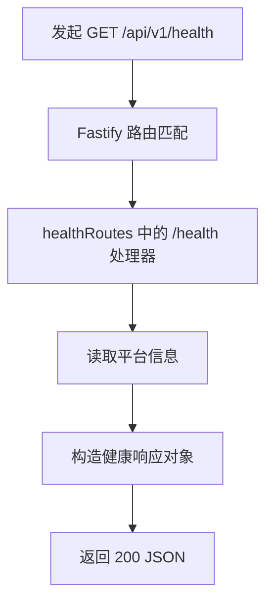
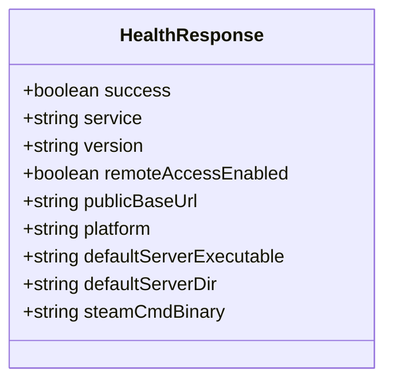
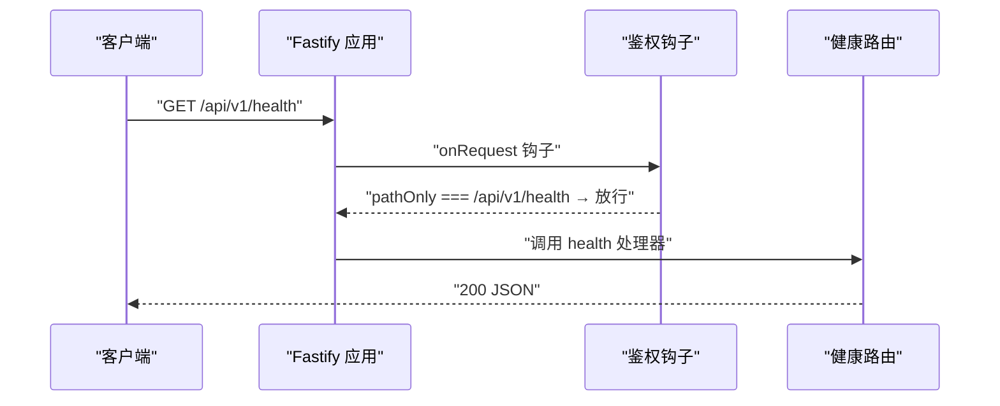

# 健康检查接口

<cite>
**本文引用的文件**   
- [packages/service/src/api/health.ts](file://packages/service/src/api/health.ts)
- [packages/service/src/platform/index.ts](file://packages/service/src/platform/index.ts)
- [packages/service/src/app.ts](file://packages/service/src/app.ts)
- [packages/service/src/api/routes.test.ts](file://packages/service/src/api/routes.test.ts)
- [packages/api-client/src/client.ts](file://packages/api-client/src/client.ts)
- [docs/agent-channels.md](file://docs/agent-channels.md)
- [docs/linux-server.md](file://docs/linux-server.md)
- [scripts/smoke-desktop-unpacked.ps1](file://scripts/smoke-desktop-unpacked.ps1)
</cite>

## 目录
1. [简介](#简介)
2. [端点规范](#端点规范)
3. [响应数据结构](#响应数据结构)
4. [请求与响应示例](#请求与响应示例)
5. [鉴权与路由行为](#鉴权与路由行为)
6. [在负载均衡与服务发现中的作用](#在负载均衡与服务发现中的作用)
7. [客户端集成示例](#客户端集成示例)
8. [监控与告警配置建议](#监控与告警配置建议)
9. [故障排查](#故障排查)
10. [结论](#结论)

## 简介
本文件说明 Arma3 Server Tools Service 提供的健康检查接口 `/api/v1/health`。该接口用于快速判断服务进程是否存活、可接收请求，并返回服务名称、版本、运行平台、默认服务器可执行文件、SteamCMD 二进制名以及当前监听地址等元信息。它通常被部署探针、脚本、桌面启动器或自动化流程用作“服务已就绪”的判定依据。

## 端点规范
| 项目 | 说明 |
|---|---|
| URL | `/api/v1/health` |
| HTTP 方法 | `GET` |
| 认证要求 | 无需 Token；该路径在鉴权钩子中被显式放行 |
| 成功状态码 | `200` |
| 失败状态码 | 网络不可达、端口未监听、反向代理拦截等场景可能返回非 `200`（例如 `401`、`403`、`502`、`503`） |
| 内容类型 | `application/json` |
| 典型用途 | 进程存活探测、启动等待、负载均衡健康检查、自动化冒烟测试 |



**图表来源**
- [packages/service/src/api/health.ts:5-19](file://packages/service/src/api/health.ts#L5-L19)
- [packages/service/src/platform/index.ts:88-95](file://packages/service/src/platform/index.ts#L88-L95)
- [packages/service/src/app.ts:150-153](file://packages/service/src/app.ts#L150-L153)

**章节来源**
- [packages/service/src/api/health.ts:5-19](file://packages/service/src/api/health.ts#L5-L19)
- [packages/service/src/app.ts:107-109](file://packages/service/src/app.ts#L107-L109)
- [packages/service/src/app.ts:150-153](file://packages/service/src/app.ts#L150-L153)

## 响应数据结构
健康检查成功时返回一个扁平的 JSON 对象，字段含义如下：

| 字段 | 类型 | 含义 | 备注 |
|---|---|---|---|
| `success` | `boolean` | 表示健康检查是否成功 | 实现中固定为 `true` |
| `service` | `string` | 服务标识 | 固定为 `Arma3ServerTools.Service` |
| `version` | `string` | 服务版本号 | 由代码内嵌版本决定 |
| `remoteAccessEnabled` | `boolean` | 是否启用远程访问 | 当前实现固定为 `false`，不代表 Agent 侧 `settings.json` 的 `http.remoteAccessEnabled` |
| `publicBaseUrl` | `string` | 当前服务对外基础地址 | 基于 Fastify 实例监听端口拼接，默认回退到 `19580` |
| `platform` | `string` | 操作系统平台 | 对应 Node.js `process.platform`，例如 `linux`、`win32` |
| `defaultServerExecutable` | `string` | 默认专用服务器可执行文件名 | 根据平台选择 `arma3server_x64.exe` 或 `arma3server` |
| `defaultServerDir` | `string` | 默认服务器目录示例 | Windows 通常为 `C:\arma3`，Linux 通常为 `/opt/arma3server` |
| `steamCmdBinary` | `string` | SteamCMD 入口文件名 | Windows 为 `steamcmd.exe`，Linux 为 `steamcmd.sh` |



**图表来源**
- [packages/service/src/api/health.ts:8-18](file://packages/service/src/api/health.ts#L8-L18)
- [packages/service/src/platform/index.ts:81-95](file://packages/service/src/platform/index.ts#L81-L95)

**章节来源**
- [packages/service/src/api/health.ts:8-18](file://packages/service/src/api/health.ts#L8-L18)
- [packages/service/src/platform/index.ts:81-95](file://packages/service/src/platform/index.ts#L81-L95)

## 请求与响应示例
以下示例展示常见调用方式及预期结果。为避免泄露真实环境信息，示例中的 IP、端口和 Token 均为占位值。

### 成功请求示例
使用 curl：
```text
curl -s http://127.0.0.1:19580/api/v1/health
```

期望响应体结构：
```json
{
  "success": true,
  "service": "Arma3ServerTools.Service",
  "version": "2.0.0-alpha.13",
  "remoteAccessEnabled": false,
  "publicBaseUrl": "http://127.0.0.1:19580",
  "platform": "linux",
  "defaultServerExecutable": "arma3server",
  "defaultServerDir": "/opt/arma3server",
  "steamCmdBinary": "steamcmd.sh"
}
```

Windows 环境下，`platform`、`defaultServerExecutable`、`defaultServerDir`、`steamCmdBinary` 会反映 Windows 默认值。文档中也明确列出 Linux 下健康检查返回的关键字段差异。

**章节来源**
- [docs/linux-server.md:34-39](file://docs/linux-server.md#L34-L39)
- [packages/service/src/platform/index.ts:35-45](file://packages/service/src/platform/index.ts#L35-L45)
- [packages/service/src/platform/index.ts:66-75](file://packages/service/src/platform/index.ts#L66-L75)

### 失败场景说明
健康检查本身不返回业务错误对象；当出现异常时，HTTP 层可能返回非 `200` 状态码：

| 现象 | 可能原因 | 建议 |
|---|---|---|
| 连接超时 | Service 未启动、端口未监听、防火墙拦截 | 确认 Service 进程、端口、反向代理和网络策略 |
| `401 Unauthorized` | 某些部署环境中对 `/api/v1/health` 做了额外鉴权 | 检查网关、反向代理或自定义中间件 |
| `403 Forbidden` | 源 IP 被拒绝 | 检查 IP 白名单、Tailscale、公网映射 |
| `502/503` | 反向代理无法连接后端 | 检查上游 Service 是否存活 |
| `200` 但 `success` 异常 | 当前实现中健康处理器固定返回 `success: true` | 若业务需要更深层健康检查，应扩展处理器逻辑 |

**章节来源**
- [packages/service/src/app.ts:107-129](file://packages/service/src/app.ts#L107-L129)
- [packages/service/src/api/health.ts:6-18](file://packages/service/src/api/health.ts#L6-L18)

## 鉴权与路由行为
Service 在启动时注册了全局鉴权钩子：

- 非 `/api/` 开头的静态资源请求跳过鉴权。
- `/api/v1/health` 和 `/api/v1/actions` 被显式放行，不需要 `Authorization`、`X-Api-Key` 或查询参数 `token`。
- 其他 `/api/v1/*` 请求在未配置 `apiToken` 时也会放行；若配置了 `apiToken`，则必须提供匹配的凭证，否则返回 `401`。

这意味着健康检查是“无状态、无依赖、低开销”的轻量探测接口，适合被外部系统高频调用。



**图表来源**
- [packages/service/src/app.ts:96-130](file://packages/service/src/app.ts#L96-L130)
- [packages/service/src/app.ts:150-153](file://packages/service/src/app.ts#L150-L153)
- [packages/service/src/api/health.ts:5-19](file://packages/service/src/api/health.ts#L5-L19)

**章节来源**
- [packages/service/src/app.ts:96-130](file://packages/service/src/app.ts#L96-L130)
- [packages/service/src/app.ts:150-153](file://packages/service/src/app.ts#L150-L153)

## 在负载均衡与服务发现中的作用
健康检查接口可用于以下运维场景：

1. **进程存活探测**  
   容器编排系统、进程管理器或服务守护程序可通过定期访问 `/api/v1/health` 判断 Service 是否仍在运行。

2. **启动就绪检测**  
   桌面启动脚本、CI 流水线或部署脚本会在启动后轮询该接口，直到返回 `200` 且 `success` 为真，再继续后续操作。

3. **负载均衡健康检查**  
   Nginx、HAProxy、云负载均衡器等可将该接口作为健康探针，剔除不可用节点。

4. **服务发现前置校验**  
   服务注册前可先自检健康接口，避免将尚未完全初始化的实例暴露给流量入口。

仓库中的脚本和测试也体现了这一用法：冒烟脚本会等待健康接口返回 `success: true`，API 测试断言 `/api/v1/health` 返回 `200` 且包含服务名。

**章节来源**
- [scripts/smoke-desktop-unpacked.ps1:65-82](file://scripts/smoke-desktop-unpacked.ps1#L65-L82)
- [packages/service/src/api/routes.test.ts:67-73](file://packages/service/src/api/routes.test.ts#L67-L73)

## 客户端集成示例
### JavaScript/TypeScript 客户端
仓库提供了统一的 API 客户端封装，其中 `health()` 方法直接调用 `/api/v1/health`。

```text
A3stClient.health()
→ GET /api/v1/health
→ ApiResponse<HealthData>
```

集成建议：
- 设置 `baseUrl` 为 Service 的实际地址，例如 `http://127.0.0.1:19580`。
- 如果只调用健康接口，可不传 `token`。
- 调用失败时应区分网络错误与业务错误；健康检查通常以 HTTP 状态码为主判断依据。

**章节来源**
- [packages/api-client/src/client.ts:107-111](file://packages/api-client/src/client.ts#L107-L111)

### PowerShell 冒烟脚本
桌面冒烟脚本实现了“等待健康接口可用”的逻辑：循环调用健康地址，捕获异常并重试，直到返回 `success: true`。

关键行为：
- 使用 `Invoke-RestMethod` 访问健康地址。
- 成功条件为响应对象中 `success` 为真。
- 超时后抛出错误，提示服务未在指定时间内响应。

**章节来源**
- [scripts/smoke-desktop-unpacked.ps1:65-82](file://scripts/smoke-desktop-unpacked.ps1#L65-L82)

### curl 与浏览器
- 本地调试可直接在浏览器或终端访问 `http://127.0.0.1:19580/api/v1/health`。
- 生产环境建议通过反向代理或受控网络访问，避免裸端口暴露。

**章节来源**
- [docs/deployment-ab-openclaw.md:424-447](file://docs/deployment-ab-openclaw.md#L424-L447)

## 监控与告警配置建议
### 指标定义
| 指标 | 类型 | 说明 |
|---|---|---|
| `a3st_health_status` | gauge | 健康检查结果，建议 `1` 表示正常，`0` 表示异常 |
| `a3st_health_response_time_ms` | histogram | 健康检查响应耗时 |
| `a3st_service_version` | info | 服务版本号 |
| `a3st_platform` | info | 运行平台 |
| `a3st_public_base_url` | info | 公开基础地址 |

### 采集频率
- 普通主机：每 10~30 秒一次。
- 高可用集群：每 5~10 秒一次。
- 健康检查应保持轻量，避免引入磁盘 IO、数据库查询或重型依赖检查。

### 告警规则建议
| 告警 | 条件 | 级别 | 说明 |
|---|---|---|---|
| 健康检查失败 | `a3st_health_status == 0` 持续 1~3 分钟 | critical | 服务不可用 |
| 健康检查延迟过高 | P95 超过阈值（例如 500ms） | warning | 服务可能过载 |
| 版本不一致 | 多实例上报不同 `a3st_service_version` | warning | 滚动升级未完成 |
| 平台异常 | 非预期平台值 | info | 便于审计和排障 |

### 与现有文档的一致性
Agent 文档明确指出 `/api/v1/health` 无需 Token，并可作为连通性验证入口。监控探针应优先依赖 HTTP 状态码和 `success` 字段，而不是解析具体业务字段。

**章节来源**
- [docs/agent-channels.md:34-36](file://docs/agent-channels.md#L34-L36)
- [docs/deployment-ab-openclaw.md:357-358](file://docs/deployment-ab-openclaw.md#L357-L358)

## 故障排查
| 现象 | 可能原因 | 处理步骤 |
|---|---|---|
| 健康接口无响应 | Service 未启动、端口占用、进程崩溃 | 检查 Service 进程、日志、端口监听 |
| 本机可通、远端不通 | 防火墙、安全组、Tailscale、隧道问题 | 使用 `Test-NetConnection` 或等效工具验证 TCP 连通性 |
| 返回 `401` | 网关或反向代理启用了额外鉴权 | 检查代理配置、Token 传递 |
| 返回 `403` | 源 IP 被拒绝 | 检查 `allowedCallerIps`、网络拓扑 |
| `success` 始终为真但服务异常 | 健康检查未覆盖业务依赖 | 扩展健康检查逻辑，加入依赖组件检查 |
| `publicBaseUrl` 不符合预期 | Service 监听端口或代理转发地址不一致 | 核对 `PORT`、`HOST`、反向代理配置 |

健康检查当前仅返回服务自身元信息，不包含游戏服务器进程状态、数据库连接、磁盘空间、CPU 或内存等系统级指标。若需要更全面的健康视图，应在 Service 内部扩展健康处理器，或在监控层聚合多个指标。

**章节来源**
- [packages/service/src/api/health.ts:6-18](file://packages/service/src/api/health.ts#L6-L18)
- [packages/service/src/platform/index.ts:88-95](file://packages/service/src/platform/index.ts#L88-L95)

## 结论
`/api/v1/health` 是一个简单、稳定、无需鉴权的 HTTP 健康检查接口，适合用于进程存活探测、启动就绪检测、负载均衡探针和自动化冒烟测试。其响应体包含服务标识、版本、平台信息和默认路径相关字段，但不包含业务依赖或系统资源使用情况。对于生产环境，建议结合监控指标、告警规则和反向代理健康检查，形成完整的可用性保障体系。