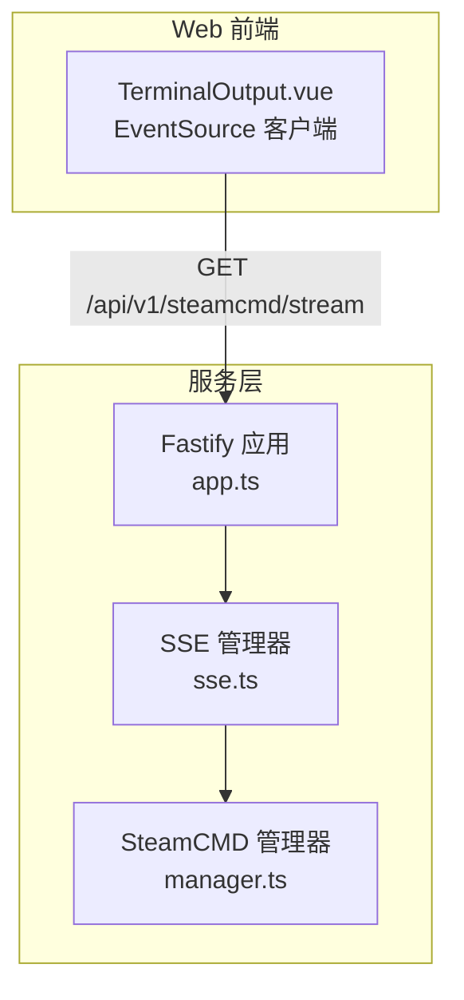
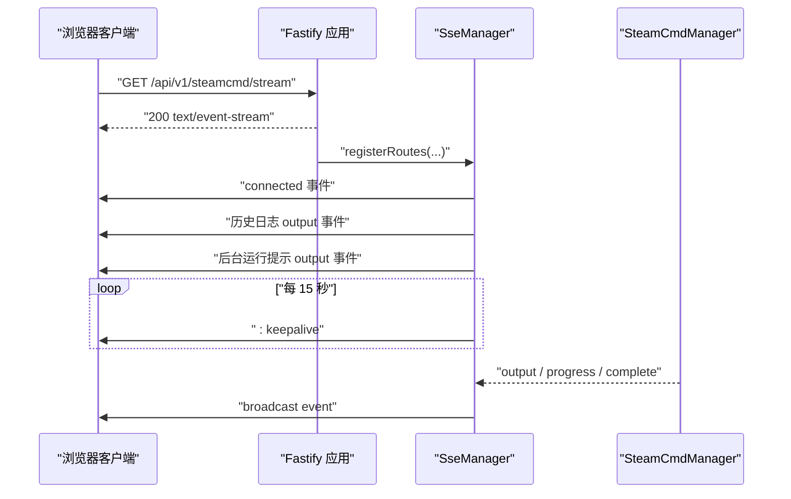
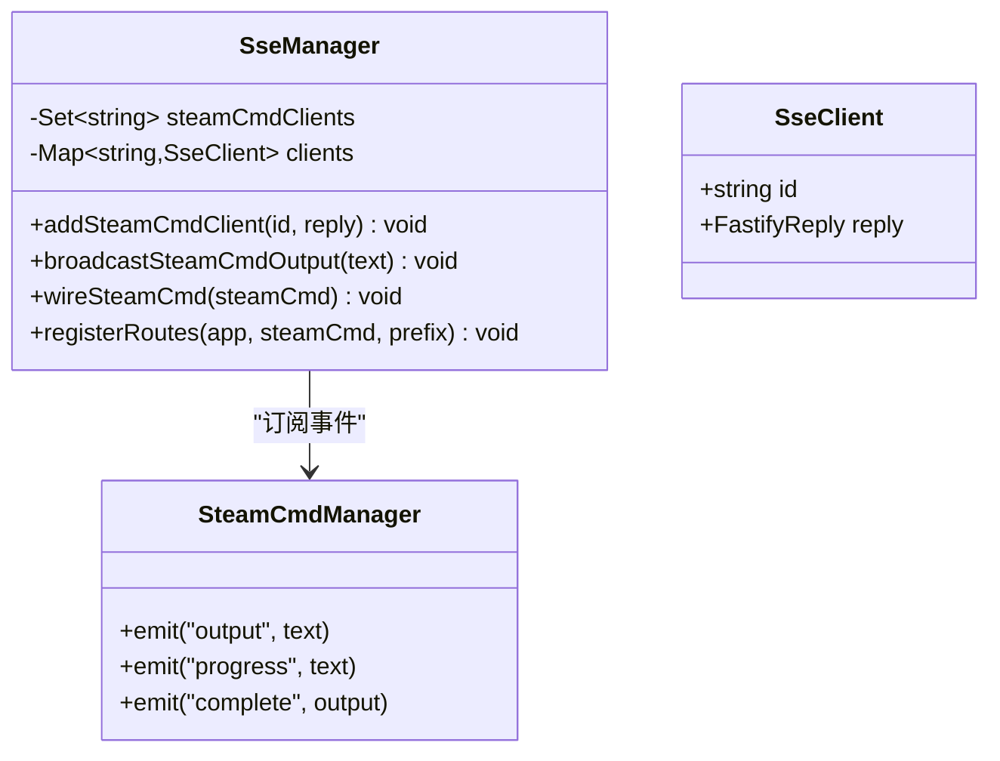
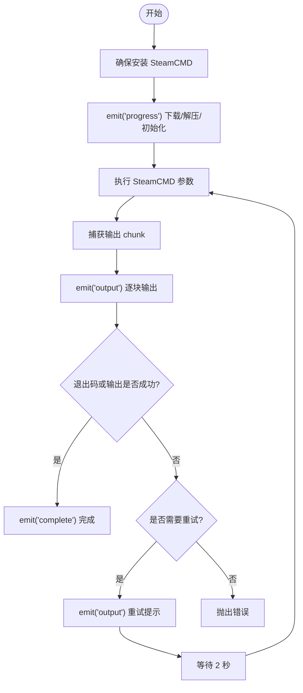
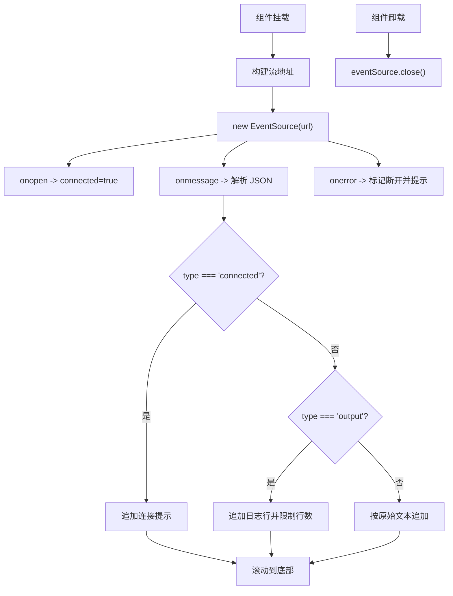
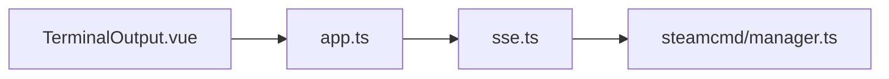
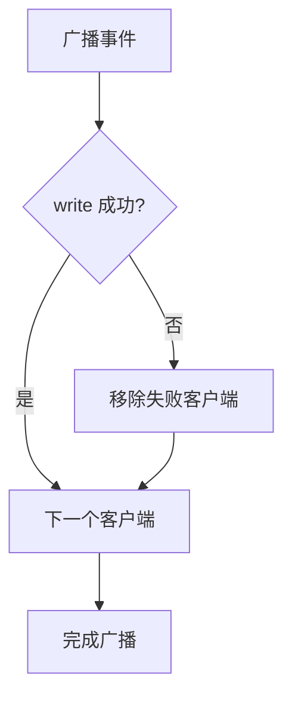

# 实时通信协议

<cite>
**本文引用的文件**   
- [packages/service/src/api/sse.ts](file://packages/service/src/api/sse.ts)
- [packages/service/src/steamcmd/manager.ts](file://packages/service/src/steamcmd/manager.ts)
- [packages/service/src/app.ts](file://packages/service/src/app.ts)
- [packages/web/src/components/TerminalOutput.vue](file://packages/web/src/components/TerminalOutput.vue)
- [packages/service/src/api/sse.test.ts](file://packages/service/src/api/sse.test.ts)
</cite>

## 目录
1. [简介](#简介)
2. [项目结构](#项目结构)
3. [核心组件](#核心组件)
4. [架构总览](#架构总览)
5. [详细组件分析](#详细组件分析)
6. [依赖关系分析](#依赖关系分析)
7. [性能与优化](#性能与优化)
8. [安全与鉴权](#安全与鉴权)
9. [错误处理与异常恢复](#错误处理与异常恢复)
10. [客户端集成指南](#客户端集成指南)
11. [故障排查](#故障排查)
12. [结论](#结论)

## 简介
本文件面向“Arma3 Server Tool”的实时通信子系统，重点说明基于 SSE（Server-Sent Events）的服务器端事件推送实现。当前实现主要围绕 SteamCMD 任务的输出、进度和完成状态进行实时广播，并在 Web 前端通过 EventSource 消费这些事件，用于终端日志展示。

SSE 在本项目中承担以下职责：
- 暴露一个长连接流式接口，向已连接的客户端推送文本事件。
- 将底层 SteamCMD 任务的事件转换为统一格式并广播给所有订阅者。
- 提供心跳 keepalive，帮助维持代理或防火墙侧的连接存活。
- 在连接建立时回发历史日志片段，便于新连接快速补齐上下文。

## 项目结构
与实时通信直接相关的代码分布在服务层与 Web 前端两个位置：
- 服务层：Fastify 应用注册 SSE 路由，管理客户端连接，桥接 SteamCMD 事件。
- 前端：Vue 组件使用浏览器原生 EventSource 建立连接，解析事件并渲染到终端界面。

**图表来源**
- [packages/service/src/app.ts:147-153](file://packages/service/src/app.ts#L147-L153)
- [packages/service/src/api/sse.ts:51-91](file://packages/service/src/api/sse.ts#L51-L91)
- [packages/service/src/steamcmd/manager.ts:50-119](file://packages/service/src/steamcmd/manager.ts#L50-L119)
- [packages/web/src/components/TerminalOutput.vue:20-48](file://packages/web/src/components/TerminalOutput.vue#L20-L48)

**章节来源**
- [packages/service/src/app.ts:57-171](file://packages/service/src/app.ts#L57-L171)
- [packages/service/src/api/sse.ts:9-94](file://packages/service/src/api/sse.ts#L9-L94)
- [packages/service/src/steamcmd/manager.ts:50-119](file://packages/service/src/steamcmd/manager.ts#L50-L119)
- [packages/web/src/components/TerminalOutput.vue:1-48](file://packages/web/src/components/TerminalOutput.vue#L1-L48)

## 核心组件
- SseManager：负责 SSE 客户端生命周期、事件广播、心跳发送、历史日志回发。
- SteamCmdManager：封装 SteamCMD 进程管理，向外抛出 output、progress、complete 等事件。
- TerminalOutput.vue：前端 SSE 消费者，负责连接、消息解析、UI 滚动与断线提示。
- app.ts：Fastify 应用初始化，挂载 SSE 路由，并将 SteamCMD 事件桥接到 SSE。

**章节来源**
- [packages/service/src/api/sse.ts:9-94](file://packages/service/src/api/sse.ts#L9-L94)
- [packages/service/src/steamcmd/manager.ts:50-119](file://packages/service/src/steamcmd/manager.ts#L50-L119)
- [packages/web/src/components/TerminalOutput.vue:1-48](file://packages/web/src/components/TerminalOutput.vue#L1-L48)
- [packages/service/src/app.ts:147-153](file://packages/service/src/app.ts#L147-L153)

## 架构总览
SSE 的整体数据流如下：
1. 客户端通过 GET 请求连接到 /api/v1/steamcmd/stream。
2. 服务端返回 text/event-stream 响应，立即发送 connected 事件。
3. 服务端回发最近的历史日志片段，以及后台运行提示。
4. 服务端启动定时心跳，周期性发送 keepalive。
5. 当 SteamCMD 产生 output、progress、complete 事件时，SSE 将其广播给所有已连接客户端。
6. 前端收到事件后解析 JSON，更新 UI；若为 connected 则显示连接成功信息，若为 output 则追加日志行。

**图表来源**
- [packages/service/src/api/sse.ts:51-91](file://packages/service/src/api/sse.ts#L51-L91)
- [packages/service/src/steamcmd/manager.ts:418-440](file://packages/service/src/steamcmd/manager.ts#L418-L440)
- [packages/web/src/components/TerminalOutput.vue:20-48](file://packages/web/src/components/TerminalOutput.vue#L20-L48)

## 详细组件分析

### SseManager：SSE 广播与连接管理
SseManager 维护两类集合：
- steamCmdClients：记录已注册的 SteamCMD SSE 客户端 ID。
- clients：以 ID 映射到具体 FastifyReply，用于写入事件。

关键行为：
- addSteamCmdClient：注册客户端，监听连接关闭事件，清理资源。
- broadcastSteamCmdOutput：构造标准 SSE data 帧，遍历所有客户端写入；捕获写异常并移除失败客户端。
- wireSteamCmd：订阅 SteamCMD 的 output、progress、complete 事件，统一转为 output 类型事件广播。
- registerRoutes：注册 /steamcmd/stream 路由，设置 SSE 响应头，发送初始 connected 和历史日志，启动心跳。

**图表来源**
- [packages/service/src/api/sse.ts:4-94](file://packages/service/src/api/sse.ts#L4-L94)
- [packages/service/src/steamcmd/manager.ts:50-119](file://packages/service/src/steamcmd/manager.ts#L50-L119)

**章节来源**
- [packages/service/src/api/sse.ts:9-94](file://packages/service/src/api/sse.ts#L9-L94)

### SteamCmdManager：事件源与任务生命周期
SteamCmdManager 是事件生产者，对外暴露：
- output：原始控制台输出。
- progress：下载、解压、初始化等进度提示。
- complete：任务完成时的最终输出。

重要流程：
- ensureInstalledBody：安装 SteamCMD，期间多次 emit("progress")。
- runCapturedProcess：捕获子进程输出，逐块 emit("output")。
- runSteamCmdArguments：根据退出码与输出判断成功或重试，必要时 emit("output") 提示并重试。
- getAggregatedLog：聚合会话输出或读取最新日志尾部，供 SSE 连接建立时回发历史。

**图表来源**
- [packages/service/src/steamcmd/manager.ts:135-209](file://packages/service/src/steamcmd/manager.ts#L135-L209)
- [packages/service/src/steamcmd/manager.ts:376-440](file://packages/service/src/steamcmd/manager.ts#L376-L440)
- [packages/service/src/steamcmd/manager.ts:442-469](file://packages/service/src/steamcmd/manager.ts#L442-L469)

**章节来源**
- [packages/service/src/steamcmd/manager.ts:135-209](file://packages/service/src/steamcmd/manager.ts#L135-L209)
- [packages/service/src/steamcmd/manager.ts:376-440](file://packages/service/src/steamcmd/manager.ts#L376-L440)
- [packages/service/src/steamcmd/manager.ts:442-469](file://packages/service/src/steamcmd/manager.ts#L442-L469)

### TerminalOutput.vue：前端 SSE 消费者
该组件负责：
- 构建带 token 参数的流地址。
- 使用 EventSource 建立连接。
- onopen 标记连接成功。
- onmessage 解析 JSON，区分 connected 与 output 类型，追加到 lines 列表，限制最多保留 500 行。
- onerror 标记断开并提示检查服务。
- onUnmounted 关闭连接。

**图表来源**
- [packages/web/src/components/TerminalOutput.vue:10-48](file://packages/web/src/components/TerminalOutput.vue#L10-L48)

**章节来源**
- [packages/web/src/components/TerminalOutput.vue:1-48](file://packages/web/src/components/TerminalOutput.vue#L1-L48)

### app.ts：SSE 路由注册与服务装配
app.ts 在服务启动过程中：
- 创建 SteamCmdManager 实例并注入到 Fastify 容器。
- 调用 sseManager.wireSteamCmd(steamCmd) 将事件桥接到 SSE。
- 调用 sseManager.registerRoutes(app, steamCmd, "/api/v1") 注册 /api/v1/steamcmd/stream。
- 配置 CORS，允许跨域请求，便于移动端 WebView 或局域网访问。

**章节来源**
- [packages/service/src/app.ts:57-171](file://packages/service/src/app.ts#L57-L171)

## 依赖关系分析
- SseManager 依赖 Fastify 的 Request/Reply 对象，用于 hijack 响应并直接写入 raw stream。
- SseManager 订阅 SteamCmdManager 的事件，属于松耦合观察者模式。
- app.ts 作为装配中心，将 SSE 与 SteamCMD 绑定，并注册路由。
- TerminalOutput.vue 依赖浏览器 EventSource API，不直接依赖后端实现细节。

**图表来源**
- [packages/service/src/app.ts:147-153](file://packages/service/src/app.ts#L147-L153)
- [packages/service/src/api/sse.ts:1-3](file://packages/service/src/api/sse.ts#L1-L3)
- [packages/service/src/steamcmd/manager.ts:50-119](file://packages/service/src/steamcmd/manager.ts#L50-L119)
- [packages/web/src/components/TerminalOutput.vue:20-48](file://packages/web/src/components/TerminalOutput.vue#L20-L48)

**章节来源**
- [packages/service/src/app.ts:57-171](file://packages/service/src/app.ts#L57-L171)
- [packages/service/src/api/sse.ts:1-3](file://packages/service/src/api/sse.ts#L1-L3)
- [packages/service/src/steamcmd/manager.ts:50-119](file://packages/service/src/steamcmd/manager.ts#L50-L119)
- [packages/web/src/components/TerminalOutput.vue:20-48](file://packages/web/src/components/TerminalOutput.vue#L20-L48)

## 性能与优化
- 心跳机制：SSE 每 15 秒发送一次 keepalive，有助于保持代理、负载均衡器或防火墙侧的连接存活，减少空闲断开概率。
- 历史日志回发：连接建立时回发最近 150 行日志，避免客户端长时间空白等待。
- 客户端内存控制：前端限制最多保留 500 行日志，防止 DOM 节点过多导致卡顿。
- 批量广播：SSE 广播采用简单遍历写入，适合当前规模；若客户端数量增长，可考虑分片广播或异步队列。
- 日志聚合：SteamCMD 会话输出有最大长度限制，避免无限增长占用内存。

[本节为通用性能建议，不直接分析具体代码]

## 安全与鉴权
- 查询参数鉴权：前端组件支持在流 URL 中附加 token 查询参数，后端通过 Fastify 全局鉴权钩子校验 query.token。
- Bearer 与 X-Api-Key：API 鉴权同时支持 Authorization: Bearer 与 X-Api-Key 头部。
- CORS 配置：允许任意 Origin，便于本地开发与移动端 WebView；生产环境应限制允许的 origin。
- 敏感信息脱敏：SteamCMD 参数中的密码会在日志中脱敏，避免泄露。

**章节来源**
- [packages/web/src/components/TerminalOutput.vue:10-18](file://packages/web/src/components/TerminalOutput.vue#L10-L18)
- [packages/service/src/app.ts:96-144](file://packages/service/src/app.ts#L96-L144)
- [packages/service/src/steamcmd/manager.ts:476-502](file://packages/service/src/steamcmd/manager.ts#L476-L502)

## 错误处理与异常恢复
- 客户端写异常：SSE 广播时对每个客户端 write 操作 try/catch，失败则从客户端集合中移除，避免影响其他客户端。
- 连接关闭清理：监听 reply.raw.on("close")，清理心跳定时器与客户端集合。
- 前端错误处理：EventSource.onerror 标记断开并提示用户检查服务；组件卸载时关闭连接。
- 单元测试覆盖：测试验证多客户端广播、断开清理、写异常容错等行为。

**图表来源**
- [packages/service/src/api/sse.ts:24-38](file://packages/service/src/api/sse.ts#L24-L38)
- [packages/service/src/api/sse.ts:84-90](file://packages/service/src/api/sse.ts#L84-L90)
- [packages/web/src/components/TerminalOutput.vue:45-53](file://packages/web/src/components/TerminalOutput.vue#L45-L53)
- [packages/service/src/api/sse.test.ts:74-113](file://packages/service/src/api/sse.test.ts#L74-L113)

**章节来源**
- [packages/service/src/api/sse.ts:24-38](file://packages/service/src/api/sse.ts#L24-L38)
- [packages/service/src/api/sse.ts:84-90](file://packages/service/src/api/sse.ts#L84-L90)
- [packages/web/src/components/TerminalOutput.vue:45-53](file://packages/web/src/components/TerminalOutput.vue#L45-L53)
- [packages/service/src/api/sse.test.ts:74-113](file://packages/service/src/api/sse.test.ts#L74-L113)

## 客户端集成指南

### 事件类型与数据结构
当前实现中，SSE 推送的消息体为 JSON，包含以下字段：
- type：事件类型，目前包括 connected 与 output。
- message：仅 connected 事件携带，表示连接成功提示。
- text：output 事件携带，表示日志内容。
- time：output 事件携带，ISO 时间戳，前端截取时分秒显示。

示例消息语义：
- connected：连接建立成功，附带提示信息。
- output：日志输出，可能包含进度前缀如“[进度]”“[完成]”，由服务端包装。

注意：
- 心跳帧不以 data 字段形式出现，而是以 `: keepalive` 注释帧形式发送，用于维持连接。
- 非 JSON 文本会被前端按原始文本追加显示，便于兼容未来扩展。

**章节来源**
- [packages/service/src/api/sse.ts:24-48](file://packages/service/src/api/sse.ts#L24-L48)
- [packages/service/src/api/sse.ts:61-79](file://packages/service/src/api/sse.ts#L61-L79)
- [packages/web/src/components/TerminalOutput.vue:27-42](file://packages/web/src/components/TerminalOutput.vue#L27-L42)

### 连接建立与心跳
- 客户端发起 GET 请求到 /api/v1/steamcmd/stream。
- 服务端返回 text/event-stream，并立即发送 connected 事件。
- 服务端每 15 秒发送一次 keepalive 注释帧。
- 客户端应在 onopen 中标记连接成功，在 onerror 中处理断线。

**章节来源**
- [packages/service/src/api/sse.ts:51-91](file://packages/service/src/api/sse.ts#L51-L91)
- [packages/web/src/components/TerminalOutput.vue:20-48](file://packages/web/src/components/TerminalOutput.vue#L20-L48)

### 断线重连策略
当前前端未实现自动重连逻辑。建议客户端自行实现指数退避重连：
- 在 onerror 中触发重连。
- 首次重连延迟较短，逐步增加延迟上限。
- 重连成功后重新拉取历史日志或清空旧日志，避免重复显示。
- 对频繁断线进行告警与限流，避免雪崩。

[本节为通用客户端实践建议，不直接分析具体代码]

### 事件过滤与订阅机制
当前实现为全量广播，没有事件过滤或订阅通道。如需扩展：
- 在 URL 中增加 channel 或 filter 参数，服务端根据参数过滤事件。
- 为不同业务域提供独立 SSE 路由，例如 /api/v1/logs/stream、/api/v1/monitor/stream。
- 在客户端侧按 type 字段进行过滤与分发。

[本节为扩展性建议，不直接分析具体代码]

### 多语言客户端集成示例
由于本项目前端使用浏览器 EventSource，以下为通用集成思路：
- JavaScript（浏览器）：直接使用 new EventSource(url)，监听 onmessage、onopen、onerror。
- Python：可使用 requests 或 httpx 以流式方式读取 text/event-stream，或使用第三方库如 sseclient。
- Go：使用 net/http 获取 Response.Body，逐行解析 SSE 格式。
- Java：使用 java.net.http.HttpClient 或 OkHttp 流式读取，解析 SSE。
- C#：使用 HttpClient.GetStreamAsync 或 System.Net.WebSockets 替代方案。

注意：
- 所有客户端需正确处理 keepalive 注释帧。
- 需要携带 token 时，将 token 作为查询参数附加到 URL。
- 对于移动端 WebView，注意 CORS 与 Origin 限制。

[本节为通用集成指导，不直接分析具体代码]

## 故障排查
常见问题与建议：
- 连接后立即断开：检查后端服务是否正常运行，确认 CORS 与鉴权配置是否正确。
- 无日志输出：确认 SteamCMD 任务是否正在运行，查看服务日志与 session log。
- 心跳无效：检查代理或负载均衡器是否丢弃空帧，必要时调整 keepalive 频率。
- 前端内存增长：确认前端是否限制日志行数，避免无限累积。
- 写异常导致部分客户端丢失：服务端已自动移除失败客户端，检查网络稳定性。

**章节来源**
- [packages/service/src/app.ts:96-144](file://packages/service/src/app.ts#L96-L144)
- [packages/service/src/steamcmd/manager.ts:542-574](file://packages/service/src/steamcmd/manager.ts#L542-L574)
- [packages/web/src/components/TerminalOutput.vue:34-42](file://packages/web/src/components/TerminalOutput.vue#L34-L42)
- [packages/service/src/api/sse.test.ts:74-113](file://packages/service/src/api/sse.test.ts#L74-L113)

## 结论
本项目的实时通信基于 SSE，实现了 SteamCMD 任务的输出、进度与完成状态的实时广播。SseManager 负责连接管理与事件广播，SteamCmdManager 作为事件源，前端 TerminalOutput.vue 消费事件并渲染终端日志。当前实现具备心跳、历史日志回发、基础鉴权与 CORS 支持，并通过单元测试覆盖关键路径。未来可根据业务需求扩展事件过滤、多通道订阅与客户端自动重连策略。