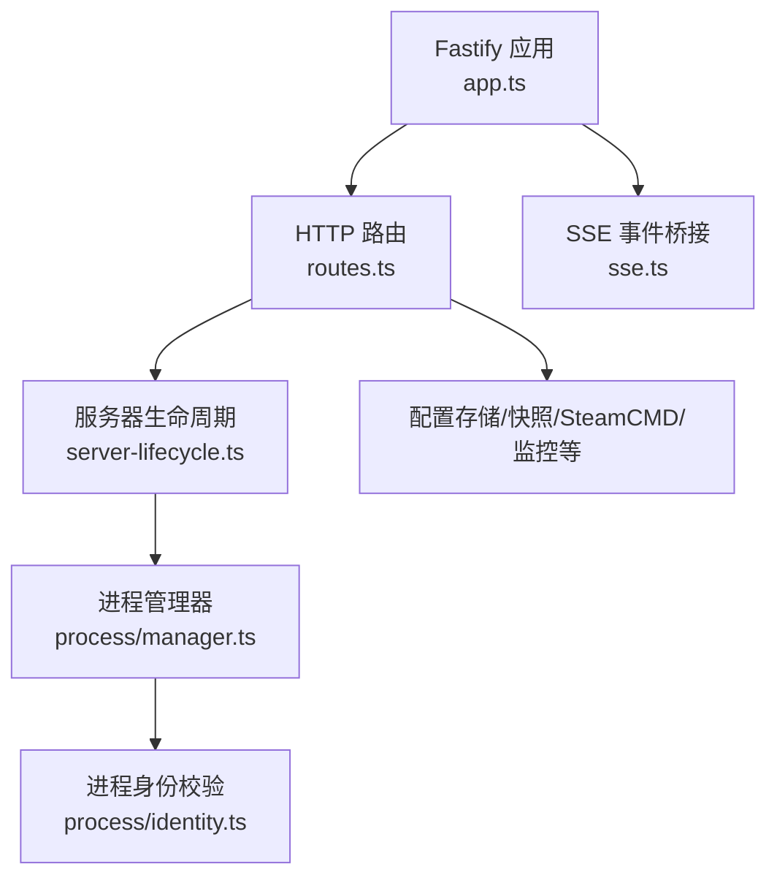
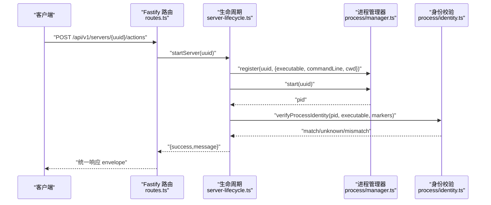
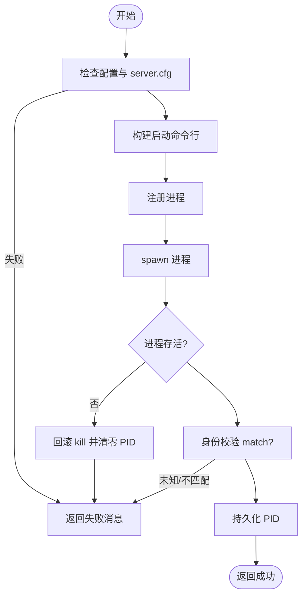
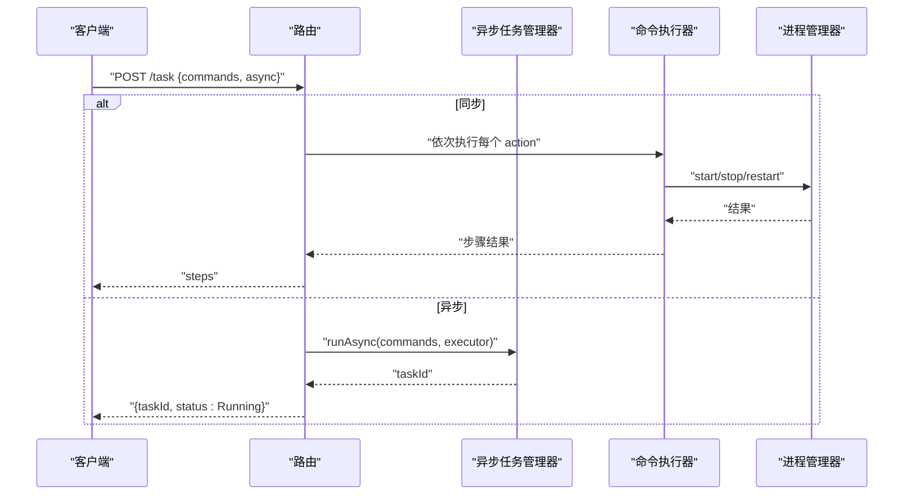
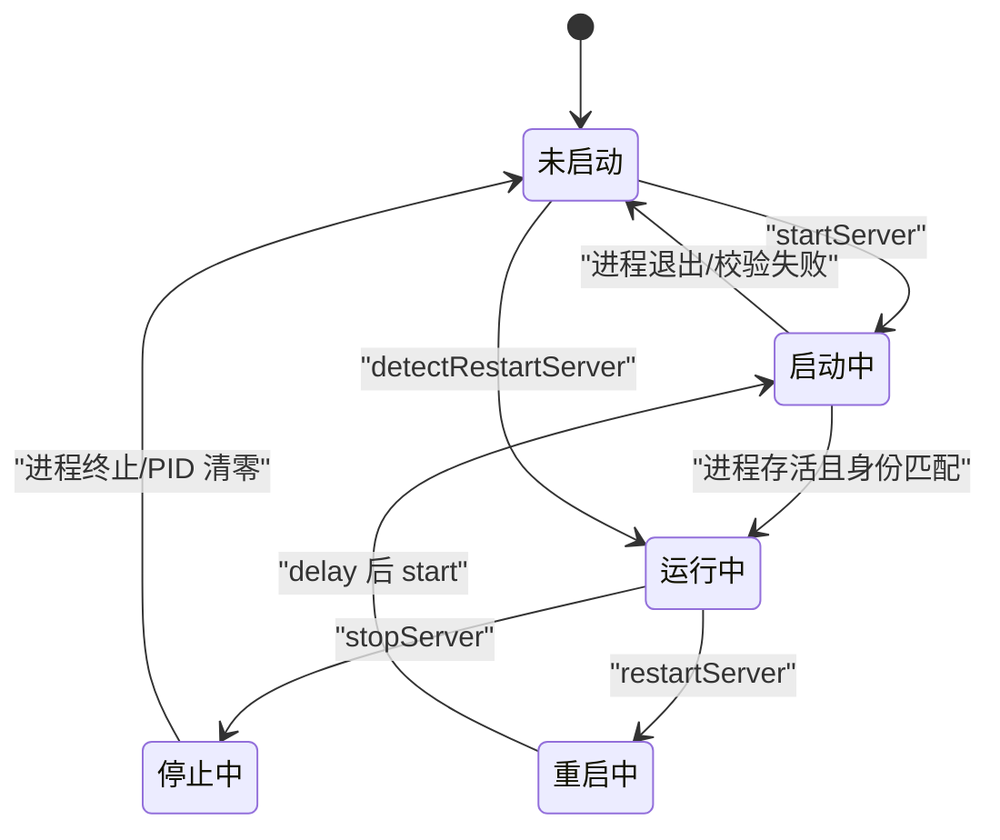
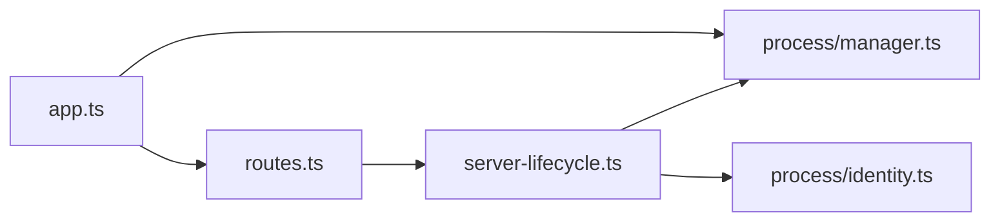

# 服务器管理接口

<cite>
**本文引用的文件**   
- [packages/service/src/app.ts](file://packages/service/src/app.ts)
- [packages/service/src/api/routes.ts](file://packages/service/src/api/routes.ts)
- [packages/service/src/scheduling/server-lifecycle.ts](file://packages/service/src/scheduling/server-lifecycle.ts)
- [packages/service/src/process/manager.ts](file://packages/service/src/process/manager.ts)
- [packages/service/src/process/identity.ts](file://packages/service/src/process/identity.ts)
- [packages/service/src/types/server.ts](file://packages/service/src/types/server.ts)
</cite>

## 目录
1. [简介](#简介)
2. [项目结构](#项目结构)
3. [核心组件](#核心组件)
4. [架构总览](#架构总览)
5. [详细组件分析](#详细组件分析)
6. [依赖关系分析](#依赖关系分析)
7. [性能与并发特性](#性能与并发特性)
8. [故障排查指南](#故障排查指南)
9. [结论](#结论)
10. [附录：API 参考](#附录api-参考)

## 简介
本文件为 Arma 3 服务器管理工具的“服务器管理接口”完整文档，聚焦于服务器生命周期操作（启动、停止、重启）、进程状态查询、辅助信息接口，以及批量任务与事务性操作的实现机制。后端基于 Fastify + TypeScript，提供统一的 REST API，并通过进程管理器与配置存储协调多实例服务器的启停与状态同步。

## 项目结构
服务入口在应用层创建 Fastify 实例，注册鉴权钩子、CORS、Multipart、SSE、静态资源与路由模块；核心业务路由集中在 routes.ts，生命周期控制逻辑集中在 server-lifecycle.ts，进程管理封装在 process/manager.ts 与 identity.ts。

**图示来源**
- [packages/service/src/app.ts:57-171](file://packages/service/src/app.ts#L57-L171)
- [packages/service/src/api/routes.ts:62-1108](file://packages/service/src/api/routes.ts#L62-L1108)
- [packages/service/src/scheduling/server-lifecycle.ts:1-217](file://packages/service/src/scheduling/server-lifecycle.ts#L1-L217)
- [packages/service/src/process/manager.ts:20-167](file://packages/service/src/process/manager.ts#L20-L167)
- [packages/service/src/process/identity.ts:145-212](file://packages/service/src/process/identity.ts#L145-L212)

**章节来源**
- [packages/service/src/app.ts:57-171](file://packages/service/src/app.ts#L57-L171)

## 核心组件
- 应用装配器：创建 Fastify 实例、注入服务、统一鉴权、挂载路由与静态资源。
- HTTP 路由：定义所有 /api/v1/* 端点，包括服务器 CRUD、状态、日志、监控、任务、SteamCMD 设置等。
- 生命周期控制器：startServer、stopServer、restartServer、detectRestartServer、executeCronAction。
- 进程管理器：封装 spawn/kill、进程状态检测、跨平台差异处理。
- 进程身份校验：通过可执行路径、命令行参数（profileName/port）验证 PID 是否属于目标服务器。

**章节来源**
- [packages/service/src/app.ts:57-171](file://packages/service/src/app.ts#L57-L171)
- [packages/service/src/api/routes.ts:62-1108](file://packages/service/src/api/routes.ts#L62-L1108)
- [packages/service/src/scheduling/server-lifecycle.ts:16-217](file://packages/service/src/scheduling/server-lifecycle.ts#L16-L217)
- [packages/service/src/process/manager.ts:20-167](file://packages/service/src/process/manager.ts#L20-L167)
- [packages/service/src/process/identity.ts:145-212](file://packages/service/src/process/identity.ts#L145-L212)

## 架构总览
以下图展示从 HTTP 请求到进程控制的调用链，以及关键数据流。

**图示来源**
- [packages/service/src/api/routes.ts:1031-1108](file://packages/service/src/api/routes.ts#L1031-L1108)
- [packages/service/src/scheduling/server-lifecycle.ts:101-160](file://packages/service/src/scheduling/server-lifecycle.ts#L101-L160)
- [packages/service/src/process/manager.ts:33-97](file://packages/service/src/process/manager.ts#L33-L97)
- [packages/service/src/process/identity.ts:145-212](file://packages/service/src/process/identity.ts#L145-L212)

## 详细组件分析

### 服务器生命周期操作
- 启动服务器
  - 触发方式：通过统一动作接口或任务系统调用 startServer。
  - 前置检查：必须存在 server.cfg、可执行文件存在、命令构建成功。
  - 行为：注册进程、启动进程、二次存活校验（约 2 秒），成功后持久化 PID。
  - 失败场景：未找到配置、未写入配置、可执行文件缺失、进程立即退出。
- 停止服务器
  - 优先使用进程管理器 kill；若仅凭持久化 PID 运行，则先进行身份校验再终止进程树。
  - 安全保护：PID 不匹配或无法识别时拒绝停止，避免误杀。
- 重启服务器
  - 顺序：stop → 等待 → start；任一阶段失败即返回错误。
- 检测并启动
  - 若已运行则直接返回成功；否则执行启动流程。

**图示来源**
- [packages/service/src/scheduling/server-lifecycle.ts:101-160](file://packages/service/src/scheduling/server-lifecycle.ts#L101-L160)
- [packages/service/src/process/manager.ts:33-97](file://packages/service/src/process/manager.ts#L33-L97)
- [packages/service/src/process/identity.ts:145-212](file://packages/service/src/process/identity.ts#L145-L212)

**章节来源**
- [packages/service/src/scheduling/server-lifecycle.ts:48-184](file://packages/service/src/scheduling/server-lifecycle.ts#L48-L184)
- [packages/service/src/process/manager.ts:33-118](file://packages/service/src/process/manager.ts#L33-L118)
- [packages/service/src/process/identity.ts:145-212](file://packages/service/src/process/identity.ts#L145-L212)

### 进程状态查询与信息获取
- 服务器状态
  - GET /api/v1/servers/:uuid/status
  - 返回 isRunning、pid、活跃任务模板、模组数量等。
- 仪表盘摘要
  - GET /api/v1/servers/:uuid/dashboard
  - 聚合主机名、端口、在线人数、监控摘要、最近 RPT、是否已写入配置等。
- 路径信息
  - GET /api/v1/servers/:uuid/paths
  - 返回工具配置目录、数据配置目录、服务器目录、日志目录等。

**章节来源**
- [packages/service/src/api/routes.ts:87-97](file://packages/service/src/api/routes.ts#L87-L97)
- [packages/service/src/api/routes.ts:583-627](file://packages/service/src/api/routes.ts#L583-L627)
- [packages/service/src/api/routes.ts:556-581](file://packages/service/src/api/routes.ts#L556-L581)

### 辅助接口
- 预检
  - GET /api/v1/servers/:uuid/preflight
  - 根据当前运行状态与扫描结果返回预检问题。
- RCon 玩家列表
  - GET /api/v1/servers/:uuid/rcon/players
  - 需要正确配置 RCon；连接失败返回 502 与错误码。
- 模组与 Bikey
  - GET /api/v1/servers/:uuid/mods
  - GET /api/v1/servers/:uuid/mods/bikeys
  - GET /api/v1/servers/:uuid/mods/bikeys/files
- 任务与异步执行
  - POST /api/v1/task
  - GET /api/v1/tasks/:taskId
  - DELETE /api/v1/tasks/:taskId
- SteamCMD
  - GET /api/v1/steamcmd/status
  - PUT /api/v1/steamcmd/credentials
  - GET /api/v1/steamcmd/log
  - POST /api/v1/steamcmd/stop

**章节来源**
- [packages/service/src/api/routes.ts:421-440](file://packages/service/src/api/routes.ts#L421-L440)
- [packages/service/src/api/routes.ts:442-462](file://packages/service/src/api/routes.ts#L442-L462)
- [packages/service/src/api/routes.ts:464-525](file://packages/service/src/api/routes.ts#L464-L525)
- [packages/service/src/api/routes.ts:1031-1108](file://packages/service/src/api/routes.ts#L1031-L1108)
- [packages/service/src/api/routes.ts:370-417](file://packages/service/src/api/routes.ts#L370-L417)

### 批量操作与事务性操作
- 任务编排
  - POST /api/v1/task 支持 commands 数组，按序执行；可标记 async=true 转为异步任务。
  - 支持 writeCfgAfter/restartAfter 作为默认后续动作，非 start/stop/restart/write_cfg 类动作后自动追加写配置或重启。
- 任务查询与取消
  - GET /api/v1/tasks/:taskId 查询任务状态与步骤结果。
  - DELETE /api/v1/tasks/:taskId 取消任务；若任务涉及 SteamCMD，会触发 abort。
- 定时重启
  - POST /api/v1/schedule/restart 设置 cron 表达式，到期后执行 stop→延迟→start 的序列。

**图示来源**
- [packages/service/src/api/routes.ts:1031-1108](file://packages/service/src/api/routes.ts#L1031-L1108)
- [packages/service/src/api/routes.ts:1177-1205](file://packages/service/src/api/routes.ts#L1177-L1205)

**章节来源**
- [packages/service/src/api/routes.ts:1031-1108](file://packages/service/src/api/routes.ts#L1031-L1108)
- [packages/service/src/api/routes.ts:1177-1205](file://packages/service/src/api/routes.ts#L1177-L1205)
- [packages/service/src/api/routes.ts:830-857](file://packages/service/src/api/routes.ts#L830-L857)

### 服务器状态机与异步处理机制
- 状态维度
  - 进程维度：isRunning、pid（由 ProcessManager.getState 综合内存映射与持久化 PID）。
  - 配置维度：tasks.processById 记录上次启动 PID，用于进程恢复与身份校验。
- 状态转换
  - 启动：register → start → verify → persist pid → 二次存活检查。
  - 停止：优先 kill 内存进程；否则校验持久化 PID 后终止进程树。
  - 重启：stop → delay → start。
  - 检测：running → success；else → start。
- 异步处理
  - 任务系统支持同步与异步两种模式；异步任务返回 taskId，可通过 GET /tasks/:taskId 轮询。
  - SSE 用于 SteamCMD 事件推送（由 app.ts 中 sseManager.wireSteamCmd 绑定）。

**图示来源**
- [packages/service/src/scheduling/server-lifecycle.ts:48-184](file://packages/service/src/scheduling/server-lifecycle.ts#L48-L184)
- [packages/service/src/process/manager.ts:120-150](file://packages/service/src/process/manager.ts#L120-L150)

**章节来源**
- [packages/service/src/scheduling/server-lifecycle.ts:48-184](file://packages/service/src/scheduling/server-lifecycle.ts#L48-L184)
- [packages/service/src/process/manager.ts:120-150](file://packages/service/src/process/manager.ts#L120-L150)

## 依赖关系分析
- 路由层依赖生命周期控制器与进程管理器。
- 生命周期控制器依赖进程身份校验与配置写入工具。
- 进程管理器依赖平台能力与进程工具函数。
- 应用层负责将各服务装饰到 Fastify 上下文，并提供统一鉴权与 CORS/Multipart/SSE 能力。

**图示来源**
- [packages/service/src/app.ts:57-171](file://packages/service/src/app.ts#L57-L171)
- [packages/service/src/api/routes.ts:62-1108](file://packages/service/src/api/routes.ts#L62-L1108)
- [packages/service/src/scheduling/server-lifecycle.ts:1-217](file://packages/service/src/scheduling/server-lifecycle.ts#L1-L217)
- [packages/service/src/process/manager.ts:1-167](file://packages/service/src/process/manager.ts#L1-L167)
- [packages/service/src/process/identity.ts:145-212](file://packages/service/src/process/identity.ts#L145-L212)

**章节来源**
- [packages/service/src/app.ts:57-171](file://packages/service/src/app.ts#L57-L171)
- [packages/service/src/api/routes.ts:62-1108](file://packages/service/src/api/routes.ts#L62-L1108)

## 性能与并发特性
- 进程启动采用 child_process.spawn，Windows 上忽略 stdout/stderr 以避免专用服务器不再写入 logFile；Linux 上捕获 stdout/stderr 并写入日志文件。
- 进程停止在 Windows 使用 taskkill /T /F，在非 Windows 平台先 SIGTERM，5 秒后强制 SIGKILL。
- 监听端口失败具备重试机制（EADDRINUSE/EACCES/EADDRNOTAVAIL），最多 15 次，间隔 1 秒。
- 任务系统支持异步执行，避免阻塞 HTTP 请求；SteamCMD 相关任务可被取消并触发 abort。

[本节为通用性能讨论，不直接分析具体代码文件]

## 故障排查指南
- 启动失败常见原因
  - 未写入 server.cfg：需先调用写配置动作。
  - 可执行文件不存在：检查服务器目录与可执行路径。
  - 进程启动后立即退出：检查模板/模组配置，查看 RPT 日志。
- 停止失败常见原因
  - PID 不匹配或无法识别：为避免误杀，接口会拒绝停止并返回相应错误码。
- 鉴权失败
  - 未携带有效 Authorization/Bearer、X-Api-Key 或 query token 时返回 401。
- RCon 连接失败
  - 返回 502 与错误码 RCON_FAILED，检查 RCon 配置与服务连通性。

**章节来源**
- [packages/service/src/scheduling/server-lifecycle.ts:101-160](file://packages/service/src/scheduling/server-lifecycle.ts#L101-L160)
- [packages/service/src/scheduling/server-lifecycle.ts:48-99](file://packages/service/src/scheduling/server-lifecycle.ts#L48-L99)
- [packages/service/src/app.ts:96-130](file://packages/service/src/app.ts#L96-L130)
- [packages/service/src/api/routes.ts:442-462](file://packages/service/src/api/routes.ts#L442-L462)

## 结论
该服务器管理接口以 Fastify 为核心，通过清晰的分层与职责分离，实现了稳定的服务器生命周期管理、进程状态追踪、批量任务编排与异步处理能力。进程身份校验与二次存活检查提升了安全性与可靠性；统一响应 envelope 简化了错误处理与前端集成。建议在生产环境启用 Bearer 鉴权，并结合任务系统与定时任务实现自动化运维。

[本节为总结性内容，不直接分析具体代码文件]

## 附录：API 参考

### 认证与安全
- 鉴权方式
  - Header: Authorization: Bearer <token>
  - Header: X-Api-Key: <token>
  - Query: ?token=<token>
- 白名单
  - /api/v1/health 与 /api/v1/actions 无需鉴权。
- 失败响应
  - 401 Unauthorized，body 包含 success=false。

**章节来源**
- [packages/service/src/app.ts:96-130](file://packages/service/src/app.ts#L96-L130)

### 服务器生命周期动作
- 统一动作接口
  - POST /api/v1/servers/:uuid/actions
  - 请求体示例
    - { action: "start" }
    - { action: "stop" }
    - { action: "restart" }
  - 响应格式
    - { success: boolean, data?: object, error?: string|null, requestId: string }
- 典型响应示例
  - 成功
    - { success: true, data: null, error: null, requestId: "abc123" }
  - 失败
    - { success: false, data: null, error: "尚未写入 server.cfg，请先点击「写入游戏配置」", requestId: "abc123" }

**章节来源**
- [packages/service/src/api/routes.ts:1031-1108](file://packages/service/src/api/routes.ts#L1031-L1108)
- [packages/service/src/api/routes.ts:1112-1114](file://packages/service/src/api/routes.ts#L1112-L1114)

### 进程状态查询
- GET /api/v1/servers/:uuid/status
- 响应字段
  - isRunning: boolean
  - pid: number | undefined
  - activeMissionTemplate: string | undefined
  - serverModCount: number

**章节来源**
- [packages/service/src/api/routes.ts:87-97](file://packages/service/src/api/routes.ts#L87-L97)

### 其他常用接口
- 预检
  - GET /api/v1/servers/:uuid/preflight
- RCon 玩家
  - GET /api/v1/servers/:uuid/rcon/players
- 任务
  - POST /api/v1/task
  - GET /api/v1/tasks/:taskId
  - DELETE /api/v1/tasks/:taskId
- SteamCMD
  - GET /api/v1/steamcmd/status
  - PUT /api/v1/steamcmd/credentials
  - GET /api/v1/steamcmd/log
  - POST /api/v1/steamcmd/stop

**章节来源**
- [packages/service/src/api/routes.ts:421-440](file://packages/service/src/api/routes.ts#L421-L440)
- [packages/service/src/api/routes.ts:442-462](file://packages/service/src/api/routes.ts#L442-L462)
- [packages/service/src/api/routes.ts:1031-1108](file://packages/service/src/api/routes.ts#L1031-L1108)
- [packages/service/src/api/routes.ts:370-417](file://packages/service/src/api/routes.ts#L370-L417)