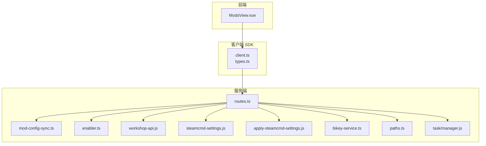
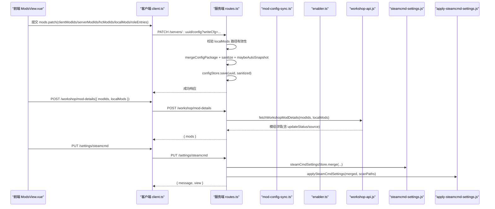
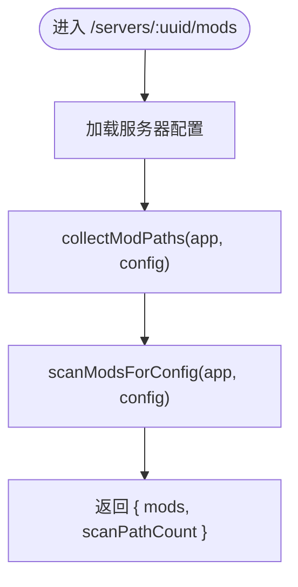
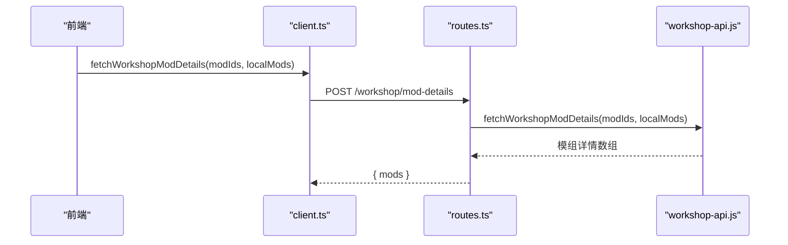
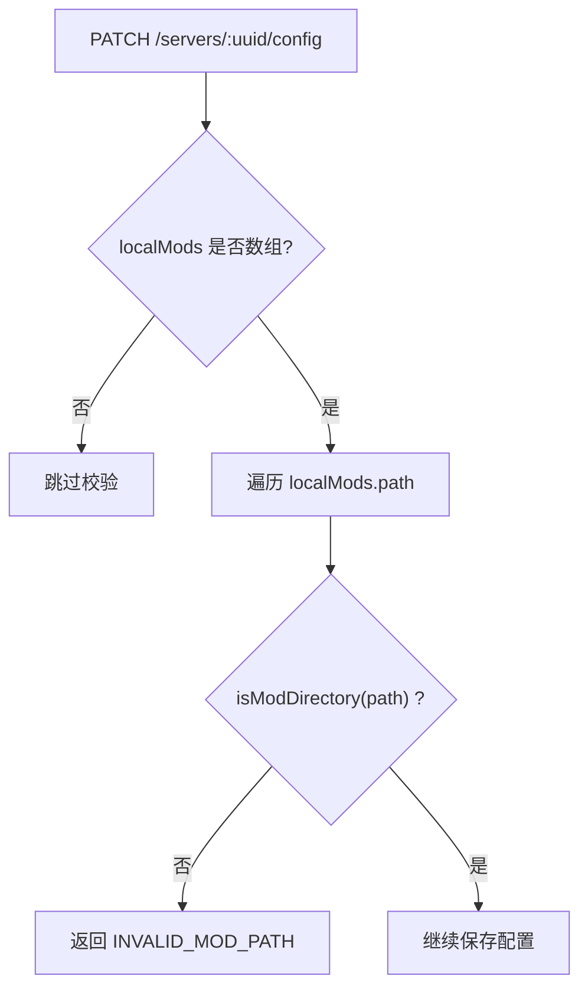
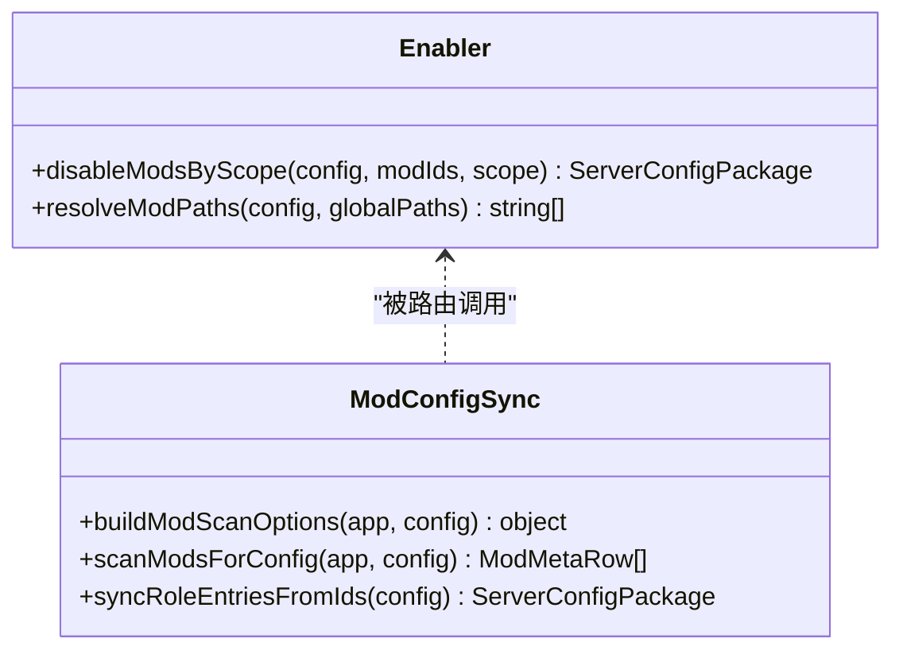
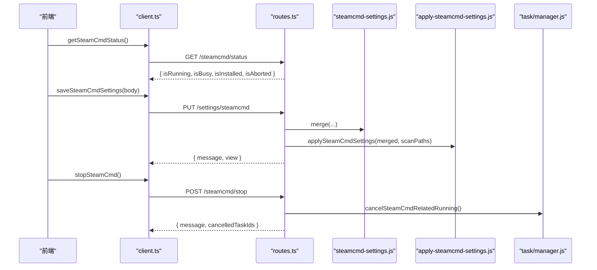
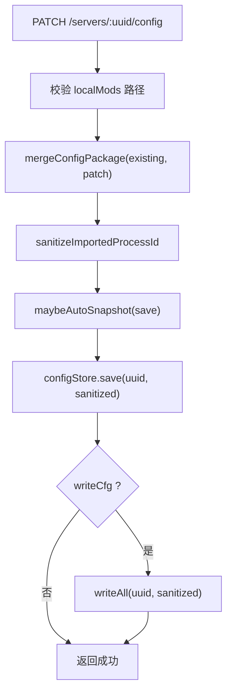
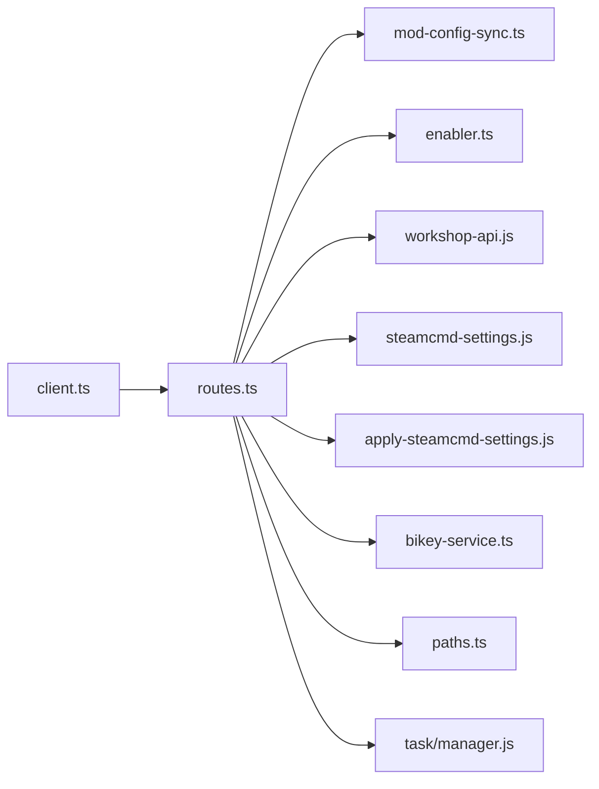

# 模组管理接口

<cite>
**本文引用的文件**   
- [packages/service/src/api/routes.ts](file://packages/service/src/api/routes.ts)
- [packages/service/src/mods/mod-config-sync.ts](file://packages/service/src/mods/mod-config-sync.ts)
- [packages/service/src/mods/enabler.ts](file://packages/service/src/mods/enabler.ts)
- [packages/service/src/steamcmd/workshop-api.js](file://packages/service/src/steamcmd/workshop-api.js)
- [packages/service/src/settings/apply-steamcmd-settings.js](file://packages/service/src/settings/apply-steamcmd-settings.js)
- [packages/service/src/settings/steamcmd-settings.js](file://packages/service/src/settings/steamcmd-settings.js)
- [packages/service/src/mods/bikey-service.ts](file://packages/service/src/mods/bikey-service.ts)
- [packages/service/src/mods/paths.ts](file://packages/service/src/mods/paths.ts)
- [packages/service/src/task/manager.js](file://packages/service/src/task/manager.js)
- [packages/api-client/src/client.ts](file://packages/api-client/src/client.ts)
- [packages/api-client/src/types.ts](file://packages/api-client/src/types.ts)
- [packages/web/src/views/ModsView.vue](file://packages/web/src/views/ModsView.vue)
</cite>

## 目录
1. [简介](#简介)
2. [项目结构](#项目结构)
3. [核心组件](#核心组件)
4. [架构总览](#架构总览)
5. [详细组件分析](#详细组件分析)
6. [依赖关系分析](#依赖关系分析)
7. [性能与缓存](#性能与缓存)
8. [故障排查指南](#故障排查指南)
9. [结论](#结论)
10. [附录：API 定义与数据模型](#附录api-定义与数据模型)

## 简介
本文件面向“模组管理”相关能力，覆盖以下目标：
- 模组列表获取、Workshop 模组同步、本地模组管理、模组依赖解析。
- SteamCMD 集成调用方式与下载进度跟踪。
- 模组配置文件管理与启用/禁用状态控制。
- 模组元数据结构定义与版本兼容性检查。
- 模组冲突检测与解决策略。
- 模组缓存机制与增量更新。
- 安装失败错误处理与重试机制。

## 项目结构
模组管理涉及服务端路由、模组扫描与配置同步、SteamCMD 工作区设置、客户端类型与前端视图等模块。整体组织如下：
- 服务端 API 路由集中在服务层，负责校验、合并配置、调用模组扫描与 SteamCMD 能力。
- 模组扫描与配置同步由独立模块提供，统一构建扫描选项并生成结果。
- SteamCMD 设置通过设置存储与应用逻辑进行持久化与生效。
- 客户端 SDK 暴露统一的 REST 方法，供桌面/Web 前端调用。
- 前端在模组页面中组装启用/禁用集合并提交到后端。

**图示来源**
- [packages/web/src/views/ModsView.vue:339-395](file://packages/web/src/views/ModsView.vue#L339-L395)
- [packages/api-client/src/client.ts:261-277](file://packages/api-client/src/client.ts#L261-L277)
- [packages/service/src/api/routes.ts:277-325](file://packages/service/src/api/routes.ts#L277-L325)
- [packages/service/src/mods/mod-config-sync.ts:6-24](file://packages/service/src/mods/mod-config-sync.ts#L6-L24)
- [packages/service/src/mods/enabler.ts:5-56](file://packages/service/src/mods/enabler.ts#L5-L56)
- [packages/service/src/steamcmd/workshop-api.js](file://packages/service/src/steamcmd/workshop-api.js)
- [packages/service/src/settings/steamcmd-settings.js](file://packages/service/src/settings/steamcmd-settings.js)
- [packages/service/src/settings/apply-steamcmd-settings.js](file://packages/service/src/settings/apply-steamcmd-settings.js)
- [packages/service/src/mods/bikey-service.ts](file://packages/service/src/mods/bikey-service.ts)
- [packages/service/src/mods/paths.ts](file://packages/service/src/mods/paths.ts)
- [packages/service/src/task/manager.js](file://packages/service/src/task/manager.js)

**章节来源**
- [packages/service/src/api/routes.ts:277-325](file://packages/service/src/api/routes.ts#L277-L325)
- [packages/service/src/mods/mod-config-sync.ts:6-24](file://packages/service/src/mods/mod-config-sync.ts#L6-L24)
- [packages/service/src/mods/enabler.ts:5-56](file://packages/service/src/mods/enabler.ts#L5-L56)
- [packages/api-client/src/client.ts:261-277](file://packages/api-client/src/client.ts#L261-L277)
- [packages/web/src/views/ModsView.vue:339-395](file://packages/web/src/views/ModsView.vue#L339-L395)

## 核心组件
- 模组扫描与配置同步
  - 构建扫描选项，聚合全局与服务器级模组路径、已启用 ID、角色条目、本地模组等。
  - 基于扫描选项执行扫描，返回模组元数据列表。
  - 根据已启用 ID 同步角色条目的客户端/服务器/HC 标记。
- 模组启用/禁用
  - 支持按范围（客户端/服务器/HC/全部）禁用模组。
  - 支持将本地模组与 Workshop 模组分别维护其启用状态。
- SteamCMD 设置与工作区
  - 读取/保存 SteamCMD 用户名、密码、Workshop 根目录、服务器安装路径。
  - 保存后自动应用设置，必要时推导默认 Workshop 扫描路径。
- Workshop 模组详情
  - 批量查询 Workshop 模组信息，结合本地引用判断更新状态。
- 模组签名密钥（bikey）
  - 汇总各模组的 bikey 状态，辅助校验与提示。
- 任务与 SteamCMD 生命周期
  - 提供停止 SteamCMD 操作、取消相关任务的能力。

**章节来源**
- [packages/service/src/mods/mod-config-sync.ts:6-57](file://packages/service/src/mods/mod-config-sync.ts#L6-L57)
- [packages/service/src/mods/enabler.ts:5-77](file://packages/service/src/mods/enabler.ts#L5-L77)
- [packages/service/src/api/routes.ts:277-325](file://packages/service/src/api/routes.ts#L277-L325)
- [packages/service/src/api/routes.ts:464-525](file://packages/service/src/api/routes.ts#L464-L525)
- [packages/service/src/api/routes.ts:370-417](file://packages/service/src/api/routes.ts#L370-L417)

## 架构总览
下图展示从前端到服务端的模组管理主流程，包括配置保存、Workshop 详情查询与 SteamCMD 设置应用。

**图示来源**
- [packages/web/src/views/ModsView.vue:339-395](file://packages/web/src/views/ModsView.vue#L339-L395)
- [packages/api-client/src/client.ts:261-277](file://packages/api-client/src/client.ts#L261-L277)
- [packages/service/src/api/routes.ts:147-195](file://packages/service/src/api/routes.ts#L147-L195)
- [packages/service/src/api/routes.ts:283-292](file://packages/service/src/api/routes.ts#L283-L292)
- [packages/service/src/api/routes.ts:294-325](file://packages/service/src/api/routes.ts#L294-L325)
- [packages/service/src/steamcmd/workshop-api.js](file://packages/service/src/steamcmd/workshop-api.js)
- [packages/service/src/settings/steamcmd-settings.js](file://packages/service/src/settings/steamcmd-settings.js)
- [packages/service/src/settings/apply-steamcmd-settings.js](file://packages/service/src/settings/apply-steamcmd-settings.js)

## 详细组件分析

### 模组列表获取与扫描
- 端点
  - GET /servers/:uuid/mods：返回模组扫描结果与扫描路径数量。
  - GET /servers/:uuid/mods/bikeys：返回模组 bikey 统计摘要。
  - GET /servers/:uuid/mods/bikeys/files：列出服务器目录下的 .bikey 文件。
- 实现要点
  - 收集模组路径（全局与服务器级），构建扫描选项并执行扫描。
  - 对本地模组路径进行有效性校验（需包含 addons）。
  - bikey 摘要用于快速识别未签名、缺少密钥或未复制的模组。

**图示来源**
- [packages/service/src/api/routes.ts:464-476](file://packages/service/src/api/routes.ts#L464-L476)
- [packages/service/src/mods/mod-config-sync.ts:6-24](file://packages/service/src/mods/mod-config-sync.ts#L6-L24)

**章节来源**
- [packages/service/src/api/routes.ts:464-525](file://packages/service/src/api/routes.ts#L464-L525)
- [packages/service/src/mods/mod-config-sync.ts:6-24](file://packages/service/src/mods/mod-config-sync.ts#L6-L24)

### Workshop 模组详情与同步
- 端点
  - POST /workshop/mod-details：批量查询 Workshop 模组详情，支持传入本地模组引用以计算更新状态。
- 行为
  - 服务端调用 workshop-api 获取远程信息。
  - 结合本地引用（path、updatedAt）计算 updateStatus（missing/up_to_date/outdated/unknown）与 source（api/html/fallback）。
  - 前端可据此决定是否触发下载或增量更新。

**图示来源**
- [packages/api-client/src/client.ts:269-277](file://packages/api-client/src/client.ts#L269-L277)
- [packages/service/src/api/routes.ts:283-292](file://packages/service/src/api/routes.ts#L283-L292)
- [packages/service/src/steamcmd/workshop-api.js](file://packages/service/src/steamcmd/workshop-api.js)

**章节来源**
- [packages/api-client/src/client.ts:269-277](file://packages/api-client/src/client.ts#L269-L277)
- [packages/service/src/api/routes.ts:283-292](file://packages/service/src/api/routes.ts#L283-L292)

### 本地模组管理与路径校验
- 端点
  - POST /mods/validate-path：校验某路径是否为有效模组目录（包含 addons）。
  - PATCH /servers/:uuid/config：保存本地模组列表时进行路径有效性校验。
- 行为
  - 若 localMods 中存在无效路径，直接返回错误码 INVALID_MOD_PATH。
  - 前端在保存前可先调用 validate-path 进行预检。

**图示来源**
- [packages/service/src/api/routes.ts:147-195](file://packages/service/src/api/routes.ts#L147-L195)
- [packages/service/src/api/routes.ts:491-499](file://packages/service/src/api/routes.ts#L491-L499)

**章节来源**
- [packages/service/src/api/routes.ts:147-195](file://packages/service/src/api/routes.ts#L147-L195)
- [packages/service/src/api/routes.ts:491-499](file://packages/service/src/api/routes.ts#L491-L499)

### 模组启用/禁用与角色条目同步
- 端点
  - PATCH /servers/:uuid/config：支持写入 mods.clientModIds/serverModIds/hcModIds/enabledIds/localMods/roleEntries。
  - 任务动作 enable_mods/disable_mods：通过自动化命令修改启用状态。
- 行为
  - disableModsByScope 支持按 client/server/hc/all 范围过滤已启用 ID 与各角色 ID 列表。
  - syncRoleEntriesFromIds 根据已启用 ID 反推 roleEntries 中的 isClientMod/isServerMod/isHcMod 标记。

**图示来源**
- [packages/service/src/mods/enabler.ts:5-77](file://packages/service/src/mods/enabler.ts#L5-L77)
- [packages/service/src/mods/mod-config-sync.ts:33-57](file://packages/service/src/mods/mod-config-sync.ts#L33-L57)

**章节来源**
- [packages/service/src/mods/enabler.ts:5-77](file://packages/service/src/mods/enabler.ts#L5-L77)
- [packages/service/src/mods/mod-config-sync.ts:33-57](file://packages/service/src/mods/mod-config-sync.ts#L33-L57)
- [packages/service/src/api/routes.ts:1321-1385](file://packages/service/src/api/routes.ts#L1321-L1385)

### SteamCMD 集成与下载进度跟踪
- 设置与凭据
  - GET/PUT /settings/steamcmd：读取/保存用户名、密码、Workshop 根目录、服务器安装路径；保存后自动应用设置。
  - GET/POST /steamcmd/status、/steamcmd/log、/steamcmd/stop：查询状态、日志、中止运行。
- 任务与取消
  - taskCommandsInvolveSteamCmd 用于识别与 SteamCMD 相关的任务，配合 stop_steamcmd 取消相关运行任务。
- 下载进度
  - 当前公开接口未提供细粒度下载进度事件；可通过 /steamcmd/log 拉取最新日志观察进度。
  - 任务系统支持 captureSteamCmdOutput，可在异步任务步骤中捕获输出。

**图示来源**
- [packages/api-client/src/client.ts:389-406](file://packages/api-client/src/client.ts#L389-L406)
- [packages/service/src/api/routes.ts:277-325](file://packages/service/src/api/routes.ts#L277-L325)
- [packages/service/src/api/routes.ts:370-417](file://packages/service/src/api/routes.ts#L370-L417)
- [packages/service/src/settings/steamcmd-settings.js](file://packages/service/src/settings/steamcmd-settings.js)
- [packages/service/src/settings/apply-steamcmd-settings.js](file://packages/service/src/settings/apply-steamcmd-settings.js)
- [packages/service/src/task/manager.js](file://packages/service/src/task/manager.js)

**章节来源**
- [packages/service/src/api/routes.ts:277-325](file://packages/service/src/api/routes.ts#L277-L325)
- [packages/service/src/api/routes.ts:370-417](file://packages/service/src/api/routes.ts#L370-L417)
- [packages/api-client/src/client.ts:389-406](file://packages/api-client/src/client.ts#L389-L406)

### 模组配置文件管理与状态控制
- 配置读写
  - GET/PUT/PATCH /servers/:uuid/config：读取、全量替换、部分更新配置；可选 writeCfg 参数同时写入磁盘。
  - 保存前可能触发自动快照（maybeAutoSnapshot）。
- 状态控制
  - 通过 mods.enabledIds、serverModIds、clientModIds、hcModIds、localMods、roleEntries 控制模组启用与角色分配。
  - 前端在 ModsView.vue 中聚合各类 ID 与本地模组，统一提交 patch。

**图示来源**
- [packages/service/src/api/routes.ts:147-195](file://packages/service/src/api/routes.ts#L147-L195)
- [packages/web/src/views/ModsView.vue:339-395](file://packages/web/src/views/ModsView.vue#L339-L395)

**章节来源**
- [packages/service/src/api/routes.ts:147-195](file://packages/service/src/api/routes.ts#L147-L195)
- [packages/web/src/views/ModsView.vue:339-395](file://packages/web/src/views/ModsView.vue#L339-L395)

### 模组依赖解析与冲突检测
- 依赖解析
  - 当前代码未实现显式依赖图解析；主要依赖 Workshop 元数据与本地模组路径。
  - 可通过扩展 scanner 或新增依赖解析模块，基于模组清单或描述字段构建依赖关系。
- 冲突检测
  - 当前未实现名称/版本冲突检测；建议基于 dirName、workshopId、updateStatus 进行去重与冲突提示。
  - 可在保存配置前增加冲突校验规则，阻止不兼容组合。

[本节为概念性说明，不直接分析具体文件]

### 模组缓存机制与增量更新
- 缓存
  - 当前未见显式模组元数据缓存层；Workshop 详情通过 API 实时获取。
  - 建议在 service 层引入本地缓存（如 JSON/SQLite），减少重复网络请求。
- 增量更新
  - 通过 WorkshopLocalModRef 的 updatedAt 与 remote timeUpdated 比较，得出 updateStatus。
  - 前端可仅对 outdated/missing 的模组发起下载。

[本节为概念性说明，不直接分析具体文件]

### 安装失败错误处理与重试机制
- 错误处理
  - 配置保存失败返回 SAVE_FAILED；写入失败返回 WRITE_CFG_FAILED；路径无效返回 INVALID_MOD_PATH。
  - SteamCMD 凭据缺失返回 INVALID_CREDENTIALS。
- 重试机制
  - 当前未内置自动重试；可在客户端侧实现指数退避重试。
  - 对于 SteamCMD 任务，可使用 stop_steamcmd 取消后重新下发任务。

**章节来源**
- [packages/service/src/api/routes.ts:147-195](file://packages/service/src/api/routes.ts#L147-L195)
- [packages/service/src/api/routes.ts:379-396](file://packages/service/src/api/routes.ts#L379-L396)

## 依赖关系分析
- 路由层依赖
  - routes.ts 依赖模组扫描、启用/禁用、SteamCMD 设置与应用、bikey 服务、任务管理等。
- 模组扫描
  - mod-config-sync.ts 依赖 paths.ts 收集路径，scanner 执行扫描。
- SteamCMD
  - settings/steamcmd-settings.js 与 apply-steamcmd-settings.js 协同完成设置持久化与运行时应用。
- 客户端
  - api-client 的 client.ts 与 types.ts 定义了所有与模组、SteamCMD 相关的接口契约。

**图示来源**
- [packages/service/src/api/routes.ts:1-60](file://packages/service/src/api/routes.ts#L1-L60)
- [packages/service/src/mods/mod-config-sync.ts:1-24](file://packages/service/src/mods/mod-config-sync.ts#L1-L24)
- [packages/service/src/mods/enabler.ts:1-77](file://packages/service/src/mods/enabler.ts#L1-L77)
- [packages/service/src/steamcmd/workshop-api.js](file://packages/service/src/steamcmd/workshop-api.js)
- [packages/service/src/settings/steamcmd-settings.js](file://packages/service/src/settings/steamcmd-settings.js)
- [packages/service/src/settings/apply-steamcmd-settings.js](file://packages/service/src/settings/apply-steamcmd-settings.js)
- [packages/service/src/mods/bikey-service.ts](file://packages/service/src/mods/bikey-service.ts)
- [packages/service/src/mods/paths.ts](file://packages/service/src/mods/paths.ts)
- [packages/service/src/task/manager.js](file://packages/service/src/task/manager.js)
- [packages/api-client/src/client.ts:261-277](file://packages/api-client/src/client.ts#L261-L277)

**章节来源**
- [packages/service/src/api/routes.ts:1-60](file://packages/service/src/api/routes.ts#L1-L60)
- [packages/api-client/src/client.ts:261-277](file://packages/api-client/src/client.ts#L261-L277)

## 性能与缓存
- 扫描优化
  - 仅在必要场景执行扫描（如 preflight、dashboard、mods 列表），避免频繁 IO。
  - 使用 collectModPaths 合并路径，减少重复扫描。
- 网络优化
  - 批量查询 Workshop 详情，减少多次往返。
  - 建议引入本地缓存以减少重复请求。
- 配置写入
  - 使用 maybeAutoSnapshot 在关键写操作前创建快照，降低回滚成本。

[本节为通用指导，不直接分析具体文件]

## 故障排查指南
- 常见错误码
  - NOT_FOUND：服务器配置不存在。
  - INVALID_BODY：请求体无效或缺少必填字段。
  - INVALID_MOD_PATH：本地模组路径无效。
  - WRITE_CFG_FAILED：写入 cfg 失败。
  - RCON_NOT_CONFIGURED/RCON_FAILED：RCon 未配置或连接失败。
  - INVALID_CREDENTIALS：SteamCMD 凭据不完整。
- 定位步骤
  - 查看 /steamcmd/log 获取最近日志。
  - 使用 /servers/:uuid/diagnostics 获取诊断信息。
  - 检查 /servers/:uuid/preflight 的前置检查结果。
  - 确认 /settings/mod-scan-paths 与 /settings/steamcmd 的配置是否正确。

**章节来源**
- [packages/service/src/api/routes.ts:421-440](file://packages/service/src/api/routes.ts#L421-L440)
- [packages/service/src/api/routes.ts:539-554](file://packages/service/src/api/routes.ts#L539-L554)
- [packages/service/src/api/routes.ts:398-403](file://packages/service/src/api/routes.ts#L398-L403)

## 结论
本项目提供了完整的模组管理基础能力：模组扫描与列表、Workshop 详情查询、本地模组路径校验、启用/禁用与角色条目同步、SteamCMD 设置与应用、bikey 状态汇总等。当前未实现显式的依赖解析与冲突检测，也未提供细粒度的下载进度事件；但可通过任务系统与日志接口进行扩展。建议在后续迭代中补充依赖解析、冲突检测、缓存与增量更新、以及更完善的错误重试机制。

## 附录：API 定义与数据模型

### 模组相关 REST 端点
- 模组列表
  - GET /servers/:uuid/mods
  - GET /servers/:uuid/mods/bikeys
  - GET /servers/:uuid/mods/bikeys/files
- Workshop 详情
  - POST /workshop/mod-details
- SteamCMD
  - GET/PUT /settings/steamcmd
  - GET /steamcmd/status
  - GET /steamcmd/log
  - POST /steamcmd/stop
- 配置
  - GET/PUT/PATCH /servers/:uuid/config

**章节来源**
- [packages/service/src/api/routes.ts:277-325](file://packages/service/src/api/routes.ts#L277-L325)
- [packages/service/src/api/routes.ts:464-525](file://packages/service/src/api/routes.ts#L464-L525)
- [packages/service/src/api/routes.ts:370-417](file://packages/service/src/api/routes.ts#L370-L417)

### 数据类型定义（节选）
- ApiResponse<T>：统一响应信封。
- TaskAction：任务动作枚举，包含 enable_mods/disable_mods/download_mods/import_mods_html/scan_mods/ensure_steamcmd/stop_steamcmd/steamcmd_status 等。
- SteamWorkshopModInfo：Workshop 模组信息，含 title、description、fileSizeMb、selected、timeUpdated、updateStatus、source。
- WorkshopLocalModRef：本地模组引用，含 modId、path、updatedAt。
- ModMetaRow：模组元数据行，含 workshopId、name、dirName、path、enabled、isServerMod/isClientMod/isHcMod/isLocalMod、bikeyPresent/bikeyStatus、sizeBytes、updatedAt/updateStatus。
- ModScanData：模组扫描结果，含 mods 与 scanPathCount。
- SteamCmdSettingsData：SteamCMD 设置视图，含 username、hasPassword、workshopRoot、serverInstallPath、steamCmdDir、workshopModCount。
- BikeySummaryData：bikey 统计摘要，含 enabled/missingBikey/ready/unsigned/unchecked 等计数。

**章节来源**
- [packages/api-client/src/types.ts:3-8](file://packages/api-client/src/types.ts#L3-L8)
- [packages/api-client/src/types.ts:82-119](file://packages/api-client/src/types.ts#L82-L119)
- [packages/api-client/src/types.ts:266-284](file://packages/api-client/src/types.ts#L266-L284)
- [packages/api-client/src/types.ts:288-313](file://packages/api-client/src/types.ts#L288-L313)
- [packages/api-client/src/types.ts:233-241](file://packages/api-client/src/types.ts#L233-L241)
- [packages/api-client/src/types.ts:254-264](file://packages/api-client/src/types.ts#L254-L264)