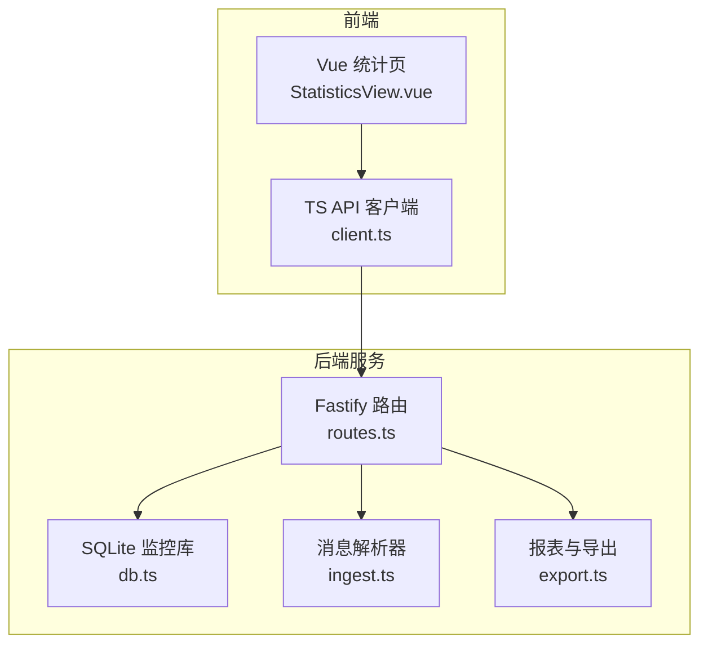
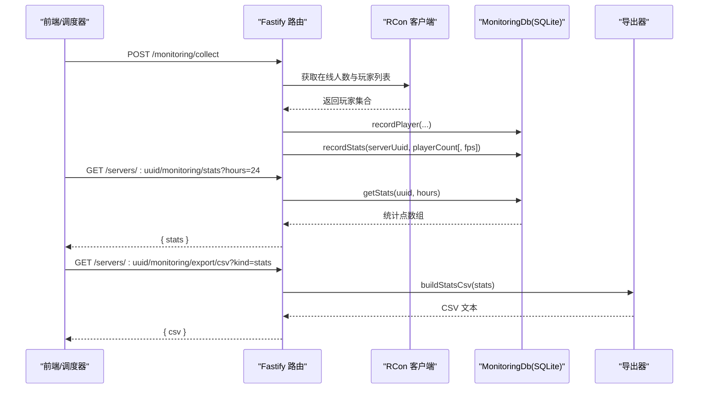
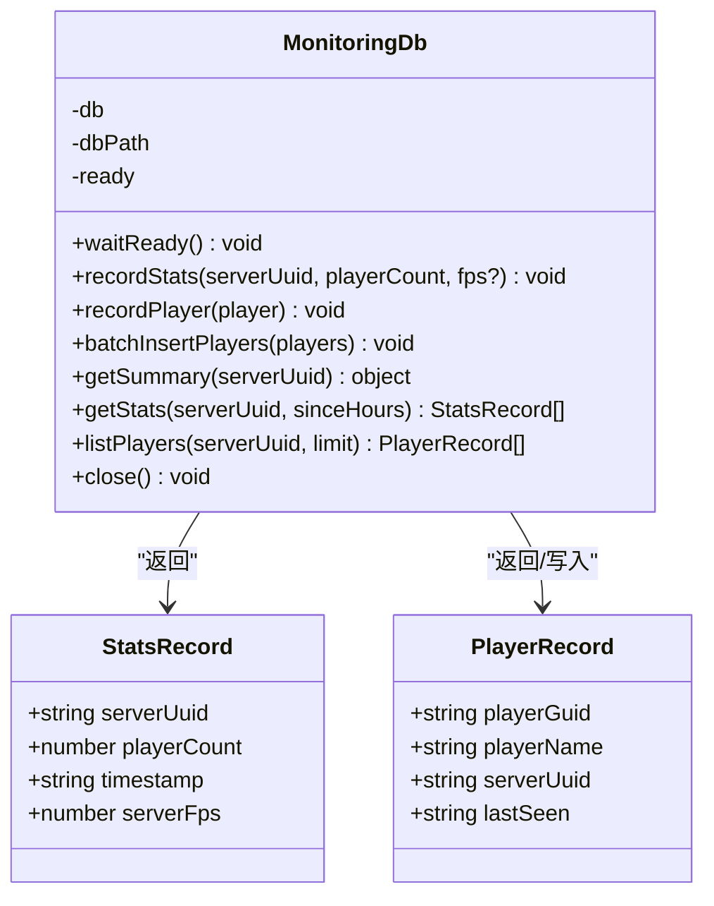
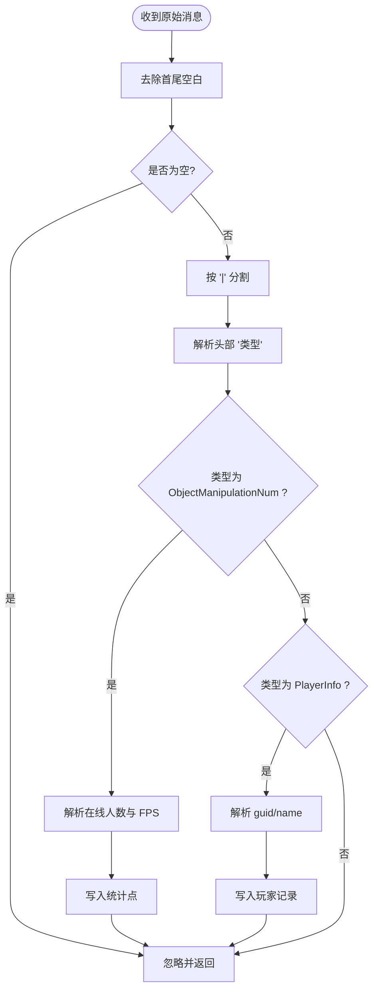
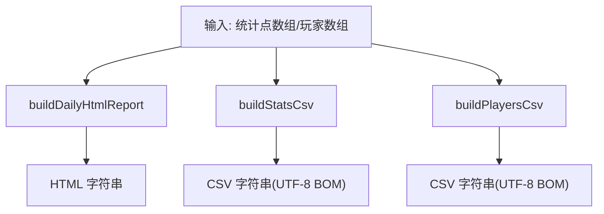
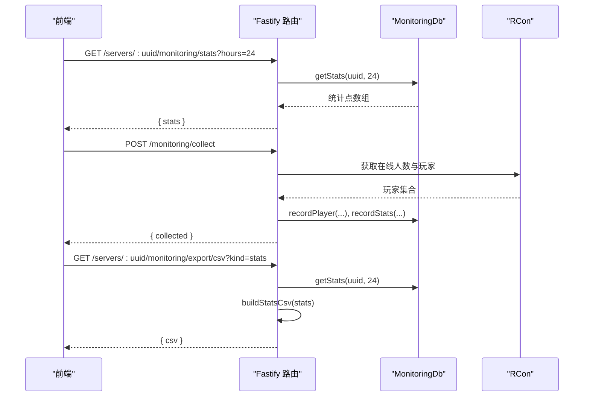
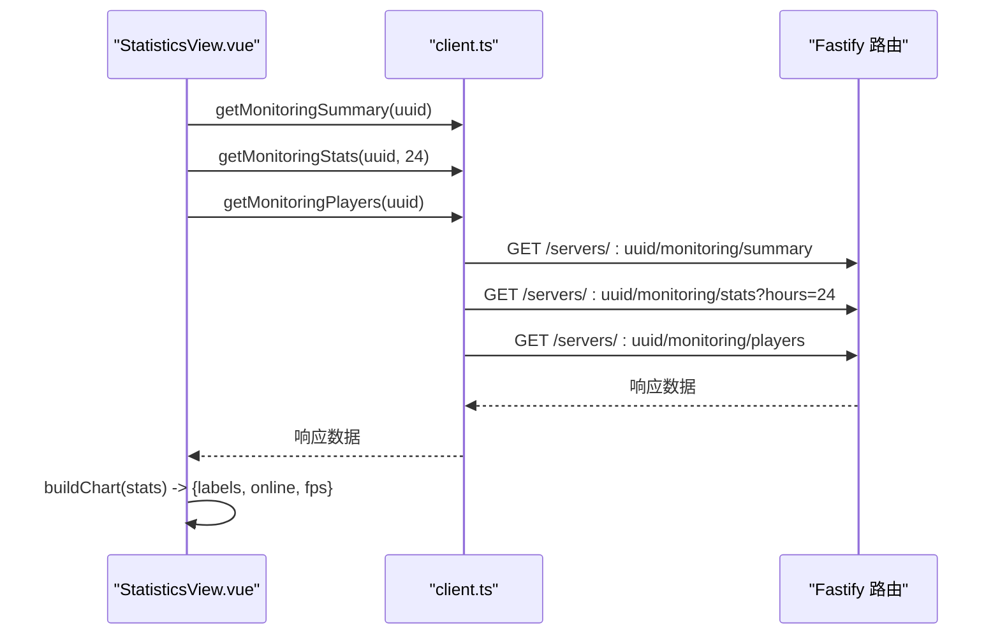
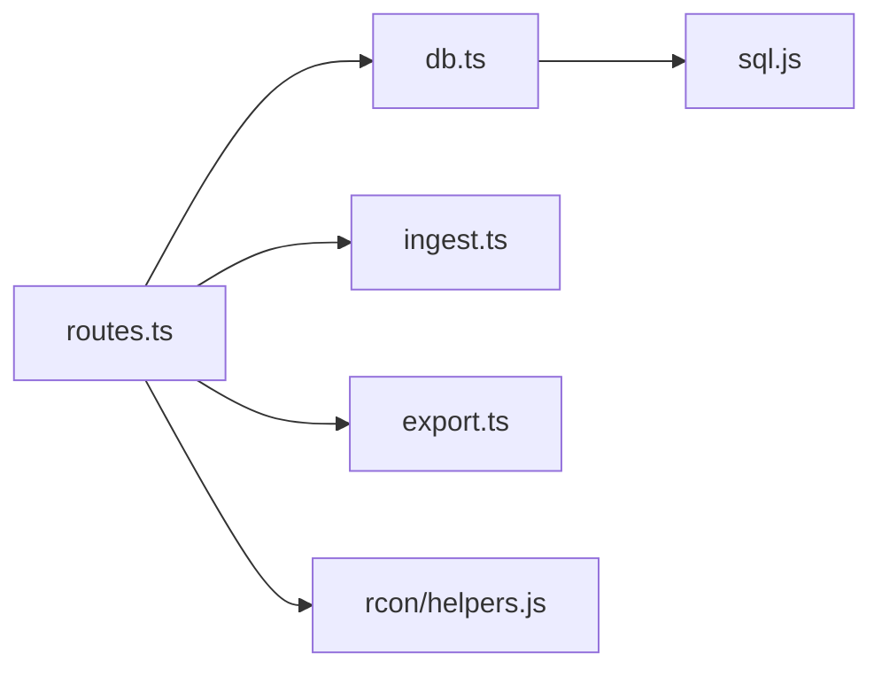

# 监控数据接口

<cite>
**本文引用的文件**   
- [README.md](file://README.md)
- [routes.ts](file://packages/service/src/api/routes.ts)
- [db.ts](file://packages/service/src/monitoring/db.ts)
- [ingest.ts](file://packages/service/src/monitoring/ingest.ts)
- [export.ts](file://packages/service/src/monitoring/export.ts)
- [index.ts](file://packages/service/src/monitoring/index.ts)
- [client.ts](file://packages/api-client/src/client.ts)
- [StatisticsView.vue](file://packages/web/src/views/StatisticsView.vue)
</cite>

## 目录
1. [简介](#简介)
2. [项目结构](#项目结构)
3. [核心组件](#核心组件)
4. [架构总览](#架构总览)
5. [详细组件分析](#详细组件分析)
6. [依赖关系分析](#依赖关系分析)
7. [性能与存储特性](#性能与存储特性)
8. [故障排查指南](#故障排查指南)
9. [结论](#结论)
10. [附录：API 参考与前端集成](#附录api-参考与前端集成)

## 简介
本文件面向 Arma 3 服务器管理工具 v2 的“监控数据接口”，覆盖以下能力：
- 实时性能指标采集、历史统计查询、玩家信息同步与列表
- FPS 监控、时间范围查询、数据聚合与图表数据格式化
- 监控数据导出（HTML 日报、CSV）
- 监控数据的存储结构与查询方式
- 采样策略与数据保留策略说明
- 可视化展示建议与前端集成示例

后端基于 Fastify + SQLite，监控数据通过 RCon 拉取或模组上报消息入库；前端通过 TypeScript API 客户端调用 REST 接口。

**章节来源**
- [README.md:37-47](file://README.md#L37-L47)

## 项目结构
与监控相关的代码主要分布在以下模块：
- 服务层 API 路由：packages/service/src/api/routes.ts
- 监控数据库封装：packages/service/src/monitoring/db.ts
- 监控消息解析：packages/service/src/monitoring/ingest.ts
- 报表与导出：packages/service/src/monitoring/export.ts
- 监控模块导出入口：packages/service/src/monitoring/index.ts
- 前端 API 客户端：packages/api-client/src/client.ts
- 前端统计页面：packages/web/src/views/StatisticsView.vue

**图示来源**
- [routes.ts:699-812](file://packages/service/src/api/routes.ts#L699-L812)
- [db.ts:36-245](file://packages/service/src/monitoring/db.ts#L36-L245)
- [ingest.ts:3-39](file://packages/service/src/monitoring/ingest.ts#L3-L39)
- [export.ts:3-75](file://packages/service/src/monitoring/export.ts#L3-L75)
- [client.ts:207-246](file://packages/api-client/src/client.ts#L207-L246)
- [StatisticsView.vue:87-126](file://packages/web/src/views/StatisticsView.vue#L87-L126)

**章节来源**
- [README.md:50-66](file://README.md#L50-L66)

## 核心组件
- 监控数据库 MonitoringDb：负责 SQLite 表结构初始化、写入统计与玩家记录、汇总与时间范围查询、批量写入等。
- 监控消息解析 ingestMonitoringMessage：将外部上报的消息按协议解析为统计点或玩家记录并入库。
- 报表与导出 buildDailyHtmlReport/buildStatsCsv/buildPlayersCsv：生成 HTML 日报与 CSV 导出数据。
- API 路由：暴露监控相关 REST 端点，包括摘要、历史统计、玩家列表、采集触发、消息摄入、玩家同步、导出等。
- 前端客户端与视图：提供便捷方法调用后端接口，并在统计页中并行加载摘要、统计与玩家数据，构建图表所需的数据格式。

**章节来源**
- [db.ts:36-245](file://packages/service/src/monitoring/db.ts#L36-L245)
- [ingest.ts:3-39](file://packages/service/src/monitoring/ingest.ts#L3-L39)
- [export.ts:3-75](file://packages/service/src/monitoring/export.ts#L3-L75)
- [routes.ts:699-812](file://packages/service/src/api/routes.ts#L699-L812)
- [client.ts:207-246](file://packages/api-client/src/client.ts#L207-L246)
- [StatisticsView.vue:87-126](file://packages/web/src/views/StatisticsView.vue#L87-L126)

## 架构总览
监控数据流从两个方向进入系统：
- 服务端主动采集：定时或手动触发 /monitoring/collect，通过 RCon 获取在线人数与玩家列表，写入统计与玩家表。
- 模组上报消息：外部进程通过 /servers/:uuid/monitoring/ingest 发送结构化消息，由解析器写入统计或玩家记录。

**图示来源**
- [routes.ts:719-750](file://packages/service/src/api/routes.ts#L719-L750)
- [routes.ts:705-711](file://packages/service/src/api/routes.ts#L705-L711)
- [routes.ts:800-812](file://packages/service/src/api/routes.ts#L800-L812)
- [db.ts:121-143](file://packages/service/src/monitoring/db.ts#L121-L143)
- [db.ts:187-201](file://packages/service/src/monitoring/db.ts#L187-L201)

## 详细组件分析

### 监控数据库 MonitoringDb
职责与要点：
- 使用 SQLite（sql.js）持久化监控数据，启用 WAL 模式提升并发写入性能。
- 两张核心表：
  - a3st_statistics：server_uuid、player_count、server_fps、recorded_at
  - a3st_players：guid、name、server_uuid、first_seen、last_seen
- 关键方法：
  - recordStats：写入统计点，可选 FPS
  - recordPlayer/batchInsertPlayers：写入或更新玩家信息
  - getSummary：计算平均在线、峰值在线、总条目数
  - getStats：按 server_uuid 与时间窗口（小时）查询统计序列
  - listPlayers：按最近出现时间倒序列出玩家（默认限制 200）

**图示来源**
- [db.ts:22-34](file://packages/service/src/monitoring/db.ts#L22-L34)
- [db.ts:121-225](file://packages/service/src/monitoring/db.ts#L121-L225)

**章节来源**
- [db.ts:1-245](file://packages/service/src/monitoring/db.ts#L1-L245)

### 监控消息解析 ingestMonitoringMessage
职责与要点：
- 接收形如 “类型|参数” 的结构化消息，支持两类消息：
  - ObjectManipulationNum：解析出在线人数与 FPS，写入统计点
  - PlayerInfo：解析出 guid 与 name，写入玩家记录
- 对非法或空消息直接忽略，保证健壮性

**图示来源**
- [ingest.ts:3-39](file://packages/service/src/monitoring/ingest.ts#L3-L39)

**章节来源**
- [ingest.ts:1-40](file://packages/service/src/monitoring/ingest.ts#L1-L40)

### 报表与导出 export
职责与要点：
- buildDailyHtmlReport：生成包含时间、在线人数、FPS 的 HTML 日报
- buildStatsCsv：输出带 BOM 的 UTF-8 CSV（timestamp, player_count, server_fps）
- buildPlayersCsv：输出玩家 CSV（guid, name, last_seen）

**图示来源**
- [export.ts:3-75](file://packages/service/src/monitoring/export.ts#L3-L75)

**章节来源**
- [export.ts:1-75](file://packages/service/src/monitoring/export.ts#L1-L75)

### API 路由与端点
监控相关端点一览（以 /api/v1 为前缀）：
- GET /servers/:uuid/monitoring/summary
  - 作用：返回该服务器的监控摘要（平均在线、峰值在线、总条目数）
- GET /servers/:uuid/monitoring/stats?hours=24
  - 作用：返回过去 N 小时的统计点序列（含在线人数与 FPS）
- GET /servers/:uuid/monitoring/players
  - 作用：返回最近出现的玩家列表（默认最多 200 条）
- POST /monitoring/collect
  - 作用：遍历所有运行中的服务器，通过 RCon 拉取在线人数与玩家列表，写入统计与玩家记录
- POST /servers/:uuid/monitoring/ingest
  - 作用：接收外部上报消息，解析并入库
- POST /servers/:uuid/monitoring/sync-players
  - 作用：通过 RCon 同步玩家列表到数据库
- GET /servers/:uuid/monitoring/export/html
  - 作用：生成 HTML 日报（包含最近 24 小时统计）
- GET /servers/:uuid/monitoring/export/csv?kind=stats|players
  - 作用：导出统计或玩家 CSV

**图示来源**
- [routes.ts:699-717](file://packages/service/src/api/routes.ts#L699-L717)
- [routes.ts:719-750](file://packages/service/src/api/routes.ts#L719-L750)
- [routes.ts:753-784](file://packages/service/src/api/routes.ts#L753-L784)
- [routes.ts:786-812](file://packages/service/src/api/routes.ts#L786-L812)

**章节来源**
- [routes.ts:699-812](file://packages/service/src/api/routes.ts#L699-L812)

### 前端集成与图表数据格式化
- API 客户端 client.ts 提供便捷方法：
  - getMonitoringSummary(uuid)
  - getMonitoringStats(uuid, hours)
  - getMonitoringPlayers(uuid)
  - postRaw("/api/v1/monitoring/collect")
- 统计页 StatisticsView.vue：
  - 并发请求摘要、统计、玩家数据
  - 将统计点转换为图表所需的 labels、online、fps 三列数组（取最近 60 个点）

**图示来源**
- [client.ts:238-246](file://packages/api-client/src/client.ts#L238-L246)
- [StatisticsView.vue:87-126](file://packages/web/src/views/StatisticsView.vue#L87-L126)

**章节来源**
- [client.ts:207-246](file://packages/api-client/src/client.ts#L207-L246)
- [StatisticsView.vue:78-126](file://packages/web/src/views/StatisticsView.vue#L78-L126)

## 依赖关系分析
- 路由层依赖：
  - MonitoringDb：读写监控数据
  - RCon helpers：获取在线人数与玩家列表
  - 导出模块：生成 HTML/CSV
- 数据模型：
  - StatsRecord：serverUuid、playerCount、timestamp、serverFps
  - PlayerRecord：playerGuid、playerName、serverUuid、lastSeen

**图示来源**
- [routes.ts:39-48](file://packages/service/src/api/routes.ts#L39-L48)
- [db.ts:1-3](file://packages/service/src/monitoring/db.ts#L1-L3)

**章节来源**
- [routes.ts:39-48](file://packages/service/src/api/routes.ts#L39-L48)

## 性能与存储特性
- 存储引擎：SQLite（sql.js），WAL 模式开启以提升并发写入性能。
- 索引：在 a3st_statistics 上针对 (server_uuid, recorded_at) 建立索引，优化按时间与服务器维度查询。
- 写入策略：
  - 每次写入后执行 save()，将内存数据库快照落盘，避免崩溃丢失。
  - 玩家写入采用 ON CONFLICT 去重更新，避免重复键冲突。
- 查询策略：
  - getStats 使用 datetime('now', '-N hours') 进行时间窗口过滤，返回有序结果。
  - listPlayers 默认 LIMIT 200，控制前端渲染压力。
- 导出策略：
  - CSV 输出带 UTF-8 BOM，兼容 Excel 中文显示。
  - HTML 日报内嵌基础样式，便于离线查看。

**章节来源**
- [db.ts:49-64](file://packages/service/src/monitoring/db.ts#L49-L64)
- [db.ts:80-104](file://packages/service/src/monitoring/db.ts#L80-L104)
- [db.ts:106-115](file://packages/service/src/monitoring/db.ts#L106-L115)
- [db.ts:132-159](file://packages/service/src/monitoring/db.ts#L132-L159)
- [db.ts:187-201](file://packages/service/src/monitoring/db.ts#L187-L201)
- [db.ts:203-225](file://packages/service/src/monitoring/db.ts#L203-L225)
- [export.ts:42-59](file://packages/service/src/monitoring/export.ts#L42-L59)

## 故障排查指南
常见问题与建议：
- 监控数据未入库
  - 检查是否调用了 /monitoring/collect 或 /servers/:uuid/monitoring/ingest
  - 确认服务器处于运行状态（collect 仅处理 isRunning=true 的服务器）
- RCon 连接失败
  - 检查服务器配置中 RCon 密码是否设置
  - 关注错误码 RCON_FAILED 与 HTTP 502 响应
- 导出为空或数据缺失
  - 确认已存在统计点（getStats 返回空数组时，CSV/HTML 将为空）
- 玩家列表不完整
  - 使用 sync-players 强制同步一次
  - 注意 listPlayers 默认限制 200 条

**章节来源**
- [routes.ts:719-750](file://packages/service/src/api/routes.ts#L719-L750)
- [routes.ts:753-784](file://packages/service/src/api/routes.ts#L753-L784)
- [routes.ts:442-462](file://packages/service/src/api/routes.ts#L442-L462)

## 结论
本监控系统通过双通道采集（RCon 主动拉取与模组消息上报）将在线人数与 FPS 指标持久化至 SQLite，并提供丰富的查询、导出与可视化接口。API 设计简洁明确，适合前端快速集成与自动化调度。建议在部署侧结合定时任务与阈值告警机制，形成完整的可观测闭环。

[本节不直接分析具体文件]

## 附录：API 参考与前端集成

### 监控数据接口定义
- GET /api/v1/servers/:uuid/monitoring/summary
  - 返回：{ avgPlayers, peakPlayers, totalEntries }
- GET /api/v1/servers/:uuid/monitoring/stats?hours=24
  - 返回：{ stats: [{ serverUuid, playerCount, timestamp, serverFps }] }
- GET /api/v1/servers/:uuid/monitoring/players
  - 返回：{ players: [{ playerGuid, playerName, serverUuid, lastSeen }] }
- POST /api/v1/monitoring/collect
  - 返回：{ collected: number }
- POST /api/v1/servers/:uuid/monitoring/ingest
  - 请求体：string 或 { message: string }
  - 返回：{ message: "监控数据已入库" }
- POST /api/v1/servers/:uuid/monitoring/sync-players
  - 返回：{ synced: number }
- GET /api/v1/servers/:uuid/monitoring/export/html
  - 返回：{ html: string }
- GET /api/v1/servers/:uuid/monitoring/export/csv?kind=stats|players
  - 返回：{ csv: string }

**章节来源**
- [routes.ts:699-812](file://packages/service/src/api/routes.ts#L699-L812)

### 前端集成示例
- 使用 client.ts 提供的 getMonitoringSummary/getMonitoringStats/getMonitoringPlayers 方法并行加载数据
- 将 stats 转换为图表数据：labels（时间）、online（在线人数）、fps（FPS）
- 触发采集：postRaw("/api/v1/monitoring/collect")

**章节来源**
- [client.ts:238-246](file://packages/api-client/src/client.ts#L238-L246)
- [StatisticsView.vue:87-126](file://packages/web/src/views/StatisticsView.vue#L87-L126)