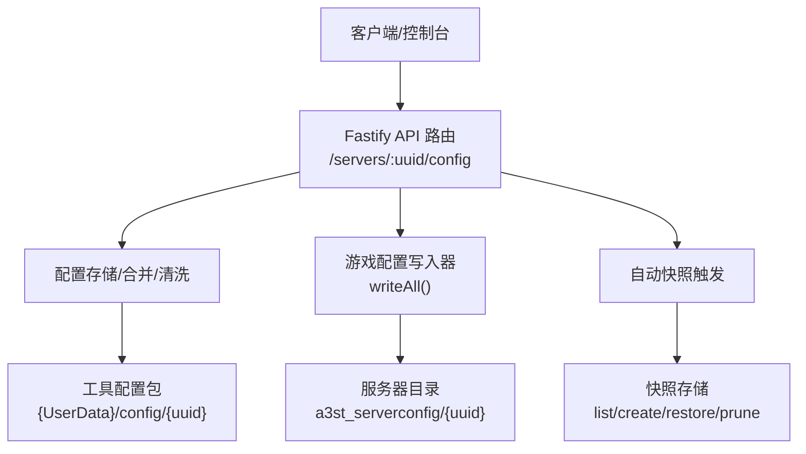
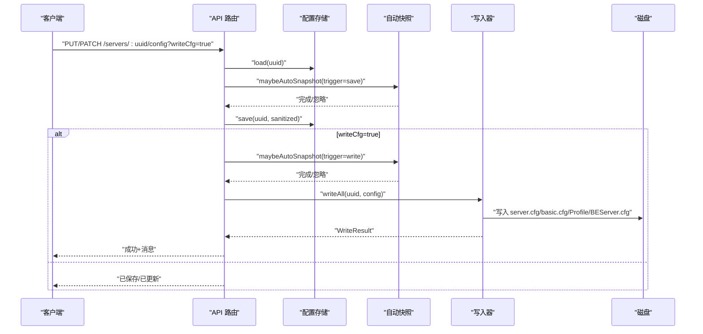
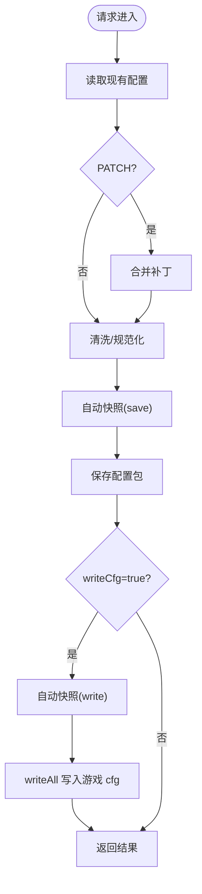
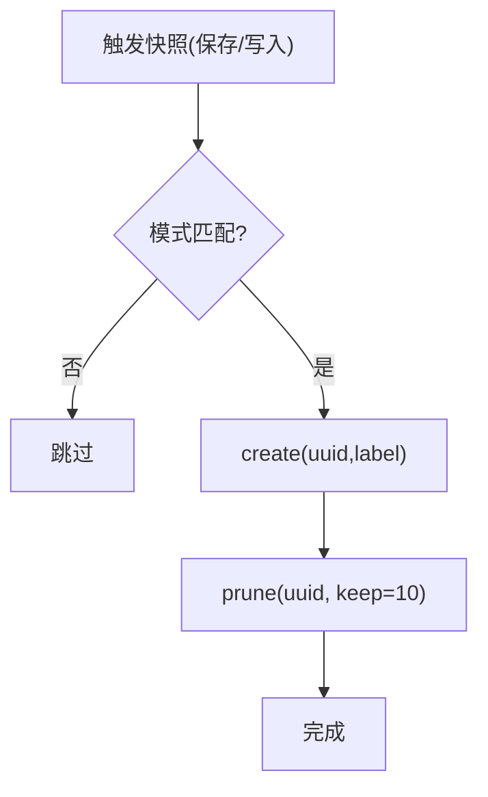
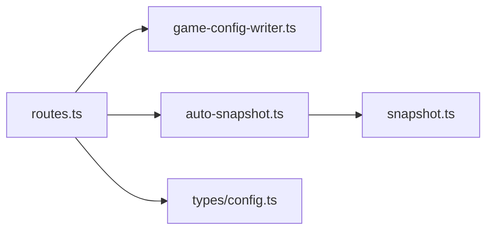

# 配置管理接口

<cite>
**本文引用的文件**   
- [README.md](file://README.md)
- [config-workflow.md](file://docs/config-workflow.md)
- [routes.ts](file://packages/service/src/api/routes.ts)
- [health.ts](file://packages/service/src/api/health.ts)
- [game-config-writer.ts](file://packages/service/src/config/game-config-writer.ts)
- [snapshot.ts](file://packages/service/src/config/snapshot.ts)
- [auto-snapshot.ts](file://packages/service/src/config/auto-snapshot.ts)
- [config.ts](file://packages/service/src/types/config.ts)
- [client.ts](file://packages/api-client/src/client.ts)
- [types.ts](file://packages/api-client/src/types.ts)
</cite>

## 目录
1. [简介](#简介)
2. [项目结构](#项目结构)
3. [核心组件](#核心组件)
4. [架构总览](#架构总览)
5. [详细组件分析](#详细组件分析)
6. [依赖关系分析](#依赖关系分析)
7. [性能与一致性考虑](#性能与一致性考虑)
8. [故障排查指南](#故障排查指南)
9. [结论](#结论)
10. [附录：JSON Schema 与校验规则](#附录json-schema-与校验规则)

## 简介
本文件面向 Arma 3 服务器工具 v2 的配置管理子系统，系统化说明配置文件的 CRUD 接口、配置文件组织结构、验证规则、版本控制机制、配置模板与快照、回滚能力、热重载与变更通知、权限与审计、以及迁移与升级支持。文档同时给出端到端调用序列图与数据流图，帮助读者快速理解从 API 到磁盘写入的完整链路。

## 项目结构
后端服务基于 Fastify + TypeScript，配置相关能力分布在以下模块：
- API 路由层：暴露 REST 端点，处理请求参数、鉴权、错误封装与统一响应。
- 配置持久化与合并：读取/保存工具配置包，合并补丁，清理非法字段。
- 游戏配置写入器：将工具配置包转换为 server.cfg、basic.cfg、Profile、BattlEye 等实际游戏可识别的文件。
- 自动快照与快照存储：在保存或写入前创建快照，支持列表、恢复与裁剪。
- 类型定义：ServerConfigPackage 及其子段定义了配置数据的结构与约束。
- 客户端 SDK：提供快照等能力的 TypeScript 客户端方法。

图表来源
- [routes.ts:99-195](file://packages/service/src/api/routes.ts#L99-L195)
- [game-config-writer.ts:590-619](file://packages/service/src/config/game-config-writer.ts#L590-L619)
- [snapshot.ts:30-63](file://packages/service/src/config/snapshot.ts#L30-L63)
- [auto-snapshot.ts:16-40](file://packages/service/src/config/auto-snapshot.ts#L16-L40)

章节来源
- [README.md:50-66](file://README.md#L50-L66)
- [config-workflow.md:41-60](file://docs/config-workflow.md#L41-L60)

## 核心组件
- 配置路由层（/servers/:uuid/config）
  - GET：读取配置，支持强制从磁盘刷新。
  - PUT：全量覆盖保存；可选 writeCfg=true 同步写入游戏目录。
  - PATCH：增量更新，含模组路径校验与 processById 清理。
  - /servers/:uuid/sync-state：查询工具侧同步状态。
- 游戏配置写入器（writeAll）
  - 生成 server.cfg、basic.cfg、Profile、BattlEye 配置。
  - 构建启动命令行、Headless 客户端命令行。
- 快照系统
  - 自动快照策略：BeforeSave / BeforeWrite / Off，支持异步。
  - 快照存储：创建、列出、恢复、裁剪保留最近 N 个。
- 类型与版本
  - ServerConfigPackage 定义格式版本与各子段。
  - 旧版单文件配置在读写时自动迁移为多文件目录结构。

章节来源
- [routes.ts:99-206](file://packages/service/src/api/routes.ts#L99-L206)
- [game-config-writer.ts:590-772](file://packages/service/src/config/game-config-writer.ts#L590-L772)
- [snapshot.ts:1-127](file://packages/service/src/config/snapshot.ts#L1-L127)
- [auto-snapshot.ts:1-41](file://packages/service/src/config/auto-snapshot.ts#L1-L41)
- [config.ts:12-132](file://packages/service/src/types/config.ts#L12-L132)
- [config-workflow.md:41-60](file://docs/config-workflow.md#L41-L60)

## 架构总览
配置管理的关键流程如下：
- 读取：API 从配置存储加载，必要时强制从磁盘刷新。
- 保存/更新：先清洗/合并，再根据策略触发自动快照，最后落盘。
- 写入游戏配置：可选参数 writeCfg=true 触发 writeAll，生成并覆盖游戏目录中的 cfg 文件。
- 同步状态：对比工具配置包与游戏目录 cfg，返回是否一致。

图表来源
- [routes.ts:112-195](file://packages/service/src/api/routes.ts#L112-L195)
- [auto-snapshot.ts:16-40](file://packages/service/src/config/auto-snapshot.ts#L16-L40)
- [game-config-writer.ts:590-619](file://packages/service/src/config/game-config-writer.ts#L590-L619)

## 详细组件分析

### 配置 CRUD 端点
- GET /api/v1/servers/:uuid/config
  - 功能：读取指定服务器的配置包。
  - 参数：reload=true 且允许外部刷新时，强制从磁盘重新加载。
  - 返回：统一信封 { success, data, error, uuid }。
- PUT /api/v1/servers/:uuid/config
  - 功能：全量保存配置包；可选 writeCfg=true 同步写入游戏目录。
  - 行为：清洗导入的 processById -> 自动快照(save) -> 保存 -> 可选写 cfg -> 自动快照(write)。
- PATCH /api/v1/servers/:uuid/config
  - 功能：增量更新配置包；对 localMods 进行路径有效性校验。
  - 行为：合并现有配置 -> 清洗 -> 自动快照(save) -> 保存 -> 可选写 cfg -> 自动快照(write)。
- GET /api/v1/servers/:uuid/sync-state
  - 功能：返回工具侧同步状态（未保存到工具/已保存到工具）。

图表来源
- [routes.ts:99-195](file://packages/service/src/api/routes.ts#L99-L195)
- [auto-snapshot.ts:6-14](file://packages/service/src/config/auto-snapshot.ts#L6-L14)

章节来源
- [routes.ts:99-206](file://packages/service/src/api/routes.ts#L99-L206)

### 配置文件组织结构
- 两类存储
  - 工具配置包：位于用户数据目录下的 {UserData}/config/{uuid}，由工具读写。
  - 游戏 cfg：位于服务器目录下的 {ServerDir}/a3st_serverconfig/{uuid}，由 Arma 3 进程使用，由工具应用或 Agent 写入。
- 配置包文件
  - manifest.json：UUID、名称、目录、保存时间、格式版本等。
  - server.json、startup.json、mods.json、basic.json、profile.json、battleye.json、tasks.json、missionparams.json。
- 旧版迁移
  - 旧版单文件 config/{uuid}.json 在读取或保存时自动迁移为上述目录结构，并删除 legacy 文件。

章节来源
- [config-workflow.md:41-60](file://docs/config-workflow.md#L41-L60)

### 验证规则与数据模型
- 数据模型
  - ServerConfigPackage 包含 formatVersion 与各业务子段（server/startup/mods/basic/profile/battleye/tasks/missionParams/scheduler/monitoring）。
- 关键校验
  - PATCH 中若存在 mods.localMods，会逐个校验 path 是否为有效模组目录（需包含 addons）。
  - 导入配置时会清理 processById，避免跨服 PID 污染。
- 版本控制
  - 通过 formatVersion 标识配置包格式版本；当前默认初始化为 2。

```mermaid
classDiagram
class ServerConfigPackage {
+number formatVersion
+ServerConfigSection server
+StartupConfigSection startup
+ModsConfigSection mods
+BasicConfigSection basic
+ProfileConfigSection profile
+BattlEyeConfigSection battleye
+TaskListSection tasks
+MissionParamsSection missionParams
+SchedulerConfigSection scheduler
+MonitoringConfigSection monitoring
}
class ServerConfigSection {
+string configName
+string serverDir
+string executable
+boolean x64
+string[] modPaths
}
class StartupConfigSection {
+string parameters
+boolean restartOnCrash
+number restartDelay
+number port
+boolean autoInit
+number cpuCount
+number exThreads
+number maxMem
+number limitFps
+number viewDistance
+number terrainGrid
+boolean enableHT
+boolean hugepages
+boolean loadMissionToMemory
+boolean disableServerThread
+boolean logObjectNotFound
+boolean skipDescriptionParsing
+boolean ignoreMissionLoadErrors
+number queueSizeLogG
+string startArgs
+string startConfigArgs
}
class ModsConfigSection {
+number[] enabledIds
+number[] serverModIds
+number[] clientModIds
+number[] hcModIds
+ModRoleEntry[] roleEntries
+boolean autoCopyBikey
+string[] modPaths
+LocalModEntry[] localMods
+string[] enabledLocalPaths
}
class BasicConfigSection {
+string hostname
+string password
+string passwordAdmin
+number maxPlayers
+number port
}
class ProfileConfigSection {
+string name
}
class BattlEyeConfigSection {
+string rconHost
+number rconPort
+string rconPassword
}
class TaskListSection {
+MissionEntry[] missions
+string forcedDifficulty
+boolean autoSelectMission
+boolean randomMissionOrder
+boolean enableHeadlessClient
+number processById
}
class MissionParamsSection {
+Record params
+Record byTemplate
}
class SchedulerConfigSection {
+string restartCron
+string monitoringCron
+Record cronJobs
}
class MonitoringConfigSection {
+boolean enabled
+boolean modEnabled
}
```

图表来源
- [config.ts:12-132](file://packages/service/src/types/config.ts#L12-L132)

章节来源
- [routes.ts:147-195](file://packages/service/src/api/routes.ts#L147-L195)
- [config.ts:12-132](file://packages/service/src/types/config.ts#L12-L132)

### 配置模板与任务参数
- 任务模板
  - 通过 tasks.missions 维护模板名、难度、白名单等；写入 server.cfg 时仅激活第一个任务，其余作为备选。
- 任务参数
  - missionParams.params 与 byTemplate 支持按模板设置参数；写入时生成 Params 块。

章节来源
- [game-config-writer.ts:233-272](file://packages/service/src/config/game-config-writer.ts#L233-L272)
- [game-config-writer.ts:421-455](file://packages/service/src/config/game-config-writer.ts#L421-L455)

### 配置快照与回滚
- 自动快照
  - 触发时机：BeforeSave / BeforeWrite / Off，支持异步执行。
  - 生命周期：每次 save/write 后最多保留最近 10 个快照。
- 快照存储
  - create：复制配置包所有 JSON 文件至快照目录，并生成 _snapshot.json 清单。
  - list：按时间倒序列出快照。
  - restore：将快照文件覆盖回配置包目录。
  - prune：删除超出保留数量的旧快照。

图表来源
- [auto-snapshot.ts:6-40](file://packages/service/src/config/auto-snapshot.ts#L6-L40)
- [snapshot.ts:30-63](file://packages/service/src/config/snapshot.ts#L30-L63)
- [snapshot.ts:110-125](file://packages/service/src/config/snapshot.ts#L110-L125)

章节来源
- [snapshot.ts:1-127](file://packages/service/src/config/snapshot.ts#L1-L127)
- [auto-snapshot.ts:1-41](file://packages/service/src/config/auto-snapshot.ts#L1-L41)

### 配置热重载与变更通知
- 热重载
  - GET /servers/:uuid/config 支持 reload=true 强制从磁盘刷新，前提是 UI 设置允许外部配置刷新。
- 变更通知
  - 仓库中存在 SSE 实现文件，但当前公开端点清单未暴露专用“配置变更”通道；如需实时推送，可在现有 SSE 基础上扩展事件类型。

章节来源
- [routes.ts:100-110](file://packages/service/src/api/routes.ts#L100-L110)
- [health.ts:36-54](file://packages/service/src/api/health.ts#L36-L54)

### 权限控制与审计日志
- 权限控制
  - 项目 README 指出 HTTP API 支持 Bearer 鉴权；具体鉴权中间件未在本文档直接展示。
- 审计日志
  - 代码库未发现统一的配置变更审计日志表或审计事件总线；建议在保存/写入前后记录操作者、时间、差异摘要。

章节来源
- [README.md:37-47](file://README.md#L37-L47)

### 配置迁移与升级
- 旧版迁移
  - 旧版单文件 config/{uuid}.json 在读取或保存时自动迁移为多文件目录结构，并删除 legacy 文件。
- 版本兼容
  - 新建服务器默认 formatVersion=2；写入器与路由逻辑均围绕该版本设计。

章节来源
- [config-workflow.md:48-60](file://docs/config-workflow.md#L48-L60)
- [routes.ts:209-225](file://packages/service/src/api/routes.ts#L209-L225)

## 依赖关系分析
- API 路由依赖
  - 配置存储（load/save/listServers/delete/rename）、写入器（writeAll/buildStartCommandLine/serverCfgExists/getServerExecutablePath）、预检（runPreflightChecks）、RCon 辅助、调度生命周期、模组扫描与 Bikey 服务、监控入库导出等。
- 快照依赖
  - 自动快照依赖 UI 设置（autoSnapshotMode/autoSnapshotAsync），并通过 Fastify 实例访问 snapshotStore。
- 写入器依赖
  - 平台可执行名、命令行拆分、模组命令行构建、端口占用检测等。

图表来源
- [routes.ts:1-60](file://packages/service/src/api/routes.ts#L1-L60)
- [auto-snapshot.ts:1-41](file://packages/service/src/config/auto-snapshot.ts#L1-L41)
- [snapshot.ts:1-127](file://packages/service/src/config/snapshot.ts#L1-L127)
- [config.ts:12-132](file://packages/service/src/types/config.ts#L12-L132)

章节来源
- [routes.ts:1-60](file://packages/service/src/api/routes.ts#L1-L60)

## 性能与一致性考虑
- 自动快照异步
  - 当 autoSnapshotAsync=true 时，快照创建不阻塞主流程，失败静默忽略，提升保存/写入吞吐。
- 配置刷新开关
  - allowExternalConfigRefresh 控制是否允许外部修改后强制刷新，避免频繁 IO。
- 写入原子性
  - writeAll 内部顺序写入多个文件；建议上层在关键路径增加事务式保护或幂等重试。
- 端口冲突检测
  - isPortInUse 通过系统命令检查端口占用，超时限制避免阻塞。

章节来源
- [auto-snapshot.ts:26-40](file://packages/service/src/config/auto-snapshot.ts#L26-L40)
- [routes.ts:65-70](file://packages/service/src/api/routes.ts#L65-L70)
- [game-config-writer.ts:197-231](file://packages/service/src/config/game-config-writer.ts#L197-L231)

## 故障排查指南
- 常见错误码与含义
  - NOT_FOUND：服务器或配置不存在。
  - SAVE_FAILED：保存失败（IO/序列化异常）。
  - WRITE_CFG_FAILED：写入游戏 cfg 失败（路径/权限/内容问题）。
  - INVALID_MOD_PATH：localMods 路径无效（缺少 addons）。
  - NO_SERVER_DIR：未设置服务器目录。
  - RCON_NOT_CONFIGURED：RCon 未配置。
- 定位步骤
  - 使用 /servers/:uuid/preflight 检查目录、端口、Bikey 等前置条件。
  - 使用 /servers/:uuid/logs 与 /servers/:uuid/rpt 查看日志。
  - 使用 /servers/:uuid/dashboard 观察运行状态与是否已写入 cfg。
  - 使用 /servers/:uuid/sync-state 确认工具侧同步状态。

章节来源
- [routes.ts:147-206](file://packages/service/src/api/routes.ts#L147-L206)
- [routes.ts:421-440](file://packages/service/src/api/routes.ts#L421-L440)
- [routes.ts:631-695](file://packages/service/src/api/routes.ts#L631-L695)
- [routes.ts:583-627](file://packages/service/src/api/routes.ts#L583-L627)

## 结论
Arma 3 服务器工具的 v2 配置管理以“工具配置包 + 游戏 cfg”双存储为核心，通过 REST API 提供安全的读/写/更新/删除能力，并结合自动快照、预检、同步状态、日志与监控等能力形成闭环。对于生产环境，建议补充统一的审计日志与配置变更通知通道，并在关键写入路径引入事务式保护与幂等重试，以提升可靠性与可观测性。

## 附录：JSON Schema 与校验规则
以下为 ServerConfigPackage 及其子段的精简 JSON Schema 描述，便于前端或网关做输入校验。注意：此处为概念性 Schema，实际字段以 types/config.ts 为准。

- ServerConfigPackage
  - type: object
  - required: ["formatVersion"]
  - properties:
    - formatVersion: { type: number }
    - server: { $ref: "#/definitions/ServerConfigSection" }
    - startup: { $ref: "#/definitions/StartupConfigSection" }
    - mods: { $ref: "#/definitions/ModsConfigSection" }
    - basic: { $ref: "#/definitions/BasicConfigSection" }
    - profile: { $ref: "#/definitions/ProfileConfigSection" }
    - battleye: { $ref: "#/definitions/BattlEyeConfigSection" }
    - tasks: { $ref: "#/definitions/TaskListSection" }
    - missionParams: { $ref: "#/definitions/MissionParamsSection" }
    - scheduler: { $ref: "#/definitions/SchedulerConfigSection" }
    - monitoring: { $ref: "#/definitions/MonitoringConfigSection" }

- ServerConfigSection
  - type: object
  - properties:
    - configName: { type: string }
    - serverDir: { type: string }
    - executable: { type: string }
    - x64: { type: boolean }
    - modPaths: { type: array, items: { type: string } }

- StartupConfigSection
  - type: object
  - properties:
    - parameters: { type: string }
    - restartOnCrash: { type: boolean }
    - restartDelay: { type: number }
    - port: { type: number }
    - autoInit: { type: boolean }
    - cpuCount: { type: number }
    - exThreads: { type: number }
    - maxMem: { type: number }
    - limitFps: { type: number }
    - viewDistance: { type: number }
    - terrainGrid: { type: number }
    - enableHT: { type: boolean }
    - hugepages: { type: boolean }
    - loadMissionToMemory: { type: boolean }
    - disableServerThread: { type: boolean }
    - logObjectNotFound: { type: boolean }
    - skipDescriptionParsing: { type: boolean }
    - ignoreMissionLoadErrors: { type: boolean }
    - queueSizeLogG: { type: number }
    - startArgs: { type: string }
    - startConfigArgs: { type: string }

- ModsConfigSection
  - type: object
  - properties:
    - enabledIds: { type: array, items: { type: number } }
    - serverModIds: { type: array, items: { type: number } }
    - clientModIds: { type: array, items: { type: number } }
    - hcModIds: { type: array, items: { type: number } }
    - roleEntries: { type: array, items: { type: object } }
    - autoCopyBikey: { type: boolean }
    - modPaths: { type: array, items: { type: string } }
    - localMods: { type: array, items: { type: object } }
    - enabledLocalPaths: { type: array, items: { type: string } }

- BasicConfigSection
  - type: object
  - properties:
    - hostname: { type: string }
    - password: { type: string }
    - passwordAdmin: { type: string }
    - maxPlayers: { type: number }
    - port: { type: number }

- ProfileConfigSection
  - type: object
  - properties:
    - name: { type: string }

- BattlEyeConfigSection
  - type: object
  - properties:
    - rconHost: { type: string }
    - rconPort: { type: number }
    - rconPassword: { type: string }

- TaskListSection
  - type: object
  - properties:
    - missions: { type: array, items: { type: object } }
    - forcedDifficulty: { type: string }
    - autoSelectMission: { type: boolean }
    - randomMissionOrder: { type: boolean }
    - enableHeadlessClient: { type: boolean }
    - processById: { type: number }

- MissionParamsSection
  - type: object
  - properties:
    - params: { type: object }
    - byTemplate: { type: object }

- SchedulerConfigSection
  - type: object
  - properties:
    - restartCron: { type: string }
    - monitoringCron: { type: string }
    - cronJobs: { type: object }

- MonitoringConfigSection
  - type: object
  - properties:
    - enabled: { type: boolean }
    - modEnabled: { type: boolean }

章节来源
- [config.ts:12-132](file://packages/service/src/types/config.ts#L12-L132)