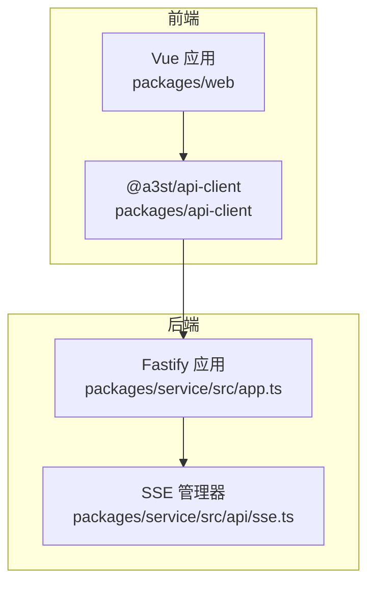
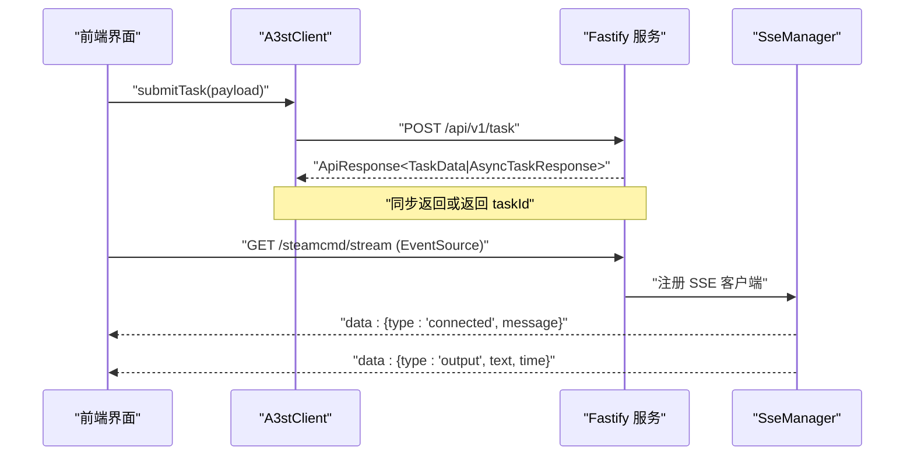
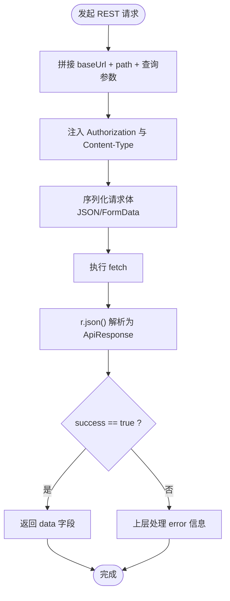
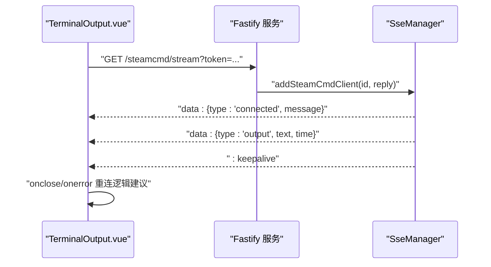
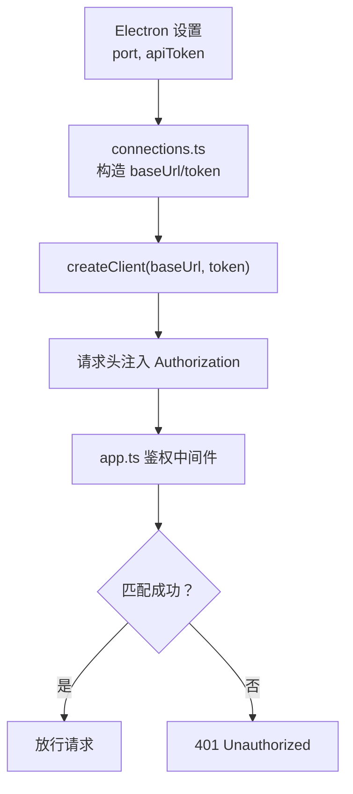
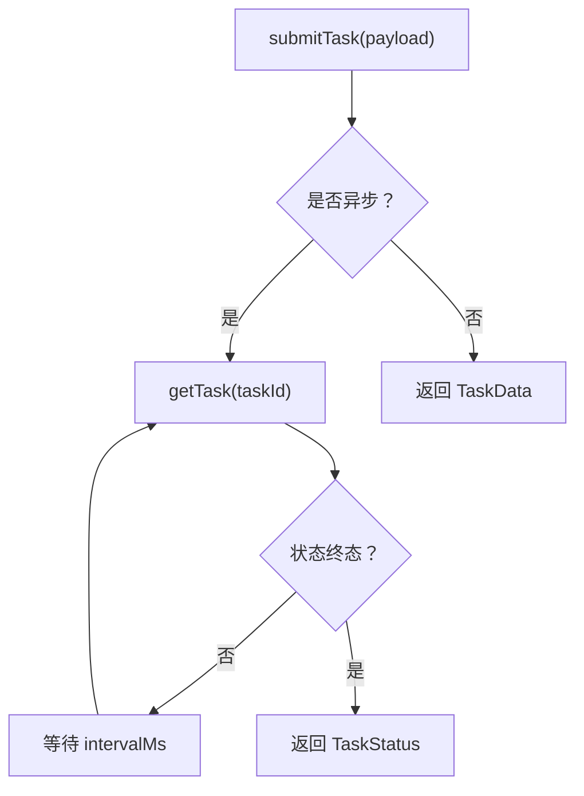
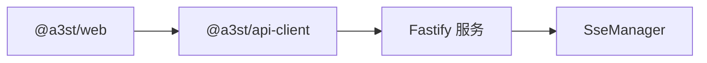

# API 集成

<cite>
**本文引用的文件**   
- [packages/api-client/src/client.ts](file://packages/api-client/src/client.ts)
- [packages/api-client/src/types.ts](file://packages/api-client/src/types.ts)
- [packages/api-client/src/index.ts](file://packages/api-client/src/index.ts)
- [packages/api-client/package.json](file://packages/api-client/package.json)
- [packages/service/src/app.ts](file://packages/service/src/app.ts)
- [packages/service/src/api/sse.ts](file://packages/service/src/api/sse.ts)
- [packages/web/src/components/TerminalOutput.vue](file://packages/web/src/components/TerminalOutput.vue)
- [packages/web/src/stores/connections.ts](file://packages/web/src/stores/connections.ts)
</cite>

## 目录
1. [简介](#简介)
2. [项目结构](#项目结构)
3. [核心组件](#核心组件)
4. [架构总览](#架构总览)
5. [详细组件分析](#详细组件分析)
6. [依赖关系分析](#依赖关系分析)
7. [性能与可靠性](#性能与可靠性)
8. [故障排查指南](#故障排查指南)
9. [结论](#结论)
10. [附录](#附录)

## 简介
本文件面向前端开发者，系统化说明 Arma3 Server Tools v2 的前端 API 集成方案。内容覆盖：
- API 客户端封装层设计：请求头注入、REST 方法封装、参数序列化、响应信封类型。
- RESTful 调用模式：服务器管理、任务提交与轮询、文件上传、设置与监控数据等。
- SSE（Server-Sent Events）实时通信：服务端广播、连接生命周期、历史回放与保活。
- WebSocket 集成现状：当前仓库未实现 WebSocket；SSE 用于流式输出。
- 认证与鉴权：Bearer Token、x-api-key、查询参数 token 三种方式。
- 类型安全、Mock 与调试建议：基于 TypeScript 的类型定义、测试样例与调试技巧。
- 并发控制、超时处理与缓存策略：客户端现有能力与扩展建议。

## 项目结构
本项目采用 monorepo 组织，API 相关代码主要分布在以下包：
- packages/api-client：TypeScript API 客户端封装，提供 A3stClient 类与统一类型。
- packages/service：后端 Fastify 服务，包含鉴权中间件与 SSE 管理器。
- packages/web：Vue 3 前端，使用 api-client 发起请求，并通过 EventSource 消费 SSE。



**图示来源**
- [packages/api-client/src/client.ts:48-105](file://packages/api-client/src/client.ts#L48-L105)
- [packages/service/src/app.ts:102-141](file://packages/service/src/app.ts#L102-L141)
- [packages/service/src/api/sse.ts:51-91](file://packages/service/src/api/sse.ts#L51-L91)

**章节来源**
- [packages/api-client/package.json:1-24](file://packages/api-client/package.json#L1-L24)
- [packages/api-client/src/index.ts:1-4](file://packages/api-client/src/index.ts#L1-L4)

## 核心组件
- A3stClient：统一的 HTTP 客户端，封装 GET/POST/PUT/DELETE 与原始请求能力，负责 Bearer Token 注入、JSON 序列化、URL 拼接与通用响应类型 ApiResponse<T>。
- 类型系统 types.ts：定义所有接口契约，包括健康检查、动作发现、服务器配置、任务模型、日志、SteamCMD、监控统计、快照等。
- SSE 管理器 SseManager：将 SteamCMD 事件广播到已连接的 SSE 客户端，支持历史回放、Keep-Alive 与断线清理。
- 前端终端组件 TerminalOutput.vue：通过 EventSource 订阅 SSE，解析 JSON 事件并渲染输出行。
- 连接管理 connections.ts：维护连接列表、本地服务发现、Token 注入与客户端实例创建。

**章节来源**
- [packages/api-client/src/client.ts:48-105](file://packages/api-client/src/client.ts#L48-L105)
- [packages/api-client/src/types.ts:1-425](file://packages/api-client/src/types.ts#L1-L425)
- [packages/service/src/api/sse.ts:9-94](file://packages/service/src/api/sse.ts#L9-L94)
- [packages/web/src/components/TerminalOutput.vue:1-42](file://packages/web/src/components/TerminalOutput.vue#L1-L42)
- [packages/web/src/stores/connections.ts:86-135](file://packages/web/src/stores/connections.ts#L86-L135)

## 架构总览
前后端通过 REST API 进行状态与命令交互，通过 SSE 推送后台任务（如 SteamCMD）的实时输出。



**图示来源**
- [packages/api-client/src/client.ts:282-302](file://packages/api-client/src/client.ts#L282-L302)
- [packages/service/src/api/sse.ts:51-91](file://packages/service/src/api/sse.ts#L51-L91)

## 详细组件分析

### API 客户端封装层（A3stClient）
职责与特性：
- 基础 URL 规范化与可插拔 fetch 实现，便于测试与替换。
- 统一请求头注入 Authorization: Bearer <token>。
- 对 GET/POST/PUT/DELETE 的轻量封装，自动设置 Content-Type 与 JSON 序列化。
- postRaw 暴露底层 RequestInit，便于文件上传、自定义头部等场景。
- 业务方法按资源域划分：健康检查、动作发现、服务器 CRUD、配置读写、任务提交与轮询、文件上传、日志读取、SteamCMD 设置、监控导出等。

请求拦截与响应处理：
- 请求拦截：headers() 合并额外头部并注入 Bearer Token。
- 响应处理：直接 r.json()，由上层根据 ApiResponse<T> 判断 success/error。

参数序列化：
- JSON 请求体统一 JSON.stringify。
- 查询参数通过字符串拼接或 URLSearchParams 构造。

错误统一处理：
- 当前客户端不捕获网络异常，也不校验 HTTP 状态码，需在上层结合 ApiResponse.success 与 try/catch 处理。

```mermaid
classDiagram
class A3stClient {
+string baseUrl
-string token
-fetch f
+constructor(options)
-headers(extra) Record<string,string>
-get<T>(path) Promise<ApiResponse<T>>
-post<T>(path, body) Promise<ApiResponse<T>>
-put<T>(path, body) Promise<ApiResponse<T>>
-deleteReq<T>(path) Promise<ApiResponse<T>>
+postRaw(path, init) Promise<Response>
+health() Promise<ApiResponse<HealthData>>
+actions() Promise<ApiResponse<ActionsData>>
+listServers(reload) Promise<ServerSummary[]>
+serverStatus(uuid) Promise<ServerStatus>
+getConfig(uuid, reload) Promise<ApiResponse<ArmaServerConfig>>
+patchConfig(uuid, patch, writeCfg) Promise<ApiResponse<ArmaServerConfig>>
+createServer(configName, serverDir) Promise<ApiResponse<CreateServerResult>>
+cloneServer(uuid) Promise<ApiResponse<CreateServerResult>>
+deleteServer(uuid) Promise<ApiResponse<{message : string}>>
+renameServer(uuid, newName) Promise<ApiResponse<{message : string}>>
+getModScan(uuid) Promise<ApiResponse<ModScanData>>
+getBans(uuid) Promise<ApiResponse<BanEntry[]>>
+saveBans(uuid, bans) Promise<ApiResponse<{message : string;count : number}>>
+scanMissions(uuid) Promise<ApiResponse<{missions : MissionEntry[];scanned : number}>>
+getDiagnostics(uuid) Promise<ApiResponse<PreflightData>>
+listLogFiles(uuid, kind) Promise<ApiResponse<{files : LogFileEntry[];serverDir : string}>>
+readLogs(uuid, logKind, options) Promise<ApiResponse<LogData>>
+syncMonitoringPlayers(uuid) Promise<ApiResponse<{synced : number}>>
+exportMonitoringHtml(uuid) Promise<ApiResponse<{html : string}>>
+exportMonitoringCsv(uuid, kind) Promise<ApiResponse<{csv : string}>>
+getServerPaths(uuid) Promise<ApiResponse<ServerPathsData>>
+listSnapshots(uuid) Promise<ApiResponse<SnapshotEntry[]>>
+createSnapshot(uuid, label) Promise<ApiResponse<SnapshotEntry>>
+restoreSnapshot(uuid, snapshotId) Promise<ApiResponse<{message : string}>>
+getMonitoringSummary(uuid) Promise<ApiResponse<MonitoringSummaryData>>
+getMonitoringStats(uuid, hours) Promise<ApiResponse<{stats : MonitoringStatsPoint[]}>>
+getMonitoringPlayers(uuid) Promise<ApiResponse<{players : MonitoringPlayerRow[]}>>
+getSyncState(uuid) Promise<ApiResponse<ServerSyncState>>
+getUiSettings() Promise<ApiResponse<UiSettings>>
+saveUiSettings(settings) Promise<ApiResponse<UiSettings>>
+getModScanPaths() Promise<ApiResponse<{paths : ModScanPathEntry[]}>>
+saveModScanPaths(paths) Promise<ApiResponse<{paths : ModScanPathEntry[];message : string}>>
+fetchWorkshopModDetails(modIds, localMods) Promise<ApiResponse<{mods : SteamWorkshopModInfo[]}>>
+validateModPath(modPath) Promise<ApiResponse<{valid : boolean}>>
+submitTask(payload) Promise<ApiResponse<TaskData|AsyncTaskResponse>>
+submitTaskLegacy(payload) Promise<LegacyTaskResponse>
+getTask(taskId) Promise<ApiResponse<TaskStatus>>
+cancelTask(taskId) Promise<ApiResponse<{message : string;status? : string}>>
+pollTask(taskId, intervalMs, timeoutMs) Promise<TaskStatus>
+uploadMissionPbo(uuid, file, options) Promise<ApiResponse<MissionUploadResult>>
+uploadModHtml(uuid, html, options) Promise<ApiResponse<ModHtmlUploadData>>
+preflight(uuid) Promise<ApiResponse<PreflightData>>
+steamCmdStatus() Promise<ApiResponse<SteamCmdStatusData>>
+getSteamCmdSettings() Promise<ApiResponse<SteamCmdSettingsData>>
+saveSteamCmdSettings(body) Promise<ApiResponse<SteamCmdSettingsData>>
+stopSteamCmd() Promise<ApiResponse<{message? : string;cancelledTaskIds? : string[]}>>
}
```

**图示来源**
- [packages/api-client/src/client.ts:48-408](file://packages/api-client/src/client.ts#L48-L408)

**章节来源**
- [packages/api-client/src/client.ts:48-105](file://packages/api-client/src/client.ts#L48-L105)
- [packages/api-client/src/client.ts:107-408](file://packages/api-client/src/client.ts#L107-L408)

### RESTful API 调用模式
- 路径规范：统一以 /api/v1 为前缀，资源命名清晰，动词语义明确。
- 参数传递：
  - 查询参数：reload、kind、hours、writeCfg、addToMissionList 等。
  - 请求体：JSON 对象，Content-Type: application/json。
  - 文件上传：FormData 或文本直传（HTML）。
- 响应格式：统一 ApiResponse<T>，包含 success、data、error、requestId。
- 典型流程：
  - 服务器管理：listServers、serverStatus、getConfig/patchConfig、createServer/cloneServer/deleteServer/renameServer。
  - 任务系统：submitTask 返回 TaskData 或 AsyncTaskResponse；pollTask 轮询 getTask 直至终态。
  - 文件操作：uploadMissionPbo、uploadModHtml。
  - 监控导出：exportMonitoringHtml/Csv、getMonitoringStats/Players/Summary。



**图示来源**
- [packages/api-client/src/client.ts:61-98](file://packages/api-client/src/client.ts#L61-L98)
- [packages/api-client/src/types.ts:1-8](file://packages/api-client/src/types.ts#L1-L8)

**章节来源**
- [packages/api-client/src/client.ts:107-408](file://packages/api-client/src/client.ts#L107-L408)
- [packages/api-client/src/types.ts:1-425](file://packages/api-client/src/types.ts#L1-L425)

### SSE（Server-Sent Events）实时通信
服务端实现：
- SseManager 维护已连接客户端集合，监听 SteamCMD 事件（output/progress/complete），向所有客户端广播 data: {...} 事件。
- 路由 /steamcmd/stream 使用 hijack 建立长连接，发送 connected 初始事件、历史日志片段、运行中提示，并按 15s 间隔发送 keepalive。
- 客户端断开时自动清理。

前端实现：
- TerminalOutput.vue 使用 EventSource 连接流地址，支持在 URL 中追加 token 查询参数。
- onmessage 解析 JSON，区分 connected/output 事件，限制最大行数避免内存膨胀。



**图示来源**
- [packages/service/src/api/sse.ts:51-91](file://packages/service/src/api/sse.ts#L51-L91)
- [packages/web/src/components/TerminalOutput.vue:10-42](file://packages/web/src/components/TerminalOutput.vue#L10-L42)

**章节来源**
- [packages/service/src/api/sse.ts:9-94](file://packages/service/src/api/sse.ts#L9-L94)
- [packages/web/src/components/TerminalOutput.vue:1-42](file://packages/web/src/components/TerminalOutput.vue#L1-L42)

### WebSocket 集成现状
- 当前仓库未发现 WebSocket 服务端或客户端实现。
- 实时输出通过 SSE 实现，适合单向流式数据（如日志、进度）。
- 如需双向实时通信，可在后端新增 WebSocket 路由并在前端引入原生 WebSocket 或第三方库。

[本节为概念性说明，不涉及具体源码]

### 认证与鉴权
- 客户端：A3stClient.headers() 自动注入 Authorization: Bearer <token>。
- 服务端：app.ts 中间件支持三种鉴权方式：
  - Authorization: Bearer <token>
  - x-api-key: <token>
  - 查询参数 token=<token>
- 前端连接管理：connections.ts 从 Electron 设置中获取端口与 token，构造 baseUrl 与 token，并创建 A3stClient。



**图示来源**
- [packages/web/src/stores/connections.ts:86-135](file://packages/web/src/stores/connections.ts#L86-L135)
- [packages/api-client/src/client.ts:61-67](file://packages/api-client/src/client.ts#L61-L67)
- [packages/service/src/app.ts:102-141](file://packages/service/src/app.ts#L102-L141)

**章节来源**
- [packages/web/src/stores/connections.ts:86-135](file://packages/web/src/stores/connections.ts#L86-L135)
- [packages/api-client/src/client.ts:61-67](file://packages/api-client/src/client.ts#L61-L67)
- [packages/service/src/app.ts:102-141](file://packages/service/src/app.ts#L102-L141)

### 任务系统与异步轮询
- submitTask：提交自动化任务，可能同步返回结果或返回 taskId。
- pollTask：循环调用 getTask，直到状态为 Succeeded/Failed/Cancelled 或达到超时。
- 取消任务：cancelTask 调用 DELETE /api/v1/tasks/:taskId。



**图示来源**
- [packages/api-client/src/client.ts:282-321](file://packages/api-client/src/client.ts#L282-L321)

**章节来源**
- [packages/api-client/src/client.ts:282-321](file://packages/api-client/src/client.ts#L282-L321)

### 文件上传与参数序列化
- uploadMissionPbo：使用 FormData 上传 .pbo 文件，支持 addToMissionList 与 writeCfg 查询参数。
- uploadModHtml：以 text/html 内容类型直接上传 HTML 字符串，支持 mode 与 writeCfg 查询参数。
- 其他 JSON 请求体统一 JSON.stringify，Content-Type: application/json。

**章节来源**
- [packages/api-client/src/client.ts:325-360](file://packages/api-client/src/client.ts#L325-L360)

## 依赖关系分析
- @a3st/api-client 被 @a3st/web 作为依赖引用，提供类型安全的客户端与类型定义。
- 前端通过 createClient 生成实例，传入 baseUrl 与 token。
- 后端 Fastify 应用挂载 SSE 路由，并与 SteamCMD 管理器事件桥接。



**图示来源**
- [package-lock.json:10128-10141](file://package-lock.json#L10128-L10141)
- [packages/service/src/api/sse.ts:51-91](file://packages/service/src/api/sse.ts#L51-L91)

**章节来源**
- [package-lock.json:10128-10141](file://package-lock.json#L10128-L10141)

## 性能与可靠性
- 并发控制：
  - 当前客户端未实现请求级并发限制，建议在业务层对高频轮询（如 pollTask）做节流与去抖。
- 超时处理：
  - pollTask 内置超时时间（默认 600000ms），可调整 intervalMs 与 timeoutMs。
  - 对于长耗时任务，建议结合 SSE 展示进度，减少频繁轮询。
- 请求缓存策略：
  - 当前未实现 HTTP 缓存；对只读数据（如 settings、monitoring summary）可在上层实现短期缓存与失效策略。
- 重试与退避：
  - 建议在网络异常时实现指数退避重试，避免雪崩。
- SSE 稳定性：
  - 服务端每 15s 发送 keepalive，前端应实现 onerror/onclose 自动重连，并保留最近 N 条消息。

[本节为通用建议，不直接分析具体源码]

## 故障排查指南
常见问题与定位要点：
- 401 Unauthorized：
  - 检查 Authorization 头是否正确注入。
  - 确认服务端配置的 token 与前端一致。
  - 若使用 x-api-key 或查询参数 token，确保服务端允许该方式。
- CORS 失败：
  - 后端已配置宽松 CORS，开发环境常见 Origin 为 http://localhost 或 null。
- SSE 无法连接：
  - 检查浏览器控制台 EventSource 错误。
  - 确认服务端 /steamcmd/stream 路由可用，且无反向代理阻断。
  - 前端 TerminalOutput.vue 应正确处理 onmessage 中的 JSON 解析异常。
- 任务长时间无响应：
  - 检查 pollTask 的 timeoutMs 是否合理。
  - 查看服务端任务队列与 SteamCMD 状态。

**章节来源**
- [packages/service/src/app.ts:102-141](file://packages/service/src/app.ts#L102-L141)
- [packages/web/src/components/TerminalOutput.vue:27-42](file://packages/web/src/components/TerminalOutput.vue#L27-L42)

## 结论
本项目的前端 API 集成以 A3stClient 为核心，提供类型安全、简洁易用的 REST 调用能力；通过 SSE 实现后台任务的实时输出；鉴权机制灵活，支持多种 Token 传递方式。当前未实现 WebSocket，但 SSE 足以满足日志与进度推送场景。建议在业务层补充缓存、重试、并发控制与更完善的错误处理，以提升鲁棒性与用户体验。

## 附录
- 类型安全：
  - 所有接口契约集中在 types.ts，前端可直接复用类型，保证编译期安全。
- Mock 数据与调试：
  - 可使用 fetch polyfill 或拦截器替换 fetchImpl，模拟不同响应。
  - 利用 TerminalOutput.vue 的 onmessage 分支打印原始 event.data，辅助调试。
- 最佳实践：
  - 对敏感操作增加二次确认与幂等键。
  - 对长任务优先使用 SSE 展示进度，轮询仅用于状态查询。
  - 对只读数据实施短缓存与按需刷新。