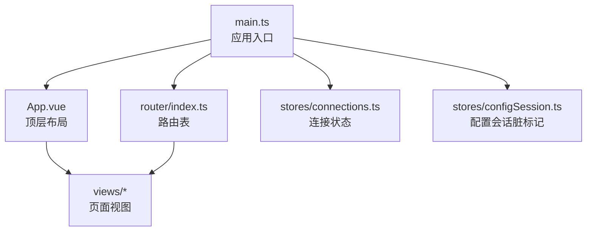
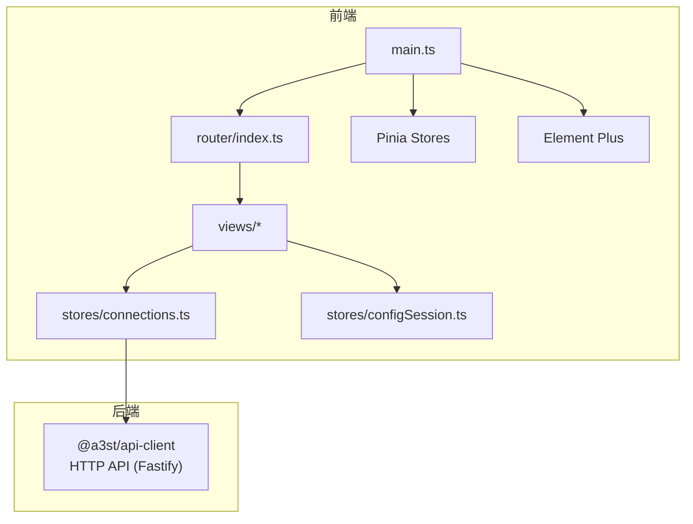
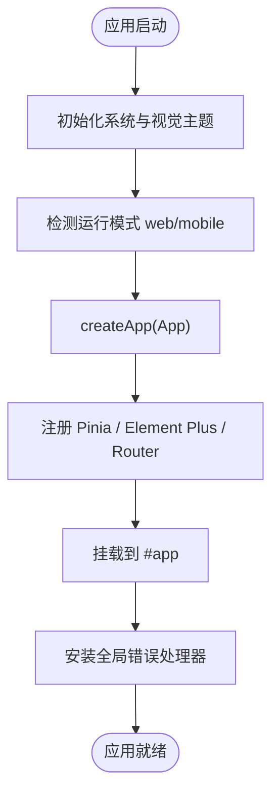
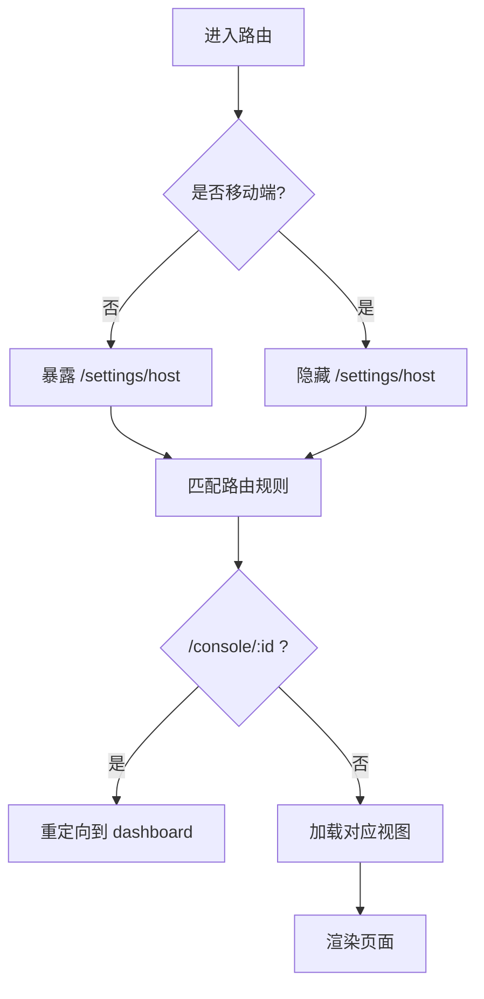
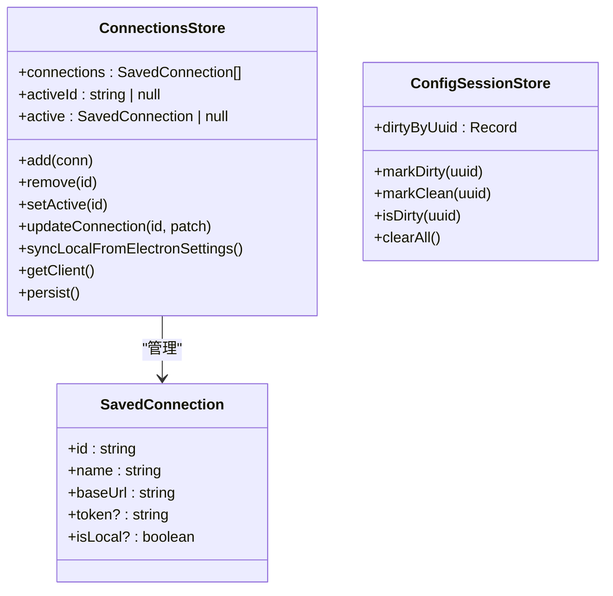
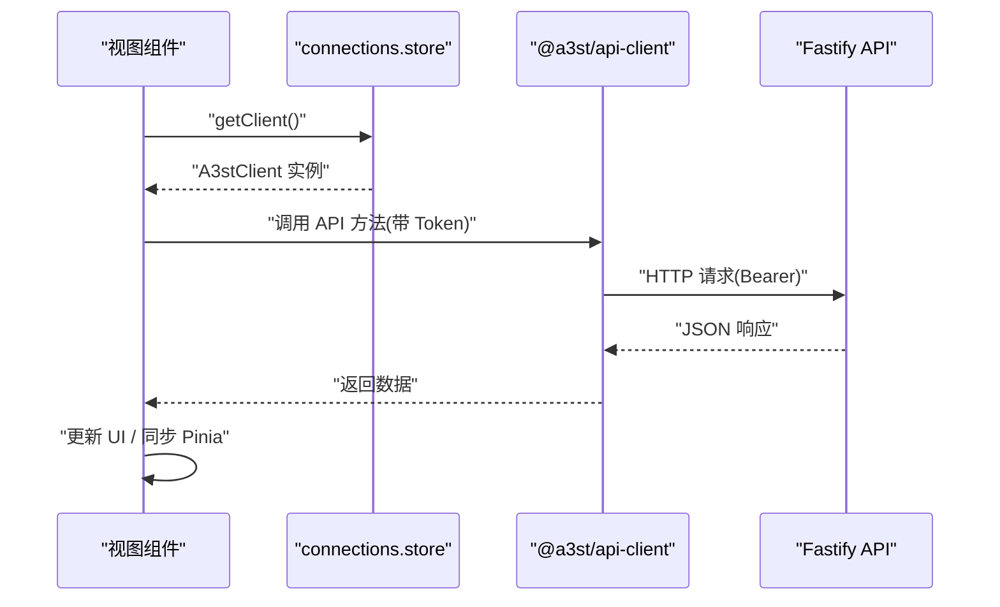
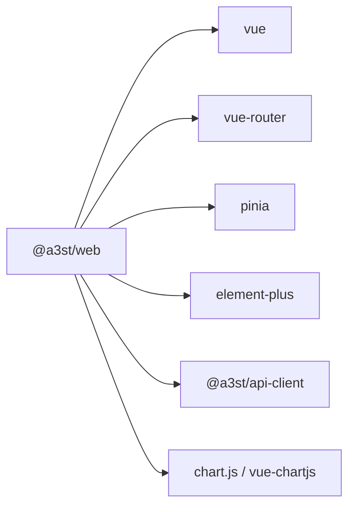

# 前端控制台

<cite>
**本文引用的文件**   
- [packages/web/package.json](file://packages/web/package.json)
- [README.md](file://README.md)
- [packages/web/src/main.ts](file://packages/web/src/main.ts)
- [packages/web/src/App.vue](file://packages/web/src/App.vue)
- [packages/web/src/router/index.ts](file://packages/web/src/router/index.ts)
- [packages/web/src/stores/connections.ts](file://packages/web/src/stores/connections.ts)
- [packages/web/src/stores/configSession.ts](file://packages/web/src/stores/configSession.ts)
</cite>

## 目录
1. [简介](#简介)
2. [项目结构](#项目结构)
3. [核心组件](#核心组件)
4. [架构总览](#架构总览)
5. [详细组件分析](#详细组件分析)
6. [依赖关系分析](#依赖关系分析)
7. [性能与优化](#性能与优化)
8. [故障排查指南](#故障排查指南)
9. [结论](#结论)

## 简介
本文件为前端控制台 @a3st/web 的详细技术文档，聚焦 Vue 3 单页应用的初始化流程、组件与路由架构、Pinia 状态管理数据流、Element Plus 集成与主题切换、以及前后端通信模式。该应用是 Arma3 Server Tools v2 的前端控制面板，使用 Vite + Vue 3 + TypeScript 构建，通过 Pinia 管理连接与配置会话状态，并通过 Element Plus 提供 UI 能力。后端为 Node.js + Fastify + SQLite，并提供 HTTP API（支持 Bearer 鉴权）。

## 项目结构
@ a3st/web 位于 monorepo 的 packages/web 目录下，主要目录包括：
- src/main.ts：应用入口，负责创建 Vue 实例、注册 Pinia、Element Plus、Router，并初始化主题与环境模式。
- src/App.vue：顶层布局容器，承载标题栏、主题选择器与 router-view。
- src/router/index.ts：路由定义，包含连接页、控制台页、设置页与演示页，采用懒加载与同步加载混合策略。
- src/stores：Pinia stores，当前包含连接管理与配置会话脏标记两个 store。
- src/views：页面视图集合，如 ConnectionsView、ServerConsoleView、HostSettingsView 等。
- src/components、src/composables、src/utils、src/styles、src/config、src/constants：组件、组合式函数、工具、样式与常量。

图表来源
- [packages/web/src/main.ts:1-45](file://packages/web/src/main.ts#L1-L45)
- [packages/web/src/App.vue:1-108](file://packages/web/src/App.vue#L1-L108)
- [packages/web/src/router/index.ts:1-79](file://packages/web/src/router/index.ts#L1-L79)
- [packages/web/src/stores/connections.ts:1-136](file://packages/web/src/stores/connections.ts#L1-L136)
- [packages/web/src/stores/configSession.ts:1-22](file://packages/web/src/stores/configSession.ts#L1-L22)

章节来源
- [packages/web/package.json:1-37](file://packages/web/package.json#L1-L37)
- [README.md:50-86](file://README.md#L50-L86)

## 核心组件
本节概述应用的核心模块及其职责：
- 应用入口 main.ts：初始化系统主题与视觉主题，注入 Pinia、Element Plus、Router，挂载根组件，并设置全局错误处理。
- 顶层布局 App.vue：根据路由判断是否控制台或连接页，渲染标题栏、主题切换下拉框与返回链接，承载 router-view。
- 路由 router/index.ts：定义 SPA 路由，包含连接页、控制台页、设置页与风格演示页；对控制台主路由采用同步加载以避免白屏。
- 连接状态 stores/connections.ts：维护已保存的连接列表、当前激活连接、持久化到 localStorage，并提供基于当前连接生成 API 客户端的方法。
- 配置会话 stores/configSession.ts：维护配置项的脏标记集合，用于提示未保存变更。

章节来源
- [packages/web/src/main.ts:1-45](file://packages/web/src/main.ts#L1-L45)
- [packages/web/src/App.vue:1-108](file://packages/web/src/App.vue#L1-L108)
- [packages/web/src/router/index.ts:1-79](file://packages/web/src/router/index.ts#L1-L79)
- [packages/web/src/stores/connections.ts:1-136](file://packages/web/src/stores/connections.ts#L1-L136)
- [packages/web/src/stores/configSession.ts:1-22](file://packages/web/src/stores/configSession.ts#L1-L22)

## 架构总览
下图展示前端控制台的整体架构：Vue 3 应用由 main.ts 启动，注册 Pinia、Element Plus 与 Router；App.vue 作为壳层承载页面；路由将 URL 映射到具体视图；Pinia stores 管理连接与配置状态；视图通过 @a3st/api-client 调用后端 Fastify API。

图表来源
- [packages/web/src/main.ts:1-45](file://packages/web/src/main.ts#L1-L45)
- [packages/web/src/router/index.ts:1-79](file://packages/web/src/router/index.ts#L1-L79)
- [packages/web/src/stores/connections.ts:1-136](file://packages/web/src/stores/connections.ts#L1-L136)

## 详细组件分析

### 应用初始化与主题系统
- 初始化流程：
  - 导入并初始化系统与视觉主题。
  - 根据环境变量决定运行模式（web/mobile），并在 documentElement 上设置 data-app-mode 与 is-mobile-app 类名。
  - 创建 Vue 应用实例，注册 Pinia、Element Plus（移动端默认尺寸）、Router，挂载到 #app。
  - 设置全局 errorHandler，捕获未处理异常并显示“界面异常”横幅，提供返回连接页的快捷链接。
- 主题系统：
  - App.vue 读取并设置主题模式（跟随系统/浅色/深色），通过 select 控件触发 setThemeMode。
  - 非移动设备且非控制台页面时显示标题栏，包含应用名称、版本、主题选择器与导航链接。

图表来源
- [packages/web/src/main.ts:1-45](file://packages/web/src/main.ts#L1-L45)
- [packages/web/src/App.vue:1-108](file://packages/web/src/App.vue#L1-L108)

章节来源
- [packages/web/src/main.ts:1-45](file://packages/web/src/main.ts#L1-L45)
- [packages/web/src/App.vue:1-108](file://packages/web/src/App.vue#L1-L108)

### 路由与页面组织
- 路由设计：
  - 根路径重定向至 /connections。
  - /connections 为连接管理页，懒加载。
  - /demo/* 为风格演示页，懒加载。
  - /settings/host 仅桌面端可用，懒加载。
  - /console/:connectionId 重定向到 dashboard 子路由。
  - /console/:connectionId/:tab 同步加载 ServerConsoleView，避免 Electron/file 协议或静态托管下异步 chunk 失败导致白屏。
- 路由错误处理：
  - 捕获路由错误，输出错误信息并渲染“页面加载失败”兜底页面，提供返回连接页的链接。

图表来源
- [packages/web/src/router/index.ts:1-79](file://packages/web/src/router/index.ts#L1-L79)

章节来源
- [packages/web/src/router/index.ts:1-79](file://packages/web/src/router/index.ts#L1-L79)

### 状态管理（Pinia）与数据流
- connections store：
  - 维护 SavedConnection[] 列表与 activeId，计算属性 active 返回当前激活连接。
  - 从 localStorage 加载连接，移动端不预置本机连接；桌面端预置本地服务地址。
  - 提供 add/remove/update/setActive 等方法，并自动持久化到 localStorage。
  - syncLocalFromElectronSettings：在 Electron 环境下，从宿主进程获取服务端口与 Token，同步更新“本机”连接，避免 UI 能打开但 API 鉴权失败。
  - getClient：基于当前连接 baseUrl 与 token 创建 @a3st/api-client 实例。
- configSession store：
  - 维护 dirtyByUuid 字典，记录哪些配置项存在未保存变更。
  - 提供 markDirty/markClean/isDirty/clearAll 方法，供编辑器或表单组件调用以提示用户保存。

图表来源
- [packages/web/src/stores/connections.ts:1-136](file://packages/web/src/stores/connections.ts#L1-L136)
- [packages/web/src/stores/configSession.ts:1-22](file://packages/web/src/stores/configSession.ts#L1-L22)

章节来源
- [packages/web/src/stores/connections.ts:1-136](file://packages/web/src/stores/connections.ts#L1-L136)
- [packages/web/src/stores/configSession.ts:1-22](file://packages/web/src/stores/configSession.ts#L1-L22)

### 组件库集成与自定义规范
- Element Plus 集成：
  - 在 main.ts 中引入 ElementPlus 与样式，并根据运行模式设置组件尺寸（移动端 default，桌面端 small）。
- 自定义组件开发建议：
  - 遵循 Vue 3 Composition API 与 TypeScript 类型约束。
  - 复用逻辑优先放入 composables，UI 组件放在 components，页面视图放在 views。
  - 样式变量与主题色通过 CSS 变量与主题系统统一管理，避免硬编码颜色。

章节来源
- [packages/web/src/main.ts:1-45](file://packages/web/src/main.ts#L1-L45)

### 响应式设计、主题切换与国际化
- 响应式策略：
  - 通过 import.meta.env.VITE_APP_MODE 区分 web 与 mobile，动态设置 documentElement 的 data-app-mode 与 is-mobile-app 类名，便于 CSS 媒体查询与条件渲染。
  - App.vue 根据 isMobile 控制标题栏与导航项的显示。
- 主题切换：
  - App.vue 提供明暗主题选择器，调用 setThemeMode 持久化主题模式。
  - main.ts 在启动时初始化系统主题与视觉主题，确保首次加载即符合用户偏好。
- 国际化：
  - 当前仓库未直接引入 i18n 依赖；如需多语言，建议在 composables 或 utils 中集中管理文案，并结合运行时语言包进行切换。

章节来源
- [packages/web/src/main.ts:1-45](file://packages/web/src/main.ts#L1-L45)
- [packages/web/src/App.vue:1-108](file://packages/web/src/App.vue#L1-L108)

### 与后端的通信机制
- API 客户端封装：
  - connections.store.getClient 基于当前连接的 baseUrl 与 token 创建 @a3st/api-client 实例，统一携带鉴权信息。
- SSE 事件处理与实时数据更新：
  - 当前代码未直接实现 SSE 客户端；可在视图中使用浏览器 EventSource 或 fetch stream 订阅后端事件流，结合 Pinia 更新实时状态（如服务器日志、监控指标）。
- 典型请求流程（概念示意）：
  - 视图调用 store.getClient().xxx(...) 发起 HTTP 请求。
  - 后端 Fastify API 校验 Bearer Token，执行业务逻辑并返回数据。
  - 视图根据响应更新 UI 或通过 Pinia 同步状态。

图表来源
- [packages/web/src/stores/connections.ts:117-121](file://packages/web/src/stores/connections.ts#L117-L121)

章节来源
- [packages/web/src/stores/connections.ts:117-121](file://packages/web/src/stores/connections.ts#L117-L121)

### 组件复用与组合式函数最佳实践
- 组合式函数（composables）：
  - 将跨组件的状态与逻辑抽取到 composables，例如网络请求封装、SSE 订阅、表单校验、主题切换等。
  - 使用 ref/reactive 管理局部状态，computed 派生值，watch 监听副作用。
- 组件复用模式：
  - 基础 UI 组件（按钮、表格、表单）放在 components/base。
  - 业务组件（服务器卡片、日志面板）放在 components/business。
  - 页面级视图放在 views，尽量薄，只负责布局与协调。

[本节为通用实践说明，不直接分析具体文件]

## 依赖关系分析
- 运行时依赖：
  - vue、vue-router、pinia、element-plus、@element-plus/icons-vue、chart.js、vue-chartjs、@a3st/api-client。
- 开发依赖：
  - vite、@vitejs/plugin-vue、typescript、unplugin-auto-import、unplugin-vue-components、vue-tsc、@playwright/test。

图表来源
- [packages/web/package.json:16-34](file://packages/web/package.json#L16-L34)

章节来源
- [packages/web/package.json:1-37](file://packages/web/package.json#L1-L37)

## 性能与优化
- 路由懒加载：
  - 除控制台主路由外，其他页面均使用动态 import 实现按需加载，减少首屏体积。
- 控制台同步加载：
  - /console/:connectionId/:tab 同步加载 ServerConsoleView，避免 Electron/file 协议或静态托管场景下异步 chunk 失败导致的白屏问题。
- 虚拟滚动与大数据渲染：
  - 对于大量日志或监控数据，建议使用虚拟滚动方案（如 vue-virtual-scroller 或自研虚拟列表），避免一次性渲染过多 DOM。
- 缓存策略：
  - 连接信息使用 localStorage 持久化；API 响应可结合内存缓存或 IndexedDB 做短期缓存，减少重复请求。
- 主题与样式：
  - 使用 CSS 变量与主题系统，避免频繁重绘；按需加载 Element Plus 样式与图标。

[本节为通用优化建议，不直接分析具体文件]

## 故障排查指南
- 全局错误处理：
  - main.ts 中设置了全局 errorHandler，当出现未捕获异常时，会在页面顶部显示“界面异常”横幅，并提供返回连接页的链接。
- 路由错误处理：
  - router.onError 捕获路由切换错误，渲染“页面加载失败”兜底页面，并输出错误信息，同时提供返回连接页的链接。
- 常见问题定位：
  - 若控制台页面白屏，检查路由同步加载是否正确，确认 ServerConsoleView 是否存在且无运行时错误。
  - 若 API 请求 401，检查 connections.store.syncLocalFromElectronSettings 是否正确同步了 Token 与端口。

章节来源
- [packages/web/src/main.ts:22-40](file://packages/web/src/main.ts#L22-L40)
- [packages/web/src/router/index.ts:64-78](file://packages/web/src/router/index.ts#L64-L78)
- [packages/web/src/stores/connections.ts:83-115](file://packages/web/src/stores/connections.ts#L83-L115)

## 结论
@a3st/web 是一个结构清晰、可扩展的 Vue 3 单页应用。通过 main.ts 完成应用初始化与主题系统，App.vue 提供统一的布局与主题切换，router/index.ts 组织页面路由并兼顾 Electron 环境稳定性，Pinia stores 管理连接与会话状态并与后端 API 解耦。在此基础上，可进一步扩展实时数据（SSE）、国际化、组件库与性能优化，以满足复杂控制台场景的需求。