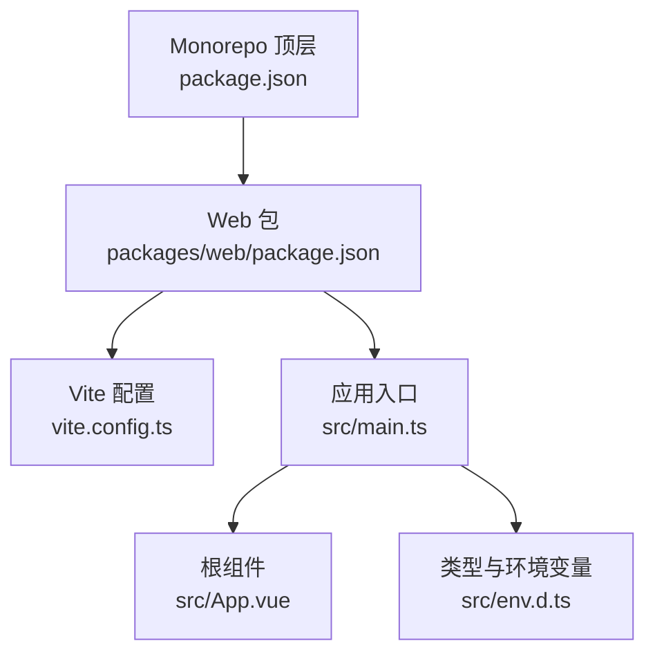
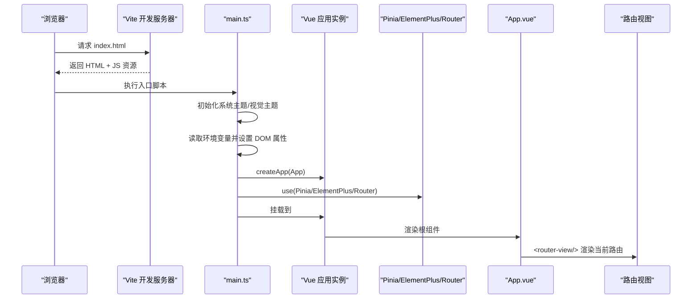
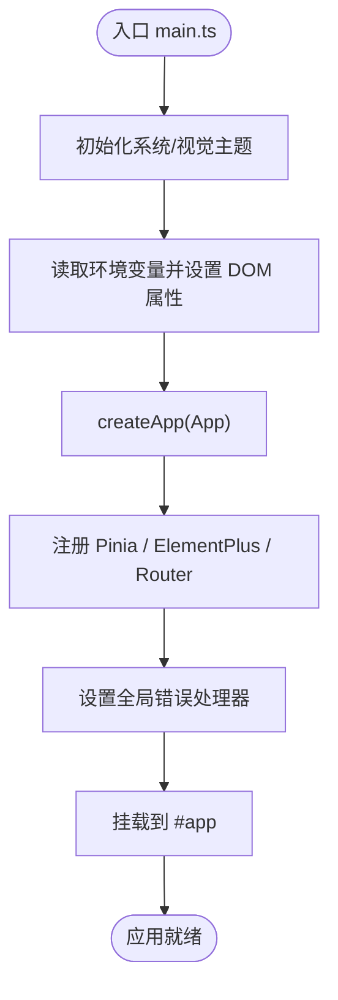
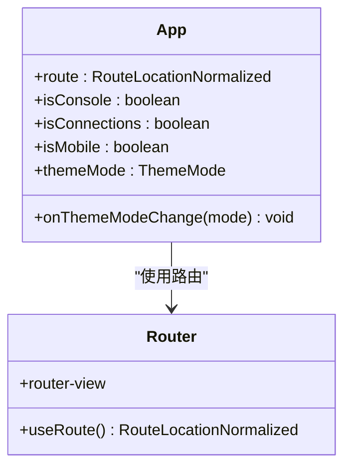
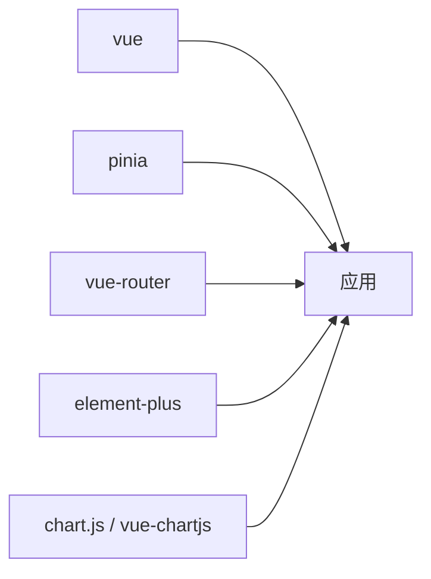
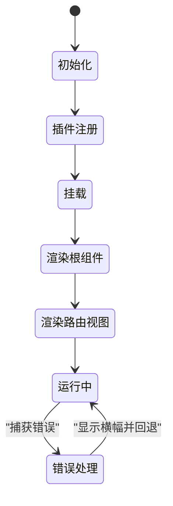

# 应用架构与初始化

<cite>
**本文引用的文件**   
- [packages/web/src/main.ts](file://packages/web/src/main.ts)
- [packages/web/src/App.vue](file://packages/web/src/App.vue)
- [packages/web/src/env.d.ts](file://packages/web/src/env.d.ts)
- [packages/web/vite.config.ts](file://packages/web/vite.config.ts)
- [packages/web/package.json](file://packages/web/package.json)
- [package.json](file://package.json)
</cite>

## 目录
1. [简介](#简介)
2. [项目结构](#项目结构)
3. [核心组件](#核心组件)
4. [架构总览](#架构总览)
5. [详细组件分析](#详细组件分析)
6. [依赖关系分析](#依赖关系分析)
7. [性能考虑](#性能考虑)
8. [故障排查指南](#故障排查指南)
9. [结论](#结论)
10. [附录](#附录)

## 简介
本文件面向前端 Vue 3 应用的架构与初始化，聚焦以下目标：
- 解析入口文件 main.ts 的初始化流程（插件注册、全局配置、依赖注入）。
- 说明根组件 App.vue 的结构设计（全局样式、路由容器、错误处理机制）。
- 解释环境变量 env.d.ts 与构建时配置 vite.config.ts。
- 梳理应用启动流程、生命周期管理与错误边界处理。
- 区分开发环境与生产环境的差异化配置。
- 给出性能监控与日志记录的最佳实践建议。

## 项目结构
该仓库为多包 monorepo，Web 前端位于 packages/web。关键路径如下：
- 应用入口：packages/web/src/main.ts
- 根组件：packages/web/src/App.vue
- 类型与环境变量声明：packages/web/src/env.d.ts
- Vite 构建配置：packages/web/vite.config.ts
- Web 包脚本与依赖：packages/web/package.json
- Monorepo 顶层脚本：package.json

图表来源
- [package.json:1-36](file://package.json#L1-L36)
- [packages/web/package.json:1-37](file://packages/web/package.json#L1-L37)
- [packages/web/vite.config.ts:1-41](file://packages/web/vite.config.ts#L1-L41)
- [packages/web/src/main.ts:1-45](file://packages/web/src/main.ts#L1-L45)
- [packages/web/src/App.vue:1-108](file://packages/web/src/App.vue#L1-L108)
- [packages/web/src/env.d.ts:1-48](file://packages/web/src/env.d.ts#L1-L48)

章节来源
- [package.json:1-36](file://package.json#L1-L36)
- [packages/web/package.json:1-37](file://packages/web/package.json#L1-L37)

## 核心组件
- 应用入口 main.ts
  - 创建 Vue 应用实例并挂载到 #app。
  - 注册 Pinia、Element Plus、Vue Router。
  - 设置全局错误处理器，提供“界面异常”横幅与回退导航。
  - 根据环境变量切换移动端/桌面端模式，并在 DOM 上标记 appMode。
  - 引入全局样式与主题工具函数。
- 根组件 App.vue
  - 基于路由判断是否控制台页面或连接页，控制标题栏与导航显示。
  - 提供明暗主题选择器，持久化主题模式。
  - 使用 router-view 作为子视图容器。
- 环境变量 env.d.ts
  - 扩展 ImportMetaEnv，定义 VITE_APP_MODE、VITE_DEFAULT_BASE_URL。
  - 声明 ElectronAPI 与 Window.electronAPI 类型，便于在 Electron 环境下调用原生能力。
- 构建配置 vite.config.ts
  - base 设置为相对路径以兼容 Electron file://、静态托管与 Capacitor。
  - 开发环境代理 /api 到本地服务端口。
  - 启用 Element Plus 自动导入与组件按需注册。
  - 输出目录 dist，构建前清空。

章节来源
- [packages/web/src/main.ts:1-45](file://packages/web/src/main.ts#L1-L45)
- [packages/web/src/App.vue:1-108](file://packages/web/src/App.vue#L1-L108)
- [packages/web/src/env.d.ts:1-48](file://packages/web/src/env.d.ts#L1-L48)
- [packages/web/vite.config.ts:1-41](file://packages/web/vite.config.ts#L1-L41)

## 架构总览
下图展示从浏览器加载到 Vue 应用运行时的关键步骤，以及各模块之间的交互关系。

图表来源
- [packages/web/src/main.ts:13-44](file://packages/web/src/main.ts#L13-L44)
- [packages/web/src/App.vue:25-76](file://packages/web/src/App.vue#L25-L76)
- [packages/web/vite.config.ts:25-34](file://packages/web/vite.config.ts#L25-L34)

## 详细组件分析

### 入口文件 main.ts 初始化流程
- 主题与环境初始化
  - 调用系统主题与视觉主题初始化函数，确保应用启动前样式与主题一致。
  - 通过 import.meta.env.VITE_APP_MODE 判定移动端模式，并在 document.documentElement 上设置 data-app-mode 与 is-mobile-app 类名，供 CSS 与逻辑分支使用。
- 应用实例与插件注册
  - 创建 Vue 应用实例后，依次注册 Pinia（状态管理）、Element Plus（UI 库）与 Vue Router（路由）。
  - Element Plus 的尺寸根据移动端/桌面端模式动态调整。
- 全局错误处理
  - 设置 app.config.errorHandler，捕获运行时错误，打印日志并在 DOM 中插入“界面异常”横幅，同时提供返回连接页的链接。
  - 防止重复插入错误横幅。
- 挂载
  - 将应用挂载到 #app 节点，完成首次渲染。

图表来源
- [packages/web/src/main.ts:13-44](file://packages/web/src/main.ts#L13-L44)

章节来源
- [packages/web/src/main.ts:1-45](file://packages/web/src/main.ts#L1-L45)

### 根组件 App.vue 结构设计
- 布局与导航
  - 非移动端且非控制台页面时显示标题栏，包含应用标识、版本、主题切换下拉框与常用导航链接。
  - 连接页（/connections 或 /）隐藏部分导航项。
- 主题管理
  - 使用 ref 维护 themeMode，onMounted 时读取已保存的主题模式。
  - 提供 onThemeModeChange 回调，更新状态并持久化主题模式。
- 路由容器
  - 使用 router-view 作为子页面容器，承载所有业务视图。

图表来源
- [packages/web/src/App.vue:1-23](file://packages/web/src/App.vue#L1-L23)
- [packages/web/src/App.vue:25-76](file://packages/web/src/App.vue#L25-L76)

章节来源
- [packages/web/src/App.vue:1-108](file://packages/web/src/App.vue#L1-L108)

### 环境变量与类型声明 env.d.ts
- ImportMetaEnv
  - VITE_APP_MODE：用于区分 web/mobile 两种运行模式。
  - VITE_DEFAULT_BASE_URL：预留默认后端 API 基础地址。
- ElectronAPI
  - 定义 Electron 主进程暴露给渲染进程的接口类型，包括平台信息、服务设置读写、服务状态查询、文件对话框、主题监听等。
- Window.electronAPI
  - 在 Electron 环境下挂载 electronAPI，供业务代码安全访问。

章节来源
- [packages/web/src/env.d.ts:1-48](file://packages/web/src/env.d.ts#L1-L48)

### 构建与开发配置 vite.config.ts
- 资源路径 base
  - 设置为相对路径 "./"，以兼容 Electron file://、Service 静态托管与 Capacitor 打包场景。
- 插件
  - @vitejs/plugin-vue：支持 .vue 单文件组件。
  - unplugin-auto-import：自动导入 Vue 组合式 API。
  - unplugin-vue-components：按 Element Plus 解析器进行组件按需注册。
- 别名
  - @ 指向 src 目录，简化导入路径。
- 开发服务器
  - 端口 5173。
  - 仅在 development 模式下代理 /api 到 http://127.0.0.1:19580。
- 构建
  - 输出目录 dist，构建前清空。

章节来源
- [packages/web/vite.config.ts:1-41](file://packages/web/vite.config.ts#L1-L41)

## 依赖关系分析
- 运行时依赖
  - vue：框架核心。
  - pinia：状态管理。
  - vue-router：路由。
  - element-plus：UI 组件库。
  - chart.js 与 vue-chartjs：图表能力（可选）。
- 开发依赖
  - vite：构建与开发服务器。
  - @vitejs/plugin-vue：Vue 支持。
  - unplugin-auto-import/unplugin-vue-components：自动化导入与组件注册。
  - typescript/vue-tsc：类型检查。

图表来源
- [packages/web/package.json:16-25](file://packages/web/package.json#L16-L25)

章节来源
- [packages/web/package.json:16-35](file://packages/web/package.json#L16-L35)

## 性能考虑
- 构建优化
  - 使用 unplugin-vue-components 对 Element Plus 进行按需注册，减少打包体积。
  - 使用 unplugin-auto-import 自动导入常用 API，减少样板代码。
  - 保持 base 为相对路径，避免跨域与路径问题导致的额外请求。
- 运行时优化
  - 在 main.ts 中尽早初始化主题与模式，减少首屏闪烁。
  - 合理使用路由懒加载（建议在路由配置中实现），降低初始包体。
  - 图表库按需引入，避免全量引入 chart.js。
- 可观测性
  - 利用全局错误处理器统一收集错误信息，结合日志上报策略（如 Sentry）进行线上监控。
  - 在移动端模式下，注意 UI 尺寸与交互差异，减少不必要的重绘与回流。

[本节为通用指导，不直接分析具体文件]

## 故障排查指南
- 全局错误横幅
  - 当发生未捕获的 Vue 运行时错误时，会在页面顶部显示“界面异常”横幅，并提供返回连接页的链接。
  - 若页面已存在错误横幅，则不会重复插入，避免遮挡。
- 常见问题定位
  - 确认环境变量 VITE_APP_MODE 是否正确设置（web/mobile）。
  - 开发环境确认代理 /api 是否成功转发到本地服务端口。
  - 检查 Element Plus 样式是否被正确引入，确保主题与尺寸生效。
  - 在 Electron 环境中，确认 Window.electronAPI 是否存在，避免调用原生接口时报错。

章节来源
- [packages/web/src/main.ts:23-40](file://packages/web/src/main.ts#L23-L40)
- [packages/web/vite.config.ts:25-34](file://packages/web/vite.config.ts#L25-L34)
- [packages/web/src/env.d.ts:36-47](file://packages/web/src/env.d.ts#L36-L47)

## 结论
本项目采用 Vue 3 + Vite + Pinia + Vue Router + Element Plus 的前端架构。入口文件负责主题初始化、模式检测、插件注册与全局错误处理；根组件负责布局、主题切换与路由容器；构建配置适配多运行环境（Electron、静态托管、Capacitor）。通过合理的环境变量与类型声明，项目在开发与生产环境具备良好的一致性与可维护性。

[本节为总结性内容，不直接分析具体文件]

## 附录

### 启动流程与生命周期概览
- 启动阶段
  - 浏览器加载 HTML 与 JS 资源。
  - main.ts 初始化主题与模式，创建应用实例并注册插件。
  - 挂载应用，触发根组件渲染。
- 生命周期要点
  - 根组件 onMounted 时读取并恢复主题模式。
  - 路由变化驱动子视图渲染。
- 错误边界
  - 全局错误处理器拦截运行时错误，提供用户可见的错误提示与回退操作。

图表来源
- [packages/web/src/main.ts:13-44](file://packages/web/src/main.ts#L13-L44)
- [packages/web/src/App.vue:15-22](file://packages/web/src/App.vue#L15-L22)

### 开发环境与生产环境差异化配置
- 开发环境
  - Vite 开发服务器端口 5173。
  - 代理 /api 到本地服务端口，解决跨域问题。
- 生产环境
  - base 为相对路径，适配 Electron file://、静态托管与 Capacitor。
  - 构建输出到 dist，构建前清空目录。
- Monorepo 脚本
  - 顶层 package.json 提供 dev/build/pack 等脚本，统一编排 Web、Desktop、Service 的构建与打包流程。

章节来源
- [packages/web/vite.config.ts:25-39](file://packages/web/vite.config.ts#L25-L39)
- [package.json:10-30](file://package.json#L10-L30)

### 性能监控与日志记录最佳实践
- 错误监控
  - 在全局错误处理器中统一捕获错误，结合第三方监控平台（如 Sentry）上报错误堆栈与上下文。
- 性能指标
  - 使用 Performance Observer 采集关键指标（FCP、LCP、CLS），在合适时机上报。
- 日志分级
  - 区分 debug/info/warn/error 级别，在生产环境仅保留 warn 及以上级别。
- 资源优化
  - 按需引入组件与图表库，开启 Gzip/Brotli 压缩，合理使用缓存策略。

[本节为通用指导，不直接分析具体文件]