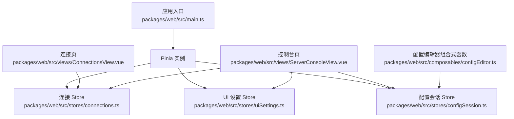
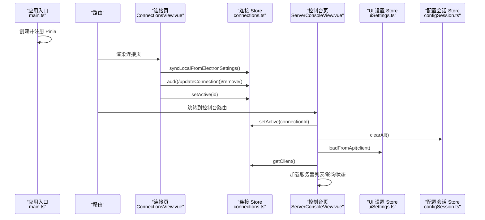
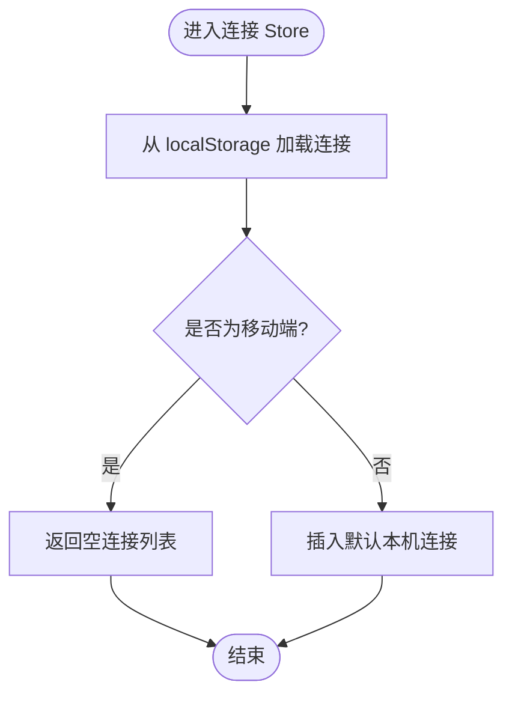
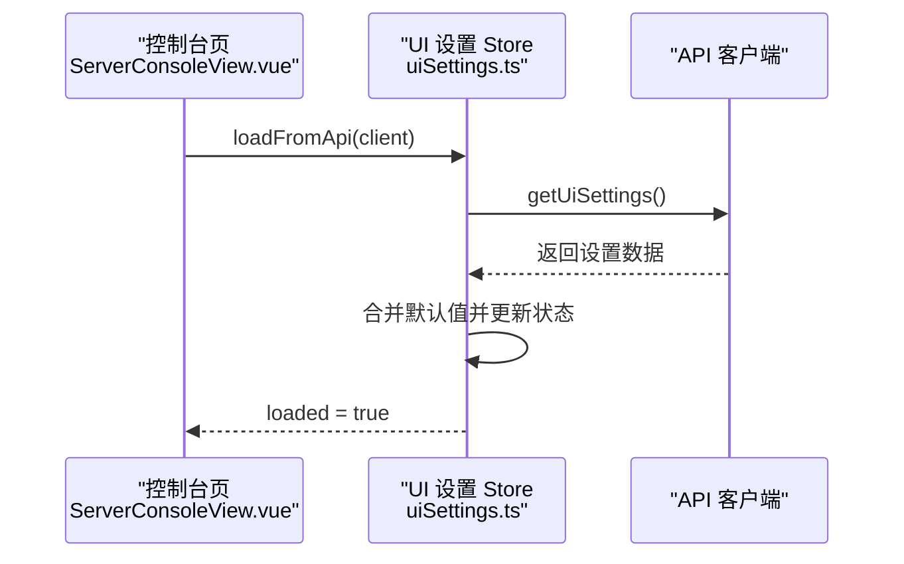
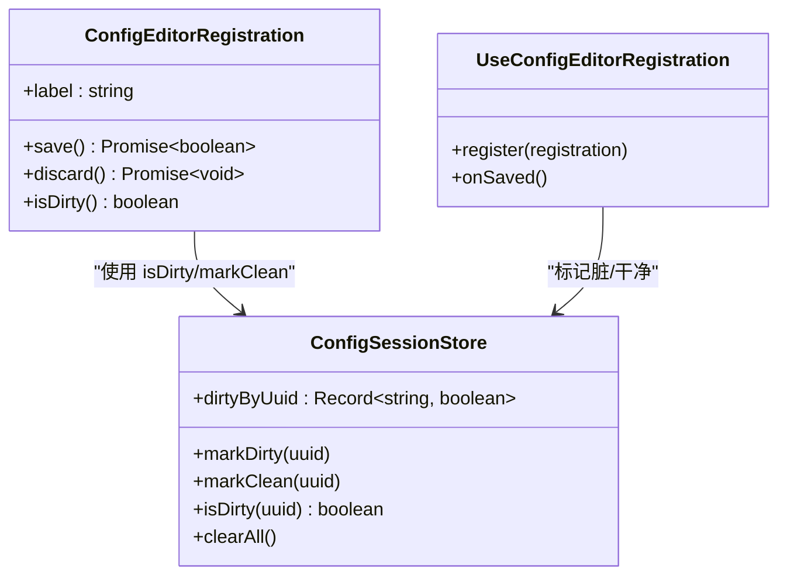
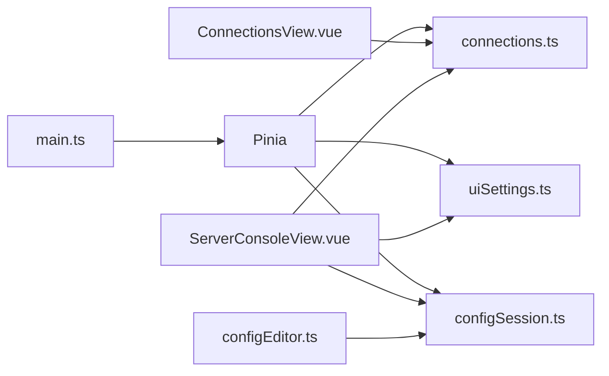

# 状态管理

<cite>
**本文引用的文件 **
- [main.ts](file://packages/web/src/main.ts)
- [package.json](file://packages/web/package.json)
- [configSession.ts](file://packages/web/src/stores/configSession.ts)
- [connections.ts](file://packages/web/src/stores/connections.ts)
- [uiSettings.ts](file://packages/web/src/stores/uiSettings.ts)
- [ConnectionsView.vue](file://packages/web/src/views/ConnectionsView.vue)
- [ServerConsoleView.vue](file://packages/web/src/views/ServerConsoleView.vue)
- [configEditor.ts](file://packages/web/src/composables/configEditor.ts)
</cite>

## 目录
1. [简介](#简介)
2. [项目结构](#项目结构)
3. [核心组件](#核心组件)
4. [架构总览](#架构总览)
5. [详细组件分析](#详细组件分析)
6. [依赖关系分析](#依赖关系分析)
7. [性能与优化](#性能与优化)
8. [错误处理与调试](#错误处理与调试)
9. [迁移与版本兼容](#迁移与版本兼容)
10. [复杂场景与最佳实践](#复杂场景与最佳实践)
11. [结论](#结论)

## 简介
本仓库的前端基于 Vue 3 + Pinia 实现状态管理。当前 Web 应用位于 `packages/web`，通过 `createPinia()` 注入全局状态容器，并在多个页面与组合式函数中共享状态。现有状态设计围绕三类核心领域：
- 连接与会话配置：保存、切换和同步主机连接信息。
- 界面设置：从后端 API 加载并持久化 UI 相关偏好。
- 配置编辑会话：跟踪配置项的脏标记，支持“未保存变更”提示与批量清理。

该文档将系统阐述 Pinia store 的组织方式、状态定义、动作方法、计算属性、持久化策略、跨组件共享机制、异步处理、错误处理、调试手段以及优化与迁移方案。

## 项目结构
前端状态主要位于 `packages/web/src/stores`，由三个 store 组成：
- `configSession.ts`：配置编辑会话的脏标记状态。
- `connections.ts`：主机连接列表、活跃连接与客户端工厂。
- `uiSettings.ts`：界面设置与后端同步。

应用入口在 `packages/web/src/main.ts` 中创建并注册 Pinia，同时提供全局错误处理与主题初始化。

**图表来源**
- [main.ts:22-41](file://packages/web/src/main.ts#L22-L41)
- [connections.ts:17-135](file://packages/web/src/stores/connections.ts#L17-L135)
- [uiSettings.ts:12-52](file://packages/web/src/stores/uiSettings.ts#L12-L52)
- [configSession.ts:3-21](file://packages/web/src/stores/configSession.ts#L3-L21)
- [ConnectionsView.vue:7-34](file://packages/web/src/views/ConnectionsView.vue#L7-L34)
- [ServerConsoleView.vue:29-47](file://packages/web/src/views/ServerConsoleView.vue#L29-L47)
- [configEditor.ts:1-61](file://packages/web/src/composables/configEditor.ts#L1-L61)

**章节来源**
- [main.ts:1-45](file://packages/web/src/main.ts#L1-L45)
- [package.json:16-25](file://packages/web/package.json#L16-L25)

## 核心组件
本节对三个 store 的职责、状态、方法与使用方式进行说明。

### 连接 Store（useConnectionsStore）
职责：
- 维护连接列表与活跃连接 ID。
- 提供增删改查、激活连接、生成 API 客户端等方法。
- 负责连接数据的本地持久化与 Electron 环境下的本机服务同步。

关键特性：
- 使用 `ref` 与 `computed` 暴露响应式状态。
- 通过 `localStorage` 持久化连接数据。
- 根据运行模式（移动端或桌面端）调整默认连接行为。
- 封装 `getClient()` 以基于活跃连接构造 API 客户端。

**章节来源**
- [connections.ts:5-135](file://packages/web/src/stores/connections.ts#L5-L135)

### UI 设置 Store（useUiSettingsStore）
职责：
- 维护界面设置（如是否显示高级选项、自动快照模式等）。
- 提供从后端 API 加载与保存设置的异步动作。
- 暴露简单的 setter 动作用于局部更新。

关键特性：
- 使用默认值对象合并初始状态。
- 增加 `loaded` 标志位表示设置是否已从 API 拉取完成。
- 所有写操作均通过 action 调用后端接口进行持久化。

**章节来源**
- [uiSettings.ts:4-52](file://packages/web/src/stores/uiSettings.ts#L4-L52)

### 配置会话 Store（useConfigSessionStore）
职责：
- 按服务器 UUID 跟踪配置编辑的脏标记。
- 提供标记脏、标记干净、查询脏状态、清空全部的方法。

关键特性：
- 使用 `Record<string, boolean>` 存储脏标记。
- 配合组合式函数 `useConfigEditorRegistration` 实现“未保存变更”提示与统一清理。

**章节来源**
- [configSession.ts:3-21](file://packages/web/src/stores/configSession.ts#L3-L21)
- [configEditor.ts:18-61](file://packages/web/src/composables/configEditor.ts#L18-L61)

## 架构总览
整体状态流如下：
- 应用启动时，`main.ts` 创建并注册 Pinia。
- 连接页 `ConnectionsView.vue` 使用 `useConnectionsStore` 管理连接列表、测试连接、添加/删除连接，并在成功后切换到控制台路由。
- 控制台页 `ServerConsoleView.vue` 订阅路由变化，设置活跃连接、清理配置会话、加载服务器列表；同时使用 `useUiSettingsStore` 控制展示模式与刷新策略。
- 配置编辑器组合式函数 `useConfigEditorRegistration` 通过 `CONFIG_EDITOR_KEY` 注入上下文，并与 `useConfigSessionStore` 协作，实现“脏标记—保存—清理”的闭环。

**图表来源**
- [main.ts:22-41](file://packages/web/src/main.ts#L22-L41)
- [ConnectionsView.vue:32-88](file://packages/web/src/views/ConnectionsView.vue#L32-L88)
- [connections.ts:83-121](file://packages/web/src/stores/connections.ts#L83-L121)
- [ServerConsoleView.vue:176-214](file://packages/web/src/views/ServerConsoleView.vue#L176-L214)
- [uiSettings.ts:18-37](file://packages/web/src/stores/uiSettings.ts#L18-L37)
- [configSession.ts:7-20](file://packages/web/src/stores/configSession.ts#L7-L20)

## 详细组件分析

### 连接 Store 分析与流程
- 状态：
  - `connections`: 连接数组，来源于 `localStorage` 或默认值。
  - `activeId`: 当前活跃连接 ID。
  - `active`: 计算属性，返回当前活跃连接对象。
- 动作：
  - `add/remove/updateConnection/setActive`：基础 CRUD 与激活逻辑。
  - `syncLocalFromElectronSettings`：在 Electron 环境下读取被控服务设置，同步到“本机”连接。
  - `getClient`：根据活跃连接构建 API 客户端。
- 持久化：
  - 每次连接数据变更后调用 `persist()` 写入 `localStorage`。
- 运行时差异：
  - 移动端不预置本机连接，避免无法访问本地 Service。

**图表来源**
- [connections.ts:23-43](file://packages/web/src/stores/connections.ts#L23-L43)

**章节来源**
- [connections.ts:17-135](file://packages/web/src/stores/connections.ts#L17-L135)

### UI 设置 Store 分析与流程
- 状态：
  - 继承 `UiSettings` 类型，并追加 `loaded` 标志。
- 动作：
  - `loadFromApi`：从后端获取设置并填充状态。
  - `saveToApi`：将当前设置保存到后端。
  - 若干 setter 动作用于局部更新。
- 使用场景：
  - 控制台页在切换路由后加载设置，并根据设置决定是否允许外部刷新配置。

**图表来源**
- [uiSettings.ts:18-28](file://packages/web/src/stores/uiSettings.ts#L18-L28)
- [ServerConsoleView.vue:176-214](file://packages/web/src/views/ServerConsoleView.vue#L176-L214)

**章节来源**
- [uiSettings.ts:12-52](file://packages/web/src/stores/uiSettings.ts#L12-L52)

### 配置会话 Store 与编辑器组合式函数
- 状态：
  - `dirtyByUuid`: 记录哪些配置项处于“已修改但未保存”的状态。
- 动作：
  - `markDirty/markClean/isDirty/clearAll`：标记与清理脏状态。
- 组合式函数：
  - `useConfigEditorRegistration`：在组件挂载时注册一个配置编辑器，提供统一的 save/discard/isDirty 能力，并在卸载时清理注册。
  - 通过 `inject(CONFIG_EDITOR_KEY)` 与父级组件通信，实现“未保存变更”提示。

**图表来源**
- [configSession.ts:3-21](file://packages/web/src/stores/configSession.ts#L3-L21)
- [configEditor.ts:1-61](file://packages/web/src/composables/configEditor.ts#L1-L61)

**章节来源**
- [configSession.ts:3-21](file://packages/web/src/stores/configSession.ts#L3-L21)
- [configEditor.ts:18-61](file://packages/web/src/composables/configEditor.ts#L18-L61)

## 依赖关系分析
- 包依赖：
  - `pinia` 作为状态管理库被引入，并在 `main.ts` 中创建实例。
- 模块依赖：
  - `connections.ts` 依赖 `@a3st/api-client` 提供的 `createClient` 与类型。
  - `uiSettings.ts` 依赖 `@a3st/api-client` 的类型与客户端方法。
  - `configEditor.ts` 依赖 `useConfigSessionStore` 与 Vue 的组合式 API。
- 视图依赖：
  - `ConnectionsView.vue` 使用 `useConnectionsStore` 管理连接。
  - `ServerConsoleView.vue` 同时使用三个 store，协调连接、设置与配置会话。

**图表来源**
- [main.ts:22-41](file://packages/web/src/main.ts#L22-L41)
- [connections.ts:1-3](file://packages/web/src/stores/connections.ts#L1-L3)
- [uiSettings.ts:1-2](file://packages/web/src/stores/uiSettings.ts#L1-L2)
- [configEditor.ts:1-2](file://packages/web/src/composables/configEditor.ts#L1-L2)
- [ConnectionsView.vue:7-34](file://packages/web/src/views/ConnectionsView.vue#L7-L34)
- [ServerConsoleView.vue:29-47](file://packages/web/src/views/ServerConsoleView.vue#L29-L47)

**章节来源**
- [package.json:16-25](file://packages/web/package.json#L16-L25)
- [connections.ts:1-3](file://packages/web/src/stores/connections.ts#L1-L3)
- [uiSettings.ts:1-2](file://packages/web/src/stores/uiSettings.ts#L1-L2)
- [configEditor.ts:1-2](file://packages/web/src/composables/configEditor.ts#L1-L2)

## 性能与优化
- 状态分割：
  - 将连接、UI 设置、配置会话拆分为独立 store，降低耦合度，便于单独测试与维护。
- 懒加载与按需使用：
  - 连接列表仅在连接页与需要时加载；UI 设置在控制台页按需拉取；配置会话在路由切换时清理，避免累积脏标记。
- 缓存策略：
  - 连接数据通过 `localStorage` 持久化，减少重复初始化成本。
  - 控制台页存在运行状态缓存（例如服务器运行状态），避免频繁重算。
- 计算属性：
  - `active` 计算属性避免在模板中重复查找活跃连接。
- 建议：
  - 对于高频更新的实时状态（如日志、监控指标），建议使用更细粒度的 store 或组合式函数，并结合防抖/节流。
  - 对大型连接列表，可考虑分页或虚拟滚动以减少渲染压力。

[本节为通用优化建议，不直接分析具体文件]

## 错误处理与调试
- 全局错误处理：
  - `main.ts` 中注册 `app.config.errorHandler`，捕获 Vue 渲染异常并显示顶部横幅，引导用户回到连接页。
- 异步错误处理：
  - `syncLocalFromElectronSettings` 使用 try/catch 忽略失败，避免阻塞 UI。
  - `loadFromApi/saveToApi` 依赖 API 客户端的错误传播，建议在调用处结合业务提示。
- 调试工具：
  - 可使用浏览器开发者工具的 Pinia Devtools（需安装扩展）查看状态树、动作调用栈与时间旅行。
  - 在开发阶段可在 actions 中添加日志输出，或使用 `console.log` 观察状态变更。

**章节来源**
- [main.ts:23-40](file://packages/web/src/main.ts#L23-L40)
- [connections.ts:83-115](file://packages/web/src/stores/connections.ts#L83-L115)
- [uiSettings.ts:18-37](file://packages/web/src/stores/uiSettings.ts#L18-L37)

## 迁移与版本兼容
- 本地存储迁移：
  - 连接数据存储在 `localStorage` 的 `a3st-connections` 键下。若未来数据结构发生变化，应在 `loadConnections` 中进行版本判断与数据迁移。
- 默认值兼容：
  - UI 设置使用默认值对象合并，新增字段时应提供合理默认值，保证旧数据仍可正常渲染。
- 运行模式兼容：
  - 移动端与桌面端的默认连接行为不同，迁移时需确保新字段在不同模式下均有合理值。
- 建议：
  - 为本地存储增加版本号字段，并在加载时执行迁移脚本。
  - 对 API 返回字段进行可选处理，避免后端字段缺失导致前端崩溃。

[本节为通用迁移建议，不直接分析具体文件]

## 复杂场景与最佳实践
- 跨组件状态共享：
  - 使用 Pinia store 实现全局共享，避免 prop drilling。
  - 通过组合式函数（如 `useConfigEditorRegistration`）封装复用逻辑，提升可测试性。
- 异步状态处理：
  - 所有涉及网络请求的动作应返回 Promise，并在调用处处理成功与失败分支。
  - 对可能失败的异步操作（如 Electron API 调用）使用 try/catch 包裹，避免影响主流程。
- 状态同步机制：
  - 连接数据变更后立即持久化，保证刷新后状态一致。
  - UI 设置通过 API 同步，确保多端一致性。
- 错误处理最佳实践：
  - 在视图层提供用户友好的错误提示，避免直接抛出未捕获异常。
  - 对关键路径（如连接测试、设置保存）进行明确的成功/失败反馈。
- 状态优化技巧：
  - 使用计算属性派生状态，减少重复计算。
  - 对大对象进行浅拷贝与选择性更新，避免不必要的深度克隆。
  - 合理使用 `watch` 与生命周期钩子，避免在组件销毁后继续执行异步任务。

[本节为通用最佳实践，不直接分析具体文件]

## 结论
本项目的前端状态管理采用 Pinia，结构清晰、职责分明。连接、UI 设置与配置会话分别由独立 store 管理，并通过组合式函数与视图组件协同工作。状态持久化主要依赖 `localStorage` 与后端 API，异步操作具备基本的错误处理。未来可在本地存储迁移、实时状态优化与调试体验方面进一步增强，以提升可维护性与用户体验。