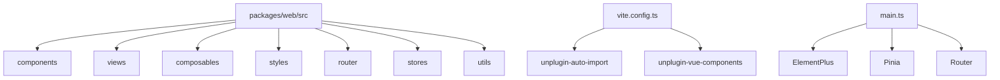
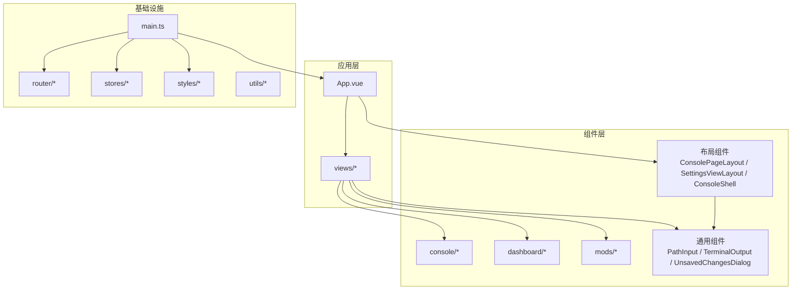
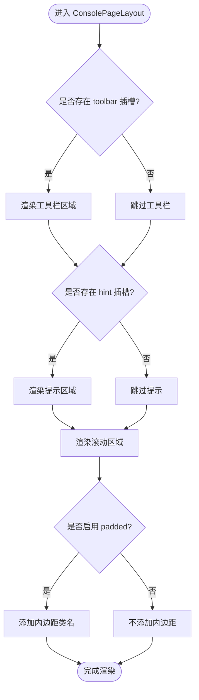
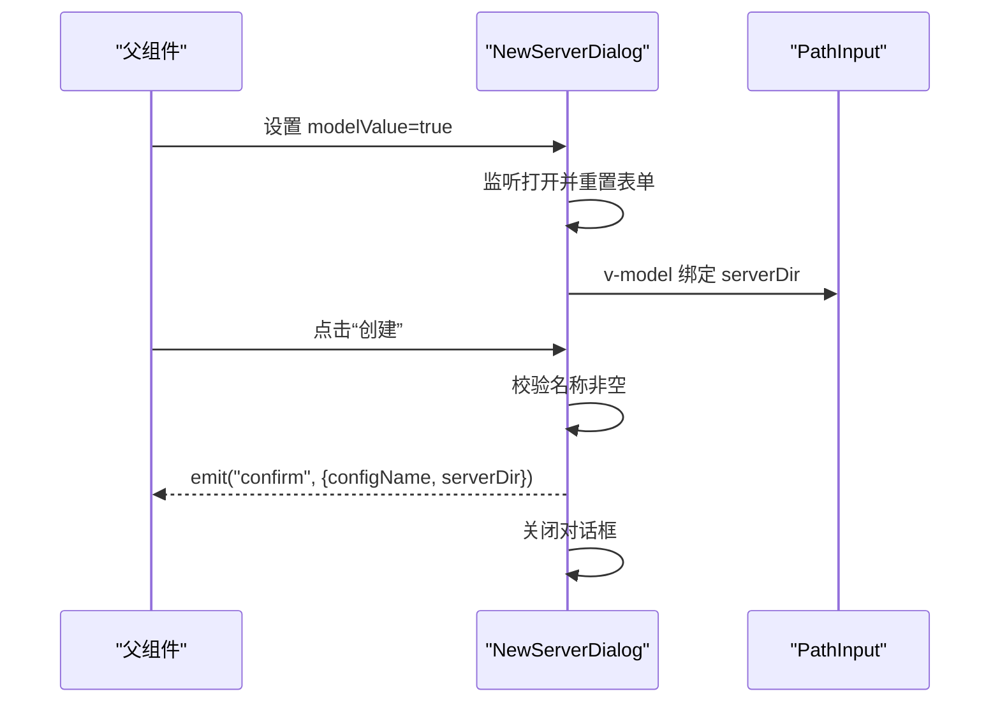
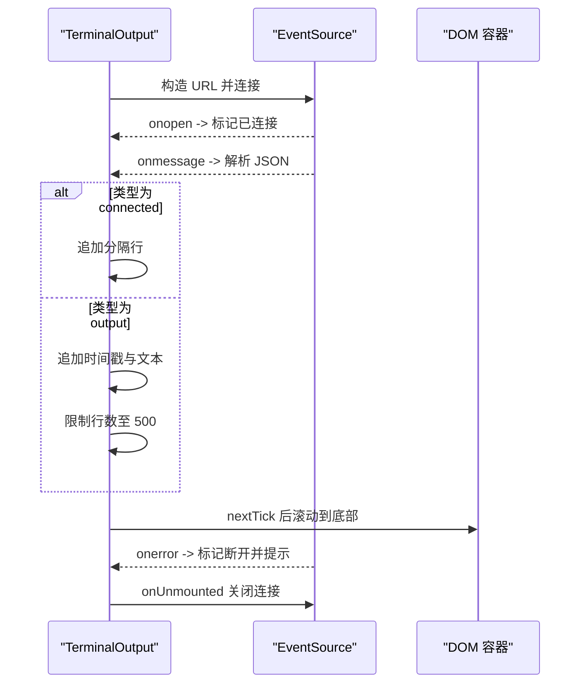
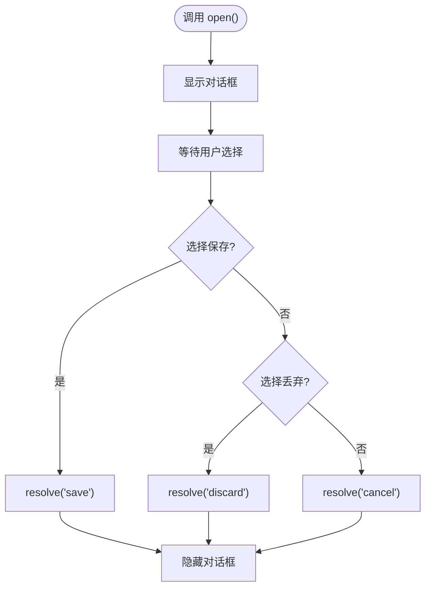
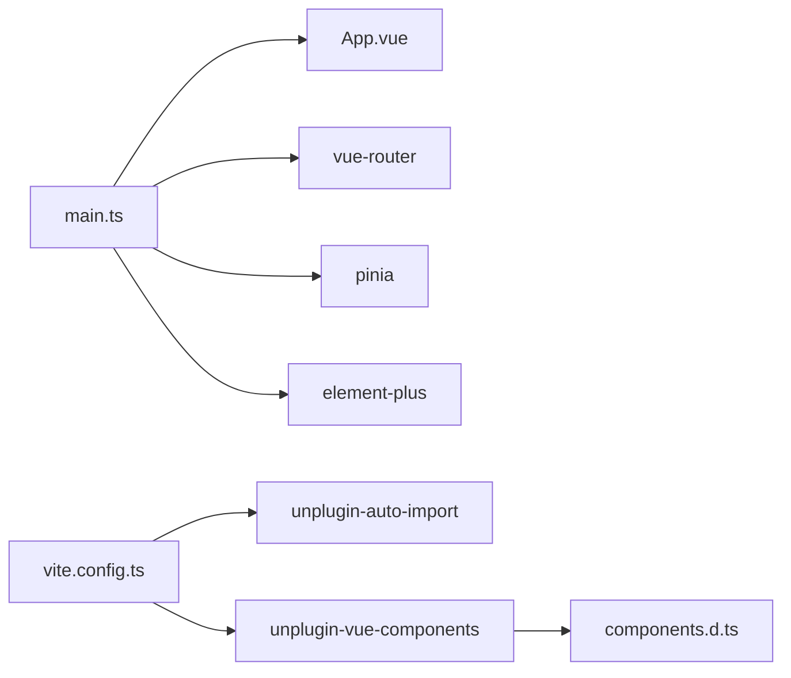

# 组件系统

<cite>
**本文引用的文件**   
- [package.json](file://package.json)
- [packages/web/package.json](file://packages/web/package.json)
- [packages/web/vite.config.ts](file://packages/web/vite.config.ts)
- [packages/web/components.d.ts](file://packages/web/components.d.ts)
- [packages/web/src/main.ts](file://packages/web/src/main.ts)
- [packages/web/src/App.vue](file://packages/web/src/App.vue)
- [packages/web/src/components/ConsolePageLayout.vue](file://packages/web/src/components/ConsolePageLayout.vue)
- [packages/web/src/components/NewServerDialog.vue](file://packages/web/src/components/NewServerDialog.vue)
- [packages/web/src/components/TerminalOutput.vue](file://packages/web/src/components/TerminalOutput.vue)
- [packages/web/src/components/UnsavedChangesDialog.vue](file://packages/web/src/components/UnsavedChangesDialog.vue)
</cite>

## 目录
1. [简介](#简介)
2. [项目结构](#项目结构)
3. [核心组件](#核心组件)
4. [架构总览](#架构总览)
5. [详细组件分析](#详细组件分析)
6. [依赖关系分析](#依赖关系分析)
7. [性能与可维护性](#性能与可维护性)
8. [样式与主题管理](#样式与主题管理)
9. [组件开发规范](#组件开发规范)
10. [测试策略](#测试策略)
11. [文档生成与版本管理](#文档生成与版本管理)
12. [自定义 UI 组件指南与最佳实践](#自定义-ui-组件指南与最佳实践)
13. [故障排查](#故障排查)
14. [结论](#结论)

## 简介
本文件面向 Arma3 Server Tools 的前端组件系统，聚焦 Vue 3 + Vite + Element Plus 的 Web 应用（@a3st/web）。文档覆盖：
- 组件目录结构与命名规范
- 业务组件、通用组件、布局组件的分类组织
- 组件开发规范：Props、事件、插槽、组合式函数集成
- 样式管理：CSS 变量、主题系统、响应式设计
- 复用模式与设计系统实现
- 测试、文档生成与版本管理
- 自定义 UI 组件开发与最佳实践

## 项目结构
前端代码位于 packages/web，采用典型 Vue SPA 结构：
- src/components：组件目录，包含通用组件、业务组件与布局组件
- src/views：页面级视图
- src/composables：组合式函数
- src/styles：全局样式与主题变量
- src/router：路由配置
- src/stores：状态管理（Pinia）
- src/utils：工具函数
- vite.config.ts：构建与插件配置
- main.ts：应用入口与全局初始化

图表来源
- [packages/web/vite.config.ts:1-41](file://packages/web/vite.config.ts#L1-L41)
- [packages/web/src/main.ts:1-45](file://packages/web/src/main.ts#L1-L45)

章节来源
- [packages/web/package.json:1-37](file://packages/web/package.json#L1-L37)
- [packages/web/vite.config.ts:1-41](file://packages/web/vite.config.ts#L1-L41)
- [packages/web/src/main.ts:1-45](file://packages/web/src/main.ts#L1-L45)

## 核心组件
当前仓库中已实现的组件包括：
- 通用组件
  - PathInput：路径输入控件
  - TerminalOutput：终端输出与 SSE 流展示
  - UnsavedChangesDialog：未保存更改确认对话框
- 业务组件
  - NewServerDialog：新建服务器配置对话框
  - FirstServerWizard：首次服务器向导
- 布局组件
  - ConsolePageLayout：控制台页面布局容器
  - SettingsViewLayout：设置页布局
  - ConsoleShell：控制台子页面 Shell

这些组件通过自动导入机制在模板中直接使用，类型声明由 unplugin-vue-components 生成。

章节来源
- [packages/web/components.d.ts:45-63](file://packages/web/components.d.ts#L45-L63)
- [packages/web/src/components/ConsolePageLayout.vue:1-78](file://packages/web/src/components/ConsolePageLayout.vue#L1-L78)
- [packages/web/src/components/NewServerDialog.vue:1-64](file://packages/web/src/components/NewServerDialog.vue#L1-L64)
- [packages/web/src/components/TerminalOutput.vue:1-135](file://packages/web/src/components/TerminalOutput.vue#L1-L135)
- [packages/web/src/components/UnsavedChangesDialog.vue:1-34](file://packages/web/src/components/UnsavedChangesDialog.vue#L1-L34)

## 架构总览
Web 应用以 Vue 3 为框架，使用 Pinia 进行状态管理，Vue Router 负责路由，Element Plus 提供基础 UI。Vite 作为构建工具，并通过 unplugin-auto-import 与 unplugin-vue-components 实现按需自动导入与组件注册。

图表来源
- [packages/web/src/App.vue:1-108](file://packages/web/src/App.vue#L1-L108)
- [packages/web/src/main.ts:1-45](file://packages/web/src/main.ts#L1-L45)

## 详细组件分析

### 布局组件：ConsolePageLayout
职责
- 提供控制台页面的统一布局容器
- 支持 toolbar、hint 插槽与主内容区滚动
- 通过 padded 属性控制内边距

设计要点
- 使用 scoped CSS 与 CSS 变量适配主题
- 基于 Flex 布局保证在不同高度下的稳定表现
- 使用 Element Plus 的 el-scrollbar 提升滚动体验

图表来源
- [packages/web/src/components/ConsolePageLayout.vue:1-78](file://packages/web/src/components/ConsolePageLayout.vue#L1-L78)

章节来源
- [packages/web/src/components/ConsolePageLayout.vue:1-78](file://packages/web/src/components/ConsolePageLayout.vue#L1-L78)

### 业务组件：NewServerDialog
职责
- 新建服务器配置的表单对话框
- 双向绑定 modelValue 控制显示
- 提交时校验并触发 confirm 事件

设计要点
- 使用 defineProps 与 defineEmits 明确接口
- 监听打开状态重置表单数据
- 复用 PathInput 组件选择服务器目录

图表来源
- [packages/web/src/components/NewServerDialog.vue:1-64](file://packages/web/src/components/NewServerDialog.vue#L1-L64)

章节来源
- [packages/web/src/components/NewServerDialog.vue:1-64](file://packages/web/src/components/NewServerDialog.vue#L1-L64)

### 通用组件：TerminalOutput
职责
- 连接后端 SSE 流并展示终端输出
- 管理连接状态、消息行数限制与自动滚动
- 暴露 clearLog 方法清空日志

设计要点
- 使用 EventSource 建立 SSE 连接
- 解析 JSON 消息，区分 connected 与 output 类型
- 限制历史行数避免内存增长
- 使用 CSS 变量适配终端背景与文本颜色

图表来源
- [packages/web/src/components/TerminalOutput.vue:1-135](file://packages/web/src/components/TerminalOutput.vue#L1-L135)

章节来源
- [packages/web/src/components/TerminalOutput.vue:1-135](file://packages/web/src/components/TerminalOutput.vue#L1-L135)

### 通用组件：UnsavedChangesDialog
职责
- 以 Promise 形式暴露 open 方法
- 返回用户操作结果：保存、丢弃或取消

设计要点
- 使用 ref 控制可见性与 resolveFn 回调
- 通过 defineExpose 暴露 open 方法供外部调用

图表来源
- [packages/web/src/components/UnsavedChangesDialog.vue:1-34](file://packages/web/src/components/UnsavedChangesDialog.vue#L1-L34)

章节来源
- [packages/web/src/components/UnsavedChangesDialog.vue:1-34](file://packages/web/src/components/UnsavedChangesDialog.vue#L1-L34)

## 依赖关系分析
- 应用入口 main.ts 初始化主题、注册 ElementPlus、Pinia、Router，并挂载根组件
- App.vue 根据路由判断是否为控制台页面与移动端模式，并提供主题切换
- Vite 配置启用自动导入与组件解析，别名 @ 指向 src

图表来源
- [packages/web/src/main.ts:1-45](file://packages/web/src/main.ts#L1-L45)
- [packages/web/src/App.vue:1-108](file://packages/web/src/App.vue#L1-L108)
- [packages/web/vite.config.ts:1-41](file://packages/web/vite.config.ts#L1-L41)
- [packages/web/components.d.ts:45-63](file://packages/web/components.d.ts#L45-L63)

章节来源
- [packages/web/src/main.ts:1-45](file://packages/web/src/main.ts#L1-L45)
- [packages/web/src/App.vue:1-108](file://packages/web/src/App.vue#L1-L108)
- [packages/web/vite.config.ts:1-41](file://packages/web/vite.config.ts#L1-L41)
- [packages/web/components.d.ts:45-63](file://packages/web/components.d.ts#L45-L63)

## 性能与可维护性
- 组件粒度清晰：布局、业务、通用组件分层明确，便于复用与维护
- 自动导入减少样板代码，降低重复 import 带来的体积与心智负担
- TerminalOutput 限制历史行数，避免长日志导致内存压力
- 使用 CSS 变量与 scoped 样式，提高主题一致性与样式隔离性

[本节为通用建议，无需具体文件引用]

## 样式与主题管理
- 全局样式入口在 main.ts 中引入 desktop-theme.css、ark-visual.css、shell-v2.css
- App.vue 与 main.ts 共同驱动主题系统：读取系统主题、设置应用模式、注入 CSS 变量
- TerminalOutput 等组件通过 CSS 变量定义终端背景与文本颜色，确保主题一致性
- 响应式与移动端适配：main.ts 根据 VITE_APP_MODE 设置 is-mobile-app 类名；App.vue 根据 mode 调整 ElementPlus 尺寸

章节来源
- [packages/web/src/main.ts:1-45](file://packages/web/src/main.ts#L1-L45)
- [packages/web/src/App.vue:1-108](file://packages/web/src/App.vue#L1-L108)
- [packages/web/src/components/TerminalOutput.vue:85-135](file://packages/web/src/components/TerminalOutput.vue#L85-L135)

## 组件开发规范
- Props 定义
  - 使用 TypeScript 接口与 withDefaults 提供默认值
  - 示例参考：ConsolePageLayout 的 padded 属性
- 事件处理
  - 使用 defineEmits 明确事件签名
  - 示例参考：NewServerDialog 的 update:modelValue 与 confirm 事件
- 插槽使用
  - 布局组件优先使用具名插槽（toolbar、hint、actions）与默认插槽承载内容
  - 示例参考：ConsolePageLayout 与 ConsoleShell
- 组合式函数集成
  - 将跨组件逻辑（如主题、视觉主题）抽取到 composables 或 utils
  - 示例参考：main.ts 中 initSystemTheme 与 initVisualTheme 的调用
- 可访问性与测试标识
  - 为关键交互元素添加 data-testid，便于端到端测试定位
  - 示例参考：NewServerDialog 与 App.vue 中的 theme-picker

章节来源
- [packages/web/src/components/ConsolePageLayout.vue:1-78](file://packages/web/src/components/ConsolePageLayout.vue#L1-L78)
- [packages/web/src/components/NewServerDialog.vue:1-64](file://packages/web/src/components/NewServerDialog.vue#L1-L64)
- [packages/web/src/App.vue:25-75](file://packages/web/src/App.vue#L25-L75)
- [packages/web/src/main.ts:13-20](file://packages/web/src/main.ts#L13-L20)

## 测试策略
- 单元测试
  - 针对组合式函数与工具函数编写用例，验证主题初始化、数据处理逻辑
- 组件测试
  - 使用 Vue Test Utils 对组件 Props、事件、插槽进行断言
  - 重点覆盖：NewServerDialog 的表单校验与事件触发；TerminalOutput 的消息解析与行数限制
- 端到端测试
  - 使用 Playwright 进行浏览器自动化测试
  - 利用 data-testid 定位关键节点，例如 theme-mode-select、nav-back-connections、new-server-dialog、new-server-name、new-server-confirm
- 错误边界
  - main.ts 中全局 errorHandler 捕获异常并展示界面异常横幅，便于快速定位问题

章节来源
- [packages/web/src/main.ts:23-40](file://packages/web/src/main.ts#L23-L40)
- [packages/web/src/App.vue:35-70](file://packages/web/src/App.vue#L35-L70)
- [packages/web/src/components/NewServerDialog.vue:41-63](file://packages/web/src/components/NewServerDialog.vue#L41-L63)

## 文档生成与版本管理
- 版本管理
  - 根 package.json 定义 monorepo 版本与工作区
  - packages/web/package.json 定义 @a3st/web 的版本与脚本
- 构建脚本
  - build:web 执行类型检查与构建
  - build:mobile 构建到 apps/mobile/www
- 自动文档
  - 可通过 unplugin-vue-components 生成的 components.d.ts 辅助 IDE 提示
  - 建议结合 Storybook 或 VuePress 生成组件文档（需额外配置）

章节来源
- [package.json:1-36](file://package.json#L1-L36)
- [packages/web/package.json:1-37](file://packages/web/package.json#L1-L37)
- [packages/web/components.d.ts:45-63](file://packages/web/components.d.ts#L45-L63)

## 自定义 UI 组件指南与最佳实践
- 组件分类
  - 通用组件：无业务语义，如 PathInput、TerminalOutput
  - 业务组件：承载具体功能流程，如 NewServerDialog、FirstServerWizard
  - 布局组件：提供页面骨架与插槽，如 ConsolePageLayout、SettingsViewLayout、ConsoleShell
- 命名规范
  - 组件文件名使用 PascalCase，如 NewServerDialog.vue
  - 目录按功能域划分：console、dashboard、mods
- Props 与事件
  - 使用 TypeScript 接口定义 Props，必要时提供默认值
  - 使用 defineEmits 明确事件参数类型
- 插槽设计
  - 优先使用具名插槽扩展布局能力，默认插槽承载主要内容
- 样式策略
  - 使用 scoped CSS 与 CSS 变量，避免全局污染
  - 遵循 Element Plus 的设计语言，保持视觉一致性
- 可测试性
  - 为关键交互元素添加 data-testid
  - 对外暴露必要的方法或事件，便于测试断言
- 可访问性
  - 合理使用 aria-* 属性，确保键盘导航与屏幕阅读器友好

[本节为通用指导，无需具体文件引用]

## 故障排查
- 界面异常横幅
  - main.ts 的全局 errorHandler 会捕获 Vue 异常并显示横幅，包含错误信息与返回链接
- 主题切换无效
  - 检查 App.vue 的主题选择器与 setThemeMode 调用是否正确
  - 确认 main.ts 中 initSystemTheme 与 initVisualTheme 已执行
- 移动端模式异常
  - 检查 VITE_APP_MODE 环境变量与 document.documentElement.dataset.appMode 的设置
- 组件未自动导入
  - 确认 vite.config.ts 中 unplugin-vue-components 与 ElementPlusResolver 配置正确
  - 检查 components.d.ts 是否包含目标组件类型

章节来源
- [packages/web/src/main.ts:23-40](file://packages/web/src/main.ts#L23-L40)
- [packages/web/src/App.vue:15-22](file://packages/web/src/App.vue#L15-L22)
- [packages/web/vite.config.ts:11-18](file://packages/web/vite.config.ts#L11-L18)
- [packages/web/components.d.ts:45-63](file://packages/web/components.d.ts#L45-L63)

## 结论
该组件系统以清晰的目录结构与命名规范为基础，结合自动导入与 Element Plus 的基础 UI，实现了布局、业务与通用组件的分层组织。通过 CSS 变量与主题初始化，保证了样式的一致性与可扩展性。建议在后续迭代中：
- 完善组合式函数的文档与测试
- 引入 Storybook 或 VuePress 生成可视化文档
- 持续优化终端输出与长列表的性能
- 强化端到端测试覆盖率，确保关键交互稳定可靠

[本节为总结性内容，无需具体文件引用]