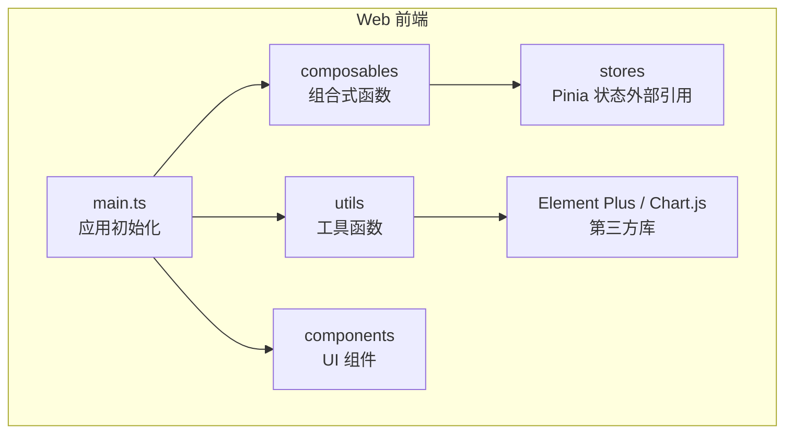
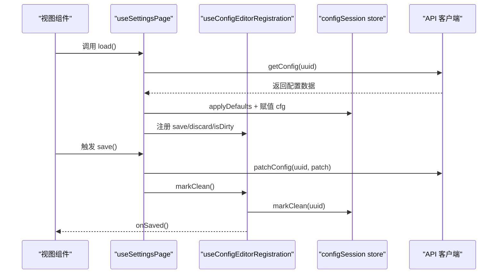
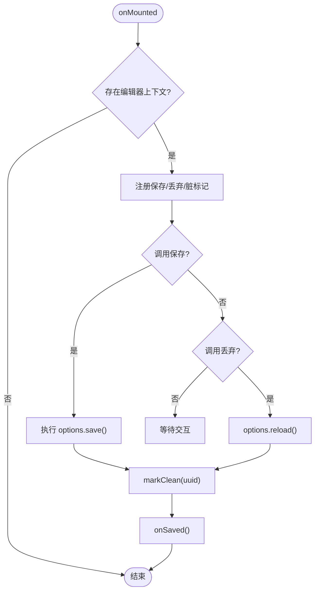
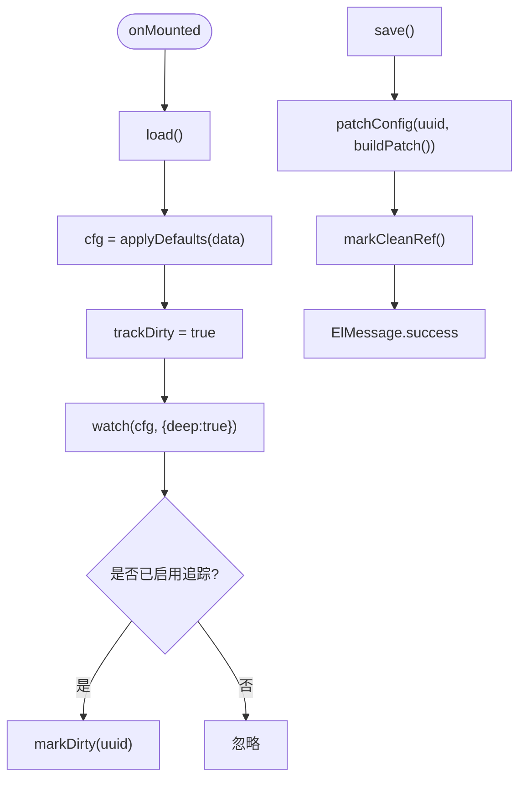
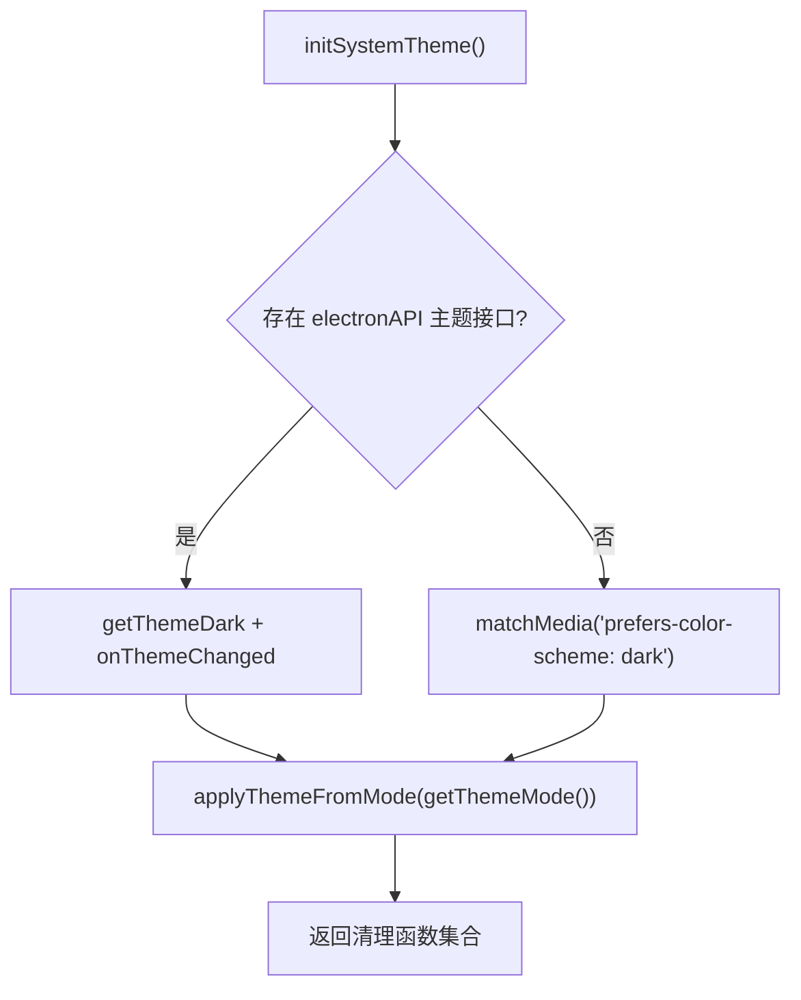
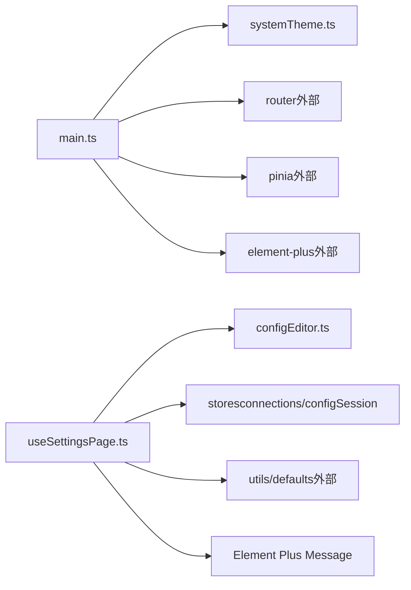

# 组合式函数与工具

<cite>
**本文引用的文件**   
- [packages/web/package.json](file://packages/web/package.json)
- [packages/web/src/main.ts](file://packages/web/src/main.ts)
- [packages/web/src/composables/configEditor.ts](file://packages/web/src/composables/configEditor.ts)
- [packages/web/src/composables/consoleActions.ts](file://packages/web/src/composables/consoleActions.ts)
- [packages/web/src/composables/useSettingsPage.ts](file://packages/web/src/composables/useSettingsPage.ts)
- [packages/web/src/utils/systemTheme.ts](file://packages/web/src/utils/systemTheme.ts)
- [packages/web/src/components/UnsavedChangesDialog.vue](file://packages/web/src/components/UnsavedChangesDialog.vue)
</cite>

## 目录
1. [简介](#简介)
2. [项目结构](#项目结构)
3. [核心组件](#核心组件)
4. [架构总览](#架构总览)
5. [详细组件分析](#详细组件分析)
6. [依赖关系分析](#依赖关系分析)
7. [性能与内存优化](#性能与内存优化)
8. [测试、文档与版本管理](#测试文档与版本管理)
9. [故障排查指南](#故障排查指南)
10. [结论](#结论)

## 简介
本文件聚焦前端组合式函数与工具库，围绕 Vue 3 Composition API 的使用模式展开，说明自定义 hooks 的设计原则、状态封装与副作用管理；梳理常用工具函数的分类与组织方式（主题系统、配置编辑、控制台动作等）；总结可复用逻辑的提取模式与函数式实践；并给出测试策略、文档生成与版本管理的建议。同时覆盖性能优化、内存泄漏防护、浏览器兼容性处理，以及第三方库集成与封装的最佳实践。

## 项目结构
前端位于 packages/web，采用 Vue 3 + Vite + Pinia + Element Plus 的技术栈。组合式函数集中在 src/composables，通用工具在 src/utils，全局入口在 src/main.ts，UI 组件在 src/components。

图表来源
- [packages/web/src/main.ts:1-45](file://packages/web/src/main.ts#L1-L45)
- [packages/web/package.json:16-25](file://packages/web/package.json#L16-L25)

章节来源
- [packages/web/package.json:1-37](file://packages/web/package.json#L1-L37)
- [packages/web/src/main.ts:1-45](file://packages/web/src/main.ts#L1-L45)

## 核心组件
本节聚焦三个关键组合式函数与一个工具模块：
- useConfigEditorRegistration：统一注册配置编辑器，提供保存/丢弃/脏标记能力
- useSettingsPage：封装“加载-变更-保存”的配置页面流程
- consoleActions：定义控制台动作上下文接口
- systemTheme：主题模式与系统深色监听、清理回收

章节来源
- [packages/web/src/composables/configEditor.ts:1-62](file://packages/web/src/composables/configEditor.ts#L1-L62)
- [packages/web/src/composables/useSettingsPage.ts:1-87](file://packages/web/src/composables/useSettingsPage.ts#L1-L87)
- [packages/web/src/composables/consoleActions.ts:1-14](file://packages/web/src/composables/consoleActions.ts#L1-L14)
- [packages/web/src/utils/systemTheme.ts:1-92](file://packages/web/src/utils/systemTheme.ts#L1-L92)

## 架构总览
组合式函数通过注入上下文与 Pinia store 协作，将“配置编辑生命周期”从视图层解耦；工具函数负责跨环境主题适配与持久化；UI 组件仅消费组合式函数暴露的状态与方法。

图表来源
- [packages/web/src/composables/useSettingsPage.ts:18-54](file://packages/web/src/composables/useSettingsPage.ts#L18-L54)
- [packages/web/src/composables/configEditor.ts:29-55](file://packages/web/src/composables/configEditor.ts#L29-L55)

## 详细组件分析

### 配置编辑器注册器 useConfigEditorRegistration
职责
- 为具体配置页提供统一的“保存/丢弃/脏标记”协议
- 通过 InjectionKey 注入上下文，避免组件间直接耦合
- 在挂载时注册，卸载时自动注销，防止内存泄漏

设计要点
- 使用 inject 获取父级上下文，若不存在则静默跳过
- 基于 configSession store 判断脏状态与清理
- 包装异步保存/重载流程，统一错误处理与回调通知

图表来源
- [packages/web/src/composables/configEditor.ts:29-55](file://packages/web/src/composables/configEditor.ts#L29-L55)

章节来源
- [packages/web/src/composables/configEditor.ts:1-62](file://packages/web/src/composables/configEditor.ts#L1-L62)

### 设置页组合式函数 useSettingsPage
职责
- 封装“加载配置 → 深监听变更 → 保存配置 → 脏标记管理”的完整流程
- 与 useConfigEditorRegistration 协作，实现统一的保存/丢弃语义
- 对外暴露 cfg、loading、saving、load、save、markDirty、markClean

关键点
- 首次加载后开启脏追踪，避免初始值误报
- 使用 deep watch 监听配置对象变更
- 切换服务器 UUID 时自动重新加载并清理脏标记

图表来源
- [packages/web/src/composables/useSettingsPage.ts:18-85](file://packages/web/src/composables/useSettingsPage.ts#L18-L85)

章节来源
- [packages/web/src/composables/useSettingsPage.ts:1-87](file://packages/web/src/composables/useSettingsPage.ts#L1-L87)

### 控制台动作上下文 ConsoleActions
职责
- 定义控制台动作的统一类型契约，便于在不同视图中以相同方式使用
- 暴露执行动作、保存、运行状态、脏状态、实例标签、配置写入状态、向导打开方法

设计要点
- 使用 InjectionKey 暴露上下文，利于组合式函数之间解耦
- 所有方法返回 Promise，便于上层统一错误处理与 UI 反馈

章节来源
- [packages/web/src/composables/consoleActions.ts:1-14](file://packages/web/src/composables/consoleActions.ts#L1-L14)

### 主题系统工具 systemTheme
职责
- 管理应用主题模式（system/light/dark），持久化到 localStorage
- 支持 Electron 主题桥接与浏览器 prefers-color-scheme 监听
- 提供清理函数，移除事件监听，避免内存泄漏

关键点
- initSystemTheme 返回清理函数，集中管理 electron 与 matchMedia 监听器的销毁
- 优先使用 Electron API，回退到浏览器媒体查询
- 根据当前模式计算最终主题并应用到根节点

图表来源
- [packages/web/src/utils/systemTheme.ts:51-91](file://packages/web/src/utils/systemTheme.ts#L51-L91)

章节来源
- [packages/web/src/utils/systemTheme.ts:1-92](file://packages/web/src/utils/systemTheme.ts#L1-L92)

### 未保存更改对话框 UnsavedChangesDialog
职责
- 提供“保存/不保存/取消”的确认弹窗，返回 Promise 供上层 await
- 通过 defineExpose 暴露 open 方法，便于组合式函数或视图调用

使用建议
- 在路由切换或关闭页面时，先 await open()，再决定是否离开
- 结合 useSettingsPage 的 dirty 状态，决定是否需要弹出该对话框

章节来源
- [packages/web/src/components/UnsavedChangesDialog.vue:1-34](file://packages/web/src/components/UnsavedChangesDialog.vue#L1-L34)

## 依赖关系分析
- 组合式函数依赖 Pinia store（如 connections、configSession）与 Element Plus 消息提示
- 工具函数依赖浏览器 API（localStorage、matchMedia）与可选的 Electron API
- main.ts 负责应用初始化、错误拦截、插件注册与主题初始化

图表来源
- [packages/web/src/main.ts:1-45](file://packages/web/src/main.ts#L1-L45)
- [packages/web/src/composables/useSettingsPage.ts:1-87](file://packages/web/src/composables/useSettingsPage.ts#L1-L87)
- [packages/web/src/composables/configEditor.ts:1-62](file://packages/web/src/composables/configEditor.ts#L1-L62)

章节来源
- [packages/web/src/main.ts:1-45](file://packages/web/src/main.ts#L1-L45)
- [packages/web/src/composables/useSettingsPage.ts:1-87](file://packages/web/src/composables/useSettingsPage.ts#L1-L87)
- [packages/web/src/composables/configEditor.ts:1-62](file://packages/web/src/composables/configEditor.ts#L1-L62)

## 性能与内存优化
- 避免深层响应式开销
  - 仅在必要时对配置对象使用 deep watch，并在首次加载后开启脏追踪，减少不必要的变更检测
- 及时清理副作用
  - 主题系统通过返回清理函数集中移除 Electron 与 matchMedia 监听器，避免内存泄漏
  - 组合式函数在 onUnmounted 中注销注册项，确保无残留订阅
- 最小化 DOM 操作
  - 主题变更通过 data 属性与 CSS 变量驱动，避免频繁样式重排
- 网络请求优化
  - 在 loading/saving 状态包裹 try/finally，保证 UI 状态恢复
  - 失败路径统一抛出错误，由上层捕获并展示用户提示

章节来源
- [packages/web/src/composables/useSettingsPage.ts:63-85](file://packages/web/src/composables/useSettingsPage.ts#L63-L85)
- [packages/web/src/utils/systemTheme.ts:51-91](file://packages/web/src/utils/systemTheme.ts#L51-L91)
- [packages/web/src/composables/configEditor.ts:53-55](file://packages/web/src/composables/configEditor.ts#L53-L55)

## 测试、文档与版本管理
- 测试策略
  - 组合式函数：针对 load/save/markDirty/markClean 进行单元测试，模拟 store 与 API 客户端
  - 工具函数：针对 getThemeMode/setThemeMode/applyThemeFromMode 进行边界与回退分支测试
  - 组件：对 UnsavedChangesDialog 的 open/choose 行为进行交互测试
- 文档生成
  - 使用 JSDoc/TSDoc 标注组合式函数参数与返回值，配合 IDE 自动补全
  - 为公共工具函数编写 README 片段，说明输入输出与异常场景
- 版本管理
  - 使用 package.json 中的 scripts 与版本号管理构建产物
  - 通过 CI/CD 流水线（GitHub Actions）自动化构建与发布

章节来源
- [packages/web/package.json:1-37](file://packages/web/package.json#L1-L37)

## 故障排查指南
- 界面异常兜底
  - main.ts 中注册了全局 errorHandler，出现未捕获异常时在页面顶部显示错误横幅，并提供返回连接页的快捷链接
- 常见错误定位
  - 检查 theme 初始化是否成功，确认 localStorage 键名与 Electron API 可用性
  - 检查配置页是否在正确时机调用 markClean，避免误报“未保存更改”
  - 检查 API 客户端连接状态，避免在未连接时发起请求导致“未连接”错误

章节来源
- [packages/web/src/main.ts:23-40](file://packages/web/src/main.ts#L23-L40)
- [packages/web/src/composables/useSettingsPage.ts:38-53](file://packages/web/src/composables/useSettingsPage.ts#L38-L53)

## 结论
本项目的前端组合式函数遵循清晰的职责分离与上下文注入模式，将配置编辑的生命周期抽象为可复用的钩子；工具函数专注于跨环境兼容与副作用清理，保障稳定性与可维护性。通过严格的错误处理、状态管理与资源清理，系统在复杂交互场景中仍保持良好性能与用户体验。建议在后续迭代中继续扩展工具函数分类（日期、格式化、验证、算法），完善测试覆盖率，并通过文档与脚本提升团队协作效率。