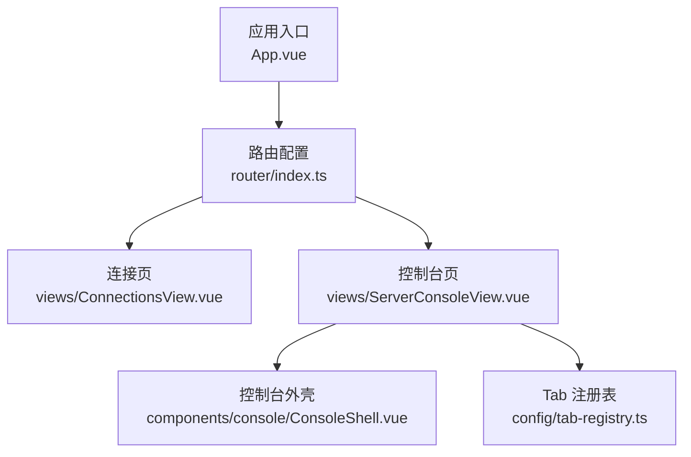
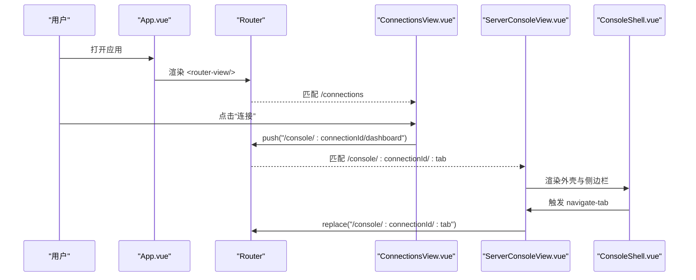
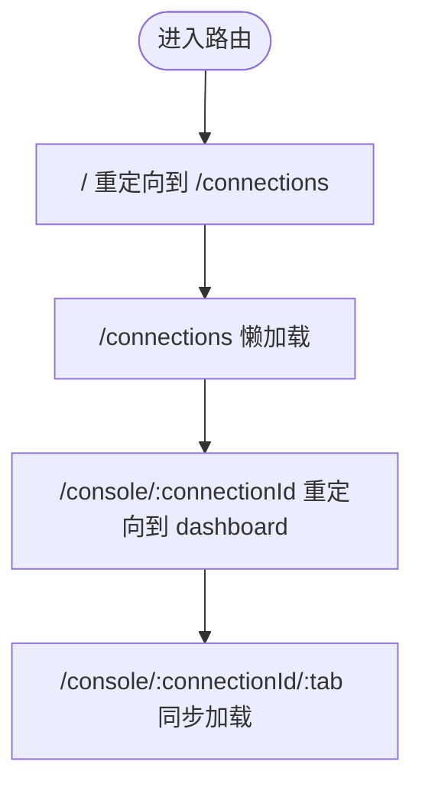
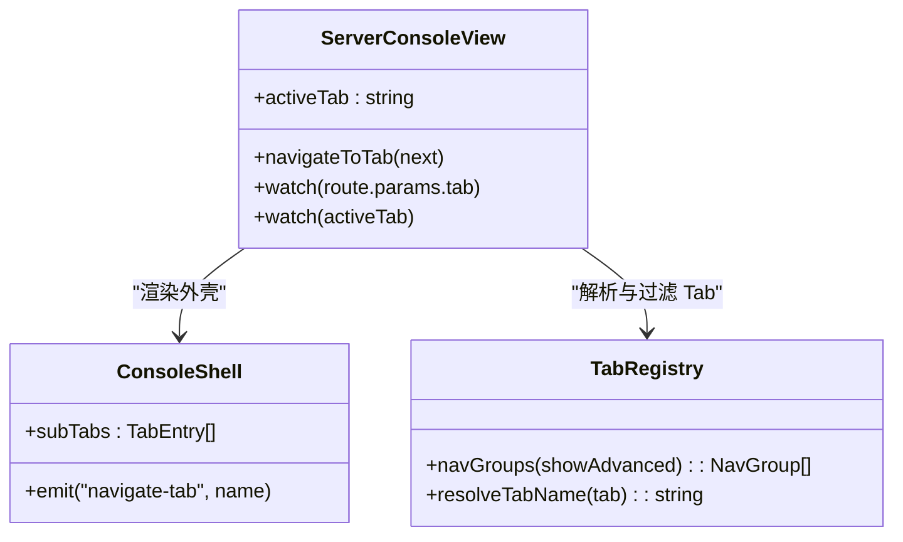
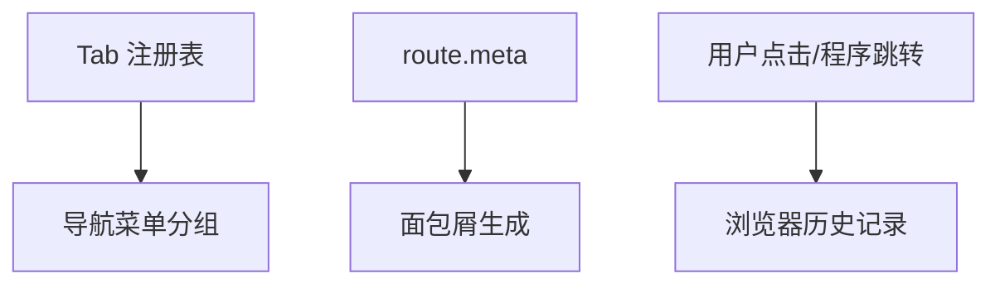
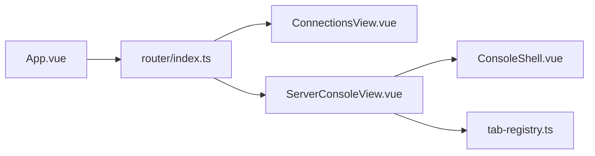

# 路由与导航

<cite>
**本文引用的文件**   
- [packages/web/src/router/index.ts](file://packages/web/src/router/index.ts)
- [packages/web/src/App.vue](file://packages/web/src/App.vue)
- [packages/web/src/views/ConnectionsView.vue](file://packages/web/src/views/ConnectionsView.vue)
- [packages/web/src/views/ServerConsoleView.vue](file://packages/web/src/views/ServerConsoleView.vue)
- [packages/web/src/config/tab-registry.ts](file://packages/web/src/config/tab-registry.ts)
- [packages/web/src/components/console/ConsoleShell.vue](file://packages/web/src/components/console/ConsoleShell.vue)
</cite>

## 目录
1. [简介](#简介)
2. [项目结构](#项目结构)
3. [核心组件](#核心组件)
4. [架构总览](#架构总览)
5. [详细组件分析](#详细组件分析)
6. [依赖关系分析](#依赖关系分析)
7. [性能与优化](#性能与优化)
8. [故障排查](#故障排查)
9. [结论](#结论)

## 简介
本章节面向前端路由与导航，聚焦 Vue Router 在本项目中的配置与使用方式。文档涵盖：
- 路由定义、重定向、动态参数
- 嵌套路由与 Tab 子路由的同步策略
- 导航守卫（权限校验、访问控制、元信息）的实现思路与扩展点
- 路由懒加载、代码分割与预加载策略
- 导航菜单生成、面包屑与历史记录管理
- 路由动画与过渡效果、SEO 优化建议
- 路由性能优化与调试技巧

## 项目结构
本项目的前端位于 packages/web 下，路由相关代码集中在 router 目录，页面视图在 views 目录，控制台 Shell 与侧边栏在 components/console 与 config/tab-registry.ts 中组织。

**图示来源**
- [packages/web/src/App.vue:25-76](file://packages/web/src/App.vue#L25-L76)
- [packages/web/src/router/index.ts:6-62](file://packages/web/src/router/index.ts#L6-L62)
- [packages/web/src/views/ConnectionsView.vue:75-124](file://packages/web/src/views/ConnectionsView.vue#L75-L124)
- [packages/web/src/views/ServerConsoleView.vue:146-195](file://packages/web/src/views/ServerConsoleView.vue#L146-L195)
- [packages/web/src/components/console/ConsoleShell.vue:150-219](file://packages/web/src/components/console/ConsoleShell.vue#L150-L219)
- [packages/web/src/config/tab-registry.ts:16-44](file://packages/web/src/config/tab-registry.ts#L16-L44)

**章节来源**
- [packages/web/src/router/index.ts:1-79](file://packages/web/src/router/index.ts#L1-L79)
- [packages/web/src/App.vue:1-108](file://packages/web/src/App.vue#L1-L108)

## 核心组件
- 路由实例与历史模式：使用 Hash 历史模式，集中定义路由表，提供全局错误处理。
- 连接页：负责主机列表、连接测试与跳转到控制台。
- 控制台页：根据动态 connectionId 与 tab 参数渲染控制台界面，维护 Tab 状态并与 URL 同步。
- 控制台外壳：提供模式切换、子 Tab 导航与操作区。
- Tab 注册表：声明式地定义所有可用 Tab，并生成分组导航。

**章节来源**
- [packages/web/src/router/index.ts:59-79](file://packages/web/src/router/index.ts#L59-L79)
- [packages/web/src/views/ConnectionsView.vue:75-124](file://packages/web/src/views/ConnectionsView.vue#L75-L124)
- [packages/web/src/views/ServerConsoleView.vue:146-195](file://packages/web/src/views/ServerConsoleView.vue#L146-L195)
- [packages/web/src/components/console/ConsoleShell.vue:150-219](file://packages/web/src/components/console/ConsoleShell.vue#L150-L219)
- [packages/web/src/config/tab-registry.ts:16-44](file://packages/web/src/config/tab-registry.ts#L16-L44)

## 架构总览
下图展示从 App 到具体页面的路由流程，以及控制台内 Tab 与 URL 的双向同步机制。

**图示来源**
- [packages/web/src/App.vue:73-75](file://packages/web/src/App.vue#L73-L75)
- [packages/web/src/router/index.ts:6-62](file://packages/web/src/router/index.ts#L6-L62)
- [packages/web/src/views/ConnectionsView.vue:75-124](file://packages/web/src/views/ConnectionsView.vue#L75-L124)
- [packages/web/src/views/ServerConsoleView.vue:183-195](file://packages/web/src/views/ServerConsoleView.vue#L183-L195)
- [packages/web/src/components/console/ConsoleShell.vue:192-210](file://packages/web/src/components/console/ConsoleShell.vue#L192-L210)

## 详细组件分析

### 路由定义与动态参数
- 根路径重定向到连接页。
- 连接页、演示页、设置页等静态路由采用懒加载。
- 控制台路由包含动态段 connectionId 与 tab，其中 console 主路由为同步加载，避免在 Electron/file 协议或静态托管环境下异步 chunk 失败导致白屏。
- 对 /console/:connectionId 提供默认重定向到 dashboard 子路由。

**图示来源**
- [packages/web/src/router/index.ts:6-56](file://packages/web/src/router/index.ts#L6-L56)

**章节来源**
- [packages/web/src/router/index.ts:6-56](file://packages/web/src/router/index.ts#L6-L56)

### 嵌套路由与 Tab 子路由
控制台通过一个父路由承载多个子 Tab，Tab 名称由注册表统一管理，并在 URL 中体现为 :tab 参数。控制台内部维护 activeTab 状态，并通过 watch 与 router.replace 保持与 URL 一致。

**图示来源**
- [packages/web/src/views/ServerConsoleView.vue:146-195](file://packages/web/src/views/ServerConsoleView.vue#L146-L195)
- [packages/web/src/components/console/ConsoleShell.vue:192-210](file://packages/web/src/components/console/ConsoleShell.vue#L192-L210)
- [packages/web/src/config/tab-registry.ts:54-85](file://packages/web/src/config/tab-registry.ts#L54-L85)
- [packages/web/src/config/tab-registry.ts:87-102](file://packages/web/src/config/tab-registry.ts#L87-L102)

**章节来源**
- [packages/web/src/views/ServerConsoleView.vue:146-195](file://packages/web/src/views/ServerConsoleView.vue#L146-L195)
- [packages/web/src/components/console/ConsoleShell.vue:192-210](file://packages/web/src/components/console/ConsoleShell.vue#L192-L210)
- [packages/web/src/config/tab-registry.ts:54-102](file://packages/web/src/config/tab-registry.ts#L54-L102)

### 导航守卫实现（权限验证、访问控制、元信息管理）
当前仓库未直接注册全局前置守卫。可在 router/index.ts 中扩展 beforeEach 实现以下能力：
- 权限验证：根据角色或会话状态拦截受保护路由。
- 访问控制：针对移动端/桌面端差异进行条件跳转。
- 元信息管理：读取 route.meta 中的 title、keywords、description，更新 document.title 与 SEO 标签。

推荐扩展点位置：
- 在 createRouter 之后、导出 router 之前添加 router.beforeEach。
- 结合 useRoute/useRouter 在各页面中读取 meta 字段，配合 Tab 注册表生成面包屑。

说明：以下为实践建议，非现有代码。

**章节来源**
- [packages/web/src/router/index.ts:59-62](file://packages/web/src/router/index.ts#L59-L62)

### 路由懒加载、代码分割与预加载
- 多数页面使用 () => import(...) 实现按需加载。
- 控制台主路由为同步加载，以避免在特定运行环境下的白屏问题。
- 可结合 Vue Router 的 prefetch 与 preload 策略，对热点路由（如 dashboard）进行预取；对低频路由保持懒加载。

建议：
- 将高频访问的子路由（dashboard）改为预取，降低首次交互延迟。
- 对大型第三方库（如 Element Plus）按模块拆分，减少首包体积。

**章节来源**
- [packages/web/src/router/index.ts:14-55](file://packages/web/src/router/index.ts#L14-L55)

### 导航菜单生成、面包屑与历史记录
- 导航菜单：基于 Tab 注册表 navGroups 生成分组菜单，支持高级设置开关控制可见性。
- 面包屑：可结合 route.meta 与 Tab 注册表 label 构建层级面包屑。
- 历史记录：使用 router.push/replace 控制是否压栈；控制台内 Tab 切换使用 replace，避免产生过多历史项。

**图示来源**
- [packages/web/src/config/tab-registry.ts:66-85](file://packages/web/src/config/tab-registry.ts#L66-L85)
- [packages/web/src/views/ServerConsoleView.vue:190-195](file://packages/web/src/views/ServerConsoleView.vue#L190-L195)

**章节来源**
- [packages/web/src/config/tab-registry.ts:66-85](file://packages/web/src/config/tab-registry.ts#L66-L85)
- [packages/web/src/views/ServerConsoleView.vue:190-195](file://packages/web/src/views/ServerConsoleView.vue#L190-L195)

### 路由动画与过渡效果
当前未使用 <transition> 包裹 <router-view/>。如需路由切换动画：
- 在 App.vue 中使用 <transition name="fade"> 包裹 <router-view/>。
- 为不同路由设置 transitionName，实现差异化动效。

说明：此为增强建议，非现有实现。

**章节来源**
- [packages/web/src/App.vue:73-75](file://packages/web/src/App.vue#L73-L75)

### SEO 优化
- 使用 metaInfo 或 head 管理每个路由的 title、meta、link。
- 在路由守卫中根据 route.meta 动态注入 SEO 信息。
- 对关键页面（如连接页、控制台概览）提供结构化数据与 Open Graph 标签。

说明：此为增强建议，非现有实现。

**章节来源**
- [packages/web/src/router/index.ts:59-62](file://packages/web/src/router/index.ts#L59-L62)

## 依赖关系分析
- App.vue 作为应用壳，渲染 <router-view/> 并提供顶部导航链接。
- router/index.ts 集中管理路由表与全局错误处理。
- ConnectionsView.vue 负责连接逻辑与跳转到控制台。
- ServerConsoleView.vue 管理控制台状态、Tab 同步与业务操作。
- ConsoleShell.vue 提供通用外壳与子 Tab 导航。
- tab-registry.ts 提供 Tab 元数据与分组逻辑。

**图示来源**
- [packages/web/src/App.vue:73-75](file://packages/web/src/App.vue#L73-L75)
- [packages/web/src/router/index.ts:59-62](file://packages/web/src/router/index.ts#L59-L62)
- [packages/web/src/views/ConnectionsView.vue:75-124](file://packages/web/src/views/ConnectionsView.vue#L75-L124)
- [packages/web/src/views/ServerConsoleView.vue:146-195](file://packages/web/src/views/ServerConsoleView.vue#L146-L195)
- [packages/web/src/components/console/ConsoleShell.vue:150-219](file://packages/web/src/components/console/ConsoleShell.vue#L150-L219)
- [packages/web/src/config/tab-registry.ts:66-85](file://packages/web/src/config/tab-registry.ts#L66-L85)

**章节来源**
- [packages/web/src/App.vue:1-108](file://packages/web/src/App.vue#L1-L108)
- [packages/web/src/router/index.ts:1-79](file://packages/web/src/router/index.ts#L1-L79)
- [packages/web/src/views/ConnectionsView.vue:1-321](file://packages/web/src/views/ConnectionsView.vue#L1-L321)
- [packages/web/src/views/ServerConsoleView.vue:1-800](file://packages/web/src/views/ServerConsoleView.vue#L1-L800)
- [packages/web/src/components/console/ConsoleShell.vue:144-219](file://packages/web/src/components/console/ConsoleShell.vue#L144-L219)
- [packages/web/src/config/tab-registry.ts:1-103](file://packages/web/src/config/tab-registry.ts#L1-L103)

## 性能与优化
- 路由懒加载：已对大部分页面启用，控制台主路由同步加载以规避白屏风险。
- 预取热点路由：对 dashboard 等常用子路由进行预取，缩短交互延迟。
- 代码分割：按功能模块拆分第三方库与重型组件，减小首屏体积。
- 路由缓存：对无副作用的页面使用 keep-alive 缓存，避免重复初始化。
- 导航节流：在频繁切换 Tab 时合并请求，避免并发刷新。
- 调试技巧：
  - 使用浏览器开发者工具的 Network 面板观察 chunk 加载情况。
  - 在 router.onError 中捕获并展示错误信息，便于定位问题。
  - 使用 Vue DevTools 查看路由状态与组件树。

**章节来源**
- [packages/web/src/router/index.ts:52-56](file://packages/web/src/router/index.ts#L52-L56)
- [packages/web/src/router/index.ts:64-78](file://packages/web/src/router/index.ts#L64-L78)

## 故障排查
- 路由切换出错：router.onError 会输出错误日志，并在 #app 容器内渲染错误提示页，提供返回连接页的快捷链接。
- 控制台 Tab 不同步：检查 ServerConsoleView 中 watch(route.params.tab) 与 watch(activeTab) 的逻辑，确保使用 router.replace 而非 push。
- 移动端与桌面端差异：注意 isMobile 环境变量对路由与 UI 的影响，必要时在守卫中进行条件跳转。

**章节来源**
- [packages/web/src/router/index.ts:64-78](file://packages/web/src/router/index.ts#L64-L78)
- [packages/web/src/views/ServerConsoleView.vue:183-195](file://packages/web/src/views/ServerConsoleView.vue#L183-L195)

## 结论
本项目采用集中式路由配置与声明式 Tab 注册，结合动态路由与同步加载策略，在保证稳定性的同时实现了良好的可扩展性。建议在后续迭代中补充全局路由守卫、SEO 管理与路由动画，进一步提升用户体验与可维护性。