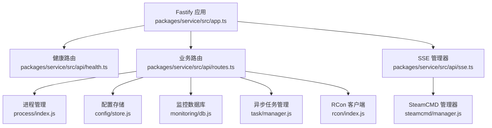
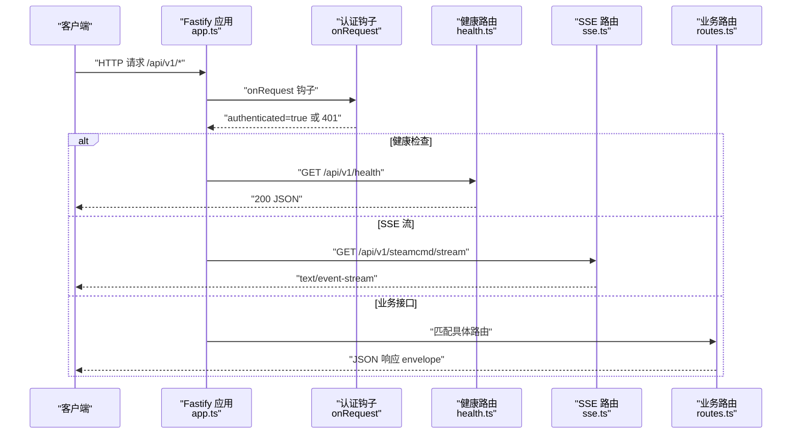
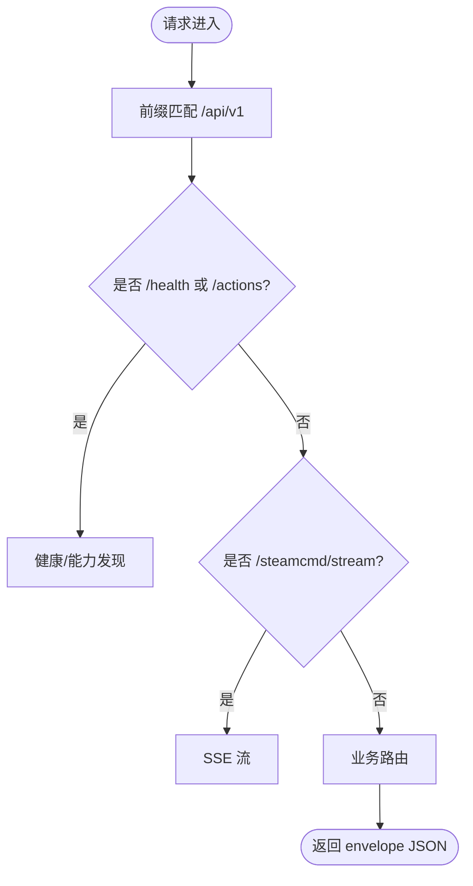
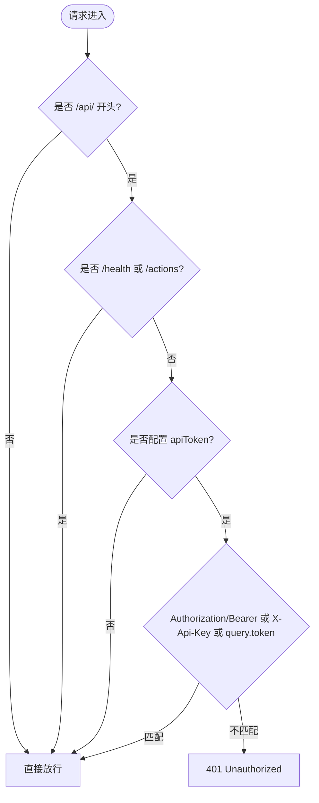
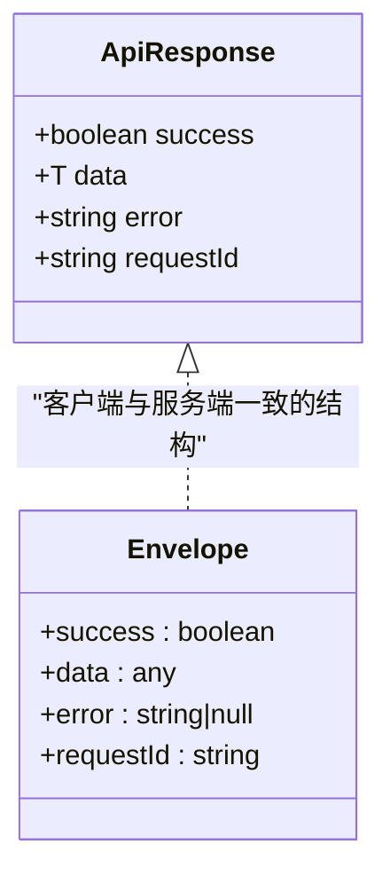
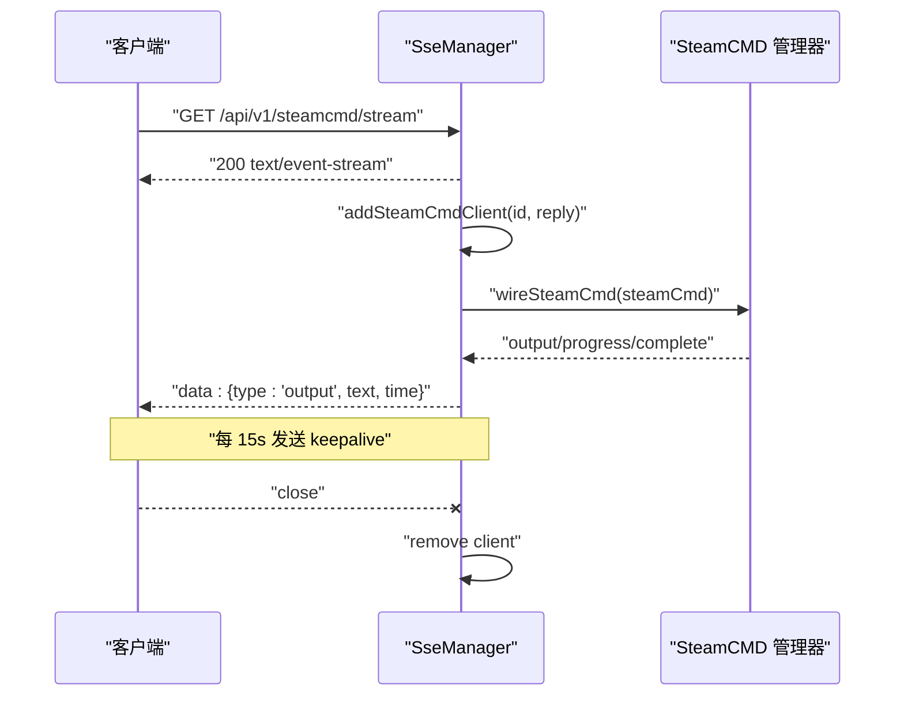
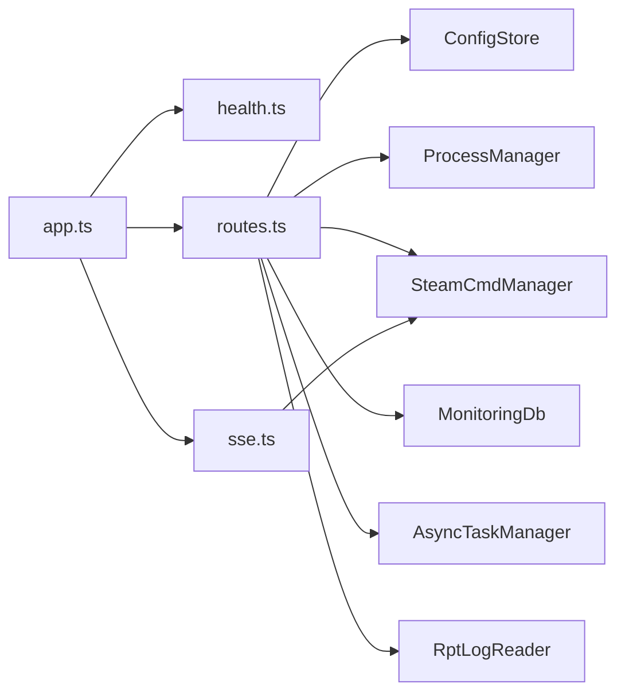

# API 路由系统

<cite>
**本文引用的文件**   
- [packages/service/src/app.ts](file://packages/service/src/app.ts)
- [packages/service/src/api/health.ts](file://packages/service/src/api/health.ts)
- [packages/service/src/api/routes.ts](file://packages/service/src/api/routes.ts)
- [packages/service/src/api/sse.ts](file://packages/service/src/api/sse.ts)
- [packages/service/src/api/types.d.ts](file://packages/service/src/api/types.d.ts)
- [packages/api-client/src/types.ts](file://packages/api-client/src/types.ts)
</cite>

## 目录
1. [简介](#简介)
2. [项目结构](#项目结构)
3. [核心组件](#核心组件)
4. [架构总览](#架构总览)
5. [详细组件分析](#详细组件分析)
6. [依赖关系分析](#依赖关系分析)
7. [性能与可扩展性](#性能与可扩展性)
8. [故障排查指南](#故障排查指南)
9. [结论](#结论)
10. [附录：API 设计规范与错误码](#附录api-设计规范与错误码)

## 简介
本文面向 Arma3 Server Tool 的 API 路由系统，系统性说明以下主题：
- 路由组织结构、版本控制策略与 RESTful 设计原则
- 认证中间件、请求校验、响应格式化与错误处理机制
- SSE（Server-Sent Events）实时通信的实现方式、事件类型与连接管理
- 路由装饰器使用、参数校验、权限控制的实践示例
- API 设计规范、错误码定义与 HTTP 状态码使用指南

该服务基于 Fastify 构建，统一以 `/api/v1` 作为 API 前缀，提供服务器配置、SteamCMD 管理、监控数据、任务编排、日志读取、SSE 输出流等能力。

## 项目结构
API 相关代码集中在 `packages/service/src` 下，关键文件如下：
- `app.ts`：Fastify 应用初始化、全局中间件、认证钩子、插件注册、路由挂载
- `api/health.ts`：健康检查与能力发现接口
- `api/routes.ts`：业务路由主体，包含服务器、SteamCMD、任务、监控、日志、封禁、文件上传等
- `api/sse.ts`：SSE 管理器，负责 SteamCMD 输出流的广播与客户端连接管理
- `api/types.d.ts`：扩展 Fastify 实例与请求的类型声明
- `packages/api-client/src/types.ts`：客户端侧统一的响应信封类型定义

**图表来源**
- [packages/service/src/app.ts:57-171](file://packages/service/src/app.ts#L57-L171)
- [packages/service/src/api/health.ts:5-66](file://packages/service/src/api/health.ts#L5-L66)
- [packages/service/src/api/routes.ts:62-1108](file://packages/service/src/api/routes.ts#L62-L1108)
- [packages/service/src/api/sse.ts:9-94](file://packages/service/src/api/sse.ts#L9-L94)

**章节来源**
- [packages/service/src/app.ts:57-171](file://packages/service/src/app.ts#L57-L171)
- [packages/service/src/api/health.ts:5-66](file://packages/service/src/api/health.ts#L5-L66)
- [packages/service/src/api/routes.ts:62-1108](file://packages/service/src/api/routes.ts#L62-L1108)
- [packages/service/src/api/sse.ts:9-94](file://packages/service/src/api/sse.ts#L9-L94)

## 核心组件
- 应用启动与中间件
  - 创建 Fastify 实例并注入服务单例（配置、进程、SteamCMD、监控、调度、日志、设置等）。
  - 通过 `decorateRequest` 和 `onRequest` 钩子实现认证逻辑。
  - 注册 CORS、Multipart 插件，支持大文件上传。
  - 按前缀 `/api/v1` 注册健康路由、SSE 路由与业务路由。
- 健康与能力发现
  - `/api/v1/health`：返回服务名、版本、平台信息、默认可执行路径等。
  - `/api/v1/actions`：返回支持的 task actions、REST 端点列表与文件上传端点。
- 业务路由
  - 服务器 CRUD、状态、配置读写、克隆、重命名、预检、诊断、路径查询、仪表盘。
  - SteamCMD 设置、凭据、状态、日志、停止。
  - 监控采集、统计、玩家同步、导出 HTML/CSV。
  - 定时任务、快照备份与恢复、本地封禁管理。
  - 文件上传（模组 HTML、任务 PBO）。
  - 任务编排：同步/异步任务，支持后续动作（写配置、重启）。
- SSE 实时通信
  - `/api/v1/steamcmd/stream`：建立 SSE 连接，推送历史日志、运行提示、实时输出、进度与完成事件。
  - 连接保活心跳，自动清理断开的客户端。
- 类型扩展
  - 扩展 FastifyInstance 与 FastifyRequest，使路由处理器可直接访问服务实例与认证标记。

**章节来源**
- [packages/service/src/app.ts:57-171](file://packages/service/src/app.ts#L57-L171)
- [packages/service/src/api/health.ts:5-66](file://packages/service/src/api/health.ts#L5-L66)
- [packages/service/src/api/routes.ts:62-1108](file://packages/service/src/api/routes.ts#L62-L1108)
- [packages/service/src/api/sse.ts:9-94](file://packages/service/src/api/sse.ts#L9-L94)
- [packages/service/src/api/types.d.ts:15-34](file://packages/service/src/api/types.d.ts#L15-L34)

## 架构总览
下图展示请求从进入 Fastify 到最终路由处理的完整流程，包括认证、CORS、SSE 与业务路由的关系。

**图表来源**
- [packages/service/src/app.ts:96-153](file://packages/service/src/app.ts#L96-L153)
- [packages/service/src/api/health.ts:5-66](file://packages/service/src/api/health.ts#L5-L66)
- [packages/service/src/api/sse.ts:51-90](file://packages/service/src/api/sse.ts#L51-L90)
- [packages/service/src/api/routes.ts:62-1108](file://packages/service/src/api/routes.ts#L62-L1108)

## 详细组件分析

### 路由组织与版本控制
- 所有 API 统一以 `/api/v1` 为前缀，便于未来演进至 v2。
- 健康路由与业务路由分别独立注册，避免耦合。
- 能力发现接口 `/api/v1/actions` 暴露当前可用的 task actions 与 REST 端点，便于客户端动态适配。

**图表来源**
- [packages/service/src/app.ts:150-153](file://packages/service/src/app.ts#L150-L153)
- [packages/service/src/api/health.ts:5-66](file://packages/service/src/api/health.ts#L5-L66)
- [packages/service/src/api/sse.ts:51-90](file://packages/service/src/api/sse.ts#L51-L90)
- [packages/service/src/api/routes.ts:62-1108](file://packages/service/src/api/routes.ts#L62-L1108)

**章节来源**
- [packages/service/src/app.ts:150-153](file://packages/service/src/app.ts#L150-L153)
- [packages/service/src/api/health.ts:5-66](file://packages/service/src/api/health.ts#L5-L66)
- [packages/service/src/api/routes.ts:62-1108](file://packages/service/src/api/routes.ts#L62-L1108)

### RESTful 设计原则
- 资源命名采用名词复数形式，如 `/servers`、`/settings`、`/tasks`。
- 操作语义明确：
  - GET：查询资源或状态
  - POST：创建资源或触发动作
  - PUT：更新资源
  - PATCH：部分更新
  - DELETE：删除资源
- 资源定位清晰：
  - `/servers/:uuid/config`：获取/更新指定服务器的配置
  - `/servers/:uuid/status`：查询服务器运行状态
  - `/servers/:uuid/dashboard`：聚合仪表盘数据
- 幂等性与安全性：
  - 读操作均为幂等
  - 写操作通过明确的 HTTP 方法与参数控制副作用（如 `writeCfg`、`restartAfter`）

**章节来源**
- [packages/service/src/api/routes.ts:65-1108](file://packages/service/src/api/routes.ts#L65-L1108)

### 认证中间件与权限控制
- 认证入口：`onRequest` 钩子
  - 非 `/api/` 路径直接放行（静态 UI 不受限）
  - `/api/v1/health` 与 `/api/v1/actions` 免认证
  - 若未配置 `apiToken`，则放行（开发环境友好）
  - 支持三种认证方式：
    - `Authorization: Bearer <token>`
    - `X-Api-Key: <token>`
    - 查询参数 `?token=<token>`
  - 失败时返回 401 与标准信封 `{ success: false, message: "Unauthorized" }`
- 权限粒度：
  - 当前实现为令牌级鉴权，未实现细粒度角色/权限控制
  - 可在路由层增加条件判断以实现更细粒度的权限控制

**图表来源**
- [packages/service/src/app.ts:96-130](file://packages/service/src/app.ts#L96-L130)

**章节来源**
- [packages/service/src/app.ts:96-130](file://packages/service/src/app.ts#L96-L130)

### 请求验证与参数校验
- 查询参数：
  - `reload`、`writeCfg`、`tail`、`kind`、`hours`、`mode`、`addToMissionList` 等布尔或枚举值
  - 使用 `parseQueryBool` 将字符串转为布尔值
- 路径参数：
  - `uuid`、`taskId`、`snapshotId`、`guid` 等
- 请求体：
  - 多数接口对 body 进行空值、数组、字段存在性校验
  - 例如：
    - `/servers/:uuid/config` 写入时调用 `sanitizeImportedProcessId` 清理进程 ID
    - `/servers/:uuid/bans` 要求 body 为数组
    - `/servers/:uuid/files/mod-list-html` 解析 HTML 中的模组 ID
- 外部输入安全：
  - 日志读取使用 `resolveAllowedLogPath` 限制路径范围
  - 模组路径校验使用 `isModDirectory` 与 `validateServerPath`

**章节来源**
- [packages/service/src/api/routes.ts:112-195](file://packages/service/src/api/routes.ts#L112-L195)
- [packages/service/src/api/routes.ts:491-499](file://packages/service/src/api/routes.ts#L491-L499)
- [packages/service/src/api/routes.ts:898-916](file://packages/service/src/api/routes.ts#L898-L916)
- [packages/service/src/api/routes.ts:945-987](file://packages/service/src/api/routes.ts#L945-L987)
- [packages/service/src/api/routes.ts:1120-1175](file://packages/service/src/api/routes.ts#L1120-L1175)

### 响应格式化与错误处理
- 统一响应信封：
  - 所有成功响应均通过 `envelope(success, data, error, requestId)` 包装
  - 客户端类型定义在 `packages/api-client/src/types.ts` 中
- 错误处理：
  - 业务异常通常返回 `{ success: false, data: null, error: "错误码", requestId }`
  - HTTP 状态码根据场景设置：
    - 400：参数无效、缺少必要字段
    - 401：未认证
    - 404：资源不存在
    - 502：下游服务失败（如 RCon）
- 内部辅助函数：
  - `ok(message)` 与 `fail(message)` 用于任务命令执行结果封装

**图表来源**
- [packages/api-client/src/types.ts:1-8](file://packages/api-client/src/types.ts#L1-L8)
- [packages/service/src/api/routes.ts:1112-1114](file://packages/service/src/api/routes.ts#L1112-L1114)

**章节来源**
- [packages/service/src/api/routes.ts:1112-1114](file://packages/service/src/api/routes.ts#L1112-L1114)
- [packages/api-client/src/types.ts:1-8](file://packages/api-client/src/types.ts#L1-L8)

### SSE 实时通信实现
- 连接建立：
  - `GET /api/v1/steamcmd/stream`
  - 使用 `reply.hijack()` 接管底层响应，设置 `Content-Type: text/event-stream`
  - 立即发送连接事件与历史日志片段
  - 若 SteamCMD 正在运行，发送后台同步提示
- 事件类型：
  - `connected`：连接成功
  - `output`：SteamCMD 输出文本
  - 进度与完成事件：通过 `wireSteamCmd` 映射为带前缀的输出事件
- 连接管理：
  - 维护 `clients` Map 与 `steamCmdClients` Set
  - 客户端断开时自动清理
  - 每 15 秒发送 keepalive 心跳
- 与 SteamCMD 集成：
  - 监听 `output`、`progress`、`complete` 事件并广播

**图表来源**
- [packages/service/src/api/sse.ts:9-94](file://packages/service/src/api/sse.ts#L9-L94)
- [packages/service/src/app.ts:147-153](file://packages/service/src/app.ts#L147-L153)

**章节来源**
- [packages/service/src/api/sse.ts:9-94](file://packages/service/src/api/sse.ts#L9-L94)
- [packages/service/src/app.ts:147-153](file://packages/service/src/app.ts#L147-L153)

### 路由装饰器使用、参数验证、权限控制示例
- 路由装饰器：
  - 使用 Fastify 原生装饰器 `app.get/post/put/patch/delete`
  - 示例：
    - `GET /servers`：列出服务器
    - `POST /servers`：创建服务器
    - `PUT /servers/:uuid/config`：更新配置
    - `DELETE /servers/:uuid`：删除服务器
- 参数验证：
  - 查询参数布尔转换：`parseQueryBool(query.reload)`
  - 路径参数类型：`req.params.uuid`
  - 请求体验证：数组、必填字段、路径有效性
- 权限控制：
  - 全局认证钩子统一拦截
  - 可在路由内追加额外校验（如仅管理员可写配置）

**章节来源**
- [packages/service/src/api/routes.ts:65-1108](file://packages/service/src/api/routes.ts#L65-L1108)
- [packages/service/src/app.ts:96-130](file://packages/service/src/app.ts#L96-L130)

## 依赖关系分析
- Fastify 应用依赖：
  - CORS 插件：允许跨域请求，适配 Capacitor WebView 与 LAN 访问
  - Multipart 插件：支持大文件上传（100MB）
- 服务依赖：
  - ConfigStore：服务器配置持久化
  - ProcessManager：进程生命周期管理
  - SteamCmdManager：SteamCMD 安装、更新、下载模组
  - MonitoringDb：监控数据存储与查询
  - Scheduler：定时任务调度
  - RptLogReader：日志读取与路径校验
  - AsyncTaskManager：异步任务编排与取消
- 模块耦合：
  - 路由层高度依赖服务层，但通过 Fastify 装饰注入，降低直接 import 耦合
  - SSE 与 SteamCMD 解耦，通过事件总线广播

**图表来源**
- [packages/service/src/app.ts:57-171](file://packages/service/src/app.ts#L57-L171)
- [packages/service/src/api/routes.ts:62-1108](file://packages/service/src/api/routes.ts#L62-L1108)
- [packages/service/src/api/sse.ts:9-94](file://packages/service/src/api/sse.ts#L9-L94)

**章节来源**
- [packages/service/src/app.ts:57-171](file://packages/service/src/app.ts#L57-L171)
- [packages/service/src/api/routes.ts:62-1108](file://packages/service/src/api/routes.ts#L62-L1108)
- [packages/service/src/api/sse.ts:9-94](file://packages/service/src/api/sse.ts#L9-L94)

## 性能与可扩展性
- 性能特性：
  - Fastify 高性能路由与序列化
  - SSE 长连接保活，减少频繁轮询开销
  - 日志读取限制行数，避免大文件阻塞
- 可扩展性建议：
  - 引入请求体 Schema 校验（如 Ajv）提升健壮性
  - 增加速率限制与请求大小限制策略
  - 将认证扩展为 JWT 或 OAuth2，支持多租户与细粒度权限
  - 将任务编排迁移至消息队列，提升并发与可靠性

[本节为通用指导，无需引用具体文件]

## 故障排查指南
- 401 未认证：
  - 检查是否配置 `apiToken`
  - 确认请求头 `Authorization`、`X-Api-Key` 或查询参数 `token` 是否正确
- 400 参数无效：
  - 检查必填字段是否存在
  - 检查路径是否为有效模组目录或服务器目录
- 404 资源不存在：
  - 检查 `uuid` 是否正确
  - 确认服务器配置是否存在
- 502 下游失败：
  - RCon 连接失败时返回 502，检查 RCon 配置与游戏服务器状态
- SSE 连接问题：
  - 检查浏览器控制台网络面板，确认 `text/event-stream`
  - 查看是否收到 keepalive 心跳
  - 确认 SteamCMD 是否正在运行

**章节来源**
- [packages/service/src/app.ts:96-130](file://packages/service/src/app.ts#L96-L130)
- [packages/service/src/api/routes.ts:442-462](file://packages/service/src/api/routes.ts#L442-L462)
- [packages/service/src/api/sse.ts:51-90](file://packages/service/src/api/sse.ts#L51-L90)

## 结论
本 API 路由系统以 Fastify 为核心，采用清晰的模块化结构与统一的响应格式，提供稳定的服务器管理、SteamCMD 集成、监控与任务编排能力。SSE 实现了高效的实时输出流，适合监控与调试场景。认证机制简洁可靠，便于开发与生产环境切换。未来可通过引入 Schema 校验、JWT 认证与消息队列进一步提升系统的健壮性与可扩展性。

[本节为总结性内容，无需引用具体文件]

## 附录：API 设计规范与错误码

### 统一响应信封
- 字段：
  - `success`：布尔值，表示请求是否成功
  - `data`：业务数据对象
  - `error`：错误码或错误信息
  - `requestId`：请求标识，便于追踪

**章节来源**
- [packages/api-client/src/types.ts:1-8](file://packages/api-client/src/types.ts#L1-L8)
- [packages/service/src/api/routes.ts:1112-1114](file://packages/service/src/api/routes.ts#L1112-L1114)

### 常见错误码
- `NOT_FOUND`：资源不存在
- `INVALID_BODY`：请求体无效或缺少必填字段
- `WRITE_CFG_FAILED`：配置文件写入失败
- `SAVE_FAILED`：保存配置失败
- `INVALID_MOD_PATH`：模组路径无效
- `RCON_NOT_CONFIGURED`：RCon 未配置
- `RCON_FAILED`：RCon 连接失败
- `NO_SERVER_DIR`：未设置服务器目录
- `INVALID_TASK`：任务参数无效
- `SNAPSHOT_FAILED`：快照创建失败
- `INVALID_BAN`：封禁数据无效
- `SAVE_BANS_FAILED`：保存封禁失败
- `MISSING_UUID`：缺少 serverUuid 参数
- `DEPRECATED`：接口已废弃
- `NO_CONTENT`：无上传内容
- `NO_FILE`：未上传文件

**章节来源**
- [packages/service/src/api/routes.ts:107-109](file://packages/service/src/api/routes.ts#L107-L109)
- [packages/service/src/api/routes.ts:128-144](file://packages/service/src/api/routes.ts#L128-L144)
- [packages/service/src/api/routes.ts:156-170](file://packages/service/src/api/routes.ts#L156-L170)
- [packages/service/src/api/routes.ts:449-461](file://packages/service/src/api/routes.ts#L449-L461)
- [packages/service/src/api/routes.ts:527-537](file://packages/service/src/api/routes.ts#L527-L537)
- [packages/service/src/api/routes.ts:649-652](file://packages/service/src/api/routes.ts#L649-L652)
- [packages/service/src/api/routes.ts:1044-1047](file://packages/service/src/api/routes.ts#L1044-L1047)
- [packages/service/src/api/routes.ts:872-874](file://packages/service/src/api/routes.ts#L872-L874)
- [packages/service/src/api/routes.ts:905-914](file://packages/service/src/api/routes.ts#L905-L914)
- [packages/service/src/api/routes.ts:918-929](file://packages/service/src/api/routes.ts#L918-L929)
- [packages/service/src/api/routes.ts:932-941](file://packages/service/src/api/routes.ts#L932-L941)
- [packages/service/src/api/routes.ts:962-965](file://packages/service/src/api/routes.ts#L962-L965)
- [packages/service/src/api/routes.ts:999-1003](file://packages/service/src/api/routes.ts#L999-L1003)

### HTTP 状态码使用指南
- 200：成功
- 201：创建成功
- 400：请求参数无效或业务校验失败
- 401：未认证
- 404：资源不存在
- 502：下游服务失败（如 RCon）

**章节来源**
- [packages/service/src/api/routes.ts:223-224](file://packages/service/src/api/routes.ts#L223-L224)
- [packages/service/src/api/routes.ts:249-250](file://packages/service/src/api/routes.ts#L249-L250)
- [packages/service/src/api/routes.ts:128-144](file://packages/service/src/api/routes.ts#L128-L144)
- [packages/service/src/api/routes.ts:449-461](file://packages/service/src/api/routes.ts#L449-L461)