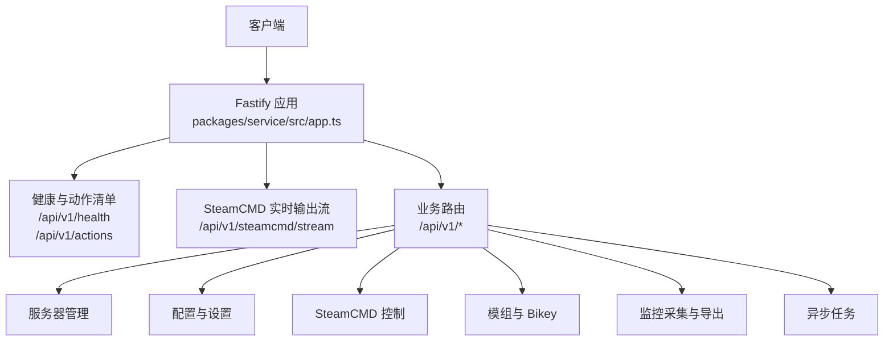
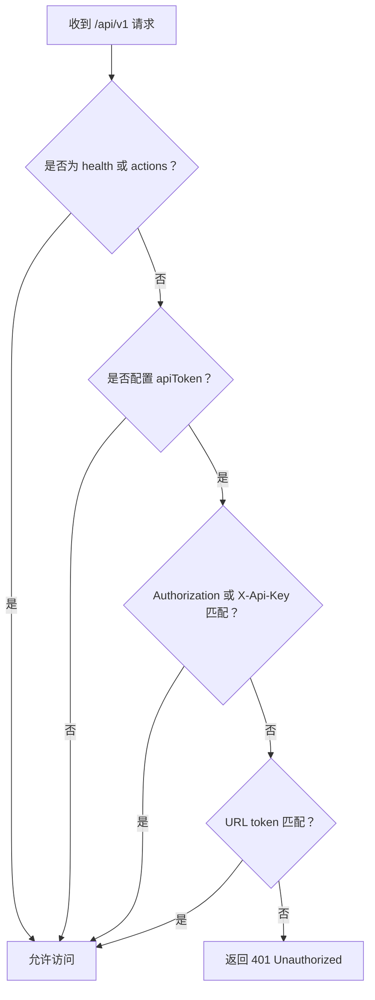
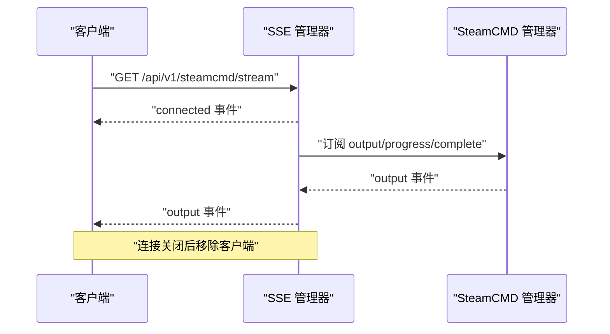

# RESTful 端点

<cite>
**本文引用的文件**   
- [README.md](file://README.md)
- [app.ts](file://packages/service/src/app.ts)
- [health.ts](file://packages/service/src/api/health.ts)
- [routes.ts](file://packages/service/src/api/routes.ts)
- [sse.ts](file://packages/service/src/api/sse.ts)
- [types.d.ts](file://packages/service/src/api/types.d.ts)
</cite>

## 目录
1. [简介](#简介)
2. [项目结构与 API 入口](#项目结构与-api-入口)
3. [通用响应格式与鉴权](#通用响应格式与鉴权)
4. [资源命名规范、查询参数与分页排序](#资源命名规范查询参数与分页排序)
5. [核心端点总览](#核心端点总览)
6. [服务器管理 /servers](#服务器管理-servers)
7. [配置管理 /config 与设置 /settings](#配置管理-config-与设置-settings)
8. [SteamCMD 集成 /steamcmd](#steamcmd-集成-steamcmd)
9. [模组管理 /mods](#模组管理-mods)
10. [监控数据 /monitoring](#监控数据-monitoring)
11. [任务系统 /task 与 /tasks](#任务系统-task-与-tasks)
12. [日志、RPT、Bans、调度与诊断](#日志rptbans调度与诊断)
13. [客户端集成示例与 SDK 使用建议](#客户端集成示例与-sdk-使用建议)
14. [错误码与状态码指南](#错误码与状态码指南)
15. [性能与最佳实践](#性能与最佳实践)
16. [故障排查](#故障排查)
17. [结论](#结论)

## 简介
本仓库是 Arma 3 专用服务器管理工具 v2，后端基于 Node.js + Fastify + SQLite，提供完整的 REST API。API 统一以 `/api/v1` 为前缀，支持 Bearer Token、`X-Api-Key` 和 URL `token` 三种鉴权方式；健康检查与动作清单接口 `/api/v1/health`、`/api/v1/actions` 不强制鉴权。

服务默认监听端口由启动命令决定，文档中常用示例地址为 `http://127.0.0.1:19580`。

**章节来源**
- [README.md:1-108](file://README.md#L1-L108)

## 项目结构与 API 入口
后端服务在 `packages/service/src/app.ts` 中创建 Fastify 实例，注册 CORS、Multipart、认证 Hook、SSE 路由以及业务路由模块。所有业务 REST 路由通过 `apiRoutes` 挂载到 `/api/v1`，健康检查路由通过 `healthRoutes` 挂载到 `/api/v1`。



**图表来源**
- [app.ts:57-171](file://packages/service/src/app.ts#L57-L171)
- [health.ts:5-66](file://packages/service/src/api/health.ts#L5-L66)
- [sse.ts:51-91](file://packages/service/src/api/sse.ts#L51-L91)
- [routes.ts:62-1111](file://packages/service/src/api/routes.ts#L62-L1111)

**章节来源**
- [app.ts:57-171](file://packages/service/src/app.ts#L57-L171)
- [types.d.ts:15-34](file://packages/service/src/api/types.d.ts#L15-L34)

## 通用响应格式与鉴权

### 统一响应结构
除少数直接返回数组或原始数据的接口外，大多数业务接口返回如下结构：

| 字段 | 类型 | 含义 |
|------|------|------|
| `success` | boolean | 请求是否成功 |
| `data` | object \| array \| null | 业务数据 |
| `error` | string \| null | 错误码或错误信息 |
| `requestId` | string | 本次请求标识，通常取 UUID 前 12 位 |

部分列表接口会直接返回数组，例如 `GET /api/v1/servers`。

### 鉴权机制
服务端对 `/api/v1` 下的请求进行鉴权，但以下路径例外：
- `/api/v1/health`
- `/api/v1/actions`
- 非 `/api/` 开头的静态页面路径

支持的鉴权方式（按优先级）：
1. `Authorization: Bearer <token>`
2. `X-Api-Key: <token>`
3. URL 查询参数 `?token=<token>`

如果未配置 `apiToken`，则所有请求视为已认证。



**图表来源**
- [app.ts:96-130](file://packages/service/src/app.ts#L96-L130)

**章节来源**
- [app.ts:96-130](file://packages/service/src/app.ts#L96-L130)
- [routes.ts:1115-1117](file://packages/service/src/api/routes.ts#L1115-L1117)

## 资源命名规范、查询参数与分页排序

### 资源命名规范
- 服务器资源使用 UUID 作为路径参数，例如 `/servers/:uuid`。
- 子资源采用层级命名，例如：
  - `/servers/:uuid/config`
  - `/servers/:uuid/status`
  - `/servers/:uuid/mods`
  - `/servers/:uuid/monitoring/stats`
- 全局设置使用 `/settings/*`。
- SteamCMD 相关操作使用 `/steamcmd/*`。
- 任务系统使用 `/task` 与 `/tasks/:taskId`。

### 查询参数约定
项目中常用的布尔型查询参数使用字符串形式：
- `reload=true` 或 `reload=1`：强制刷新缓存或从磁盘读取。
- `writeCfg=true`：保存配置后写入游戏配置文件。
- `tail=N`：读取日志末尾 N 行。
- `hours=N`：查询最近 N 小时的监控统计。
- `kind=rpt|battleye|console|all`：日志类型或导出类型。
- `mode=download_and_enable`：模组导入模式。
- `addToMissionList=true`：上传任务包后加入任务列表。
- `missingOnly=true`：仅复制缺失的 Bikey。

### 分页与排序
当前代码中未发现通用的分页参数（如 `page`、`pageSize`）或排序参数（如 `sort`、`order`）。需要分页的场景应关注具体接口的返回值，并在未来版本中根据实际实现补充。

**章节来源**
- [routes.ts:65-84](file://packages/service/src/api/routes.ts#L65-L84)
- [routes.ts:100-195](file://packages/service/src/api/routes.ts#L100-L195)
- [routes.ts:398-403](file://packages/service/src/api/routes.ts#L398-L403)
- [routes.ts:705-711](file://packages/service/src/api/routes.ts#L705-L711)
- [routes.ts:801-812](file://packages/service/src/api/routes.ts#L801-L812)

## 核心端点总览

| 功能域 | 主要路径 | HTTP 方法 | 说明 |
|--------|----------|-----------|------|
| 健康检查 | `/api/v1/health` | GET | 服务版本、平台、默认可执行文件等元信息 |
| 能力清单 | `/api/v1/actions` | GET | 列出可用任务 action 与 REST 端点 |
| 服务器 | `/api/v1/servers` | GET、POST | 列举服务器、创建服务器 |
| 服务器详情 | `/api/v1/servers/:uuid/*` | GET、PUT、PATCH、DELETE | 状态、配置、克隆、重命名、删除 |
| 配置 | `/api/v1/settings/steamcmd` | GET、PUT | SteamCMD 设置 |
| 配置 | `/api/v1/settings/ui` | GET、PUT | UI 设置 |
| 配置 | `/api/v1/settings/mod-scan-paths` | GET、PUT | 模组扫描路径 |
| SteamCMD | `/api/v1/steamcmd/status` | GET | 运行状态 |
| SteamCMD | `/api/v1/steamcmd/credentials` | PUT | 设置凭据 |
| SteamCMD | `/api/v1/steamcmd/log` | GET | 聚合日志 |
| SteamCMD | `/api/v1/steamcmd/stop` | POST | 停止并取消相关任务 |
| SteamCMD 流 | `/api/v1/steamcmd/stream` | GET | SSE 实时输出 |
| 模组 | `/api/v1/workshop/mod-details` | POST | 查询 Workshop 模组详情 |
| 模组 | `/api/v1/mods/validate-path` | POST | 校验模组目录 |
| 监控 | `/api/v1/monitoring/collect` | POST | 主动采集监控数据 |
| 监控 | `/api/v1/servers/:uuid/monitoring/*` | GET、POST | 摘要、统计、玩家、入库、同步、导出 |
| 任务 | `/api/v1/task` | POST | 同步或异步执行任务 |
| 任务 | `/api/v1/tasks/:taskId` | GET、DELETE | 查询任务、取消任务 |

**章节来源**
- [health.ts:5-66](file://packages/service/src/api/health.ts#L5-L66)
- [routes.ts:62-1111](file://packages/service/src/api/routes.ts#L62-L1111)

## 服务器管理 /servers

### 列举服务器
- **路径**：`GET /api/v1/servers`
- **鉴权**：可选
- **查询参数**：
  - `reload=true`：若启用外部配置刷新，则清空配置缓存并从磁盘重新加载。
- **响应**：数组，每项包含：
  - `uuid`
  - `configName`
  - `serverDir`

**章节来源**
- [routes.ts:65-84](file://packages/service/src/api/routes.ts#L65-L84)

### 创建服务器
- **路径**：`POST /api/v1/servers`
- **请求体**：
  - `configName`：可选，服务器显示名称
  - `serverDir`：可选，Arma 3 服务器安装目录
- **响应**：
  - `success`
  - `data.uuid`
  - `error`
  - `requestId`
- **状态码**：201 表示创建成功。

**章节来源**
- [routes.ts:209-225](file://packages/service/src/api/routes.ts#L209-L225)

### 获取服务器状态
- **路径**：`GET /api/v1/servers/:uuid/status`
- **响应字段**：
  - `isRunning`
  - `pid`
  - `activeMissionTemplate`
  - `serverModCount`

**章节来源**
- [routes.ts:87-97](file://packages/service/src/api/routes.ts#L87-L97)

### 获取服务器配置
- **路径**：`GET /api/v1/servers/:uuid/config`
- **查询参数**：
  - `reload=true`：强制从磁盘读取配置。
- **响应**：
  - `success`
  - `data`：完整配置对象
  - `error`
  - `requestId`

**章节来源**
- [routes.ts:100-110](file://packages/service/src/api/routes.ts#L100-L110)

### 保存服务器配置
- **路径**：`PUT /api/v1/servers/:uuid/config`
- **请求体**：完整 `ServerConfigPackage` 配置对象。
- **查询参数**：
  - `writeCfg=true`：保存后写入游戏配置文件。
- **行为**：
  - 自动清理可能误带入的进程 ID。
  - 触发自动快照。
  - 写入失败时返回 `WRITE_CFG_FAILED`。
- **状态码**：
  - 200：成功
  - 400：保存失败或写入失败

**章节来源**
- [routes.ts:112-145](file://packages/service/src/api/routes.ts#L112-L145)

### 更新服务器配置
- **路径**：`PATCH /api/v1/servers/:uuid/config`
- **请求体**：部分配置对象，服务端会合并到现有配置。
- **校验**：
  - 如果 patch 中包含 `mods.localMods`，会校验每个模组目录是否有效。
- **查询参数**：
  - `writeCfg=true`：更新后写入游戏配置文件。
- **状态码**：
  - 200：成功
  - 400：无效模组路径或写入失败
  - 404：服务器不存在

**章节来源**
- [routes.ts:147-195](file://packages/service/src/api/routes.ts#L147-L195)

### 获取同步状态
- **路径**：`GET /api/v1/servers/:uuid/sync-state`
- **用途**：查看服务器配置与磁盘、模组、任务等资源的同步情况。
- **响应**：`syncState` 对象。

**章节来源**
- [routes.ts:197-206](file://packages/service/src/api/routes.ts#L197-L206)

### 克隆服务器
- **路径**：`POST /api/v1/servers/:uuid/clone`
- **响应**：新服务器的 `uuid`。
- **行为**：副本名称追加“副本”，并重置进程 ID。

**章节来源**
- [routes.ts:227-251](file://packages/service/src/api/routes.ts#L227-L251)

### 删除服务器
- **路径**：`DELETE /api/v1/servers/:uuid`
- **响应**：`message` 表示已删除。
- **状态码**：404 表示未找到。

**章节来源**
- [routes.ts:253-261](file://packages/service/src/api/routes.ts#L253-L261)

### 重命名服务器
- **路径**：`PUT /api/v1/servers/:uuid/rename`
- **请求体**：
  - `newName`：新名称
- **响应**：`message` 表示已重命名。

**章节来源**
- [routes.ts:263-273](file://packages/service/src/api/routes.ts#L263-L273)

### 服务器仪表盘
- **路径**：`GET /api/v1/servers/:uuid/dashboard`
- **响应字段**：
  - `hostname`
  - `port`
  - `isRunning`
  - `pid`
  - `onlineCount`
  - `monitoring`
  - `scheduleSummary`
  - `latestRpt`
  - `cfgWritten`

**章节来源**
- [routes.ts:583-627](file://packages/service/src/api/routes.ts#L583-L627)

## 配置管理 /config 与设置 /settings

### SteamCMD 设置
- **路径**：`GET /api/v1/settings/steamcmd`
- **路径**：`PUT /api/v1/settings/steamcmd`
- **请求体字段**：
  - `username`
  - `password`
  - `workshopRoot`
  - `serverInstallPath`
- **行为**：
  - 保存后应用 SteamCMD 设置。
  - 如果设置了 `workshopRoot`，会自动添加默认 Workshop 扫描路径。
- **响应**：包含 `message` 与 SteamCMD 设置视图。

**章节来源**
- [routes.ts:277-325](file://packages/service/src/api/routes.ts#L277-L325)

### UI 设置
- **路径**：`GET /api/v1/settings/ui`
- **路径**：`PUT /api/v1/settings/ui`
- **请求体字段**：
  - `showAdvancedSettings`
  - `allowExternalConfigRefresh`
  - `hasShownTrayMinimizeHint`
  - `autoSnapshotMode`
  - `autoSnapshotAsync`

**章节来源**
- [routes.ts:327-343](file://packages/service/src/api/routes.ts#L327-L343)

### 模组扫描路径
- **路径**：`GET /api/v1/settings/mod-scan-paths`
- **路径**：`PUT /api/v1/settings/mod-scan-paths`
- **请求体**：
  - `paths`：模组扫描路径条目数组
- **行为**：
  - 标准化路径。
  - 如果没有 `workshopRoot`，尝试从扫描路径推导。
  - 应用 SteamCMD 设置。

**章节来源**
- [routes.ts:345-368](file://packages/service/src/api/routes.ts#L345-L368)

### 预检与诊断
- **路径**：`GET /api/v1/servers/:uuid/preflight`
- **路径**：`GET /api/v1/servers/:uuid/diagnostics`
- **用途**：启动前检查与完整诊断，包括进程状态、模组扫描结果、问题项。

**章节来源**
- [routes.ts:421-440](file://packages/service/src/api/routes.ts#L421-L440)
- [routes.ts:539-554](file://packages/service/src/api/routes.ts#L539-L554)

### 路径信息
- **路径**：`GET /api/v1/servers/:uuid/paths`
- **响应字段**：
  - `toolConfigDir`
  - `dataConfigDir`
  - `serverDir`
  - `serverConfigDir`
  - `logDir`
  - `processLogDir`

**章节来源**
- [routes.ts:556-581](file://packages/service/src/api/routes.ts#L556-L581)

## SteamCMD 集成 /steamcmd

### 状态查询
- **路径**：`GET /api/v1/steamcmd/status`
- **响应字段**：
  - `isRunning`
  - `isBusy`
  - `isInstalled`
  - `isAborted`

**章节来源**
- [routes.ts:370-377](file://packages/service/src/api/routes.ts#L370-L377)

### 设置凭据
- **路径**：`PUT /api/v1/steamcmd/credentials`
- **请求体**：
  - `username`
  - `password`
- **校验**：用户名和密码必填。
- **行为**：设置凭据并应用 SteamCMD 设置。

**章节来源**
- [routes.ts:379-396](file://packages/service/src/api/routes.ts#L379-L396)

### 查看日志
- **路径**：`GET /api/v1/steamcmd/log`
- **查询参数**：
  - `tail`：读取最近 N 行，默认 300。
- **响应**：
  - `text`
  - `source`

**章节来源**
- [routes.ts:398-403](file://packages/service/src/api/routes.ts#L398-L403)

### 停止 SteamCMD
- **路径**：`POST /api/v1/steamcmd/stop`
- **行为**：
  - 请求中止 SteamCMD。
  - 取消相关的异步任务。
- **响应**：
  - `message`
  - `cancelledTaskIds`

**章节来源**
- [routes.ts:405-417](file://packages/service/src/api/routes.ts#L405-L417)

### SteamCMD 实时输出流
- **路径**：`GET /api/v1/steamcmd/stream`
- **协议**：Server-Sent Events
- **事件类型**：
  - `connected`：连接成功
  - `output`：SteamCMD 输出
  - 进度与完成提示也会以 output 事件推送
- **心跳**：服务端每 15 秒发送 keepalive。



**图表来源**
- [sse.ts:9-91](file://packages/service/src/api/sse.ts#L9-L91)

**章节来源**
- [sse.ts:9-91](file://packages/service/src/api/sse.ts#L9-L91)

## 模组管理 /mods

### 查询 Workshop 模组详情
- **路径**：`POST /api/v1/workshop/mod-details`
- **请求体**：
  - `modIds`：Workshop 模组 ID 数组
  - `localMods`：本地模组信息，用于补充详情
- **校验**：至少提供一个 `modId`。
- **响应**：
  - `mods`：模组详情数组

**章节来源**
- [routes.ts:283-292](file://packages/service/src/api/routes.ts#L283-L292)

### 校验模组路径
- **路径**：`POST /api/v1/mods/validate-path`
- **请求体**：
  - `path`：模组目录路径
- **响应**：
  - `valid`：是否为有效模组目录

**章节来源**
- [routes.ts:491-499](file://packages/service/src/api/routes.ts#L491-L499)

### 服务器模组列表
- **路径**：`GET /api/v1/servers/:uuid/mods`
- **响应字段**：
  - `mods`
  - `scanPathCount`

**章节来源**
- [routes.ts:464-476](file://packages/service/src/api/routes.ts#L464-L476)

### Bikey 摘要与文件
- **路径**：`GET /api/v1/servers/:uuid/mods/bikeys`
- **路径**：`GET /api/v1/servers/:uuid/mods/bikeys/files`
- **用途**：查看已启用模组的 Bikey 摘要，或列出服务器 Keys 目录中的 `.bikey` 文件。

**章节来源**
- [routes.ts:478-525](file://packages/service/src/api/routes.ts#L478-L525)

### 任务式模组操作
模组相关操作主要通过 `/api/v1/task` 调用，常见 action 包括：
- `enable_mods`
- `disable_mods`
- `scan_mods`
- `download_mods`
- `import_mods_html`
- `copy_bikeys`

这些 action 会在内部处理配置合并、SteamCMD 下载、Bikey 复制等逻辑。

**章节来源**
- [routes.ts:1324-1457](file://packages/service/src/api/routes.ts#L1324-L1457)

## 监控数据 /monitoring

### 主动采集
- **路径**：`POST /api/v1/monitoring/collect`
- **行为**：
  - 遍历所有服务器。
  - 仅对运行中的服务器采集在线人数与玩家列表。
  - 写入玩家记录与统计数据。
- **响应**：
  - `collected`：成功采集的服务器数量。

**章节来源**
- [routes.ts:719-751](file://packages/service/src/api/routes.ts#L719-L751)

### 服务器监控摘要
- **路径**：`GET /api/v1/servers/:uuid/monitoring/summary`
- **响应**：监控摘要对象。

**章节来源**
- [routes.ts:699-703](file://packages/service/src/api/routes.ts#L699-L703)

### 服务器监控统计
- **路径**：`GET /api/v1/servers/:uuid/monitoring/stats`
- **查询参数**：
  - `hours`：最近 N 小时，默认 24。
- **响应**：
  - `stats`

**章节来源**
- [routes.ts:705-711](file://packages/service/src/api/routes.ts#L705-L711)

### 服务器玩家列表
- **路径**：`GET /api/v1/servers/:uuid/monitoring/players`
- **响应**：
  - `players`

**章节来源**
- [routes.ts:713-717](file://packages/service/src/api/routes.ts#L713-L717)

### 监控消息入库
- **路径**：`POST /api/v1/servers/:uuid/monitoring/ingest`
- **请求体**：
  - `message`：字符串或包含 message 的对象
- **用途**：将模组或外部监控组件上报的消息写入数据库。

**章节来源**
- [routes.ts:753-763](file://packages/service/src/api/routes.ts#L753-L763)

### 同步玩家
- **路径**：`POST /api/v1/servers/:uuid/monitoring/sync-players`
- **行为**：通过 RCon 拉取在线玩家并写入监控数据库。

**章节来源**
- [routes.ts:765-784](file://packages/service/src/api/routes.ts#L765-L784)

### 导出 HTML 报告
- **路径**：`GET /api/v1/servers/:uuid/monitoring/export/html`
- **响应**：
  - `html`：当日 HTML 报告内容
- **Content-Type**：`text/html; charset=utf-8`

**章节来源**
- [routes.ts:786-798](file://packages/service/src/api/routes.ts#L786-L798)

### 导出 CSV
- **路径**：`GET /api/v1/servers/:uuid/monitoring/export/csv`
- **查询参数**：
  - `kind=stats|players`
- **响应**：
  - `csv`：CSV 文本
- **Content-Type**：`text/csv; charset=utf-8`

**章节来源**
- [routes.ts:801-812](file://packages/service/src/api/routes.ts#L801-L812)

### 监控资源检测
- **路径**：`GET /api/v1/servers/:uuid/monitoring/assets`
- **响应**：
  - `hasBundledAssets`：是否包含内置监控资源

**章节来源**
- [routes.ts:814-822](file://packages/service/src/api/routes.ts#L814-L822)

## 任务系统 /task 与 /tasks

### 提交任务
- **路径**：`POST /api/v1/task`
- **请求体字段**：
  - `taskId`：可选任务 ID
  - `serverUuid`：必填，目标服务器 UUID
  - `serverName`：可选
  - `commands`：必填，action 数组
  - `async`：是否异步执行
  - `writeCfgAfter`：是否在执行成功后写入配置
  - `restartAfter`：是否在执行成功后重启服务器
- **行为**：
  - 同步任务立即执行并返回步骤结果。
  - 异步任务返回 `taskId` 与初始状态。
  - 支持后续 write_cfg 与 restart 自动跟进。
- **响应**：
  - 同步：`steps` 数组
  - 异步：`taskId`、`status`

**章节来源**
- [routes.ts:1030-1068](file://packages/service/src/api/routes.ts#L1030-L1068)

### 查询任务
- **路径**：`GET /api/v1/tasks/:taskId`
- **响应字段**：
  - `taskId`
  - `status`
  - `serverUuid`
  - `steps`
  - `error`
  - `createdAt`
  - `completedAt`

**章节来源**
- [routes.ts:1070-1085](file://packages/service/src/api/routes.ts#L1070-L1085)

### 取消任务
- **路径**：`DELETE /api/v1/tasks/:taskId`
- **行为**：
  - 取消任务。
  - 如果任务涉及 SteamCMD，则同时请求中止 SteamCMD。
- **响应**：
  - `message`
  - `status`

**章节来源**
- [routes.ts:1087-1110](file://packages/service/src/api/routes.ts#L1087-L1110)

### 常用任务 action
| action | 说明 |
|--------|------|
| `status` | 查询进程状态 |
| `start` | 启动服务器 |
| `stop` | 停止服务器 |
| `restart` | 重启服务器 |
| `save` | 保存配置 |
| `apply` / `write_cfg` | 写入配置文件 |
| `switch_mission` | 切换任务模板 |
| `enable_mods` | 启用模组 |
| `disable_mods` | 禁用模组 |
| `download_mods` | 下载模组 |
| `import_mods_html` | 从 HTML 导入模组 |
| `scan_mods` | 扫描模组 |
| `update_server` | 更新服务器文件 |
| `preflight` | 启动前检查 |
| `rcon_players` | 查询在线玩家 |
| `rcon_kick` | 踢人 |
| `rcon_ban` | 封禁 |
| `rcon_broadcast` | 广播 |
| `rcon_mission` | RCon 任务相关 |
| `rcon_lock` / `rcon_unlock` | 锁定/解锁服务器 |
| `read_logs` | 读取日志 |
| `stop_steamcmd` | 停止 SteamCMD |
| `steamcmd_status` | SteamCMD 状态 |
| `ensure_steamcmd` | 确保 SteamCMD 就绪 |
| `install_dedicated_server` | 安装专用服务器 |
| `create_server` | 创建服务器 |
| `first_server_setup` | 首服准备 |
| `help` | 帮助 |

**章节来源**
- [health.ts:21-66](file://packages/service/src/api/health.ts#L21-L66)
- [routes.ts:1241-1600](file://packages/service/src/api/routes.ts#L1241-L1600)

## 日志、RPT、Bans、调度与诊断

### RPT 日志
- **路径**：`GET /api/v1/servers/:uuid/rpt`
- **响应**：
  - `lines`
  - `totalLines`

**章节来源**
- [routes.ts:631-643](file://packages/service/src/api/routes.ts#L631-L643)

### 日志列表
- **路径**：`GET /api/v1/servers/:uuid/logs`
- **查询参数**：
  - `kind=rpt|battleye|console|all`
- **响应**：
  - `kind`
  - `serverDir`
  - `files`：文件名、路径、大小、修改时间、类型

**章节来源**
- [routes.ts:645-667](file://packages/service/src/api/routes.ts#L645-L667)

### 读取日志
- **路径**：`GET /api/v1/servers/:uuid/logs/read`
- **查询参数**：
  - `kind`
  - `tail`
  - `file`
- **响应**：
  - `lines`
  - `totalLines`
  - `fileName`
  - `filePath`

**章节来源**
- [routes.ts:669-695](file://packages/service/src/api/routes.ts#L669-L695)

### Bans 管理
- **路径**：`GET /api/v1/servers/:uuid/bans`
- **路径**：`PUT /api/v1/servers/:uuid/bans`
- **路径**：`GET /api/v1/bans?serverUuid=:uuid`
- **注意**：旧版 `POST /api/v1/bans` 与 `DELETE /api/v1/bans/:guid` 已标记为废弃。

**章节来源**
- [routes.ts:882-938](file://packages/service/src/api/routes.ts#L882-L938)

### 调度任务
- **路径**：`GET /api/v1/schedule`
- **路径**：`POST /api/v1/schedule/restart`
- **请求体**：
  - `serverUuid`
  - `cron`
- **校验**：cron 表达式必须合法。

**章节来源**
- [routes.ts:824-854](file://packages/service/src/api/routes.ts#L824-L854)

### 快照管理
- **路径**：`GET /api/v1/servers/:uuid/snapshots`
- **路径**：`POST /api/v1/servers/:uuid/snapshots`
- **路径**：`POST /api/v1/servers/:uuid/snapshots/:snapshotId/restore`

**章节来源**
- [routes.ts:856-880](file://packages/service/src/api/routes.ts#L856-L880)

### 文件上传
- **路径**：`POST /api/v1/servers/:uuid/files/mod-list-html`
- **路径**：`POST /api/v1/servers/:uuid/files/mission-pbo`
- **用途**：
  - 上传模组列表 HTML，解析 Workshop ID 并导入。
  - 上传 `.pbo` 任务包，可选择加入任务列表。

**章节来源**
- [routes.ts:940-1026](file://packages/service/src/api/routes.ts#L940-L1026)

## 客户端集成示例与 SDK 使用建议

### 基础请求示例
以下示例描述请求与响应结构，不包含具体代码内容。

#### 获取健康信息
- **请求**：
  - `GET http://127.0.0.1:19580/api/v1/health`
- **响应**：
  - `success`
  - `service`
  - `version`
  - `publicBaseUrl`
  - `platform`
  - `defaultServerExecutable`
  - `defaultServerDir`
  - `steamCmdBinary`

#### 列举服务器
- **请求**：
  - `GET http://127.0.0.1:19580/api/v1/servers`
- **响应**：服务器数组。

#### 创建服务器
- **请求**：
  - `POST http://127.0.0.1:19580/api/v1/servers`
  - 请求体：`{ configName: "测试服", serverDir: "D:\\arma3-server" }`
- **响应**：
  - `success: true`
  - `data.uuid`

#### 保存配置并写入
- **请求**：
  - `PUT http://127.0.0.1:19580/api/v1/servers/{uuid}/config?writeCfg=true`
  - 请求体：完整配置对象
- **响应**：
  - `success: true`
  - `data.message`

#### 查询 SteamCMD 状态
- **请求**：
  - `GET http://127.0.0.1:19580/api/v1/steamcmd/status`
- **响应**：
  - `isRunning`
  - `isBusy`
  - `isInstalled`
  - `isAborted`

#### 采集监控数据
- **请求**：
  - `POST http://127.0.0.1:19580/api/v1/monitoring/collect`
- **响应**：
  - `collected`

#### 提交异步任务
- **请求**：
  - `POST http://127.0.0.1:19580/api/v1/task`
  - 请求体：`{ serverUuid, commands: [{ action: "scan_mods" }], async: true }`
- **响应**：
  - `taskId`
  - `status: "Running"`

#### 查询任务状态
- **请求**：
  - `GET http://127.0.0.1:19580/api/v1/tasks/{taskId}`
- **响应**：
  - `taskId`
  - `status`
  - `steps`
  - `error`
  - `createdAt`
  - `completedAt`

### SDK 使用建议
- 使用 TypeScript API 客户端包 `packages/api-client` 时，优先复用封装好的类型与请求方法。
- 对于长连接场景，优先使用 `/api/v1/steamcmd/stream` 的 SSE 接口，而不是轮询 `/api/v1/steamcmd/log`。
- 批量操作建议使用 `/api/v1/task`，将多个 action 组合为一个任务，便于追踪失败步骤。
- 所有写操作建议开启 `writeCfg=true`，以确保配置变更生效。
- 对敏感凭据（SteamCMD 账号、RCon 密码）应通过安全通道传输，并避免将 token 硬编码到前端。

**章节来源**
- [health.ts:5-19](file://packages/service/src/api/health.ts#L5-L19)
- [routes.ts:65-84](file://packages/service/src/api/routes.ts#L65-L84)
- [routes.ts:209-225](file://packages/service/src/api/routes.ts#L209-L225)
- [routes.ts:112-145](file://packages/service/src/api/routes.ts#L112-L145)
- [routes.ts:370-377](file://packages/service/src/api/routes.ts#L370-L377)
- [routes.ts:719-751](file://packages/service/src/api/routes.ts#L719-L751)
- [routes.ts:1030-1085](file://packages/service/src/api/routes.ts#L1030-L1085)

## 错误码与状态码指南

### HTTP 状态码
| 状态码 | 含义 | 常见场景 |
|--------|------|----------|
| 200 | 成功 | 普通查询、更新、写入 |
| 201 | 已创建 | 创建服务器、克隆服务器 |
| 400 | 请求错误 | 缺少必填字段、无效路径、无效 cron |
| 401 | 未授权 | 鉴权失败 |
| 404 | 未找到 | 服务器 UUID 不存在 |
| 502 | 网关错误 | RCon 连接失败 |

### 业务错误码
| 错误码 | 含义 |
|--------|------|
| `NOT_FOUND` | 资源不存在 |
| `SAVE_FAILED` | 配置保存失败 |
| `WRITE_CFG_FAILED` | 写入配置文件失败 |
| `INVALID_MOD_PATH` | 模组目录无效 |
| `RCON_NOT_CONFIGURED` | 未配置 RCon |
| `RCON_FAILED` | RCon 连接失败 |
| `NO_SERVER_DIR` | 未设置服务器目录 |
| `INVALID_BODY` | 请求体无效 |
| `INVALID_CREDENTIALS` | 凭据无效 |
| `INVALID_TASK` | 任务请求无效 |
| `TASK_FAILED` | 任务执行失败 |
| `INVALID_CRON` | cron 表达式非法 |
| `SYNC_FAILED` | 定时任务同步失败 |
| `SNAPSHOT_FAILED` | 快照创建失败 |
| `DEPRECATED` | 接口已废弃 |

### 错误响应示例
```json
{
  "success": false,
  "data": null,
  "error": "NOT_FOUND",
  "requestId": "abc123def456"
}
```

**章节来源**
- [routes.ts:100-195](file://packages/service/src/api/routes.ts#L100-L195)
- [routes.ts:442-461](file://packages/service/src/api/routes.ts#L442-L461)
- [routes.ts:830-854](file://packages/service/src/app.ts#L830-L854)
- [routes.ts:1030-1110](file://packages/service/src/api/routes.ts#L1030-L1110)

## 性能与最佳实践

### 性能建议
- 使用 `reload=true` 仅在必要时刷新配置缓存，避免频繁磁盘 I/O。
- 使用 `tail` 限制日志读取行数，避免大日志导致响应过大。
- 使用 `hours` 限制监控统计时间范围。
- 使用 `/api/v1/steamcmd/stream` 替代轮询 SteamCMD 日志。
- 使用 `/api/v1/task` 批量执行操作，减少多次网络往返。

### 最佳实践
- 始终携带鉴权信息，避免在生产环境暴露无保护 API。
- 对写操作使用 `writeCfg=true`，确保配置变更生效。
- 对关键配置变更先创建快照，再执行更新。
- 对模组导入、下载等操作使用异步任务，并通过 `/api/v1/tasks/:taskId` 查询结果。
- 对 RCon 操作先检查 RCon 是否配置，再发起请求。
- 对监控数据定期采集，避免依赖单次手动调用。

[本节为通用指导，不直接分析具体文件]

## 故障排查

### 401 未授权
- 检查是否配置了 `apiToken`。
- 检查请求头 `Authorization`、`X-Api-Key` 或 URL `token`。
- 确认请求路径不是 `/api/v1/health` 或 `/api/v1/actions`。

### 400 请求错误
- 检查必填字段是否存在。
- 检查 `writeCfg`、`reload`、`tail`、`hours` 等参数类型。
- 检查模组路径是否包含 `addons` 目录。
- 检查 cron 表达式是否合法。

### 404 未找到
- 检查服务器 UUID 是否正确。
- 检查服务器是否已被删除。
- 检查快照 ID 是否存在。

### 502 RCon 失败
- 检查服务器是否运行。
- 检查 BattlEye RCon 密码是否配置。
- 检查防火墙与端口是否开放。

### SteamCMD 卡住
- 调用 `/api/v1/steamcmd/stop` 中止操作。
- 取消相关异步任务。
- 查看 `/api/v1/steamcmd/log` 或 SSE 流。

**章节来源**
- [app.ts:96-130](file://packages/service/src/app.ts#L96-L130)
- [routes.ts:112-195](file://packages/service/src/api/routes.ts#L112-L195)
- [routes.ts:379-417](file://packages/service/src/api/routes.ts#L379-L417)
- [routes.ts:830-854](file://packages/service/src/api/routes.ts#L830-L854)

## 结论
该项目的 REST API 围绕 Arma 3 服务器生命周期展开，覆盖服务器管理、配置管理、SteamCMD 集成、模组管理、监控数据采集与导出、任务编排、日志与诊断等核心能力。API 设计以 `/api/v1` 为统一前缀，使用 UUID 标识服务器资源，并通过 `/api/v1/task` 提供统一的动作编排入口。生产环境中应重视鉴权、配置写入、异步任务、SSE 流与错误码处理，以获得稳定可控的远程管理能力。

[本节为总结性内容，不直接分析具体文件]