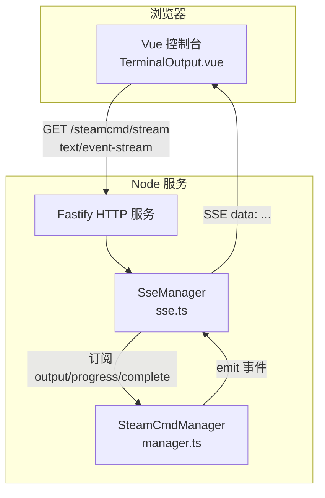
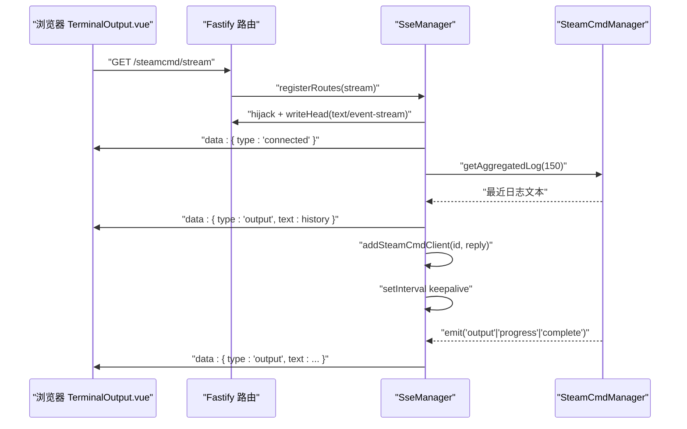
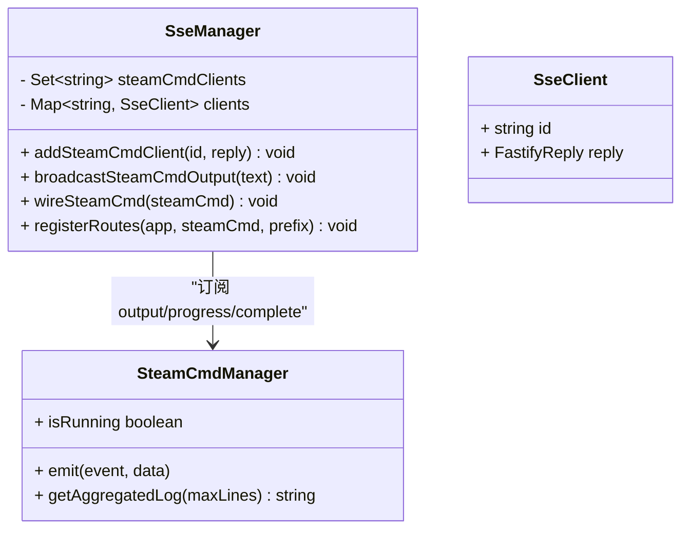
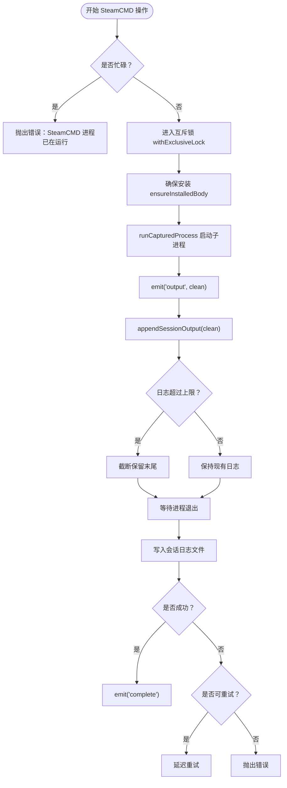
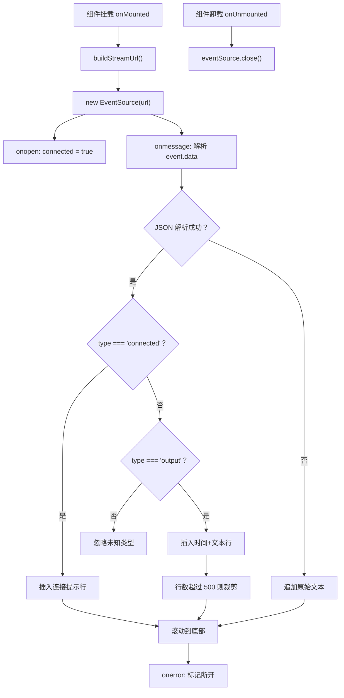
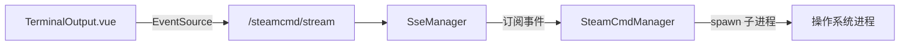
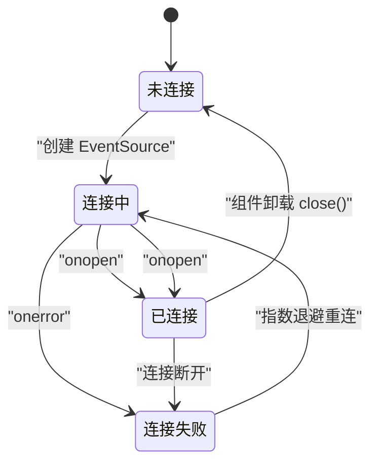

# SSE 实时通信

<cite>
**本文引用的文件**   
- [packages/service/src/api/sse.ts](file://packages/service/src/api/sse.ts)
- [packages/service/src/steamcmd/manager.ts](file://packages/service/src/steamcmd/manager.ts)
- [packages/service/src/api/sse.test.ts](file://packages/service/src/api/sse.test.ts)
- [packages/web/src/components/TerminalOutput.vue](file://packages/web/src/components/TerminalOutput.vue)
- [docs/architecture-v2.md](file://docs/architecture-v2.md)
</cite>

## 目录
1. [引言](#引言)
2. [项目结构中的 SSE 位置](#项目结构中的-sse-位置)
3. [核心组件](#核心组件)
4. [架构总览](#架构总览)
5. [详细组件分析](#详细组件分析)
6. [依赖关系分析](#依赖关系分析)
7. [性能与内存优化](#性能与内存优化)
8. [前端集成与事件监听](#前端集成与事件监听)
9. [错误处理与重连策略](#错误处理与重连策略)
10. [监控指标、调试技巧与排障](#监控指标调试技巧与排障)
11. [实际应用场景](#实际应用场景)
12. [结论](#结论)

## 引言
本文围绕 Arma 3 Server Tools v2 中的 **Server-Sent Events（SSE）实时通信**，聚焦以下目标：
- 解释 SSE 连接建立、事件流管理、客户端断开与清理。
- 说明事件类型定义、消息格式、数据序列化方式。
- 分析连接池管理、内存限制、并发控制与取消机制。
- 给出前端集成示例、事件监听实现和错误处理方案。
- 提供性能调优建议、监控指标、调试技巧。
- 重点覆盖实时进度更新、状态变更通知、日志流推送等真实场景。

该项目的后端基于 Node.js + Fastify，SteamCMD 任务通过 `SteamCmdManager` 以事件形式输出；SSE 层负责把这些事件广播给浏览器端，由 Vue 组件消费并渲染为终端式日志面板。

## 项目结构中的 SSE 位置
SSE 相关代码主要分布在两个包中：
- 后端服务包 `@a3st/service`：
  - `packages/service/src/api/sse.ts`：SSE 路由、客户端集合、事件广播。
  - `packages/service/src/steamcmd/manager.ts`：SteamCMD 进程管理、事件发射、日志聚合。
- 前端 Web 包 `@a3st/web`：
  - `packages/web/src/components/TerminalOutput.vue`：使用浏览器原生 `EventSource` 消费 SSE。

**图表来源**
- [packages/service/src/api/sse.ts:52-90](file://packages/service/src/api/sse.ts#L52-L90)
- [packages/service/src/steamcmd/manager.ts:50-119](file://packages/service/src/steamcmd/manager.ts#L50-L119)
- [packages/web/src/components/TerminalOutput.vue:20-48](file://packages/web/src/components/TerminalOutput.vue#L20-L48)

**章节来源**
- [docs/architecture-v2.md:1-21](file://docs/architecture-v2.md#L1-L21)

## 核心组件
本节的“核心组件”指 SSE 实时通信链路中的关键类与模块：

| 组件 | 职责 | 关键行为 |
|---|---|---|
| `SseManager` | 管理 SSE 客户端、注册路由、广播事件 | 维护已连接客户端集合；向所有客户端写入 `data:` 行；发送 keepalive；连接时回推历史日志。 |
| `SteamCmdManager` | 管理 SteamCMD 安装、下载、更新、Workshop 模组下载 | 通过子进程管道捕获输出；发射 `output`、`progress`、`complete` 事件；维护会话日志与最近日志尾部。 |
| `TerminalOutput.vue` | 前端 SSE 终端面板 | 使用 `EventSource` 建立连接；解析 JSON 事件；限制显示行数；处理连接成功、消息、错误生命周期。 |

**章节来源**
- [packages/service/src/api/sse.ts:9-94](file://packages/service/src/api/sse.ts#L9-L94)
- [packages/service/src/steamcmd/manager.ts:50-119](file://packages/service/src/steamcmd/manager.ts#L50-L119)
- [packages/web/src/components/TerminalOutput.vue:1-66](file://packages/web/src/components/TerminalOutput.vue#L1-L66)

## 架构总览
SSE 在系统中的角色是 **把后台异步任务的实时输出暴露为浏览器可消费的文本事件流**。整体流程如下：

1. 前端创建 `EventSource`，发起 GET 请求到 `/steamcmd/stream`。
2. Fastify 路由 hijack 响应，设置 `Content-Type: text/event-stream`，立即写入连接确认事件。
3. 服务端读取 SteamCMD 最近日志尾部，作为历史事件一次性推送。
4. 如果 SteamCMD 正在运行，再追加一条提示事件。
5. 将当前响应对象登记为 SSE 客户端。
6. 启动定时器，每 15 秒发送一次 keepalive 注释。
7. 当 `SteamCmdManager` 发出 `output`、`progress`、`complete` 事件时，`SseManager` 将其序列化为 SSE `data:` 行并广播给所有在线客户端。
8. 客户端收到事件后解析 JSON，按 `type` 分类渲染。

**图表来源**
- [packages/service/src/api/sse.ts:52-90](file://packages/service/src/api/sse.ts#L52-L90)
- [packages/service/src/steamcmd/manager.ts:542-551](file://packages/service/src/steamcmd/manager.ts#L542-L551)
- [packages/web/src/components/TerminalOutput.vue:20-48](file://packages/web/src/components/TerminalOutput.vue#L20-L48)

## 详细组件分析

### SseManager：SSE 连接与广播
`SseManager` 是 SSE 的核心控制器，承担以下职责：
- 维护两类客户端索引：
  - `steamCmdClients`：用于广播的客户端 ID 集合。
  - `clients`：ID 到 `{ id, reply }` 的映射。
- 注册 SteamCMD SSE 客户端：
  - 添加 ID 到集合。
  - 保存 `reply` 引用。
  - 监听底层 `raw.on("close")`，断开时从集合和映射中删除。
- 广播 SteamCMD 输出：
  - 构造 JSON：`{ type: "output", text, time }`。
  - 遍历已注册客户端，调用 `reply.raw.write("data: ...\\n\\n")`。
  - 写入失败时移除对应客户端，避免损坏集合。
- 绑定 `SteamCmdManager` 事件：
  - `output`：直接广播。
  - `progress`：前缀 `[进度]` 后广播。
  - `complete`：前缀 `[完成]` 后广播。
- 注册 Fastify 路由：
  - 路径：`${prefix}/steamcmd/stream`。
  - 设置 `text/event-stream`、`no-cache`、`keep-alive`、跨域允许。
  - 先写连接事件，再写历史日志，再写运行中提示。
  - 生成客户端 ID，登记客户端。
  - 每 15 秒发送 keepalive 注释。
  - 连接关闭时清理定时器。

**图表来源**
- [packages/service/src/api/sse.ts:4-94](file://packages/service/src/api/sse.ts#L4-L94)

**章节来源**
- [packages/service/src/api/sse.ts:9-94](file://packages/service/src/api/sse.ts#L9-L94)

### SteamCmdManager：事件源与日志聚合
`SteamCmdManager` 继承自 Node 的 `EventEmitter`，是 SSE 事件的真正来源。它负责：
- 初始化安装目录、日志目录、上次异常进程清理。
- 判断是否已安装、是否运行、是否忙碌。
- 执行安装、更新服务器、下载 Workshop 模组等操作。
- 通过子进程管道捕获输出，清洗后追加到会话日志。
- 发射三类事件：
  - `output`：原始输出或提示信息。
  - `progress`：进度信息，例如下载百分比。
  - `complete`：任务完成时的完整输出。
- 维护会话日志长度上限，防止无限增长。
- 提供最近日志读取接口，供 SSE 连接时回填历史。

**图表来源**
- [packages/service/src/steamcmd/manager.ts:355-440](file://packages/service/src/steamcmd/manager.ts#L355-L440)
- [packages/service/src/steamcmd/manager.ts:523-551](file://packages/service/src/steamcmd/manager.ts#L523-L551)

**章节来源**
- [packages/service/src/steamcmd/manager.ts:50-119](file://packages/service/src/steamcmd/manager.ts#L50-L119)
- [packages/service/src/steamcmd/manager.ts:355-440](file://packages/service/src/steamcmd/manager.ts#L355-L440)
- [packages/service/src/steamcmd/manager.ts:523-551](file://packages/service/src/steamcmd/manager.ts#L523-L551)

### TerminalOutput.vue：前端 SSE 消费者
前端组件负责：
- 根据传入 `url`、`baseUrl`、`token` 构建流地址。
- 在组件挂载时创建 `EventSource`。
- 处理 `onopen`：标记已连接。
- 处理 `onmessage`：
  - 尝试解析 JSON。
  - `type === "connected"`：插入分隔提示行。
  - `type === "output"`：插入带时间戳的行，并限制最多 500 行。
  - 解析失败时兜底显示原始文本。
- 处理 `onerror`：标记未连接，并插入断线提示。
- 组件卸载时关闭 `EventSource`。

**图表来源**
- [packages/web/src/components/TerminalOutput.vue:10-53](file://packages/web/src/components/TerminalOutput.vue#L10-L53)

**章节来源**
- [packages/web/src/components/TerminalOutput.vue:1-66](file://packages/web/src/components/TerminalOutput.vue#L1-L66)

## 依赖关系分析
SSE 链路的依赖关系如下：

**图表来源**
- [packages/web/src/components/TerminalOutput.vue:20-48](file://packages/web/src/components/TerminalOutput.vue#L20-L48)
- [packages/service/src/api/sse.ts:52-90](file://packages/service/src/api/sse.ts#L52-L90)
- [packages/service/src/steamcmd/manager.ts:442-469](file://packages/service/src/steamcmd/manager.ts#L442-L469)

**章节来源**
- [packages/service/src/api/sse.ts:1-94](file://packages/service/src/api/sse.ts#L1-L94)
- [packages/service/src/steamcmd/manager.ts:1-33](file://packages/service/src/steamcmd/manager.ts#L1-L33)

## 性能与内存优化
当前实现已经包含若干关键优化点：

| 方面 | 现状 | 影响与建议 |
|---|---|---|
| 会话日志长度 | `SESSION_OUTPUT_MAX_CHARS` 限制会话输出长度 | 防止长时间运行后内存无限增长；建议结合业务调整上限，并考虑定期归档。 |
| 历史日志读取 | `getAggregatedLog` 返回最近若干行 | 新连接快速补齐历史，但大日志仍可能产生较大单次事件；建议对超大日志做分页或分段推送。 |
| 客户端广播 | 遍历 `steamCmdClients` 逐个写 | 简单可靠；高并发下可考虑批量缓冲、背压控制、写失败快速剔除。 |
| Keepalive | 每 15 秒发送注释 | 有助于穿透代理和检测死连接；可根据网络环境调整间隔。 |
| 并发控制 | `withExclusiveLock` 保证同一时刻只执行一个 SteamCMD 业务操作 | 避免多个下载/更新互相干扰；适合工具内部串行化长任务。 |
| 取消机制 | `_aborted` 与 `_runId` 配合，旧协程失效 | 支持用户主动停止，避免继续拉起新进程；需要前端配合显示取消状态。 |

**章节来源**
- [packages/service/src/steamcmd/manager.ts:35-36](file://packages/service/src/steamcmd/manager.ts#L35-L36)
- [packages/service/src/steamcmd/manager.ts:355-367](file://packages/service/src/steamcmd/manager.ts#L355-L367)
- [packages/service/src/steamcmd/manager.ts:523-528](file://packages/service/src/steamcmd/manager.ts#L523-L528)
- [packages/service/src/api/sse.ts:84-89](file://packages/service/src/api/sse.ts#L84-L89)

## 前端集成与事件监听
### 基本集成方式
前端通过 `EventSource` 连接后端 SSE 路由：
- URL 由 `baseUrl` 与组件 `url` 拼接。
- 可选携带 `token` 查询参数。
- 连接成功后标记 UI 状态为已连接。
- 收到 `connected` 事件时插入分隔提示。
- 收到 `output` 事件时追加日志行。
- 限制最多显示 500 行，避免 DOM 节点过多。
- 自动滚动到底部。
- 连接错误时显示断线提示。

### 事件监听实现要点
- 使用 `onmessage` 接收 SSE 默认事件。
- 使用 `JSON.parse` 解析 `event.data`。
- 对解析失败做兜底，避免整个面板崩溃。
- 使用 `nextTick` 确保 DOM 更新后再滚动。
- 组件卸载时关闭连接，释放资源。

### 推荐扩展
当前组件仅处理 `connected` 和 `output`，若未来增加更多事件类型，建议：
- 新增 `status`、`error`、`progress` 等事件类型。
- 对不同类型使用不同样式或交互。
- 增加“暂停滚动”“复制日志”“导出日志”等功能。
- 增加重连按钮，而不是完全依赖浏览器默认重连行为。

**章节来源**
- [packages/web/src/components/TerminalOutput.vue:10-66](file://packages/web/src/components/TerminalOutput.vue#L10-L66)

## 错误处理与重连策略
### 服务端错误处理
- 向客户端写入失败时，`SseManager.broadcastSteamCmdOutput` 会捕获异常并移除对应客户端，避免后续广播继续失败。
- 连接关闭时，SSE 客户端从集合和映射中删除。
- keepalive 写入失败时会清理定时器，避免泄漏。

### 客户端错误处理
- `TerminalOutput.vue` 的 `onerror` 会将连接状态置为未连接，并插入断线提示。
- 当前组件没有自动重连逻辑，也没有显式 `onreconnect` 处理。
- 浏览器原生 `EventSource` 会在连接断开后自动尝试重连，但不会触发 `onmessage` 的 `reconnect` 事件。

### 推荐的重连策略
建议在组件中自行实现更可控的重连：
1. 连接成功时记录连接时间。
2. 连接失败时启动指数退避重连。
3. 重连前清空或合并历史，避免重复渲染。
4. 组件卸载时取消重连定时器。
5. 对频繁断连做告警或降级展示。

**图表来源**
- [packages/web/src/components/TerminalOutput.vue:20-53](file://packages/web/src/components/TerminalOutput.vue#L20-L53)
- [packages/service/src/api/sse.ts:18-21](file://packages/service/src/api/sse.ts#L18-L21)
- [packages/service/src/api/sse.ts:84-89](file://packages/service/src/api/sse.ts#L84-L89)

**章节来源**
- [packages/service/src/api/sse.ts:18-37](file://packages/service/src/api/sse.ts#L18-L37)
- [packages/web/src/components/TerminalOutput.vue:45-53](file://packages/web/src/components/TerminalOutput.vue#L45-L53)

## 监控指标、调试技巧与排障
### 建议监控指标
| 指标 | 含义 | 采集建议 |
|---|---|---|
| 活跃 SSE 连接数 | `SseManager.clients.size` | 可在健康检查或监控端点中暴露。 |
| 广播失败次数 | 写入抛错次数 | 在 `broadcastSteamCmdOutput` 中计数。 |
| 平均连接时长 | 连接建立到关闭的时间 | 在连接建立和关闭时记录时间戳。 |
| 事件吞吐率 | 每秒广播事件数 | 统计 `broadcastSteamCmdOutput` 调用频率。 |
| 会话日志大小 | `sessionOutput.length` | 监控内存占用趋势。 |
| SteamCMD 任务状态 | `isRunning`、`isBusy`、`isAborted` | 暴露为 API 或前端状态栏。 |

### 调试技巧
- 使用浏览器开发者工具的 Network 面板查看 `/steamcmd/stream` 请求。
- 查看 Response 流中的 `data:` 行，确认事件格式。
- 检查 `Content-Type` 是否为 `text/event-stream`。
- 检查 keepalive 注释是否正常出现。
- 观察前端 `TerminalOutput.vue` 的连接状态和日志行数。
- 在后端日志中查看 SteamCMD 会话日志文件路径和内容。

### 常见排障
| 现象 | 可能原因 | 处理建议 |
|---|---|---|
| 前端一直显示未连接 | 后端未启动、路由未注册、CORS 拦截、Token 无效 | 检查 Service 端口、路由前缀、跨域配置、token 传递。 |
| 能连接但没有日志 | SteamCMD 未运行或无输出 | 触发一次安装/更新/下载任务，或检查历史日志。 |
| 日志不刷新 | SSE 被代理或防火墙中断 | 检查 keepalive、代理超时、Nginx/Apache 配置。 |
| 内存持续增长 | 会话日志过大或客户端未清理 | 调整 `SESSION_OUTPUT_MAX_CHARS`，检查客户端断开清理。 |
| 广播卡顿 | 客户端过多或某个客户端写入慢 | 减少连接数、优化前端渲染、实现写失败快速剔除。 |

**章节来源**
- [packages/service/src/api/sse.ts:24-37](file://packages/service/src/api/sse.ts#L24-L37)
- [packages/service/src/steamcmd/manager.ts:523-551](file://packages/service/src/steamcmd/manager.ts#L523-L551)

## 实际应用场景
### 实时进度更新
SteamCMD 在下载、解压、初始化、更新服务器、下载 Workshop 模组时会发射 `progress` 事件。SSE 层会将其包装为 `[进度] ...` 文本并通过 `output` 类型事件推送。前端可将进度文本解析为百分比或步骤条。

适用场景：
- 首次安装 SteamCMD。
- 下载 Arma 3 专用服务器。
- 批量下载 Workshop 模组。
- 单个模组单独重试下载。

**章节来源**
- [packages/service/src/steamcmd/manager.ts:141-209](file://packages/service/src/steamcmd/manager.ts#L141-L209)
- [packages/service/src/steamcmd/manager.ts:252-349](file://packages/service/src/steamcmd/manager.ts#L252-L349)
- [packages/service/src/api/sse.ts:43-45](file://packages/service/src/api/sse.ts#L43-L45)

### 状态变更通知
SteamCMD 任务完成后会发射 `complete` 事件。SSE 层将其包装为 `[完成] SteamCMD 执行完毕`。前端可据此：
- 将任务状态从“进行中”改为“已完成”。
- 启用下一步操作按钮。
- 弹出完成提示。
- 记录完成时间。

**章节来源**
- [packages/service/src/steamcmd/manager.ts:418-421](file://packages/service/src/steamcmd/manager.ts#L418-L421)
- [packages/service/src/api/sse.ts:46-48](file://packages/service/src/api/sse.ts#L46-L48)

### 日志流推送
SSE 最直接的用途就是推送 SteamCMD 控制台输出。当前实现：
- 连接时推送连接确认。
- 连接时推送最近日志。
- 运行中持续推送输出。
- 前端限制最多 500 行，避免页面卡顿。

**章节来源**
- [packages/service/src/api/sse.ts:61-79](file://packages/service/src/api/sse.ts#L61-L79)
- [packages/web/src/components/TerminalOutput.vue:27-42](file://packages/web/src/components/TerminalOutput.vue#L27-L42)

## 结论
本项目中的 SSE 实时通信实现了从 SteamCMD 后台任务到浏览器终端面板的端到端推送。其核心优势在于：
- 使用标准 `text/event-stream`，前端可直接使用 `EventSource`。
- 服务端有明确的客户端集合管理和断开清理。
- 后端任务通过事件驱动，便于扩展更多实时输出。
- 前端组件简洁，适合快速集成日志展示。

改进方向包括：
- 前端增加可控重连、重连状态、断线恢复。
- 后端增加连接数、广播失败率等监控指标。
- 对超大日志进行分页或分段推送。
- 扩展事件类型，支持进度、状态、错误等结构化事件。
- 在高并发场景下引入写缓冲、背压控制和连接池优化。