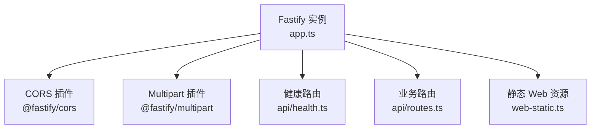
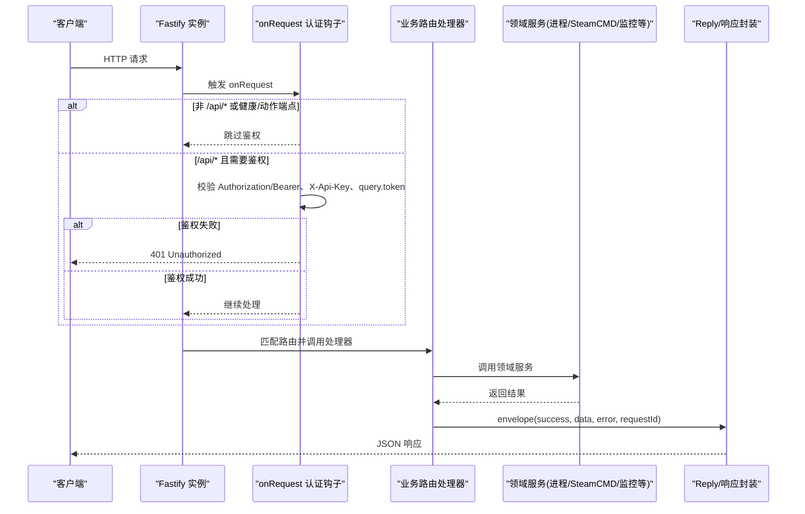
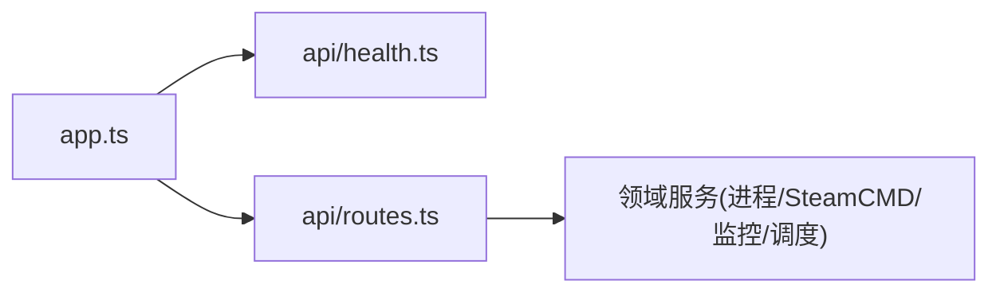

# 中间件与认证

<cite>
**本文引用的文件**   
- [packages/service/src/app.ts](file://packages/service/src/app.ts)
- [packages/service/src/api/health.ts](file://packages/service/src/api/health.ts)
- [packages/service/src/api/routes.ts](file://packages/service/src/api/routes.ts)
</cite>

## 目录
1. [简介](#简介)
2. [项目结构](#项目结构)
3. [核心组件](#核心组件)
4. [架构总览](#架构总览)
5. [详细组件分析](#详细组件分析)
6. [依赖关系分析](#依赖关系分析)
7. [性能与安全注意事项](#性能与安全注意事项)
8. [故障排查指南](#故障排查指南)
9. [结论](#结论)

## 简介
本文聚焦后端 Fastify 服务的中间件注册机制、请求生命周期钩子、响应拦截器，以及认证流程、权限控制、API 密钥管理。同时说明请求验证、输入清洗、CORS 配置、速率限制现状，并给出自定义装饰器、统一错误处理、日志记录中间件的实现建议与示例路径。

## 项目结构
本仓库采用多包结构，后端服务位于 packages/service，Fastify 应用初始化、插件注册、全局钩子与路由挂载集中在服务入口与 API 模块中：
- 服务启动与中间件装配：packages/service/src/app.ts
- 健康检查与公开端点：packages/service/src/api/health.ts
- 业务路由与任务执行：packages/service/src/api/routes.ts

图表来源
- [packages/service/src/app.ts:57-170](file://packages/service/src/app.ts#L57-L170)
- [packages/service/src/api/health.ts:5-66](file://packages/service/src/api/health.ts#L5-L66)
- [packages/service/src/api/routes.ts:62-1111](file://packages/service/src/api/routes.ts#L62-L1111)

章节来源
- [packages/service/src/app.ts:57-170](file://packages/service/src/app.ts#L57-L170)

## 核心组件
- Fastify 实例与服务选项：端口、主机、数据目录、可选的 API Token。
- 全局装饰器：将配置存储、进程管理、SteamCMD、模组扫描、监控数据库、调度器、RPT 日志读取器、UI 设置、模组扫描路径、SteamCMD 设置、异步任务管理器、数据目录等注入到 request/response 上下文。
- 认证钩子：在 onRequest 阶段对 /api/* 进行鉴权，支持 Authorization Bearer、X-Api-Key、query token 三种方式；静态页面与健康/动作端点豁免鉴权。
- CORS 配置：允许任意 Origin（适配 Capacitor WebView），暴露必要请求头。
- Multipart 配置：支持最大 100MB 的文件上传。
- SSE 集成：将 SteamCMD 事件桥接到 SSE 通道。
- 路由注册：/api/v1/health、/api/v1/actions 与主业务路由。

章节来源
- [packages/service/src/app.ts:19-94](file://packages/service/src/app.ts#L19-L94)
- [packages/service/src/app.ts:96-145](file://packages/service/src/app.ts#L96-L145)
- [packages/service/src/app.ts:147-153](file://packages/service/src/app.ts#L147-L153)

## 架构总览
下图展示一次受保护的 API 请求从进入 Fastify 到返回响应的完整链路，包括认证钩子、CORS、Multipart、路由处理器与统一响应封装。

图表来源
- [packages/service/src/app.ts:96-130](file://packages/service/src/app.ts#L96-L130)
- [packages/service/src/api/routes.ts:1115-1117](file://packages/service/src/api/routes.ts#L1115-L1117)

## 详细组件分析

### Fastify 中间件注册机制
- 插件注册顺序：先创建 Fastify 实例并装饰全局服务，再注册认证钩子，随后注册 CORS 与 multipart，最后挂载路由与静态资源。
- 关键插件：
  - @fastify/cors：动态 origin 策略，允许 file:// 与 null Origin，暴露 Authorization、Content-Type、X-Api-Key、Accept。
  - @fastify/multipart：启用文件上传，限制单文件 100MB。
- 监听重试：当端口占用、权限不足或地址不可用时自动重试，提升启动鲁棒性。

章节来源
- [packages/service/src/app.ts:57-94](file://packages/service/src/app.ts#L57-L94)
- [packages/service/src/app.ts:132-145](file://packages/service/src/app.ts#L132-L145)
- [packages/service/src/app.ts:28-55](file://packages/service/src/app.ts#L28-L55)

### 请求生命周期钩子与响应拦截器
- 请求钩子：
  - onRequest：用于认证与白名单放行。静态 UI 路径、/api/v1/health、/api/v1/actions 不强制鉴权。
  - 未通过鉴权的请求直接返回 401。
- 响应拦截器：
  - 当前代码未在 app.ts 中定义全局 onSend 或 onError 拦截器。
  - 业务层使用统一的 envelope 函数包装响应体，包含 success、data、error、requestId。

章节来源
- [packages/service/src/app.ts:96-130](file://packages/service/src/app.ts#L96-L130)
- [packages/service/src/api/routes.ts:1115-1117](file://packages/service/src/api/routes.ts#L1115-L1117)

### 认证流程、权限验证与角色控制
- 认证方式：
  - Authorization: Bearer <token>
  - X-Api-Key: <token>
  - query.token=<token>
- 白名单：
  - 非 /api/* 的请求视为静态资源，无需鉴权。
  - /api/v1/health 与 /api/v1/actions 始终免鉴权。
- 权限与角色：
  - 当前实现为“单一 API Token”模式，未区分用户、角色与细粒度权限。
  - 如需 RBAC，可在 onRequest 中解析 Token 后加载用户角色，并写入 request.user 供后续路由守卫使用。

章节来源
- [packages/service/src/app.ts:96-130](file://packages/service/src/app.ts#L96-L130)

### API 密钥管理
- 密钥来源：服务启动时通过 options.apiToken 注入。
- 校验位置：onRequest 钩子内按优先级检查 Header、Query。
- 扩展建议：
  - 将 apiToken 迁移至配置中心或环境变量，并提供轮换接口。
  - 增加密钥过期时间、作用域与审计日志。

章节来源
- [packages/service/src/app.ts:19-24](file://packages/service/src/app.ts#L19-L24)
- [packages/service/src/app.ts:110-128](file://packages/service/src/app.ts#L110-L128)

### 请求验证与输入清洗
- 请求体验证：
  - 当前路由未使用 fastify-plugin 或 schema 校验，主要依赖业务层手动判断与错误码返回。
  - 部分端点使用 parseQueryBool 等工具函数做基础转换。
- 输入清洗：
  - sanitizeImportedProcessId：在导入/克隆配置时清理 processById，避免误报运行状态或误杀进程。
  - mergeConfigPackage：安全合并补丁对象，防止原型链污染。
  - validateServerPath：在创建服务器时校验路径合法性。
- 建议：
  - 引入 fastify-type-provider-zod 或 ajv 进行请求体验证。
  - 对文件上传内容类型、大小、文件名进行严格校验与清洗。

章节来源
- [packages/service/src/api/routes.ts:1119-1178](file://packages/service/src/api/routes.ts#L1119-L1178)
- [packages/service/src/api/routes.ts:1210-1239](file://packages/service/src/api/routes.ts#L1210-L1239)
- [packages/service/src/api/routes.ts:1524-1532](file://packages/service/src/api/routes.ts#L1524-L1532)

### CORS 配置
- 行为：
  - 允许所有 Origin（含 null/file://），便于 Capacitor WebView 与本地开发。
  - 允许的请求头包含 Authorization、Content-Type、X-Api-Key、Accept。
- 风险与建议：
  - 生产环境应限制允许的 Origin 列表，避免跨站滥用。
  - 结合 CSRF 防护（如 SameSite Cookie）与严格的鉴权策略。

章节来源
- [packages/service/src/app.ts:132-144](file://packages/service/src/app.ts#L132-L144)

### 速率限制
- 现状：
  - 代码库未内置速率限制插件。
- 建议：
  - 引入 @fastify/rate-limit 或外部网关（Nginx/Cloudflare）进行限流。
  - 针对写操作与敏感接口（如 RCon、SteamCMD）设置更严格的阈值。

[本节为通用建议，不涉及具体文件]

### 自定义装饰器开发
- 现有装饰器：
  - 在服务启动时将多个服务实例装饰到 app 上，供路由处理器访问。
- 推荐实践：
  - 新增 authUser 装饰器：在 onRequest 中解析 Token 并填充 request.auth = { userId, roles }。
  - 新增 requireRole 守卫：在路由级别校验角色集合。
  - 新增 auditLog 装饰器：记录敏感操作的审计信息。

章节来源
- [packages/service/src/app.ts:81-94](file://packages/service/src/app.ts#L81-L94)

### 错误处理统一化
- 现状：
  - 业务层使用 envelope 统一返回结构，包含 success、data、error、requestId。
  - 多处直接 reply.status(...) 配合 envelope 返回错误。
- 建议：
  - 注册全局 onError 钩子，捕获未处理异常并返回标准错误格式。
  - 定义错误码枚举与消息模板，便于前端统一提示。

章节来源
- [packages/service/src/api/routes.ts:1115-1117](file://packages/service/src/api/routes.ts#L1115-L1117)

### 日志记录中间件
- 现状：
  - Fastify 实例启用内置 logger。
  - 无自定义日志中间件。
- 建议：
  - 注册 pino-http 或自定义 onRequest/onResponse 钩子，输出结构化日志（请求 ID、方法、路径、耗时、状态码）。
  - 对鉴权失败、参数校验失败、外部调用失败进行分类打点。

章节来源
- [packages/service/src/app.ts:57-58](file://packages/service/src/app.ts#L57-L58)

### 文件上传与 Multipart
- 能力：
  - 已启用 multipart，支持大文件上传（上限 100MB）。
  - 提供模组 HTML 列表与任务 PBO 文件上传端点。
- 建议：
  - 增加 Content-Type 白名单、文件大小二次校验、文件名清洗与病毒扫描。
  - 对上传路径进行沙箱隔离，避免路径穿越。

章节来源
- [packages/service/src/app.ts:145-145](file://packages/service/src/app.ts#L145-L145)
- [packages/service/src/api/routes.ts:942-1026](file://packages/service/src/api/routes.ts#L942-L1026)

### 健康检查与公开端点
- /api/v1/health：返回服务版本、平台信息与默认可执行路径等元数据。
- /api/v1/actions：列出支持的命令动作与 REST 端点清单，便于自动化集成。

章节来源
- [packages/service/src/api/health.ts:5-66](file://packages/service/src/api/health.ts#L5-L66)

## 依赖关系分析
- 模块耦合：
  - app.ts 负责装配服务与中间件，低耦合地注册 health 与 routes。
  - routes.ts 依赖多个领域服务（进程、SteamCMD、监控、调度等），通过装饰器注入。
- 外部依赖：
  - @fastify/cors、@fastify/multipart 作为中间件插件。
  - Node.js 原生 fs/path/crypto 用于文件系统与标识生成。

图表来源
- [packages/service/src/app.ts:147-153](file://packages/service/src/app.ts#L147-L153)
- [packages/service/src/api/routes.ts:62-1111](file://packages/service/src/api/routes.ts#L62-L1111)

章节来源
- [packages/service/src/app.ts:147-153](file://packages/service/src/app.ts#L147-L153)
- [packages/service/src/api/routes.ts:62-1111](file://packages/service/src/api/routes.ts#L62-L1111)

## 性能与安全注意事项
- 性能：
  - 路由处理器多为 I/O 密集（文件、网络、RCon），建议对长耗时操作使用异步任务队列与进度查询。
  - 对频繁读的配置与缓存数据使用内存缓存与失效策略。
- 安全：
  - 生产环境收紧 CORS 与鉴权策略，禁用匿名访问。
  - 对敏感操作（RCon、SteamCMD、配置写入）增加二次确认与审计日志。
  - 对上传文件进行类型、大小、内容校验与恶意检测。

[本节为通用建议，不涉及具体文件]

## 故障排查指南
- 401 Unauthorized：
  - 检查是否携带 Authorization: Bearer、X-Api-Key 或 query.token。
  - 确认请求路径是否为 /api/* 且非健康/动作端点。
- 端口占用或权限不足：
  - 查看服务启动日志中的重试与错误码（EADDRINUSE/EACCES/EADDRNOTAVAIL）。
- 文件上传失败：
  - 检查 Content-Type 是否为 multipart/form-data，文件大小是否超过 100MB。
- 配置写入失败：
  - 关注 WRITE_CFG_FAILED 错误码与 writeAll 返回的消息。

章节来源
- [packages/service/src/app.ts:96-130](file://packages/service/src/app.ts#L96-L130)
- [packages/service/src/app.ts:28-55](file://packages/service/src/app.ts#L28-L55)
- [packages/service/src/api/routes.ts:124-144](file://packages/service/src/api/routes.ts#L124-L144)

## 结论
当前 Fastify 服务通过 onRequest 钩子实现了基于 Token 的统一鉴权，配合 CORS 与 Multipart 插件满足基本的前端交互需求。业务层以 envelope 统一响应结构，便于前端消费。若需在生产环境强化安全与可观测性，建议引入请求体验证、全局错误拦截、结构化日志与速率限制，并将单一 Token 升级为具备角色与作用域的认证体系。