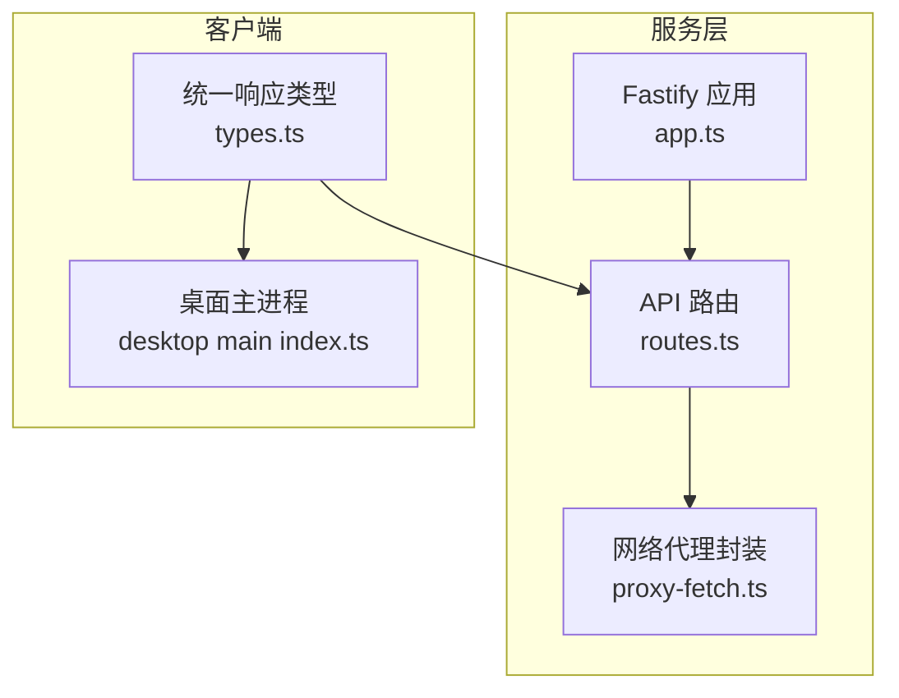
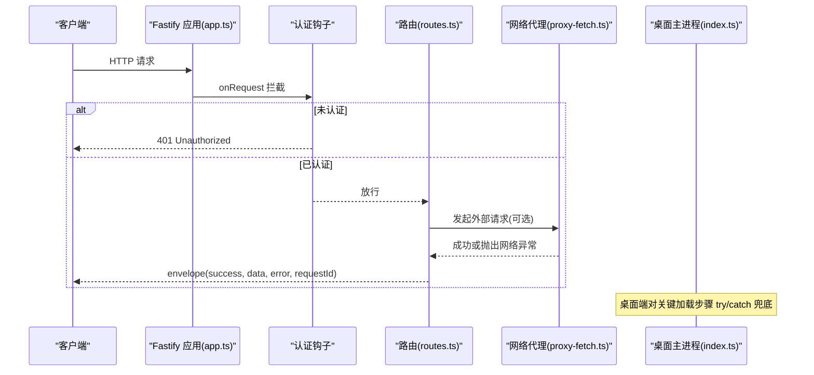
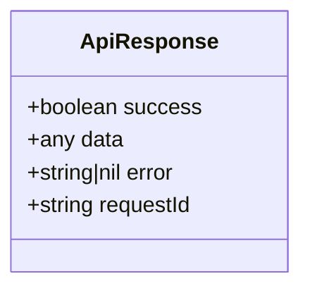
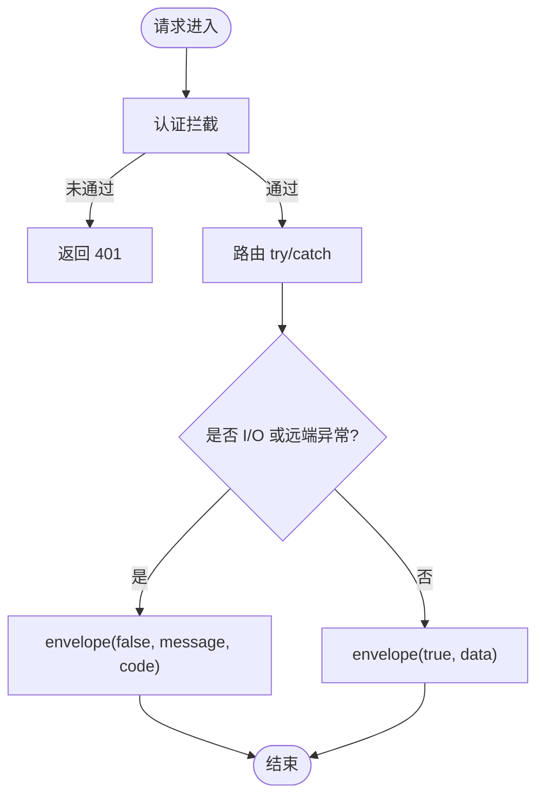
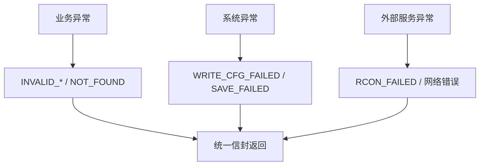
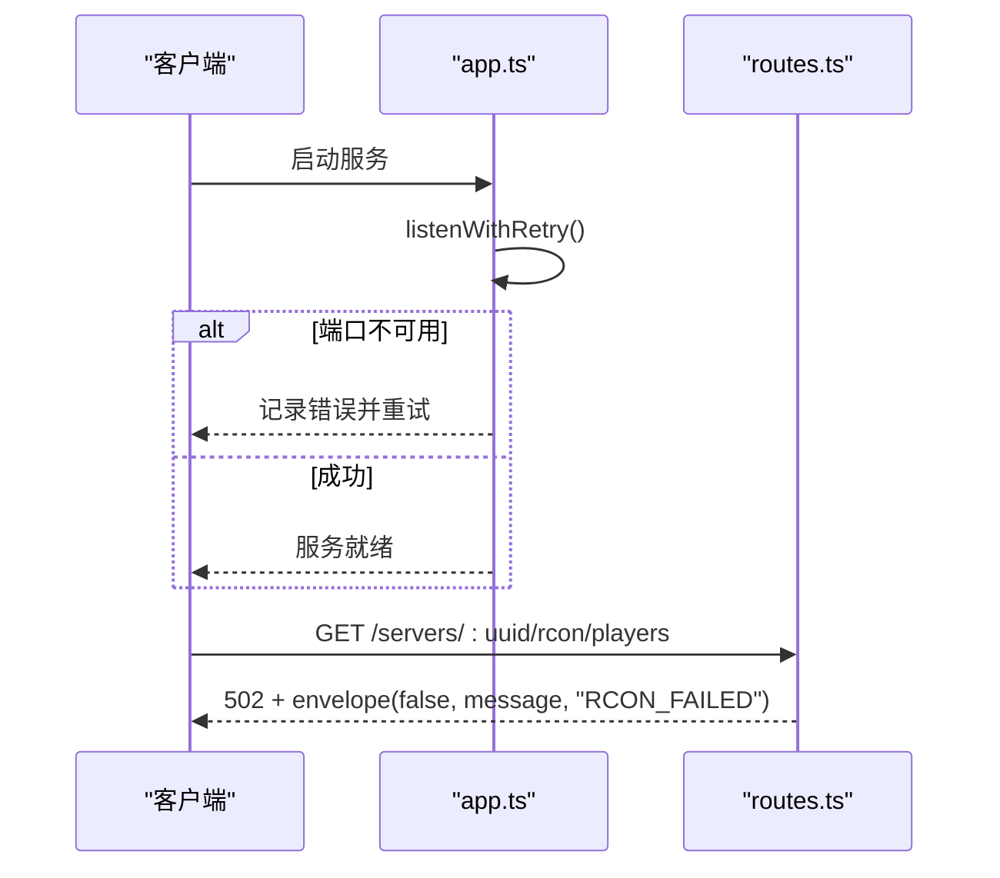
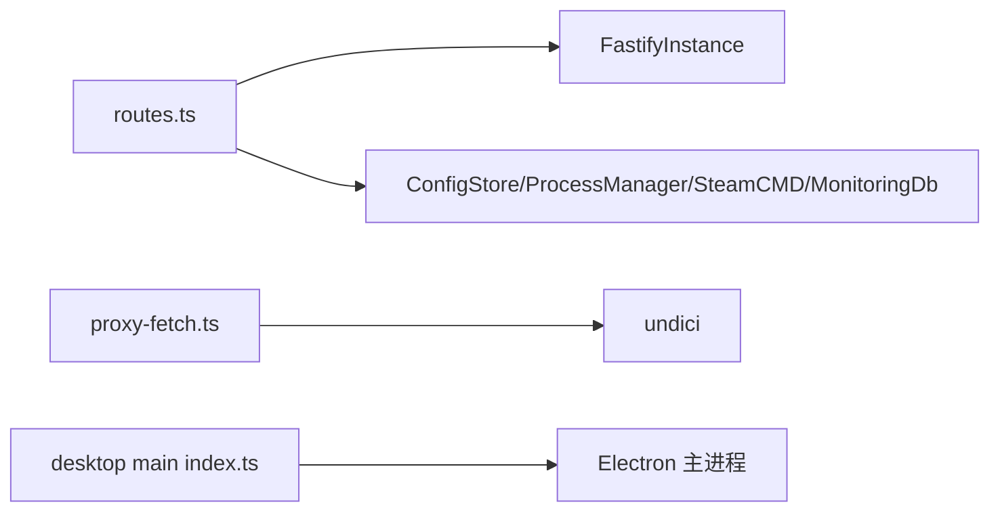

# 错误处理机制

<cite>
**本文引用的文件**   
- [packages/service/src/app.ts](file://packages/service/src/app.ts)
- [packages/service/src/api/routes.ts](file://packages/service/src/api/routes.ts)
- [packages/service/src/steamcmd/proxy-fetch.ts](file://packages/service/src/steamcmd/proxy-fetch.ts)
- [packages/service/src/steamcmd/proxy-fetch.test.ts](file://packages/service/src/steamcmd/proxy-fetch.test.ts)
- [packages/api-client/src/types.ts](file://packages/api-client/src/types.ts)
- [apps/desktop/src/main/index.ts](file://apps/desktop/src/main/index.ts)
</cite>

## 目录
1. [简介](#简介)
2. [项目结构](#项目结构)
3. [核心组件](#核心组件)
4. [架构总览](#架构总览)
5. [详细组件分析](#详细组件分析)
6. [依赖关系分析](#依赖关系分析)
7. [性能与稳定性考虑](#性能与稳定性考虑)
8. [故障排查指南](#故障排查指南)
9. [结论](#结论)

## 简介
本文件系统性梳理 Arma3 Server Tool 的错误处理机制，覆盖统一响应格式、错误码约定、异常捕获策略、日志与监控集成、用户友好提示以及常见错误场景的处理方式。目标是帮助开发者快速定位问题、统一对外错误语义，并提升系统可观测性与用户体验。

## 项目结构
本项目在服务端使用 Fastify 提供 REST API，通过统一的 envelope 函数封装所有接口返回；网络请求通过代理封装并附带超时控制；桌面端对关键启动流程进行 try/catch 兜底；同时存在面向前端的统一响应类型定义。

**图示来源**
- [packages/service/src/app.ts:57-171](file://packages/service/src/app.ts#L57-L171)
- [packages/service/src/api/routes.ts:1115-1120](file://packages/service/src/api/routes.ts#L1115-L1120)
- [packages/service/src/steamcmd/proxy-fetch.ts:22-46](file://packages/service/src/steamcmd/proxy-fetch.ts#L22-L46)
- [packages/api-client/src/types.ts:1-8](file://packages/api-client/src/types.ts#L1-L8)
- [apps/desktop/src/main/index.ts:191-198](file://apps/desktop/src/main/index.ts#L191-L198)

**章节来源**
- [packages/service/src/app.ts:57-171](file://packages/service/src/app.ts#L57-L171)
- [packages/service/src/api/routes.ts:1115-1120](file://packages/service/src/api/routes.ts#L1115-L1120)
- [packages/service/src/steamcmd/proxy-fetch.ts:22-46](file://packages/service/src/steamcmd/proxy-fetch.ts#L22-L46)
- [packages/api-client/src/types.ts:1-8](file://packages/api-client/src/types.ts#L1-L8)
- [apps/desktop/src/main/index.ts:191-198](file://apps/desktop/src/main/index.ts#L191-L198)

## 核心组件
- 统一响应信封：所有 API 通过 envelope 函数返回统一结构，包含 success、data、error、requestId。
- 认证拦截器：在请求进入业务逻辑前校验 Authorization、X-Api-Key、query token，未通过则返回 401。
- 监听重试：端口监听失败时按错误码分类重试，避免 EADDRINUSE/EACCES/EADDRNOTAVAIL 导致启动失败。
- 网络代理与超时：HTTP 请求支持代理与超时，并提供 describeNetworkError 聚合 cause 链信息。
- 桌面端兜底：Electron 主进程对关键加载步骤做 catch 保护，避免 UI 崩溃。

**章节来源**
- [packages/service/src/api/routes.ts:1115-1120](file://packages/service/src/api/routes.ts#L1115-L1120)
- [packages/service/src/app.ts:96-130](file://packages/service/src/app.ts#L96-L130)
- [packages/service/src/app.ts:26-55](file://packages/service/src/app.ts#L26-L55)
- [packages/service/src/steamcmd/proxy-fetch.ts:22-46](file://packages/service/src/steamcmd/proxy-fetch.ts#L22-L46)
- [apps/desktop/src/main/index.ts:191-198](file://apps/desktop/src/main/index.ts#L191-L198)

## 架构总览
下图展示一次典型 API 请求的错误处理路径：认证拦截 → 路由处理 → 业务调用 → 统一信封返回；网络异常由代理层描述并上抛；桌面端对 UI 加载异常进行兜底。

**图示来源**
- [packages/service/src/app.ts:96-130](file://packages/service/src/app.ts#L96-L130)
- [packages/service/src/api/routes.ts:1115-1120](file://packages/service/src/api/routes.ts#L1115-L1120)
- [packages/service/src/steamcmd/proxy-fetch.ts:22-46](file://packages/service/src/steamcmd/proxy-fetch.ts#L22-L46)
- [apps/desktop/src/main/index.ts:191-198](file://apps/desktop/src/main/index.ts#L191-L198)

## 详细组件分析

### 统一错误响应格式
- 统一信封字段：success、data、error、requestId。
- 路由层统一通过 envelope 返回，保证前端一致解析。
- 客户端侧定义了 ApiResponse 类型，便于 TypeScript 类型约束。

**图示来源**
- [packages/api-client/src/types.ts:1-8](file://packages/api-client/src/types.ts#L1-L8)
- [packages/service/src/api/routes.ts:1115-1120](file://packages/service/src/api/routes.ts#L1115-L1120)

**章节来源**
- [packages/api-client/src/types.ts:1-8](file://packages/api-client/src/types.ts#L1-L8)
- [packages/service/src/api/routes.ts:1115-1120](file://packages/service/src/api/routes.ts#L1115-L1120)

### 错误码定义与分类
当前代码中广泛使用字符串错误码标识具体失败原因，例如：
- NOT_FOUND：资源不存在
- WRITE_CFG_FAILED：配置文件写入失败
- SAVE_FAILED：保存配置失败
- INVALID_BODY：请求体无效
- INVALID_PATHS：扫描路径无效
- INVALID_CREDENTIALS：凭据无效
- RCON_NOT_CONFIGURED：RCon 未配置
- RCON_FAILED：RCon 连接失败
- NO_SERVER_DIR：未设置服务器目录

建议后续将错误码集中枚举化，并在文档中维护映射表，便于前端统一渲染和告警规则匹配。

**章节来源**
- [packages/service/src/api/routes.ts:107-109](file://packages/service/src/api/routes.ts#L107-L109)
- [packages/service/src/api/routes.ts:128-143](file://packages/service/src/api/routes.ts#L128-L143)
- [packages/service/src/api/routes.ts:162-169](file://packages/service/src/api/routes.ts#L162-L169)
- [packages/service/src/api/routes.ts:182-185](file://packages/service/src/api/routes.ts#L182-L185)
- [packages/service/src/api/routes.ts:200-205](file://packages/service/src/api/routes.ts#L200-L205)
- [packages/service/src/api/routes.ts:287-291](file://packages/service/src/api/routes.ts#L287-L291)
- [packages/service/src/api/routes.ts:301-304](file://packages/service/src/api/routes.ts#L301-L304)
- [packages/service/src/api/routes.ts:351-354](file://packages/service/src/api/routes.ts#L351-L354)
- [packages/service/src/api/routes.ts:381-384](file://packages/service/src/api/routes.ts#L381-L384)
- [packages/service/src/api/routes.ts:454-461](file://packages/service/src/api/routes.ts#L454-L461)
- [packages/service/src/api/routes.ts:531-533](file://packages/service/src/api/routes.ts#L531-L533)
- [packages/service/src/api/routes.ts:649-652](file://packages/service/src/api/routes.ts#L649-L652)
- [packages/service/src/api/routes.ts:673-676](file://packages/service/src/api/routes.ts#L673-L676)

### 异常捕获策略
- 认证拦截：未通过认证直接返回 401，不进入业务逻辑。
- 路由级 try/catch：针对可能失败的 I/O 或远程调用进行局部捕获，返回 envelope(false, ..., errorCode)。
- 网络层：代理封装统一超时与代理配置，并通过 describeNetworkError 聚合 cause 链，便于诊断。
- 启动层：端口监听失败按错误码分类重试，最终失败记录日志并抛出。
- 桌面端：关键 UI 加载步骤 try/catch，避免主进程崩溃。

**图示来源**
- [packages/service/src/app.ts:96-130](file://packages/service/src/app.ts#L96-L130)
- [packages/service/src/api/routes.ts:115-144](file://packages/service/src/api/routes.ts#L115-L144)
- [packages/service/src/api/routes.ts:454-461](file://packages/service/src/api/routes.ts#L454-L461)
- [packages/service/src/steamcmd/proxy-fetch.ts:22-46](file://packages/service/src/steamcmd/proxy-fetch.ts#L22-L46)
- [packages/service/src/app.ts:26-55](file://packages/service/src/app.ts#L26-L55)

**章节来源**
- [packages/service/src/app.ts:96-130](file://packages/service/src/app.ts#L96-L130)
- [packages/service/src/api/routes.ts:115-144](file://packages/service/src/api/routes.ts#L115-L144)
- [packages/service/src/api/routes.ts:454-461](file://packages/service/src/api/routes.ts#L454-L461)
- [packages/service/src/steamcmd/proxy-fetch.ts:22-46](file://packages/service/src/steamcmd/proxy-fetch.ts#L22-L46)
- [packages/service/src/app.ts:26-55](file://packages/service/src/app.ts#L26-L55)

### 业务异常、系统异常、外部服务异常的分类处理
- 业务异常（参数校验、状态不一致）：通过 envelope(false, null, "INVALID_*") 返回，HTTP 状态通常为 400。
- 系统异常（文件系统、内部状态）：如配置写入失败返回 WRITE_CFG_FAILED，保存失败返回 SAVE_FAILED。
- 外部服务异常（RCon、SteamCMD、网络）：RCon 失败返回 RCON_FAILED 并标记 502；网络层通过 describeNetworkError 聚合底层错误信息。

**图示来源**
- [packages/service/src/api/routes.ts:128-143](file://packages/service/src/api/routes.ts#L128-L143)
- [packages/service/src/api/routes.ts:454-461](file://packages/service/src/api/routes.ts#L454-L461)
- [packages/service/src/steamcmd/proxy-fetch.ts:48-62](file://packages/service/src/steamcmd/proxy-fetch.ts#L48-L62)

**章节来源**
- [packages/service/src/api/routes.ts:128-143](file://packages/service/src/api/routes.ts#L128-L143)
- [packages/service/src/api/routes.ts:454-461](file://packages/service/src/api/routes.ts#L454-L461)
- [packages/service/src/steamcmd/proxy-fetch.ts:48-62](file://packages/service/src/steamcmd/proxy-fetch.ts#L48-L62)

### 错误日志记录、监控告警、用户友好提示
- 日志记录：Fastify 内置 logger，监听失败等场景通过 app.log.error 输出；Web UI 缺失也会记录错误日志。
- 监控告警：监控数据入库与导出能力存在，但未见统一告警触发逻辑；可在错误码维度接入告警规则。
- 用户友好提示：路由层返回中文消息（如“未设置服务器目录”），配合 envelope 的 error 字段供前端展示。

**章节来源**
- [packages/service/src/app.ts:47-50](file://packages/service/src/app.ts#L47-L50)
- [packages/service/src/app.ts:159-161](file://packages/service/src/app.ts#L159-L161)
- [packages/service/src/api/routes.ts:531-533](file://packages/service/src/api/routes.ts#L531-L533)
- [packages/service/src/api/routes.ts:649-652](file://packages/service/src/api/routes.ts#L649-L652)

### 常见错误场景与处理示例
- 端口占用或权限不足：listenWithRetry 根据错误码重试，超过次数后记录错误并抛出。
- 认证失败：认证钩子返回 401，message 为 “Unauthorized”。
- RCon 连接失败：返回 502 与 RCON_FAILED，message 来自异常对象或默认文案。
- 配置写入失败：返回 WRITE_CFG_FAILED，message 来自写入结果。
- 未设置服务器目录：返回 NO_SERVER_DIR，message 为 “未设置服务器目录”。

**图示来源**
- [packages/service/src/app.ts:26-55](file://packages/service/src/app.ts#L26-L55)
- [packages/service/src/app.ts:96-130](file://packages/service/src/app.ts#L96-L130)
- [packages/service/src/api/routes.ts:454-461](file://packages/service/src/api/routes.ts#L454-L461)

**章节来源**
- [packages/service/src/app.ts:26-55](file://packages/service/src/app.ts#L26-L55)
- [packages/service/src/app.ts:96-130](file://packages/service/src/app.ts#L96-L130)
- [packages/service/src/api/routes.ts:454-461](file://packages/service/src/api/routes.ts#L454-L461)

## 依赖关系分析
- 路由模块依赖 Fastify 实例与多个服务（配置存储、进程管理、SteamCMD、监控数据库等）。
- 网络代理依赖 undici，支持代理与超时，并通过 describeNetworkError 增强错误可读性。
- 桌面端依赖 Electron 主进程生命周期，对 UI 加载进行兜底。

**图示来源**
- [packages/service/src/api/routes.ts:1-60](file://packages/service/src/api/routes.ts#L1-L60)
- [packages/service/src/steamcmd/proxy-fetch.ts:1-46](file://packages/service/src/steamcmd/proxy-fetch.ts#L1-L46)
- [apps/desktop/src/main/index.ts:191-198](file://apps/desktop/src/main/index.ts#L191-L198)

**章节来源**
- [packages/service/src/api/routes.ts:1-60](file://packages/service/src/api/routes.ts#L1-L60)
- [packages/service/src/steamcmd/proxy-fetch.ts:1-46](file://packages/service/src/steamcmd/proxy-fetch.ts#L1-L46)
- [apps/desktop/src/main/index.ts:191-198](file://apps/desktop/src/main/index.ts#L191-L198)

## 性能与稳定性考虑
- 网络超时：proxyFetch 默认 20s 超时，可通过 init.timeoutMs 调整，避免长时间阻塞。
- 重试策略：端口监听最多重试 15 次，间隔 1s，降低瞬时冲突影响。
- 流式与批量：监控采集与导出采用批量处理，减少频繁 I/O。
- 建议：对耗时操作增加超时与取消信号，避免任务堆积；对高频错误码建立熔断与退避策略。

**章节来源**
- [packages/service/src/steamcmd/proxy-fetch.ts:22-46](file://packages/service/src/steamcmd/proxy-fetch.ts#L22-L46)
- [packages/service/src/app.ts:26-55](file://packages/service/src/app.ts#L26-L55)

## 故障排查指南
- 认证失败
  - 现象：返回 401，message 为 “Unauthorized”。
  - 排查：检查 Authorization、X-Api-Key、query token 是否与配置一致。
  - 参考：[packages/service/src/app.ts:96-130](file://packages/service/src/app.ts#L96-L130)

- RCon 连接失败
  - 现象：返回 502，error 为 “RCON_FAILED”，message 来自异常或默认文案。
  - 排查：确认 RCon 密码与服务运行状态；查看服务端日志。
  - 参考：[packages/service/src/api/routes.ts:454-461](file://packages/service/src/api/routes.ts#L454-L461)

- 配置写入失败
  - 现象：返回 WRITE_CFG_FAILED，message 来自写入结果。
  - 排查：检查磁盘权限、路径有效性、配置文件格式。
  - 参考：[packages/service/src/api/routes.ts:128-143](file://packages/service/src/api/routes.ts#L128-L143)

- 未设置服务器目录
  - 现象：返回 NO_SERVER_DIR，message 为 “未设置服务器目录”。
  - 排查：在服务器配置中填写 serverDir。
  - 参考：[packages/service/src/api/routes.ts:531-533](file://packages/service/src/api/routes.ts#L531-L533), [packages/service/src/api/routes.ts:649-652](file://packages/service/src/api/routes.ts#L649-L652)

- 网络错误诊断
  - 工具：describeNetworkError 聚合 Error.cause 与 code，便于定位 DNS、代理、超时等问题。
  - 测试：单元测试验证了 cause 链拼接行为。
  - 参考：[packages/service/src/steamcmd/proxy-fetch.ts:48-62](file://packages/service/src/steamcmd/proxy-fetch.ts#L48-L62), [packages/service/src/steamcmd/proxy-fetch.test.ts:1-14](file://packages/service/src/steamcmd/proxy-fetch.test.ts#L1-L14)

- 桌面端 UI 加载异常
  - 现象：Electron 主进程在加载 Web 页面或本地文件时发生异常。
  - 兜底：try/catch 捕获并记录错误，避免主进程崩溃。
  - 参考：[apps/desktop/src/main/index.ts:191-198](file://apps/desktop/src/main/index.ts#L191-L198)

**章节来源**
- [packages/service/src/app.ts:96-130](file://packages/service/src/app.ts#L96-L130)
- [packages/service/src/api/routes.ts:454-461](file://packages/service/src/api/routes.ts#L454-L461)
- [packages/service/src/api/routes.ts:128-143](file://packages/service/src/api/routes.ts#L128-L143)
- [packages/service/src/api/routes.ts:531-533](file://packages/service/src/api/routes.ts#L531-L533)
- [packages/service/src/api/routes.ts:649-652](file://packages/service/src/api/routes.ts#L649-L652)
- [packages/service/src/steamcmd/proxy-fetch.ts:48-62](file://packages/service/src/steamcmd/proxy-fetch.ts#L48-L62)
- [packages/service/src/steamcmd/proxy-fetch.test.ts:1-14](file://packages/service/src/steamcmd/proxy-fetch.test.ts#L1-L14)
- [apps/desktop/src/main/index.ts:191-198](file://apps/desktop/src/main/index.ts#L191-L198)

## 结论
该项目的错误处理以统一信封为核心，结合认证拦截、路由级 try/catch、网络代理与超时控制，形成从入口到外部的完整异常链路。建议在后续迭代中：
- 将错误码集中枚举化并维护文档映射；
- 对高频错误码建立告警与熔断策略；
- 完善结构化日志与追踪 ID，提升排障效率；
- 在前端统一消费 error 与 message，提供更友好的用户提示。