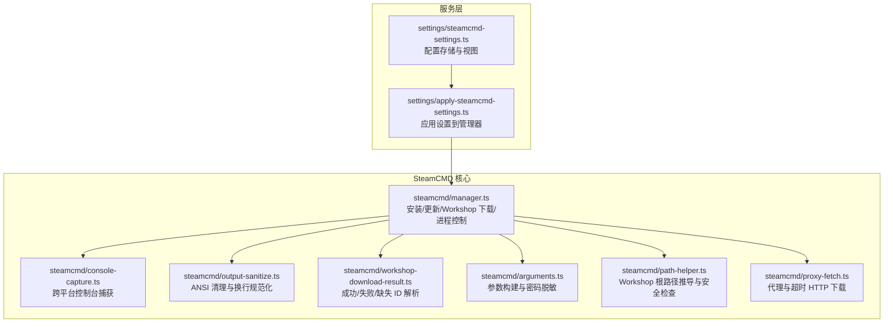
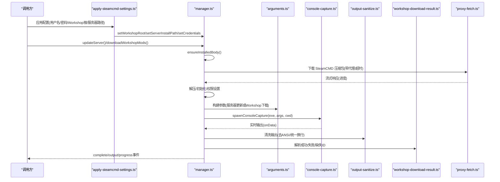
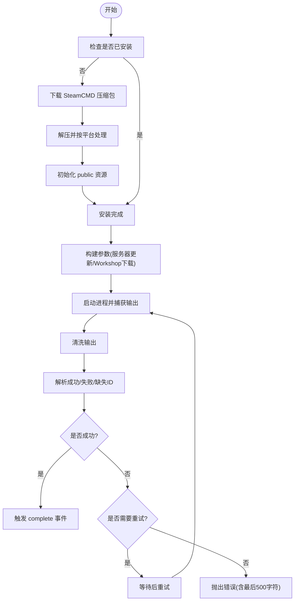
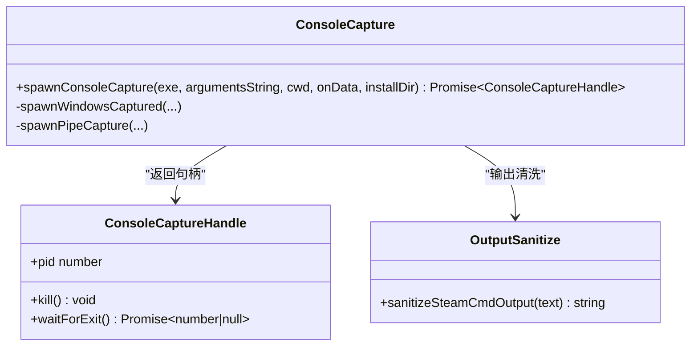
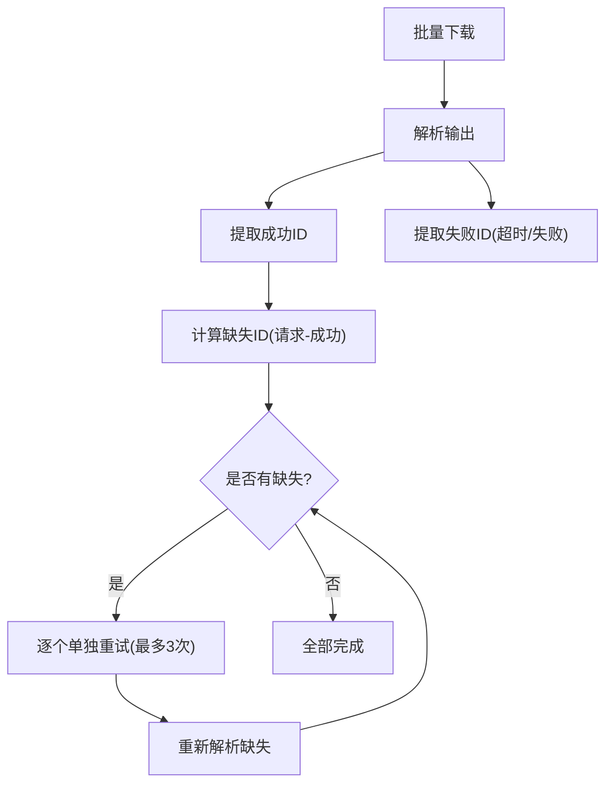
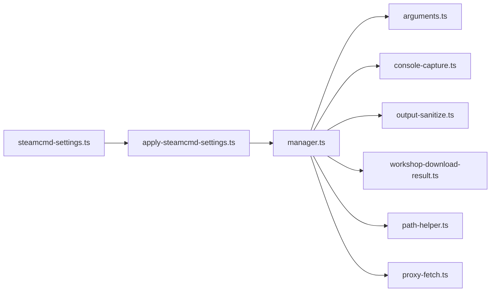

# SteamCMD 集成

<cite>
**本文引用的文件**   
- [packages/service/src/steamcmd/manager.ts](file://packages/service/src/steamcmd/manager.ts)
- [packages/service/src/steamcmd/console-capture.ts](file://packages/service/src/steamcmd/console-capture.ts)
- [packages/service/src/steamcmd/output-sanitize.ts](file://packages/service/src/steamcmd/output-sanitize.ts)
- [packages/service/src/steamcmd/workshop-download-result.ts](file://packages/service/src/steamcmd/workshop-download-result.ts)
- [packages/service/src/steamcmd/arguments.ts](file://packages/service/src/steamcmd/arguments.ts)
- [packages/service/src/steamcmd/path-helper.ts](file://packages/service/src/steamcmd/path-helper.ts)
- [packages/service/src/steamcmd/proxy-fetch.ts](file://packages/service/src/steamcmd/proxy-fetch.ts)
- [packages/service/src/settings/apply-steamcmd-settings.ts](file://packages/service/src/settings/apply-steamcmd-settings.ts)
- [packages/service/src/settings/steamcmd-settings.ts](file://packages/service/src/settings/steamcmd-settings.ts)
</cite>

## 目录
1. [简介](#简介)
2. [项目结构](#项目结构)
3. [核心组件](#核心组件)
4. [架构总览](#架构总览)
5. [详细组件分析](#详细组件分析)
6. [依赖关系分析](#依赖关系分析)
7. [性能与并发优化](#性能与并发优化)
8. [故障排查指南](#故障排查指南)
9. [结论](#结论)
10. [附录](#附录)

## 简介
本文件面向 Arma 3 服务器工具中的 SteamCMD 集成，系统性说明客户端封装、命令执行、输出解析、服务器下载流程、进度监控、断点续传、缓存策略、模组同步机制、Workshop 集成、认证配置、代理设置、网络超时处理，以及批量下载、并行处理、错误重试、日志分析与失败处理的完整方案。文档以代码仓库中实际实现为依据，既适合开发者深入理解，也便于运维人员排障与调优。

## 项目结构
SteamCMD 相关能力集中在 service 包的 steamcmd 子模块与 settings 子模块：
- steamcmd 子模块负责进程管理、参数构建、控制台捕获、输出清洗、Workshop 结果解析、路径推导与代理下载。
- settings 子模块负责 SteamCMD 配置持久化、Workshop 根目录校验与视图转换。

**图表来源**
- [packages/service/src/steamcmd/manager.ts:1-33](file://packages/service/src/steamcmd/manager.ts#L1-L33)
- [packages/service/src/steamcmd/console-capture.ts:1-33](file://packages/service/src/steamcmd/console-capture.ts#L1-L33)
- [packages/service/src/steamcmd/output-sanitize.ts:1-22](file://packages/service/src/steamcmd/output-sanitize.ts#L1-L22)
- [packages/service/src/steamcmd/workshop-download-result.ts:1-16](file://packages/service/src/steamcmd/workshop-download-result.ts#L1-L16)
- [packages/service/src/steamcmd/arguments.ts:1-78](file://packages/service/src/steamcmd/arguments.ts#L1-L78)
- [packages/service/src/steamcmd/path-helper.ts:1-34](file://packages/service/src/steamcmd/path-helper.ts#L1-L34)
- [packages/service/src/steamcmd/proxy-fetch.ts:1-46](file://packages/service/src/steamcmd/proxy-fetch.ts#L1-L46)
- [packages/service/src/settings/apply-steamcmd-settings.ts:1-20](file://packages/service/src/settings/apply-steamcmd-settings.ts#L1-L20)
- [packages/service/src/settings/steamcmd-settings.ts:1-49](file://packages/service/src/settings/steamcmd-settings.ts#L1-L49)

**章节来源**
- [packages/service/src/steamcmd/manager.ts:1-33](file://packages/service/src/steamcmd/manager.ts#L1-L33)
- [packages/service/src/settings/apply-steamcmd-settings.ts:1-20](file://packages/service/src/settings/apply-steamcmd-settings.ts#L1-L20)

## 核心组件
- SteamCmdManager：对外暴露安装、更新服务器、下载 Workshop 模组、取消与终止、日志读取等能力；内部维护会话输出、互斥锁、运行标识、孤儿进程清理。
- ConsoleCapture：跨平台启动 SteamCMD 并捕获输出；Windows 通过 console_log.txt 轮询，Linux 通过 stdout/stderr 管道。
- Arguments：构建 SteamCMD 命令行参数（Workshop 下载、专用服务器更新），并对密码进行脱敏。
- OutputSanitize：清理 ANSI 颜色码、孤立 SGR、多余转义符，统一换行。
- WorkshopDownloadResult：从控制台输出解析成功、失败、缺失的模组 ID。
- PathHelper：推导 Workshop 根目录，防止写入受保护的应用目录。
- ProxyFetch：基于 undici 的带代理与超时的 HTTP 下载，用于自动拉取 SteamCMD 压缩包。
- Settings：持久化用户名、密码、Workshop 根、服务器安装路径，并提供视图与目录初始化。

**章节来源**
- [packages/service/src/steamcmd/manager.ts:50-127](file://packages/service/src/steamcmd/manager.ts#L50-L127)
- [packages/service/src/steamcmd/console-capture.ts:9-33](file://packages/service/src/steamcmd/console-capture.ts#L9-L33)
- [packages/service/src/steamcmd/arguments.ts:15-57](file://packages/service/src/steamcmd/arguments.ts#L15-L57)
- [packages/service/src/steamcmd/output-sanitize.ts:9-21](file://packages/service/src/steamcmd/output-sanitize.ts#L9-L21)
- [packages/service/src/steamcmd/workshop-download-result.ts:1-16](file://packages/service/src/steamcmd/workshop-download-result.ts#L1-L16)
- [packages/service/src/steamcmd/path-helper.ts:16-55](file://packages/service/src/steamcmd/path-helper.ts#L16-L55)
- [packages/service/src/steamcmd/proxy-fetch.ts:22-46](file://packages/service/src/steamcmd/proxy-fetch.ts#L22-L46)
- [packages/service/src/settings/steamcmd-settings.ts:21-49](file://packages/service/src/settings/steamcmd-settings.ts#L21-L49)

## 架构总览
SteamCMD 集成采用“管理器 + 子系统”的分层设计：
- 上层 settings 将用户配置应用到 manager。
- manager 协调参数构建、进程启动、输出清洗、结果解析、重试与取消。
- 底层 console-capture 负责跨平台进程 IO。
- proxy-fetch 提供带代理的网络下载。
- path-helper 保证 Workshop 根目录安全与可发现性。

**图表来源**
- [packages/service/src/settings/apply-steamcmd-settings.ts:5-20](file://packages/service/src/settings/apply-steamcmd-settings.ts#L5-L20)
- [packages/service/src/steamcmd/manager.ts:129-209](file://packages/service/src/steamcmd/manager.ts#L129-L209)
- [packages/service/src/steamcmd/manager.ts:236-349](file://packages/service/src/steamcmd/manager.ts#L236-L349)
- [packages/service/src/steamcmd/arguments.ts:15-57](file://packages/service/src/steamcmd/arguments.ts#L15-L57)
- [packages/service/src/steamcmd/console-capture.ts:22-33](file://packages/service/src/steamcmd/console-capture.ts#L22-L33)
- [packages/service/src/steamcmd/output-sanitize.ts:9-21](file://packages/service/src/steamcmd/output-sanitize.ts#L9-L21)
- [packages/service/src/steamcmd/workshop-download-result.ts:7-16](file://packages/service/src/steamcmd/workshop-download-result.ts#L7-L16)
- [packages/service/src/steamcmd/proxy-fetch.ts:22-46](file://packages/service/src/steamcmd/proxy-fetch.ts#L22-L46)

## 详细组件分析

### SteamCmdManager：安装、更新与 Workshop 下载
- 安装与初始化：检测是否已安装，未安装则通过 proxy-fetch 下载压缩包，按平台解压，必要时执行 bootstrap 初始化，确保 public 资源就绪。
- 服务器更新：构建 app_update 参数，支持 Linux 与 Windows 差异（含 creatordlc），并在退出码为 0 或输出匹配成功模式时判定成功。
- Workshop 下载：批量构建 +workshop_download_item 指令，解析输出识别成功/失败/缺失项；对未完成项最多单独重试 3 次，每次间隔 1.5 秒，最终汇总失败项抛出异常。
- 互斥与取消：withExclusiveLock 保证同一时刻仅一次业务操作；requestAbort 提升 runId 并 kill 进程，使旧协程在检查点抛错且不再拉起新进程。
- 日志与会话输出：每次运行生成独立日志文件，包含时间、程序、参数（密码脱敏）、退出码、成功标志、捕获方式；会话输出限制最大长度，避免内存膨胀。
- 孤儿进程清理：构造时与取消时清理同目录下残留 steamcmd 进程，避免目录占用。

**图表来源**
- [packages/service/src/steamcmd/manager.ts:129-209](file://packages/service/src/steamcmd/manager.ts#L129-L209)
- [packages/service/src/steamcmd/manager.ts:236-349](file://packages/service/src/steamcmd/manager.ts#L236-L349)
- [packages/service/src/steamcmd/manager.ts:375-440](file://packages/service/src/steamcmd/manager.ts#L375-L440)
- [packages/service/src/steamcmd/manager.ts:504-535](file://packages/service/src/steamcmd/manager.ts#L504-L535)

**章节来源**
- [packages/service/src/steamcmd/manager.ts:129-209](file://packages/service/src/steamcmd/manager.ts#L129-L209)
- [packages/service/src/steamcmd/manager.ts:236-349](file://packages/service/src/steamcmd/manager.ts#L236-L349)
- [packages/service/src/steamcmd/manager.ts:351-373](file://packages/service/src/steamcmd/manager.ts#L351-L373)
- [packages/service/src/steamcmd/manager.ts:375-440](file://packages/service/src/steamcmd/manager.ts#L375-L440)
- [packages/service/src/steamcmd/manager.ts:471-502](file://packages/service/src/steamcmd/manager.ts#L471-L502)
- [packages/service/src/steamcmd/manager.ts:593-635](file://packages/service/src/steamcmd/manager.ts#L593-L635)

### 控制台捕获与输出清洗
- Windows：使用 ProcessStartInfo.Arguments 兼容方式启动，后台静默运行并通过轮询 console_log.txt 增量读取输出。
- Linux：直接绑定 stdout/stderr 管道，逐行回调输出。
- 输出清洗：移除 ANSI CSI 序列、孤立 SGR、多余 ESC 与替换符，统一换行为 LF，避免 Web 终端渲染异常。

**图表来源**
- [packages/service/src/steamcmd/console-capture.ts:9-33](file://packages/service/src/steamcmd/console-capture.ts#L9-L33)
- [packages/service/src/steamcmd/console-capture.ts:35-108](file://packages/service/src/steamcmd/console-capture.ts#L35-L108)
- [packages/service/src/steamcmd/console-capture.ts:110-173](file://packages/service/src/steamcmd/console-capture.ts#L110-L173)
- [packages/service/src/steamcmd/output-sanitize.ts:9-21](file://packages/service/src/steamcmd/output-sanitize.ts#L9-L21)

**章节来源**
- [packages/service/src/steamcmd/console-capture.ts:22-33](file://packages/service/src/steamcmd/console-capture.ts#L22-L33)
- [packages/service/src/steamcmd/console-capture.ts:35-108](file://packages/service/src/steamcmd/console-capture.ts#L35-L108)
- [packages/service/src/steamcmd/console-capture.ts:110-173](file://packages/service/src/steamcmd/console-capture.ts#L110-L173)
- [packages/service/src/steamcmd/output-sanitize.ts:9-21](file://packages/service/src/steamcmd/output-sanitize.ts#L9-L21)

### Workshop 下载结果解析
- 成功项：正则匹配 “Success. Downloaded item <id>”。
- 失败项：合并 “ERROR! Timeout downloading item <id>” 与 “ERROR! Download item <id> failed”。
- 缺失项：对比请求 ID 集合与成功集合，得到从未报告成功的 ID。
- 批量下载流程：先批量下载，再根据缺失项逐个单独重试，最多 3 轮，每轮间隔 1.5 秒，最终若仍有缺失则抛出错误。

**图表来源**
- [packages/service/src/steamcmd/workshop-download-result.ts:3-16](file://packages/service/src/steamcmd/workshop-download-result.ts#L3-L16)
- [packages/service/src/steamcmd/workshop-download-result.ts:18-37](file://packages/service/src/steamcmd/workshop-download-result.ts#L18-L37)
- [packages/service/src/steamcmd/manager.ts:252-349](file://packages/service/src/steamcmd/manager.ts#L252-L349)

**章节来源**
- [packages/service/src/steamcmd/workshop-download-result.ts:1-39](file://packages/service/src/steamcmd/workshop-download-result.ts#L1-L39)
- [packages/service/src/steamcmd/manager.ts:252-349](file://packages/service/src/steamcmd/manager.ts#L252-L349)

### 参数构建与密码脱敏
- Workshop 下载参数：+force_install_dir +login +workshop_download_item ... +quit，支持 validate 模式。
- 服务器更新参数：+force_install_dir +login +app_update ... +quit，区分 Linux 与 Windows（含 creatordlc）。
- 密码脱敏：日志与参数字符串中用占位符替换真实密码，避免泄露。

**章节来源**
- [packages/service/src/steamcmd/arguments.ts:15-57](file://packages/service/src/steamcmd/arguments.ts#L15-L57)
- [packages/service/src/steamcmd/arguments.ts:71-77](file://packages/service/src/steamcmd/arguments.ts#L71-L77)

### 路径推导与安全检查
- Workshop 根优先顺序：用户配置 > 扫描路径推导 > 内置 extension 目录。
- 安全规则：禁止写入 applicationBase 下（除非 applicationBase 与 userDataDirectory 相同），防止覆盖应用目录。
- 默认内容目录：确保 steamapps/workshop/content/107410 存在，便于 Workshop 模组落盘。

**章节来源**
- [packages/service/src/steamcmd/path-helper.ts:16-55](file://packages/service/src/steamcmd/path-helper.ts#L16-L55)
- [packages/service/src/steamcmd/path-helper.ts:57-87](file://packages/service/src/steamcmd/path-helper.ts#L57-L87)
- [packages/service/src/settings/steamcmd-settings.ts:64-74](file://packages/service/src/settings/steamcmd-settings.ts#L64-L74)

### 认证配置与应用
- 配置项：username、password、workshopRoot、serverInstallPath。
- 应用流程：applySteamCmdSettings 将配置映射到 manager 的设置方法，确保工作目录与账号可用。
- 视图展示：toSteamCmdSettingsView 提供 hasPassword、workshopModCount 等只读信息。

**章节来源**
- [packages/service/src/settings/steamcmd-settings.ts:5-10](file://packages/service/src/settings/steamcmd-settings.ts#L5-L10)
- [packages/service/src/settings/steamcmd-settings.ts:21-49](file://packages/service/src/settings/steamcmd-settings.ts#L21-L49)
- [packages/service/src/settings/steamcmd-settings.ts:97-109](file://packages/service/src/settings/steamcmd-settings.ts#L97-L109)
- [packages/service/src/settings/apply-steamcmd-settings.ts:5-20](file://packages/service/src/settings/apply-steamcmd-settings.ts#L5-L20)

### 代理设置与网络超时
- 代理来源：环境变量 https_proxy/HTTPS_PROXY/http_proxy/HTTP_PROXY。
- 超时控制：默认 20 秒，可通过 init.timeoutMs 覆盖；SteamCMD 下载压缩包使用 180 秒超时。
- 错误描述：聚合 cause 链路与 code，便于前端提示。

**章节来源**
- [packages/service/src/steamcmd/proxy-fetch.ts:3-13](file://packages/service/src/steamcmd/proxy-fetch.ts#L3-L13)
- [packages/service/src/steamcmd/proxy-fetch.ts:22-46](file://packages/service/src/steamcmd/proxy-fetch.ts#L22-L46)
- [packages/service/src/steamcmd/proxy-fetch.ts:48-62](file://packages/service/src/steamcmd/proxy-fetch.ts#L48-L62)
- [packages/service/src/steamcmd/manager.ts:146-151](file://packages/service/src/steamcmd/manager.ts#L146-L151)

## 依赖关系分析
- manager.ts 依赖：
  - arguments.ts：参数构建与密码脱敏。
  - console-capture.ts：跨平台进程捕获。
  - output-sanitize.ts：输出清洗。
  - workshop-download-result.ts：结果解析。
  - path-helper.ts：Workshop 根路径推导与安全校验。
  - proxy-fetch.ts：带代理与超时的 HTTP 下载。
  - platform/index.js：平台判断与路径解析（由 manager 导入）。
  - process/identity.js：进程树终止。
- settings 与 manager 的关系：
  - apply-steamcmd-settings.ts 作为桥梁，将用户配置注入 manager。
  - steamcmd-settings.ts 提供配置持久化、Workshop 目录初始化与视图转换。

**图表来源**
- [packages/service/src/steamcmd/manager.ts:1-33](file://packages/service/src/steamcmd/manager.ts#L1-L33)
- [packages/service/src/settings/apply-steamcmd-settings.ts:1-20](file://packages/service/src/settings/apply-steamcmd-settings.ts#L1-L20)
- [packages/service/src/settings/steamcmd-settings.ts:1-49](file://packages/service/src/settings/steamcmd-settings.ts#L1-L49)

**章节来源**
- [packages/service/src/steamcmd/manager.ts:1-33](file://packages/service/src/steamcmd/manager.ts#L1-L33)
- [packages/service/src/settings/apply-steamcmd-settings.ts:1-20](file://packages/service/src/settings/apply-steamcmd-settings.ts#L1-L20)
- [packages/service/src/settings/steamcmd-settings.ts:1-49](file://packages/service/src/settings/steamcmd-settings.ts#L1-L49)

## 性能与并发优化
- 全局互斥：同一时刻仅允许一次 SteamCMD 业务操作，避免多进程竞争与状态混乱。
- 批量下载：一次性构建多个 +workshop_download_item，减少登录与进程启动开销。
- 分治重试：批量失败项逐个单独重试，降低单次任务失败影响面，提高成功率。
- 流式下载：SteamCMD 压缩包下载使用流式 reader/writer，边下边写，避免大文件内存峰值。
- 输出缓冲上限：会话输出限制最大字符数，防止长时间运行导致内存增长。
- 建议扩展：
  - 并行度控制：可按模组大小或网络状况动态调整单个批次大小，避免瞬时带宽拥塞。
  - 断点续传：依赖 SteamCMD 自身验证与缓存；建议在失败后优先使用 validate 模式重校验。
  - 缓存策略：复用 depotcache/appcache（由忽略规则可见），避免重复下载公共资源。

**章节来源**
- [packages/service/src/steamcmd/manager.ts:351-367](file://packages/service/src/steamcmd/manager.ts#L351-L367)
- [packages/service/src/steamcmd/manager.ts:252-349](file://packages/service/src/steamcmd/manager.ts#L252-L349)
- [packages/service/src/steamcmd/manager.ts:157-174](file://packages/service/src/steamcmd/manager.ts#L157-L174)
- [packages/service/src/steamcmd/manager.ts:523-528](file://packages/service/src/steamcmd/manager.ts#L523-L528)

## 故障排查指南
- 无法下载 SteamCMD：
  - 检查域名是否被 hosts 拦截、能否访问 Steam CDN、是否配置 HTTPS_PROXY。
  - 查看 describeNetworkError 输出的 cause 与 code，定位具体网络错误。
- 初始化未完成：
  - 确认 public 资源下载成功；如失败，检查网络并重试。
- Workshop 下载失败：
  - 查看失败项列表，常见为大体积模组；可稍后单独下载或检查磁盘空间与网络。
  - 使用 validate 模式单独重试，确保完整性。
- 进程卡死或目录占用：
  - 使用 purgeOrphanSteamCmdProcesses 清理残留进程；取消操作会主动 kill 进程并提升 runId。
- 日志分析：
  - 获取最新会话日志 tail，关注 “--- console ---” 之后的输出。
  - 日志包含时间、程序、参数（密码已脱敏）、退出码、成功标志、捕获方式。

**章节来源**
- [packages/service/src/steamcmd/proxy-fetch.ts:48-62](file://packages/service/src/steamcmd/proxy-fetch.ts#L48-L62)
- [packages/service/src/steamcmd/manager.ts:146-151](file://packages/service/src/steamcmd/manager.ts#L146-L151)
- [packages/service/src/steamcmd/manager.ts:197-206](file://packages/service/src/steamcmd/manager.ts#L197-L206)
- [packages/service/src/steamcmd/manager.ts:340-345](file://packages/service/src/steamcmd/manager.ts#L340-L345)
- [packages/service/src/steamcmd/manager.ts:593-635](file://packages/service/src/steamcmd/manager.ts#L593-L635)
- [packages/service/src/steamcmd/manager.ts:542-574](file://packages/service/src/steamcmd/manager.ts#L542-L574)
- [packages/service/src/steamcmd/manager.ts:476-502](file://packages/service/src/steamcmd/manager.ts#L476-L502)

## 结论
该 SteamCMD 集成以 manager.ts 为核心，结合参数构建、跨平台控制台捕获、输出清洗、Workshop 结果解析、路径推导与代理下载，形成完整的服务器与模组下载闭环。通过全局互斥、批量下载、分治重试、流式下载与日志记录，兼顾可靠性与可观测性。在实际部署中，建议配合代理与超时配置、合理设置 Workshop 根目录，并结合日志与失败项分析进行持续优化。

## 附录
- 关键接口与数据模型：
  - SteamCmdOptions：installDir、username、password。
  - SteamCmdSettings：username、password、workshopRoot、serverInstallPath。
  - SteamCmdSettingsView：username、hasPassword、workshopRoot、serverInstallPath、steamCmdDir、workshopModCount。
  - ConsoleCaptureHandle：pid、kill、waitForExit。
- 常用常量：
  - ARMA3_DEDICATED_APP_ID = 233780
  - ARMA3_WORKSHOP_APP_ID = 107410

**章节来源**
- [packages/service/src/steamcmd/manager.ts:37-41](file://packages/service/src/steamcmd/manager.ts#L37-L41)
- [packages/service/src/steamcmd/console-capture.ts:9-13](file://packages/service/src/steamcmd/console-capture.ts#L9-L13)
- [packages/service/src/steamcmd/arguments.ts:3-4](file://packages/service/src/steamcmd/arguments.ts#L3-L4)
- [packages/service/src/settings/steamcmd-settings.ts:5-10](file://packages/service/src/settings/steamcmd-settings.ts#L5-L10)
- [packages/service/src/settings/steamcmd-settings.ts:88-109](file://packages/service/src/settings/steamcmd-settings.ts#L88-L109)