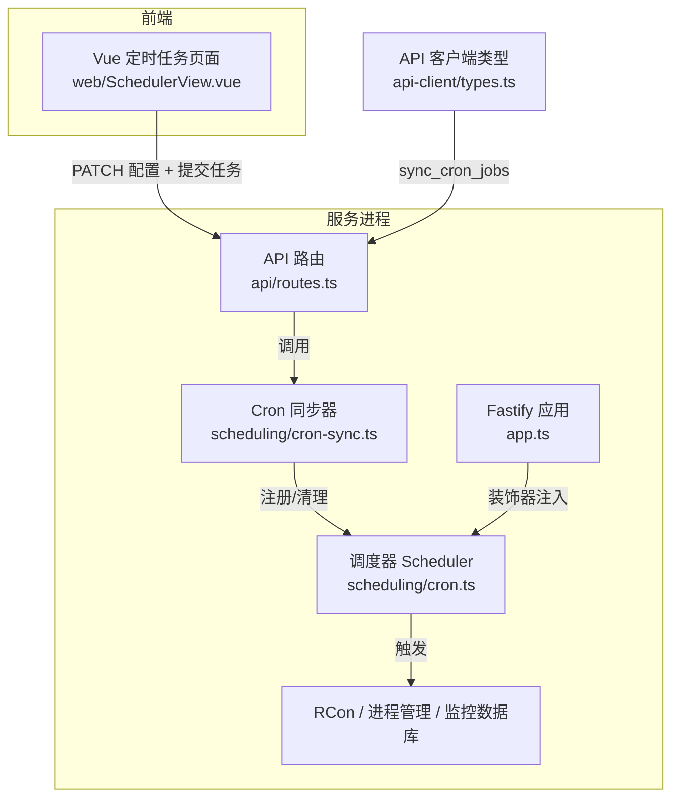
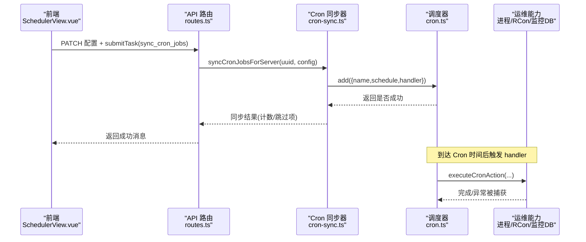
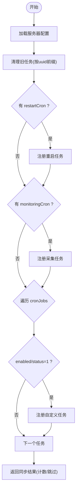
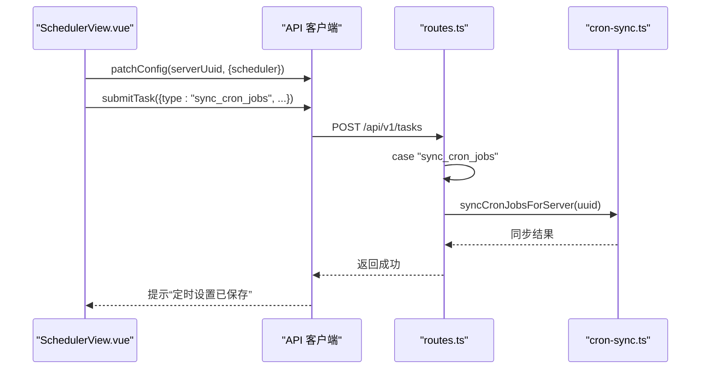
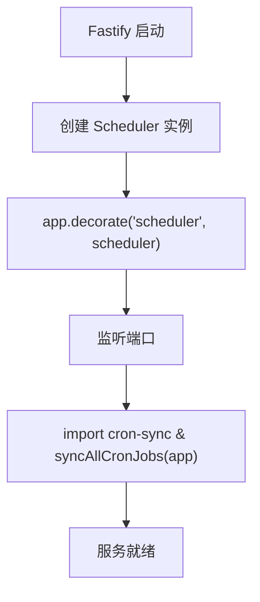
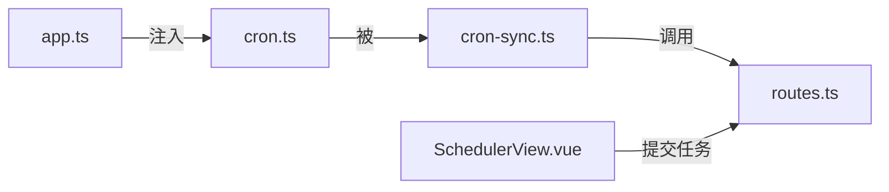

# 任务调度系统

<cite>
**本文引用的文件**   
- [README.md](file://README.md)
- [app.ts](file://packages/service/src/app.ts)
- [routes.ts](file://packages/service/src/api/routes.ts)
- [cron.ts](file://packages/service/src/scheduling/cron.ts)
- [cron-sync.ts](file://packages/service/src/scheduling/cron-sync.ts)
- [index.ts（调度模块）](file://packages/service/src/scheduling/index.ts)
- [cron.test.ts](file://packages/service/src/scheduling/cron.test.ts)
- [SchedulerView.vue](file://packages/web/src/views/SchedulerView.vue)
- [types.ts（API 客户端类型）](file://packages/api-client/src/types.ts)
</cite>

## 目录
1. [引言](#引言)
2. [项目结构](#项目结构)
3. [核心组件](#核心组件)
4. [架构总览](#架构总览)
5. [详细组件分析](#详细组件分析)
6. [依赖关系分析](#依赖关系分析)
7. [性能与可靠性](#性能与可靠性)
8. [监控、日志与告警](#监控日志与告警)
9. [任务编排与扩展能力](#任务编排与扩展能力)
10. [调试、测试与优化指南](#调试测试与优化指南)
11. [故障排查](#故障排查)
12. [结论](#结论)

## 引言
本文件聚焦 Arma 3 服务器管理工具中的“任务调度系统”，围绕定时任务配置、调度策略、执行队列管理展开，说明 Cron 表达式支持、延迟/重复/一次性任务模式、任务优先级与资源限制、失败重试与超时控制，并覆盖任务监控、执行日志、性能统计与告警通知。同时给出任务编排、依赖管理与分布式执行的扩展建议，以及调试、测试与性能优化的实用指南。

该系统的后端基于 Fastify + Node.js，使用 croner 库实现 Cron 调度；前端通过 Vue 控制面板编辑定时任务配置，并通过 API 提交同步命令触发调度器重建。

**章节来源**
- [README.md:37-47](file://README.md#L37-L47)

## 项目结构
与任务调度直接相关的代码主要位于以下位置：
- 调度内核：packages/service/src/scheduling/cron.ts
- 调度与服务器配置的同步：packages/service/src/scheduling/cron-sync.ts
- 应用启动时注入调度器并初始化所有定时任务：packages/service/src/app.ts
- API 路由中暴露的调度相关接口与状态汇总：packages/service/src/api/routes.ts
- 前端定时任务配置界面：packages/web/src/views/SchedulerView.vue
- 调度模块对外导出：packages/service/src/scheduling/index.ts
- 客户端类型定义中包含任务类型 sync_cron_jobs：packages/api-client/src/types.ts



**图表来源**
- [app.ts:69-88](file://packages/service/src/app.ts#L69-L88)
- [app.ts:167-169](file://packages/service/src/app.ts#L167-L169)
- [cron.ts:25-80](file://packages/service/src/scheduling/cron.ts#L25-L80)
- [cron-sync.ts:15-125](file://packages/service/src/scheduling/cron-sync.ts#L15-L125)
- [routes.ts:50-56](file://packages/service/src/api/routes.ts#L50-L56)
- [routes.ts:583-627](file://packages/service/src/api/routes.ts#L583-L627)
- [SchedulerView.vue:77-140](file://packages/web/src/views/SchedulerView.vue#L77-L140)
- [types.ts:101](file://packages/api-client/src/types.ts#L101)

**章节来源**
- [app.ts:57-94](file://packages/service/src/app.ts#L57-L94)
- [app.ts:167-169](file://packages/service/src/app.ts#L167-L169)
- [cron.ts:1-100](file://packages/service/src/scheduling/cron.ts#L1-L100)
- [cron-sync.ts:1-126](file://packages/service/src/scheduling/cron-sync.ts#L1-L126)
- [routes.ts:50-56](file://packages/service/src/api/routes.ts#L50-L56)
- [routes.ts:583-627](file://packages/service/src/api/routes.ts#L583-L627)
- [SchedulerView.vue:77-140](file://packages/web/src/views/SchedulerView.vue#L77-L140)
- [types.ts:101](file://packages/api-client/src/types.ts#L101)

## 核心组件
- 调度器 Scheduler：封装 Cron 任务的增删查与生命周期管理，提供 Cron 表达式校验、错误隔离、列表查询等能力。
- Cron 同步器：根据服务器配置（restartCron、monitoringCron、cronJobs）将定时任务映射到 Scheduler，并在启动或配置变更时同步。
- API 路由：暴露服务器状态、仪表盘摘要（含调度摘要）、监控数据、日志读取等接口；在任务编排中负责处理 submitTask 的 sync_cron_jobs 动作。
- 前端调度视图：维护 cronRows 行数据，保存 scheduler 配置并提交任务以触发后端同步。

关键职责边界：
- Scheduler 不关心业务逻辑，只负责按 Cron 表达式触发 handler。
- Cron 同步器负责把配置转换为具体 handler，例如重启服务器、采集在线人数与玩家信息。
- API 路由负责对外暴露能力，并将前端操作转化为对调度器的更新。

**章节来源**
- [cron.ts:1-100](file://packages/service/src/scheduling/cron.ts#L1-L100)
- [cron-sync.ts:15-125](file://packages/service/src/scheduling/cron-sync.ts#L15-L125)
- [routes.ts:583-627](file://packages/service/src/api/routes.ts#L583-L627)
- [SchedulerView.vue:77-140](file://packages/web/src/views/SchedulerView.vue#L77-L140)

## 架构总览
下图展示从前端配置到后端调度的完整链路，包括启动时的自动同步与运行时通过 API 触发的重新同步。



**图表来源**
- [SchedulerView.vue:77-140](file://packages/web/src/views/SchedulerView.vue#L77-L140)
- [routes.ts:50-56](file://packages/service/src/api/routes.ts#L50-L56)
- [routes.ts:1682](file://packages/service/src/api/routes.ts#L1682)
- [cron-sync.ts:15-125](file://packages/service/src/scheduling/cron-sync.ts#L15-L125)
- [cron.ts:34-54](file://packages/service/src/scheduling/cron.ts#L34-L54)

## 详细组件分析

### 调度器 Scheduler（cron.ts）
- 功能要点
  - isValidCron：在不实际调度情况下验证 Cron 表达式合法性。
  - add：注册任务，若表达式非法则跳过并返回 false；handler 包裹 Promise 避免未捕获异常影响调度器。
  - remove/clear：停止并移除单个或全部任务。
  - list：返回已注册任务的名称与表达式。
  - 内置示例常量：CRON_EVERY_5_MIN、CRON_EVERY_HOUR、CRON_DAILY_3AM、CRON_SERVER_RESTART。
- 复杂度与健壮性
  - Map 存取 O(1)，clear 为 O(n)。
  - 单任务异常不会导致调度器崩溃，具备基础容错。

```mermaid
classDiagram
class Scheduler {
-jobs : Map<string, Cron>
-schedules : Map<string, string>
+add(def) : boolean
+remove(name) : void
+clear() : void
+list() : {name : string; schedule : string}[]
}
class CronJobDef {
+name : string
+schedule : string
+handler : function
}
Scheduler --> CronJobDef : "接收"
```

**图表来源**
- [cron.ts:5-9](file://packages/service/src/scheduling/cron.ts#L5-L9)
- [cron.ts:25-80](file://packages/service/src/scheduling/cron.ts#L25-L80)

**章节来源**
- [cron.ts:1-100](file://packages/service/src/scheduling/cron.ts#L1-L100)
- [cron.test.ts:1-38](file://packages/service/src/scheduling/cron.test.ts#L1-L38)

### Cron 同步器（cron-sync.ts）
- 功能要点
  - clearCronJobsForServer：按 uuid 前缀清理已有任务，保证幂等。
  - syncCronJobsForServer：
    - 读取服务器配置，清空旧任务。
    - 若存在 restartCron，注册重启任务。
    - 若存在 monitoringCron，注册采集任务：仅当服务器运行且 RCon 可用时记录在线人数与玩家信息。
    - 遍历 cronJobs，按 enabled/status 决定是否注册自定义任务，统一走 executeCronAction。
  - syncAllCronJobs：启动时对所有服务器批量同步。
- 行为特性
  - 非法 Cron 表达式会被跳过，返回包含跳过项的消息。
  - 任务名带 uuid 前缀，便于按服务器隔离。



**图表来源**
- [cron-sync.ts:6-13](file://packages/service/src/scheduling/cron-sync.ts#L6-L13)
- [cron-sync.ts:15-125](file://packages/service/src/scheduling/cron-sync.ts#L15-L125)

**章节来源**
- [cron-sync.ts:1-126](file://packages/service/src/scheduling/cron-sync.ts#L1-L126)

### API 路由与前端交互（routes.ts、SchedulerView.vue）
- API 侧
  - 仪表盘摘要返回 scheduleSummary，显示当前生效的重启或采集 Cron。
  - 处理 submitTask 的 sync_cron_jobs 动作，触发对应服务器的 Cron 同步。
- 前端侧
  - 维护 cronRows 行数据，保存 scheduler 配置，并通过 client.submitTask 提交 sync_cron_jobs 以触发后端同步。



**图表来源**
- [routes.ts:583-627](file://packages/service/src/api/routes.ts#L583-L627)
- [routes.ts:1682](file://packages/service/src/api/routes.ts#L1682)
- [SchedulerView.vue:77-140](file://packages/web/src/views/SchedulerView.vue#L77-L140)
- [types.ts:101](file://packages/api-client/src/types.ts#L101)

**章节来源**
- [routes.ts:583-627](file://packages/service/src/api/routes.ts#L583-L627)
- [routes.ts:1682](file://packages/service/src/api/routes.ts#L1682)
- [SchedulerView.vue:77-140](file://packages/web/src/views/SchedulerView.vue#L77-L140)
- [types.ts:101](file://packages/api-client/src/types.ts#L101)

### 应用启动与调度器注入（app.ts）
- 创建 Scheduler 实例并装饰到 app 上，供路由与同步器使用。
- 启动完成后，动态导入并执行 syncAllCronJobs，将所有服务器的 Cron 任务加载到调度器。



**图表来源**
- [app.ts:69-88](file://packages/service/src/app.ts#L69-L88)
- [app.ts:167-169](file://packages/service/src/app.ts#L167-L169)

**章节来源**
- [app.ts:57-94](file://packages/service/src/app.ts#L57-L94)
- [app.ts:167-169](file://packages/service/src/app.ts#L167-L169)

## 依赖关系分析
- 模块内聚与耦合
  - scheduling/cron.ts 高内聚，仅依赖 croner。
  - scheduling/cron-sync.ts 耦合配置存储、RCon 辅助、监控数据库与进程生命周期。
  - api/routes.ts 聚合多个子系统能力，作为外部入口。
  - web/SchedulerView.vue 仅关注配置编辑与任务提交。
- 外部依赖
  - croner：Cron 表达式解析与调度。
  - Fastify：HTTP 服务与装饰器机制。
  - SQLite（通过 MonitoringDb）：监控数据存储。
- 潜在循环依赖
  - routes.ts 与 scheduling/server-lifecycle.ts 通过函数引用解耦，避免循环。



**图表来源**
- [cron.ts:1-100](file://packages/service/src/scheduling/cron.ts#L1-L100)
- [cron-sync.ts:1-126](file://packages/service/src/scheduling/cron-sync.ts#L1-L126)
- [routes.ts:50-56](file://packages/service/src/api/routes.ts#L50-L56)
- [app.ts:69-88](file://packages/service/src/app.ts#L69-L88)
- [SchedulerView.vue:77-140](file://packages/web/src/views/SchedulerView.vue#L77-L140)

**章节来源**
- [cron.ts:1-100](file://packages/service/src/scheduling/cron.ts#L1-L100)
- [cron-sync.ts:1-126](file://packages/service/src/scheduling/cron-sync.ts#L1-L126)
- [routes.ts:50-56](file://packages/service/src/api/routes.ts#L50-L56)
- [app.ts:69-88](file://packages/service/src/app.ts#L69-L88)
- [SchedulerView.vue:77-140](file://packages/web/src/views/SchedulerView.vue#L77-L140)

## 性能与可靠性
- 调度开销
  - Cron 任务数量与处理器复杂度决定 CPU 占用；建议将耗时任务放入异步队列或后台任务管理器。
- 错误隔离
  - Scheduler.add 将 handler 包裹在 Promise 中，避免未捕获异常影响调度器。
- 表达式校验
  - 使用 isValidCron 提前过滤非法表达式，减少无效任务注册。
- 并发与资源限制
  - 当前调度器无内置并发限制；如需限流，可在 handler 层引入信号量或任务队列。
- 重试与超时
  - 当前未内置重试与超时；建议在 handler 层封装重试与超时控制逻辑。

[本节为通用指导，不直接分析具体文件]

## 监控、日志与告警
- 监控采集
  - monitoringCron 触发时，若服务器运行且 RCon 可用，会记录在线人数与玩家信息至监控数据库。
- 日志读取
  - API 提供 rpt、battleye、console 等日志读取接口，便于定位问题。
- 仪表盘摘要
  - dashboard 返回 scheduleSummary，直观展示当前生效的 Cron。
- 告警通知
  - 当前未内置告警通道；可基于监控数据与日志关键字扩展告警逻辑。

**章节来源**
- [cron-sync.ts:45-79](file://packages/service/src/scheduling/cron-sync.ts#L45-L79)
- [routes.ts:631-695](file://packages/service/src/api/routes.ts#L631-L695)
- [routes.ts:583-627](file://packages/service/src/api/routes.ts#L583-L627)

## 任务编排与扩展能力
- 任务编排
  - 通过 cronJobs 自定义任务，每个任务携带 cron 表达式与 actionText，统一由 executeCronAction 执行。
- 依赖管理
  - 当前调度器不支持显式依赖图；可通过任务编排顺序与外部协调器实现简单依赖。
- 分布式执行
  - 当前为单机调度；如需多机一致，可扩展为基于共享存储（如 Redis/ZK）的任务锁与全局调度器。
- 任务优先级与队列
  - 当前无优先级队列；可引入优先级队列（如 heap）与 worker 池进行扩展。
- 延迟/一次性任务
  - 当前基于 Cron 表达式；如需延迟或一次性任务，可在 handler 层封装 setTimeout 或一次性 Cron。

[本节为概念性扩展建议，不直接分析具体文件]

## 调试、测试与优化指南
- 单元测试
  - 使用 vitest 验证 Scheduler 的添加、移除、清理等行为。
- 前端调试
  - 在 SchedulerView.vue 中观察 cronRows 变化，确认 save 与 submitTask 流程。
- 后端调试
  - 查看 API 返回的 scheduleSummary 与同步结果消息，确认 Cron 表达式是否被接受。
- 性能优化
  - 合并高频采集任务，降低 RCon 请求频率。
  - 将重 IO 操作（如日志写入、统计报表生成）移至后台任务。

**章节来源**
- [cron.test.ts:1-38](file://packages/service/src/scheduling/cron.test.ts#L1-L38)
- [SchedulerView.vue:77-140](file://packages/web/src/views/SchedulerView.vue#L77-L140)
- [routes.ts:583-627](file://packages/service/src/api/routes.ts#L583-L627)

## 故障排查
- 定时任务未执行
  - 检查 Cron 表达式是否合法（isValidCron）。
  - 确认 sync_cron_jobs 已提交且返回成功。
  - 查看 scheduleSummary 是否显示预期 Cron。
- 任务被跳过
  - 同步结果消息会列出跳过的任务与原因（通常为非法表达式）。
- 采集任务未写入监控
  - 确认服务器处于运行状态且 RCon 已配置。
- 调度器异常
  - 由于 handler 异常被捕获，调度器应继续运行；检查 handler 内部日志定位问题。

**章节来源**
- [cron.ts:12-23](file://packages/service/src/scheduling/cron.ts#L12-L23)
- [cron-sync.ts:106-114](file://packages/service/src/scheduling/cron-sync.ts#L106-L114)
- [routes.ts:583-627](file://packages/service/src/api/routes.ts#L583-L627)

## 结论
该任务调度系统以 Scheduler 为核心，结合 Cron 同步器与 API 路由，实现了基于配置的定时任务管理。其优势在于表达式校验、错误隔离与按服务器隔离的任务命名；不足在于缺少内置的重试、超时、优先级与分布式一致性。建议在 handler 层补充这些能力，并结合监控与日志构建完整的可观测性与告警体系。