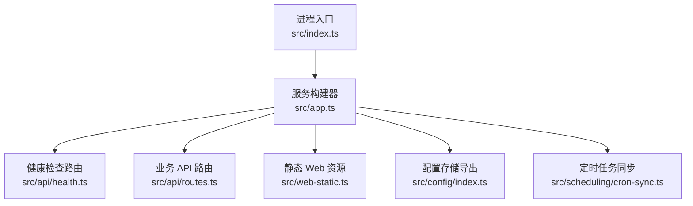
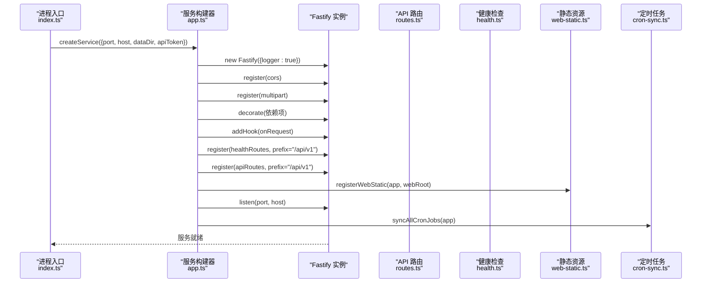
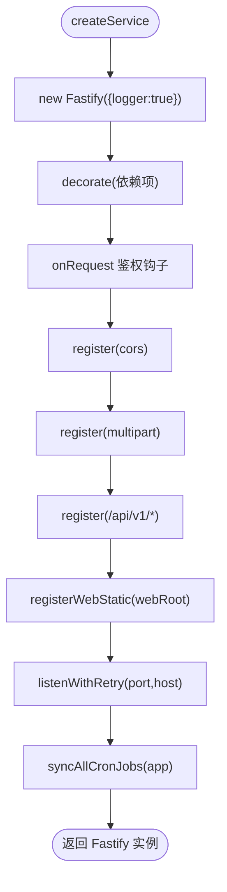
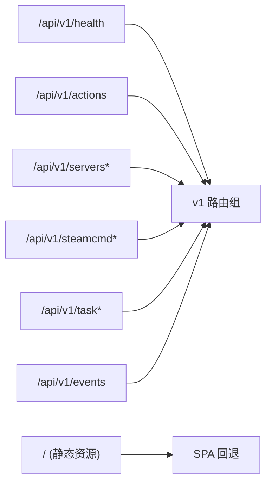
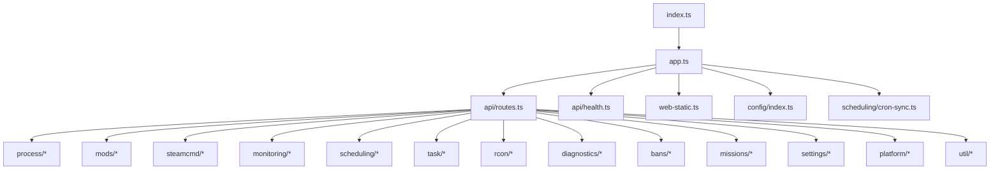

# 后端服务

<cite>
**本文引用的文件**   
- [packages/service/package.json](file://packages/service/package.json)
- [README.md](file://README.md)
- [packages/service/src/index.ts](file://packages/service/src/index.ts)
- [packages/service/src/app.ts](file://packages/service/src/app.ts)
- [packages/service/src/api/health.ts](file://packages/service/src/api/health.ts)
- [packages/service/src/api/routes.ts](file://packages/service/src/api/routes.ts)
- [packages/service/src/web-static.ts](file://packages/service/src/web-static.ts)
- [packages/service/src/config/index.ts](file://packages/service/src/config/index.ts)
- [packages/service/src/scheduling/cron-sync.ts](file://packages/service/src/scheduling/cron-sync.ts)
</cite>

## 目录
1. [简介](#简介)
2. [项目结构](#项目结构)
3. [核心组件](#核心组件)
4. [架构总览](#架构总览)
5. [详细组件分析](#详细组件分析)
6. [依赖关系分析](#依赖关系分析)
7. [性能与并发](#性能与并发)
8. [故障排查指南](#故障排查指南)
9. [结论](#结论)
10. [附录：扩展指南](#附录扩展指南)

## 简介
本文件面向 @a3st/service 后端服务的开发者与维护者，系统性说明 Fastify 应用初始化、中间件注册、依赖注入、路由组织与 API 版本策略、模块化职责划分、配置与环境变量、日志与错误处理、请求校验与响应格式化、扩展点与插件机制，以及性能优化建议。文档同时提供添加新 API 端点与服务模块的实操步骤和图示。

该服务基于 Node.js + Fastify + SQLite，提供服务器管理、BattlEye RCon、模组管理、SteamCMD、HTTP API、任务自动化、监控统计与定时任务等能力。

**章节来源**
- [README.md:1-108](file://README.md#L1-L108)

## 项目结构
@packages/service 是后端服务包，入口为 src/index.ts，核心服务构建在 src/app.ts 中完成。API 路由集中在 src/api 下，静态 Web UI 由 src/web-static.ts 提供，配置读写集中在 src/config 下，定时任务同步逻辑位于 src/scheduling/cron-sync.ts。

**图表来源**
- [packages/service/src/index.ts:1-41](file://packages/service/src/index.ts#L1-L41)
- [packages/service/src/app.ts:57-171](file://packages/service/src/app.ts#L57-L171)
- [packages/service/src/api/health.ts:5-66](file://packages/service/src/api/health.ts#L5-L66)
- [packages/service/src/api/routes.ts:62-200](file://packages/service/src/api/routes.ts#L62-L200)
- [packages/service/src/web-static.ts:17-93](file://packages/service/src/web-static.ts#L17-L93)
- [packages/service/src/config/index.ts:1-14](file://packages/service/src/config/index.ts#L1-L14)
- [packages/service/src/scheduling/cron-sync.ts:1-106](file://packages/service/src/scheduling/cron-sync.ts#L1-L106)

**章节来源**
- [packages/service/package.json:1-32](file://packages/service/package.json#L1-L32)
- [packages/service/src/index.ts:1-41](file://packages/service/src/index.ts#L1-L41)
- [packages/service/src/app.ts:57-171](file://packages/service/src/app.ts#L57-L171)

## 核心组件
- 进程入口 index.ts：解析环境变量（端口、主机、数据目录、API Token），创建服务实例，并监听 SIGINT/SIGTERM 进行优雅关闭。
- 服务构建 app.ts：创建 Fastify 实例，注册 CORS 与 multipart，装饰依赖（配置、进程、SteamCMD、模组扫描、监控数据库、调度器、RPT 日志读取、UI 设置、扫描路径、SteamCMD 设置、异步任务管理器），实现统一鉴权钩子，挂载 /api/v1 路由与静态 Web 资源，启动监听并加载定时任务。
- API 路由 api/routes.ts：集中实现服务器 CRUD、配置读写、状态查询、SteamCMD、任务、监控、诊断等 REST 接口。
- 健康检查 api/health.ts：暴露 /health 与 /actions，用于探测服务状态与列出可用动作与端点。
- 静态资源 web-static.ts：根据 WEB_ROOT 或默认路径定位前端构建产物，提供安全静态文件服务与 SPA 回退。
- 配置导出 config/index.ts：统一导出配置写入、命令行构建、路径工具等能力。
- 定时任务 cron-sync.ts：按服务器配置同步重启、监控采集与自定义 cron 任务。

**章节来源**
- [packages/service/src/index.ts:1-41](file://packages/service/src/index.ts#L1-L41)
- [packages/service/src/app.ts:57-171](file://packages/service/src/app.ts#L57-L171)
- [packages/service/src/api/health.ts:5-66](file://packages/service/src/api/health.ts#L5-L66)
- [packages/service/src/api/routes.ts:62-200](file://packages/service/src/api/routes.ts#L62-L200)
- [packages/service/src/web-static.ts:17-93](file://packages/service/src/web-static.ts#L17-L93)
- [packages/service/src/config/index.ts:1-14](file://packages/service/src/config/index.ts#L1-L14)
- [packages/service/src/scheduling/cron-sync.ts:1-106](file://packages/service/src/scheduling/cron-sync.ts#L1-L106)

## 架构总览
Fastify 作为 HTTP 框架，通过 createService 组装各子系统，使用装饰器将共享服务注入到请求上下文；所有对外 API 统一以 /api/v1 前缀暴露；静态 Web 资源在非 API 路径下提供；CORS 针对浏览器与 Capacitor WebView 场景放宽 Origin；multipart 支持大文件上传；SSE 与 SteamCMD 事件打通；启动后按服务器配置同步定时任务。

**图表来源**
- [packages/service/src/index.ts:18-41](file://packages/service/src/index.ts#L18-L41)
- [packages/service/src/app.ts:57-171](file://packages/service/src/app.ts#L57-L171)
- [packages/service/src/api/health.ts:5-66](file://packages/service/src/api/health.ts#L5-L66)
- [packages/service/src/api/routes.ts:62-200](file://packages/service/src/api/routes.ts#L62-L200)
- [packages/service/src/web-static.ts:62-93](file://packages/service/src/web-static.ts#L62-L93)
- [packages/service/src/scheduling/cron-sync.ts:96-106](file://packages/service/src/scheduling/cron-sync.ts#L96-L106)

## 详细组件分析

### Fastify 应用初始化与中间件注册
- 创建 Fastify 实例并开启内置日志。
- 注册 @fastify/cors：允许空 Origin 与 null，反射调用方 Origin，放行常用方法与头部。
- 注册 @fastify/multipart：限制单文件 100MB。
- 装饰依赖：configStore、snapshotStore、processManager、steamCmd、modScanner、monitorDb、scheduler、rptLogReader、uiSettingsStore、modScanPathStore、steamCmdSettingsStore、asyncTaskManager、dataDir。
- 统一鉴权钩子 onRequest：非 /api/ 路径直接放行；/api/v1/health 与 /api/v1/actions 免鉴权；若未配置 apiToken 则放行；否则校验 Authorization Bearer、X-Api-Key、query.token。
- 挂载路由：/api/v1/health、/api/v1/actions、/api/v1/*。
- 静态资源：resolveWebRoot 优先使用 WEB_ROOT，其次查找 packages/web/dist 等位置；registerWebStatic 提供安全文件访问与 SPA 回退。
- 启动监听：listenWithRetry 对 EADDRINUSE/EACCES/EADDRNOTAVAIL 重试最多 15 次。
- 启动后同步定时任务：syncAllCronJobs 遍历所有服务器配置并注册 cron。

**图表来源**
- [packages/service/src/app.ts:57-171](file://packages/service/src/app.ts#L57-L171)
- [packages/service/src/web-static.ts:17-93](file://packages/service/src/web-static.ts#L17-L93)

**章节来源**
- [packages/service/src/app.ts:57-171](file://packages/service/src/app.ts#L57-L171)
- [packages/service/src/web-static.ts:17-93](file://packages/service/src/web-static.ts#L17-L93)

### 依赖注入机制
- 通过 app.decorate 将服务实例挂载到 Fastify 实例上，路由处理器可直接从 app 获取依赖，避免全局单例与循环依赖。
- 关键依赖包括配置存储、快照存储、进程管理、SteamCMD 管理、模组扫描、监控数据库、调度器、RPT 日志读取、UI 设置、扫描路径、SteamCMD 设置、异步任务管理器与数据目录。
- 这种模式使模块间解耦，便于测试替换与扩展。

**章节来源**
- [packages/service/src/app.ts:60-94](file://packages/service/src/app.ts#L60-L94)

### 路由组织与 API 版本管理
- 所有业务 API 统一以 /api/v1 前缀暴露，便于未来演进至 v2 而不破坏现有客户端。
- 健康检查与健康动作：/api/v1/health、/api/v1/actions。
- 服务器相关：/api/v1/servers、/api/v1/servers/:uuid/status、/api/v1/servers/:uuid/config（GET/PUT/PATCH）、/api/v1/servers/:uuid/clone、/api/v1/servers/:uuid/rename、/api/v1/servers/:uuid/preflight、/api/v1/servers/:uuid/files/* 等。
- SteamCMD：/api/v1/settings/steamcmd、/api/v1/steamcmd/status、/api/v1/steamcmd/log、/api/v1/steamcmd/stop。
- 任务：/api/v1/task、/api/v1/tasks/:taskId。
- SSE：/api/v1/events（由 sseManager.registerRoutes 注册）。
- 静态资源：非 /api/ 路径由 registerWebStatic 处理，SPA 回退到 index.html。

**图表来源**
- [packages/service/src/api/health.ts:5-66](file://packages/service/src/api/health.ts#L5-L66)
- [packages/service/src/app.ts:150-153](file://packages/service/src/app.ts#L150-L153)
- [packages/service/src/web-static.ts:62-93](file://packages/service/src/web-static.ts#L62-L93)

**章节来源**
- [packages/service/src/api/health.ts:5-66](file://packages/service/src/api/health.ts#L5-L66)
- [packages/service/src/app.ts:150-153](file://packages/service/src/app.ts#L150-L153)
- [packages/service/src/api/routes.ts:62-200](file://packages/service/src/api/routes.ts#L62-L200)

### 模块化设计原则与各模块职责
- api：对外 REST 接口与 SSE 事件流。
- config：配置读取、写入、快照、命令构建与路径工具。
- process：进程生命周期管理（含 headless 客户端）。
- steamcmd：SteamCMD 下载、安装、更新与命令执行。
- mods：模组扫描、启用/禁用、Bikey 同步、工作区扫描路径。
- monitoring：监控数据采集、入库、导出与部署。
- scheduling：定时任务调度与服务器生命周期联动。
- task：异步任务管理与执行。
- rcon：BattlEye RCon 连接与操作。
- diagnostics：系统诊断与问题定位。
- bans：本地封禁列表管理。
- missions：任务（Mission）文件扫描与合并。
- settings：UI 设置与 SteamCMD 设置持久化。
- util/utils：通用工具函数。
- platform：平台信息与默认路径。

**章节来源**
- [packages/service/src/app.ts:60-94](file://packages/service/src/app.ts#L60-L94)
- [packages/service/src/config/index.ts:1-14](file://packages/service/src/config/index.ts#L1-L14)

### 服务配置选项与环境变量管理
- 环境变量
  - PORT：服务监听端口，默认 19580。
  - HOST：服务监听地址，默认 127.0.0.1。
  - DATA_DIR：数据存储目录，未设置时回退到 .a3st-dev-data。
  - API_TOKEN：API 鉴权令牌，为空则跳过鉴权。
  - WEB_ROOT：静态 Web 根目录，优先于默认路径。
- createService 参数
  - port、host、dataDir、apiToken。
- 运行时行为
  - 未配置 API_TOKEN 时，/api/* 也放行。
  - 静态资源找不到时记录错误日志，/ 返回 404。

**章节来源**
- [packages/service/src/index.ts:4-23](file://packages/service/src/index.ts#L4-L23)
- [packages/service/src/app.ts:19-24](file://packages/service/src/app.ts#L19-L24)
- [packages/service/src/web-static.ts:17-41](file://packages/service/src/web-static.ts#L17-L41)

### 日志记录策略
- Fastify 内置 logger 已开启，所有中间件与路由均输出结构化日志。
- 关键节点：服务监听成功、Web UI 根目录、Cron 任务数量、错误堆栈等均有日志输出。
- 建议在自定义模块中也使用 app.log 进行信息记录，保持日志一致性。

**章节来源**
- [packages/service/src/app.ts:58-58](file://packages/service/src/app.ts#L58-L58)
- [packages/service/src/app.ts:155-169](file://packages/service/src/app.ts#L155-L169)

### 错误处理机制
- 统一鉴权失败返回 401 与 { success:false, message:"Unauthorized" }。
- 配置保存失败返回 400 与具体错误码（如 WRITE_CFG_FAILED、SAVE_FAILED）。
- 无效模组路径返回 400 与 INVALID_MOD_PATH。
- 未找到配置返回 404 与 NOT_FOUND。
- 静态资源越界访问返回 403 Forbidden。
- 非 GET/HEAD 且不存在的路径返回 404。

**章节来源**
- [packages/service/src/app.ts:96-130](file://packages/service/src/app.ts#L96-L130)
- [packages/service/src/api/routes.ts:112-195](file://packages/service/src/api/routes.ts#L112-L195)
- [packages/service/src/web-static.ts:62-93](file://packages/service/src/web-static.ts#L62-L93)

### 请求验证与响应格式化
- 请求验证
  - 鉴权：Authorization Bearer、X-Api-Key、query.token。
  - 路径与参数：UUID 参数、布尔查询参数 parseQueryBool。
  - 业务校验：模组目录有效性、导入配置中的进程 ID 清理。
- 响应格式化
  - envelope 封装统一响应体 { success, data/message, error?, uuid? }。
  - 健康检查与动作清单返回标准 JSON。

**章节来源**
- [packages/service/src/app.ts:96-130](file://packages/service/src/app.ts#L96-L130)
- [packages/service/src/api/routes.ts:62-200](file://packages/service/src/api/routes.ts#L62-L200)
- [packages/service/src/api/health.ts:5-66](file://packages/service/src/api/health.ts#L5-L66)

### 服务扩展点与插件机制
- 装饰器扩展：通过 app.decorate 新增服务实例，供路由与调度器使用。
- 钩子扩展：onRequest 钩子可继续扩展鉴权、限流、审计等横切逻辑。
- 路由扩展：在 apiRoutes 中追加新的路由分组，遵循 /api/v1/* 命名规范。
- 插件扩展：继续使用 Fastify 生态插件（如 cors、multipart），按需引入。
- 定时任务扩展：在 cron-sync.ts 中按服务器配置注册新任务。

**章节来源**
- [packages/service/src/app.ts:81-94](file://packages/service/src/app.ts#L81-L94)
- [packages/service/src/app.ts:96-130](file://packages/service/src/app.ts#L96-L130)
- [packages/service/src/scheduling/cron-sync.ts:15-94](file://packages/service/src/scheduling/cron-sync.ts#L15-L94)

### 添加新 API 端点的步骤
- 在 api/routes.ts 中添加新的路由定义，遵循 /api/v1/* 前缀。
- 如需新增业务服务，先在 app.ts 中实例化并通过 app.decorate 注入。
- 在 health.ts 的 actions 清单中补充新动作描述，便于前端展示。
- 如涉及文件上传，复用 multipart 提供的 req.file 与 req.files。
- 编写单元测试，覆盖正常与异常分支。

**章节来源**
- [packages/service/src/api/routes.ts:62-200](file://packages/service/src/api/routes.ts#L62-L200)
- [packages/service/src/app.ts:60-94](file://packages/service/src/app.ts#L60-L94)
- [packages/service/src/api/health.ts:21-65](file://packages/service/src/api/health.ts#L21-L65)

### 添加新服务模块的步骤
- 新建模块目录与主文件，导出所需类与方法。
- 在 app.ts 中实例化并 app.decorate 注入。
- 在需要处通过 app.xxx 获取依赖，避免全局状态。
- 如有定时任务，参考 cron-sync.ts 的模式注册。
- 在 README 或 API 清单中补充说明。

**章节来源**
- [packages/service/src/app.ts:60-94](file://packages/service/src/app.ts#L60-L94)
- [packages/service/src/scheduling/cron-sync.ts:15-94](file://packages/service/src/scheduling/cron-sync.ts#L15-L94)

## 依赖关系分析
- 外部依赖
  - fastify：HTTP 框架与插件体系。
  - @fastify/cors：跨域控制。
  - @fastify/multipart：文件上传。
  - croner：定时任务调度（被 Scheduler 使用）。
  - sql.js：SQLite 内存/文件数据库（监控数据）。
  - undici：HTTP 客户端（部分网络请求）。
- 内部依赖
  - index.ts 依赖 app.ts 的 createService。
  - app.ts 聚合各模块服务并注册路由与静态资源。
  - api/routes.ts 依赖 config、process、steamcmd、mods、monitoring、scheduling、task、rcon、diagnostics、bans、missions、settings、platform、util 等。
  - web-static.ts 提供静态资源服务。
  - cron-sync.ts 依赖 scheduler、configStore、processManager、monitorDb、rcon helpers。

**图表来源**
- [packages/service/src/index.ts:1-41](file://packages/service/src/index.ts#L1-L41)
- [packages/service/src/app.ts:57-171](file://packages/service/src/app.ts#L57-L171)
- [packages/service/src/api/routes.ts:1-60](file://packages/service/src/api/routes.ts#L1-L60)

**章节来源**
- [packages/service/package.json:17-24](file://packages/service/package.json#L17-L24)
- [packages/service/src/app.ts:57-171](file://packages/service/src/app.ts#L57-L171)
- [packages/service/src/api/routes.ts:1-60](file://packages/service/src/api/routes.ts#L1-L60)

## 性能与并发
- 监听重试：listenWithRetry 对常见端口占用与权限错误进行指数外重试，提升可用性。
- 静态资源：使用流式读取，避免一次性加载大文件。
- 文件上传：multipart 限制文件大小，防止内存溢出。
- 并发模型：Fastify 基于 Node.js 事件循环，I/O 密集型操作（RCon、SteamCMD、文件系统）应使用异步 API，避免阻塞。
- 缓存与快照：配置读写配合自动快照，减少频繁磁盘写与回滚成本。
- 调度器：croner 轻量级调度，适合后台任务；注意任务耗时与频率，避免堆积。
- 内存管理：避免在请求中持有大对象引用；及时释放临时缓冲区；合理使用流式处理。
- 连接池与超时：对远程调用（如 SteamCMD、RCon）设置合理超时与重试策略。

[本节为通用指导，不直接分析具体文件]

## 故障排查指南
- 无法启动监听
  - 检查端口占用与权限，查看 listenWithRetry 的错误日志。
- 鉴权失败
  - 确认是否配置 API_TOKEN；检查 Authorization、X-Api-Key、query.token。
- 静态页面 404
  - 检查 WEB_ROOT 或默认路径是否存在 index.html。
- 配置保存失败
  - 关注 WRITE_CFG_FAILED、SAVE_FAILED 错误码与消息。
- 模组路径无效
  - 确保目录包含 addons 文件夹，符合 isModDirectory 规则。
- 定时任务未生效
  - 检查服务器配置的 scheduler 字段是否正确，cron 表达式是否合法。

**章节来源**
- [packages/service/src/app.ts:28-55](file://packages/service/src/app.ts#L28-L55)
- [packages/service/src/app.ts:96-130](file://packages/service/src/app.ts#L96-L130)
- [packages/service/src/web-static.ts:62-93](file://packages/service/src/web-static.ts#L62-L93)
- [packages/service/src/api/routes.ts:112-195](file://packages/service/src/api/routes.ts#L112-L195)
- [packages/service/src/scheduling/cron-sync.ts:15-94](file://packages/service/src/scheduling/cron-sync.ts#L15-L94)

## 结论
@a3st/service 采用 Fastify 作为核心框架，通过装饰器实现清晰的依赖注入，统一 /api/v1 路由前缀保障 API 版本可控，结合 CORS、multipart、SSE、静态资源与定时任务形成完整的服务能力。模块化职责清晰，扩展点明确，便于持续迭代与团队协作。在生产环境中，建议完善错误码与日志规范，强化鉴权与输入校验，并对高并发与内存使用进行压测与调优。

[本节为总结性内容，不直接分析具体文件]

## 附录：扩展指南
- 新增 API 端点
  - 在 api/routes.ts 中追加路由，遵循 /api/v1/*。
  - 如需新服务，先在 app.ts 中实例化并 decorate。
  - 在 health.ts 的 actions 清单中补充描述。
- 新增服务模块
  - 新建模块目录与导出接口。
  - 在 app.ts 中实例化并注入。
  - 如需定时任务，参考 cron-sync.ts 注册。
- 配置与环境变量
  - 通过 index.ts 的环境变量解析与 app.ts 的参数传递统一管理。
- 日志与错误
  - 使用 app.log 记录关键流程；统一返回 envelope 格式。
- 性能优化
  - 使用流式 I/O、限制上传大小、合理设置超时与重试、避免阻塞事件循环。

**章节来源**
- [packages/service/src/api/routes.ts:62-200](file://packages/service/src/api/routes.ts#L62-L200)
- [packages/service/src/app.ts:60-94](file://packages/service/src/app.ts#L60-L94)
- [packages/service/src/api/health.ts:21-65](file://packages/service/src/api/health.ts#L21-L65)
- [packages/service/src/scheduling/cron-sync.ts:15-94](file://packages/service/src/scheduling/cron-sync.ts#L15-L94)
- [packages/service/src/index.ts:4-23](file://packages/service/src/index.ts#L4-L23)