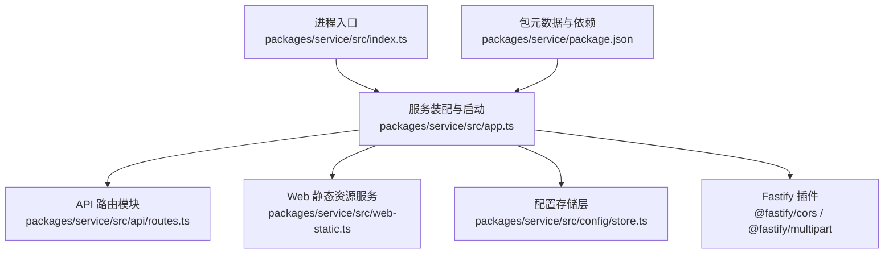
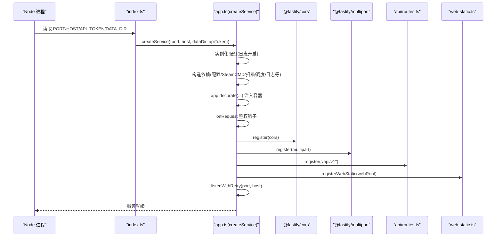
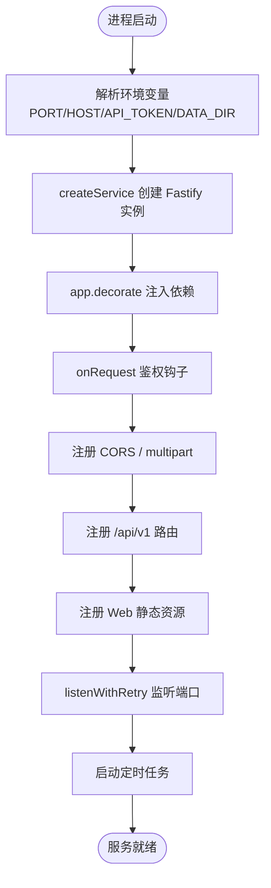
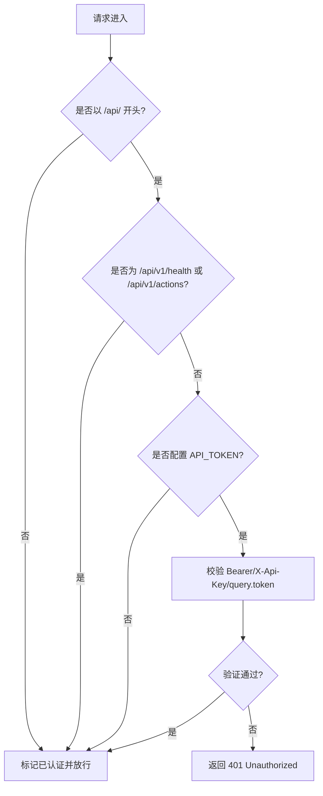
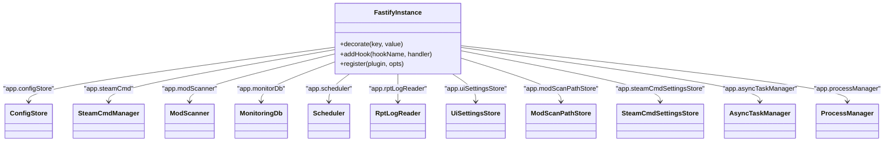
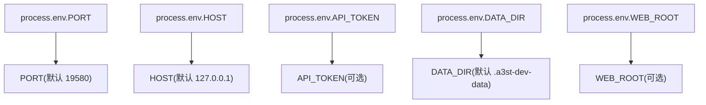
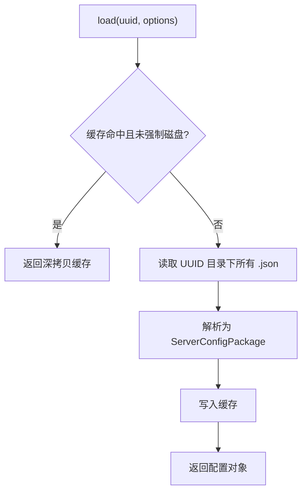
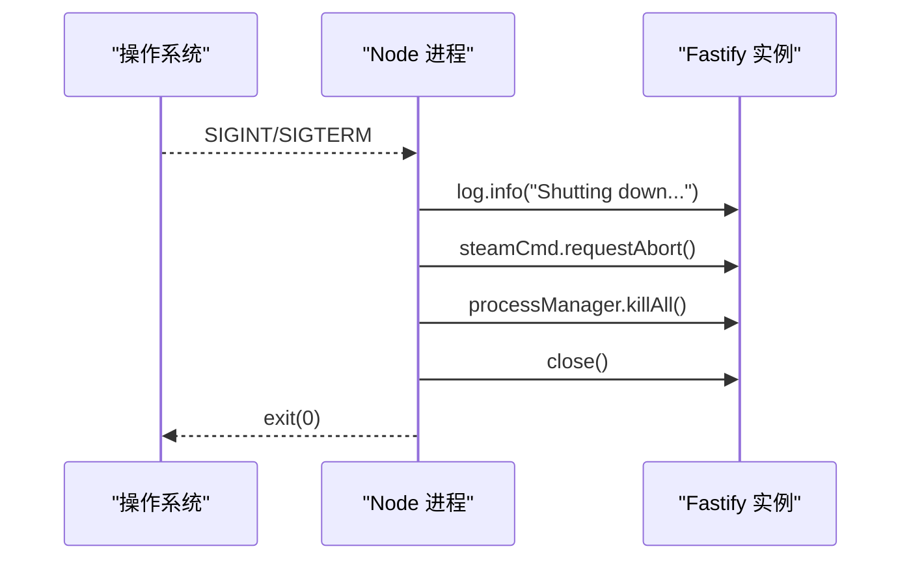
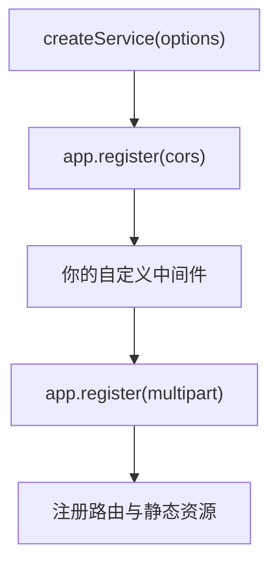
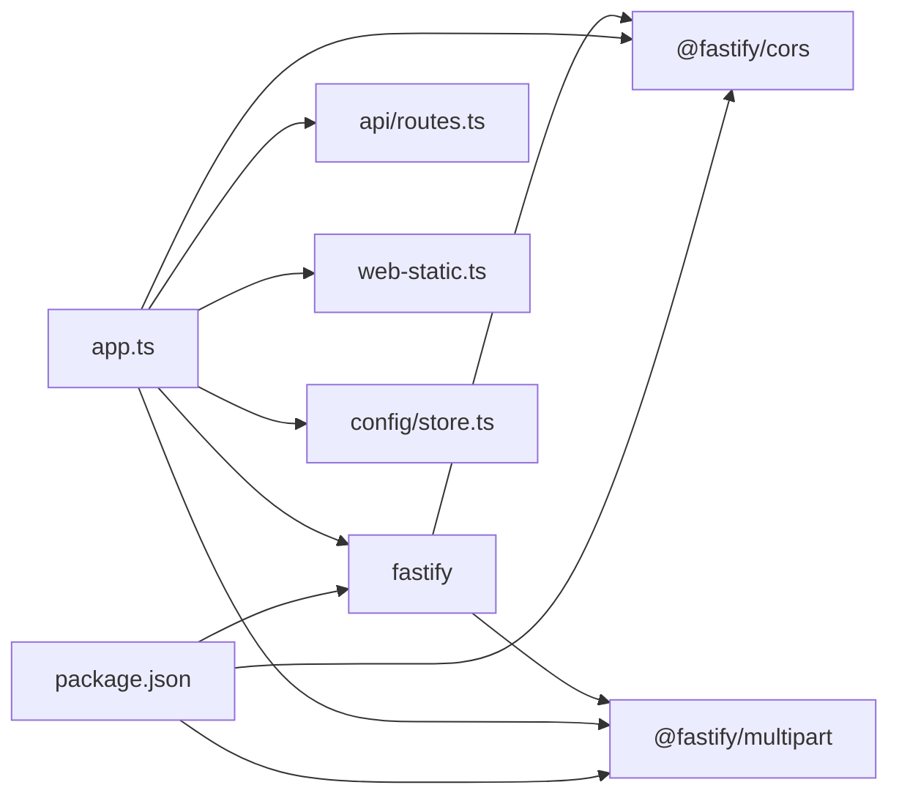

# 服务初始化与配置

<cite>
**本文引用的文件**   
- [packages/service/src/index.ts](file://packages/service/src/index.ts)
- [packages/service/src/app.ts](file://packages/service/src/app.ts)
- [packages/service/package.json](file://packages/service/package.json)
- [packages/service/src/web-static.ts](file://packages/service/src/web-static.ts)
- [packages/service/src/config/store.ts](file://packages/service/src/config/store.ts)
- [packages/service/src/api/routes.ts](file://packages/service/src/api/routes.ts)
</cite>

## 目录
1. [简介](#简介)
2. [项目结构](#项目结构)
3. [核心组件](#核心组件)
4. [架构总览](#架构总览)
5. [详细组件分析](#详细组件分析)
6. [依赖关系分析](#依赖关系分析)
7. [性能考虑](#性能考虑)
8. [故障排查指南](#故障排查指南)
9. [结论](#结论)
10. [附录](#附录)

## 简介
本文面向后端服务的启动与配置，聚焦 Fastify 应用的创建、中间件注册顺序、依赖注入容器的装配、环境变量管理策略、配置文件加载机制、日志系统初始化、应用生命周期钩子、错误处理、CORS 配置、请求体解析器设置，以及开发/生产环境的差异。文档同时提供扩展中间件链和自定义配置选项的实践指引。

## 项目结构
后端服务位于 packages/service 中，入口脚本负责读取环境变量并调用 createService 构建 Fastify 实例；app.ts 完成服务装配、中间件注册、路由挂载与静态资源托管；config/store.ts 实现服务器配置的持久化与缓存；web-static.ts 提供 Web UI 的静态文件服务；api/routes.ts 暴露业务 API。

**图示来源**
- [packages/service/src/index.ts:1-41](file://packages/service/src/index.ts#L1-L41)
- [packages/service/src/app.ts:1-178](file://packages/service/src/app.ts#L1-L178)
- [packages/service/src/web-static.ts:1-94](file://packages/service/src/web-static.ts#L1-L94)
- [packages/service/src/config/store.ts:1-181](file://packages/service/src/config/store.ts#L1-L181)
- [packages/service/package.json:1-32](file://packages/service/package.json#L1-L32)

**章节来源**
- [packages/service/src/index.ts:1-41](file://packages/service/src/index.ts#L1-L41)
- [packages/service/src/app.ts:1-178](file://packages/service/src/app.ts#L1-L178)
- [packages/service/package.json:1-32](file://packages/service/package.json#L1-L32)

## 核心组件
- 进程入口与环境变量：PORT、HOST、API_TOKEN、DATA_DIR、WEB_ROOT。
- Fastify 应用装配：createService 负责实例化、装饰器注入、中间件注册、路由挂载、静态资源托管与监听。
- 配置存储：ConfigStore 提供服务器配置的 JSON 分片存储、清单管理与内存缓存。
- Web 静态资源：根据 WEB_ROOT 或默认路径定位 web dist，安全地提供前端资源。
- API 路由：集中定义服务器、SteamCMD、监控、RCon、任务等接口。

**章节来源**
- [packages/service/src/index.ts:4-23](file://packages/service/src/index.ts#L4-L23)
- [packages/service/src/app.ts:57-171](file://packages/service/src/app.ts#L57-L171)
- [packages/service/src/config/store.ts:29-181](file://packages/service/src/config/store.ts#L29-L181)
- [packages/service/src/web-static.ts:17-94](file://packages/service/src/web-static.ts#L17-L94)
- [packages/service/src/api/routes.ts:62-800](file://packages/service/src/api/routes.ts#L62-L800)

## 架构总览
下图展示从进程启动到请求处理的完整链路，包括环境变量解析、Fastify 实例创建、中间件链、装饰器注入、路由注册与静态资源服务。

**图示来源**
- [packages/service/src/index.ts:4-23](file://packages/service/src/index.ts#L4-L23)
- [packages/service/src/app.ts:57-171](file://packages/service/src/app.ts#L57-L171)
- [packages/service/src/web-static.ts:62-94](file://packages/service/src/web-static.ts#L62-L94)
- [packages/service/src/api/routes.ts:62-800](file://packages/service/src/api/routes.ts#L62-L800)

## 详细组件分析

### Fastify 应用启动流程
- 入口 index.ts 解析环境变量并调用 createService。
- createService 创建 Fastify 实例（启用内置 logger），实例化各子系统，通过 app.decorate 将服务注入到请求上下文。
- 注册 onReques t 鉴权钩子，随后注册 CORS 与 multipart 插件。
- 挂载健康检查、SSE、业务 API 路由，并尝试托管 Web UI。
- 使用 listenWithRetry 重试监听端口，成功后启动定时任务。

**图示来源**
- [packages/service/src/index.ts:4-23](file://packages/service/src/index.ts#L4-L23)
- [packages/service/src/app.ts:57-171](file://packages/service/src/app.ts#L57-L171)

**章节来源**
- [packages/service/src/index.ts:4-23](file://packages/service/src/index.ts#L4-L23)
- [packages/service/src/app.ts:57-171](file://packages/service/src/app.ts#L57-L171)

### 中间件注册顺序与鉴权钩子
- 注册顺序：cors → multipart → routes → static。
- 鉴权钩子在 cors 之后执行，对非 /api/ 路径放行，/api/v1/health 与 /api/v1/actions 直接放行；若配置了 API_TOKEN，则校验 Authorization Bearer、X-Api-Key 或 query token，否则返回 401。

**图示来源**
- [packages/service/src/app.ts:96-130](file://packages/service/src/app.ts#L96-L130)

**章节来源**
- [packages/service/src/app.ts:96-145](file://packages/service/src/app.ts#L96-L145)

### 依赖注入容器与装饰器
- 通过 app.decorate 将以下对象注入到 Fastify 实例：configStore、snapshotStore、processManager、steamCmd、modScanner、monitorDb、scheduler、rptLogReader、uiSettingsStore、modScanPathStore、steamCmdSettingsStore、asyncTaskManager、dataDir。
- 在路由处理器中通过 app.xxx 访问这些服务，形成松耦合的服务装配。

**图示来源**
- [packages/service/src/app.ts:60-94](file://packages/service/src/app.ts#L60-L94)

**章节来源**
- [packages/service/src/app.ts:60-94](file://packages/service/src/app.ts#L60-L94)

### 环境变量管理策略
- PORT：HTTP 监听端口，默认 19580。
- HOST：监听地址，默认 127.0.0.1。
- API_TOKEN：可选的 API 鉴权令牌。
- DATA_DIR：工具数据目录，未设置时回退到当前工作目录下的 .a3st-dev-data。
- WEB_ROOT：可选的前端静态资源根目录，未设置时按默认候选路径查找。

**图示来源**
- [packages/service/src/index.ts:4-14](file://packages/service/src/index.ts#L4-L14)
- [packages/service/src/web-static.ts:17-40](file://packages/service/src/web-static.ts#L17-L40)

**章节来源**
- [packages/service/src/index.ts:4-14](file://packages/service/src/index.ts#L4-L14)
- [packages/service/src/web-static.ts:17-40](file://packages/service/src/web-static.ts#L17-L40)

### 配置文件加载机制
- ConfigStore 将每个服务器的配置拆分为多个 JSON 文件（如 server/startup/mods/basic/profile/battleye/tasks/missionparams/scheduler/monitoring），并通过 manifest.json 维护元信息。
- load 方法支持内存缓存与强制从磁盘重载；save 方法会写回所有分片并更新缓存；delete 删除整个配置包。
- listServers 仅读取清单目录，避免全量解析。

**图示来源**
- [packages/service/src/config/store.ts:71-103](file://packages/service/src/config/store.ts#L71-L103)

**章节来源**
- [packages/service/src/config/store.ts:29-181](file://packages/service/src/config/store.ts#L29-L181)

### 日志系统初始化
- Fastify 实例创建时启用内置 logger（logger: true）。
- 监听失败、静态资源缺失、服务就绪、Cron 任务数量等关键事件均通过 app.log 输出。

**章节来源**
- [packages/service/src/app.ts:58-58](file://packages/service/src/app.ts#L58-L58)
- [packages/service/src/app.ts:155-169](file://packages/service/src/app.ts#L155-L169)

### 应用生命周期钩子与优雅关闭
- 进程收到 SIGINT/SIGTERM 时触发优雅关闭：记录日志、中止 SteamCMD、终止所有受管进程、关闭 Fastify 实例后退出进程。

**图示来源**
- [packages/service/src/index.ts:25-40](file://packages/service/src/index.ts#L25-L40)

**章节来源**
- [packages/service/src/index.ts:25-40](file://packages/service/src/index.ts#L25-L40)

### 错误处理中间件
- 鉴权失败返回 401。
- 静态资源 404 处理器对非 GET/HEAD 返回 404，对 /api/* 直接返回 404，其他路径尝试回退到 index.html。
- 路径越界保护：isSafeUnderRoot 确保不泄露 webRoot 之外的文件。

**章节来源**
- [packages/service/src/app.ts:96-130](file://packages/service/src/app.ts#L96-L130)
- [packages/service/src/web-static.ts:62-94](file://packages/service/src/web-static.ts#L62-L94)

### CORS 配置
- 允许空 origin 与 null origin 反射为 *，其余原样反射 Origin。
- 允许的 HTTP 方法与请求头包含 Authorization、Content-Type、X-Api-Key、Accept。

**章节来源**
- [packages/service/src/app.ts:132-144](file://packages/service/src/app.ts#L132-L144)

### 请求体解析器设置
- 启用 @fastify/multipart，限制单文件大小为 100MB。

**章节来源**
- [packages/service/src/app.ts:145-145](file://packages/service/src/app.ts#L145-L145)

### 扩展中间件链与自定义配置选项
- 扩展中间件链：在 app.register(cors) 与 app.register(multipart) 之间插入自定义插件，例如限流、审计、压缩等。
- 自定义配置选项：在 ServiceOptions 中新增字段并在 createService 中消费，例如增加 featureFlag 控制开关，或在装饰器中注入新的服务实例。

**图示来源**
- [packages/service/src/app.ts:132-145](file://packages/service/src/app.ts#L132-L145)

**章节来源**
- [packages/service/src/app.ts:19-24](file://packages/service/src/app.ts#L19-L24)
- [packages/service/src/app.ts:132-145](file://packages/service/src/app.ts#L132-L145)

### 开发环境与生产环境配置差异
- 开发环境建议：
  - 不设置 API_TOKEN 以简化本地调试（此时 /api/* 也放行）。
  - 设置 DATA_DIR 指向独立目录，便于隔离测试数据。
  - 设置 WEB_ROOT 指向打包后的前端产物，便于热更新与调试。
- 生产环境建议：
  - 设置强随机 API_TOKEN，并仅在可信网络暴露服务。
  - 明确 HOST 与 PORT，必要时配合反向代理。
  - 固定 DATA_DIR 与 WEB_ROOT，确保权限与安全边界。
  - 结合部署平台的环境变量注入机制管理敏感配置。

[本节为通用指导，不直接分析具体文件]

## 依赖关系分析
- Fastify 作为核心框架，承载中间件与路由。
- @fastify/cors 与 @fastify/multipart 作为官方插件被注册。
- 业务模块通过装饰器注入，避免循环依赖与紧耦合。
- 包依赖声明于 package.json，确保运行时可用。

**图示来源**
- [packages/service/package.json:17-24](file://packages/service/package.json#L17-L24)
- [packages/service/src/app.ts:1-178](file://packages/service/src/app.ts#L1-L178)

**章节来源**
- [packages/service/package.json:17-24](file://packages/service/package.json#L17-L24)
- [packages/service/src/app.ts:1-178](file://packages/service/src/app.ts#L1-L178)

## 性能考虑
- 配置加载采用内存缓存，减少重复 IO；listServers 仅读取清单，降低开销。
- 静态资源服务使用流式响应，避免大文件一次性载入内存。
- 端口监听具备重试逻辑，提升在端口占用或权限不足时的恢复能力。
- 多路并发由 Fastify 内部优化，建议在网关层做限流与连接池管理。

[本节为通用指导，不直接分析具体文件]

## 故障排查指南
- 端口无法监听：检查 LISTEN_RETRY_CODES 覆盖的错误码（EADDRINUSE/EACCES/EADDRNOTAVAIL），确认端口占用与权限。
- 静态资源 404：确认 WEB_ROOT 或默认 web dist 存在 index.html，且未被安全校验拦截。
- 鉴权失败：确认 API_TOKEN 是否配置，客户端是否正确携带 Authorization/Bearer、X-Api-Key 或 query token。
- 配置保存失败：检查 config 目录权限与磁盘空间，关注 writeAll 返回的错误消息。
- 优雅关闭无效：确认进程信号是否被捕获，SteamCMD 与进程管理器是否正常释放资源。

**章节来源**
- [packages/service/src/app.ts:26-55](file://packages/service/src/app.ts#L26-L55)
- [packages/service/src/web-static.ts:52-94](file://packages/service/src/web-static.ts#L52-L94)
- [packages/service/src/app.ts:96-130](file://packages/service/src/app.ts#L96-L130)
- [packages/service/src/config/store.ts:122-171](file://packages/service/src/config/store.ts#L122-L171)
- [packages/service/src/index.ts:25-40](file://packages/service/src/index.ts#L25-L40)

## 结论
该后端服务以 Fastify 为核心，通过清晰的入口与环境变量管理、严格的中间件注册顺序、基于装饰器的依赖注入、健壮的鉴权钩子与 CORS/multipart 配置，提供了可扩展、可观测、易运维的服务基座。配合 ConfigStore 的分片配置与缓存策略，以及静态资源的安全托管，能够满足开发与生产环境的多样化需求。

[本节为总结性内容，不直接分析具体文件]

## 附录
- 常用环境变量清单：
  - PORT：监听端口（默认 19580）
  - HOST：监听地址（默认 127.0.0.1）
  - API_TOKEN：API 鉴权令牌（可选）
  - DATA_DIR：工具数据目录（默认 .a3st-dev-data）
  - WEB_ROOT：前端静态资源根目录（可选）

**章节来源**
- [packages/service/src/index.ts:4-14](file://packages/service/src/index.ts#L4-L14)
- [packages/service/src/web-static.ts:17-40](file://packages/service/src/web-static.ts#L17-L40)