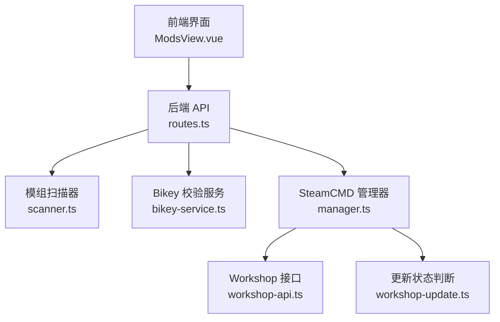
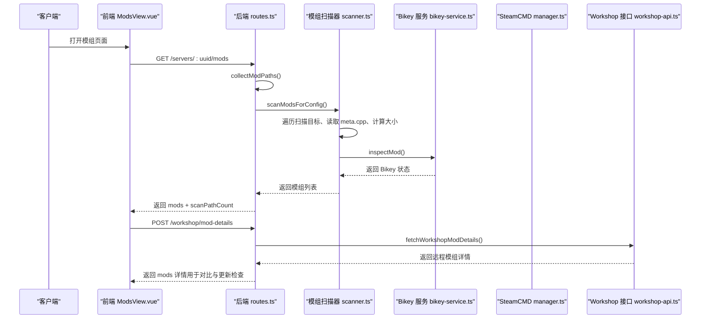
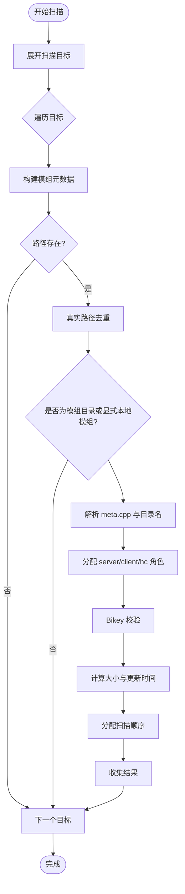
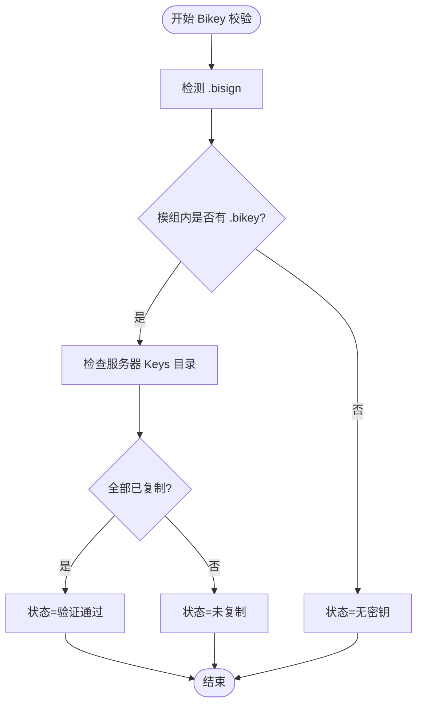
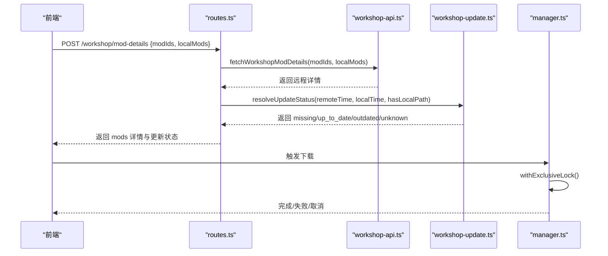
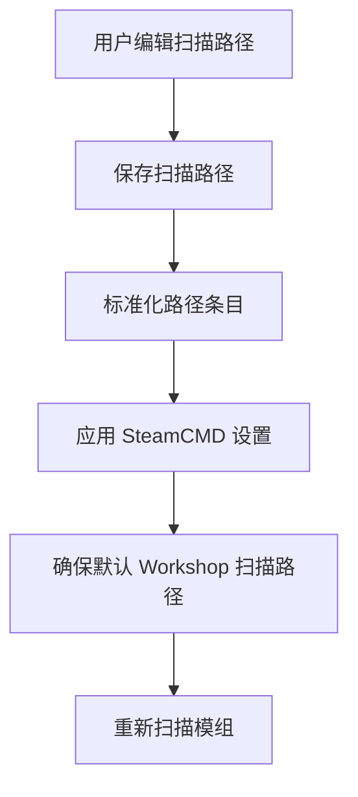
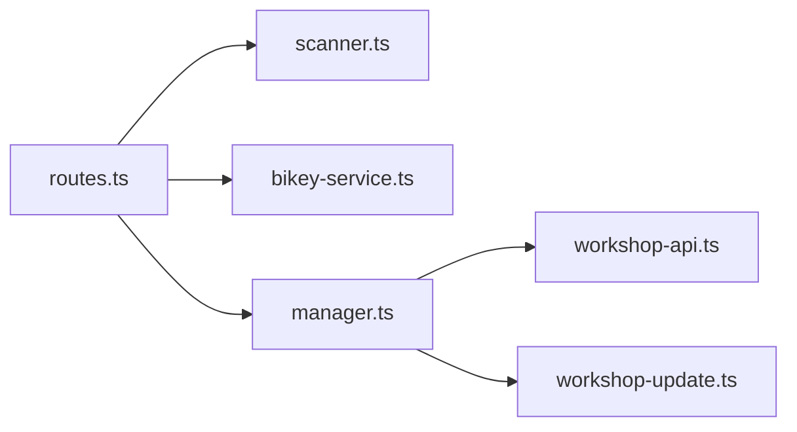

# 模组扫描与管理

<cite>
**本文引用的文件**   
- [README.md](file://README.md)
- [scanner.ts](file://packages/service/src/mods/scanner.ts)
- [bikey-service.ts](file://packages/service/src/mods/bikey-service.ts)
- [routes.ts](file://packages/service/src/api/routes.ts)
- [workshop-update.ts](file://packages/service/src/steamcmd/workshop-update.ts)
- [manager.ts](file://packages/service/src/steamcmd/manager.ts)
- [workshop-api.ts](file://packages/service/src/steamcmd/workshop-api.ts)
- [ModsView.vue](file://packages/web/src/views/ModsView.vue)
</cite>

## 目录
1. [引言](#引言)
2. [项目结构](#项目结构)
3. [核心组件](#核心组件)
4. [架构总览](#架构总览)
5. [详细组件分析](#详细组件分析)
6. [依赖关系分析](#依赖关系分析)
7. [性能与容量考量](#性能与容量考量)
8. [故障排查指南](#故障排查指南)
9. [结论](#结论)
10. [附录：API 与数据模型](#附录api-与数据模型)

## 引言
本文件面向 Arma 3 服务器管理工具中的“模组扫描与管理”子系统，系统性说明以下能力：
- 模组文件扫描、元数据提取（名称、Workshop ID、更新时间、大小）
- Workshop 模组同步、本地模组管理、版本控制与更新检查
- 模组冲突检测、加载顺序优化、性能影响评估
- 模组分类、搜索过滤、批量操作
- 模组安装/卸载、更新检查、回滚机制
- 模组统计、使用分析、安全扫描（Bikey 校验）

该子系统由后端服务提供 API，前端通过 Vue 界面交互，SteamCMD 负责下载与状态管理，模组扫描器负责解析本地模组与 Bikey 签名状态。

**章节来源**
- [README.md:37-47](file://README.md#L37-L47)

## 项目结构
与模组扫描与管理直接相关的代码主要分布在以下位置：
- 后端服务 API：`packages/service/src/api/routes.ts`
- 模组扫描与 Bikey 校验：`packages/service/src/mods/scanner.ts`、`packages/service/src/mods/bikey-service.ts`
- SteamCMD 工作区与 Workshop 接口：`packages/service/src/steamcmd/manager.ts`、`packages/service/src/steamcmd/workshop-api.ts`、`packages/service/src/steamcmd/workshop-update.ts`
- 前端模组界面：`packages/web/src/views/ModsView.vue`

**图表来源**
- [routes.ts:283-325](file://packages/service/src/api/routes.ts#L283-L325)
- [scanner.ts:28-64](file://packages/service/src/mods/scanner.ts#L28-L64)
- [bikey-service.ts:49-89](file://packages/service/src/mods/bikey-service.ts#L49-L89)
- [manager.ts:331-374](file://packages/service/src/steamcmd/manager.ts#L331-L374)
- [workshop-api.ts:218-267](file://packages/service/src/steamcmd/workshop-api.ts#L218-L267)
- [workshop-update.ts:39-53](file://packages/service/src/steamcmd/workshop-update.ts#L39-L53)

**章节来源**
- [README.md:50-66](file://README.md#L50-L66)

## 核心组件
- 模组扫描器 `ModScanner`
  - 扫描目标：配置的工作区路径、用户自定义扫描路径、本地模组条目
  - 输出：模组元数据列表（含启用状态、角色分配、Bikey 状态、大小、更新时间、扫描顺序）
  - 辅助：复制 Bikey、汇总 Bikey 状态、按已扫描结果复制缺失 Bikey
- Bikey 校验服务
  - 判定模组是否具备 .bisign、是否在模组内包含 .bikey、是否已复制到服务器 Keys 目录
  - 提供四种互斥状态：未签名、无密钥、未复制、验证通过
  - 提供复制单个/多个模组的 Bikey 到服务器 Keys 目录的能力
- SteamCMD 管理器
  - 全局互斥执行下载任务，支持取消与重试逻辑
  - 维护运行状态、日志、凭据
- Workshop 接口与更新状态
  - 批量获取 Workshop 模组详情（优先 JSON，失败回退 HTML）
  - 根据远程更新时间与本地更新时间判断 missing/up_to_date/outdated/unknown

**章节来源**
- [scanner.ts:15-26](file://packages/service/src/mods/scanner.ts#L15-L26)
- [scanner.ts:28-64](file://packages/service/src/mods/scanner.ts#L28-L64)
- [scanner.ts:66-84](file://packages/service/src/mods/scanner.ts#L66-L84)
- [scanner.ts:86-148](file://packages/service/src/mods/scanner.ts#L86-L148)
- [bikey-service.ts:18-33](file://packages/service/src/mods/bikey-service.ts#L18-L33)
- [bikey-service.ts:49-89](file://packages/service/src/mods/bikey-service.ts#L49-L89)
- [bikey-service.ts:311-362](file://packages/service/src/mods/bikey-service.ts#L311-L362)
- [manager.ts:331-374](file://packages/service/src/steamcmd/manager.ts#L331-L374)
- [workshop-api.ts:218-267](file://packages/service/src/steamcmd/workshop-api.ts#L218-L267)
- [workshop-update.ts:39-53](file://packages/service/src/steamcmd/workshop-update.ts#L39-L53)

## 架构总览
从请求到结果的端到端流程如下：

**图表来源**
- [routes.ts:464-476](file://packages/service/src/api/routes.ts#L464-L476)
- [routes.ts:283-292](file://packages/service/src/api/routes.ts#L283-L292)
- [scanner.ts:28-64](file://packages/service/src/mods/scanner.ts#L28-L64)
- [scanner.ts:150-221](file://packages/service/src/mods/scanner.ts#L150-L221)
- [bikey-service.ts:286-303](file://packages/service/src/mods/bikey-service.ts#L286-L303)
- [workshop-api.ts:218-267](file://packages/service/src/steamcmd/workshop-api.ts#L218-L267)

## 详细组件分析

### 模组扫描与元数据提取
- 扫描入口
  - `ModScanner.scan(options)` 接收模组路径、扫描路径条目、启用 ID、角色分配、本地模组等参数
  - 先展开扫描目标，再依次构建模组元数据，最后追加显式本地模组
- 去重与有效性
  - 基于真实路径去重；非模组目录且非显式本地模组将被忽略
- 元数据解析
  - 从 `meta.cpp` 解析 `publishedid`、`name`、`timestamp`
  - 若未解析到 Workshop ID，尝试从目录名推断（纯数字或带前缀的长数字）
- 启用与角色
  - 根据 server/client/hc 三类 ID 集合与保存的角色条目决定启用状态与角色
- 大小与时间
  - 递归统计文件大小；优先使用 `meta.cpp` 的时间戳，否则取文件系统 mtime
- 扫描顺序
  - 为每个模组分配 `scanOrder`，便于后续排序与展示

**图表来源**
- [scanner.ts:28-64](file://packages/service/src/mods/scanner.ts#L28-L64)
- [scanner.ts:150-221](file://packages/service/src/mods/scanner.ts#L150-L221)
- [scanner.ts:268-307](file://packages/service/src/mods/scanner.ts#L268-L307)
- [scanner.ts:309-329](file://packages/service/src/mods/scanner.ts#L309-L329)

**章节来源**
- [scanner.ts:28-64](file://packages/service/src/mods/scanner.ts#L28-L64)
- [scanner.ts:150-221](file://packages/service/src/mods/scanner.ts#L150-L221)
- [scanner.ts:268-307](file://packages/service/src/mods/scanner.ts#L268-L307)
- [scanner.ts:309-329](file://packages/service/src/mods/scanner.ts#L309-L329)

### Bikey 安全扫描与复制
- 状态判定
  - 仅当同时满足“模组含 .bisign”“模组内含 .bikey”“Keys 目录中存在对应 .bikey”时，状态为“验证通过”
- 关键函数
  - `inspectMod()`：综合判断并返回状态与标签
  - `findModBikeys()`：递归查找模组内的 .bikey
  - `hasBisignFiles()`：检测 .bisign（含 addons 子目录递归）
  - `areAllModBikeysOnServer()`：校验服务器 Keys 目录是否齐全
- 复制策略
  - `copyBikeysForMod()`：将模组内所有 .bikey 复制到服务器 Keys 目录，生成规范化文件名
  - `copyBikeysForMods()`：批量复制，聚合结果（成功/跳过/总数）
  - `copyMissingBikeys()`：仅复制启用且缺少服务器侧 Bikey 的模组

**图表来源**
- [bikey-service.ts:49-89](file://packages/service/src/mods/bikey-service.ts#L49-L89)
- [bikey-service.ts:159-197](file://packages/service/src/mods/bikey-service.ts#L159-L197)
- [bikey-service.ts:199-249](file://packages/service/src/mods/bikey-service.ts#L199-L249)
- [bikey-service.ts:265-303](file://packages/service/src/mods/bikey-service.ts#L265-L303)
- [bikey-service.ts:311-362](file://packages/service/src/mods/bikey-service.ts#L311-L362)

**章节来源**
- [bikey-service.ts:18-33](file://packages/service/src/mods/bikey-service.ts#L18-L33)
- [bikey-service.ts:49-89](file://packages/service/src/mods/bikey-service.ts#L49-L89)
- [bikey-service.ts:159-197](file://packages/service/src/mods/bikey-service.ts#L159-L197)
- [bikey-service.ts:199-249](file://packages/service/src/mods/bikey-service.ts#L199-L249)
- [bikey-service.ts:265-303](file://packages/service/src/mods/bikey-service.ts#L265-L303)
- [bikey-service.ts:311-362](file://packages/service/src/mods/bikey-service.ts#L311-L362)

### Workshop 模组同步与版本控制
- 获取远程详情
  - 优先调用 JSON 接口，失败则回退 HTML 解析
  - 并发限制避免对远端造成压力
- 本地比对与更新状态
  - 根据远程 `updated` 时间与本地 `updatedAt`（或文件系统 mtime）判断：
    - missing：无本地路径
    - up_to_date：本地不落后于远程
    - outdated：本地落后于远程
    - unknown：无法比较（缺时间信息）
- 下载与互斥
  - SteamCMD 管理器保证同一时刻只执行一个业务操作
  - 支持取消与重试，失败时报告具体模组 ID

**图表来源**
- [routes.ts:283-292](file://packages/service/src/api/routes.ts#L283-L292)
- [workshop-api.ts:218-267](file://packages/service/src/steamcmd/workshop-api.ts#L218-L267)
- [workshop-update.ts:39-53](file://packages/service/src/steamcmd/workshop-update.ts#L39-L53)
- [manager.ts:331-374](file://packages/service/src/steamcmd/manager.ts#L331-L374)

**章节来源**
- [workshop-api.ts:218-267](file://packages/service/src/steamcmd/workshop-api.ts#L218-L267)
- [workshop-update.ts:39-53](file://packages/service/src/steamcmd/workshop-update.ts#L39-L53)
- [manager.ts:331-374](file://packages/service/src/steamcmd/manager.ts#L331-L374)

### 本地模组管理与扫描路径
- 扫描路径管理
  - 支持添加/删除/保存扫描路径，自动推导默认 Workshop 根目录
  - 保存后应用 SteamCMD 设置并刷新可用扫描范围
- 本地模组条目
  - 允许指定本地模组路径，并在扫描时合并到结果中
  - 可标记为 server/client/hc 角色，并持久化保存
- 路径校验
  - 提供 `/mods/validate-path` 校验目录是否为有效模组目录（需包含 addons）

**图表来源**
- [routes.ts:345-368](file://packages/service/src/api/routes.ts#L345-L368)
- [routes.ts:491-499](file://packages/service/src/api/routes.ts#L491-L499)

**章节来源**
- [routes.ts:345-368](file://packages/service/src/api/routes.ts#L345-L368)
- [routes.ts:491-499](file://packages/service/src/api/routes.ts#L491-L499)

### 模组冲突检测与加载顺序优化
- 冲突检测
  - 当前实现以“扫描去重”为主：基于真实路径去重，避免重复加载
  - 未实现跨模组内容级冲突检测（如同名脚本覆盖），但可通过诊断与预检接口辅助定位问题
- 加载顺序
  - 扫描器为每个模组分配 `scanOrder`，可用于前端排序与展示
  - 实际加载顺序由 Arma 引擎决定，工具侧提供扫描顺序作为参考

**章节来源**
- [scanner.ts:28-64](file://packages/service/src/mods/scanner.ts#L28-L64)
- [scanner.ts:150-221](file://packages/service/src/mods/scanner.ts#L150-L221)

### 模组分类、搜索过滤与批量操作
- 分类
  - 按 server/client/hc 三类角色分类，支持独立勾选与保存
- 搜索与过滤
  - 前端在模组列表中支持筛选与搜索（例如按名称、Workshop ID、状态）
- 批量操作
  - 批量复制 Bikey、批量启用/禁用、批量保存角色分配
  - 通过任务系统提交命令，异步执行并反馈进度

**章节来源**
- [ModsView.vue:339-395](file://packages/web/src/views/ModsView.vue#L339-L395)
- [ModsView.vue:866-919](file://packages/web/src/views/ModsView.vue#L866-L919)

### 模组安装/卸载、更新检查与回滚机制
- 安装
  - 通过 SteamCMD 下载 Workshop 模组；完成后建议重新扫描并复制 Bikey
- 卸载
  - 移除模组引用（server/client/hc IDs）与本地模组条目；必要时清理本地目录
- 更新检查
  - 使用 `/workshop/mod-details` 获取远程更新时间，结合本地时间判断是否需要更新
- 回滚
  - 工具未内置模组版本快照与一键回滚；可通过配置文件快照与手动替换模组目录实现近似回滚

**章节来源**
- [routes.ts:283-292](file://packages/service/src/api/routes.ts#L283-L292)
- [workshop-update.ts:39-53](file://packages/service/src/steamcmd/workshop-update.ts#L39-L53)

### 模组统计、使用分析与安全扫描
- 统计
  - 提供 Bikey 状态汇总（启用数、就绪数、缺失数、未签名数等）
- 使用分析
  - 监控模块记录在线人数与玩家信息，可与模组启用情况关联分析
- 安全扫描
  - Bikey 校验属于安全扫描范畴，确保模组签名与密钥完整

**章节来源**
- [scanner.ts:86-148](file://packages/service/src/mods/scanner.ts#L86-L148)
- [routes.ts:478-489](file://packages/service/src/api/routes.ts#L478-L489)
- [routes.ts:697-784](file://packages/service/src/api/routes.ts#L697-L784)

## 依赖关系分析
- API 层依赖
  - `routes.ts` 依赖模组扫描、Bikey 服务、SteamCMD 设置与工作区、任务系统、RCon、监控数据库等
- 模组扫描依赖
  - `scanner.ts` 依赖路径扩展、Bikey 服务、用户路径解析
- SteamCMD 依赖
  - `manager.ts` 提供互斥锁与任务生命周期
  - `workshop-api.ts` 负责远端详情抓取与解析
  - `workshop-update.ts` 负责本地与远程时间比对

**图表来源**
- [routes.ts:18-38](file://packages/service/src/api/routes.ts#L18-L38)
- [scanner.ts:1-13](file://packages/service/src/mods/scanner.ts#L1-L13)
- [manager.ts:331-374](file://packages/service/src/steamcmd/manager.ts#L331-L374)
- [workshop-api.ts:218-267](file://packages/service/src/steamcmd/workshop-api.ts#L218-L267)
- [workshop-update.ts:39-53](file://packages/service/src/steamcmd/workshop-update.ts#L39-L53)

**章节来源**
- [routes.ts:18-38](file://packages/service/src/api/routes.ts#L18-L38)
- [scanner.ts:1-13](file://packages/service/src/mods/scanner.ts#L1-L13)
- [manager.ts:331-374](file://packages/service/src/steamcmd/manager.ts#L331-L374)
- [workshop-api.ts:218-267](file://packages/service/src/steamcmd/workshop-api.ts#L218-L267)
- [workshop-update.ts:39-53](file://packages/service/src/steamcmd/workshop-update.ts#L39-L53)

## 性能与容量考量
- 扫描性能
  - 递归统计模组大小可能较慢，尤其是大体积模组；建议在后台任务中执行并显示进度
  - 去重与无效路径快速跳过可减少 IO 开销
- Bikey 校验
  - 递归查找 .bikey 与 .bisign 会多次访问文件系统；仅在需要时触发
- SteamCMD 并发
  - 全局互斥避免资源竞争；批量下载时应分批次处理，避免长时间阻塞
- 网络请求
  - Workshop 详情获取采用并发限制，避免对远端造成压力

[本节为通用指导，不直接分析具体文件]

## 故障排查指南
- 模组未出现在扫描结果
  - 确认路径是否为有效模组目录（包含 addons）
  - 检查扫描路径是否正确保存并已应用
- Bikey 状态异常
  - 未签名：模组不含 .bisign
  - 无密钥：模组不含 .bikey
  - 未复制：服务器 Keys 目录缺少对应 .bikey
  - 验证通过：三者齐全
- SteamCMD 下载失败
  - 检查账号凭据是否配置
  - 查看 SteamCMD 日志与错误消息
  - 注意大体积模组可能需要更长时间或单独重试

**章节来源**
- [routes.ts:491-499](file://packages/service/src/api/routes.ts#L491-L499)
- [bikey-service.ts:18-33](file://packages/service/src/mods/bikey-service.ts#L18-L33)
- [manager.ts:331-374](file://packages/service/src/steamcmd/manager.ts#L331-L374)

## 结论
本模组扫描与管理子系统围绕“扫描—校验—同步—管理”的主线展开：
- 扫描器负责发现与解析本地模组，提供基础元数据与扫描顺序
- Bikey 服务提供安全校验与复制能力，保障模组签名完整性
- SteamCMD 管理器与 Workshop 接口负责下载与版本比对
- API 层整合各组件，暴露统一接口供前端使用
- 前端提供分类、过滤、批量操作与可视化状态展示

未来可在以下方面增强：
- 引入模组内容级冲突检测与解决建议
- 增加模组版本快照与一键回滚
- 提供更细粒度的扫描与校验缓存机制以提升性能

[本节为总结性内容，不直接分析具体文件]

## 附录：API 与数据模型
- 相关 API
  - `GET /servers/:uuid/mods`：返回模组列表与扫描路径数量
  - `POST /workshop/mod-details`：批量获取 Workshop 模组详情
  - `GET /settings/mod-scan-paths`：获取扫描路径
  - `PUT /settings/mod-scan-paths`：保存扫描路径
  - `GET /servers/:uuid/mods/bikeys`：Bikey 状态汇总
  - `GET /servers/:uuid/mods/bikeys/files`：服务器 Keys 目录下的 .bikey 文件列表
- 关键数据结构
  - 模组元数据：包含 workshopId、name、dirName、path、enabled、角色标志、Bikey 状态、sizeBytes、updatedAt、scanOrder
  - Bikey 校验结果：hasBisign、hasBikeyInMod、allCopiedToServer、status、label
  - 更新状态：missing、up_to_date、outdated、unknown

**章节来源**
- [routes.ts:464-476](file://packages/service/src/api/routes.ts#L464-L476)
- [routes.ts:283-292](file://packages/service/src/api/routes.ts#L283-L292)
- [routes.ts:345-368](file://packages/service/src/api/routes.ts#L345-L368)
- [routes.ts:478-525](file://packages/service/src/api/routes.ts#L478-L525)
- [scanner.ts:15-26](file://packages/service/src/mods/scanner.ts#L15-L26)
- [scanner.ts:202-221](file://packages/service/src/mods/scanner.ts#L202-L221)
- [bikey-service.ts:10-16](file://packages/service/src/mods/bikey-service.ts#L10-L16)
- [workshop-update.ts:3-9](file://packages/service/src/steamcmd/workshop-update.ts#L3-L9)