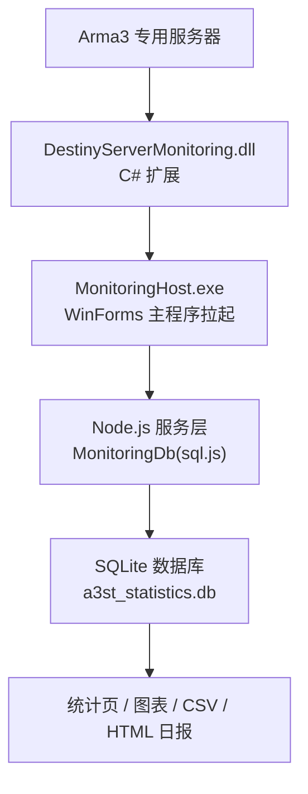
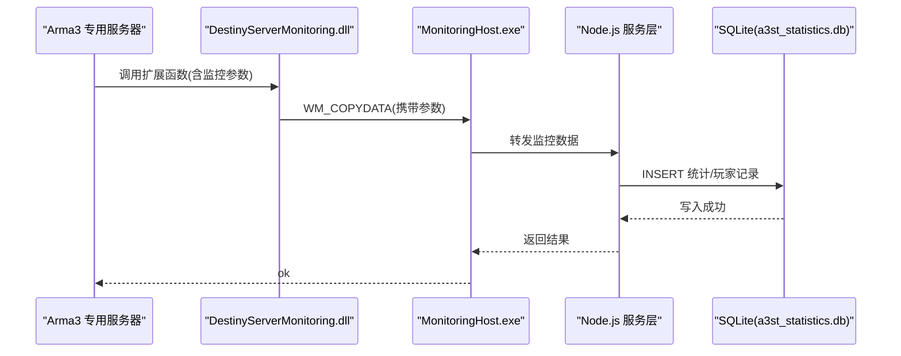
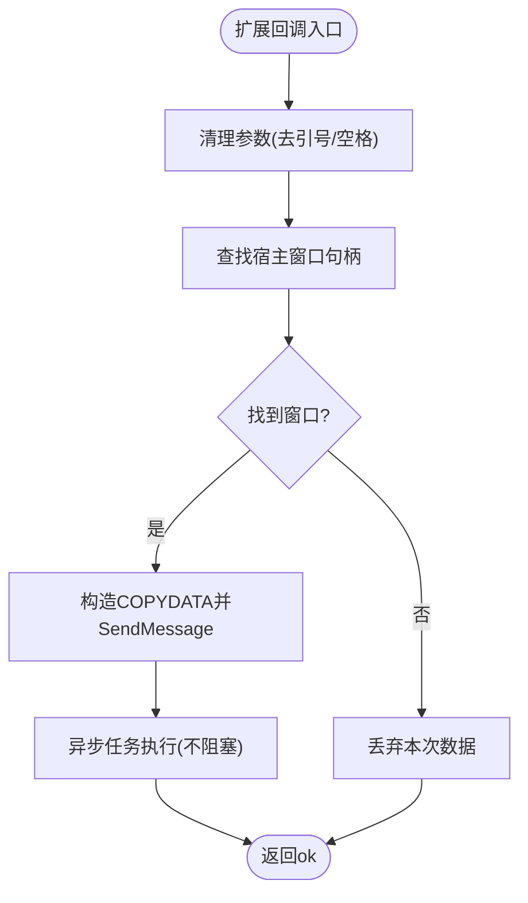
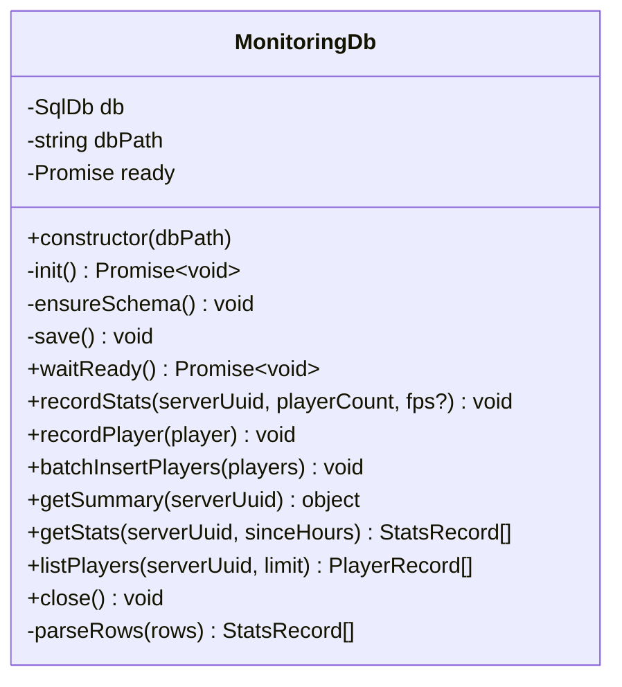
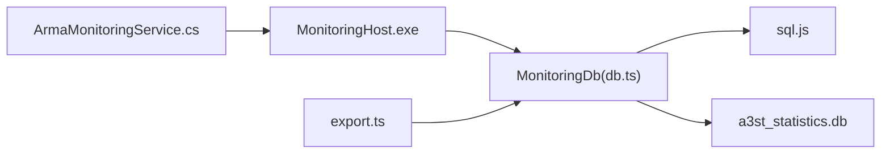
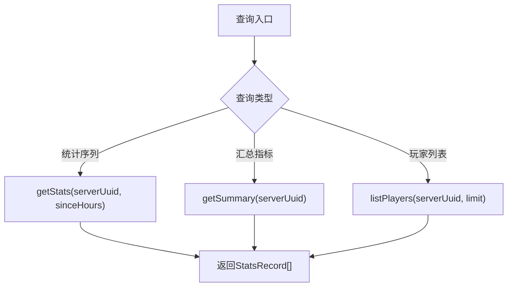

# 监控数据存储

<cite>
**本文引用的文件**   
- [ArmaMonitoringService.cs](file://DestinyServerMonitoring/DestinyServerMonitoring/ArmaMonitoringService.cs)
- [db.ts](file://packages/service/src/monitoring/db.ts)
- [index.ts](file://packages/service/src/monitoring/index.ts)
- [export.ts](file://packages/service/src/monitoring/export.ts)
- [monitoring-cpp-dll-build.md](file://docs/monitoring-cpp-dll-build.md)
</cite>

## 目录
1. [简介](#简介)
2. [项目结构](#项目结构)
3. [核心组件](#核心组件)
4. [架构总览](#架构总览)
5. [详细组件分析](#详细组件分析)
6. [依赖关系分析](#依赖关系分析)
7. [性能与并发](#性能与并发)
8. [查询与统计支持](#查询与统计支持)
9. [数据清理、归档与备份恢复](#数据清理归档与备份恢复)
10. [故障排查](#故障排查)
11. [结论](#结论)

## 简介
本文件面向“监控数据存储系统”，聚焦于 SQLite 数据库设计、表结构与索引优化，以及数据采集、存储策略、压缩与归档机制。同时覆盖查询优化、批量写入、事务处理、并发访问控制，并提供历史数据查询、统计分析、趋势图表的数据支撑说明，以及数据清理策略、存储空间管理、备份恢复方案与一致性保证的具体实现要点。

## 项目结构
监控相关代码主要分布在以下位置：
- 游戏侧扩展（C# + DllExport）：负责从 Arma 3 服务器采集数据并通过 Windows 消息投递给宿主进程。
- Node.js 服务层：使用 sql.js 操作 SQLite，提供监控数据的入库、查询、导出等能力。
- 文档：说明原生 DLL 构建流程以及与工具主程序的协作关系。

图示来源
- [monitoring-cpp-dll-build.md:34-45](file://docs/monitoring-cpp-dll-build.md#L34-L45)
- [ArmaMonitoringService.cs:120-144](file://DestinyServerMonitoring/DestinyServerMonitoring/ArmaMonitoringService.cs#L120-L144)
- [db.ts:36-47](file://packages/service/src/monitoring/db.ts#L36-L47)

章节来源
- [monitoring-cpp-dll-build.md:1-45](file://docs/monitoring-cpp-dll-build.md#L1-L45)
- [ArmaMonitoringService.cs:1-148](file://DestinyServerMonitoring/DestinyServerMonitoring/ArmaMonitoringService.cs#L1-L148)
- [db.ts:1-47](file://packages/service/src/monitoring/db.ts#L1-L47)

## 核心组件
- 数据采集入口（游戏侧扩展）
  - 通过 DllExport 暴露回调接口，接收 Arma 3 扩展调用，并将参数经 WM_COPYDATA 投递到宿主窗口。
- 监控数据库封装（Node.js 服务层）
  - 基于 sql.js 的 MonitoringDb 类，负责初始化、建表、索引、写入、查询、导出与关闭。
- 数据导出模块
  - 生成 HTML 日报与 CSV 报表，便于离线分析与可视化。

章节来源
- [ArmaMonitoringService.cs:51-59](file://DestinyServerMonitoring/DestinyServerMonitoring/ArmaMonitoringService.cs#L51-L59)
- [ArmaMonitoringService.cs:120-144](file://DestinyServerMonitoring/DestinyServerMonitoring/ArmaMonitoringService.cs#L120-L144)
- [db.ts:36-47](file://packages/service/src/monitoring/db.ts#L36-L47)
- [export.ts:1-75](file://packages/service/src/monitoring/export.ts#L1-L75)

## 架构总览
整体数据流如下：
- Arma 3 服务器加载 DestinyServerMonitoring.dll，触发回调并发送监控数据。
- 宿主进程（MonitoringHost）接收数据后交由 Node.js 服务层的 MonitoringDb 持久化到 SQLite。
- 上层 UI 或导出模块读取同一数据库，生成统计图表、CSV、HTML 日报。

图示来源
- [ArmaMonitoringService.cs:120-144](file://DestinyServerMonitoring/DestinyServerMonitoring/ArmaMonitoringService.cs#L120-L144)
- [db.ts:121-143](file://packages/service/src/monitoring/db.ts#L121-L143)
- [monitoring-cpp-dll-build.md:34-45](file://docs/monitoring-cpp-dll-build.md#L34-L45)

## 详细组件分析

### 数据采集与跨进程通信（游戏侧扩展）
- 关键职责
  - 注册回调入口，接收 Arma 3 扩展调用。
  - 将传入参数清理后，通过 WM_COPYDATA 发送到指定窗口句柄。
  - 异步任务投递，避免阻塞扩展调用线程。
- 关键点
  - 使用 DllExport 暴露 WinAPI 风格的函数名，兼容不同平台 ABI。
  - 使用 COPYDATASTRUCT 传递字符串数据，确保长度正确。
  - 对目标窗口进行查找，若不存在则丢弃数据，避免异常。

图示来源
- [ArmaMonitoringService.cs:120-144](file://DestinyServerMonitoring/DestinyServerMonitoring/ArmaMonitoringService.cs#L120-L144)

章节来源
- [ArmaMonitoringService.cs:51-59](file://DestinyServerMonitoring/DestinyServerMonitoring/ArmaMonitoringService.cs#L51-L59)
- [ArmaMonitoringService.cs:102-144](file://DestinyServerMonitoring/DestinyServerMonitoring/ArmaMonitoringService.cs#L102-L144)

### 监控数据库设计与实现（Node.js 服务层）
- 数据库路径与初始化
  - 默认路径为 dbPath/a3st_statistics.db，自动创建目录。
  - 优先以 WAL 模式打开数据库，提升并发写性能。
  - 初始化失败时具备回退逻辑，尽量保证服务可用。
- 表结构与索引
  - a3st_statistics：服务器快照统计（在线人数、FPS、时间戳）。
  - a3st_players：玩家信息（GUID、名称、所属服务器、首次/最后出现时间）。
  - 索引 idx_stats_server_time：按 server_uuid 与 recorded_at 组合索引，加速按时间与服务器维度的查询。
- 写入策略
  - recordStats：单条插入统计记录。
  - recordPlayer：单条插入或更新玩家记录（ON CONFLICT 更新 last_seen）。
  - batchInsertPlayers：预编译语句批量写入玩家记录，减少 SQL 解析开销。
- 保存与持久化
  - 每次写入后调用 save()，将内存数据库导出为临时文件，再原子替换目标文件，降低损坏风险。
- 查询与导出
  - getSummary：计算平均在线、峰值在线与条目总数。
  - getStats：按时间范围拉取统计序列，用于趋势图。
  - listPlayers：分页限制地列出最近活跃玩家。
  - export.ts：生成 HTML 日报与 CSV 报表。

图示来源
- [db.ts:36-47](file://packages/service/src/monitoring/db.ts#L36-L47)
- [db.ts:80-104](file://packages/service/src/monitoring/db.ts#L80-L104)
- [db.ts:121-159](file://packages/service/src/monitoring/db.ts#L121-L159)
- [db.ts:161-244](file://packages/service/src/monitoring/db.ts#L161-L244)

章节来源
- [db.ts:1-245](file://packages/service/src/monitoring/db.ts#L1-L245)
- [index.ts:1-2](file://packages/service/src/monitoring/index.ts#L1-L2)
- [export.ts:1-75](file://packages/service/src/monitoring/export.ts#L1-L75)

### 数据导出与可视化支持
- HTML 日报
  - 包含时间、在线人数、FPS 表格，适合浏览器直接查看。
- CSV 报表
  - 标准 CSV 格式，带 BOM，便于 Excel 导入与分析。
- 数据源
  - 直接从 MonitoringDb 的查询结果生成，无需额外聚合层。

章节来源
- [export.ts:1-75](file://packages/service/src/monitoring/export.ts#L1-L75)

## 依赖关系分析
- 外部依赖
  - sql.js：在 Node.js 环境中运行 SQLite，提供内存数据库与文件导出能力。
  - 操作系统 API：Windows 消息机制（WM_COPYDATA）用于跨进程通信。
- 内部依赖
  - 游戏侧扩展 → 宿主进程 → Node.js 服务层 → SQLite 数据库。
  - 导出模块依赖 MonitoringDb 的查询接口。

图示来源
- [ArmaMonitoringService.cs:120-144](file://DestinyServerMonitoring/DestinyServerMonitoring/ArmaMonitoringService.cs#L120-L144)
- [db.ts:1-4](file://packages/service/src/monitoring/db.ts#L1-L4)
- [export.ts:1-2](file://packages/service/src/monitoring/export.ts#L1-L2)

章节来源
- [monitoring-cpp-dll-build.md:34-45](file://docs/monitoring-cpp-dll-build.md#L34-L45)
- [db.ts:1-4](file://packages/service/src/monitoring/db.ts#L1-L4)

## 性能与并发
- WAL 模式
  - 通过 PRAGMA journal_mode=WAL 启用 Write-Ahead Logging，提高并发读写的吞吐与稳定性。
- 原子保存
  - 写入后导出为 .tmp 文件，再原子替换目标文件，降低部分写入导致数据库损坏的风险。
- 批量写入
  - 使用 prepare + run 循环批量插入玩家记录，减少 SQL 解析与绑定开销。
- 查询优化
  - 针对 server_uuid 与 recorded_at 建立复合索引，加速按服务器与时间的筛选。
- 事务处理
  - 当前实现未显式包裹事务；在高并发场景下可考虑将多条写入合并为单次事务以提升一致性与性能。
- 并发访问控制
  - sql.js 在同一进程中单实例访问数据库；多进程并发需由上层协调（如队列或锁），避免文件级竞争。

章节来源
- [db.ts:59-64](file://packages/service/src/monitoring/db.ts#L59-L64)
- [db.ts:106-115](file://packages/service/src/monitoring/db.ts#L106-L115)
- [db.ts:145-159](file://packages/service/src/monitoring/db.ts#L145-L159)
- [db.ts:90-93](file://packages/service/src/monitoring/db.ts#L90-L93)

## 查询与统计支持
- 历史数据查询
  - getStats：按 server_uuid 与时间范围（sinceHours）获取统计序列，用于绘制 FPS 与在线人数趋势图。
- 统计分析
  - getSummary：计算平均在线人数、峰值在线人数与总条目数，作为概览指标。
- 玩家列表
  - listPlayers：按 last_seen 倒序返回最近活跃玩家，支持 limit 限制返回规模。
- 可视化输出
  - HTML 日报与 CSV 报表可直接消费上述查询结果，快速生成可视化内容。

图示来源
- [db.ts:161-225](file://packages/service/src/monitoring/db.ts#L161-L225)

章节来源
- [db.ts:161-225](file://packages/service/src/monitoring/db.ts#L161-L225)
- [export.ts:1-75](file://packages/service/src/monitoring/export.ts#L1-L75)

## 数据清理、归档与备份恢复
- 数据清理策略
  - 当前实现未内置定时清理；建议在上层调度器中定期删除早于保留期的统计记录，或按 server_uuid 分库/分区管理。
- 归档机制
  - 可将历史数据库导出为独立文件（例如按日期命名），并归档至冷存储；导出过程可利用现有 save() 与 fs 操作。
- 备份恢复方案
  - 备份：直接复制 a3st_statistics.db 及其 WAL 相关文件（若存在）。
  - 恢复：停止服务后替换数据库文件，重启服务即可恢复。
- 存储空间管理
  - 监控数据增长较快时，建议结合归档与清理策略，定期释放空间；必要时按服务器维度拆分数据库文件。

章节来源
- [db.ts:106-115](file://packages/service/src/monitoring/db.ts#L106-L115)
- [monitoring-cpp-dll-build.md:44-45](file://docs/monitoring-cpp-dll-build.md#L44-L45)

## 故障排查
- 常见问题
  - 数据库始终为空：检查 MonitoringHost 是否启动、DLL 是否加载、EnableMonitoringService 是否开启。
  - 仅有玩家库无快照：RCon 有连接但 DLL 未注入；检查服务器目录与扩展配置。
  - 图表为空：快照不足或时间戳为 0；运行一段时间后重试。
- 定位建议
  - 确认 WM_COPYDATA 是否成功投递到宿主窗口。
  - 检查 WAL 模式是否生效，以及 save() 是否完成原子替换。
  - 验证索引是否存在且被查询计划使用。

章节来源
- [monitoring-cpp-dll-build.md:82-89](file://docs/monitoring-cpp-dll-build.md#L82-L89)
- [ArmaMonitoringService.cs:120-144](file://DestinyServerMonitoring/DestinyServerMonitoring/ArmaMonitoringService.cs#L120-L144)
- [db.ts:59-64](file://packages/service/src/monitoring/db.ts#L59-L64)

## 结论
该监控数据存储系统以 SQLite 为核心，结合 sql.js 在 Node.js 环境内提供高可用的数据持久化能力。通过 WAL 模式、原子保存与复合索引，系统在并发写入与查询性能上取得平衡。上层导出模块提供了便捷的可视化与离线分析能力。未来可在事务合并、批量写入优化、定时清理与归档方面进一步增强，以满足更大规模与更长周期的监控需求。