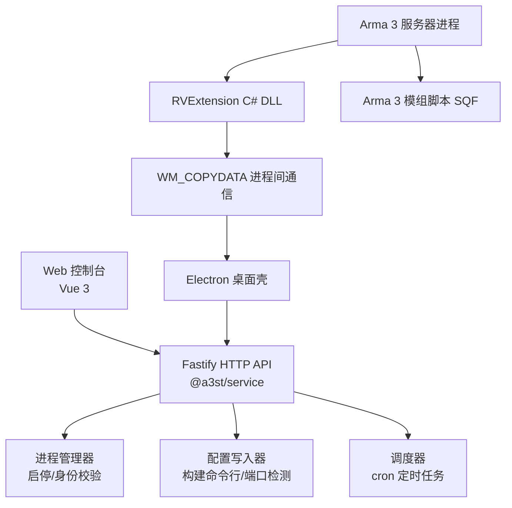
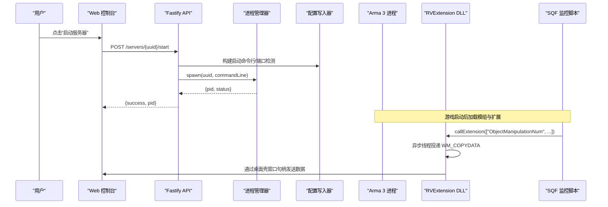
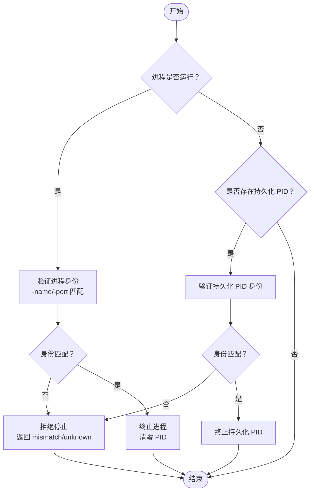
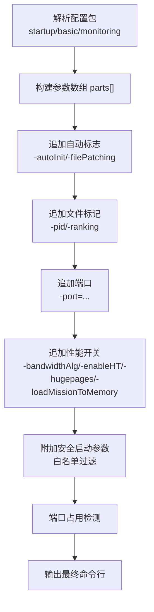
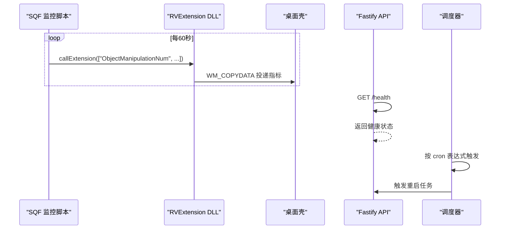
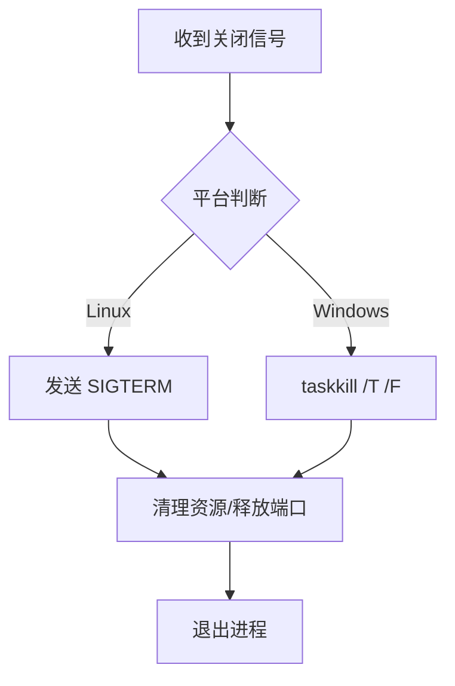
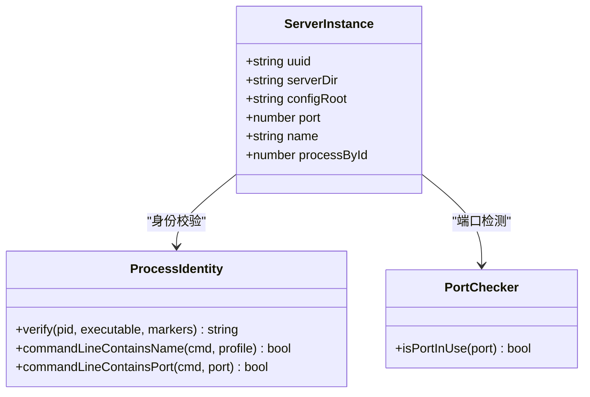
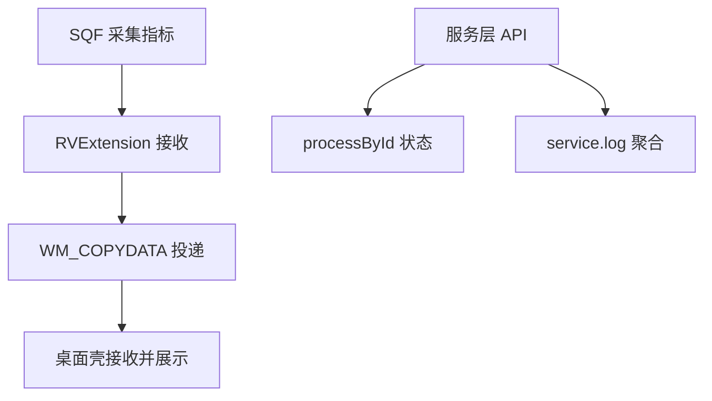
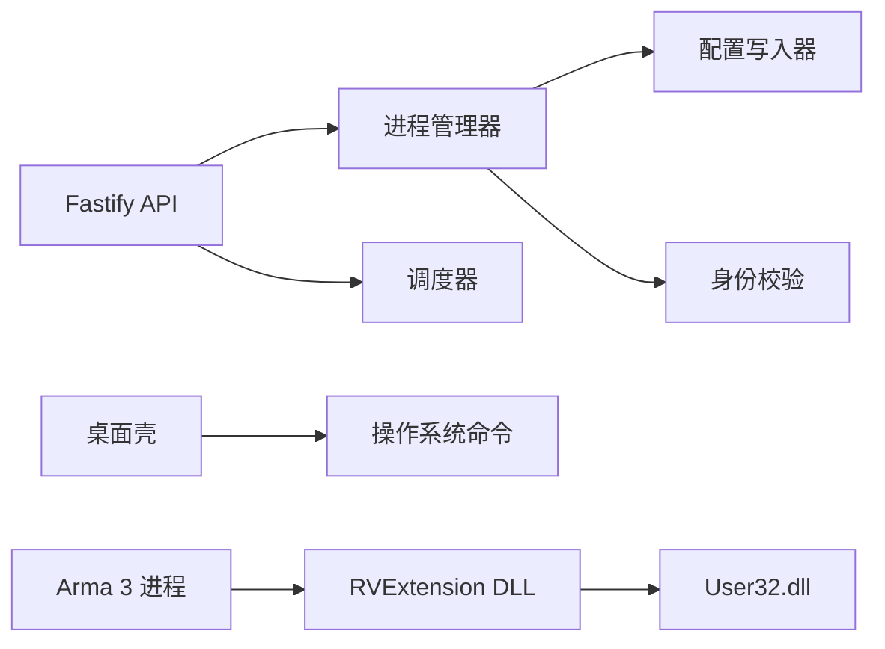

# 进程管理

<cite>
**本文引用的文件**   
- [README.md](file://README.md)
- [architecture-v2.md](file://docs/architecture-v2.md)
- [v2-quickstart.md](file://docs/v2-quickstart.md)
- [index.ts](file://apps/desktop/src/main/index.ts)
- [server-lifecycle.ts](file://packages/service/src/scheduling/server-lifecycle.ts)
- [cron.ts](file://packages/service/src/scheduling/cron.ts)
- [identity.ts](file://packages/service/src/process/identity.ts)
- [game-config-writer.ts](file://packages/service/src/config/game-config-writer.ts)
- [routes.ts](file://packages/service/src/api/routes.ts)
- [ArmaMonitoringService.cs](file://DestinyServerMonitoring/DestinyServerMonitoring/ArmaMonitoringService.cs)
- [destiny_fnc_monitoring_service.sqf](file://mod/@a3st_monitor/addons/a3st_monitor/script/destiny_fnc_monitoring_service.sqf)
</cite>

## 目录
1. [引言](#引言)
2. [项目结构](#项目结构)
3. [核心组件](#核心组件)
4. [架构总览](#架构总览)
5. [详细组件分析](#详细组件分析)
6. [依赖关系分析](#依赖关系分析)
7. [性能与资源特性](#性能与资源特性)
8. [故障恢复与调试指南](#故障恢复与调试指南)
9. [结论](#结论)

## 引言
本文面向 Arma 3 专用服务器进程管理，覆盖进程生命周期、启动参数、环境变量注入、监控与健康检查、自动重启、信号处理与优雅关闭、多实例与端口冲突、资源隔离、状态跟踪、日志聚合、性能监控、故障恢复与异常处理、调试工具使用等主题。文档基于仓库中的服务层（Node.js/Fastify）、桌面壳（Electron）、游戏侧监控扩展（C# DLL + SQF）进行系统化说明，并给出可操作的流程图与时序图，帮助读者从“概念”到“代码实现”建立完整认知。

## 项目结构
本项目采用控制端 UI + 被控端 Service 的分层模型：
- 控制端 UI：浏览器或 Electron 窗口
- 被控端 Service：Node.js + Fastify + SQLite，负责启停、配置、SteamCMD、日志、RCon、定时任务等
- 共享契约：TypeScript API 客户端类型定义
- 游戏侧监控：C# RVExtension DLL + Arma 3 模组脚本，采集运行时指标并通过 WM_COPYDATA 回传

图表来源
- [architecture-v2.md:1-50](file://docs/architecture-v2.md#L1-L50)
- [index.ts:125-228](file://apps/desktop/src/main/index.ts#L125-L228)
- [game-config-writer.ts:625-669](file://packages/service/src/config/game-config-writer.ts#L625-L669)
- [server-lifecycle.ts:46-83](file://packages/service/src/scheduling/server-lifecycle.ts#L46-L83)
- [ArmaMonitoringService.cs:102-144](file://DestinyServerMonitoring/DestinyServerMonitoring/ArmaMonitoringService.cs#L102-L144)
- [destiny_fnc_monitoring_service.sqf:1-83](file://mod/@a3st_monitor/addons/a3st_monitor/script/destiny_fnc_monitoring_service.sqf#L1-L83)

章节来源
- [README.md:1-108](file://README.md#L1-L108)
- [architecture-v2.md:1-118](file://docs/architecture-v2.md#L1-L118)
- [v2-quickstart.md:1-74](file://docs/v2-quickstart.md#L1-L74)

## 核心组件
- 进程生命周期管理：通过服务层的进程管理器与身份校验模块，完成启动、停止、重启、PID 追踪与误杀防护。
- 启动参数与环境变量：由配置写入器根据配置包生成命令行参数，支持安全白名单过滤、端口检测、HT/hugepages 等优化开关。
- 监控与健康检查：游戏侧通过 SQF 定时采集对象数量、FPS 等指标，经 C# RVExtension 回调与 WM_COPYDATA 投递给桌面壳；服务层提供健康检查接口。
- 自动重启策略：基于 cron 调度器按小时触发重启任务，结合进程状态与配置持久化。
- 信号处理与优雅关闭：桌面壳在 Linux 下发送 SIGTERM，Windows 下使用 taskkill；服务层在停止前进行进程身份验证。
- 多实例与端口冲突：通过 -name/-port 标记与端口占用检测避免多实例冲突；桌面壳具备端口占用探测与释放能力。
- 状态跟踪与日志聚合：服务层维护 processById、任务状态、日志文件；桌面壳读取 service.log 尾部用于展示。
- 故障恢复与异常处理：导入配置时清理无效 PID；停止流程中拒绝 mismatch/unknown 的进程标识；错误路径返回结构化响应。

章节来源
- [server-lifecycle.ts:46-83](file://packages/service/src/scheduling/server-lifecycle.ts#L46-L83)
- [identity.ts:93-150](file://packages/service/src/process/identity.ts#L93-L150)
- [game-config-writer.ts:164-195](file://packages/service/src/config/game-config-writer.ts#L164-L195)
- [game-config-writer.ts:197-210](file://packages/service/src/config/game-config-writer.ts#L197-L210)
- [game-config-writer.ts:625-669](file://packages/service/src/config/game-config-writer.ts#L625-L669)
- [routes.ts:1111-1159](file://packages/service/src/api/routes.ts#L1111-L1159)
- [index.ts:173-228](file://apps/desktop/src/main/index.ts#L173-L228)

## 架构总览
系统分为三层：
- 控制端 UI（Web/Electron）：用户交互、命令下发、状态展示
- 被控端 Service（Node.js/Fastify）：业务逻辑、进程管理、配置写入、调度、日志
- 游戏侧（Arma 3 + 模组）：运行期数据采集、事件上报、远程控制入口

图表来源
- [game-config-writer.ts:625-669](file://packages/service/src/config/game-config-writer.ts#L625-L669)
- [server-lifecycle.ts:46-83](file://packages/service/src/scheduling/server-lifecycle.ts#L46-L83)
- [ArmaMonitoringService.cs:102-144](file://DestinyServerMonitoring/DestinyServerMonitoring/ArmaMonitoringService.cs#L102-L144)
- [destiny_fnc_monitoring_service.sqf:1-83](file://mod/@a3st_monitor/addons/a3st_monitor/script/destiny_fnc_monitoring_service.sqf#L1-L83)

## 详细组件分析

### 进程生命周期管理
- 启动流程：
  - 根据配置包构建命令行参数，包含端口、HT、hugepages、mission 加载等选项。
  - 调用进程管理器 spawn，记录 PID 到配置 tasks.processById。
  - 启动完成后返回成功状态。
- 停止流程：
  - 若进程仍在运行，先验证 PID 对应进程是否为当前服务器进程（通过 -name/-port 标记）。
  - 若身份 mismatch/unknown，拒绝停止以避免误杀。
  - 否则执行 kill，并清零 processById。
- 重启流程：
  - 可通过 cron 调度器按小时触发，结合进程状态与配置持久化执行重启。

图表来源
- [server-lifecycle.ts:46-83](file://packages/service/src/scheduling/server-lifecycle.ts#L46-L83)
- [identity.ts:93-150](file://packages/service/src/process/identity.ts#L93-L150)

章节来源
- [server-lifecycle.ts:46-83](file://packages/service/src/scheduling/server-lifecycle.ts#L46-L83)
- [identity.ts:93-150](file://packages/service/src/process/identity.ts#L93-L150)

### 启动参数配置与环境变量注入
- 启动参数构建：
  - 从配置包的 startup/basic/monitoring 字段解析参数。
  - 追加 -autoInit、-filePatching、-pid、-ranking、-port、-bandwidthAlg、-enableHT、-hugepages、-loadMissionToMemory 等。
  - 支持额外启动参数白名单过滤，仅允许安全字符集。
- 端口检测：
  - 跨平台检测端口占用（Windows netstat，Linux lsof），防止端口冲突。
- 环境变量注入：
  - 快速开始文档显示通过 DATA_DIR 环境变量指定数据目录；服务层据此定位配置文件与日志位置。

图表来源
- [game-config-writer.ts:625-669](file://packages/service/src/config/game-config-writer.ts#L625-L669)
- [game-config-writer.ts:164-195](file://packages/service/src/config/game-config-writer.ts#L164-L195)
- [game-config-writer.ts:197-210](file://packages/service/src/config/game-config-writer.ts#L197-L210)
- [v2-quickstart.md:22-33](file://docs/v2-quickstart.md#L22-L33)

章节来源
- [game-config-writer.ts:164-195](file://packages/service/src/config/game-config-writer.ts#L164-L195)
- [game-config-writer.ts:197-210](file://packages/service/src/config/game-config-writer.ts#L197-L210)
- [game-config-writer.ts:625-669](file://packages/service/src/config/game-config-writer.ts#L625-L669)
- [v2-quickstart.md:22-33](file://docs/v2-quickstart.md#L22-L33)

### 监控机制、健康检查与自动重启
- 监控采集：
  - SQF 脚本每 60 秒采集对象数量、FPS 等指标，通过 callExtension 发送到 RVExtension。
  - RVExtension 在独立线程中将数据通过 WM_COPYDATA 投递到桌面壳窗口句柄。
- 健康检查：
  - 服务层暴露健康检查接口（health），供前端或外部探针轮询。
- 自动重启：
  - 调度器使用 croner 按小时表达式触发重启任务；支持生成每日固定小时重启表达式。

图表来源
- [destiny_fnc_monitoring_service.sqf:1-83](file://mod/@a3st_monitor/addons/a3st_monitor/script/destiny_fnc_monitoring_service.sqf#L1-L83)
- [ArmaMonitoringService.cs:102-144](file://DestinyServerMonitoring/DestinyServerMonitoring/ArmaMonitoringService.cs#L102-L144)
- [cron.ts:1-60](file://packages/service/src/scheduling/cron.ts#L1-L60)

章节来源
- [destiny_fnc_monitoring_service.sqf:1-83](file://mod/@a3st_monitor/addons/a3st_monitor/script/destiny_fnc_monitoring_service.sqf#L1-L83)
- [ArmaMonitoringService.cs:102-144](file://DestinyServerMonitoring/DestinyServerMonitoring/ArmaMonitoringService.cs#L102-L144)
- [cron.ts:1-60](file://packages/service/src/scheduling/cron.ts#L1-L60)

### 信号处理、优雅关闭与资源清理
- 桌面壳在 Linux 下对服务进程发送 SIGTERM，Windows 下使用 taskkill /T /F 终止进程树。
- 停止流程在服务层进行进程身份验证，避免误杀其他进程。
- 端口释放：
  - 桌面壳检测端口占用者 PID，必要时强制释放端口，确保服务可重新启动。

图表来源
- [index.ts:173-228](file://apps/desktop/src/main/index.ts#L173-L228)
- [server-lifecycle.ts:46-83](file://packages/service/src/scheduling/server-lifecycle.ts#L46-L83)

章节来源
- [index.ts:173-228](file://apps/desktop/src/main/index.ts#L173-L228)
- [server-lifecycle.ts:46-83](file://packages/service/src/scheduling/server-lifecycle.ts#L46-L83)

### 多实例管理、端口冲突解决与资源隔离
- 多实例管理：
  - 每个服务器实例拥有唯一 UUID，配置与进程状态分离存储。
  - 通过 -name 与 -port 标记区分不同实例，进程身份校验确保操作目标正确。
- 端口冲突解决：
  - 启动前检测端口占用；桌面壳可主动释放占用端口。
- 资源隔离：
  - 通过独立的 serverDir、configRoot、日志文件与 PID 文件隔离各实例资源。

图表来源
- [identity.ts:93-150](file://packages/service/src/process/identity.ts#L93-L150)
- [game-config-writer.ts:197-210](file://packages/service/src/config/game-config-writer.ts#L197-L210)
- [routes.ts:1111-1159](file://packages/service/src/api/routes.ts#L1111-L1159)

章节来源
- [identity.ts:93-150](file://packages/service/src/process/identity.ts#L93-L150)
- [game-config-writer.ts:197-210](file://packages/service/src/config/game-config-writer.ts#L197-L210)
- [routes.ts:1111-1159](file://packages/service/src/api/routes.ts#L1111-L1159)

### 进程状态跟踪、日志聚合与性能监控
- 状态跟踪：
  - 服务层维护 tasks.processById，并在导入/克隆配置时清理无效 PID。
- 日志聚合：
  - 桌面壳读取 service.log 尾部内容用于展示；服务层统一日志落盘。
- 性能监控：
  - SQF 采集 FPS、对象数量等指标，通过 RVExtension 投递至桌面壳，便于可视化。

图表来源
- [destiny_fnc_monitoring_service.sqf:1-83](file://mod/@a3st_monitor/addons/a3st_monitor/script/destiny_fnc_monitoring_service.sqf#L1-L83)
- [ArmaMonitoringService.cs:102-144](file://DestinyServerMonitoring/DestinyServerMonitoring/ArmaMonitoringService.cs#L102-L144)
- [index.ts:224-228](file://apps/desktop/src/main/index.ts#L224-L228)
- [routes.ts:1111-1159](file://packages/service/src/api/routes.ts#L1111-L1159)

章节来源
- [destiny_fnc_monitoring_service.sqf:1-83](file://mod/@a3st_monitor/addons/a3st_monitor/script/destiny_fnc_monitoring_service.sqf#L1-L83)
- [ArmaMonitoringService.cs:102-144](file://DestinyServerMonitoring/DestinyServerMonitoring/ArmaMonitoringService.cs#L102-L144)
- [index.ts:224-228](file://apps/desktop/src/main/index.ts#L224-L228)
- [routes.ts:1111-1159](file://packages/service/src/api/routes.ts#L1111-L1159)

## 依赖关系分析
- 组件耦合：
  - 进程管理器依赖配置写入器与身份校验模块，确保启动参数与进程标识一致。
  - 调度器与服务层 API 解耦，通过 cron 表达式触发重启任务。
  - 桌面壳依赖系统命令（netstat/taskkill/lsof）进行端口探测与进程终止。
- 外部依赖：
  - Arma 3 服务器进程与 RVExtension DLL 通过 Windows API（User32.dll）进行进程间通信。
  - Node.js 环境下的 croner 库用于定时任务。

图表来源
- [server-lifecycle.ts:46-83](file://packages/service/src/scheduling/server-lifecycle.ts#L46-L83)
- [game-config-writer.ts:625-669](file://packages/service/src/config/game-config-writer.ts#L625-L669)
- [identity.ts:93-150](file://packages/service/src/process/identity.ts#L93-L150)
- [cron.ts:1-60](file://packages/service/src/scheduling/cron.ts#L1-L60)
- [index.ts:173-228](file://apps/desktop/src/main/index.ts#L173-L228)
- [ArmaMonitoringService.cs:1-144](file://DestinyServerMonitoring/DestinyServerMonitoring/ArmaMonitoringService.cs#L1-L144)

章节来源
- [server-lifecycle.ts:46-83](file://packages/service/src/scheduling/server-lifecycle.ts#L46-L83)
- [game-config-writer.ts:625-669](file://packages/service/src/config/game-config-writer.ts#L625-L669)
- [identity.ts:93-150](file://packages/service/src/process/identity.ts#L93-L150)
- [cron.ts:1-60](file://packages/service/src/scheduling/cron.ts#L1-L60)
- [index.ts:173-228](file://apps/desktop/src/main/index.ts#L173-L228)
- [ArmaMonitoringService.cs:1-144](file://DestinyServerMonitoring/DestinyServerMonitoring/ArmaMonitoringService.cs#L1-L144)

## 性能与资源特性
- 性能开关：
  - -enableHT 启用超线程，-hugepages 启用大页内存，-loadMissionToMemory 将任务载入内存，减少 I/O 延迟。
  - -bandwidthAlg=2 调整带宽算法，提升网络吞吐。
- 资源隔离：
  - 通过独立的 serverDir、configRoot、PID 文件与日志文件隔离各实例资源，避免相互干扰。
- 监控开销：
  - SQF 每 60 秒采集一次指标，避免频繁采样影响游戏性能。

章节来源
- [game-config-writer.ts:625-669](file://packages/service/src/config/game-config-writer.ts#L625-L669)
- [destiny_fnc_monitoring_service.sqf:72-83](file://mod/@a3st_monitor/addons/a3st_monitor/script/destiny_fnc_monitoring_service.sqf#L72-L83)

## 故障恢复与调试指南
- 故障恢复：
  - 导入配置时清理无效的 processById，避免误报 running 或误杀。
  - 停止流程中拒绝 mismatch/unknown 的进程标识，防止误杀其他进程。
- 异常处理：
  - 端口占用检测失败时返回空结果，不中断主流程。
  - 进程终止失败时记录错误日志，便于排查。
- 调试工具：
  - 桌面壳读取 service.log 尾部内容，辅助定位服务层问题。
  - 使用快速开始文档中的 DATA_DIR 环境变量切换开发数据目录，便于隔离测试环境。

章节来源
- [routes.ts:1111-1159](file://packages/service/src/api/routes.ts#L1111-L1159)
- [server-lifecycle.ts:46-83](file://packages/service/src/scheduling/server-lifecycle.ts#L46-L83)
- [index.ts:173-228](file://apps/desktop/src/main/index.ts#L173-L228)
- [v2-quickstart.md:22-33](file://docs/v2-quickstart.md#L22-L33)

## 结论
本项目的进程管理体系以“控制端 UI + 被控端 Service + 游戏侧监控”为核心架构，实现了从启动参数构建、端口冲突检测、进程身份校验、优雅关闭到监控指标采集与自动重启的全链路管理。通过严格的身份验证与端口检测，有效避免了多实例冲突与误杀风险；通过 SQF 与 RVExtension 的协作，实现了低开销的性能监控与状态反馈。建议在部署时遵循快速开始文档的环境要求，合理配置 DATA_DIR 与端口，结合调度器与日志聚合，构建稳定可靠的 Arma 3 服务器运维体系。