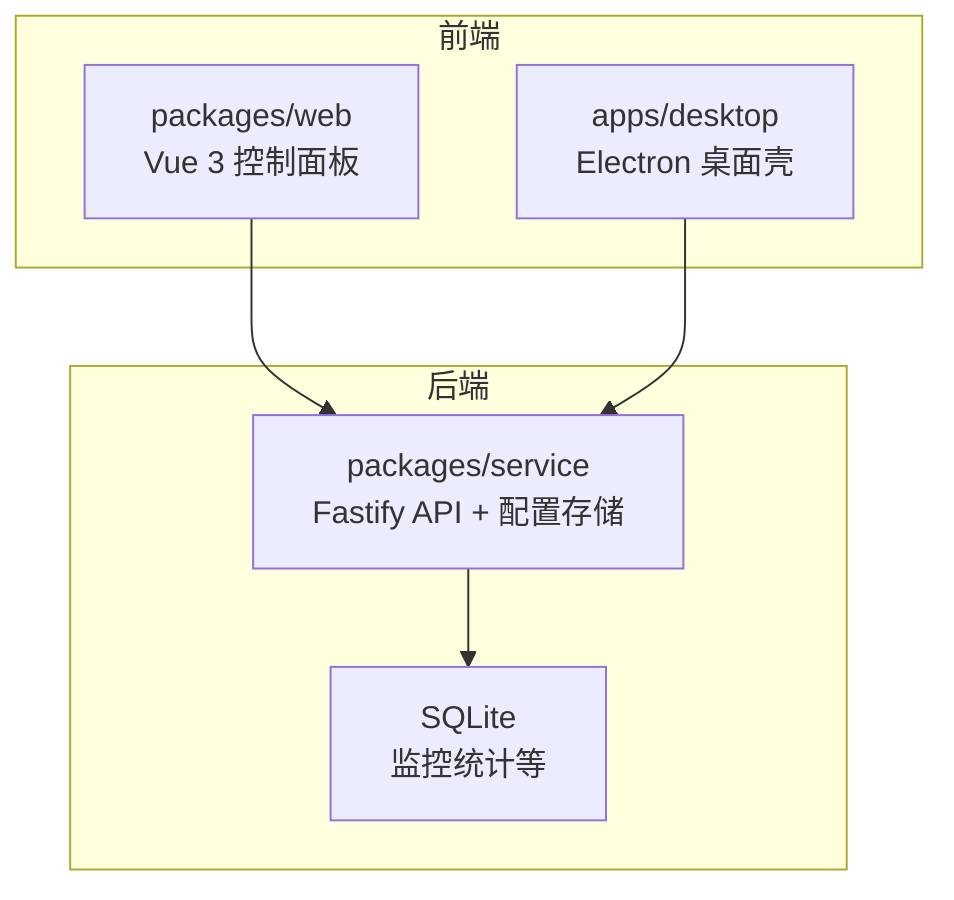
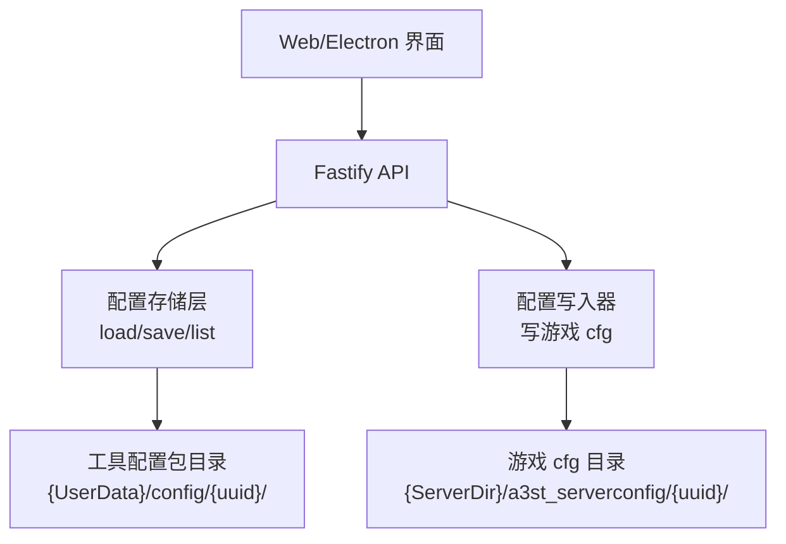
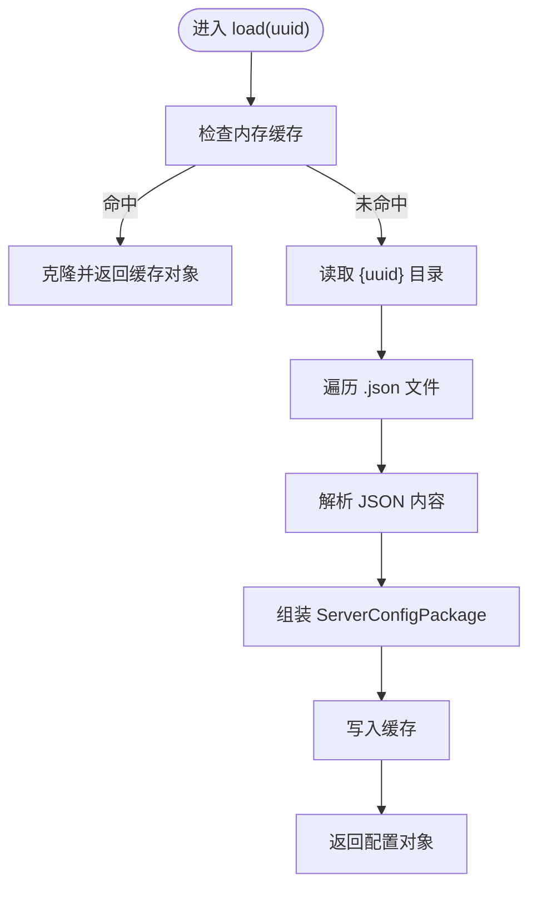
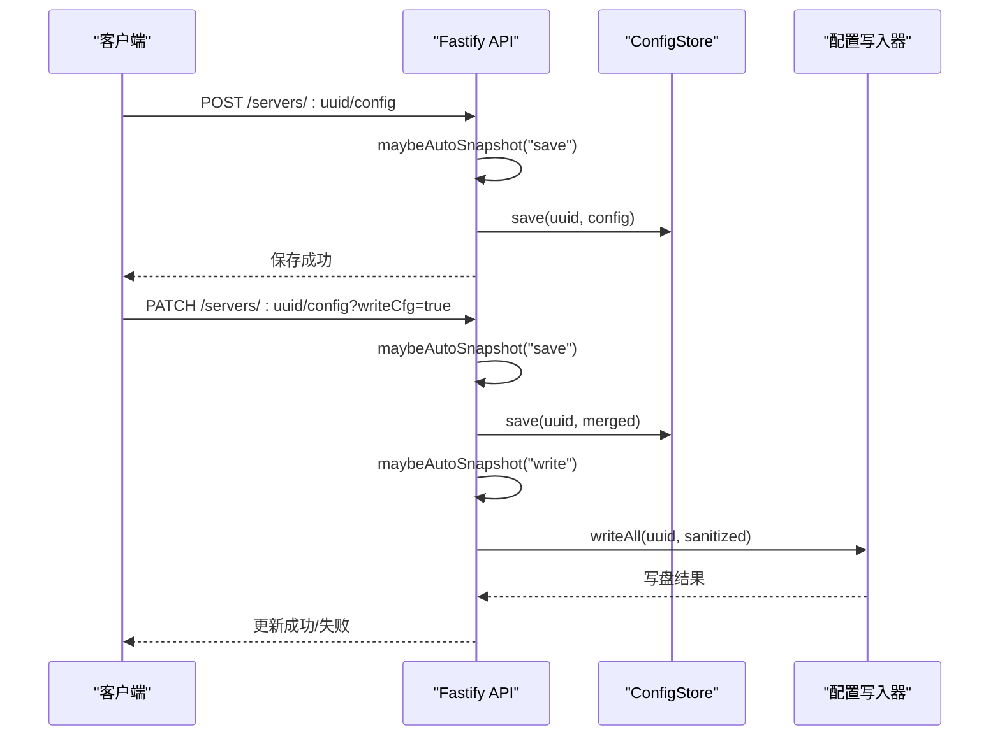
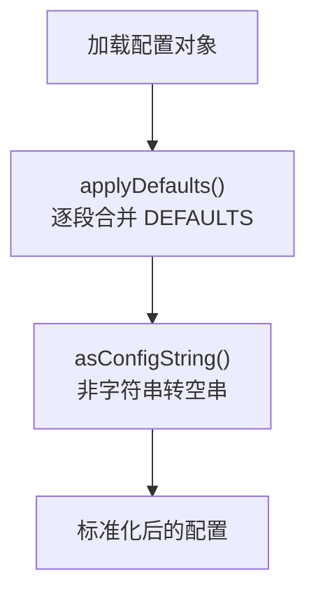
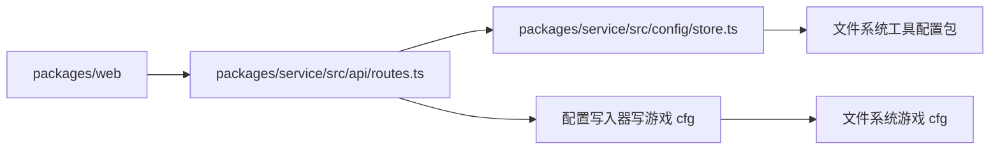

# 配置管理

<cite>
**本文引用的文件**   
- [README.md](file://README.md)
- [package.json](file://package.json)
- [config-workflow.md](file://docs/config-workflow.md)
- [architecture.md](file://docs/architecture.md)
- [defaults.ts](file://packages/web/src/utils/defaults.ts)
- [configStringField.ts](file://packages/web/src/utils/configStringField.ts)
- [store.ts](file://packages/service/src/config/store.ts)
- [routes.ts](file://packages/service/src/api/routes.ts)
- [mod-startup-sync.ts](file://packages/service/src/mods/mod-startup-sync.ts)
</cite>

## 目录
1. [简介](#简介)
2. [项目结构](#项目结构)
3. [核心组件](#核心组件)
4. [架构总览](#架构总览)
5. [详细组件分析](#详细组件分析)
6. [依赖关系分析](#依赖关系分析)
7. [性能与可靠性](#性能与可靠性)
8. [故障排查](#故障排查)
9. [结论](#结论)
10. [附录：配置字段与默认值速查](#附录配置字段与默认值速查)

## 简介
本文件面向 Arma 3 服务器工具 v2 的配置管理系统，聚焦以下目标：
- 配置文件结构与存储位置（工具配置包 vs 游戏 cfg）
- JSON Schema 验证、默认值处理与类型安全
- 配置热重载、版本迁移、备份恢复机制
- 游戏配置文件生成、模板引擎与变量替换
- 权限控制、敏感信息加密、审计日志记录
- 配置导入导出、批量修改、冲突解决
- 配置验证规则、错误提示与用户友好界面支持

该工具采用 TypeScript 全栈实现，后端为 Node.js + Fastify + SQLite，前端为 Vue 3 控制面板，桌面端通过 Electron 提供 Windows 打包体验。

**章节来源**
- [README.md:1-108](file://README.md#L1-L108)

## 项目结构
仓库根目录使用 npm workspaces 组织多包工程，关键目录如下：
- packages/service：后端服务（Fastify API、配置持久化、任务调度等）
- packages/web：Vue 3 控制面板（配置编辑、状态展示、操作入口）
- apps/desktop：Electron 桌面壳（Windows）
- docs：文档与流程说明（含配置工作流）

**图表来源**
- [README.md:50-66](file://README.md#L50-L66)
- [package.json:1-36](file://package.json#L1-L36)

**章节来源**
- [README.md:50-66](file://README.md#L50-L66)
- [package.json:1-36](file://package.json#L1-L36)

## 核心组件
- 配置工作流与语义：保存、写入、启动、重启、模组同步等
- 配置存储层：工具配置包（JSON 分片）与游戏 cfg 分离
- 默认值与类型转换：前端默认值填充与字符串规范化
- API 路由：配置保存、补丁更新、可选写盘、状态查询
- 模组参数刷新：启动时构建模组参数（与 C# 对齐）

**章节来源**
- [config-workflow.md:1-105](file://docs/config-workflow.md#L1-L105)
- [defaults.ts:1-171](file://packages/web/src/utils/defaults.ts#L1-L171)
- [configStringField.ts:1-6](file://packages/web/src/utils/configStringField.ts#L1-L6)
- [routes.ts:126-201](file://packages/service/src/api/routes.ts#L126-L201)
- [mod-startup-sync.ts:1-6](file://packages/service/src/mods/mod-startup-sync.ts#L1-L6)

## 架构总览
配置系统遵循“工具配置包”和“游戏 cfg”双轨存储：
- 工具配置包：位于用户数据目录下的 `{uuid}` 子目录，包含 manifest、server、startup、mods、basic/profile/battleye、tasks、missionparams 等 JSON 文件
- 游戏 cfg：位于服务器目录的 `a3st_serverconfig/{uuid}/`，由工具在应用或 Agent 调用时写入

**图表来源**
- [config-workflow.md:41-60](file://docs/config-workflow.md#L41-L60)
- [store.ts:51-88](file://packages/service/src/config/store.ts#L51-L88)
- [routes.ts:126-201](file://packages/service/src/api/routes.ts#L126-L201)

**章节来源**
- [config-workflow.md:41-60](file://docs/config-workflow.md#L41-L60)
- [store.ts:51-88](file://packages/service/src/config/store.ts#L51-L88)

## 详细组件分析

### 配置存储与加载（ConfigStore）
职责：
- 列出所有服务器摘要（读取 manifest）
- 加载完整配置包（按 UUID 从磁盘解析各 JSON 片段）
- 缓存已加载配置（避免重复 IO）

关键点：
- 仅读取 manifest 进行列表展示，减少序列化开销
- 对损坏的 manifest 跳过并继续扫描
- 返回结构化配置对象，便于后续合并与校验

**图表来源**
- [store.ts:51-88](file://packages/service/src/config/store.ts#L51-L88)

**章节来源**
- [store.ts:51-88](file://packages/service/src/config/store.ts#L51-L88)

### API 配置接口（保存/补丁/写盘）
职责：
- POST /servers/:uuid/config：保存配置包；可选先写游戏 cfg
- PATCH /servers/:uuid/config：增量更新配置；可带 writeCfg=true 直接写盘
- GET /servers/:uuid/sync-state：查询同步状态（未保存/需写盘等）

行为要点：
- 保存前触发自动快照（根据策略）
- 写盘失败返回明确错误码与信息
- 补丁时对模组路径做有效性校验（需包含 addons）

**图表来源**
- [routes.ts:126-201](file://packages/service/src/api/routes.ts#L126-L201)

**章节来源**
- [routes.ts:126-201](file://packages/service/src/api/routes.ts#L126-L201)

### 默认值与类型转换
职责：
- 提供各配置段的默认值（与 C# 默认保持一致）
- 将缺失字段补齐到现有配置对象
- 将任意值转换为配置字符串（空串兜底）

用途：
- 新建服务器或旧配置升级时，确保字段完整性
- 前端表单渲染时提供稳定初始值

**图表来源**
- [defaults.ts:1-171](file://packages/web/src/utils/defaults.ts#L1-L171)
- [configStringField.ts:1-6](file://packages/web/src/utils/configStringField.ts#L1-L6)

**章节来源**
- [defaults.ts:1-171](file://packages/web/src/utils/defaults.ts#L1-L171)
- [configStringField.ts:1-6](file://packages/web/src/utils/configStringField.ts#L1-L6)

### 模组参数刷新
职责：
- 在启动时构建模组参数（与 C# 对齐）
- 当前实现保持配置不变，预留扩展点

用途：
- 保证模组加载顺序与参数一致性
- 避免 UI 与后端逻辑差异导致的运行异常

**章节来源**
- [mod-startup-sync.ts:1-6](file://packages/service/src/mods/mod-startup-sync.ts#L1-L6)

## 依赖关系分析
- 前端依赖后端 API 完成配置的保存、更新与写盘
- 后端依赖文件系统读写工具配置包与游戏 cfg
- 配置工作流贯穿 UI、API、存储与写入器

**图表来源**
- [routes.ts:126-201](file://packages/service/src/api/routes.ts#L126-L201)
- [store.ts:51-88](file://packages/service/src/config/store.ts#L51-L88)

**章节来源**
- [routes.ts:126-201](file://packages/service/src/api/routes.ts#L126-L201)
- [store.ts:51-88](file://packages/service/src/config/store.ts#L51-L88)

## 性能与可靠性
- 列表页仅读 manifest，避免全量序列化，提升响应速度
- 自动快照策略支持异步执行，不阻塞保存/写入
- 配置包与游戏 cfg 分离，降低耦合，提高并发安全性
- 写盘失败时返回明确错误码，便于前端提示与重试

建议：
- 对大模组列表与长任务进行分页与进度反馈
- 对频繁写盘操作增加节流与去重
- 对敏感字段（密码、密钥）进行加密存储与脱敏显示

[本节为通用指导，无需具体文件引用]

## 故障排查
常见问题与定位思路：
- 保存失败：检查 API 是否返回 SAVE_FAILED，确认磁盘权限与路径合法性
- 写盘失败：检查 WRITE_CFG_FAILED 消息，确认游戏目录存在且可写
- 模组路径无效：检查 INVALID_MOD_PATH，确保所选目录包含 addons
- 配置不同步：查看 sync-state，必要时执行“应用到服务器目录”

参考：
- 配置工作流中的三个主操作与状态语义
- API 的错误码与消息结构

**章节来源**
- [config-workflow.md:62-98](file://docs/config-workflow.md#L62-L98)
- [routes.ts:126-201](file://packages/service/src/api/routes.ts#L126-L201)

## 结论
本配置管理系统以“工具配置包 + 游戏 cfg”的双轨模型为核心，结合清晰的 API 语义、默认值填充与类型转换、自动快照与写盘流程，提供了稳定可靠的配置管理能力。未来可在 JSON Schema 验证、敏感信息加密、审计日志与用户界面友好性方面进一步增强，以提升安全性与易用性。

[本节为总结性内容，无需具体文件引用]

## 附录：配置字段与默认值速查
- server：服务器基本信息（名称、目录、可执行文件、x64 标志、模组目录）
- startup：启动参数（端口、线程、内存、FPS、地形网格、HT、HugePages、Mission 加载、RCon/DLC 开关等）
- basic：基础设置（主机名、密码、最大玩家、端口、持久化、BattlEye、签名校验、踢重连、文件修补例外等）
- profile：用户配置文件相关字段
- battleye：BattlEye 配置
- mods：模组列表与本地模组路径
- scheduler：定时任务（重启、监控采集 cron）
- monitoring：监控相关字段
- missionparams：任务参数字典

默认值填充策略：
- 使用 applyDefaults 将 DEFAULTS 与现有配置逐段合并
- 非字符串字段统一转为空串，避免运行时类型错误

**章节来源**
- [defaults.ts:1-171](file://packages/web/src/utils/defaults.ts#L1-L171)
- [configStringField.ts:1-6](file://packages/web/src/utils/configStringField.ts#L1-L6)