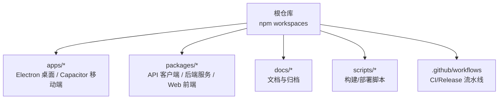
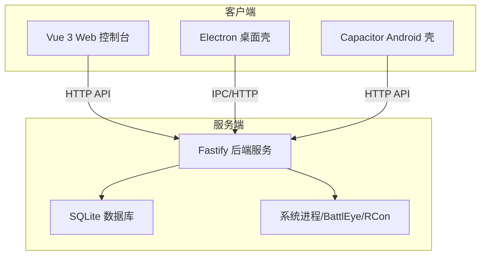
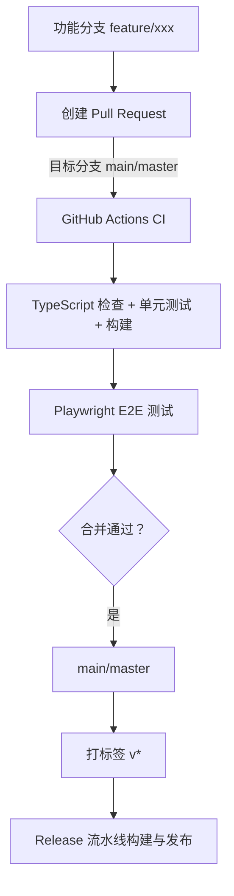
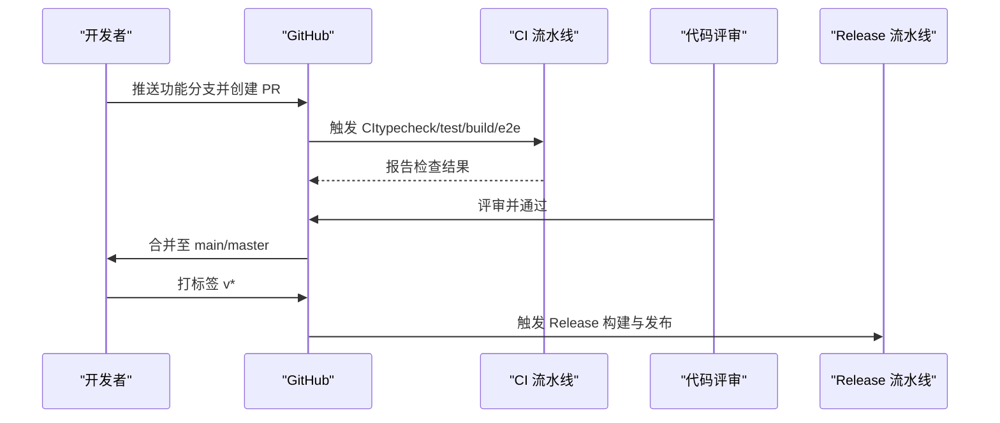
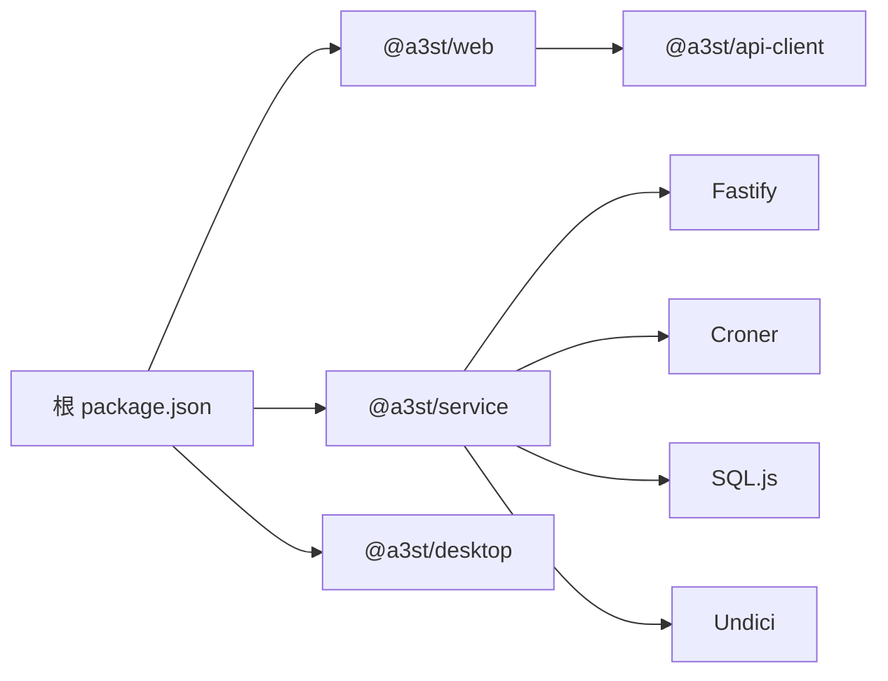

# 代码贡献规范

<cite>
**本文引用的文件**   
- [README.md](file://README.md)
- [package.json](file://package.json)
- [.editorconfig](file://.editorconfig)
- [packages/web/package.json](file://packages/web/package.json)
- [packages/service/package.json](file://packages/service/package.json)
- [packages/web/src/utils/taskSteps.ts](file://packages/web/src/utils/taskSteps.ts)
- [packages/service/src/api/routes.ts](file://packages/service/src/api/routes.ts)
- [packages/service/src/config/snapshot.test.ts](file://packages/service/src/config/snapshot.test.ts)
- [.github/workflows/ci.yml](file://.github/workflows/ci.yml)
- [.github/workflows/release.yml](file://.github/workflows/release.yml)
</cite>

## 目录
1. [引言](#引言)
2. [项目结构](#项目结构)
3. [核心组件](#核心组件)
4. [架构总览](#架构总览)
5. [详细组件分析](#详细组件分析)
6. [依赖关系分析](#依赖关系分析)
7. [性能与质量考量](#性能与质量考量)
8. [故障排查指南](#故障排查指南)
9. [结论](#结论)
10. [附录：贡献流程清单](#附录贡献流程清单)

## 引言
本规范面向所有参与 Arma3 Server Tools v2 的开发者，统一分支策略、提交信息格式、Pull Request 流程、代码风格与审查标准，并给出新开发者入门指引。项目为跨平台 Arma 3 专用服务器管理工具，采用 TypeScript 全栈实现，包含 Electron 桌面端、Capacitor Android 壳、Node.js + Fastify 后端服务以及 Vue 3 Web 控制面板。

## 项目结构
仓库采用 npm workspaces 多包结构，根 package.json 定义工作区与脚本；apps 下为应用（desktop/mobile），packages 下为可复用模块（api-client/service/web）。CI/CD 通过 GitHub Actions 在 push 到 main/master 或 PR 时执行类型检查、测试、构建与 E2E 测试；Release 流水线在打 tag 时构建 Windows 桌面安装包并发布 Release。

**图表来源**
- [package.json:1-36](file://package.json#L1-L36)
- [README.md:50-66](file://README.md#L50-L66)

**章节来源**
- [README.md:1-108](file://README.md#L1-L108)
- [package.json:1-36](file://package.json#L1-L36)

## 核心组件
- 后端服务（@a3st/service）：Fastify + SQLite + RCon，提供 REST API、任务调度、配置快照等能力。
- Web 控制台（@a3st/web）：Vue 3 + Vite + Element Plus，负责可视化控制与监控。
- API 客户端（@a3st/api-client）：TypeScript 客户端封装，供 Web/Electron 调用后端。
- 桌面端（apps/desktop）：Electron 壳，打包 Windows 桌面应用。
- 移动端（apps/mobile）：Capacitor Android 壳，复用 Web 构建产物。

**章节来源**
- [README.md:3-10](file://README.md#L3-L10)
- [packages/service/package.json:1-32](file://packages/service/package.json#L1-L32)
- [packages/web/package.json:1-37](file://packages/web/package.json#L1-L37)

## 架构总览
v2 采用前后端分离与服务化架构：Web/Electron 通过 API 客户端调用后端 Fastify 服务，服务层协调进程管理、配置读写、Bans、任务与监控数据。

**图表来源**
- [README.md:3-10](file://README.md#L3-L10)
- [packages/service/package.json:17-24](file://packages/service/package.json#L17-L24)

## 详细组件分析

### 分支策略与命名约定
- 主分支
  - main 与 master 均受保护，CI 对两个分支的 push 与 PR 生效。
- 开发分支
  - 建议以 develop 作为集成分支（若仓库未显式存在，请在 PR 目标分支处遵循当前 CI 触发规则）。
- 功能分支
  - 命名建议：feature/<短描述>、fix/<问题编号>-<简述>、chore/<变更说明>、refactor/<范围>-<目的>、docs/<范围>-<更新点>、test/<范围>-<用例>。
- 发布分支
  - 使用语义化版本标签 v* 触发 Release 流水线，生成 Windows 安装包与解压包。

**图表来源**
- [.github/workflows/ci.yml:1-12](file://.github/workflows/ci.yml#L1-L12)
- [.github/workflows/release.yml:1-10](file://.github/workflows/release.yml#L1-L10)

**章节来源**
- [.github/workflows/ci.yml:1-12](file://.github/workflows/ci.yml#L1-L12)
- [.github/workflows/release.yml:1-10](file://.github/workflows/release.yml#L1-L10)

### 提交信息规范（Conventional Commits）
- 类型建议：feat、fix、docs、style、refactor、perf、test、build、ci、chore、revert。
- 主题行：简短明确，动词开头，不超过 72 字符。
- 正文：说明动机、影响面与注意事项；必要时列出破坏性变更。
- 关联：引用 Issue/PR 编号，便于追踪。
- 示例模板（不展示具体提交内容，仅说明格式）：
  - feat(service): 新增配置自动快照与清理策略
  - fix(web): 修复任务步骤消息解析异常
  - docs: 更新快速开始与环境要求

### Pull Request 流程要求
- 分支来源：从功能分支发起 PR，目标分支为 main 或 master。
- 前置检查：本地先运行 typecheck、test、build 确保通过。
- 自动化门禁：CI 将执行类型检查、单元测试、服务与 Web 构建、E2E 测试。
- 评审要求：至少一名维护者 Review 通过后合并。
- 发布流程：合并后打语义化标签 v*，触发 Release 流水线产出安装包。

**图表来源**
- [.github/workflows/ci.yml:13-63](file://.github/workflows/ci.yml#L13-L63)
- [.github/workflows/release.yml:11-83](file://.github/workflows/release.yml#L11-L83)

**章节来源**
- [.github/workflows/ci.yml:13-63](file://.github/workflows/ci.yml#L13-L63)
- [.github/workflows/release.yml:11-83](file://.github/workflows/release.yml#L11-L83)

### 代码风格约定

#### TypeScript/JavaScript 编码规范
- 编辑器与格式化
  - 使用 .editorconfig 统一缩进、换行、UTF-8 编码与尾随空格策略。
  - 推荐编辑器启用 EditorConfig 插件，避免风格漂移。
- 类型与编译
  - 后端与客户端均使用 TypeScript；根脚本提供 typecheck 命令。
  - 建议在 PR 前本地运行 npm run typecheck。
- 命名与组织
  - 保持与现有模块一致的命名风格；公共接口优先放在 types 或独立模块中。
  - 避免深层嵌套目录，按功能域划分模块。

**章节来源**
- [.editorconfig:1-32](file://.editorconfig#L1-L32)
- [package.json:28-30](file://package.json#L28-L30)

#### Vue 组件编写标准
- 单文件组件（SFC）
  - 使用 <script setup> 语法，保持逻辑内聚。
  - 组件职责单一，复杂页面拆分为子组件。
- 状态与路由
  - 使用 Pinia 管理全局状态，Vue Router 管理页面路由。
- UI 与图标
  - 使用 Element Plus 组件库与官方图标集。
- 构建与预览
  - 使用 Vite 开发服务器与构建工具链；支持 mobile 模式输出。

**章节来源**
- [packages/web/package.json:1-37](file://packages/web/package.json#L1-L37)

#### 文件组织原则
- packages/web：Vue 前端 SPA，按 views/components/utils 分层。
- packages/service：Fastify 后端，按 api、domain、infra 分层。
- apps/desktop：Electron 主进程与预加载脚本。
- apps/mobile：Capacitor 壳工程，复用 web 构建产物。
- scripts：构建、打包、E2E 与冒烟测试脚本。

**章节来源**
- [README.md:50-66](file://README.md#L50-L66)

#### 注释与文档字符串规范
- 对外暴露的函数与类需添加 JSDoc 或 TS 类型注解，说明参数、返回值与异常。
- 业务关键路径（如任务步骤解析、配置写入）应补充必要注释，解释边界条件与错误处理。
- 公共 API 变更需在 README/docs 同步更新。

**章节来源**
- [packages/web/src/utils/taskSteps.ts:1-56](file://packages/web/src/utils/taskSteps.ts#L1-L56)

### 代码审查检查清单

#### 架构一致性
- 是否遵循前后端分离与服务化边界。
- 新增 API 是否在后端 routes 中集中管理，并在客户端类型中同步。
- 配置与持久化是否通过服务层访问，避免直连数据库。

**章节来源**
- [packages/service/src/api/routes.ts:1242-1284](file://packages/service/src/api/routes.ts#L1242-L1284)

#### 性能考虑
- 避免阻塞 I/O 的主线程操作；长任务使用异步与进度回调。
- 大对象传输注意分页与增量更新；前端列表渲染避免频繁重排。
- 日志与监控数据入库需考虑批处理与索引优化。

#### 安全性检查
- 鉴权：确保 API 入口校验 Bearer Token，敏感操作二次确认。
- 输入校验：对用户输入进行白名单校验与长度限制。
- 文件系统：严格校验路径，防止路径穿越与越权访问。
- 第三方依赖：定期审计依赖漏洞，避免硬编码密钥。

#### 测试覆盖率要求
- 后端单元测试：使用 Vitest，覆盖核心逻辑与边界条件。
- 端到端测试：Web 使用 Playwright，覆盖关键用户流程。
- 覆盖率阈值：建议新增代码行覆盖率不低于 80%，分支覆盖率不低于 70%。

**章节来源**
- [packages/service/package.json:25-30](file://packages/service/package.json#L25-L30)
- [packages/web/package.json:27-35](file://packages/web/package.json#L27-L35)
- [packages/service/src/config/snapshot.test.ts:73-90](file://packages/service/src/config/snapshot.test.ts#L73-L90)

## 依赖关系分析
- 根工作区脚本统一管理各子包的 dev/build/test 命令。
- Web 依赖 @a3st/api-client 与 Element Plus/Pinia/Vue Router。
- Service 依赖 Fastify、Croner、SQL.js、Undici。
- CI 矩阵覆盖 Node 20/22，确保兼容性。

**图表来源**
- [package.json:6-30](file://package.json#L6-L30)
- [packages/web/package.json:16-35](file://packages/web/package.json#L16-L35)
- [packages/service/package.json:17-30](file://packages/service/package.json#L17-L30)

**章节来源**
- [package.json:1-36](file://package.json#L1-L36)
- [packages/web/package.json:1-37](file://packages/web/package.json#L1-L37)
- [packages/service/package.json:1-32](file://packages/service/package.json#L1-L32)

## 性能与质量考量
- 构建与缓存
  - CI 使用 npm ci 安装依赖，保证可重复构建。
  - Web 构建使用 Vite，Service 使用 tsc 编译。
- 测试与稳定性
  - 后端单元测试覆盖核心逻辑；E2E 启动真实服务并验证健康端点。
  - 建议在本地先跑通 test 与 e2e 再提交 PR。
- 发布质量
  - Release 流水线构建 NSIS 安装包与解压包，并上传 GitHub Release。

**章节来源**
- [.github/workflows/ci.yml:28-63](file://.github/workflows/ci.yml#L28-L63)
- [.github/workflows/release.yml:34-83](file://.github/workflows/release.yml#L34-L83)

## 故障排查指南
- 无法启动服务
  - 检查端口占用与健康端点 http://127.0.0.1:19580/api/v1/health。
  - 确认已执行 build:service 且 dist/index.js 存在。
- 前端无法连接后端
  - 检查代理与 CORS 配置；确认后端已启动。
- 测试失败
  - 查看 Vitest 与 Playwright 日志；定位断言失败的具体步骤。
- 构建失败
  - 运行 typecheck 检查类型错误；清理 dist 后重试构建。

**章节来源**
- [.github/workflows/ci.yml:47-63](file://.github/workflows/ci.yml#L47-L63)
- [packages/service/package.json:8-15](file://packages/service/package.json#L8-L15)

## 结论
本规范明确了分支策略、提交规范、PR 流程、代码风格与审查标准，并结合仓库现有的 CI/CD 与脚本定义了可执行的开发与发布流程。请所有贡献者在提交前完成本地检查，确保代码质量与架构一致性。

## 附录：贡献流程清单
- 环境搭建
  - 安装 Node.js >= 20。
  - 克隆仓库并执行 npm install。
  - 构建服务：npm run build:service。
  - 启动服务：npm run start:service。
  - 启动前端：npm run dev:web。
- 第一个 PR
  - 创建功能分支 feature/<描述>。
  - 修改代码并补充测试。
  - 本地运行 npm run typecheck && npm test。
  - 提交并创建 PR，等待 CI 与评审。
- 常见问题
  - 端口冲突：修改服务端口或关闭占用进程。
  - 依赖安装失败：清理 node_modules 后重新 npm ci。
  - E2E 失败：确认服务健康端点可达后再运行 Playwright。

**章节来源**
- [README.md:70-86](file://README.md#L70-L86)
- [package.json:10-30](file://package.json#L10-L30)