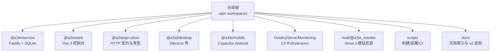
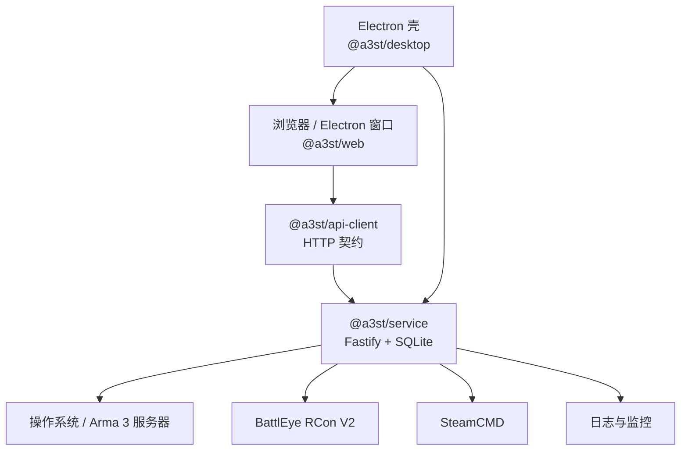
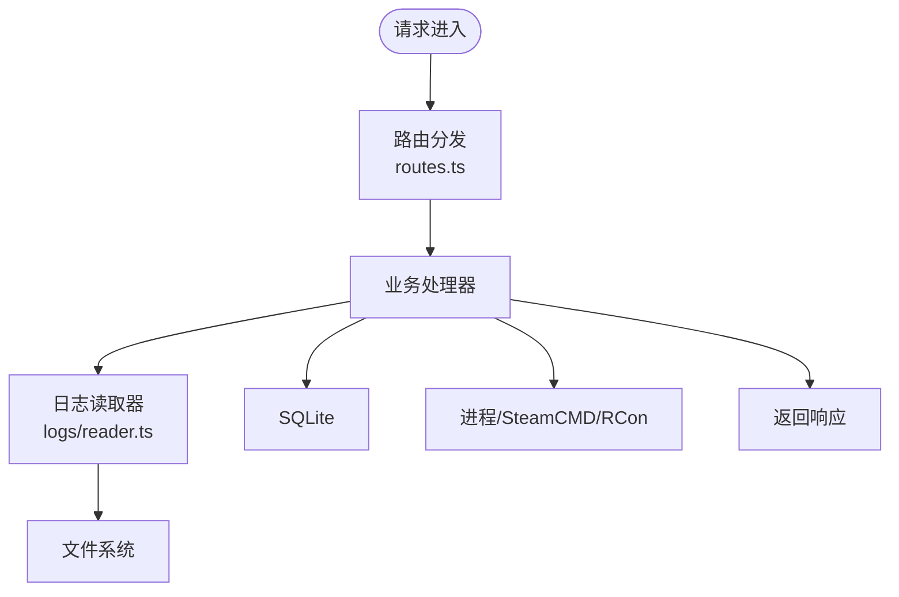
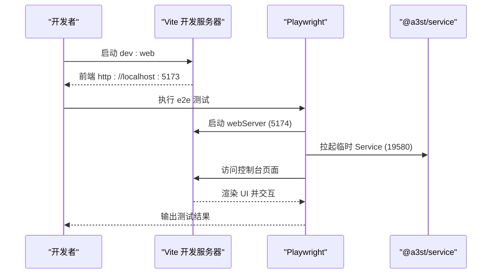
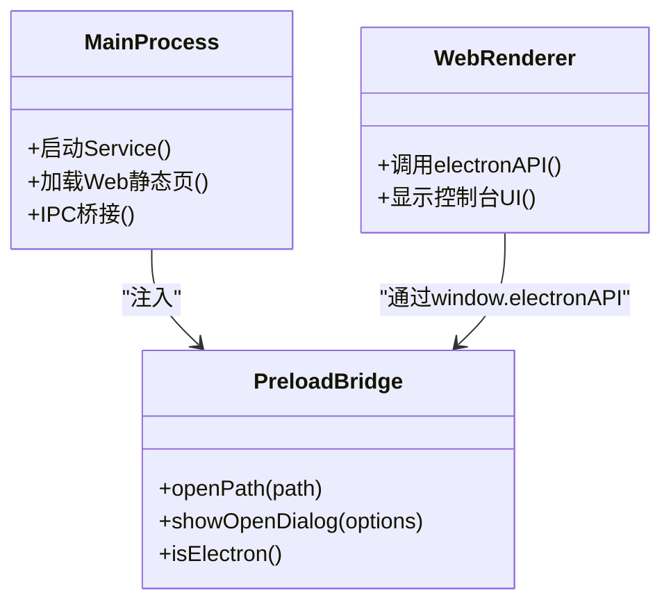
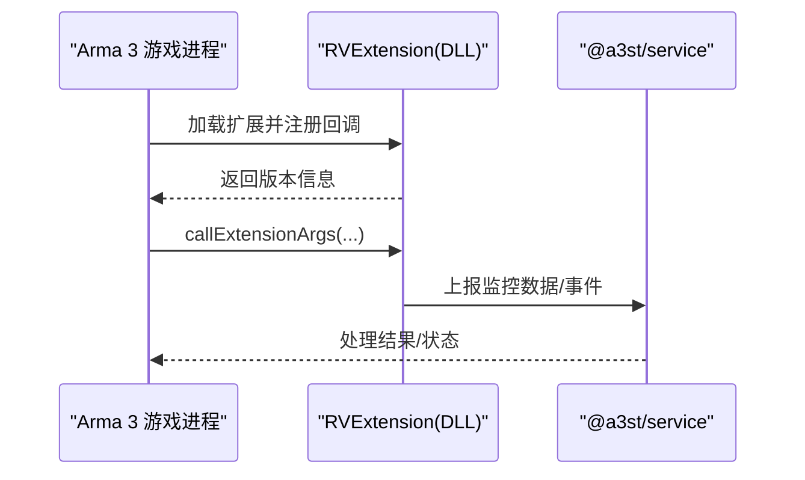
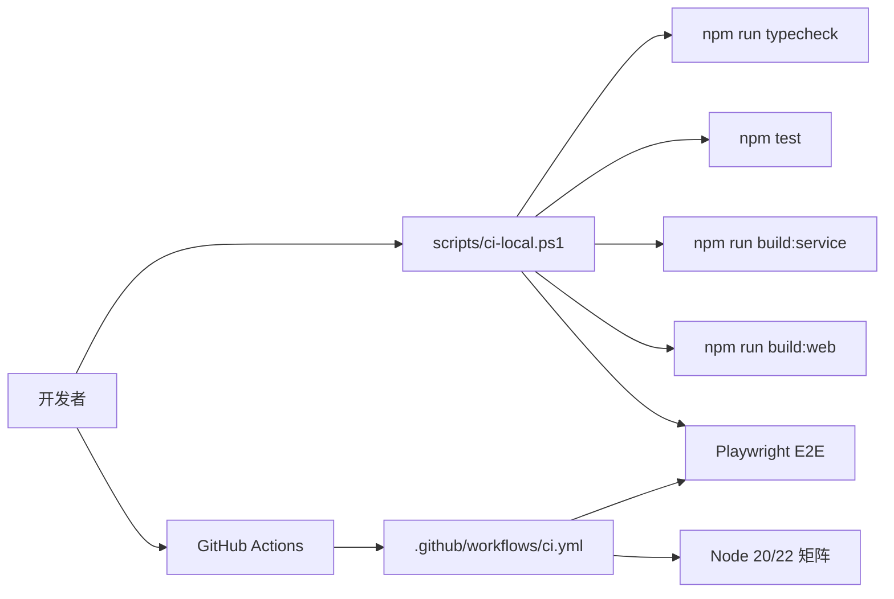
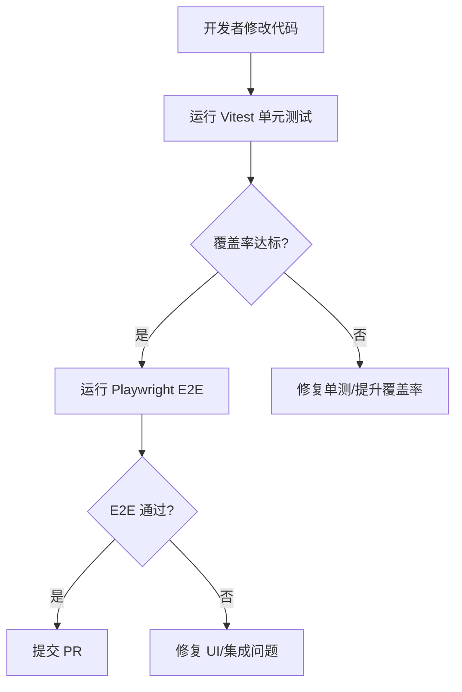

# 开发者指南

<cite>
**本文引用的文件**   
- [README.md](file://README.md)
- [package.json](file://package.json)
- [.editorconfig](file://.editorconfig)
- [docs/README.md](file://docs/README.md)
- [docs/v2-quickstart.md](file://docs/v2-quickstart.md)
- [docs/architecture-v2.md](file://docs/architecture-v2.md)
- [.github/workflows/ci.yml](file://.github/workflows/ci.yml)
- [.github/workflows/release.yml](file://.github/workflows/release.yml)
- [scripts/ci-local.ps1](file://scripts/ci-local.ps1)
- [scripts/run-automated-tests.ps1](file://scripts/run-automated-tests.ps1)
- [packages/web/playwright.config.ts](file://packages/web/playwright.config.ts)
- [packages/service/vitest.config.ts](file://packages/service/vitest.config.ts)
- [packages/service/src/api/routes.test.ts](file://packages/service/src/api/routes.test.ts)
- [packages/service/src/logs/reader.test.ts](file://packages/service/src/logs/reader.test.ts)
- [packages/service/src/logs/reader.ts](file://packages/service/src/logs/reader.ts)
- [apps/desktop/src/main/index.ts](file://apps/desktop/src/main/index.ts)
- [apps/desktop/src/preload/index.ts](file://apps/desktop/src/preload/index.ts)
- [apps/desktop/src/build-stub.ts](file://apps/desktop/src/build-stub.ts)
- [DestinyServerMonitoring/DestinyServerMonitoring/ArmaMonitoringService.cs](file://DestinyServerMonitoring/DestinyServerMonitoring/ArmaMonitoringService.cs)
</cite>

## 目录
1. [引言](#引言)
2. [项目结构](#项目结构)
3. [核心组件](#核心组件)
4. [架构总览](#架构总览)
5. [详细组件分析](#详细组件分析)
6. [依赖关系分析](#依赖关系分析)
7. [性能与质量](#性能与质量)
8. [测试策略](#测试策略)
9. [调试与开发工具](#调试与开发工具)
10. [扩展开发指南](#扩展开发指南)
11. [重构与演进计划](#重构与演进计划)
12. [故障排查](#故障排查)
13. [结论](#结论)

## 引言
本指南面向贡献者与维护者，覆盖分支与提交规范、代码审查流程、项目结构与编码约定、测试策略、调试与工具配置、扩展开发、重构方向、性能优化与质量检查、以及新功能脚手架。仓库为 TypeScript 全栈 monorepo，包含后端服务、Web 控制台、Electron 桌面壳、Capacitor Android 壳、监控模组与 C# RVExtension 源码等。

## 项目结构
仓库采用 npm workspaces 管理多包：
- packages/service：Node.js + Fastify + SQLite 后端服务
- packages/web：Vue 3 Web 控制台
- packages/api-client：共享 HTTP 契约与类型
- apps/desktop：Electron 桌面壳（Windows）
- apps/mobile：Capacitor Android 主控壳
- DestinyServerMonitoring：C# RVExtension 监控源码
- mod/@a3st_monitor：Arma 3 监控模组资源
- scripts：构建、打包、CI 脚本
- docs：文档索引与 v2 说明

图表来源
- [README.md:50-66](file://README.md#L50-L66)
- [package.json:6-9](file://package.json#L6-L9)

章节来源
- [README.md:50-66](file://README.md#L50-L66)
- [package.json:1-35](file://package.json#L1-L35)

## 核心组件
- 后端服务（@a3st/service）
  - 提供 REST API、任务调度、SteamCMD、RCon、日志读取、Bans、监控统计等能力
  - 通过 index.ts 启动，app.ts 注册路由与中间件
- Web 控制台（@a3st/web）
  - Vue 3 控制台 UI，ConsoleShell 布局、主题切换、模式导航
- Electron 桌面壳（@a3st/desktop）
  - 启动本机 service，内嵌 web 控制台，提供系统级能力（文件选择、路径打开）
- API 客户端（@a3st/api-client）
  - 共享类型与 HTTP 契约，供 web 与外部调用方使用
- 监控与模组
  - DestinyServerMonitoring（C# RVExtension）与 mod/@a3st_monitor（Arma 3 模组）

章节来源
- [docs/architecture-v2.md:1-52](file://docs/architecture-v2.md#L1-L52)
- [docs/v2-quickstart.md:1-20](file://docs/v2-quickstart.md#L1-L20)

## 架构总览
v2 采用“控制端 UI + 被控端 Service”的分层模型。UI 不直接读写磁盘或 spawn 进程，全部走 HTTP；Service 可独立运行于 Linux/Windows；Electron 仅作为壳层。

图表来源
- [docs/architecture-v2.md:1-52](file://docs/architecture-v2.md#L1-L52)
- [README.md:37-47](file://README.md#L37-L47)

## 详细组件分析

### 后端服务（@a3st/service）
- 入口与路由
  - index.ts 启动服务，app.ts 注册 Fastify 应用与路由
  - routes.ts 定义业务路由，routes.test.ts 覆盖关键接口行为
- 日志读取
  - logs/reader.ts 实现 rpt/console 日志扫描与过滤，reader.test.ts 验证行为
- 测试与覆盖率
  - vitest.config.ts 配置测试环境、覆盖率阈值与排除规则

图表来源
- [packages/service/src/api/routes.test.ts:195-232](file://packages/service/src/api/routes.test.ts#L195-L232)
- [packages/service/src/logs/reader.ts:89-139](file://packages/service/src/logs/reader.ts#L89-L139)

章节来源
- [packages/service/src/api/routes.test.ts:195-232](file://packages/service/src/api/routes.test.ts#L195-L232)
- [packages/service/src/logs/reader.ts:89-139](file://packages/service/src/logs/reader.ts#L89-L139)
- [packages/service/vitest.config.ts:1-35](file://packages/service/vitest.config.ts#L1-L35)

### Web 控制台（@a3st/web）
- 布局与主题
  - ConsoleShell 顶栏 + rail + 子导航 + actions 插槽 + 底栏
  - 视觉主题 classic/ark，存储于 localStorage
- E2E 测试
  - Playwright 配置在 playwright.config.ts，默认端口 5174，headless 模式

图表来源
- [packages/web/playwright.config.ts:1-24](file://packages/web/playwright.config.ts#L1-L24)
- [docs/v2-quickstart.md:13-41](file://docs/v2-quickstart.md#L13-L41)

章节来源
- [docs/architecture-v2.md:55-108](file://docs/architecture-v2.md#L55-L108)
- [packages/web/playwright.config.ts:1-24](file://packages/web/playwright.config.ts#L1-L24)

### Electron 桌面壳（@a3st/desktop）
- main/index.ts 负责主进程逻辑
- preload/index.ts 注入安全桥接 API（如 openPath、showOpenDialog）
- build-stub.ts 构建占位逻辑

图表来源
- [apps/desktop/src/main/index.ts](file://apps/desktop/src/main/index.ts)
- [apps/desktop/src/preload/index.ts](file://apps/desktop/src/preload/index.ts)
- [apps/desktop/src/build-stub.ts](file://apps/desktop/src/build-stub.ts)
- [packages/web/src/utils/electron.ts:1-44](file://packages/web/src/utils/electron.ts#L1-L44)

章节来源
- [apps/desktop/src/main/index.ts](file://apps/desktop/src/main/index.ts)
- [apps/desktop/src/preload/index.ts](file://apps/desktop/src/preload/index.ts)
- [apps/desktop/src/build-stub.ts](file://apps/desktop/src/build-stub.ts)
- [packages/web/src/utils/electron.ts:1-44](file://packages/web/src/utils/electron.ts#L1-L44)

### 监控与模组（C# RVExtension 与 Arma 3 模组）
- DestinyServerMonitoring 提供 RVExtension 回调与版本信息
- mod/@a3st_monitor 提供 Arma 3 侧监控脚本与初始化

图表来源
- [DestinyServerMonitoring/DestinyServerMonitoring/ArmaMonitoringService.cs:1-110](file://DestinyServerMonitoring/DestinyServerMonitoring/ArmaMonitoringService.cs#L1-L110)

章节来源
- [DestinyServerMonitoring/DestinyServerMonitoring/ArmaMonitoringService.cs:1-110](file://DestinyServerMonitoring/DestinyServerMonitoring/ArmaMonitoringService.cs#L1-L110)

## 依赖关系分析
- 工作区与工作流
  - package.json 定义 workspaces 与脚本，统一安装、构建、测试、打包
- CI 流水线
  - .github/workflows/ci.yml 在 push/PR 到 main/master 时执行 typecheck、test、build、E2E
- 本地 CI
  - scripts/ci-local.ps1 镜像 CI 步骤，支持跳过 E2E

图表来源
- [package.json:10-30](file://package.json#L10-L30)
- [.github/workflows/ci.yml:1-63](file://.github/workflows/ci.yml#L1-L63)
- [scripts/ci-local.ps1:1-46](file://scripts/ci-local.ps1#L1-L46)

章节来源
- [package.json:1-35](file://package.json#L1-L35)
- [.github/workflows/ci.yml:1-63](file://.github/workflows/ci.yml#L1-L63)
- [scripts/ci-local.ps1:1-46](file://scripts/ci-local.ps1#L1-L46)

## 性能与质量
- 性能优化建议
  - 日志读取：避免重复 stat 与锁冲突，reader.ts 已对异常进行捕获；批量收集时使用 Set 去重
  - 任务调度：异步任务需序列化执行，避免并发写盘与进程操作交错
  - 前端渲染：ConsoleShell 大列表分页与虚拟滚动，减少 DOM 压力
- 代码质量检查
  - TypeScript 类型检查：npm run typecheck
  - 单元测试覆盖率：vitest config 设置语句/分支/函数/行阈值
  - EditorConfig：统一缩进、换行、命名风格（含 C# 命名规则）

章节来源
- [packages/service/src/logs/reader.ts:89-139](file://packages/service/src/logs/reader.ts#L89-L139)
- [packages/service/vitest.config.ts:1-35](file://packages/service/vitest.config.ts#L1-L35)
- [.editorconfig:1-32](file://.editorconfig#L1-L32)

## 测试策略
- 单元测试（Vitest）
  - 位置：packages/service/src/**/*.test.ts
  - 配置：packages/service/vitest.config.ts（全局、环境、覆盖率阈值）
  - 示例：routes.test.ts 覆盖任务写入与取消；reader.test.ts 覆盖日志枚举
- 端到端测试（Playwright）
  - 配置：packages/web/playwright.config.ts（headless、视口、baseURL、webServer）
  - 执行：npm run test:e2e 或 scripts/ci-e2e.ps1
- 自动化测试脚本
  - scripts/run-automated-tests.ps1 用于旧版 xUnit 测试（保留兼容）

图表来源
- [packages/service/vitest.config.ts:1-35](file://packages/service/vitest.config.ts#L1-L35)
- [packages/web/playwright.config.ts:1-24](file://packages/web/playwright.config.ts#L1-L24)
- [scripts/run-automated-tests.ps1:1-33](file://scripts/run-automated-tests.ps1#L1-L33)

章节来源
- [packages/service/src/api/routes.test.ts:195-232](file://packages/service/src/api/routes.test.ts#L195-L232)
- [packages/service/src/logs/reader.test.ts:132-145](file://packages/service/src/logs/reader.test.ts#L132-L145)
- [packages/web/playwright.config.ts:1-24](file://packages/web/playwright.config.ts#L1-L24)
- [scripts/run-automated-tests.ps1:1-33](file://scripts/run-automated-tests.ps1#L1-L33)

## 调试与开发工具
- IDE 设置
  - 启用 EditorConfig 以统一缩进、换行与命名风格
  - Node.js ≥ 20，推荐 VS Code + ESLint/Prettier（按团队约定）
- 断点调试
  - Service：在 index.ts/app.ts 打断点，使用 npm run start:service 启动后调试
  - Web：Vite dev server 支持原生断点；E2E 可在 Playwright 中开启 headed 模式
  - Electron：main/preload 分别调试，注意 preload 注入失败时的降级检测
- 性能分析
  - Node：使用 --inspect 配合 Chrome DevTools 分析 CPU/内存
  - Web：Chrome Performance 面板记录渲染与网络耗时
  - 日志：Service 日志与 Arma RPT 结合定位问题

章节来源
- [.editorconfig:1-32](file://.editorconfig#L1-L32)
- [docs/v2-quickstart.md:13-41](file://docs/v2-quickstart.md#L13-L41)
- [packages/web/src/utils/electron.ts:1-44](file://packages/web/src/utils/electron.ts#L1-L44)

## 扩展开发指南
- 插件开发
  - 通过 @a3st/api-client 复用类型与 HTTP 契约，扩展 Service 的 Task action
  - 新增路由：在 routes.ts 添加端点，并在 routes.test.ts 补充用例
- 自定义组件
  - Web 控制台基于 Vue 3 组件化；遵循 ConsoleShell 布局与 ArkTechPanel 样式
  - 主题切换通过 document.documentElement.dataset.visual 控制
- API 扩展
  - 新增 REST 端点需考虑鉴权、错误码、SSE 推送（如需要）
  - 保持向后兼容，变更需在 agent-capabilities 文档更新

章节来源
- [docs/architecture-v2.md:55-108](file://docs/architecture-v2.md#L55-L108)
- [packages/service/src/api/routes.test.ts:195-232](file://packages/service/src/api/routes.test.ts#L195-L232)

## 重构与演进计划
- 架构演进
  - 保持 HTTP API 为唯一业务边界，避免将 Node 逻辑塞入 web
  - 合并物理部署可选：Service 托管 web 静态资源，简化远程部署
- 重构方向
  - 日志读取与任务调度进一步解耦，增强并发安全
  - Web 控制台逐步迁移至更清晰的模块划分与状态管理
- 历史参考
  - v1 文档与归档见 docs/archive/，语义仍可参考但代码已移除

章节来源
- [docs/architecture-v2.md:23-52](file://docs/architecture-v2.md#L23-L52)
- [docs/README.md:35-43](file://docs/README.md#L35-L43)

## 故障排查
- 常见构建与运行问题
  - Node 版本不匹配：确保 Node ≥ 20
  - E2E 超时：Playwright 首次编译可能超过 30s，已在配置中提高 timeout
  - Service 未就绪：CI 中轮询 /api/v1/health 后再运行 E2E
- 桌面版问题
  - preload 注入失败：检测 isElectronShellWithoutBridge，回退到非 Electron 行为
  - 打包产物缺失：release.yml 校验 Setup exe 与 Unpacked zip 存在
- 本地 CI 跳过 E2E
  - 设置环境变量 A3ST_SKIP_E2E=1 后运行 scripts/ci-local.ps1

章节来源
- [.github/workflows/ci.yml:47-62](file://.github/workflows/ci.yml#L47-L62)
- [packages/web/playwright.config.ts:7-24](file://packages/web/playwright.config.ts#L7-L24)
- [packages/web/src/utils/electron.ts:1-11](file://packages/web/src/utils/electron.ts#L1-L11)
- [.github/workflows/release.yml:57-80](file://.github/workflows/release.yml#L57-L80)
- [scripts/ci-local.ps1:37-42](file://scripts/ci-local.ps1#L37-L42)

## 结论
本指南明确了 v2 项目的开发流程、架构边界、测试与质量保障、调试与工具配置、扩展开发方式以及重构方向。贡献者应遵循 EditorConfig 与 TypeScript 类型检查，完善单测与 E2E，保持 API 稳定与可观测性，并通过 CI 与本地脚本保证交付质量。