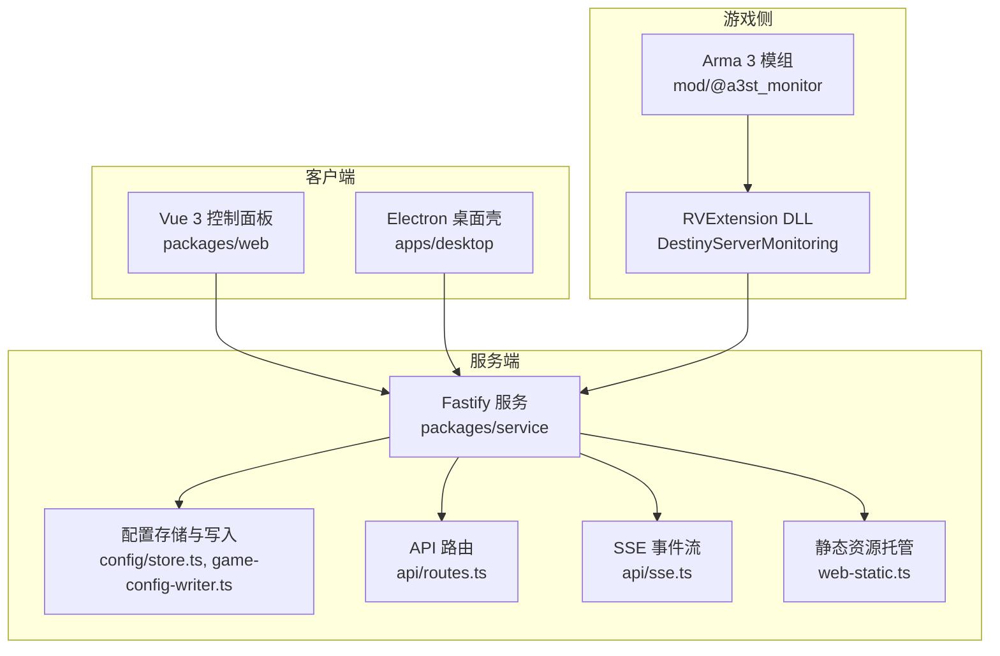
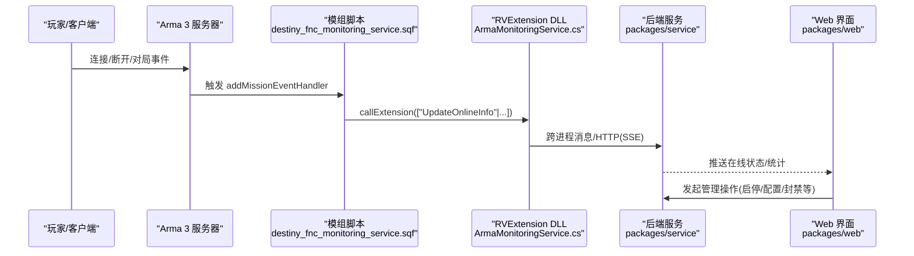
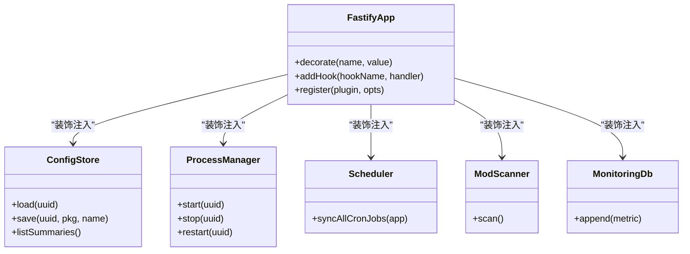
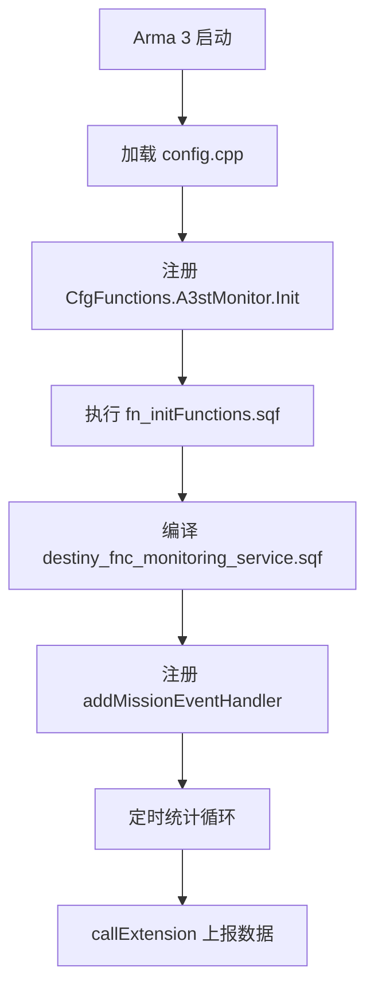
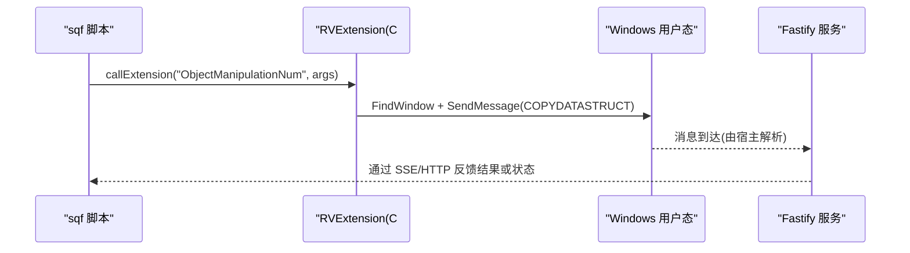
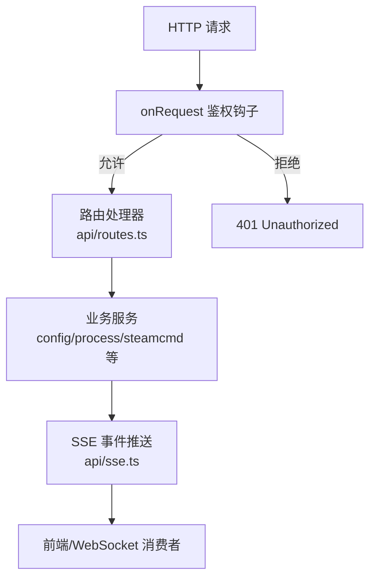
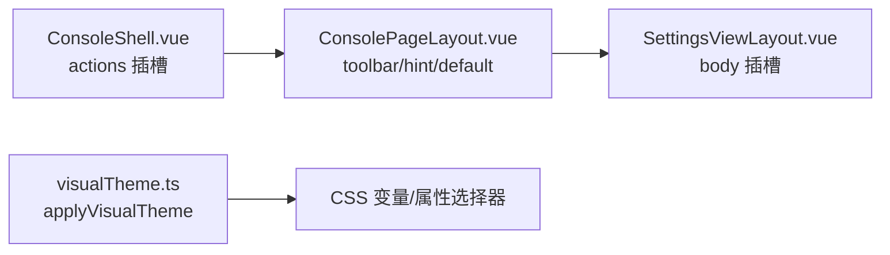
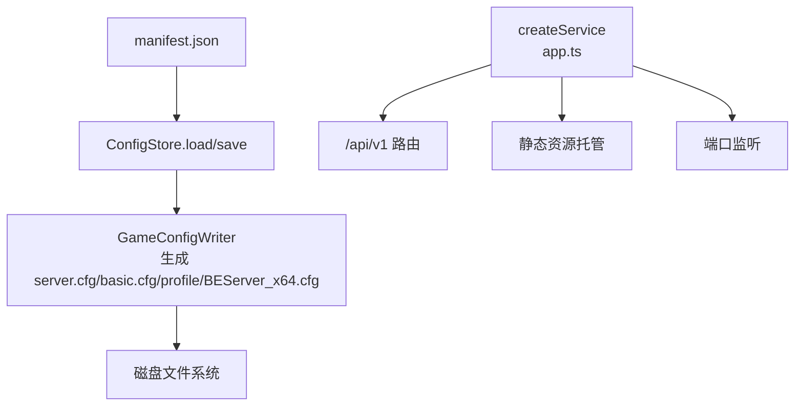
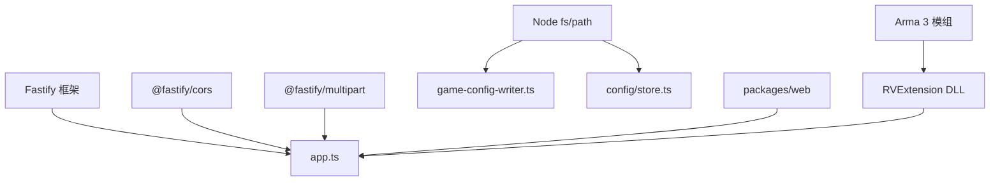
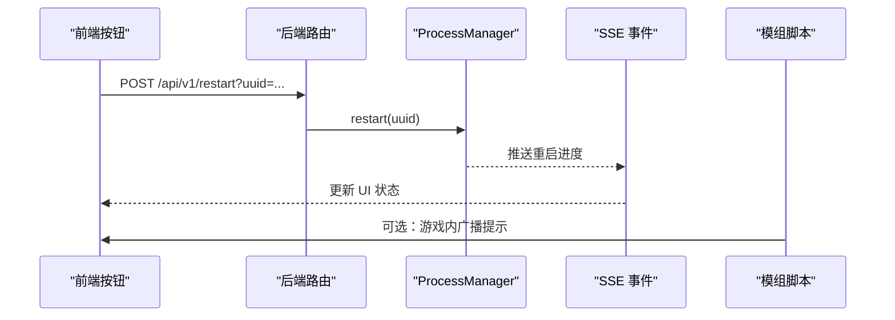

# 扩展开发指南

<cite>
**本文引用的文件**   
- [README.md](file://README.md)
- [architecture.md](file://docs/architecture.md)
- [config.cpp](file://mod/@a3st_monitor/addons/a3st_monitor/config.cpp)
- [fn_initFunctions.sqf](file://mod/@a3st_monitor/addons/a3st_monitor/fn_initFunctions.sqf)
- [destiny_fnc_monitoring_service.sqf](file://mod/@a3st_monitor/addons/a3st_monitor/script/destiny_fnc_monitoring_service.sqf)
- [ArmaMonitoringService.cs](file://DestinyServerMonitoring/DestinyServerMonitoring/ArmaMonitoringService.cs)
- [app.ts](file://packages/service/src/app.ts)
- [web-static.ts](file://packages/service/src/web-static.ts)
- [routes.ts](file://packages/service/src/api/routes.ts)
- [sse.ts](file://packages/service/src/api/sse.ts)
- [game-config-writer.ts](file://packages/service/src/config/game-config-writer.ts)
- [store.ts](file://packages/service/src/config/store.ts)
- [ConsolePageLayout.vue](file://packages/web/src/components/ConsolePageLayout.vue)
- [SettingsViewLayout.vue](file://packages/web/src/components/console/SettingsViewLayout.vue)
- [ConsoleShell.vue](file://packages/web/src/components/console/ConsoleShell.vue)
- [ServerConsoleView.vue](file://packages/web/src/views/ServerConsoleView.vue)
- [visualTheme.ts](file://packages/web/src/utils/visualTheme.ts)
</cite>

## 目录
1. [引言](#引言)
2. [项目结构](#项目结构)
3. [核心组件](#核心组件)
4. [架构总览](#架构总览)
5. [详细组件分析](#详细组件分析)
6. [依赖关系分析](#依赖关系分析)
7. [性能与可扩展性](#性能与可扩展性)
8. [故障排查](#故障排查)
9. [结论](#结论)
10. [附录：开发示例与清单](#附录开发示例与清单)

## 引言
本指南面向希望为 Arma 3 Server Tools v2 进行扩展开发的开发者，覆盖以下主题：
- 插件系统架构：扩展点定义、生命周期钩子、依赖注入机制。
- 模组开发规范：Arma 3 模组结构、配置文件格式、脚本函数注册。
- API 扩展方法：自定义路由添加、中间件开发、事件监听器实现。
- UI 扩展方案：Vue 组件插槽、面板扩展、主题定制。
- 部署与分发机制：扩展包格式、版本兼容性、自动加载配置。
- 完整开发示例：从简单命令扩展到复杂业务逻辑的逐步实现。

本项目当前主线为 TypeScript 全栈（Node.js + Fastify + SQLite），前端为 Vue 3，桌面端使用 Electron，同时提供 Arma 3 监控模组与 RVExtension C# DLL 以打通游戏进程与后端服务。

**章节来源**
- [README.md:1-108](file://README.md#L1-L108)

## 项目结构
仓库采用多包工作区组织：
- packages/service：后端服务（Fastify + SQLite + RCon + SteamCMD + 调度等）。
- packages/web：Vue 3 控制面板。
- apps/desktop：Electron 桌面壳。
- mod：Arma 3 监控模组资源（config.cpp、sqf 脚本）。
- DestinyServerMonitoring：RVExtension C# DLL 源码，用于通过 callExtension 与工具通信。
- docs：文档与历史说明。
- scripts：构建与发布脚本。

**图表来源**
- [app.ts:57-171](file://packages/service/src/app.ts#L57-L171)
- [web-static.ts:17-93](file://packages/service/src/web-static.ts#L17-L93)
- [config.cpp:1-23](file://mod/@a3st_monitor/addons/a3st_monitor/config.cpp#L1-L23)
- [ArmaMonitoringService.cs:51-135](file://DestinyServerMonitoring/DestinyServerMonitoring/ArmaMonitoringService.cs#L51-L135)

**章节来源**
- [README.md:50-66](file://README.md#L50-L66)
- [architecture.md:1-23](file://docs/architecture.md#L1-L23)

## 核心组件
本节聚焦扩展开发最关键的几个子系统：
- 后端服务容器与依赖注入：Fastify 实例装饰器承载服务单例，供路由与中间件消费。
- 配置持久化与生成：JSON 配置包 + 游戏 cfg/profile/BattlEye 文件生成。
- 模组与脚本：Arma 3 模组结构与 sqf 函数注册，配合 RVExtension 回调。
- 前端 UI 扩展点：布局插槽、主题切换、控制台 Shell 与设置页骨架。

**章节来源**
- [app.ts:57-94](file://packages/service/src/app.ts#L57-L94)
- [store.ts:51-130](file://packages/service/src/config/store.ts#L51-L130)
- [game-config-writer.ts:543-577](file://packages/service/src/config/game-config-writer.ts#L543-L577)
- [config.cpp:1-23](file://mod/@a3st_monitor/addons/a3st_monitor/config.cpp#L1-L23)
- [ConsolePageLayout.vue:12-29](file://packages/web/src/components/ConsolePageLayout.vue#L12-L29)
- [SettingsViewLayout.vue:24-46](file://packages/web/src/components/console/SettingsViewLayout.vue#L24-L46)

## 架构总览
系统由“前端控制面 + 后端服务 + 游戏侧模组/RVExtension”三部分构成。后端通过 Fastify 暴露 REST/SSE 接口，并负责配置管理、进程管理、SteamCMD、RCon、任务调度等；前端通过 Vue 3 提供可视化操作；游戏侧通过模组与 RVExtension 将运行时指标与事件回传到工具。

**图表来源**
- [destiny_fnc_monitoring_service.sqf:44-52](file://mod/@a3st_monitor/addons/a3st_monitor/script/destiny_fnc_monitoring_service.sqf#L44-L52)
- [ArmaMonitoringService.cs:116-135](file://DestinyServerMonitoring/DestinyServerMonitoring/ArmaMonitoringService.cs#L116-L135)
- [sse.ts](file://packages/service/src/api/sse.ts)
- [app.ts:147-153](file://packages/service/src/app.ts#L147-L153)

## 详细组件分析

### 1) 插件系统与扩展点
- 扩展点定义
  - 后端扩展点：Fastify 装饰器（如 configStore、processManager、steamCmd、scheduler 等）作为全局可注入的服务入口。
  - 前端扩展点：Vue 组件插槽（toolbar/hint/default）、Shell 动作插槽（actions）、设置页主体插槽。
  - 游戏侧扩展点：CfgFunctions 注册的 initFunctions 生命周期钩子，以及 callExtension 命名空间。
- 生命周期钩子
  - 后端：Fastify onRequest 钩子实现鉴权中间件；模块在 createService 中按顺序装配。
  - 游戏侧：CfgFunctions.A3stMonitor.Init.postInit 启动初始化流程，随后执行 sqf 脚本中的定时统计与事件处理。
- 依赖注入机制
  - 后端：通过 app.decorate 将服务挂载到请求上下文，路由直接消费。
  - 前端：通过 props/emits 与组合式 API 传递状态，未引入 DI 框架，但遵循组件职责分离。

**图表来源**
- [app.ts:57-94](file://packages/service/src/app.ts#L57-L94)

**章节来源**
- [app.ts:96-130](file://packages/service/src/app.ts#L96-L130)
- [config.cpp:12-22](file://mod/@a3st_monitor/addons/a3st_monitor/config.cpp#L12-L22)
- [ConsolePageLayout.vue:12-29](file://packages/web/src/components/ConsolePageLayout.vue#L12-L29)
- [SettingsViewLayout.vue:24-46](file://packages/web/src/components/console/SettingsViewLayout.vue#L24-L46)

### 2) 模组开发规范（Arma 3）
- 模组目录结构
  - addons/a3st_monitor：包含 config.cpp 与脚本目录 script。
  - config.cpp 声明 CfgPatches 与 CfgFunctions，指定 requiredAddons 与 postInit 钩子。
- 配置文件格式
  - CfgPatches.requiredVersion、requiredAddons 约束运行环境。
  - CfgFunctions.A3stMonitor.Init.initFunctions.postInit=1 表示在初始化阶段调用。
- 脚本函数注册
  - fn_initFunctions.sqf 在服务端初始化变量，编译并加载 destiny_fnc_monitoring_service.sqf。
  - 脚本内定义统计与事件处理函数，并通过 callExtension 上报数据。

**图表来源**
- [config.cpp:1-23](file://mod/@a3st_monitor/addons/a3st_monitor/config.cpp#L1-L23)
- [fn_initFunctions.sqf:1-10](file://mod/@a3st_monitor/addons/a3st_monitor/fn_initFunctions.sqf#L1-L10)
- [destiny_fnc_monitoring_service.sqf:1-21](file://mod/@a3st_monitor/addons/a3st_monitor/script/destiny_fnc_monitoring_service.sqf#L1-L21)

**章节来源**
- [config.cpp:1-23](file://mod/@a3st_monitor/addons/a3st_monitor/config.cpp#L1-L23)
- [fn_initFunctions.sqf:1-10](file://mod/@a3st_monitor/addons/a3st_monitor/fn_initFunctions.sqf#L1-L10)
- [destiny_fnc_monitoring_service.sqf:44-83](file://mod/@a3st_monitor/addons/a3st_monitor/script/destiny_fnc_monitoring_service.sqf#L44-L83)

### 3) RVExtension 与后端集成
- RVExtension 导出函数
  - RVExtensionRegisterCallback：注册回调函数指针。
  - RVExtensionVersion：返回扩展版本信息。
  - RVExtensionArgs：接收 callExtension 的参数数组，清理引号后异步转发。
- 进程间通信
  - 通过 Windows User32 SendMessage 向固定窗口标题发送 COPYDATASTRUCT 数据。
- 后端接入
  - 后端通过 SSE 与 HTTP 接口对外暴露能力，供 Web 与外部系统集成。

**图表来源**
- [ArmaMonitoringService.cs:51-59](file://DestinyServerMonitoring/DestinyServerMonitoring/ArmaMonitoringService.cs#L51-L59)
- [ArmaMonitoringService.cs:116-135](file://DestinyServerMonitoring/DestinyServerMonitoring/ArmaMonitoringService.cs#L116-L135)

**章节来源**
- [ArmaMonitoringService.cs:15-59](file://DestinyServerMonitoring/DestinyServerMonitoring/ArmaMonitoringService.cs#L15-L59)
- [ArmaMonitoringService.cs:116-135](file://DestinyServerMonitoring/DestinyServerMonitoring/ArmaMonitoringService.cs#L116-L135)

### 4) API 扩展方法
- 自定义路由添加
  - 在 api/routes.ts 中新增路由处理器，并在 app.ts 中通过 app.register(apiRoutes, { prefix: "/api/v1" }) 挂载。
  - 所有 /api/* 默认受 onRequest 鉴权钩子保护，除非显式放行（如 health、actions）。
- 中间件开发
  - 使用 app.addHook("onRequest", ...) 实现鉴权、限流、审计等横切逻辑。
  - 静态资源路径不要求 Bearer Token，避免浏览器直开页面失败。
- 事件监听器实现
  - 使用 SSE 模块将 SteamCMD 事件桥接到前端，支持实时进度与状态推送。

**图表来源**
- [app.ts:96-130](file://packages/service/src/app.ts#L96-L130)
- [app.ts:147-153](file://packages/service/src/app.ts#L147-L153)
- [sse.ts](file://packages/service/src/api/sse.ts)

**章节来源**
- [app.ts:96-130](file://packages/service/src/app.ts#L96-L130)
- [app.ts:147-153](file://packages/service/src/app.ts#L147-L153)

### 5) UI 扩展方案
- Vue 组件插槽
  - ConsolePageLayout 提供 toolbar、hint、default 插槽，便于扩展控制台顶部工具栏与提示区域。
  - SettingsViewLayout 提供 actions 与 body 插槽，便于扩展设置页保存按钮与内容区。
  - ConsoleShell 提供 actions 插槽，便于扩展实例级操作按钮。
- 面板扩展
  - ServerConsoleView 根据模式与主题动态显示/隐藏操作按钮，可作为新面板的参考。
- 主题定制
  - visualTheme.ts 提供经典/工业风主题切换，通过 data.visual 属性驱动样式。

**图表来源**
- [ConsoleShell.vue:213-218](file://packages/web/src/components/console/ConsoleShell.vue#L213-L218)
- [ConsolePageLayout.vue:12-29](file://packages/web/src/components/ConsolePageLayout.vue#L12-L29)
- [SettingsViewLayout.vue:24-46](file://packages/web/src/components/console/SettingsViewLayout.vue#L24-L46)
- [visualTheme.ts:22-28](file://packages/web/src/utils/visualTheme.ts#L22-L28)

**章节来源**
- [ConsoleShell.vue:213-218](file://packages/web/src/components/console/ConsoleShell.vue#L213-L218)
- [ConsolePageLayout.vue:12-29](file://packages/web/src/components/ConsolePageLayout.vue#L12-L29)
- [SettingsViewLayout.vue:24-46](file://packages/web/src/components/console/SettingsViewLayout.vue#L24-L46)
- [ServerConsoleView.vue:62-114](file://packages/web/src/views/ServerConsoleView.vue#L62-L114)
- [visualTheme.ts:1-28](file://packages/web/src/utils/visualTheme.ts#L1-L28)

### 6) 配置与部署
- 配置包格式
  - 每个服务器实例对应一个 UUID 目录，内含 manifest.json 与各段 JSON 配置（server/basic/startup/battleye 等）。
  - store.ts 负责读取/缓存/序列化配置包。
- 游戏配置文件生成
  - game-config-writer.ts 将配置包写为 server.cfg、basic.cfg、profile、BEServer_x64.cfg 等。
- 静态资源与 Web 根
  - web-static.ts 提供 resolveWebRoot 与 registerWebStatic，支持 WEB_ROOT 环境变量与多候选路径。
- 自动加载与启动
  - app.ts 在创建服务时注册 CORS、multipart、SSE、健康检查、API 路由与静态资源，最后启动监听。

**图表来源**
- [store.ts:51-130](file://packages/service/src/config/store.ts#L51-L130)
- [game-config-writer.ts:543-577](file://packages/service/src/config/game-config-writer.ts#L543-L577)
- [web-static.ts:17-93](file://packages/service/src/web-static.ts#L17-L93)
- [app.ts:147-171](file://packages/service/src/app.ts#L147-L171)

**章节来源**
- [store.ts:51-130](file://packages/service/src/config/store.ts#L51-L130)
- [game-config-writer.ts:543-577](file://packages/service/src/config/game-config-writer.ts#L543-L577)
- [web-static.ts:17-93](file://packages/service/src/web-static.ts#L17-L93)
- [app.ts:147-171](file://packages/service/src/app.ts#L147-L171)

## 依赖关系分析
- 组件耦合
  - 后端服务强依赖 Fastify 生态（cors、multipart、find-my-way 路由引擎）。
  - 配置模块与文件系统紧密耦合，需保证权限与路径安全。
  - 前端与后端通过 REST/SSE 解耦，UI 扩展主要基于插槽与主题属性。
- 外部依赖
  - Node.js 运行时、SQLite（通过 service 层封装）、SteamCMD、RCon。
  - Windows 平台特性（User32 SendMessage）用于 RVExtension 通信。

**图表来源**
- [app.ts:1-18](file://packages/service/src/app.ts#L1-L18)
- [web-static.ts:1-15](file://packages/service/src/web-static.ts#L1-L15)
- [game-config-writer.ts:543-577](file://packages/service/src/config/game-config-writer.ts#L543-L577)
- [store.ts:51-130](file://packages/service/src/config/store.ts#L51-L130)

**章节来源**
- [app.ts:1-18](file://packages/service/src/app.ts#L1-L18)
- [web-static.ts:1-15](file://packages/service/src/web-static.ts#L1-L15)

## 性能与可扩展性
- 后端
  - 使用 Fastify 高性能路由与插件体系；SSE 用于低延迟事件推送。
  - 配置读写采用内存缓存 + 磁盘持久化，减少重复 IO。
- 前端
  - 组件插槽与主题属性降低耦合，便于扩展与复用。
- 游戏侧
  - 定时统计循环建议保持合理间隔，避免频繁 callExtension 造成开销。
- 扩展建议
  - 新增路由尽量模块化，集中注册于 routes.ts。
  - 中间件统一在 onRequest 钩子中实现，避免分散逻辑。
  - UI 扩展优先使用插槽与主题变量，减少对现有组件结构的侵入。

[本节为通用指导，不直接分析具体文件]

## 故障排查
- 无法访问 Web UI
  - 检查 WEB_ROOT 环境变量或 packages/web/dist 是否存在 index.html。
  - 确认静态资源托管已注册且路径安全校验通过。
- API 鉴权失败
  - 确认 Authorization: Bearer <token> 或 X-Api-Key 或 query token 匹配。
  - 注意 /api/v1/health 与 /api/v1/actions 为白名单路径。
- 静态资源 404
  - 检查 URL 是否以 /api/ 开头（API 不应走静态资源兜底）。
  - 确认 isSafeUnderRoot 安全检查未拦截路径穿越。
- 游戏侧无数据上报
  - 确认模组已正确安装且 CfgFunctions 已注册。
  - 检查 RVExtension 是否正确导出并收到 callExtension 调用。

**章节来源**
- [web-static.ts:52-93](file://packages/service/src/web-static.ts#L52-L93)
- [app.ts:96-130](file://packages/service/src/app.ts#L96-L130)
- [config.cpp:12-22](file://mod/@a3st_monitor/addons/a3st_monitor/config.cpp#L12-L22)
- [ArmaMonitoringService.cs:116-135](file://DestinyServerMonitoring/DestinyServerMonitoring/ArmaMonitoringService.cs#L116-L135)

## 结论
本指南梳理了 Arma 3 Server Tools v2 的扩展点与开发范式：后端通过 Fastify 装饰器暴露服务，前端通过插槽与主题机制扩展 UI，游戏侧通过模组与 RVExtension 打通运行时数据。按照本文的架构与规范，开发者可以稳健地扩展路由、中间件、事件与界面，并以配置包与静态资源托管完成部署与分发。

[本节为总结性内容，不直接分析具体文件]

## 附录：开发示例与清单

### A. 从简单命令扩展到复杂业务逻辑
- 目标：新增一个管理命令，例如“重启服务器并广播通知”。
- 步骤
  1. 在后端新增路由处理器（api/routes.ts），调用 processManager.restart(uuid)。
  2. 在 onRequest 钩子中确保该路由需要鉴权。
  3. 通过 SSE 推送重启倒计时与状态给前端。
  4. 在前端 ConsoleShell 的 actions 插槽中添加“重启”按钮，绑定到后端 API。
  5. 可选：在游戏侧通过模组脚本广播重启提示（借助 callExtension 与 UI 文本）。

**图表来源**
- [app.ts:96-130](file://packages/service/src/app.ts#L96-L130)
- [ConsoleShell.vue:213-218](file://packages/web/src/components/console/ConsoleShell.vue#L213-L218)
- [destiny_fnc_monitoring_service.sqf:54-74](file://mod/@a3st_monitor/addons/a3st_monitor/script/destiny_fnc_monitoring_service.sqf#L54-L74)

**章节来源**
- [app.ts:96-130](file://packages/service/src/app.ts#L96-L130)
- [ConsoleShell.vue:213-218](file://packages/web/src/components/console/ConsoleShell.vue#L213-L218)
- [destiny_fnc_monitoring_service.sqf:54-74](file://mod/@a3st_monitor/addons/a3st_monitor/script/destiny_fnc_monitoring_service.sqf#L54-L74)

### B. 模组开发清单
- 在 addons/a3st_monitor 下维护 config.cpp 与脚本。
- 确保 CfgFunctions.A3stMonitor.Init.postInit 正确注册。
- 在 fn_initFunctions.sqf 中初始化变量并编译主脚本。
- 使用 addMissionEventHandler 订阅连接/断开事件。
- 通过 callExtension 上报统计数据与状态。

**章节来源**
- [config.cpp:12-22](file://mod/@a3st_monitor/addons/a3st_monitor/config.cpp#L12-L22)
- [fn_initFunctions.sqf:1-10](file://mod/@a3st_monitor/addons/a3st_monitor/fn_initFunctions.sqf#L1-L10)
- [destiny_fnc_monitoring_service.sqf:44-83](file://mod/@a3st_monitor/addons/a3st_monitor/script/destiny_fnc_monitoring_service.sqf#L44-L83)

### C. API 扩展清单
- 新增路由：在 api/routes.ts 中定义处理器，并在 app.ts 中注册。
- 中间件：在 onRequest 钩子中实现鉴权、审计、限流。
- 事件：通过 sse.ts 将后端事件推送到前端。

**章节来源**
- [app.ts:96-130](file://packages/service/src/app.ts#L96-L130)
- [app.ts:147-153](file://packages/service/src/app.ts#L147-L153)

### D. UI 扩展清单
- 使用 ConsolePageLayout 的 toolbar/hint/default 插槽扩展控制台。
- 使用 SettingsViewLayout 的 body 插槽扩展设置页内容。
- 使用 ConsoleShell 的 actions 插槽扩展实例操作按钮。
- 通过 visualTheme.ts 切换主题并应用 CSS 变量。

**章节来源**
- [ConsolePageLayout.vue:12-29](file://packages/web/src/components/ConsolePageLayout.vue#L12-L29)
- [SettingsViewLayout.vue:24-46](file://packages/web/src/components/console/SettingsViewLayout.vue#L24-L46)
- [ConsoleShell.vue:213-218](file://packages/web/src/components/console/ConsoleShell.vue#L213-L218)
- [visualTheme.ts:22-28](file://packages/web/src/utils/visualTheme.ts#L22-L28)

### E. 部署与分发清单
- 配置包：每个实例一个 UUID 目录，包含 manifest.json 与各段 JSON。
- 配置文件：使用 game-config-writer.ts 生成 server.cfg/basic.cfg/profile/BEServer_x64.cfg。
- 静态资源：确保 WEB_ROOT 或 packages/web/dist 存在 index.html。
- 服务启动：npm run build:service 与 npm run start:service，浏览器访问 http://127.0.0.1:19580。

**章节来源**
- [store.ts:51-130](file://packages/service/src/config/store.ts#L51-L130)
- [game-config-writer.ts:543-577](file://packages/service/src/config/game-config-writer.ts#L543-L577)
- [web-static.ts:17-41](file://packages/service/src/web-static.ts#L17-L41)
- [README.md:70-86](file://README.md#L70-L86)