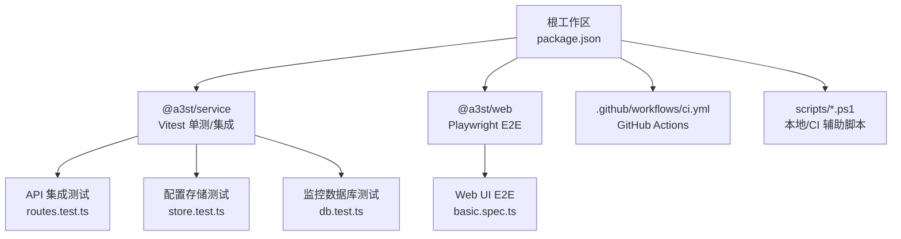
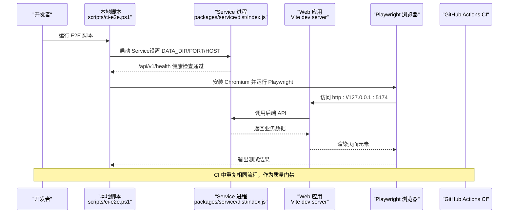
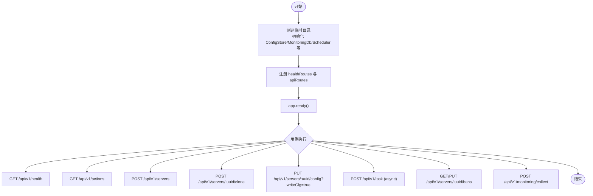
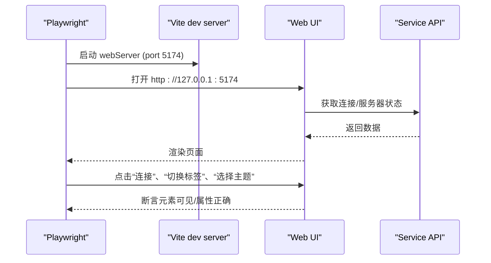
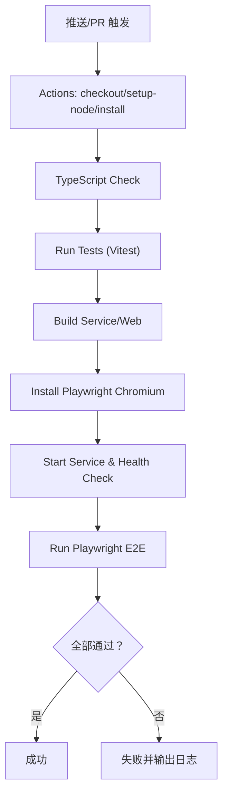
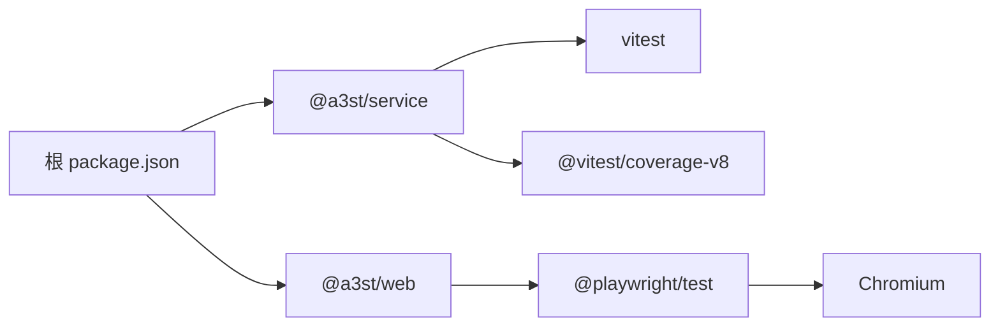

# 测试指南

<cite>
**本文引用的文件**   
- [package.json](file://package.json)
- [packages/service/package.json](file://packages/service/package.json)
- [packages/web/package.json](file://packages/web/package.json)
- [packages/service/vitest.config.ts](file://packages/service/vitest.config.ts)
- [.github/workflows/ci.yml](file://.github/workflows/ci.yml)
- [scripts/ci-e2e.ps1](file://scripts/ci-e2e.ps1)
- [scripts/run-automated-tests.ps1](file://scripts/run-automated-tests.ps1)
- [packages/service/src/api/routes.test.ts](file://packages/service/src/api/routes.test.ts)
- [packages/service/src/config/store.test.ts](file://packages/service/src/config/store.test.ts)
- [packages/service/src/monitoring/db.test.ts](file://packages/service/src/monitoring/db.test.ts)
- [packages/web/e2e/basic.spec.ts](file://packages/web/e2e/basic.spec.ts)
- [packages/web/playwright.config.ts](file://packages/web/playwright.config.ts)
</cite>

## 目录
1. [引言](#引言)
2. [项目结构](#项目结构)
3. [核心组件](#核心组件)
4. [架构总览](#架构总览)
5. [详细组件分析](#详细组件分析)
6. [依赖分析](#依赖分析)
7. [性能考虑](#性能考虑)
8. [故障排查指南](#故障排查指南)
9. [结论](#结论)
10. [附录](#附录)

## 引言
本测试指南面向 Arma3 Server Tools 多仓库工程，说明分层测试策略与执行方式：单元测试（Vitest）、集成测试、端到端测试（Playwright），以及 CI/CD 流水线中的自动化测试、失败处理和质量门禁。文档同时覆盖测试工具链配置、Mock 策略、测试数据管理、覆盖率报告生成，并提供调试技巧与最佳实践。

## 项目结构
本项目采用 monorepo 组织：
- 根 package.json 提供统一脚本入口，如 npm test、npm run test:e2e。
- packages/service 为后端服务，使用 Vitest 进行单元测试与 API 集成测试。
- packages/web 为前端 SPA，使用 Playwright 进行 E2E 测试。
- .github/workflows/ci.yml 定义 GitHub Actions 的构建、类型检查、测试与 E2E 流程。
- scripts 下包含 Windows PowerShell 辅助脚本，用于本地或 CI 中启动 Service 并运行 E2E。

图示来源
- [package.json:10-30](file://package.json#L10-L30)
- [packages/service/package.json:8-15](file://packages/service/package.json#L8-L15)
- [packages/web/package.json:1-15](file://packages/web/package.json#L1-L15)
- [.github/workflows/ci.yml:13-62](file://.github/workflows/ci.yml#L13-L62)

章节来源
- [package.json:10-30](file://package.json#L10-L30)
- [packages/service/package.json:8-15](file://packages/service/package.json#L8-L15)
- [packages/web/package.json:1-15](file://packages/web/package.json#L1-L15)

## 核心组件
- 测试框架与工具链
  - 后端：Vitest + @vitest/coverage-v8，环境 node，全局断言，v8 覆盖率。
  - 前端：Playwright，headless Chromium，复用 Vite dev server。
  - 类型检查：TypeScript（service）与 vue-tsc（web）。
- 脚本入口
  - npm test：执行 service 的 vitest run。
  - npm run test:e2e：调用 scripts/ci-e2e.ps1 启动 Service 并运行 Playwright。
  - CI：在 GitHub Actions 中执行 typecheck、test、build、install playwright chromium、E2E。

章节来源
- [packages/service/vitest.config.ts:1-35](file://packages/service/vitest.config.ts#L1-L35)
- [packages/service/package.json:8-15](file://packages/service/package.json#L8-L15)
- [packages/web/package.json:27-35](file://packages/web/package.json#L27-L35)
- [package.json:24-26](file://package.json#L24-L26)
- [.github/workflows/ci.yml:31-62](file://.github/workflows/ci.yml#L31-L62)

## 架构总览
下图展示从代码到测试执行的完整链路：开发者编写测试 → Vitest/Playwright 执行 → CI 自动触发 → 质量门禁。

图示来源
- [scripts/ci-e2e.ps1:8-33](file://scripts/ci-e2e.ps1#L8-L33)
- [scripts/ci-e2e.ps1:35-58](file://scripts/ci-e2e.ps1#L35-L58)
- [scripts/ci-e2e.ps1:60-83](file://scripts/ci-e2e.ps1#L60-L83)
- [packages/web/playwright.config.ts:7-23](file://packages/web/playwright.config.ts#L7-L23)
- [.github/workflows/ci.yml:43-62](file://.github/workflows/ci.yml#L43-L62)

## 详细组件分析

### 后端单元测试与 API 集成测试（Vitest）
- 测试目标
  - 配置持久化与容错（ConfigStore）。
  - 监控数据存储与查询（MonitoringDb）。
  - Fastify API 路由与业务逻辑（routes.test.ts）。
- 关键实现要点
  - 使用临时目录隔离测试数据，避免污染文件系统。
  - 在 beforeAll 中构造最小 Fastify 实例，注入真实服务实例（非 Mock），以验证集成路径。
  - 对异步任务、配置写入、克隆服务器等场景进行端到端式 API 验证。
  - 使用 fs/path/os 创建/清理临时目录，确保测试幂等性。

图示来源
- [packages/service/src/api/routes.test.ts:28-58](file://packages/service/src/api/routes.test.ts#L28-L58)
- [packages/service/src/api/routes.test.ts:66-325](file://packages/service/src/api/routes.test.ts#L66-L325)

章节来源
- [packages/service/src/api/routes.test.ts:1-326](file://packages/service/src/api/routes.test.ts#L1-L326)
- [packages/service/src/config/store.test.ts:1-118](file://packages/service/src/config/store.test.ts#L1-L118)
- [packages/service/src/monitoring/db.test.ts:1-81](file://packages/service/src/monitoring/db.test.ts#L1-L81)

#### 配置存储测试（ConfigStore）
- 覆盖点
  - 保存/加载/删除服务器配置。
  - 列表排序与名称保留。
  - 并发写“最后写入胜出”。
  - 部分损坏文件的容错读取。
- 数据管理
  - 使用 os.tmpdir 下的随机目录，beforeEach/afterEach 自动清理。

章节来源
- [packages/service/src/config/store.test.ts:10-17](file://packages/service/src/config/store.test.ts#L10-L17)
- [packages/service/src/config/store.test.ts:19-117](file://packages/service/src/config/store.test.ts#L19-L117)

#### 监控数据库测试（MonitoringDb）
- 覆盖点
  - 记录统计、批量插入玩家、时间窗口查询。
  - 未知服务器的空结果与零值摘要。
- 数据管理
  - 使用临时目录与 waitReady/close 生命周期管理。

章节来源
- [packages/service/src/monitoring/db.test.ts:10-19](file://packages/service/src/monitoring/db.test.ts#L10-L19)
- [packages/service/src/monitoring/db.test.ts:21-80](file://packages/service/src/monitoring/db.test.ts#L21-L80)

### 前端端到端测试（Playwright）
- 测试目标
  - 连接页加载、默认本地连接显示。
  - 控制台面板、侧边栏导航切换。
  - 主题模式切换、添加连接对话框。
  - 模组页加载、首服向导步骤。
- 运行方式
  - playwright.config.ts 启动 Vite dev server（端口 5174），headless Chromium。
  - basic.spec.ts 通过 data-testid 定位元素，断言可见性与交互。

图示来源
- [packages/web/playwright.config.ts:7-23](file://packages/web/playwright.config.ts#L7-L23)
- [packages/web/e2e/basic.spec.ts:1-108](file://packages/web/e2e/basic.spec.ts#L1-L108)

章节来源
- [packages/web/playwright.config.ts:1-25](file://packages/web/playwright.config.ts#L1-L25)
- [packages/web/e2e/basic.spec.ts:1-108](file://packages/web/e2e/basic.spec.ts#L1-L108)

### CI/CD 测试流水线
- GitHub Actions
  - 矩阵 Node 版本 20/22。
  - 步骤：checkout → setup-node → install → typecheck → test → build service → build web → install playwright chromium → start service → health check → run playwright tests。
- 本地 PowerShell 脚本
  - ci-e2e.ps1：校验 Service 已构建 → 清理并创建 .a3st-e2e-data → 启动 Service 子进程 → 轮询健康接口 → 安装 Chromium → 运行 Playwright → 停止 Service。
  - run-automated-tests.ps1：构建 .NET 解决方案并运行 xUnit 测试（适用于 DestinyServerMonitoring 相关测试）。

图示来源
- [.github/workflows/ci.yml:13-62](file://.github/workflows/ci.yml#L13-L62)
- [scripts/ci-e2e.ps1:8-83](file://scripts/ci-e2e.ps1#L8-L83)
- [scripts/run-automated-tests.ps1:9-32](file://scripts/run-automated-tests.ps1#L9-L32)

章节来源
- [.github/workflows/ci.yml:1-63](file://.github/workflows/ci.yml#L1-L63)
- [scripts/ci-e2e.ps1:1-87](file://scripts/ci-e2e.ps1#L1-L87)
- [scripts/run-automated-tests.ps1:1-33](file://scripts/run-automated-tests.ps1#L1-L33)

## 依赖分析
- 测试依赖关系
  - service 依赖 vitest 与 @vitest/coverage-v8，用于单测与覆盖率。
  - web 依赖 @playwright/test，用于 E2E。
  - 根脚本将 service 的 test 命令暴露为 npm test。
- 运行时依赖
  - Service 使用 Fastify、croner、sql.js、undici 等；测试中直接实例化这些依赖，保证集成真实性。
  - Playwright 依赖 Chromium，CI 中显式安装。

图示来源
- [package.json:24-26](file://package.json#L24-L26)
- [packages/service/package.json:25-30](file://packages/service/package.json#L25-L30)
- [packages/web/package.json:27-35](file://packages/web/package.json#L27-L35)

章节来源
- [package.json:24-26](file://package.json#L24-L26)
- [packages/service/package.json:25-30](file://packages/service/package.json#L25-L30)
- [packages/web/package.json:27-35](file://packages/web/package.json#L27-L35)

## 性能考虑
- Vitest 覆盖率阈值
  - statements 90%、branches 80%、functions 90%、lines 90%，未达标会阻止合并。
- 排除范围
  - 排除 index.ts、types、process、steamcmd、rcon/client、api/routes、api/health 等文件，聚焦核心业务逻辑。
- E2E 超时与重试
  - Playwright 设置较长 timeout（冷启动 Vite 可能超过 30s），retries 为 0，强调稳定性优先。
- 并行与隔离
  - 每个测试使用独立临时目录，避免共享状态导致的竞态与慢速。

章节来源
- [packages/service/vitest.config.ts:9-33](file://packages/service/vitest.config.ts#L9-L33)
- [packages/web/playwright.config.ts:9-11](file://packages/web/playwright.config.ts#L9-L11)

## 故障排查指南
- 常见错误与定位
  - Service 未构建：ci-e2e.ps1 会在启动前检查 dist/index.js 是否存在，不存在则抛出错误。
  - 健康检查失败：脚本轮询 /api/v1/health，若 30 秒内未就绪，打印 Job 输出并终止。
  - Playwright 安装失败：显式捕获退出码并报错。
  - 端口冲突：固定 PORT=19580，确保无其他进程占用。
- 调试技巧
  - 断点调试：在 routes.test.ts 中打断点，使用 IDE 的 Node.js 调试器逐步执行 Fastify 请求。
  - 日志分析：查看 Service 标准输出与错误输出，结合 health 接口响应体定位问题。
  - 性能瓶颈：关注 Vite 首次编译耗时（Playwright 已放宽超时），必要时启用 reuseExistingServer 环境变量减少冷启动。
  - 覆盖率报告：运行 npm test 后查看 lcov 文本摘要，定位未覆盖分支与语句。

章节来源
- [scripts/ci-e2e.ps1:11-13](file://scripts/ci-e2e.ps1#L11-L13)
- [scripts/ci-e2e.ps1:35-58](file://scripts/ci-e2e.ps1#L35-L58)
- [scripts/ci-e2e.ps1:60-83](file://scripts/ci-e2e.ps1#L60-L83)
- [packages/web/playwright.config.ts:17-23](file://packages/web/playwright.config.ts#L17-L23)
- [packages/service/vitest.config.ts:9-33](file://packages/service/vitest.config.ts#L9-L33)

## 结论
本项目采用清晰的分层测试策略：后端使用 Vitest 进行单元与 API 集成测试，前端使用 Playwright 进行 E2E 测试，并通过 GitHub Actions 与 PowerShell 脚本形成稳定的自动化流水线。配合严格的覆盖率阈值与隔离的测试数据管理，能够在保证质量的同时提升开发效率。建议在新增功能时遵循本指南的规范，持续完善测试覆盖与可观测性。

## 附录
- 常用命令
  - npm test：运行 service 的 Vitest 测试。
  - npm run test:e2e：本地运行 E2E（Windows PowerShell）。
  - npx playwright test：在 packages/web 目录下运行 Playwright。
- 覆盖率输出
  - 查看 lcov 与 text-summary 输出，确认是否达到阈值。
- 示例参考
  - API 集成测试：packages/service/src/api/routes.test.ts
  - 配置存储测试：packages/service/src/config/store.test.ts
  - 监控数据库测试：packages/service/src/monitoring/db.test.ts
  - Web UI E2E：packages/web/e2e/basic.spec.ts