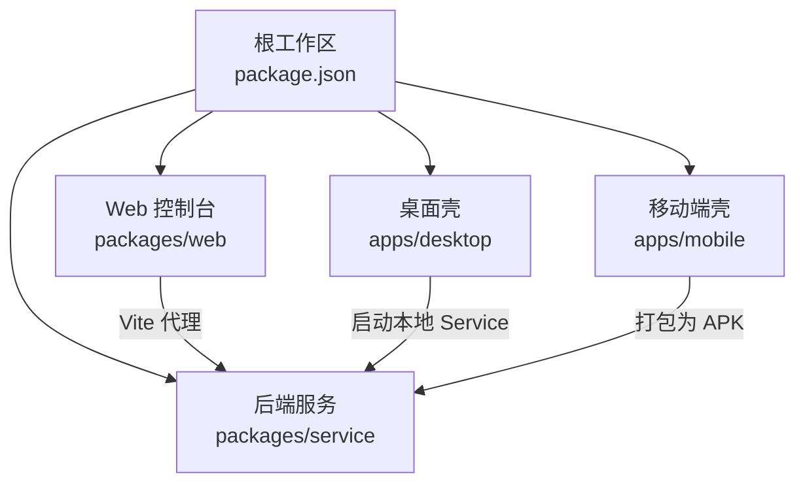
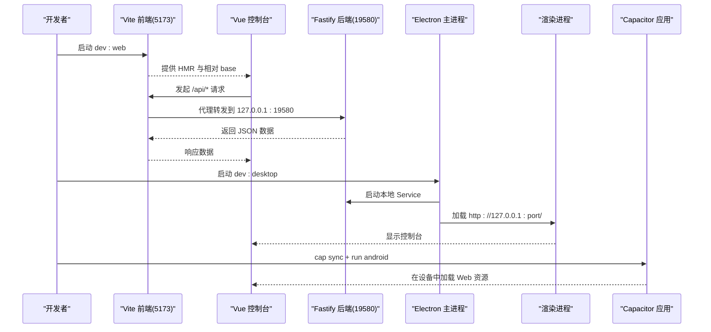
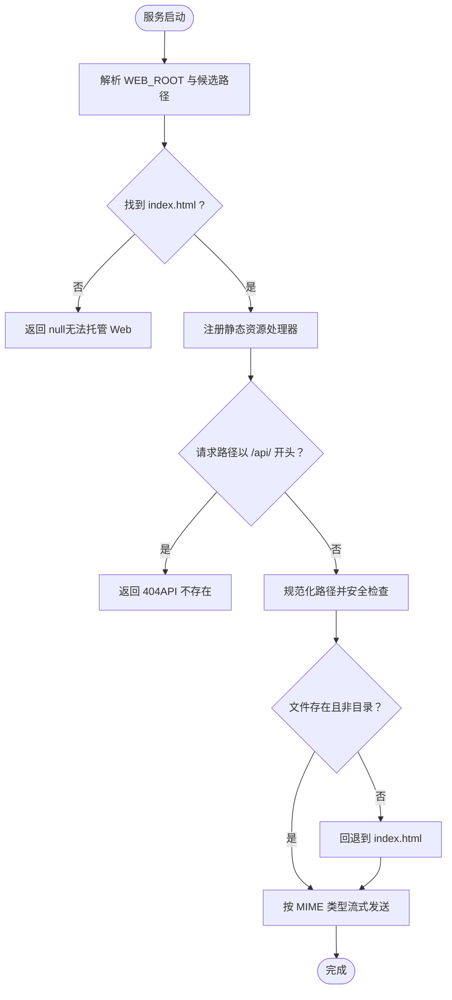
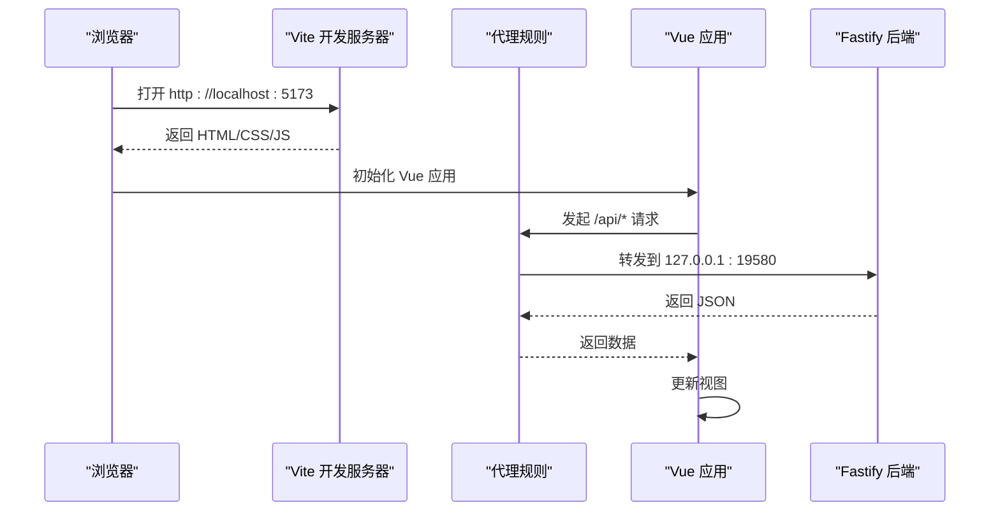
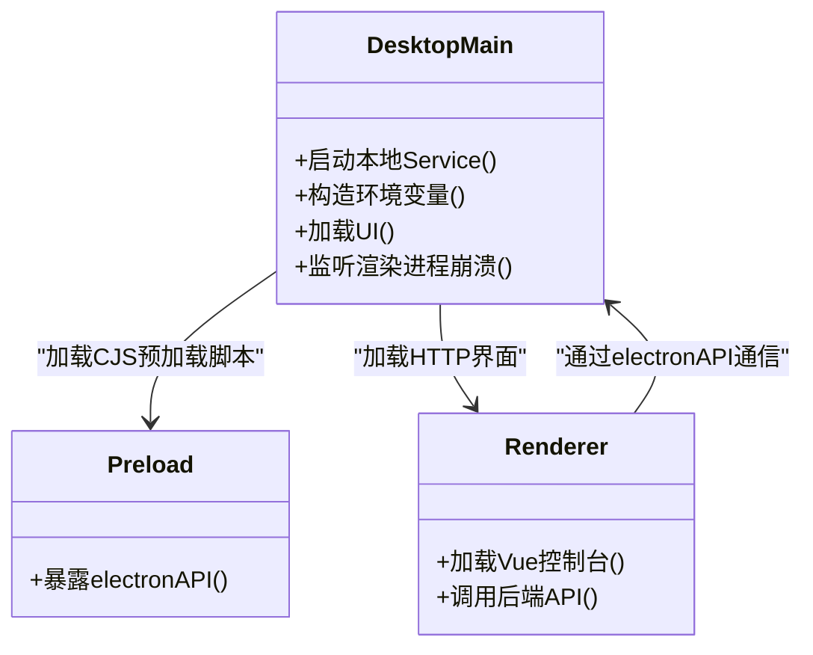
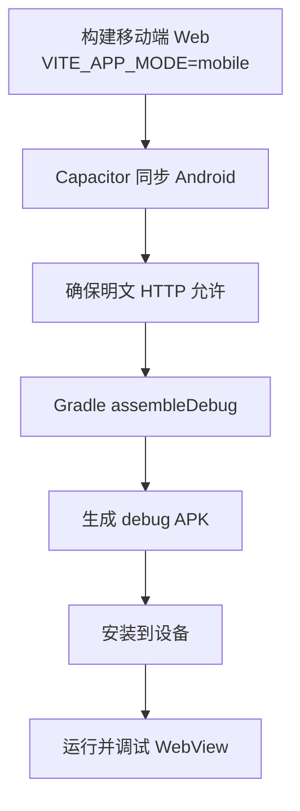
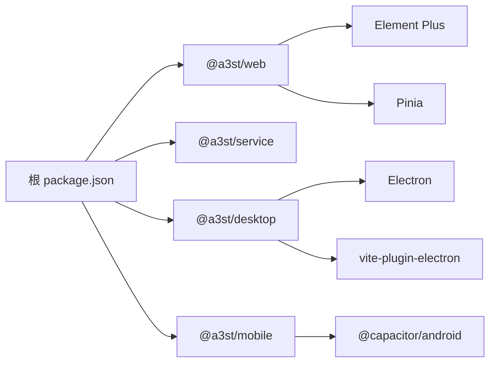

# 调试与开发工具

<cite>
**本文引用的文件**   
- [README.md](file://README.md)
- [package.json](file://package.json)
- [v2-quickstart.md](file://docs/v2-quickstart.md)
- [packages/web/vite.config.ts](file://packages/web/vite.config.ts)
- [packages/web/tsconfig.json](file://packages/web/tsconfig.json)
- [packages/web/src/main.ts](file://packages/web/src/main.ts)
- [packages/web/src/composables/useSettingsPage.ts](file://packages/web/src/composables/useSettingsPage.ts)
- [packages/service/src/web-static.ts](file://packages/service/src/web-static.ts)
- [apps/desktop/package.json](file://apps/desktop/package.json)
- [apps/desktop/vite.config.ts](file://apps/desktop/vite.config.ts)
- [apps/desktop/src/main/index.ts](file://apps/desktop/src/main/index.ts)
- [apps/mobile/package.json](file://apps/mobile/package.json)
- [scripts/pack-mobile-apk.ps1](file://scripts/pack-mobile-apk.ps1)
- [scripts/ensure-mobile-cleartext.ps1](file://scripts/ensure-mobile-cleartext.ps1)
</cite>

## 目录
1. [简介](#简介)
2. [项目结构](#项目结构)
3. [核心组件](#核心组件)
4. [架构总览](#架构总览)
5. [详细组件分析](#详细组件分析)
6. [依赖关系分析](#依赖关系分析)
7. [性能分析与优化](#性能分析与优化)
8. [常见调试场景](#常见调试场景)
9. [结论](#结论)
10. [附录：IDE 配置模板](#附录ide-配置模板)

## 简介
本指南面向 Arma3 Server Tools v2 的开发者，聚焦“调试与开发工具”的使用与实践。内容覆盖 IDE 配置建议、后端 Fastify 服务调试、前端 Vue 控制台调试、Electron 桌面应用调试、Capacitor 移动应用调试，以及内存泄漏检测、CPU 性能分析、网络请求监控等性能分析方法。同时给出数据库连接问题、进程通信异常、文件权限错误、端口冲突等常见问题的排查思路，并说明开发服务器启动方式与热重载配置。

## 项目结构
仓库采用 monorepo 组织，包含后端服务、Web 控制台、Electron 桌面壳与 Capacitor 移动端壳。根脚本通过 npm workspaces 统一编排构建与运行命令。

图示来源
- [package.json:6-30](file://package.json#L6-L30)
- [README.md:50-66](file://README.md#L50-L66)

章节来源
- [README.md:50-66](file://README.md#L50-L66)
- [package.json:6-30](file://package.json#L6-L30)

## 核心组件
- 后端服务（Fastify + SQLite）：提供 HTTP API、静态 Web UI 托管、任务调度与日志采集。
- Web 控制台（Vue 3 + Vite）：浏览器端控制面板，开发模式下通过 Vite 代理访问后端。
- Electron 桌面壳：启动本机 Service，内嵌 Web 控制台，处理托盘、窗口生命周期与渲染进程异常恢复。
- Capacitor 移动端壳：将 Web 控制台打包为 Android APK，支持局域网 HTTP 访问。

章节来源
- [README.md:3-10](file://README.md#L3-L10)
- [docs/v2-quickstart.md:1-11](file://docs/v2-quickstart.md#L1-L11)

## 架构总览
下图展示开发模式下的端到端交互：前端通过 Vite 开发服务器启动，并在开发模式下将 `/api` 请求代理到本地后端；Electron 桌面壳会拉起本地 Service 并加载 Web 控制台；移动端通过 Capacitor 同步 Web 资源并运行在 Android 设备上。

图示来源
- [packages/web/vite.config.ts:25-34](file://packages/web/vite.config.ts#L25-L34)
- [apps/desktop/src/main/index.ts:281-320](file://apps/desktop/src/main/index.ts#L281-L320)
- [apps/desktop/src/main/index.ts:563-568](file://apps/desktop/src/main/index.ts#L563-L568)
- [apps/mobile/package.json:7-12](file://apps/mobile/package.json#L7-L12)

## 详细组件分析

### 后端服务调试（Fastify 应用）
- 启动方式
  - 使用根脚本 `npm run start:service` 直接运行已编译的服务入口。
  - 也可手动执行 `node packages/service/dist/index.js`，并通过环境变量设置数据目录与端口。
- 静态 Web 托管
  - 服务根据环境变量 `WEB_ROOT` 与候选路径解析 Web 根目录，若未找到则返回空。
  - 对非 API 路径进行安全校验，防止目录穿越，并以流式读取静态文件。
- 调试要点
  - 使用 Node Inspector 或 VS Code 调试器附加到 `node packages/service/dist/index.js`。
  - 检查 `WEB_ROOT` 是否正确指向 `packages/web/dist` 或其他静态资源目录。
  - 观察 404/403 路由逻辑，确认静态资源路径与安全校验是否生效。

图示来源
- [packages/service/src/web-static.ts:17-41](file://packages/service/src/web-static.ts#L17-L41)
- [packages/service/src/web-static.ts:62-93](file://packages/service/src/web-static.ts#L62-L93)

章节来源
- [docs/v2-quickstart.md:22-33](file://docs/v2-quickstart.md#L22-L33)
- [packages/service/src/web-static.ts:17-41](file://packages/service/src/web-static.ts#L17-L41)
- [packages/service/src/web-static.ts:62-93](file://packages/service/src/web-static.ts#L62-L93)

### 前端控制台调试（Vue DevTools）
- 开发服务器
  - Vite 默认监听 5173 端口，开发模式下将 `/api` 代理到 `http://127.0.0.1:19580`。
  - 资源路径使用相对 `base: "./"`，适配 Electron file://、Service 静态托管与 Capacitor。
- 运行时错误处理
  - Vue 全局错误处理器捕获异常并输出到控制台，同时在界面顶部显示“界面异常”横幅。
- 调试要点
  - 使用浏览器开发者工具与 Vue DevTools 检查组件状态、Pinia 状态与网络请求。
  - 检查 Vite 代理是否成功转发 `/api` 请求。
  - 关注 Vue 全局错误横幅提示，快速定位渲染层异常。

图示来源
- [packages/web/vite.config.ts:8-10](file://packages/web/vite.config.ts#L8-L10)
- [packages/web/vite.config.ts:25-34](file://packages/web/vite.config.ts#L25-L34)
- [packages/web/src/main.ts:22-37](file://packages/web/src/main.ts#L22-L37)

章节来源
- [packages/web/vite.config.ts:8-10](file://packages/web/vite.config.ts#L8-L10)
- [packages/web/vite.config.ts:25-34](file://packages/web/vite.config.ts#L25-L34)
- [packages/web/src/main.ts:22-37](file://packages/web/src/main.ts#L22-L37)

### 桌面应用调试（Electron DevTools）
- 工程与脚本
  - Electron 主进程入口由 Vite 插件管理，preload 脚本以 CommonJS 输出，避免 ESM 静默失败。
  - 桌面脚本提供 `dev`、`build`、`preview`、`pack` 等命令。
- 启动本地 Service
  - 桌面主进程根据设置生成环境变量（端口、主机、数据目录、API Token），并启动本地 Service。
  - 开发模式下使用 `node` 执行服务入口；生产模式使用当前可执行路径并注入 `ELECTRON_RUN_AS_NODE=1`。
- 窗口与渲染进程
  - 优先加载 `http://127.0.0.1:port/` 以避免 file:// 下动态 chunk 白屏问题。
  - 监听渲染进程崩溃事件，弹出对话框并尝试重新加载界面。
- 调试要点
  - 启用 Electron DevTools 查看渲染进程控制台与网络面板。
  - 检查 preload 脚本是否成功加载，确保 electronAPI 可用。
  - 观察渲染进程崩溃原因与自动恢复行为。

图示来源
- [apps/desktop/vite.config.ts:8-46](file://apps/desktop/vite.config.ts#L8-L46)
- [apps/desktop/src/main/index.ts:281-320](file://apps/desktop/src/main/index.ts#L281-L320)
- [apps/desktop/src/main/index.ts:528-537](file://apps/desktop/src/main/index.ts#L528-L537)
- [apps/desktop/src/main/index.ts:563-568](file://apps/desktop/src/main/index.ts#L563-L568)

章节来源
- [apps/desktop/package.json:9-17](file://apps/desktop/package.json#L9-L17)
- [apps/desktop/vite.config.ts:8-46](file://apps/desktop/vite.config.ts#L8-L46)
- [apps/desktop/src/main/index.ts:281-320](file://apps/desktop/src/main/index.ts#L281-L320)
- [apps/desktop/src/main/index.ts:528-537](file://apps/desktop/src/main/index.ts#L528-L537)
- [apps/desktop/src/main/index.ts:563-568](file://apps/desktop/src/main/index.ts#L563-L568)

### 移动应用调试（Capacitor 调试）
- 工程与脚本
  - 移动端壳通过 `cap sync android` 同步 Web 资源，并提供 `run:android` 在设备上运行。
  - 构建脚本会强制允许明文 HTTP，以便在局域网访问本地 Service。
- 调试要点
  - 使用 Android Studio 或 Chrome DevTools for Android 调试 WebView。
  - 检查 `network_security_config.xml` 与 `AndroidManifest.xml` 是否允许明文 HTTP。
  - 确认 `VITE_APP_MODE=mobile` 构建产物已正确同步到 `apps/mobile/www`。

图示来源
- [apps/mobile/package.json:7-12](file://apps/mobile/package.json#L7-L12)
- [scripts/pack-mobile-apk.ps1:36-75](file://scripts/pack-mobile-apk.ps1#L36-L75)
- [scripts/ensure-mobile-cleartext.ps1:1-39](file://scripts/ensure-mobile-cleartext.ps1#L1-L39)

章节来源
- [apps/mobile/package.json:7-12](file://apps/mobile/package.json#L7-L12)
- [scripts/pack-mobile-apk.ps1:36-75](file://scripts/pack-mobile-apk.ps1#L36-L75)
- [scripts/ensure-mobile-cleartext.ps1:1-39](file://scripts/ensure-mobile-cleartext.ps1#L1-L39)

## 依赖关系分析
- 根工作区通过 workspaces 管理 apps 与 packages。
- Web 控制台依赖 Element Plus 与 Pinia，并使用 Vite 插件进行自动导入与组件解析。
- Electron 桌面壳依赖 vite-plugin-electron 与 renderer 插件，preload 必须输出 CJS。
- 移动端壳依赖 @capacitor/android 与 @capacitor/core，并通过脚本确保 Android 明文 HTTP。

图示来源
- [package.json:6-30](file://package.json#L6-L30)
- [apps/desktop/package.json:19-29](file://apps/desktop/package.json#L19-L29)
- [apps/mobile/package.json:14-21](file://apps/mobile/package.json#L14-L21)

章节来源
- [package.json:6-30](file://package.json#L6-L30)
- [apps/desktop/package.json:19-29](file://apps/desktop/package.json#L19-L29)
- [apps/mobile/package.json:14-21](file://apps/mobile/package.json#L14-L21)

## 性能分析与优化
- 内存泄漏检测
  - 在浏览器中打开“性能”面板，录制一段时间的运行快照，比较堆快照查找未释放引用。
  - 在 Electron 渲染进程中同样可使用“内存”面板对比堆快照。
  - 针对长驻任务（如轮询、定时器）检查闭包与全局变量引用。
- CPU 性能分析
  - 使用“性能”面板录制用户操作，分析火焰图定位热点函数。
  - 注意 Vue 组件重渲染与大量 DOM 操作导致的性能瓶颈。
- 网络请求监控
  - 使用“网络”面板查看请求耗时、大小与重试策略。
  - 检查 Vite 代理转发是否正常，确认后端接口响应时间与错误码。
- 优化建议
  - 减少不必要的状态更新与深拷贝。
  - 对大列表使用虚拟滚动与分页加载。
  - 合理拆分模块与懒加载页面，降低首屏体积。

[本节为通用指导，不直接分析具体文件]

## 常见调试场景
- 数据库连接问题
  - 现象：后端启动后无法读写 SQLite 数据。
  - 排查：检查数据目录是否存在且可写；确认 `DATA_DIR` 环境变量是否设置；观察后端日志中的路径与权限错误。
  - 解决：赋予目录写入权限，或修正环境变量指向有效路径。
- 进程通信异常
  - 现象：Electron 渲染进程崩溃或无法调用 electronAPI。
  - 排查：检查 preload 脚本是否以 CJS 输出；确认 preload 路径解析逻辑；查看渲染进程崩溃事件详情。
  - 解决：修复 preload 构建配置，确保 electronAPI 可用；必要时重启桌面应用。
- 文件权限错误
  - 现象：后端无法写入配置文件或日志。
  - 排查：检查目标目录权限与服务运行账户；确认 `WEB_ROOT` 指向合法路径。
  - 解决：调整目录权限或使用具有写入权限的路径。
- 端口冲突解决
  - 现象：后端或前端启动时报端口占用。
  - 排查：确认 19580（后端）与 5173（前端）是否被其他进程占用。
  - 解决：停止占用进程或修改端口配置；在 Electron 中检查 Settings 中的端口设置。

章节来源
- [docs/v2-quickstart.md:22-33](file://docs/v2-quickstart.md#L22-L33)
- [apps/desktop/src/main/index.ts:281-320](file://apps/desktop/src/main/index.ts#L281-L320)
- [apps/desktop/src/main/index.ts:528-537](file://apps/desktop/src/main/index.ts#L528-L537)
- [packages/service/src/web-static.ts:17-41](file://packages/service/src/web-static.ts#L17-L41)

## 结论
通过本指南，开发者可以系统地在 VS Code 中配置调试环境，分别对后端 Fastify 服务、前端 Vue 控制台、Electron 桌面应用与 Capacitor 移动应用进行调试。结合性能分析工具与常见问题的排查方法，能够更高效地定位与解决问题，提升开发与交付效率。

[本节为总结性内容，不直接分析具体文件]

## 附录：IDE 配置模板
- VS Code 扩展推荐
  - ESLint、Prettier、Vue Language Features (Volar)、TypeScript Vue Plugin (Volar)。
  - Electron 相关：Electron Snippets、ES7+ React/Redux/React-Native snippets（如需）。
  - 调试：Debugger for Chrome（用于 Electron 渲染进程调试）。
- 调试配置模板
  - Node 后端调试：附加到 `node packages/service/dist/index.js`，设置断点于路由与静态资源处理逻辑。
  - Electron 渲染调试：启用 Electron DevTools，在渲染进程控制台设置断点。
  - 浏览器调试：直接在浏览器中调试 Vue 应用，配合 Vue DevTools。
- 代码片段库
  - 常用 API 调用封装、错误处理模板、Vue 组件骨架、Electron 主进程与 preload 通信模板。
  - 可在 VS Code 用户片段中定义，提高重复代码编写效率。

[本节为通用指导，不直接分析具体文件]