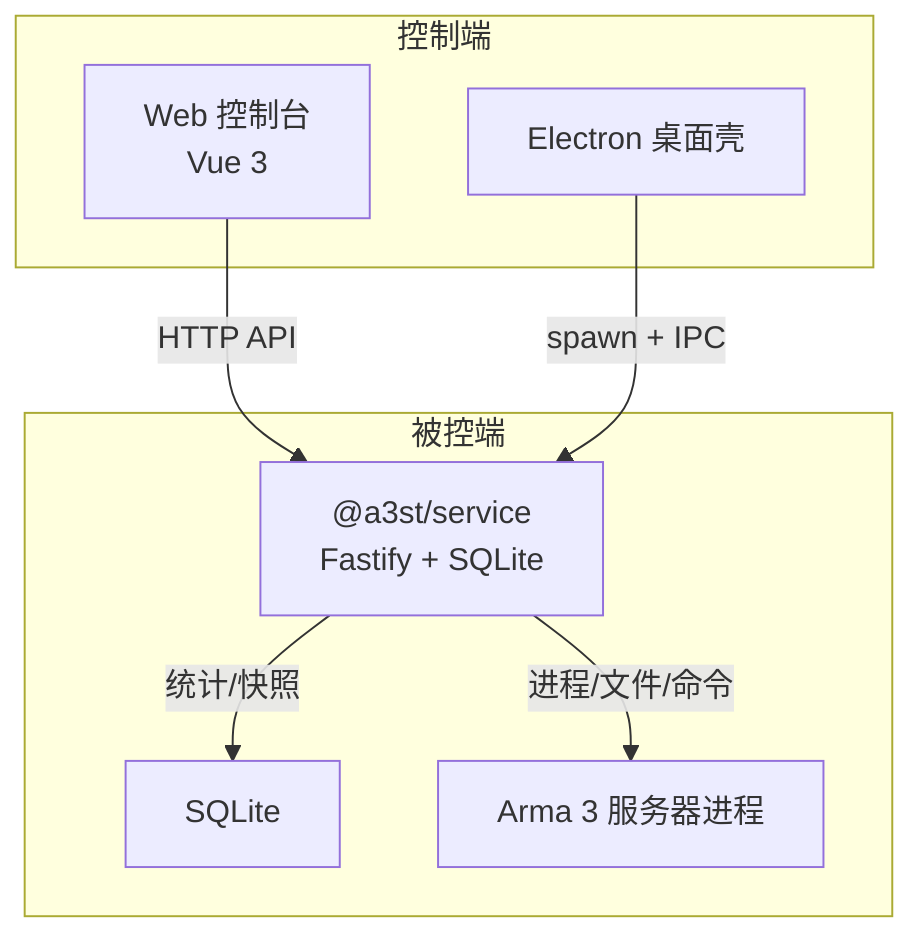
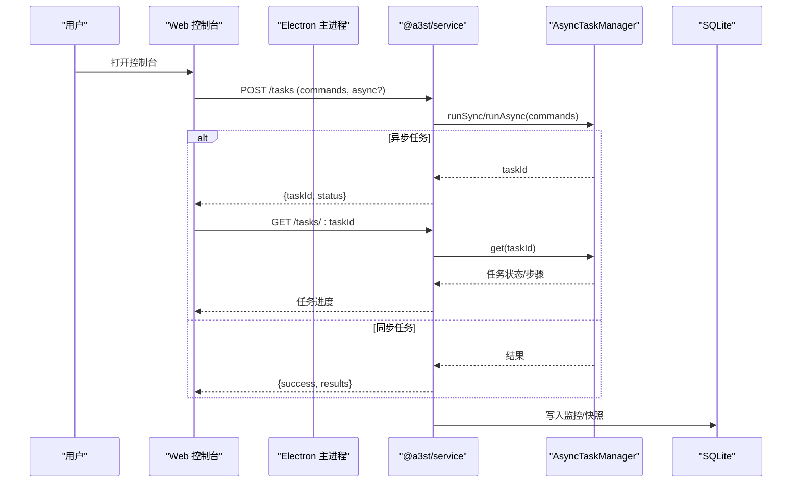
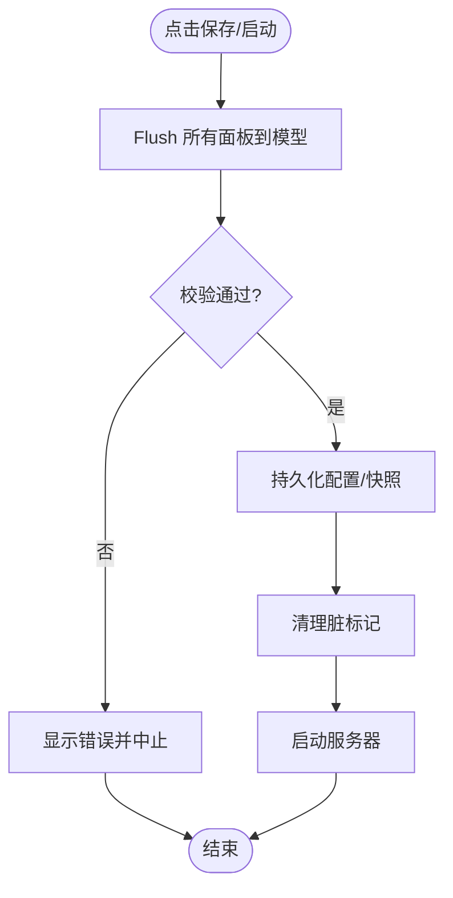
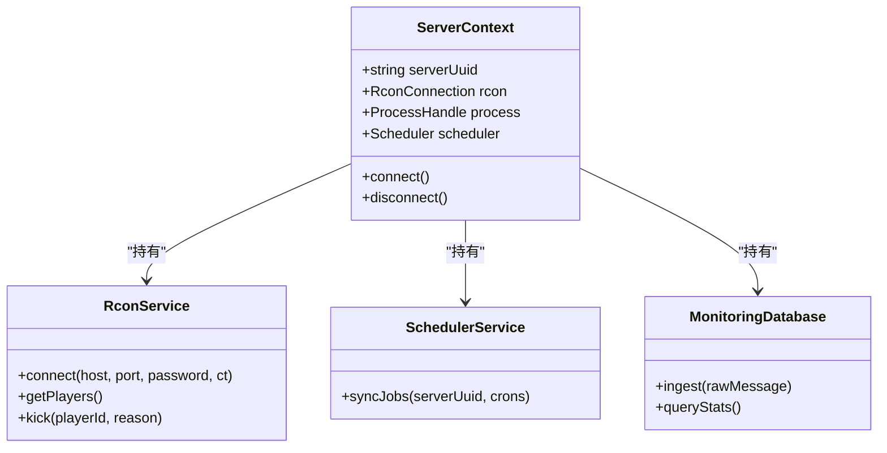
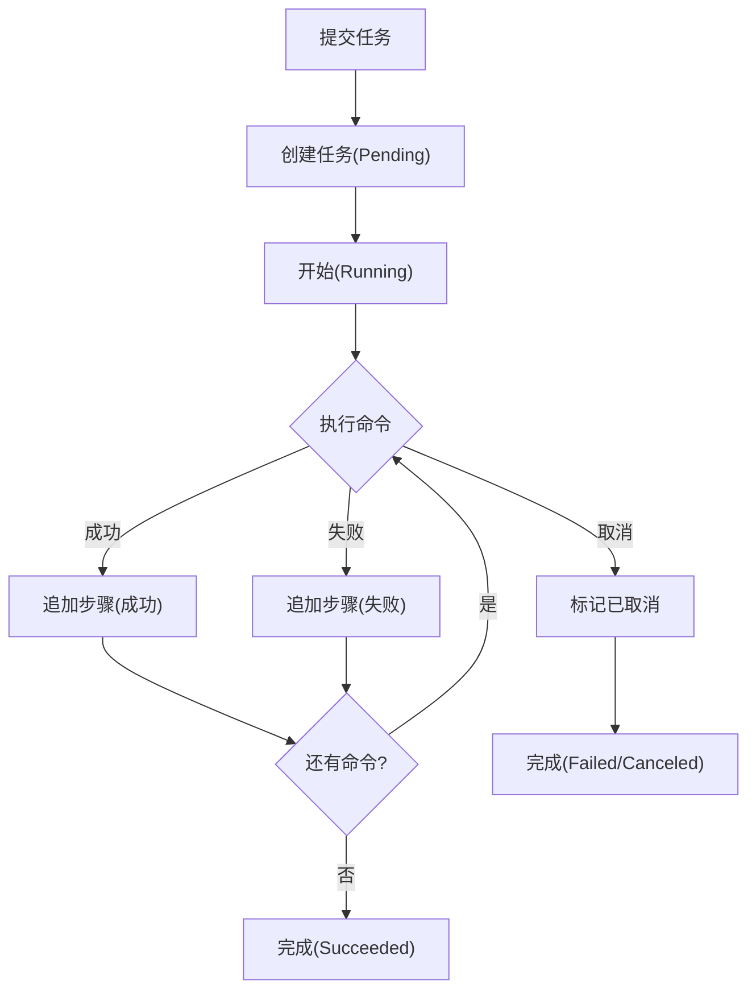
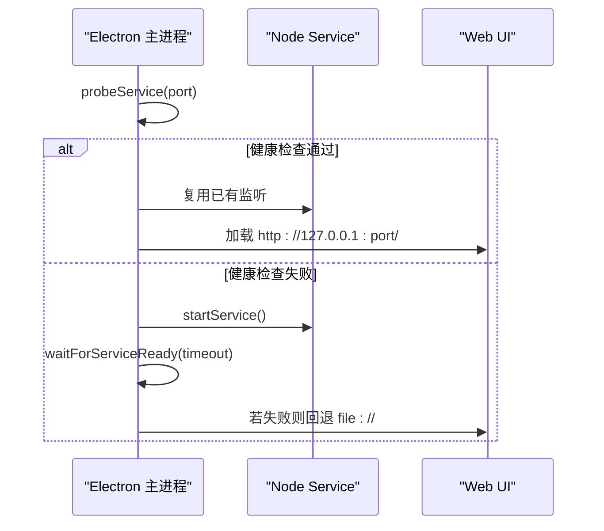
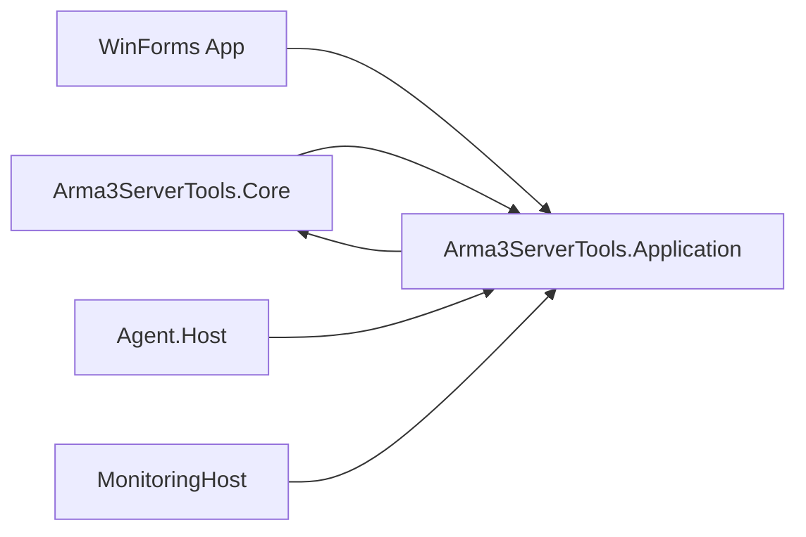

# 重构计划与架构演进

<cite>
**本文引用的文件**   
- [README.md](file://README.md)
- [docs/architecture.md](file://docs/architecture.md)
- [docs/architecture-v2.md](file://docs/architecture-v2.md)
- [docs/archive/refactoring-plan.md](file://docs/archive/refactoring-plan.md)
- [docs/archive/code-review-2026-05-27.md](file://docs/archive/code-review-2026-05-27.md)
- [apps/desktop/src/main/index.ts](file://apps/desktop/src/main/index.ts)
- [packages/service/src/app.ts](file://packages/service/src/app.ts)
- [packages/service/src/api/routes.ts](file://packages/service/src/api/routes.ts)
- [packages/service/src/task/manager.ts](file://packages/service/src/task/manager.ts)
- [packages/service/src/task/manager.test.ts](file://packages/service/src/task/manager.test.ts)
- [DestinyServerMonitoring/DestinyServerMonitoring/DestinyServerMonitoring.csproj](file://DestinyServerMonitoring/DestinyServerMonitoring/DestinyServerMonitoring.csproj)
</cite>

## 目录
1. [引言](#引言)
2. [项目结构](#项目结构)
3. [核心组件](#核心组件)
4. [架构总览](#架构总览)
5. [详细组件分析](#详细组件分析)
6. [依赖关系分析](#依赖关系分析)
7. [性能优化路线图](#性能优化路线图)
8. [技术选型决策](#技术选型决策)
9. [风险评估与回滚策略](#风险评估与回滚策略)
10. [结论](#结论)

## 引言
本文件面向 Arma3 Server Tools v2 的重构与架构演进，目标是：
- 明确当前技术债与重构优先级：MainForm 拆分、Singleton 改进、异步处理优化。
- 设计 v2 架构方向：微服务化改造、事件驱动、容器化部署。
- 制定渐进式迁移策略：向后兼容保证、测试覆盖要求。
- 给出性能优化路线图：数据库查询、内存管理、并发增强。
- 说明技术选型决策：新技术引入评估、第三方库替换策略、平台支持规划。
- 提供风险评估与回滚策略，确保重构过程可控、可观测、可恢复。

## 项目结构
v2 采用“控制端 UI + 被控端 Service”的分层模型，代码边界清晰：
- `@a3st/web`：Vue 控制台 UI，运行在浏览器或 Electron 窗口。
- `@a3st/service`：Node 被控端（Fastify + SQLite），负责启停、配置、SteamCMD、日志等。
- `@a3st/api-client`：共享 HTTP 契约与类型，供 web 与脚本使用。
- `apps/desktop`：Electron 壳，spawn 本机 service，并加载 web 静态页；不是第三套后端。

图表来源
- [docs/architecture-v2.md:1-52](file://docs/architecture-v2.md#L1-L52)
- [README.md:3-10](file://README.md#L3-L10)

章节来源
- [README.md:3-10](file://README.md#L3-L10)
- [docs/architecture-v2.md:1-52](file://docs/architecture-v2.md#L1-L52)

## 核心组件
- 任务执行器：AsyncTaskManager 提供同步/异步任务编排、步骤记录、取消与失败处理。
- 服务启动与监听：Fastify 应用创建、端口监听重试、服务实例装配。
- API 路由：任务提交、状态查询、后续动作（写配置、重启）组合。
- Electron 主进程：探测/接管/启动 service，UI 加载策略与错误回退。

章节来源
- [packages/service/src/task/manager.ts:178-218](file://packages/service/src/task/manager.ts#L178-L218)
- [packages/service/src/app.ts:34-71](file://packages/service/src/app.ts#L34-L71)
- [packages/service/src/api/routes.ts:1038-1074](file://packages/service/src/api/routes.ts#L1038-L1074)
- [apps/desktop/src/main/index.ts:95-137](file://apps/desktop/src/main/index.ts#L95-L137)

## 架构总览
v2 的三层分离是逻辑边界而非强制物理隔离：
- 代码边界：UI 不直接读写磁盘或 spawn 进程，全部走 REST。
- 进程边界：开发时常见 service :19580 + web :5173。
- 部署边界：Linux 开服机仅装 service；控制端用任意系统浏览器连接。

推荐结论：保留逻辑分离（API + 分包），合并物理部署（可选）。

图表来源
- [packages/service/src/api/routes.ts:1038-1074](file://packages/service/src/api/routes.ts#L1038-L1074)
- [packages/service/src/task/manager.ts:178-218](file://packages/service/src/task/manager.ts#L178-L218)
- [packages/service/src/app.ts:57-71](file://packages/service/src/app.ts#L57-L71)

## 详细组件分析

### MainForm 拆分（历史 C# WinForms 阶段）
- 现状：MainForm 承担过多职责，保存语义、ApplyAll 懒绑定、Tab dirty 跟踪存在遗漏风险。
- 问题：
  - ApplyAll 可能跳过未打开或未标记 dirty 的面板，导致数据丢失。
  - StartServerAsync 快照与 dirty 清除时机不当。
  - RconService 为 Singleton，多服切换与并发操作存在竞态。
- 重构建议：
  - 将 MainForm 拆分为导航、列表、面板容器、状态栏等子组件。
  - 统一 ApplyAll 行为：启动前强制 flush 所有面板到模型。
  - 调整快照与 dirty 清除时机：先保存/写盘，再清理脏标记。
  - 引入每服上下文或连接池，避免 Singleton 共享 RCon 会话。

图表来源
- [docs/archive/code-review-2026-05-27.md:104-117](file://docs/archive/code-review-2026-05-27.md#L104-L117)
- [docs/archive/code-review-2026-05-27.md:323-356](file://docs/archive/code-review-2026-05-27.md#L323-L356)

章节来源
- [docs/archive/code-review-2026-05-27.md:104-117](file://docs/archive/code-review-2026-05-27.md#L104-L117)
- [docs/archive/code-review-2026-05-27.md:323-356](file://docs/archive/code-review-2026-05-27.md#L323-L356)

### Singleton 模式改进
- 现状：RconService、ServerProcessService、SchedulerService、MonitoringDatabase 等注册为 Singleton。
- 风险：多服切换时共享连接易被 Dispose，缺少每服连接或连接池模型。
- 改进方案：
  - 引入 ServerContext：按 serverUuid 维护连接、进程句柄、调度器实例。
  - 对 RCon 使用连接池或 per-server 会话，禁止 UI 直接 Dispose 共享实例。
  - 对 Scheduler 与 MonitoringDatabase 也按服隔离或加锁串行化。

图表来源
- [docs/archive/code-review-2026-05-27.md:88-100](file://docs/archive/code-review-2026-05-27.md#L88-L100)

章节来源
- [docs/archive/code-review-2026-05-27.md:88-100](file://docs/archive/code-review-2026-05-27.md#L88-L100)

### 异步处理优化
- 现状：AsyncTaskManager 支持 runSync 与 runAsync，具备步骤追加、取消、失败处理。
- 优化点：
  - 增加任务超时与重试策略。
  - 对 I/O 密集操作使用队列与背压，避免阻塞事件循环。
  - 完善取消令牌传播，确保外部取消能中断底层 I/O。
  - 扩展任务状态机，支持暂停/恢复。

图表来源
- [packages/service/src/task/manager.ts:178-218](file://packages/service/src/task/manager.ts#L178-L218)
- [packages/service/src/task/manager.test.ts:1-118](file://packages/service/src/task/manager.test.ts#L1-L118)

章节来源
- [packages/service/src/task/manager.ts:178-218](file://packages/service/src/task/manager.ts#L178-L218)
- [packages/service/src/task/manager.test.ts:1-118](file://packages/service/src/task/manager.test.ts#L1-L118)

### Electron 主进程与服务生命周期
- 功能：探测 service 健康、接管已有监听进程、启动/停止 service、UI 加载策略（优先 http，回退 file）。
- 关键点：
  - probeService 检测 /api/v1/health 与首页 HTML。
  - adoptListenerIfPresent 复用已有 service 进程。
  - loadUiIntoWindow 根据 preferFileUi 决定加载方式。

图表来源
- [apps/desktop/src/main/index.ts:95-137](file://apps/desktop/src/main/index.ts#L95-L137)
- [apps/desktop/src/main/index.ts:203-222](file://apps/desktop/src/main/index.ts#L203-L222)
- [apps/desktop/src/main/index.ts:567-616](file://apps/desktop/src/main/index.ts#L567-L616)

章节来源
- [apps/desktop/src/main/index.ts:95-137](file://apps/desktop/src/main/index.ts#L95-L137)
- [apps/desktop/src/main/index.ts:203-222](file://apps/desktop/src/main/index.ts#L203-L222)
- [apps/desktop/src/main/index.ts:567-616](file://apps/desktop/src/main/index.ts#L567-L616)

## 依赖关系分析
- v1 架构（C# WinForms）强调 Core/Application/Presentation 分层，Core 不引用 UI，Application 只引用 Core。
- v2 架构以 HTTP API 为唯一业务边界，web 与 service 解耦，Electron 作为壳。

图表来源
- [docs/architecture.md:25-68](file://docs/architecture.md#L25-L68)

章节来源
- [docs/architecture.md:25-68](file://docs/architecture.md#L25-L68)

## 性能优化路线图
- 数据库查询优化
  - 对监控入库与统计查询建立索引，减少全表扫描。
  - 批量写入与分页查询，降低单次事务压力。
- 内存管理改进
  - 限制 AsyncTaskManager 中任务历史长度，及时释放已完成任务对象。
  - 对大文件日志读取使用流式处理，避免一次性加载。
- 并发处理增强
  - 为 I/O 操作引入队列与背压，避免阻塞事件循环。
  - 对 RCon 与 SteamCMD 调用增加超时与重试上限。

[本节为通用指导，不直接分析具体文件]

## 技术选型决策
- 新技术引入评估
  - 优先选择稳定、社区活跃、许可友好的库。
  - 对 Node.js 生态，优先使用内置模块或成熟第三方库（如 Fastify、Vitest）。
- 第三方库替换策略
  - 逐步替换旧依赖（如 Nito.AsyncEx、HttpWebRequest→HttpClient），保持 API 不变。
  - 在 CI 中验证构建与测试，确保无回归。
- 平台支持规划
  - v1 Core 绑定 Windows（DPAPI/WMI），对专用工具合理。
  - v2 service 跨平台（Windows/Linux），Electron 壳目前仅打包 Windows。

章节来源
- [docs/archive/refactoring-plan.md:94-95](file://docs/archive/refactoring-plan.md#L94-L95)
- [docs/archive/refactoring-plan.md:320-333](file://docs/archive/refactoring-plan.md#L320-L333)
- [README.md:5-10](file://README.md#L5-L10)

## 风险评估与回滚策略
- 风险
  - MainForm 拆分可能导致 UI 行为不一致。
  - Singleton 改为 per-server 上下文可能引入新的竞态。
  - 异步任务取消与失败路径需充分测试。
  - Electron 主进程接管/启动 service 的边界条件。
- 对策
  - 分阶段实施：先 Core/Application，再 UI，最后集成测试。
  - 向后兼容：保留旧 API 与配置格式，逐步迁移。
  - 测试覆盖：单元测试覆盖任务状态机、API 路由、Electron 主进程关键路径。
  - 回滚策略：发布前保留上一版本包与配置备份；CI 失败自动回滚。

章节来源
- [docs/archive/refactoring-plan.md:377-386](file://docs/archive/refactoring-plan.md#L377-L386)
- [packages/service/src/task/manager.test.ts:1-118](file://packages/service/src/task/manager.test.ts#L1-L118)
- [apps/desktop/src/main/index.ts:647-657](file://apps/desktop/src/main/index.ts#L647-L657)

## 结论
本次重构以 v2 架构为核心，明确技术债与优先级，提出 MainForm 拆分、Singleton 改进、异步优化等关键任务。通过渐进式迁移、向后兼容与严格测试，确保重构过程可控。未来将继续推进微服务化、事件驱动与容器化部署，提升系统可扩展性与可运维性。