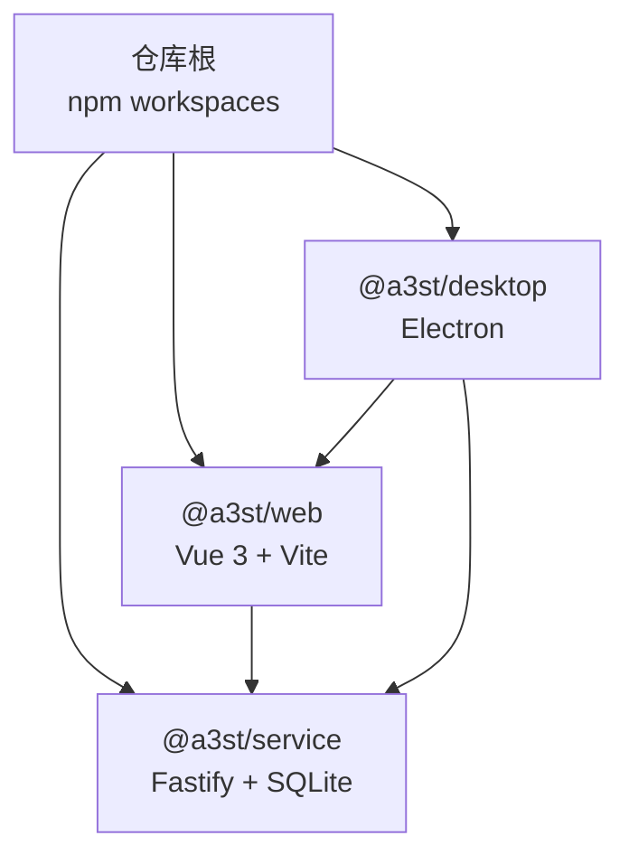
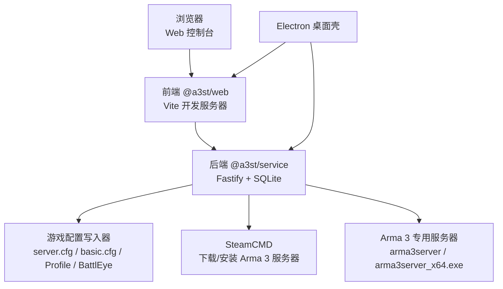
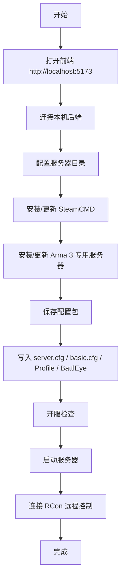

# 快速开始

<cite>
**本文引用的文件**   
- [README.md](file://README.md)
- [package.json](file://package.json)
- [docs/v2-quickstart.md](file://docs/v2-quickstart.md)
- [docs/linux-server.md](file://docs/linux-server.md)
- [docs/first-server-guide.txt](file://docs/first-server-guide.txt)
- [packages/service/package.json](file://packages/service/package.json)
- [packages/web/package.json](file://packages/web/package.json)
- [packages/service/src/config/game-config-writer.ts](file://packages/service/src/config/game-config-writer.ts)
</cite>

## 目录
1. [简介](#简介)
2. [环境要求](#环境要求)
3. [项目结构速览](#项目结构速览)
4. [开发环境搭建](#开发环境搭建)
5. [首次运行第一个 Arma 3 服务器](#首次运行第一个-arma-3-服务器)
6. [生产环境部署要点](#生产环境部署要点)
7. [验证安装是否成功](#验证安装是否成功)
8. [常见故障排除](#常见故障排除)
9. [架构与数据流概览](#架构与数据流概览)
10. [结论](#结论)

## 简介
Arma3 Server Tools v2 是一个跨平台的 Arma 3 专用服务器管理工具，采用 TypeScript 全栈实现。后端基于 Node.js、Fastify 和 SQLite；前端为 Vue 3 Web 控制台；可选 Electron 桌面壳用于 Windows 本地体验。它支持多服管理、BattlEye RCon 远程控制、Workshop 模组下载、SteamCMD 安装与更新、HTTP API、定时任务与监控统计等能力。

本快速开始指南的目标是：让新手在约 15 分钟内完成环境准备、安装依赖、构建服务、启动后端与前端，并成功运行第一个 Arma 3 服务器实例。

## 环境要求
### 系统要求
- **Windows**：推荐 Windows 10/11，路径与服务器目录不要包含中文。
- **Linux**：常见 x64 发行版（如 Ubuntu 22.04+、Debian 12+）。
- **控制端**：任意系统的现代浏览器即可访问 Web 控制台。
- **开服机**：需要安装 Arma 3 专用服务器与 SteamCMD。

### Node.js 版本
- 仓库根 `engines.node` 要求 **Node.js ≥ 20**。
- 文档中部分说明使用“Node.js 18+”作为宽松描述，但实际工程约束更严格，建议直接使用 **Node.js 20 或更高版本**。

### 其他依赖
- **Windows**：Electron 桌面壳目前仅打包 Windows；若使用源码运行 Service，不需要额外 .NET 运行时。
- **Linux**：Service 与 SteamCMD 已支持 Linux；需要 `tar` 解压 SteamCMD，`ss` 用于 UDP 端口检测（通常随 `iproute2` 提供）。
- **SteamCMD**：通过控制面板的 SteamCMD 页面自动下载或使用已有 SteamCMD 程序目录。

**章节来源**
- [README.md:3-10](file://README.md#L3-L10)
- [package.json:32-34](file://package.json#L32-L34)
- [docs/v2-quickstart.md:7-11](file://docs/v2-quickstart.md#L7-L11)
- [docs/linux-server.md:6-11](file://docs/linux-server.md#L6-L11)
- [docs/first-server-guide.txt:8-13](file://docs/first-server-guide.txt#L8-L13)

## 项目结构速览
v2 采用 monorepo 结构，核心模块如下：
- `packages/service`：后端服务，Fastify + SQLite + RCon。
- `packages/web`：Vue 3 控制面板，Vite 开发服务器。
- `apps/desktop`：Electron 桌面壳，可拉起本机 Service 并内嵌 Web 控制台。
- `scripts`：构建、打包、CI 与测试脚本。
- `mod` 与 `DestinyServerMonitoring`：监控相关资源与 RVExtension 源码。



**图表来源**
- [README.md:50-66](file://README.md#L50-L66)
- [package.json:6-9](file://package.json#L6-L9)

**章节来源**
- [README.md:50-66](file://README.md#L50-L66)
- [package.json:6-9](file://package.json#L6-L9)

## 开发环境搭建
以下命令均在仓库根目录执行。

### 第一步：安装依赖
```powershell
npm install
```
该命令会安装 monorepo 所有 workspace 的依赖，包括后端 Service、前端 Web 与桌面 Desktop。

### 第二步：构建后端服务
```powershell
npm run build:service
```
后端入口位于 `packages/service/dist/index.js`，由 TypeScript 编译生成。

### 第三步：启动后端服务
```powershell
npm run start:service
```
默认监听地址为 `http://127.0.0.1:19580`，数据目录默认为 `.a3st-dev-data`。  
也可手动设置环境变量后直接运行：
```powershell
$env:DATA_DIR = "c:\path\to\arma3-server-tool\.a3st-dev-data"
node packages\service\dist\index.js
```

注意：
- `npm run dev:service` 只是 TypeScript 监视编译，**不会**启动 HTTP 服务。
- 生产环境应使用 `start:service` 或 systemd 托管。

### 第四步：启动前端开发服务器
另开一个终端：
```powershell
npm run dev:web
```
前端默认监听 `http://localhost:5173`，并通过 Vite 代理将 API 请求转发到后端 19580 端口。

### 第五步：可选 — 启动 Electron 桌面版
```powershell
npm run build:service
npm run dev:desktop
```
桌面版会拉起本机 `@a3st/service` 并内嵌 Web 控制台，适合 Windows 本地开发体验。

**章节来源**
- [README.md:70-86](file://README.md#L70-L86)
- [docs/v2-quickstart.md:13-50](file://docs/v2-quickstart.md#L13-L50)
- [package.json:10-30](file://package.json#L10-L30)
- [packages/service/package.json:8-15](file://packages/service/package.json#L8-L15)
- [packages/web/package.json:7-14](file://packages/web/package.json#L7-L14)

## 首次运行第一个 Arma 3 服务器
本节面向第一次使用 Arma 3 服务器的用户。

### 步骤一：打开 Web 控制台
浏览器打开前端地址：
```
http://localhost:5173
```
默认连接配置为「本机」，点击「连接」。

### 步骤二：配置服务器目录
进入「向导」或「基本」页面，填写服务器目录。  
服务器目录应包含 Arma 3 专用服务器文件，例如：
- Windows：`D:\Games\Arma3Server\`
- Linux：`/opt/arma3server/`

### 步骤三：安装或更新 Arma 3 专用服务器
进入「SteamCMD」页面：
1. 填写 Steam 账号。
2. 点击「下载 SteamCMD」。
3. 选择「安装/更新专用服务器」，指定服务器目录。

提示：
- 如果网络出现 502.3、IIS 或 HTML 响应，可能是代理拦截了 Steam CDN，请关闭代理或手动解压完整 SteamCMD。
- Workshop 模组会下载到 `steamapps\workshop\content\107410\<模组ID>\`。

### 步骤四：保存配置并写入游戏配置
在各设置页修改参数后：
1. 点击「保存」，将配置包写入工具配置目录。
2. 点击「写入游戏配置」，生成 `server.cfg`、`basic.cfg`、Profile 与 BattlEye 配置。

写入逻辑会创建配置根目录、Users 目录、BattlEye 目录，并输出关键配置文件。

### 步骤五：启动服务器
1. 先执行「开服检查」，确认 `server.cfg` 有效。
2. 点击「启动」，工具会先保存当前编辑的配置包，再启动 Arma 3 专用服务器进程。
3. 如需远程控制，进入「远程控制」页面连接 RCon。

**章节来源**
- [docs/v2-quickstart.md:52-61](file://docs/v2-quickstart.md#L52-L61)
- [docs/first-server-guide.txt:26-69](file://docs/first-server-guide.txt#L26-L69)
- [docs/first-server-guide.txt:79-85](file://docs/first-server-guide.txt#L79-L85)
- [packages/service/src/config/game-config-writer.ts:291-320](file://packages/service/src/config/game-config-writer.ts#L291-L320)
- [packages/service/src/config/game-config-writer.ts:590-618](file://packages/service/src/config/game-config-writer.ts#L590-L618)

## 生产环境部署要点
### Windows 生产部署
- 使用 `npm run build:service` 构建后端。
- 使用 `npm run start:service` 启动服务，或通过任务计划程序、进程守护工具托管。
- 前端可通过 Vite 构建产物配合静态文件服务器发布，或直接使用 Electron 桌面版分发。

### Linux 生产部署
Linux 下可通过环境变量配置数据目录与端口：
```bash
export DATA_DIR="$HOME/.a3st-data"
export PORT=19580
node packages/service/dist/index.js
```

推荐使用 systemd 托管 Service，示例配置中包含：
- `WorkingDirectory`
- `Environment=DATA_DIR`
- `Environment=PORT`
- `Environment=HOST=0.0.0.0`
- `ExecStart=/usr/bin/node /opt/arma3-server-tool/packages/service/dist/index.js`

远程访问时务必设置 `API_TOKEN` 并配置防火墙。

### 端口与主机绑定
- 默认后端端口为 `19580`。
- 默认前端开发端口为 `5173`。
- 生产环境建议通过反向代理暴露 Web 控制台，并限制 API 访问来源。

**章节来源**
- [docs/linux-server.md:13-32](file://docs/linux-server.md#L13-L32)
- [docs/linux-server.md:58-79](file://docs/linux-server.md#L58-L79)
- [docs/v2-quickstart.md:22-39](file://docs/v2-quickstart.md#L22-L39)

## 验证安装是否成功
### 健康检查接口
启动后端后，调用健康检查接口：
```
GET http://127.0.0.1:19580/api/v1/health
```
预期返回包含平台信息与服务元数据，例如：
- `platform`：`windows` 或 `linux`
- `defaultServerExecutable`：`arma3server_x64.exe` 或 `arma3server`
- `steamCmdBinary`：`steamcmd.exe` 或 `steamcmd.sh`

### Web 控制台连通性
- 打开 `http://localhost:5173`。
- 点击「连接」，应能列出本机服务器或新建服务器。
- 能进入 SteamCMD 页面并看到下载进度。
- 能写入配置并看到生成的 `server.cfg`、`basic.cfg`、Profile、BattlEye 相关文件。

### 服务器进程验证
- Windows：任务管理器中可见 `arma3server_x64.exe`。
- Linux：进程列表中可见 `arma3server`。
- 日志目录中应出现 `server_console.log` 或对应日志文件。

**章节来源**
- [docs/linux-server.md:34-39](file://docs/linux-server.md#L34-L39)
- [packages/service/src/config/game-config-writer.ts:297-306](file://packages/service/src/config/game-config-writer.ts#L297-L306)
- [packages/service/src/config/game-config-writer.ts:603-613](file://packages/service/src/config/game-config-writer.ts#L603-L613)

## 常见故障排除
### 依赖缺失或安装失败
- 现象：`npm install` 报错或依赖未安装。
- 排查：
  - 确认 Node.js 版本 ≥ 20。
  - 清理缓存后重试：删除 `node_modules` 与 `package-lock.json`，重新 `npm install`。
  - 检查网络代理是否影响 npm registry。

### 后端无法启动
- 现象：`npm run start:service` 无响应或端口占用。
- 排查：
  - 检查 19580 端口是否被占用。
  - 检查 `DATA_DIR` 是否有写入权限。
  - 查看控制台错误日志，确认 Fastify 启动阶段异常。

### 前端无法连接后端
- 现象：Web 控制台显示连接失败。
- 排查：
  - 确认后端已启动且监听 19580。
  - 确认前端开发服务器正在运行 5173。
  - 检查浏览器控制台 CORS 或代理错误。

### SteamCMD 下载失败
- 现象：SteamCMD 下载卡住、返回 502.3、IIS 或 HTML。
- 排查：
  - 关闭代理或退出抓包工具。
  - 手动解压完整 SteamCMD 到 extension 目录。
  - 确认服务器目录与 SteamCMD 路径不含中文。

### 权限问题
- 现象：无法写入 `server.cfg`、`basic.cfg`、BattlEye 配置。
- 排查：
  - 确保服务器目录有写入权限。
  - Windows 避免安装在 Program Files 受限目录。
  - Linux 使用合适用户运行 Service，并确保 `DATA_DIR` 与服务器目录可写。

### 端口冲突
- 现象：后端或前端启动时报端口占用。
- 排查：
  - 后端默认 19580，前端默认 5173。
  - Linux 可通过 `PORT` 环境变量调整后端端口。
  - 使用系统工具查看占用端口的进程并释放。

### BattlEye 与 RCon 连接失败
- 现象：RCon 无法连接、踢人封禁无效。
- 排查：
  - 检查 BattlEye 是否启用。
  - 检查 RCon 端口、密码与防火墙规则。
  - 确认服务器已正确写入 BattlEye 配置。

**章节来源**
- [docs/first-server-guide.txt:53-55](file://docs/first-server-guide.txt#L53-L55)
- [docs/first-server-guide.txt:100-106](file://docs/first-server-guide.txt#L100-L106)
- [docs/linux-server.md:79-85](file://docs/linux-server.md#L79-L85)
- [packages/service/src/config/game-config-writer.ts:556-588](file://packages/service/src/config/game-config-writer.ts#L556-L588)

## 架构与数据流概览
### 组件关系


**图表来源**
- [README.md:3-10](file://README.md#L3-L10)
- [README.md:50-66](file://README.md#L50-L66)
- [packages/service/src/config/game-config-writer.ts:590-613](file://packages/service/src/config/game-config-writer.ts#L590-L613)

### 首次开服流程


**图表来源**
- [docs/v2-quickstart.md:52-61](file://docs/v2-quickstart.md#L52-L61)
- [docs/first-server-guide.txt:61-69](file://docs/first-server-guide.txt#L61-L69)
- [docs/first-server-guide.txt:79-85](file://docs/first-server-guide.txt#L79-L85)

## 结论
按照本指南，你可以在 15 分钟内完成 Arma3 Server Tools v2 的环境准备、依赖安装、服务构建与前后端启动，并成功运行第一个 Arma 3 服务器实例。后续可根据需求扩展模组、配置 BattlEye、接入 RCon 远程控制，并在 Linux 上使用 systemd 进行生产托管。遇到问题时，优先检查 Node.js 版本、端口占用、路径权限与 SteamCDN 网络环境。