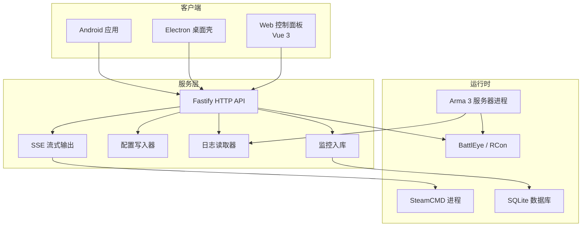
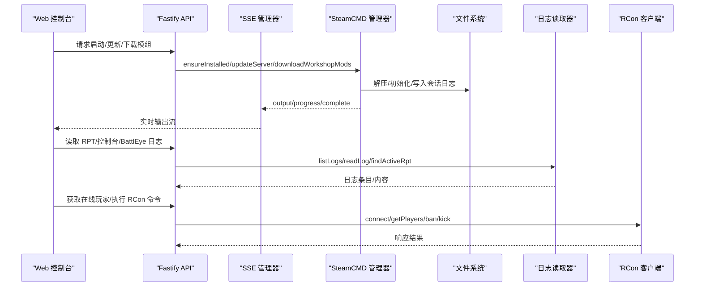
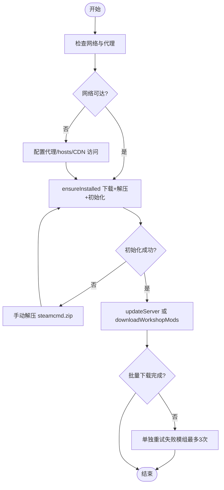
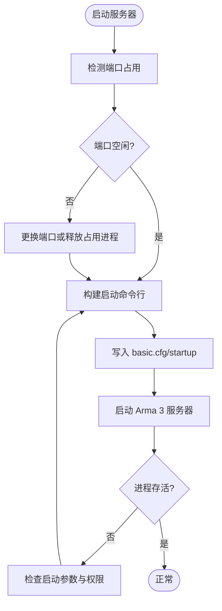
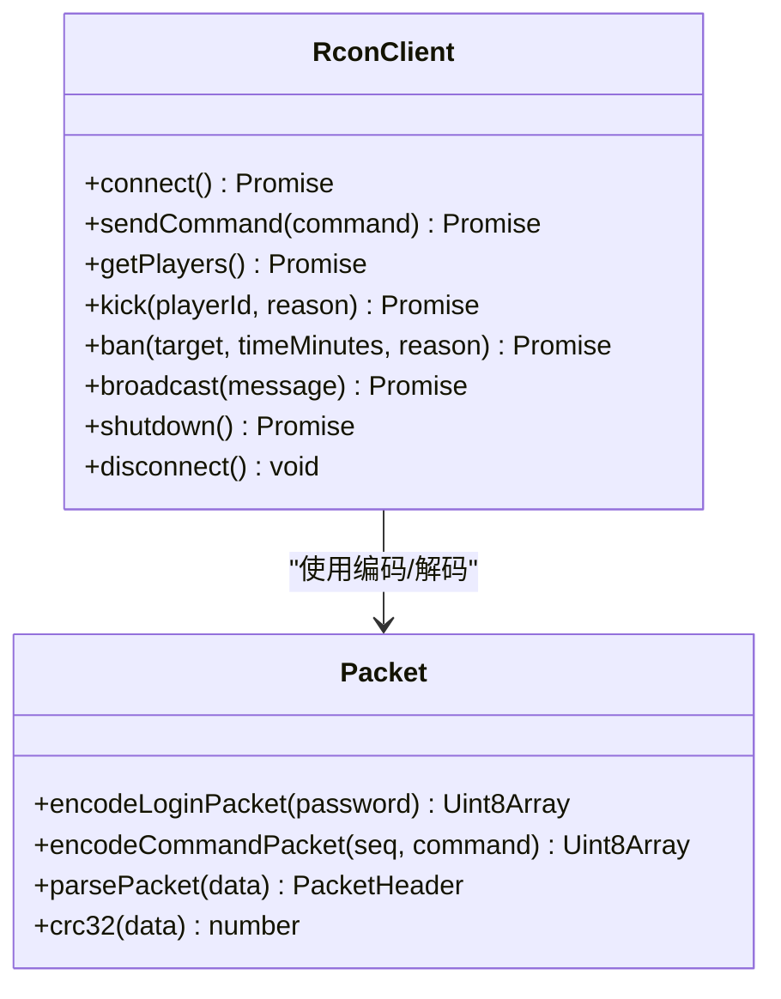
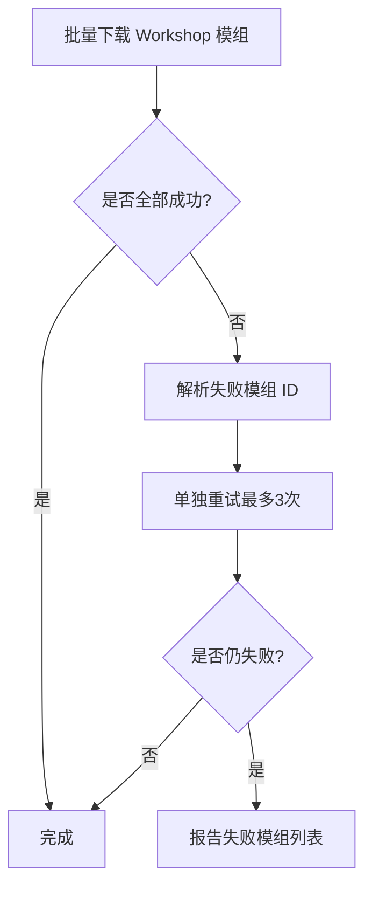
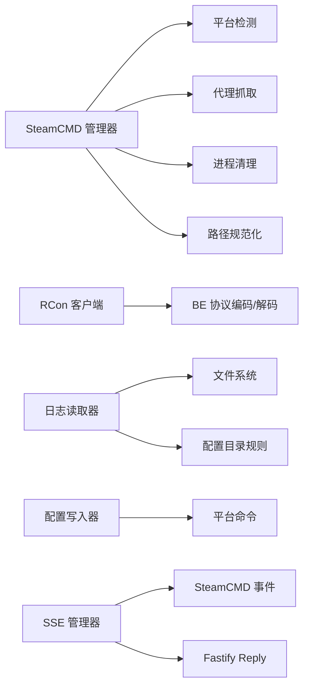

# 故障排除

<cite>
**本文引用的文件**   
- [README.md](file://README.md)
- [known-issues.md](file://docs/known-issues.md)
- [linux-server.md](file://docs/linux-server.md)
- [diagnose-agent.ps1](file://scripts/diagnose-agent.ps1)
- [manager.ts](file://packages\service\src\steamcmd\manager.ts)
- [console-capture.ts](file://packages\service\src\steamcmd\console-capture.ts)
- [workshop-download-result.ts](file://packages\service\src\steamcmd\workshop-download-result.ts)
- [workshop-update.ts](file://packages\service\src\steamcmd\workshop-update.ts)
- [sse.ts](file://packages\service\src\api\sse.ts)
- [routes.ts](file://packages\service\src\api\routes.ts)
- [reader.ts](file://packages\service\src\logs\reader.ts)
- [client.ts](file://packages\service\src\rcon\client.ts)
- [packet.ts](file://packages\service\src\rcon\packet.ts)
- [helpers.ts](file://packages\service\src\rcon\helpers.ts)
- [game-config-writer.ts](file://packages\service\src\config\game-config-writer.ts)
- [defaults.ts](file://packages\web\src\utils\defaults.ts)
- [PerformanceView.vue](file://packages\web\src\views\PerformanceView.vue)
- [NetworkView.vue](file://packages\web\src\views\NetworkView.vue)
- [StatisticsView.vue](file://packages\web\src\views\StatisticsView.vue)
- [ingest.ts](file://packages\service\src\monitoring\ingest.ts)
- [server.ts](file://packages\service\src\types\server.ts)
- [ArmaMonitoringService.cs](file://DestinyServerMonitoring\DestinyServerMonitoring\ArmaMonitoringService.cs)
</cite>

## 目录
1. [引言](#引言)
2. [项目结构](#项目结构)
3. [核心组件](#核心组件)
4. [架构总览](#架构总览)
5. [详细组件分析](#详细组件分析)
6. [依赖关系分析](#依赖关系分析)
7. [性能问题诊断与优化](#性能问题诊断与优化)
8. [网络问题排查](#网络问题排查)
9. [日志分析与调试技巧](#日志分析与调试技巧)
10. [用户反馈收集与处理流程](#用户反馈收集与处理流程)
11. [自助诊断工具与脚本](#自助诊断工具与脚本)
12. [结论](#结论)

## 引言
本指南面向 Arma 3 专用服务器管理工具的运维与排障人员，聚焦以下目标：
- SteamCMD 连接失败、下载中断、初始化异常
- Arma 3 服务器启动异常、端口冲突、BattlEye/RCon 连接问题
- Workshop 模组加载错误、部分模组缺失
- CPU 占用过高、内存泄漏、磁盘 I/O 瓶颈
- 防火墙、代理、端口冲突等网络问题
- 日志分析、进程监控、SSE 实时输出、RCon 抓包思路
- 用户反馈收集、问题分类、闭环处理流程

## 项目结构
本项目为跨平台 Arma 3 专用服务器管理工具，后端基于 Node.js + Fastify + SQLite，前端为 Vue 3 Web 控制面板，另有 Electron 桌面壳与 Android 移动端。SteamCMD 负责游戏与模组安装，BattlEye RCon V2 提供远程控制能力，日志读取器支持 .rpt、控制台日志与 BattlEye 日志。

图表来源
- [README.md:50-66](file://README.md#L50-L66)
- [routes.ts:687-798](file://packages\service\src\api\routes.ts#L687-L798)
- [sse.ts:41-94](file://packages\service\src\api\sse.ts#L41-L94)
- [reader.ts:108-148](file://packages\service\src\logs\reader.ts#L108-L148)
- [manager.ts:50-119](file://packages\service\src\steamcmd\manager.ts#L50-L119)

章节来源
- [README.md:1-108](file://README.md#L1-L108)

## 核心组件
- SteamCMD 管理器：负责下载/更新 SteamCMD、安装/更新 Arma 3 服务器、Workshop 模组批量下载与单模组重试、会话日志记录、进程清理与取消控制。
- RCon 客户端：实现 BattlEye RCon V2 协议，封装登录、命令发送、玩家列表解析、踢人/封禁/广播/关闭等能力。
- 日志读取器：扫描 .rpt、控制台日志、BattlEye 日志，支持按服务器 UUID 定位 profile 目录，返回活跃日志路径。
- 配置写入器：生成 basic.cfg/startup 参数，构建 Arma 3 启动命令行，检测 UDP 端口占用，选择 Headless 端口。
- SSE 输出：将 SteamCMD 输出通过 Server-Sent Events 推送至前端，包含历史片段与保活心跳。
- 监控入库：解析 RVExtension 上报消息，持久化玩家数、FPS、玩家信息，并提供统计查询与导出 HTML 报告。

章节来源
- [manager.ts:50-119](file://packages\service\src\steamcmd\manager.ts#L50-L119)
- [client.ts:21-71](file://packages\service\src\rcon\client.ts#L21-L71)
- [reader.ts:108-148](file://packages\service\src\logs\reader.ts#L108-L148)
- [game-config-writer.ts:621-669](file://packages\service\src\config\game-config-writer.ts#L621-L669)
- [sse.ts:41-94](file://packages\service\src\api\sse.ts#L41-L94)
- [ingest.ts:1-39](file://packages\service\src\monitoring\ingest.ts#L1-L39)

## 架构总览
系统以 Fastify API 为中心，对外暴露服务器状态、日志、监控、SteamCMD 操作、RCon 管理等接口；内部通过事件与文件 IO 协调 SteamCMD 子进程、Arma 3 进程、BattlEye RCon 与 SQLite 数据库。

图表来源
- [manager.ts:129-249](file://packages\service\src\steamcmd\manager.ts#L129-L249)
- [sse.ts:51-94](file://packages\service\src\api\sse.ts#L51-L94)
- [reader.ts:108-185](file://packages\service\src\logs\reader.ts#L108-L185)
- [client.ts:41-126](file://packages\service\src\rcon\client.ts#L41-L126)

## 详细组件分析

### SteamCMD 连接与下载故障
常见症状
- 无法下载 SteamCMD 或初始化失败
- 下载进度不更新或卡住
- Workshop 模组批量下载部分失败，大体积模组超时
- 进程残留导致“已占用”或重复任务被拒绝

原因分析
- 网络不可达、CDN 被拦截、代理未配置
- 解压失败或权限不足
- Steam Guard 二次验证未通过
- 并发任务冲突或旧进程未清理

解决步骤
- 检查网络与代理：确认可访问 Steam CDN，必要时配置 HTTPS_PROXY；查看错误提示是否包含域名被 hosts 拦截或代理相关说明。
- 手动安装：若自动安装失败，可将 steamcmd.zip 解压到 SteamCMD 目录后重试。
- 等待初始化：首次运行会拉取 public 资源，需确保网络稳定。
- 清理孤儿进程：使用工具内置的进程清理逻辑，避免目录被占用。
- 单独重试失败模组：批量下载失败时，系统会自动识别未完成项并最多单独重试三次。
- 查看会话日志：在 logs/steamcmd 下查看最近一次会话日志，关注退出码与最后 500 字符输出。

图表来源
- [manager.ts:129-209](file://packages\service\src\steamcmd\manager.ts#L129-L209)
- [manager.ts:236-349](file://packages\service\src\steamcmd\manager.ts#L236-L349)
- [manager.ts:593-635](file://packages\service\src\steamcmd\manager.ts#L593-L635)

章节来源
- [manager.ts:129-209](file://packages\service\src\steamcmd\manager.ts#L129-L209)
- [manager.ts:236-349](file://packages\service\src\steamcmd\manager.ts#L236-L349)
- [manager.ts:593-635](file://packages\service\src\steamcmd\manager.ts#L593-L635)

### Arma 3 服务器启动异常
常见症状
- 服务器无法启动或启动后立即退出
- 端口冲突导致监听失败
- Headless 客户端端口冲突
- 启动参数不正确或缺少必要参数

原因分析
- UDP/TCP 端口被占用
- 启动参数缺失或错误（如 -port、-enableHT、-loadMissionToMemory）
- 配置文件未正确写入
- Linux 下二进制名称或权限问题

解决步骤
- 检查端口占用：Windows 使用 netstat，Linux 使用 ss，确认 2302 及 Headless 端口未被占用。
- 修正启动参数：根据性能与网络页面调整 cpuCount、exThreads、maxMem、limitFps、viewDistance、terrainGrid、bandwidthAlg、hugepages、loadMissionToMemory 等。
- 重新应用配置：先保存到工具，再应用到服务器目录，确保 basic.cfg/startup 参数生效。
- Linux 环境核对：确认专用服二进制为 arma3server，SteamCMD 为 steamcmd.sh，且具备执行权限。

图表来源
- [game-config-writer.ts:200-231](file://packages\service\src\config\game-config-writer.ts#L200-L231)
- [game-config-writer.ts:621-669](file://packages\service\src\config\game-config-writer.ts#L621-L669)
- [linux-server.md:40-57](file://docs/linux-server.md#L40-L57)

章节来源
- [game-config-writer.ts:200-231](file://packages\service\src\config\game-config-writer.ts#L200-L231)
- [game-config-writer.ts:621-669](file://packages\service\src\config\game-config-writer.ts#L621-L669)
- [linux-server.md:40-57](file://docs/linux-server.md#L40-L57)

### BattlEye 连接与 RCon 问题
常见症状
- RCon 连接超时或认证失败
- 无法获取在线玩家列表
- 踢人/封禁/广播命令无响应

原因分析
- BattlEye RCon 密码未配置或错误
- RCon 主机/端口配置不正确
- 防火墙阻止 RCon 端口
- RCon 协议解析异常（BE 包头校验失败）

解决步骤
- 检查 RCon 配置：确认 battleye.rconPassword、rconHost、rconPort 设置正确。
- 测试连通性：从服务端本机连接 RCon 端口，确认未被防火墙拦截。
- 查看 RCon 客户端状态：连接、认证、命令发送均有超时保护，失败时会抛出明确错误。
- 抓包辅助：可使用网络抓包工具观察 BE 包头是否为 “BE”，CRC32 是否正确，载荷类型是否符合预期。

图表来源
- [client.ts:21-126](file://packages\service\src\rcon\client.ts#L21-L126)
- [packet.ts:1-45](file://packages\service\src\rcon\packet.ts#L1-L45)

章节来源
- [client.ts:21-126](file://packages\service\src\rcon\client.ts#L21-L126)
- [packet.ts:1-45](file://packages\service\src\rcon\packet.ts#L1-L45)
- [helpers.ts:5-44](file://packages\service\src\rcon\helpers.ts#L5-L44)

### 模组加载错误与 Workshop 下载失败
常见症状
- Workshop 模组下载失败或部分模组缺失
- 大体积模组（如 CUP Terrains）超时
- 模组启用后服务器仍报缺少模组

原因分析
- 网络不稳定导致下载中断
- 磁盘空间不足
- 模组 ID 无效或未成功下载
- 本地缓存时间戳不一致导致更新状态判断异常

解决步骤
- 查看下载结果：使用 hasWorkshopDownloadFailure 与 resolveWorkshopDownloadMissingIds 判断失败模组。
- 单独重试：对失败模组单独执行下载，最多重试三次。
- 检查本地时间戳：readLocalUpdatedAtMs 与 resolveUpdateStatus 用于判断 missing/up_to_date/outdated/unknown。
- 清理并重试：若磁盘空间不足，清理无用文件后重试。

图表来源
- [manager.ts:252-349](file://packages\service\src\steamcmd\manager.ts#L252-L349)
- [workshop-download-result.ts:33-57](file://packages\service\src\steamcmd\workshop-download-result.ts#L33-L57)
- [workshop-update.ts:22-53](file://packages\service\src\steamcmd\workshop-update.ts#L22-L53)

章节来源
- [manager.ts:252-349](file://packages\service\src\steamcmd\manager.ts#L252-L349)
- [workshop-download-result.ts:33-57](file://packages\service\src\steamcmd\workshop-download-result.ts#L33-L57)
- [workshop-update.ts:22-53](file://packages\service\src\steamcmd\workshop-update.ts#L22-L53)

### 日志分析与调试技巧
- RPT 日志：listLogs 支持 rpt/console/battleye 三类，findActiveRpt 返回最新 .rpt 路径，readLog 支持分页读取。
- 控制台日志：优先匹配 server_console*.log，其次匹配 server_*.log（非 .rpt）。
- BattlEye 日志：排除 bans.txt、beserver_x64.cfg、beserver.cfg，匹配 .log/.txt。
- SSE 实时输出：SSE 管理器订阅 SteamCMD 的 output/progress/complete 事件，向浏览器推送历史片段与保活心跳。

建议流程
- 先定位活跃日志：findActiveRpt/findActiveConsoleLog。
- 分段读取：readLog 使用 startOffset 增量拉取。
- 结合 SSE：在 SteamCMD 操作期间打开 SSE 流，观察实时输出与进度。
- 会话日志：查看 logs/steamcmd 下最近一次会话日志，关注退出码与最后 500 字符。

章节来源
- [reader.ts:108-185](file://packages\service\src\logs\reader.ts#L108-L185)
- [sse.ts:41-94](file://packages\service\src\api\sse.ts#L41-L94)
- [console-capture.ts:137-203](file://packages\service\src\steamcmd\console-capture.ts#L137-L203)

## 依赖关系分析
- SteamCMD 管理器依赖平台检测、代理抓取、进程树清理、工作区路径规范化。
- RCon 客户端依赖 BE 协议编码/解码与超时控制。
- 日志读取器依赖文件系统与配置目录规则。
- 配置写入器依赖平台命令（netstat/ss）进行端口检测。
- SSE 管理器依赖 SteamCMD 事件与 Fastify Reply hijack。

图表来源
- [manager.ts:1-33](file://packages\service\src\steamcmd\manager.ts#L1-L33)
- [client.ts:1-8](file://packages\service\src\rcon\client.ts#L1-L8)
- [reader.ts:1-4](file://packages\service\src\logs\reader.ts#L1-L4)
- [game-config-writer.ts:200-217](file://packages\service\src\config\game-config-writer.ts#L200-L217)
- [sse.ts:41-94](file://packages\service\src\api\sse.ts#L41-L94)

章节来源
- [manager.ts:1-33](file://packages\service\src\steamcmd\manager.ts#L1-L33)
- [client.ts:1-8](file://packages\service\src\rcon\client.ts#L1-L8)
- [reader.ts:1-4](file://packages\service\src\logs\reader.ts#L1-L4)
- [game-config-writer.ts:200-217](file://packages\service\src\config\game-config-writer.ts#L200-L217)
- [sse.ts:41-94](file://packages\service\src\api\sse.ts#L41-L94)

## 性能问题诊断与优化
常见问题
- CPU 占用过高：CPU 核心数、额外线程数、视距、地形网格等参数设置不当。
- 内存泄漏：最大内存限制过低或 mission 加载策略不合理。
- 磁盘 I/O 瓶颈：大量模组、频繁日志写入、SteamCMD 解压/下载阻塞。

诊断方法
- 使用监控统计：statisticsEnabled 开启后，监控数据入库，可通过 /servers/:uuid/monitoring/stats 查询趋势。
- 观察前台指标：PerformanceView 提供 CPU/内存/帧率等参数编辑入口。
- 检查网络吞吐：NetworkView 提供 MaxMsgSend、MaxSizeGuaranteed、MaxSizeNonguaranteed 等参数。
- 进程监控：ServerProcessState 包含 isRunning、pid、uptime、cpuUsage、memoryMb。

优化建议
- 合理设置 cpuCount、exThreads、maxMem，避免过度分配。
- 调整 limitFps、viewDistance、terrainGrid 平衡画质与性能。
- 启用 hugepages、loadMissionToMemory 减少 I/O 压力。
- 调整 bandwidthAlg、uploadMbps 提升网络吞吐。
- 定期归档日志，避免磁盘写放大。

章节来源
- [defaults.ts:1-53](file://packages\web\src\utils\defaults.ts#L1-L53)
- [PerformanceView.vue:1-24](file://packages\web\src\views\PerformanceView.vue#L1-L24)
- [NetworkView.vue:1-24](file://packages\web\src\views\NetworkView.vue#L1-L24)
- [routes.ts:699-798](file://packages\service\src\api\routes.ts#L699-L798)
- [server.ts:1-15](file://packages\service\src\types\server.ts#L1-L15)

## 网络问题排查
防火墙与端口
- Windows：检查防火墙入站规则，允许 19580（Agent HTTP）、2302（Arma 3）、Headless 端口。
- Linux：使用 ss -uln 检测 UDP 端口占用，确保未被其他进程占用。
- urlacl：当 listenHost 为 + 时，需在 Windows 上预留 URL ACL。

代理设置
- 代理抓取：SteamCMD 下载通过 proxyFetch，支持 HTTPS_PROXY。
- 错误提示：若网络不可达，错误信息会描述域名被 hosts 拦截或代理问题。

远程访问
- Agent 配置：http.remoteAccessEnabled、listenHost、listenPort、publicBaseUrl、apiToken、allowedCallerIps。
- 鉴权顺序：IP 白名单 → /health 免 Token → 其余 API 需 Bearer Token。

章节来源
- [linux-server.md:49-86](file://docs/linux-server.md#L49-L86)
- [manager.ts:146-151](file://packages\service\src\steamcmd\manager.ts#L146-L151)
- [game-config-writer.ts:200-217](file://packages\service\src\config\game-config-writer.ts#L200-L217)

## 日志分析与调试技巧
- RPT 日志：使用 reader.listLogs 与 findActiveRpt 定位最新日志，readLog 分页读取。
- 控制台日志：优先 server_console*.log，其次 server_*.log。
- BattlEye 日志：排除特定文件名，匹配 .log/.txt。
- SSE 输出：SSE 管理器订阅 SteamCMD 事件，推送 output/progress/complete，含历史片段与 keepalive。
- 会话日志：logs/steamcmd 下最近一次会话日志，包含程序、参数、退出码、成功标志、捕获方式与 console 内容。

调试技巧
- 在 SteamCMD 操作期间打开 SSE 流，观察实时输出。
- 若下载失败，查看会话日志最后 500 字符与退出码。
- 使用 RCon 客户端 getPlayers 验证 BattlEye 连通性。
- 使用 monitor/collect 触发采集，检查监控入库是否正常。

章节来源
- [reader.ts:108-185](file://packages\service\src\logs\reader.ts#L108-L185)
- [sse.ts:41-94](file://packages\service\src\api\sse.ts#L41-L94)
- [manager.ts:471-502](file://packages\service\src\steamcmd\manager.ts#L471-L502)
- [client.ts:122-153](file://packages\service\src\rcon\client.ts#L122-L153)
- [routes.ts:719-763](file://packages\service\src\api\routes.ts#L719-L763)

## 用户反馈收集与处理流程
- 已知问题记录：docs/known-issues.md 汇总用户反馈与处理状态，v2 alpha 主线状态、首服向导、E2E 测试等。
- 问题分类：按模块划分（SteamCMD、Arma 3 启动、BattlEye/RCon、模组加载、性能、网络）。
- 处理流程：
  1. 收集症状：错误信息、日志片段、SSE 输出、RCon 响应。
  2. 复现环境：操作系统、Node 版本、Arma 3 版本、模组列表。
  3. 定位根因：网络、权限、端口、配置、协议。
  4. 修复验证：单元测试、E2E 测试、Smoke 清单。
  5. 文档更新：更新 known-issues 与相关文档。

章节来源
- [known-issues.md:1-67](file://docs/known-issues.md#L1-L67)
- [README.md:37-47](file://README.md#L37-L47)

## 自助诊断工具与脚本
- diagnose-agent.ps1：检查 Agent 配置、服务器配置目录、Agent 进程、HTTP API 可用性、.NET 运行时、防火墙、SteamCMD 安装情况，并生成测试任务文件。
- 使用方法：
  - 运行 PowerShell 脚本，查看输出中的 OK/WARN/ERROR。
  - 若 API 无法访问，确认 Agent 已启动且端口开放。
  - 若远程访问启用，检查防火墙与 IP 白名单。
  - 若 SteamCMD 未找到，首次使用时工具会自动下载。

章节来源
- [diagnose-agent.ps1:1-134](file://scripts/diagnose-agent.ps1#L1-L134)

## 结论
本指南围绕 SteamCMD、Arma 3 服务器、BattlEye/RCon、日志与监控、性能与网络等关键维度，提供了系统性诊断方法与解决步骤。通过 SSE 实时输出、RCon 协议封装、日志读取器与监控入库，工具链覆盖了从安装、启动、运行到排障的全生命周期。建议在日常运维中结合日志分析、进程监控与网络抓包，快速定位问题根因，并通过配置优化与参数调优提升稳定性与性能。