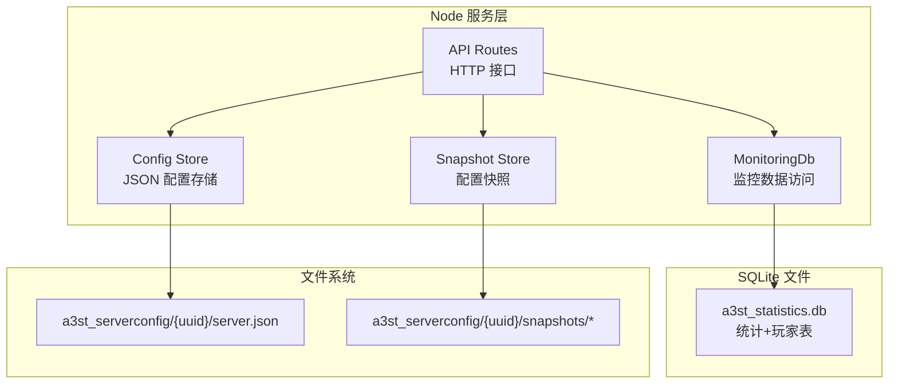
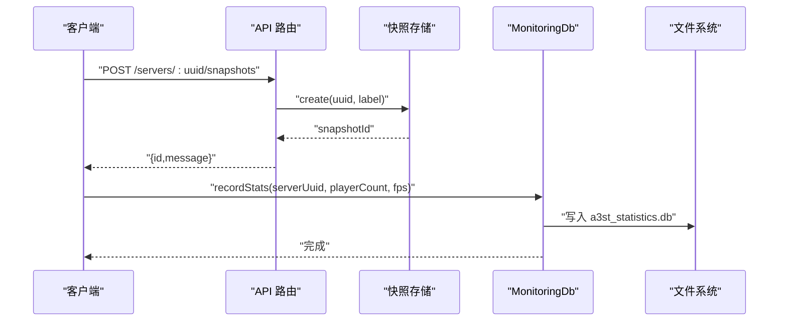
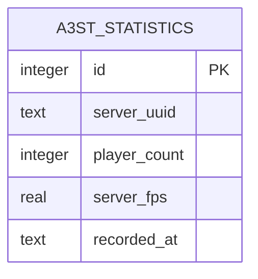
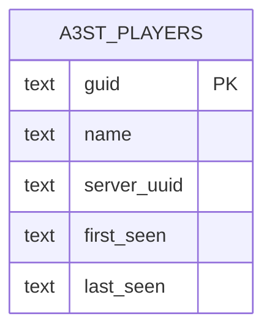
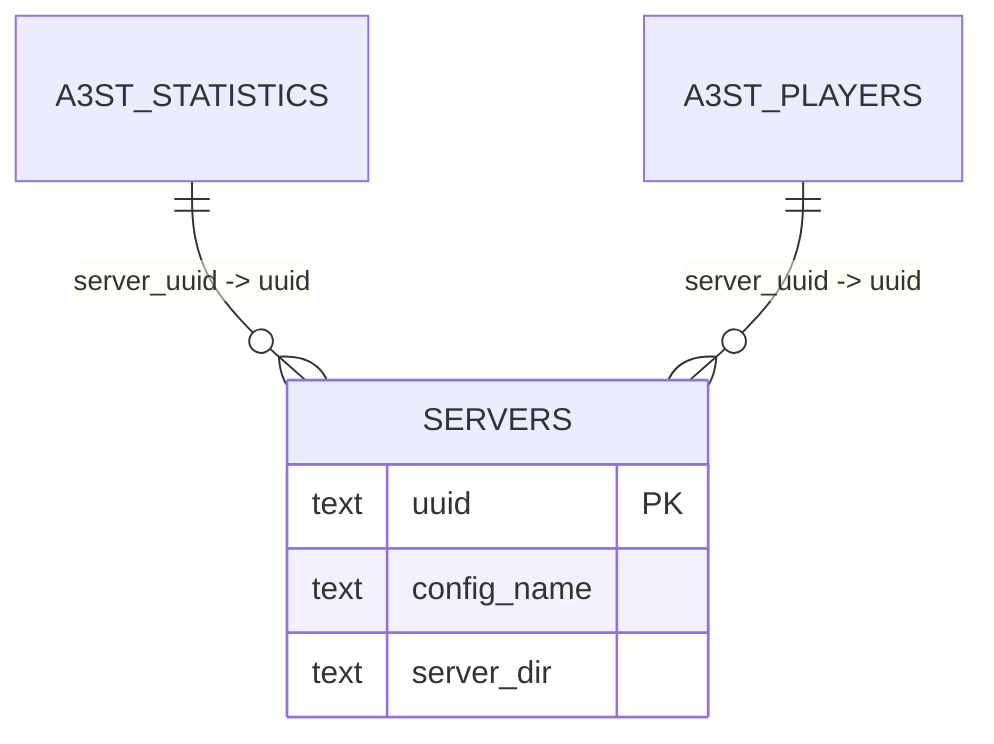
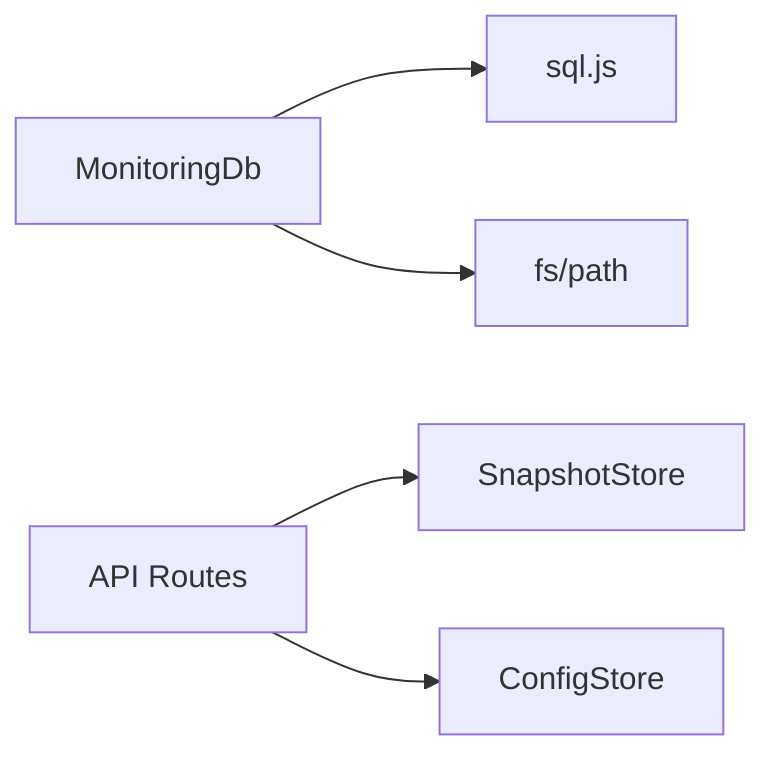
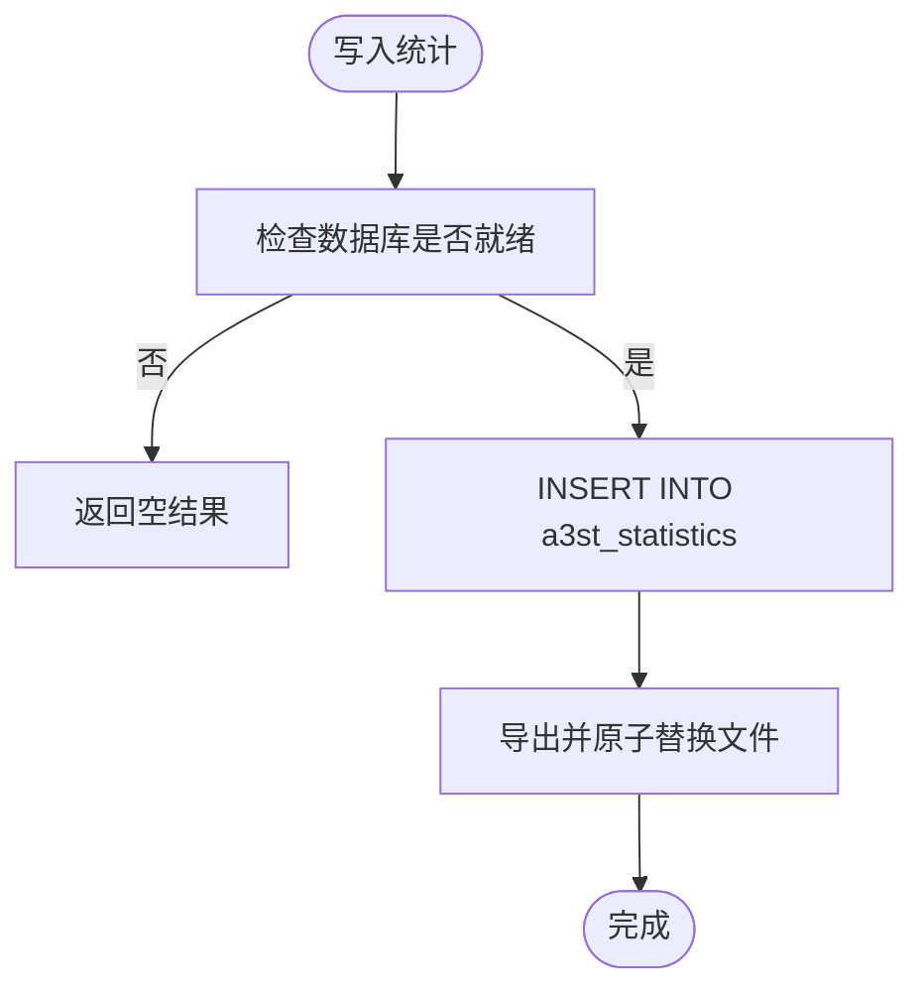
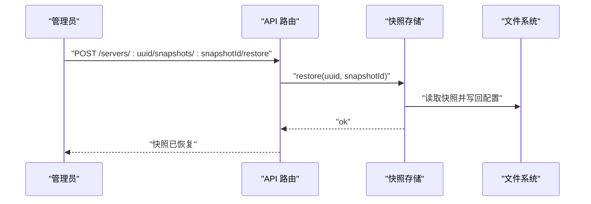

# 数据库设计

<cite>
**本文引用的文件**   
- [packages/service/src/monitoring/db.ts](file://packages/service/src/monitoring/db.ts)
- [packages/service/src/monitoring/index.ts](file://packages/service/src/monitoring/index.ts)
- [packages/service/src/monitoring/db.test.ts](file://packages/service/src/monitoring/db.test.ts)
- [packages/service/src/config/snapshot.test.ts](file://packages/service/src/config/snapshot.test.ts)
- [packages/service/src/config/auto-snapshot.ts](file://packages/service/src/config/auto-snapshot.ts)
- [packages/service/src/api/routes.ts](file://packages/service/src/api/routes.ts)
- [docs/archive/net10-migration-plan.md](file://docs/archive/net10-migration-plan.md)
</cite>

## 目录
1. [引言](#引言)
2. [项目结构](#项目结构)
3. [核心组件](#核心组件)
4. [架构总览](#架构总览)
5. [详细组件分析](#详细组件分析)
6. [依赖关系分析](#依赖关系分析)
7. [性能与索引优化](#性能与索引优化)
8. [数据迁移与版本管理](#数据迁移与版本管理)
9. [备份、恢复与灾难恢复](#备份恢复与灾难恢复)
10. [数据生命周期管理](#数据生命周期管理)
11. [数据访问层抽象与 ORM 模式](#数据访问层抽象与-orm-模式)
12. [一致性保证与事务处理](#一致性保证与事务处理)
13. [故障排查指南](#故障排查指南)
14. [结论](#结论)

## 引言
本文面向 Arma3 Server Tool 的 SQLite 数据库设计，重点覆盖监控统计数据表、玩家记录表、服务器配置快照机制、模组元数据相关上下文，以及查询优化、迁移策略、备份恢复、生命周期管理与数据访问层抽象。文档以仓库中实际实现为依据，同时给出可扩展的设计建议，帮助读者在不直接阅读源码的情况下理解整体数据模型与运维策略。

## 项目结构
当前仓库中与数据库直接相关的代码集中在 Node.js 服务层的监控模块，使用 sql.js 在进程内操作 SQLite 文件；服务器配置采用 JSON 文件 + 快照机制，而非关系型数据库存储。

图表来源
- [packages/service/src/monitoring/db.ts:36-115](file://packages/service/src/monitoring/db.ts#L36-L115)
- [packages/service/src/api/routes.ts:862-883](file://packages/service/src/api/routes.ts#L862-L883)

章节来源
- [packages/service/src/monitoring/db.ts:1-245](file://packages/service/src/monitoring/db.ts#L1-L245)
- [packages/service/src/api/routes.ts:862-883](file://packages/service/src/api/routes.ts#L862-L883)

## 核心组件
- MonitoringDb：封装 SQLite 连接、建表、写入统计与玩家记录、聚合查询、批量写入与持久化保存。
- Config Store：基于 JSON 文件的服务器配置存储（不在本仓库中以数据库形式存在）。
- Snapshot Store：为配置提供创建、列出、恢复、裁剪等能力，配合自动快照触发器。
- API Routes：对外暴露服务器配置与快照操作的 HTTP 接口。

章节来源
- [packages/service/src/monitoring/db.ts:22-47](file://packages/service/src/monitoring/db.ts#L22-L47)
- [packages/service/src/config/auto-snapshot.ts:1-40](file://packages/service/src/config/auto-snapshot.ts#L1-L40)
- [packages/service/src/api/routes.ts:862-883](file://packages/service/src/api/routes.ts#L862-L883)

## 架构总览
监控数据通过 MonitoringDb 写入 SQLite 文件 a3st_statistics.db；服务器配置以 JSON 文件形式保存在 a3st_serverconfig 目录下，并通过快照机制进行版本管理。API 层统一暴露配置与快照操作，供前端或 Agent 调用。

图表来源
- [packages/service/src/api/routes.ts:866-875](file://packages/service/src/api/routes.ts#L866-L875)
- [packages/service/src/monitoring/db.ts:121-130](file://packages/service/src/monitoring/db.ts#L121-L130)

## 详细组件分析

### 监控统计数据表 a3st_statistics
- 用途：按时间序列记录每个服务器的在线人数与可选 FPS。
- 主键：自增 id。
- 关键字段：
  - server_uuid：服务器标识。
  - player_count：在线人数。
  - server_fps：可选帧率指标。
  - recorded_at：记录时间，默认当前时间。
- 索引：(server_uuid, recorded_at) 复合索引，用于按服务器和时间范围查询。

图表来源
- [packages/service/src/monitoring/db.ts:80-93](file://packages/service/src/monitoring/db.ts#L80-L93)

章节来源
- [packages/service/src/monitoring/db.ts:80-93](file://packages/service/src/monitoring/db.ts#L80-L93)

### 玩家记录表 a3st_players
- 用途：记录玩家 GUID、名称、所属服务器及首次/最后出现时间。
- 主键：guid（玩家 GUID）。
- 关键字段：
  - name：玩家名称。
  - server_uuid：服务器标识。
  - first_seen：首次出现时间。
  - last_seen：最后出现时间。
- 写入策略：INSERT OR REPLACE（冲突时更新名称与最后出现时间），支持批量插入。

图表来源
- [packages/service/src/monitoring/db.ts:94-102](file://packages/service/src/monitoring/db.ts#L94-L102)

章节来源
- [packages/service/src/monitoring/db.ts:94-102](file://packages/service/src/monitoring/db.ts#L94-L102)

### 实体关系模型与外键约束
- 当前两表之间没有显式外键约束。
- server_uuid 作为逻辑关联字段，用于将统计与玩家归属到同一服务器。
- 建议在后续扩展中引入服务器元数据表，并添加外键约束以保证引用完整性。

[此图为概念性扩展示意，未在当前源码中实现]

### 服务器配置表与模组元数据表
- 服务器配置：当前以 JSON 文件形式存储在 a3st_serverconfig/{uuid} 下，并非 SQLite 表。
- 模组元数据：仓库未定义独立的模组元数据表；模组信息通常由外部工具或服务器配置文件描述。
- 若未来需要结构化存储，可新增 servers 与 mods 表，并与现有 server_uuid 建立外键关系。

章节来源
- [docs/deployment-ab-openclaw.md:261](file://docs/deployment-ab-openclaw.md#L261)
- [docs/deployment-ab-openclaw.md:640](file://docs/deployment-ab-openclaw.md#L640)

### 数据访问层抽象与 ORM 使用模式
- 当前 MonitoringDb 直接调用 sql.js 执行 SQL，未使用 ORM。
- 类型定义 PlayerRecord、StatsRecord 作为数据契约，便于上层消费。
- 建议：
  - 引入轻量 ORM（如 Prisma、TypeORM）或 Repository 模式，屏蔽 SQL 细节。
  - 将 ensureSchema 升级为迁移管理器，支持版本演进。

章节来源
- [packages/service/src/monitoring/db.ts:22-34](file://packages/service/src/monitoring/db.ts#L22-L34)
- [packages/service/src/monitoring/index.ts:1-2](file://packages/service/src/monitoring/index.ts#L1-L2)

## 依赖关系分析
- MonitoringDb 依赖 sql.js 与 Node fs/path。
- API Routes 依赖 SnapshotStore 与 ConfigStore，间接影响配置与快照流程。
- 测试用例验证了玩家记录、批量插入、统计查询与摘要计算。

图表来源
- [packages/service/src/monitoring/db.ts:1-3](file://packages/service/src/monitoring/db.ts#L1-L3)
- [packages/service/src/api/routes.ts:862-883](file://packages/service/src/api/routes.ts#L862-L883)

章节来源
- [packages/service/src/monitoring/db.ts:1-3](file://packages/service/src/monitoring/db.ts#L1-L3)
- [packages/service/src/api/routes.ts:862-883](file://packages/service/src/api/routes.ts#L862-L883)

## 性能与索引优化
- WAL 日志模式：初始化时设置 PRAGMA journal_mode=WAL，提升并发写入性能与崩溃恢复能力。
- 复合索引：(server_uuid, recorded_at) 加速按服务器与时间窗口的查询。
- 批量写入：players 表使用 prepare 语句循环插入，减少重复解析开销。
- 查询限制：listPlayers 默认 LIMIT 200，避免大结果集拖慢响应。

图表来源
- [packages/service/src/monitoring/db.ts:121-130](file://packages/service/src/monitoring/db.ts#L121-L130)
- [packages/service/src/monitoring/db.ts:106-115](file://packages/service/src/monitoring/db.ts#L106-L115)

章节来源
- [packages/service/src/monitoring/db.ts:58-64](file://packages/service/src/monitoring/db.ts#L58-L64)
- [packages/service/src/monitoring/db.ts:90-93](file://packages/service/src/monitoring/db.ts#L90-L93)
- [packages/service/src/monitoring/db.ts:145-159](file://packages/service/src/monitoring/db.ts#L145-L159)
- [packages/service/src/monitoring/db.ts:203-225](file://packages/service/src/monitoring/db.ts#L203-L225)

## 数据迁移与版本管理
- 当前 ensureSchema 使用 CREATE TABLE IF NOT EXISTS，适合无版本化的简单演进。
- 未实现显式迁移脚本或 schema_version 表。
- 建议：
  - 引入迁移管理器（如 node-migrate、dbmate），维护 migrations 目录。
  - 在数据库中增加 schema_version 列或独立表，记录已应用迁移。
  - 对破坏性变更（字段重命名、类型变更）编写回滚脚本。

章节来源
- [packages/service/src/monitoring/db.ts:80-104](file://packages/service/src/monitoring/db.ts#L80-L104)

## 备份、恢复与灾难恢复
- SQLite 文件备份：a3st_statistics.db 可直接复制；WAL 模式下建议先关闭连接或使用 VACUUM 后备份。
- 配置快照：
  - 手动快照：API 提供创建与恢复接口。
  - 自动快照：根据 UI 设置，在保存或写入前自动创建，并保留最近 N 个快照。
- 灾难恢复：
  - 从快照恢复服务器配置。
  - 从备份文件恢复统计数据库。

图表来源
- [packages/service/src/api/routes.ts:877-883](file://packages/service/src/api/routes.ts#L877-L883)
- [packages/service/src/config/auto-snapshot.ts:16-40](file://packages/service/src/config/auto-snapshot.ts#L16-L40)

章节来源
- [packages/service/src/api/routes.ts:866-883](file://packages/service/src/api/routes.ts#L866-L883)
- [packages/service/src/config/auto-snapshot.ts:1-40](file://packages/service/src/config/auto-snapshot.ts#L1-L40)
- [packages/service/src/config/snapshot.test.ts:38-90](file://packages/service/src/config/snapshot.test.ts#L38-L90)

## 数据生命周期管理
- 历史归档：
  - 统计数据的归档可通过定时任务将旧数据迁移至冷存储（如对象存储或归档库）。
  - 建议在归档前对数据进行压缩与校验。
- 清理策略：
  - 可按时间窗口删除 a3st_statistics 中的旧记录。
  - 对 a3st_players 可按 last_seen 清理长期离线玩家。
- 存储空间优化：
  - 定期运行 VACUUM 回收空间。
  - 合理设置 WAL 文件大小上限。

章节来源
- [packages/service/src/monitoring/db.ts:187-201](file://packages/service/src/monitoring/db.ts#L187-L201)
- [packages/service/src/monitoring/db.ts:203-225](file://packages/service/src/monitoring/db.ts#L203-L225)

## 数据访问层抽象与 ORM 模式
- 现状：MonitoringDb 直接操作 SQL，类型契约清晰但缺乏 ORM 抽象。
- 建议：
  - 引入 Repository 模式，将数据访问逻辑封装为接口与实现。
  - 使用 ORM 生成类型安全的查询与模型映射。
  - 将 ensureSchema 改为迁移驱动，支持多环境部署。

章节来源
- [packages/service/src/monitoring/db.ts:22-34](file://packages/service/src/monitoring/db.ts#L22-L34)
- [packages/service/src/monitoring/index.ts:1-2](file://packages/service/src/monitoring/index.ts#L1-L2)

## 一致性保证与事务处理
- 当前写入未显式包裹事务；每条 INSERT 后立即 save() 落盘。
- 建议：
  - 对批量写入使用事务（BEGIN/COMMIT）确保原子性。
  - 在异常路径上回滚事务，避免部分写入导致不一致。
  - 结合 WAL 模式与 PRAGMA synchronous=NORMAL 平衡性能与安全。

章节来源
- [packages/service/src/monitoring/db.ts:121-159](file://packages/service/src/monitoring/db.ts#L121-L159)

## 故障排查指南
- 数据库初始化失败：
  - 检查 sql.js 加载与文件权限。
  - 查看 PRAGMA journal_mode=WAL 是否被跳过。
- 写入失败：
  - 确认数据库连接状态与文件锁。
  - 检查磁盘空间与 WAL 文件完整性。
- 查询结果为空：
  - 核对 server_uuid 与时间窗口参数。
  - 确认索引是否存在且生效。

章节来源
- [packages/service/src/monitoring/db.ts:49-78](file://packages/service/src/monitoring/db.ts#L49-L78)
- [packages/service/src/monitoring/db.ts:187-201](file://packages/service/src/monitoring/db.ts#L187-L201)

## 结论
当前监控数据通过 MonitoringDb 直接操作 SQLite，具备基础的性能优化与索引设计；服务器配置采用 JSON + 快照机制，提供了灵活的版本管理与恢复能力。未来可在以下方面增强：
- 引入迁移管理器与 schema_version 控制。
- 规范化服务器与模组元数据表，完善外键约束。
- 引入 ORM 与 Repository 模式，提升可维护性与类型安全。
- 完善事务处理与一致性保障，提升高并发写入稳定性。