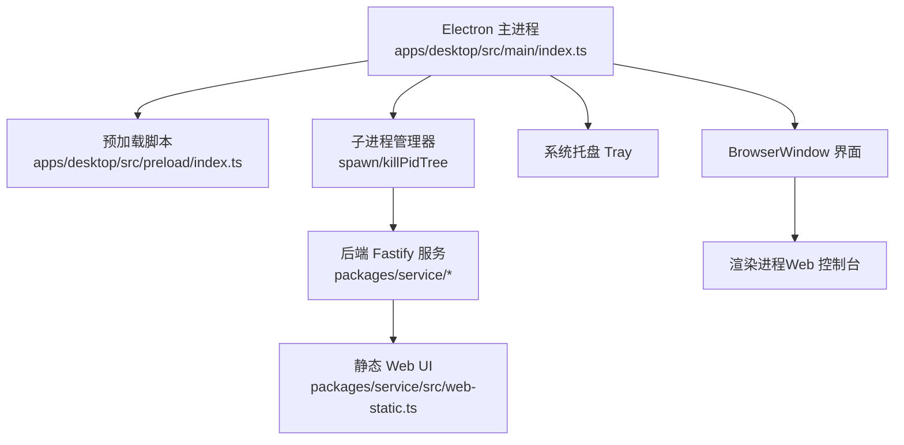
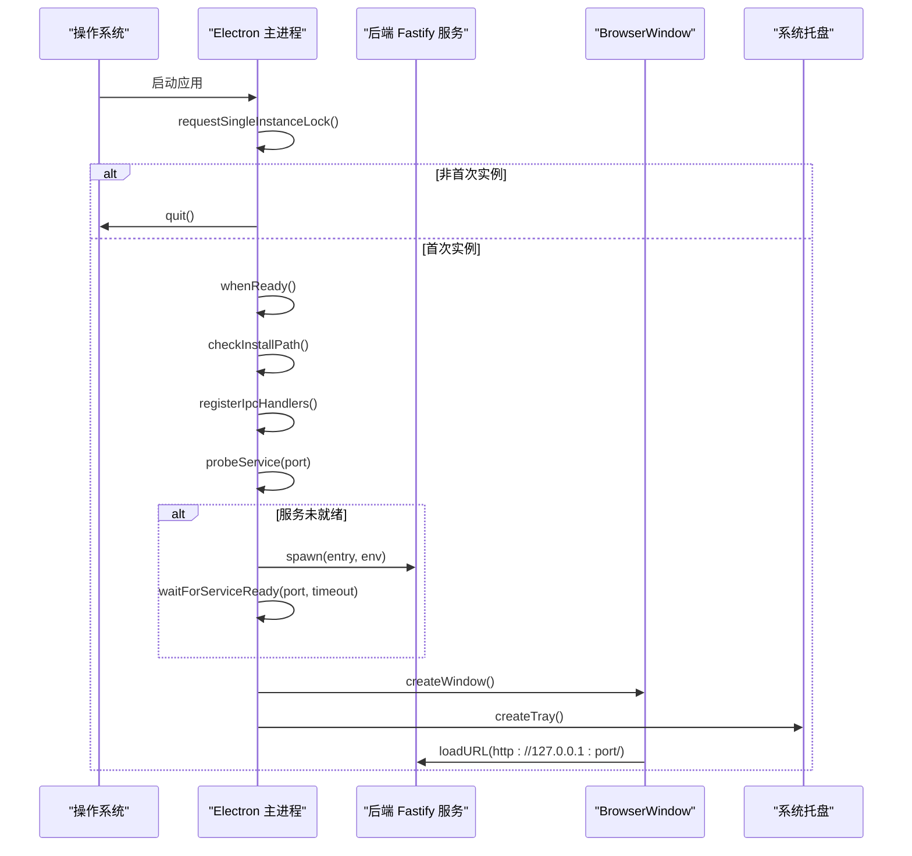
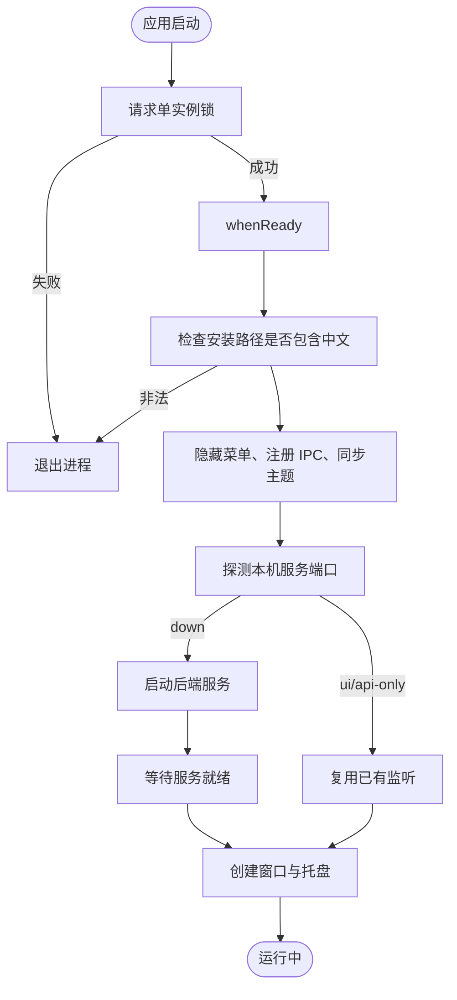
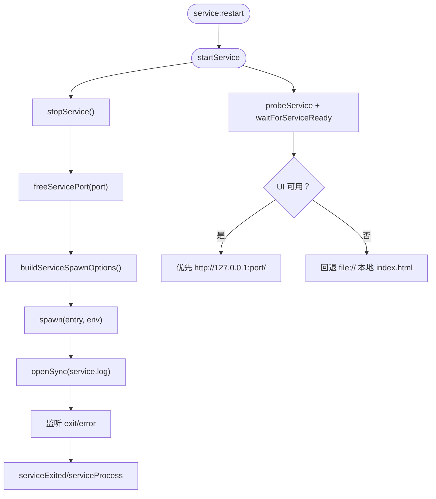
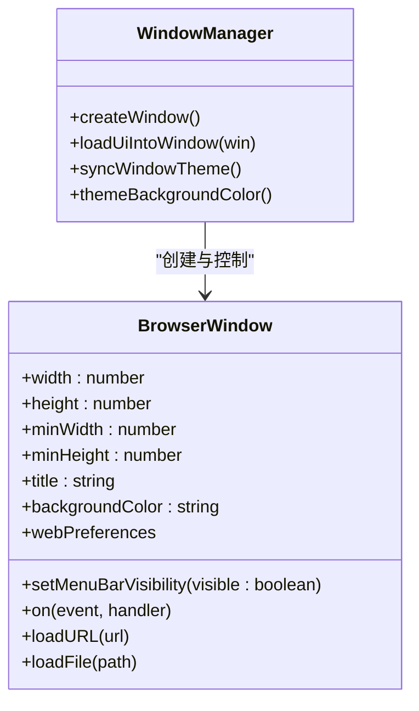
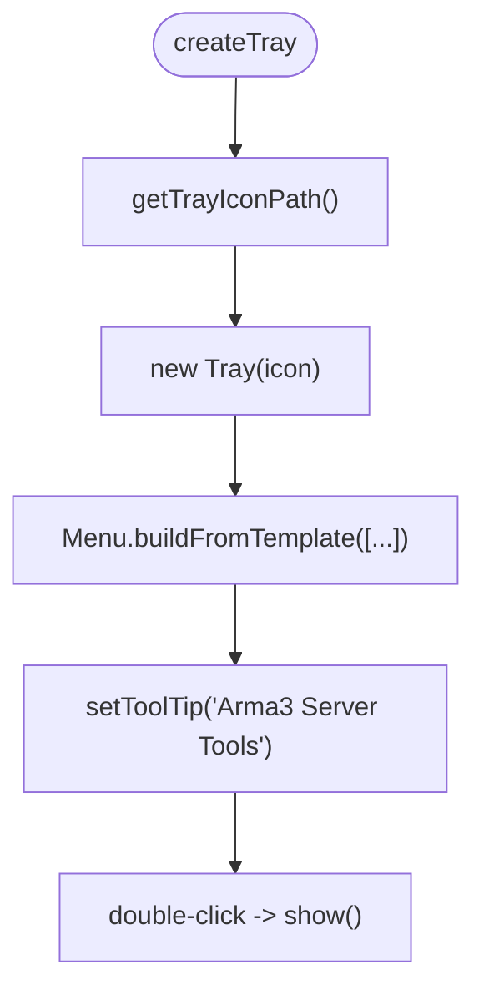
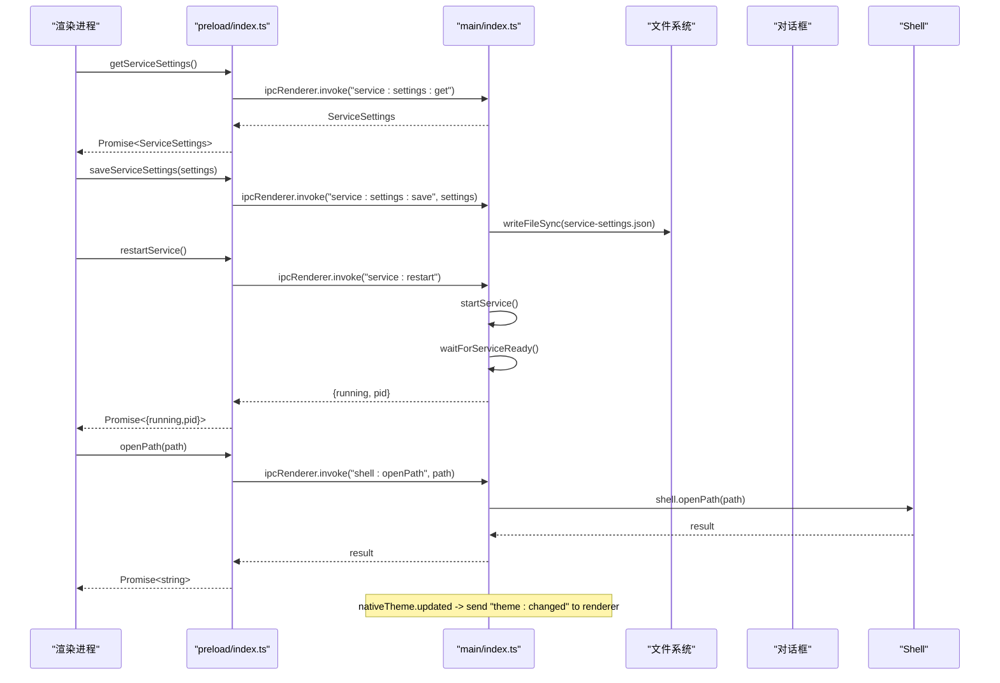
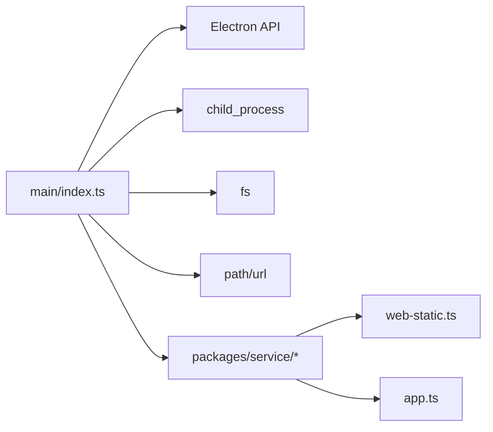

# Electron 主进程

<cite>
**本文引用的文件**   
- [apps/desktop/src/main/index.ts](file://apps/desktop/src/main/index.ts)
- [apps/desktop/src/preload/index.ts](file://apps/desktop/src/preload/index.ts)
- [apps/desktop/package.json](file://apps/desktop/package.json)
- [packages/service/src/web-static.ts](file://packages/service/src/web-static.ts)
- [packages/service/src/app.ts](file://packages/service/src/app.ts)
</cite>

## 目录
1. [简介](#简介)
2. [项目结构](#项目结构)
3. [核心组件](#核心组件)
4. [架构总览](#架构总览)
5. [详细组件分析](#详细组件分析)
6. [依赖关系分析](#依赖关系分析)
7. [性能与资源管理](#性能与资源管理)
8. [故障排查指南](#故障排查指南)
9. [结论](#结论)

## 简介
本文面向 Electron 主进程的开发者与维护者，系统性说明 Arma3 Server Tools 桌面端的主进程职责、生命周期、服务进程管理、窗口管理、系统托盘、IPC 通信、错误处理与性能优化建议。文档以仓库中的实际实现为依据，重点围绕以下目标：
- 主进程生命周期与应用初始化流程
- 后端 Fastify 服务进程的启动、停止、重启与状态探测
- BrowserWindow 配置、多实例控制与窗口状态管理
- 系统托盘图标、上下文菜单与交互行为
- IPC 处理器注册、事件监听与数据传递
- 错误处理策略、用户提示与日志记录
- 性能优化与资源管理最佳实践

## 项目结构
Electron 桌面应用位于 apps/desktop 目录，主入口为 TypeScript 源文件，打包后由 electron-builder 输出到 dist-electron。预加载脚本通过 contextBridge 暴露受限 API 给渲染进程。后端服务为独立的 Node/Fastify 应用，由主进程以子进程方式托管。

**图表来源**
- [apps/desktop/src/main/index.ts:1-731](file://apps/desktop/src/main/index.ts#L1-L731)
- [apps/desktop/src/preload/index.ts:1-48](file://apps/desktop/src/preload/index.ts#L1-L48)
- [packages/service/src/web-static.ts:1-93](file://packages/service/src/web-static.ts#L1-L93)

**章节来源**
- [apps/desktop/package.json:1-31](file://apps/desktop/package.json#L1-L31)
- [apps/desktop/src/main/index.ts:1-90](file://apps/desktop/src/main/index.ts#L1-L90)

## 核心组件
- 应用生命周期与单实例锁：使用 app.requestSingleInstanceLock 保证单实例运行，second-instance 事件聚焦已有窗口。
- 设置与数据目录：基于 app.getPath("userData") 持久化 service-settings.json 与服务数据目录 a3st-data。
- 服务进程管理：通过 child_process.spawn 启动后端服务，支持端口占用检测、进程树终止、日志重定向。
- 窗口管理：创建 BrowserWindow，隐藏默认菜单栏，处理 did-fail-load、render-process-gone 等异常，提供 file:// 回退。
- 系统托盘：根据平台与构建模式选择图标路径，提供“显示窗口”和“退出”菜单项。
- IPC 通信：ipcMain.handle 注册主题、服务状态、设置读写、重启服务、文件系统、对话框、Shell 打开等接口；preload 暴露 window.electronAPI。

**章节来源**
- [apps/desktop/src/main/index.ts:38-90](file://apps/desktop/src/main/index.ts#L38-L90)
- [apps/desktop/src/main/index.ts:323-406](file://apps/desktop/src/main/index.ts#L323-L406)
- [apps/desktop/src/main/index.ts:423-468](file://apps/desktop/src/main/index.ts#L423-L468)
- [apps/desktop/src/main/index.ts:470-616](file://apps/desktop/src/main/index.ts#L470-L616)
- [apps/desktop/src/main/index.ts:618-645](file://apps/desktop/src/main/index.ts#L618-L645)
- [apps/desktop/src/preload/index.ts:10-47](file://apps/desktop/src/preload/index.ts#L10-L47)

## 架构总览
主进程作为桌面壳层，负责：
- 应用初始化与单实例控制
- 读取并校验安装路径
- 注册 IPC 处理器
- 探测或启动后端服务
- 创建主窗口与托盘
- 在应用关闭时清理服务进程

**图表来源**
- [apps/desktop/src/main/index.ts:659-730](file://apps/desktop/src/main/index.ts#L659-L730)
- [apps/desktop/src/main/index.ts:95-137](file://apps/desktop/src/main/index.ts#L95-L137)
- [apps/desktop/src/main/index.ts:323-378](file://apps/desktop/src/main/index.ts#L323-L378)
- [apps/desktop/src/main/index.ts:470-616](file://apps/desktop/src/main/index.ts#L470-L616)

## 详细组件分析

### 主进程生命周期与初始化
- 单实例锁：若已存在实例则直接退出当前进程；否则监听 second-instance 将已有窗口恢复并聚焦。
- 初始化顺序：whenReady -> 检查安装路径 -> 隐藏应用菜单 -> 注册 IPC -> 同步主题 -> 探测服务 -> 创建窗口与托盘。
- 关闭钩子：before-quit 中停止服务；window-all-closed 保持托盘运行；activate 显示窗口。

**图表来源**
- [apps/desktop/src/main/index.ts:659-730](file://apps/desktop/src/main/index.ts#L659-L730)
- [apps/desktop/src/main/index.ts:647-657](file://apps/desktop/src/main/index.ts#L647-L657)
- [apps/desktop/src/main/index.ts:682-715](file://apps/desktop/src/main/index.ts#L682-L715)

**章节来源**
- [apps/desktop/src/main/index.ts:659-730](file://apps/desktop/src/main/index.ts#L659-L730)

### 服务进程管理（Fastify 后端）
- 启动流程：
  - 先调用 stopService 清理旧进程与日志句柄。
  - 读取设置，释放端口占用（findListenerPid + killPidTree）。
  - 生成环境变量 PORT/HOST/DATA_DIR/API_TOKEN/WEB_ROOT/ELECTRON_RUN_AS_NODE。
  - 使用 child_process.spawn 启动服务 entry，标准输出与错误输出重定向到 service.log。
  - 监听 exit/error 事件，更新 serviceExited 与 serviceProcess 引用。
- 停止流程：
  - 对自有进程使用 killPidTree（Windows taskkill /T /F，其他平台 SIGTERM）。
  - 对 adopt 的进程也进行终止。
  - 关闭日志文件描述符。
- 重启流程：
  - 通过 IPC service:restart 触发 startService，随后 waitForServiceReady 探测 UI 可用性，决定 preferFileUi。
- 健康探测：
  - probeService 访问 /api/v1/health 判断服务是否存活。
  - 再尝试 GET / 判断是否为 UI 页面，区分 ui 与 api-only。
  - waitForServiceReady 轮询最多 30 秒，每 250ms 一次。

**图表来源**
- [apps/desktop/src/main/index.ts:95-137](file://apps/desktop/src/main/index.ts#L95-L137)
- [apps/desktop/src/main/index.ts:139-222](file://apps/desktop/src/main/index.ts#L139-L222)
- [apps/desktop/src/main/index.ts:236-249](file://apps/desktop/src/main/index.ts#L236-L249)
- [apps/desktop/src/main/index.ts:281-321](file://apps/desktop/src/main/index.ts#L281-L321)
- [apps/desktop/src/main/index.ts:323-396](file://apps/desktop/src/main/index.ts#L323-L396)
- [apps/desktop/src/main/index.ts:440-451](file://apps/desktop/src/main/index.ts#L440-L451)

**章节来源**
- [apps/desktop/src/main/index.ts:95-137](file://apps/desktop/src/main/index.ts#L95-L137)
- [apps/desktop/src/main/index.ts:139-222](file://apps/desktop/src/main/index.ts#L139-L222)
- [apps/desktop/src/main/index.ts:236-249](file://apps/desktop/src/main/index.ts#L236-L249)
- [apps/desktop/src/main/index.ts:281-321](file://apps/desktop/src/main/index.ts#L281-L321)
- [apps/desktop/src/main/index.ts:323-396](file://apps/desktop/src/main/index.ts#L323-L396)
- [apps/desktop/src/main/index.ts:440-451](file://apps/desktop/src/main/index.ts#L440-L451)

### 窗口管理系统（BrowserWindow）
- 窗口配置：
  - 尺寸：宽 1100、高 740，最小尺寸 780x500。
  - 标题：“Arma3 Server Tools”。
  - 背景色跟随系统主题（深色 #1e1e1e，浅色 #ffffff）。
  - webPreferences：启用 preload，开启 contextIsolation，禁用 nodeIntegration，sandbox=false。
  - show=false，ready-to-show 后再显示。
- 菜单与可见性：
  - 隐藏菜单栏 setMenuBarVisibility(false)，避免白屏误判。
- 加载策略：
  - 开发环境：优先加载 Vite dev server http://localhost:5173，失败回退到打包的 index.html。
  - 生产环境：优先加载 http://127.0.0.1:port/，若 preferFileUi=true 或服务加载失败，回退到 file:// 本地 index.html。
- 异常处理：
  - did-fail-load：仅主框架且非 -3 时触发回退逻辑，展示错误对话框。
  - render-process-gone：弹出提示并重新加载 UI。
  - show 事件：若 URL 为空或 about:blank，再次加载 UI。
  - close 事件：有托盘时阻止关闭，改为隐藏窗口。

**图表来源**
- [apps/desktop/src/main/index.ts:408-421](file://apps/desktop/src/main/index.ts#L408-L421)
- [apps/desktop/src/main/index.ts:470-561](file://apps/desktop/src/main/index.ts#L470-L561)
- [apps/desktop/src/main/index.ts:567-616](file://apps/desktop/src/main/index.ts#L567-L616)

**章节来源**
- [apps/desktop/src/main/index.ts:408-421](file://apps/desktop/src/main/index.ts#L408-L421)
- [apps/desktop/src/main/index.ts:470-561](file://apps/desktop/src/main/index.ts#L470-L561)
- [apps/desktop/src/main/index.ts:567-616](file://apps/desktop/src/main/index.ts#L567-L616)

### 系统托盘实现
- 图标路径：
  - 开发模式：apps/desktop/build/icon.ico
  - 打包模式：process.resourcesPath/assets/icon.ico
  - 若图标不存在，创建空图像。
- 菜单项：
  - “显示窗口”：显示 mainWindow。
  - “退出”：停止服务、销毁托盘、app.exit。
- 交互：
  - 双击托盘图标显示窗口。
  - 工具提示设置为应用名称。

**图表来源**
- [apps/desktop/src/main/index.ts:251-256](file://apps/desktop/src/main/index.ts#L251-L256)
- [apps/desktop/src/main/index.ts:618-645](file://apps/desktop/src/main/index.ts#L618-L645)

**章节来源**
- [apps/desktop/src/main/index.ts:251-256](file://apps/desktop/src/main/index.ts#L251-L256)
- [apps/desktop/src/main/index.ts:618-645](file://apps/desktop/src/main/index.ts#L618-L645)

### IPC 通信机制
- 预加载脚本（preload）：
  - 通过 contextBridge.exposeInMainWorld 暴露 window.electronAPI。
  - 方法包括：getServiceSettings、saveServiceSettings、getServiceStatus、restartService、openFile、getAppVersion、getAppPath、openPath、showOpenDialog、readTextFile、getThemeDark、onThemeChanged。
- 主进程处理器（ipcMain.handle）：
  - theme:shouldUseDarkColors：返回 nativeTheme.shouldUseDarkColors。
  - service:status：返回 { running, pid? }。
  - service:settings:get/save：读取/保存 service-settings.json。
  - service:restart：启动服务并探测 UI 可用性，返回服务状态。
  - app:version/app:path：返回应用版本与路径。
  - shell:openPath：打开系统路径。
  - dialog:openFile：打开文件选择对话框。
  - fs:readTextFile：读取文本文件内容。
- 事件推送：
  - 主题变化：nativeTheme.on("updated") 触发 syncWindowTheme，向渲染进程发送 theme:changed。

**图表来源**
- [apps/desktop/src/preload/index.ts:10-47](file://apps/desktop/src/preload/index.ts#L10-L47)
- [apps/desktop/src/main/index.ts:423-468](file://apps/desktop/src/main/index.ts#L423-L468)
- [apps/desktop/src/main/index.ts:408-421](file://apps/desktop/src/main/index.ts#L408-L421)

**章节来源**
- [apps/desktop/src/preload/index.ts:10-47](file://apps/desktop/src/preload/index.ts#L10-L47)
- [apps/desktop/src/main/index.ts:423-468](file://apps/desktop/src/main/index.ts#L423-L468)
- [apps/desktop/src/main/index.ts:408-421](file://apps/desktop/src/main/index.ts#L408-L421)

### 错误处理策略
- 进程异常捕获：
  - 子进程 exit/error 事件统一记录日志并标记 serviceExited。
  - 渲染进程 gone 事件弹出提示并尝试重新加载 UI。
- 用户提示：
  - 安装路径含中文：dialog.showErrorBox 提示重新安装。
  - 服务未找到：提示执行 npm run build:service。
  - 界面加载失败：提示查看 service.log 或确认服务已启动。
  - 渲染进程异常：提示原因并尝试重载。
- 日志记录：
  - 服务 stdout/stderr 重定向到 dataDir/service.log。
  - 主进程 console.log/console.error 用于调试。
  - 服务启动失败时读取日志尾部信息辅助诊断。

**章节来源**
- [apps/desktop/src/main/index.ts:356-376](file://apps/desktop/src/main/index.ts#L356-L376)
- [apps/desktop/src/main/index.ts:528-537](file://apps/desktop/src/main/index.ts#L528-L537)
- [apps/desktop/src/main/index.ts:332-340](file://apps/desktop/src/main/index.ts#L332-L340)
- [apps/desktop/src/main/index.ts:500-525](file://apps/desktop/src/main/index.ts#L500-L525)
- [apps/desktop/src/main/index.ts:697-712](file://apps/desktop/src/main/index.ts#L697-L712)

## 依赖关系分析
- 主进程依赖 Electron API：app、BrowserWindow、Tray、Menu、nativeImage、dialog、ipcMain、shell、nativeTheme。
- 子进程管理依赖 Node.js child_process：execFileSync、spawn。
- 文件系统依赖 Node.js fs：mkdirSync、writeFileSync、readFileSync、openSync。
- 路径与模块解析依赖 path、url。
- 后端服务依赖 Fastify 与静态资源服务：
  - web-static.ts 提供静态资源路由与 MIME 类型映射。
  - app.ts 提供 Fastify 实例创建、监听重试与依赖注入。

**图表来源**
- [apps/desktop/src/main/index.ts:1-7](file://apps/desktop/src/main/index.ts#L1-L7)
- [packages/service/src/web-static.ts:1-93](file://packages/service/src/web-static.ts#L1-L93)
- [packages/service/src/app.ts:34-71](file://packages/service/src/app.ts#L34-L71)

**章节来源**
- [apps/desktop/src/main/index.ts:1-7](file://apps/desktop/src/main/index.ts#L1-L7)
- [packages/service/src/web-static.ts:1-93](file://packages/service/src/web-static.ts#L1-L93)
- [packages/service/src/app.ts:34-71](file://packages/service/src/app.ts#L34-L71)

## 性能与资源管理
- 子进程资源：
  - 启动前确保端口空闲，避免重复监听导致的崩溃与资源泄漏。
  - 使用 killPidTree 终止进程树，防止僵尸进程残留。
  - 日志文件句柄在 stopService 中显式关闭，避免 fd 泄漏。
- 窗口资源：
  - 使用 show=false 与 ready-to-show 显示，减少首屏闪烁。
  - 隐藏菜单栏降低 UI 开销。
  - 主题变更时仅更新背景色并通过 IPC 通知渲染进程，避免全量重建。
- I/O 与网络：
  - 健康探测使用短超时（1.5s），轮询间隔 250ms，避免阻塞主线程。
  - 文件读取采用同步 API 仅在必要场景使用（如设置读取、日志读取）。
- 安全与隔离：
  - 启用 contextIsolation，禁用 nodeIntegration，降低渲染侧攻击面。
  - preload 仅暴露最小 API，遵循最小权限原则。

[本节为通用指导，不直接分析具体文件]

## 故障排查指南
- 服务未找到：
  - 现象：启动时报错提示未找到服务入口。
  - 处理：执行 npm run build:service，确认 packages/service/dist/index.js 存在。
  - 参考路径：apps/desktop/src/main/index.ts:332-340。
- 端口被占用：
  - 现象：服务无法启动或 UI 无法连接。
  - 处理：检查 findListenerPid 与 killPidTree 是否成功释放端口；必要时手动结束占用进程。
  - 参考路径：apps/desktop/src/main/index.ts:139-222。
- 界面加载失败：
  - 现象：did-fail-load 触发，回退到 file:// 仍失败。
  - 处理：检查 WEB_ROOT 与 getPackagedWebRoot 路径；确认打包产物包含 web/dist/index.html。
  - 参考路径：apps/desktop/src/main/index.ts:500-525、567-616。
- 渲染进程异常：
  - 现象：render-process-gone 触发。
  - 处理：查看 reason，尝试重新加载 UI；检查内存与扩展冲突。
  - 参考路径：apps/desktop/src/main/index.ts:528-537。
- 主题不同步：
  - 现象：窗口背景色与系统主题不一致。
  - 处理：检查 nativeTheme.updated 监听与 syncWindowTheme 调用。
  - 参考路径：apps/desktop/src/main/index.ts:408-421。

**章节来源**
- [apps/desktop/src/main/index.ts:332-340](file://apps/desktop/src/main/index.ts#L332-L340)
- [apps/desktop/src/main/index.ts:139-222](file://apps/desktop/src/main/index.ts#L139-L222)
- [apps/desktop/src/main/index.ts:500-525](file://apps/desktop/src/main/index.ts#L500-L525)
- [apps/desktop/src/main/index.ts:528-537](file://apps/desktop/src/main/index.ts#L528-L537)
- [apps/desktop/src/main/index.ts:408-421](file://apps/desktop/src/main/index.ts#L408-L421)

## 结论
Electron 主进程在本项目中承担应用壳层、服务托管、窗口与托盘管理、IPC 桥接等核心职责。通过严格的单实例控制、健壮的服务探测与回退策略、安全的 IPC 暴露以及完善的错误处理与日志记录，保证了桌面端的稳定性与可维护性。在生产环境中，应重点关注端口占用、服务启动失败、UI 加载回退与渲染进程异常等关键路径，并结合日志与用户提示快速定位问题。同时，遵循最小权限与安全隔离原则，持续优化 I/O 与网络探测的性能，提升用户体验。