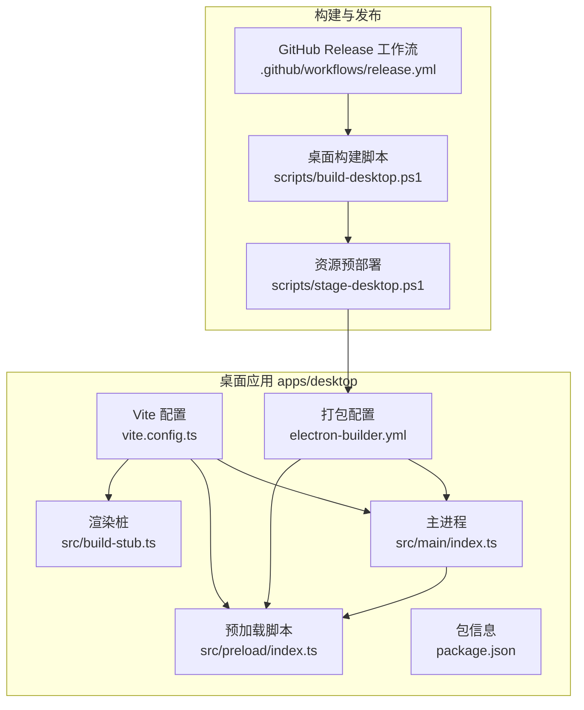
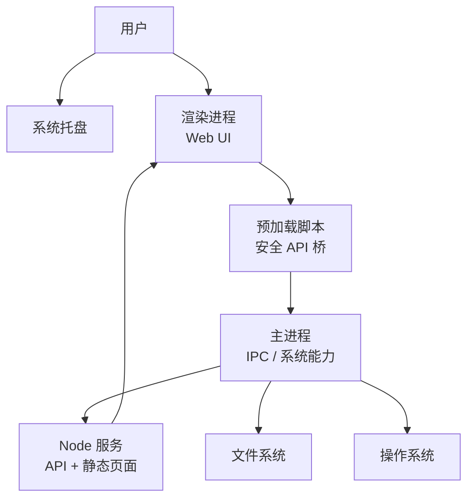
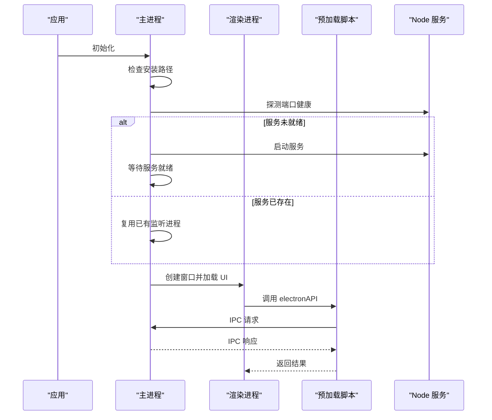
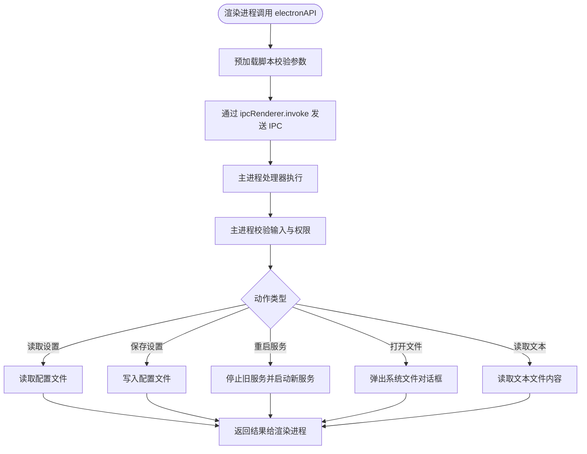
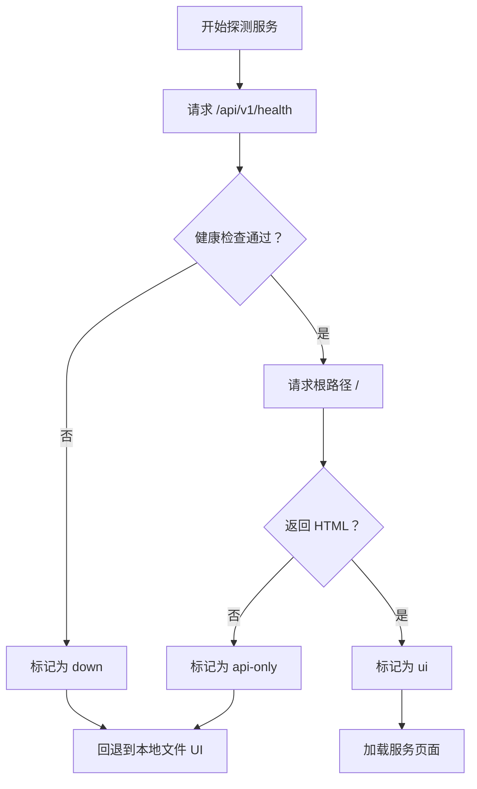
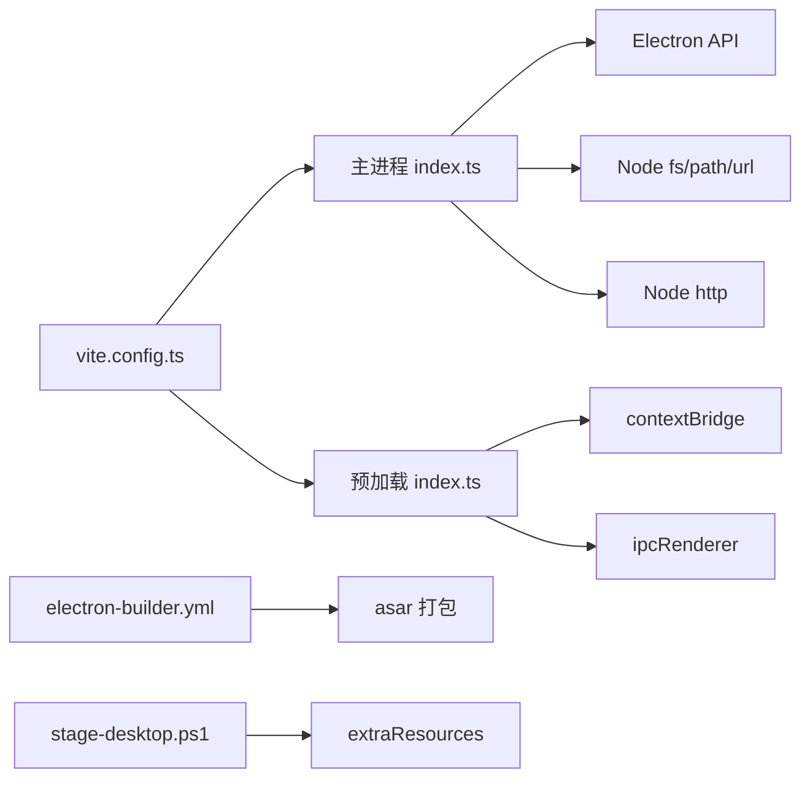

# 桌面应用

<cite>
**本文引用的文件**   
- [apps/desktop/src/main/index.ts](file://apps/desktop/src/main/index.ts)
- [apps/desktop/src/preload/index.ts](file://apps/desktop/src/preload/index.ts)
- [apps/desktop/package.json](file://apps/desktop/package.json)
- [apps/desktop/vite.config.ts](file://apps/desktop/vite.config.ts)
- [apps/desktop/electron-builder.yml](file://apps/desktop/electron-builder.yml)
- [apps/desktop/src/build-stub.ts](file://apps/desktop/src/build-stub.ts)
- [scripts/stage-desktop.ps1](file://scripts/stage-desktop.ps1)
- [scripts/build-desktop.ps1](file://scripts/build-desktop.ps1)
- [.github/workflows/release.yml](file://.github/workflows/release.yml)
</cite>

## 目录
1. [简介](#简介)
2. [项目结构](#项目结构)
3. [核心组件](#核心组件)
4. [架构总览](#架构总览)
5. [详细组件分析](#详细组件分析)
6. [依赖关系分析](#依赖关系分析)
7. [性能与内存管理](#性能与内存管理)
8. [故障排查指南](#故障排查指南)
9. [结论](#结论)
10. [附录：打包、签名与自动更新](#附录打包签名与自动更新)

## 简介
本项目是一个基于 Electron 的桌面应用，用于管理和监控 Arma3 服务器。应用采用主进程 + 渲染进程 + 预加载脚本的经典三层架构：
- 主进程负责系统能力、子进程管理、托盘、窗口生命周期和 IPC 处理。
- 渲染进程承载 Web 控制台界面，通过预加载脚本暴露最小化 API。
- 预加载脚本在隔离环境中桥接安全能力，避免直接暴露 Node.js 或 Electron 对象。

此外，应用会启动一个内嵌的 Node 服务作为后端，提供 HTTP API 和静态页面；Electron 窗口优先加载该服务的本地地址，若不可用则回退到本地文件资源。

## 项目结构
桌面端位于 `apps/desktop`，主要包含：
- `src/main/index.ts`：Electron 主进程入口。
- `src/preload/index.ts`：预加载脚本，定义渲染进程可用的安全 API。
- `vite.config.ts`：Vite 构建配置，分别编译主进程、预加载脚本和渲染桩代码。
- `electron-builder.yml`：打包产物、额外资源、NSIS 安装器配置。
- `package.json`：桌面应用元数据、脚本和依赖。
- `src/build-stub.ts`：占位渲染入口，使 Vite 客户端构建成功。

**图表来源**
- [apps/desktop/src/main/index.ts:1-10](file://apps/desktop/src/main/index.ts#L1-L10)
- [apps/desktop/src/preload/index.ts:1-10](file://apps/desktop/src/preload/index.ts#L1-L10)
- [apps/desktop/vite.config.ts:1-20](file://apps/desktop/vite.config.ts#L1-L20)
- [apps/desktop/electron-builder.yml:1-10](file://apps/desktop/electron-builder.yml#L1-L10)
- [scripts/stage-desktop.ps1:1-20](file://scripts/stage-desktop.ps1#L1-L20)
- [scripts/build-desktop.ps1:1-20](file://scripts/build-desktop.ps1#L1-L20)
- [.github/workflows/release.yml:1-20](file://.github/workflows/release.yml#L1-L20)

**章节来源**
- [apps/desktop/package.json:1-31](file://apps/desktop/package.json#L1-L31)
- [apps/desktop/vite.config.ts:1-63](file://apps/desktop/vite.config.ts#L1-L63)
- [apps/desktop/electron-builder.yml:1-48](file://apps/desktop/electron-builder.yml#L1-L48)

## 核心组件
- 主进程模块：负责应用生命周期、窗口创建、托盘、IPC 处理器、被控服务启动/停止、端口探测、日志读取、主题同步等。
- 预加载脚本模块：通过 `contextBridge` 暴露最小 API，包括服务设置读写、服务状态查询、重启服务、文件对话框、路径操作、文本文件读取、主题监听等。
- 构建与打包：Vite 分别构建主进程、预加载（CJS）和渲染桩；electron-builder 将主进程、预加载、Web 前端和资源打包进 asar，并生成 NSIS 安装包。

**章节来源**
- [apps/desktop/src/main/index.ts:1-731](file://apps/desktop/src/main/index.ts#L1-L731)
- [apps/desktop/src/preload/index.ts:1-48](file://apps/desktop/src/preload/index.ts#L1-L48)
- [apps/desktop/vite.config.ts:1-63](file://apps/desktop/vite.config.ts#L1-L63)
- [apps/desktop/electron-builder.yml:1-48](file://apps/desktop/electron-builder.yml#L1-L48)

## 架构总览
应用运行时由以下部分组成：
- Electron 主进程：系统级能力、IPC、子进程管理。
- 渲染进程：Web UI，运行在隔离上下文，仅能调用预加载暴露的 API。
- 预加载脚本：安全边界，桥接受限能力。
- 内嵌 Node 服务：HTTP API 与静态页面，默认监听本地环回地址。
- 系统托盘：常驻后台，提供显示窗口和退出应用菜单。

**图表来源**
- [apps/desktop/src/main/index.ts:423-468](file://apps/desktop/src/main/index.ts#L423-L468)
- [apps/desktop/src/preload/index.ts:10-47](file://apps/desktop/src/preload/index.ts#L10-L47)
- [apps/desktop/src/main/index.ts:323-378](file://apps/desktop/src/main/index.ts#L323-L378)
- [apps/desktop/src/main/index.ts:618-645](file://apps/desktop/src/main/index.ts#L618-L645)

## 详细组件分析

### 主进程职责与实现
主进程承担以下职责：
- 应用单实例锁与多实例激活。
- 窗口创建、显示隐藏、关闭行为控制。
- 托盘图标与菜单。
- 内嵌服务启动、停止、重启、端口释放、进程树终止。
- 服务健康探测与 UI 模式选择。
- IPC 处理器注册，限制渲染进程可访问的能力。
- 主题同步与深色背景适配。
- 安装路径检查与错误提示。

关键流程：
- 启动时检测服务是否已监听端口；若未就绪则尝试启动服务，等待健康检查。
- 根据探测结果决定 UI 加载策略：优先加载服务提供的页面，否则回退到本地文件资源。
- 渲染进程崩溃时捕获事件并尝试重新加载。
- 托盘双击显示窗口，右键菜单支持显示窗口和退出应用。

**图表来源**
- [apps/desktop/src/main/index.ts:659-715](file://apps/desktop/src/main/index.ts#L659-L715)
- [apps/desktop/src/main/index.ts:470-616](file://apps/desktop/src/main/index.ts#L470-L616)
- [apps/desktop/src/preload/index.ts:10-47](file://apps/desktop/src/preload/index.ts#L10-L47)

**章节来源**
- [apps/desktop/src/main/index.ts:1-731](file://apps/desktop/src/main/index.ts#L1-L731)

### 预加载脚本与安全机制
预加载脚本通过 `contextBridge.exposeInMainWorld` 暴露最小 API，渲染进程只能通过这些方法访问主进程能力：
- 服务设置获取与保存。
- 服务状态查询与重启。
- 文件对话框打开。
- 应用版本与路径查询。
- 系统路径打开。
- 文本文件读取。
- 主题颜色查询与变更监听。

安全要点：
- 渲染进程禁用 Node 集成，启用上下文隔离。
- 不直接暴露 `ipcRenderer`、`fs`、`child_process` 等危险对象。
- 所有敏感操作均通过命名明确的 IPC 通道，主进程进行参数校验与权限控制。

**图表来源**
- [apps/desktop/src/preload/index.ts:10-47](file://apps/desktop/src/preload/index.ts#L10-L47)
- [apps/desktop/src/main/index.ts:423-468](file://apps/desktop/src/main/index.ts#L423-L468)

**章节来源**
- [apps/desktop/src/preload/index.ts:1-48](file://apps/desktop/src/preload/index.ts#L1-L48)
- [apps/desktop/src/main/index.ts:423-468](file://apps/desktop/src/main/index.ts#L423-L468)

### 系统集成能力
- 文件系统操作：主进程通过 Node `fs` 模块读取服务日志、保存设置、读取文本文件；预加载脚本暴露受限的文件读取接口。
- 进程管理：主进程使用 `child_process.spawn` 启动 Node 服务，监听 exit/error 事件，并通过平台命令释放端口、终止进程树。
- 系统托盘：创建托盘图标与菜单，支持双击显示窗口、右键退出应用。
- 窗口管理：创建 BrowserWindow，设置最小尺寸、标题、背景色、菜单栏隐藏；处理 show/hide/close 事件；崩溃后重试加载。

**章节来源**
- [apps/desktop/src/main/index.ts:1-10](file://apps/desktop/src/main/index.ts#L1-L10)
- [apps/desktop/src/main/index.ts:139-201](file://apps/desktop/src/main/index.ts#L139-L201)
- [apps/desktop/src/main/index.ts:224-249](file://apps/desktop/src/main/index.ts#L224-L249)
- [apps/desktop/src/main/index.ts:618-645](file://apps/desktop/src/main/index.ts#L618-L645)
- [apps/desktop/src/main/index.ts:470-561](file://apps/desktop/src/main/index.ts#L470-L561)

### 安全最佳实践
- 上下文隔离：窗口创建时启用 `contextIsolation: true`，禁用 `nodeIntegration`。
- 预加载白名单：仅暴露必要 API，避免直接暴露 Node/Electron 对象。
- 权限控制：主进程对 IPC 参数进行规范化与校验，例如端口、主机、令牌、布尔值。
- 内容安全策略：UI 优先从本地环回地址加载，避免 `file://` 下动态路由问题；失败时回退到本地文件资源。
- 单实例锁：防止重复启动，第二实例聚焦已有窗口。

**章节来源**
- [apps/desktop/src/main/index.ts:474-489](file://apps/desktop/src/main/index.ts#L474-L489)
- [apps/desktop/src/main/index.ts:423-468](file://apps/desktop/src/main/index.ts#L423-L468)
- [apps/desktop/src/main/index.ts:659-671](file://apps/desktop/src/main/index.ts#L659-L671)
- [apps/desktop/src/main/index.ts:567-616](file://apps/desktop/src/main/index.ts#L567-L616)

### 与后端服务的通信策略
- 健康探测：主进程通过 HTTP 请求 `/api/v1/health` 判断服务是否存活。
- UI 模式探测：进一步请求根路径，判断是否为 HTML 页面，区分“UI”、“API-only”、“down”。
- 启动策略：若服务未就绪，主进程启动 Node 服务，等待健康检查完成后再加载 UI。
- 回退策略：若服务只暴露 API 或无法连接，则加载本地静态页面；若本地页面缺失，则弹窗提示。

**图表来源**
- [apps/desktop/src/main/index.ts:95-137](file://apps/desktop/src/main/index.ts#L95-L137)
- [apps/desktop/src/main/index.ts:567-616](file://apps/desktop/src/main/index.ts#L567-L616)

**章节来源**
- [apps/desktop/src/main/index.ts:95-137](file://apps/desktop/src/main/index.ts#L95-L137)
- [apps/desktop/src/main/index.ts:567-616](file://apps/desktop/src/main/index.ts#L567-L616)

### 本地开发调试方法
- 开发模式：主进程优先加载 Vite 开发服务器 `http://localhost:5173`，便于热重载。
- 预加载脚本：Vite 插件确保预加载以 CJS 输出，避免 ESM 在打包后静默失败。
- 渲染桩：构建桩文件使 Vite 客户端构建成功，实际 UI 由 extraResources/web 提供。
- 调试建议：查看主进程控制台日志、服务日志文件、渲染进程崩溃事件。

**章节来源**
- [apps/desktop/src/main/index.ts:567-576](file://apps/desktop/src/main/index.ts#L567-L576)
- [apps/desktop/vite.config.ts:24-43](file://apps/desktop/vite.config.ts#L24-L43)
- [apps/desktop/src/build-stub.ts:1-3](file://apps/desktop/src/build-stub.ts#L1-L3)

## 依赖关系分析
- 主进程依赖 Electron API、Node 标准库（child_process、fs、path、url）、HTTP 模块。
- 预加载脚本依赖 Electron 的 contextBridge 与 ipcRenderer。
- 构建工具链：Vite 插件分别处理主进程、预加载、渲染桩；electron-builder 负责打包与 NSIS 安装器生成。
- 外部资源：Web 前端与 Node 服务通过 staging 脚本复制到 `electron-resources`，再由 electron-builder 打入 asar。

**图表来源**
- [apps/desktop/src/main/index.ts:1-6](file://apps/desktop/src/main/index.ts#L1-L6)
- [apps/desktop/src/preload/index.ts:1-2](file://apps/desktop/src/preload/index.ts#L1-L2)
- [apps/desktop/vite.config.ts:1-45](file://apps/desktop/vite.config.ts#L1-L45)
- [apps/desktop/electron-builder.yml:11-34](file://apps/desktop/electron-builder.yml#L11-L34)
- [scripts/stage-desktop.ps1:1-20](file://scripts/stage-desktop.ps1#L1-L20)

**章节来源**
- [apps/desktop/src/main/index.ts:1-731](file://apps/desktop/src/main/index.ts#L1-L731)
- [apps/desktop/src/preload/index.ts:1-48](file://apps/desktop/src/preload/index.ts#L1-L48)
- [apps/desktop/vite.config.ts:1-63](file://apps/desktop/vite.config.ts#L1-L63)
- [apps/desktop/electron-builder.yml:1-48](file://apps/desktop/electron-builder.yml#L1-L48)
- [scripts/stage-desktop.ps1:1-98](file://scripts/stage-desktop.ps1#L1-L98)

## 性能与内存管理
- 渲染进程崩溃恢复：捕获 `render-process-gone` 事件并重试加载 UI，提升稳定性。
- 服务进程生命周期：记录进程 PID，避免重复启动；退出时清理日志句柄。
- 端口占用处理：查找监听进程并终止，避免端口冲突导致服务无法启动。
- 日志轮转：读取服务日志尾部，便于快速定位问题。
- 主题切换优化：仅在主题变化时通知渲染进程，减少不必要的 IPC。

建议：
- 避免在主进程中频繁执行阻塞式文件 I/O，必要时使用异步 API。
- 对大文件读取应分块或流式处理，避免一次性加载到内存。
- 合理设置窗口最小尺寸，避免过小导致布局重排开销。
- 在服务启动前尽量释放端口，减少重试次数。

**章节来源**
- [apps/desktop/src/main/index.ts:528-537](file://apps/desktop/src/main/index.ts#L528-L537)
- [apps/desktop/src/main/index.ts:356-378](file://apps/desktop/src/main/index.ts#L356-L378)
- [apps/desktop/src/main/index.ts:212-222](file://apps/desktop/src/main/index.ts#L212-L222)
- [apps/desktop/src/main/index.ts:224-234](file://apps/desktop/src/main/index.ts#L224-L234)
- [apps/desktop/src/main/index.ts:408-421](file://apps/desktop/src/main/index.ts#L408-L421)

## 故障排查指南
常见问题与定位方法：
- 界面加载失败：检查服务是否启动、端口是否被占用、本地文件是否存在；查看 `service.log`。
- 服务未就绪：确认服务入口文件是否存在，执行构建命令；查看健康检查与根路径探测结果。
- 渲染进程异常：查看崩溃原因，应用会自动重试加载。
- 托盘无图标：检查图标路径与资源打包是否正确。
- 安装路径含中文：主进程会弹窗提示并退出，需重新安装到不含中文的路径。

建议步骤：
1. 确认服务日志末尾是否有错误信息。
2. 检查端口是否被其他进程占用。
3. 验证 Web 前端与服务是否都已构建完成。
4. 查看主进程控制台输出，定位 IPC 错误或路径问题。
5. 若为打包问题，检查 extraResources 与 asar 配置。

**章节来源**
- [apps/desktop/src/main/index.ts:498-526](file://apps/desktop/src/main/index.ts#L498-L526)
- [apps/desktop/src/main/index.ts:697-712](file://apps/desktop/src/main/index.ts#L697-L712)
- [apps/desktop/src/main/index.ts:647-657](file://apps/desktop/src/main/index.ts#L647-L657)
- [apps/desktop/src/main/index.ts:224-234](file://apps/desktop/src/main/index.ts#L224-L234)

## 结论
本桌面应用通过清晰的主进程与渲染进程职责分离、严格的预加载安全边界、健壮的服务启动与健康探测机制，提供了稳定的 Arma3 服务器管理体验。构建与打包流程完整，支持 NSIS 安装器与 GitHub Release 发布。后续可在权限细化、日志轮转、远程更新等方面继续优化。

## 附录：打包、签名与自动更新

### 打包配置
- Vite 构建：
  - 主进程输出到 `dist-electron/main.js`。
  - 预加载脚本以 CJS 输出 `preload.cjs`。
  - 渲染桩输出 `stub.js`，仅用于客户端构建成功。
- electron-builder：
  - 应用 ID、产品名称、版本号、输出目录。
  - 将 `dist-electron`、`web`、`service`、`assets` 打入 asar。
  - 生成 NSIS 安装包，允许自定义安装目录与桌面快捷方式。
  - 当前未启用代码签名。

**章节来源**
- [apps/desktop/vite.config.ts:9-43](file://apps/desktop/vite.config.ts#L9-L43)
- [apps/desktop/electron-builder.yml:1-48](file://apps/desktop/electron-builder.yml#L1-L48)

### 资源预部署
- staging 脚本要求 Web 与 Service 均已构建。
- 复制 Web 与 Service 产物到 `electron-resources`。
- 生成服务运行时 package.json 并安装生产依赖。
- 复制图标到资源目录，供托盘使用。

**章节来源**
- [scripts/stage-desktop.ps1:1-98](file://scripts/stage-desktop.ps1#L1-L98)

### 桌面构建脚本
- 依次执行 TypeScript 检查、测试、服务构建、Web 构建、Electron 构建、资源预部署。
- 调用 electron-builder 生成安装包或解压目录。
- 禁用自动代码签名环境变量。

**章节来源**
- [scripts/build-desktop.ps1:1-59](file://scripts/build-desktop.ps1#L1-L59)

### 自动化发布
- GitHub Actions 在推送标签时触发 Windows 桌面构建。
- 安装依赖、类型检查、测试、打包 NSIS 与 win-unpacked。
- 压缩 win-unpacked 为 zip，收集 artifacts 并发布到 GitHub Release。
- 当前未启用代码签名与自动更新。

**章节来源**
- [.github/workflows/release.yml:1-83](file://.github/workflows/release.yml#L1-L83)

### 签名流程与自动更新机制
- 签名：当前配置禁用自动发现证书，未启用签名。如需签名，需在 CI 中配置证书并提供相应环境变量。
- 自动更新：当前未实现内置更新逻辑。可通过 GitHub Releases 提供新版本，并在应用中定期检查更新或使用第三方更新方案。

[本节为概念性说明，不直接分析具体源码文件]