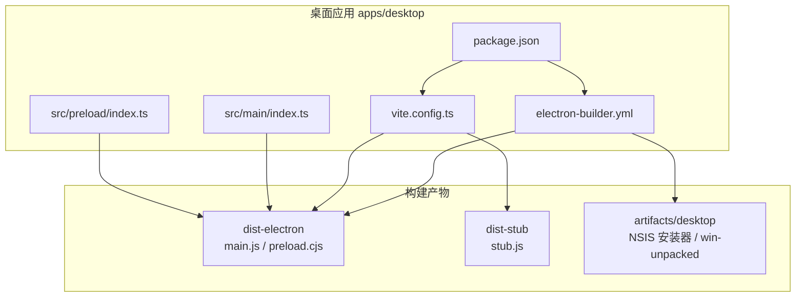
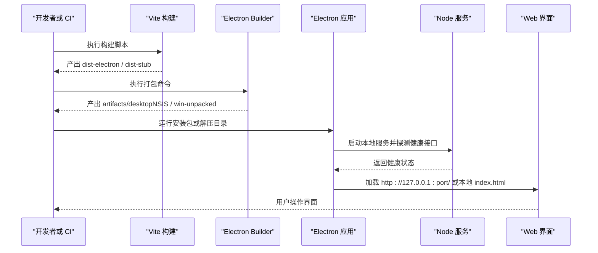
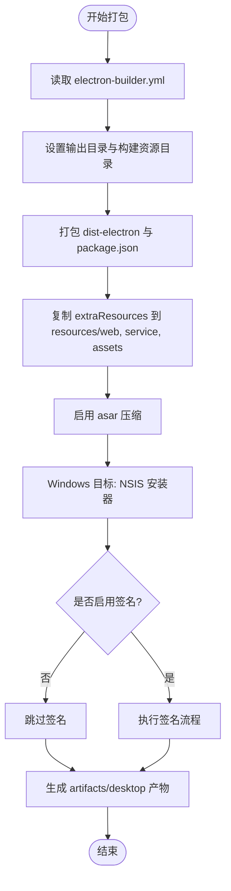
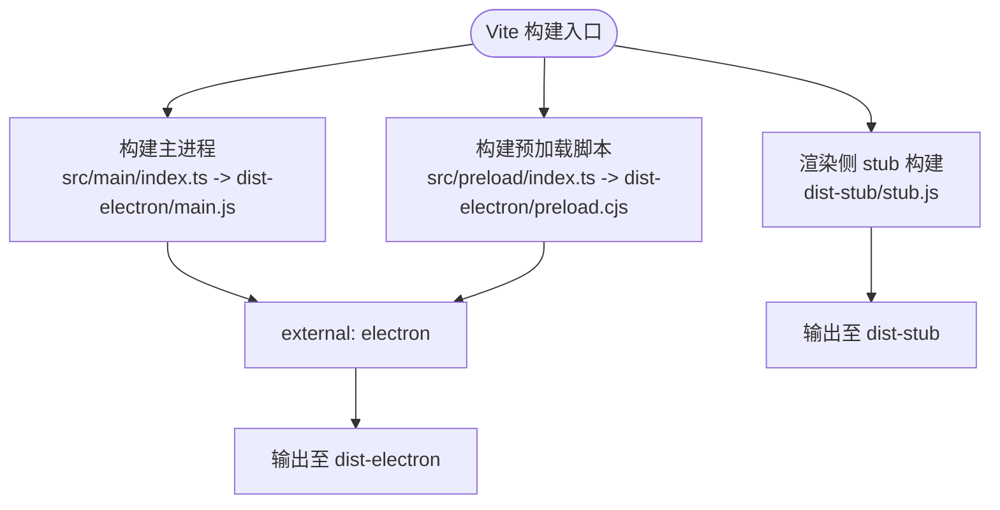
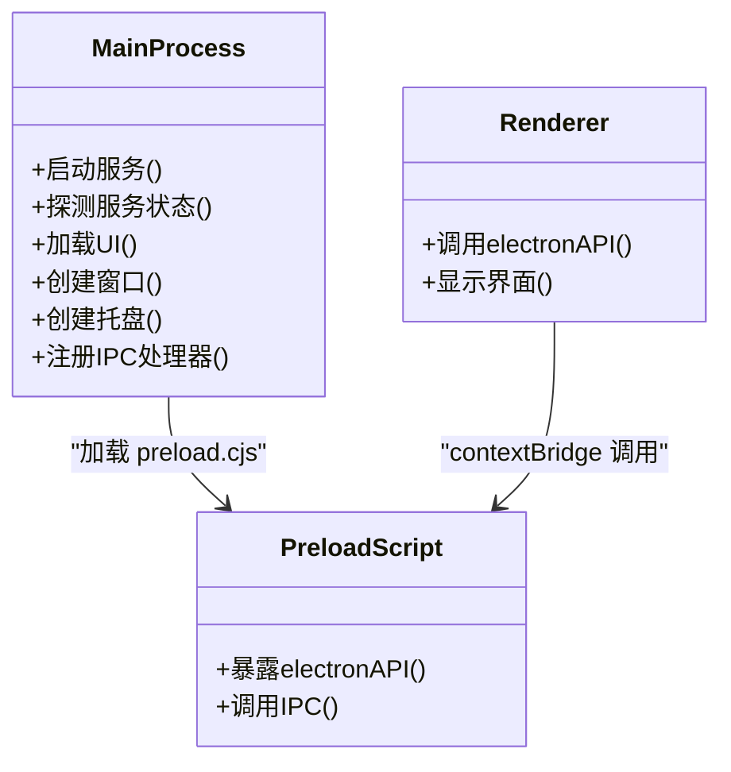
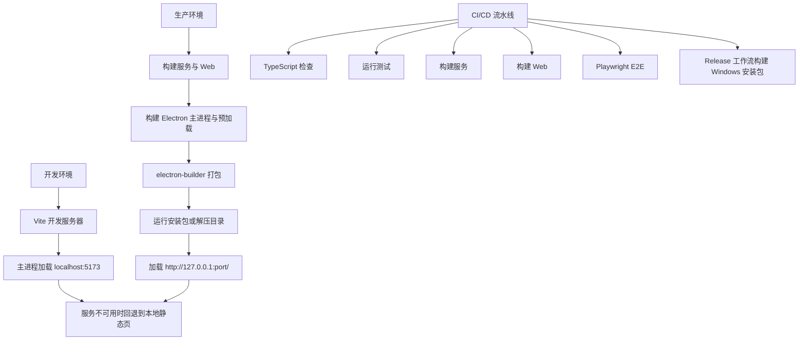
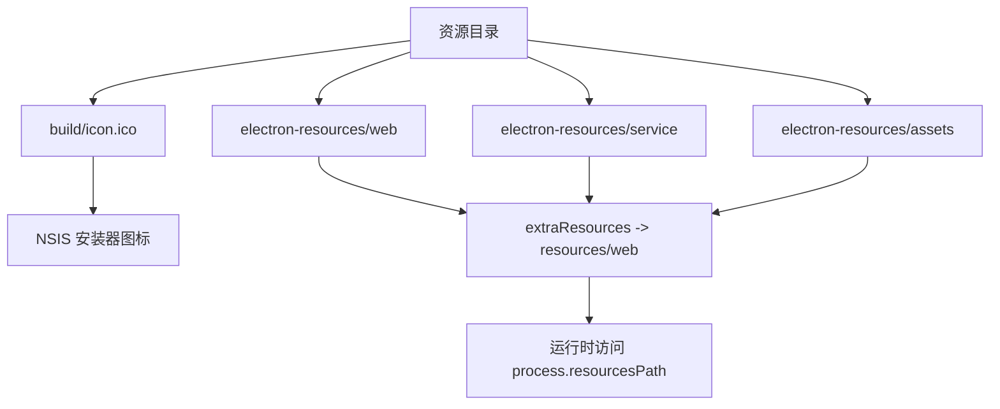
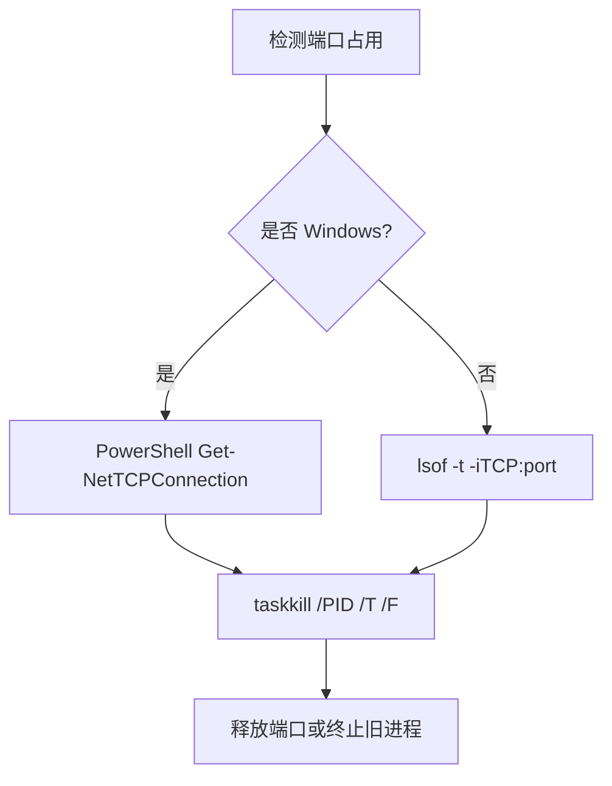
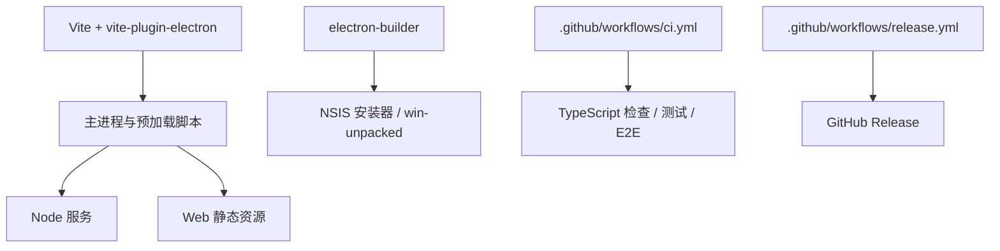

# 桌面应用打包

<cite>
**本文引用的文件**   
- [apps/desktop/electron-builder.yml](file://apps/desktop/electron-builder.yml)
- [apps/desktop/vite.config.ts](file://apps/desktop/vite.config.ts)
- [apps/desktop/package.json](file://apps/desktop/package.json)
- [apps/desktop/src/main/index.ts](file://apps/desktop/src/main/index.ts)
- [apps/desktop/src/preload/index.ts](file://apps/desktop/src/preload/index.ts)
- [.github/workflows/ci.yml](file://.github/workflows/ci.yml)
- [.github/workflows/release.yml](file://.github/workflows/release.yml)
- [scripts/build-desktop.ps1](file://scripts/build-desktop.ps1)
- [scripts/build-release.ps1](file://scripts/build-release.ps1)
</cite>

## 目录
1. [简介](#简介)
2. [项目结构](#项目结构)
3. [核心组件](#核心组件)
4. [架构总览](#架构总览)
5. [详细组件分析](#详细组件分析)
6. [依赖关系分析](#依赖关系分析)
7. [性能与体积优化](#性能与体积优化)
8. [故障排除指南](#故障排除指南)
9. [结论](#结论)
10. [附录：环境与流水线对照](#附录环境与流水线对照)

## 简介
本文面向 Arma3 Server Tools 的桌面端打包与构建配置，围绕 Electron Builder、Vite、Electron 主进程与预加载脚本、CI/CD 流水线以及资源打包策略展开。文档重点说明：
- Electron Builder 的目标平台、安装包格式、签名与发布配置
- Vite 开发服务器、资源处理、代码分割与多入口构建
- 开发环境、生产环境与 CI/CD 流水线的构建流程差异
- 图标、配置文件、静态资源的打包与运行时访问策略
- Windows、macOS、Linux 的跨平台兼容性与注意事项
- 自动更新机制现状与版本管理策略
- 打包优化技巧与常见问题排查方法

## 项目结构
桌面应用位于 `apps/desktop`，其关键构建产物与配置如下：
- `electron-builder.yml`：Electron Builder 打包配置
- `vite.config.ts`：Vite + vite-plugin-electron 构建配置
- `package.json`：脚本入口、依赖与包元信息
- `src/main/index.ts`：Electron 主进程逻辑
- `src/preload/index.ts`：预加载脚本，暴露安全 API 给渲染进程

**图表来源**
- [apps/desktop/electron-builder.yml:1-48](file://apps/desktop/electron-builder.yml#L1-L48)
- [apps/desktop/vite.config.ts:1-63](file://apps/desktop/vite.config.ts#L1-L63)
- [apps/desktop/package.json:1-31](file://apps/desktop/package.json#L1-L31)

**章节来源**
- [apps/desktop/electron-builder.yml:1-48](file://apps/desktop/electron-builder.yml#L1-L48)
- [apps/desktop/vite.config.ts:1-63](file://apps/desktop/vite.config.ts#L1-L63)
- [apps/desktop/package.json:1-31](file://apps/desktop/package.json#L1-L31)

## 核心组件
本节从打包视角梳理核心配置与职责：
- Electron Builder：定义应用标识、产物名称、输出目录、asar 打包、额外资源、Windows NSIS 安装器、签名开关等
- Vite：定义 Electron 主进程与预加载脚本的多入口构建、外部化 electron 模块、preload 强制 CJS、渲染侧 stub 构建
- package.json：提供 dev/build/stage/pack 脚本，串联 Vite 与 electron-builder
- 主进程与预加载脚本：负责服务生命周期、UI 加载、托盘、IPC 桥接、主题同步等

**章节来源**
- [apps/desktop/electron-builder.yml:1-48](file://apps/desktop/electron-builder.yml#L1-L48)
- [apps/desktop/vite.config.ts:1-63](file://apps/desktop/vite.config.ts#L1-L63)
- [apps/desktop/package.json:1-31](file://apps/desktop/package.json#L1-L31)
- [apps/desktop/src/main/index.ts:1-731](file://apps/desktop/src/main/index.ts#L1-L731)
- [apps/desktop/src/preload/index.ts:1-48](file://apps/desktop/src/preload/index.ts#L1-L48)

## 架构总览
下图展示桌面应用在开发与生产环境下的整体交互：Vite 构建主进程与预加载脚本，Electron Builder 将产物与额外资源打包为安装包；运行时主进程启动 Node 服务并加载 Web UI。

**图表来源**
- [apps/desktop/vite.config.ts:1-63](file://apps/desktop/vite.config.ts#L1-L63)
- [apps/desktop/electron-builder.yml:1-48](file://apps/desktop/electron-builder.yml#L1-L48)
- [apps/desktop/src/main/index.ts:95-137](file://apps/desktop/src/main/index.ts#L95-L137)
- [apps/desktop/src/main/index.ts:567-616](file://apps/desktop/src/main/index.ts#L567-L616)

## 详细组件分析

### Electron Builder 配置
- 应用标识与产物命名
  - 应用 ID、产品名称、版权信息与 Electron 版本在配置中声明
  - 产物文件名包含版本号与扩展名，便于区分不同版本
- 目录与资源
  - 输出目录指向仓库根下的 artifacts/desktop
  - buildResources 指向 build 目录，用于平台相关图标等资源
  - files 仅打包 dist-electron 与 package.json，排除 dist-stub 与 electron-resources
  - extraResources 将 web、service、assets 三个目录分别复制到 app.asar.unpacked 的资源路径下，供运行时通过 process.resourcesPath 访问
- asar 与 npmRebuild
  - 启用 asar 压缩，提升加载性能与安全隔离
  - 关闭 npmRebuild，避免 monorepo 下原生模块重建失败
- 发布与签名
  - publish 为空数组，表示默认不自动发布到远程更新源
  - Windows 目标使用 NSIS 安装器，禁用自动签名
- NSIS 安装器行为
  - 非一键安装，允许选择安装目录
  - 创建桌面快捷方式，名称与应用产品名一致

**图表来源**
- [apps/desktop/electron-builder.yml:1-48](file://apps/desktop/electron-builder.yml#L1-L48)

**章节来源**
- [apps/desktop/electron-builder.yml:1-48](file://apps/desktop/electron-builder.yml#L1-L48)

### Vite 构建配置
- 插件与入口
  - 使用 vite-plugin-electron 同时构建 Electron 主进程与预加载脚本
  - 主进程入口 src/main/index.ts，输出 main.js
  - 预加载入口 src/preload/index.ts，强制以 CJS 形式输出 preload.cjs
- 外部化依赖
  - 主进程与预加载均 external electron，避免重复打包
- 渲染侧构建
  - 渲染侧使用 vite-plugin-electron-renderer，但当前构建输出为 stub.js，作为占位产物
- 开发服务器
  - 主进程在开发模式下加载 http://localhost:5173，即 Vite 开发服务器地址
  - 预加载在开发时触发重载，便于调试
- 别名与根目录
  - 设置 @ 指向 src 目录，简化导入路径

**图表来源**
- [apps/desktop/vite.config.ts:1-63](file://apps/desktop/vite.config.ts#L1-L63)

**章节来源**
- [apps/desktop/vite.config.ts:1-63](file://apps/desktop/vite.config.ts#L1-L63)

### 主进程与预加载脚本
- 主进程职责
  - 启动并管理 Node 服务进程，探测健康接口与 UI 页面可用性
  - 根据运行环境选择加载 HTTP 服务页或本地 file:// 静态页
  - 创建窗口、托盘菜单、主题同步、单实例锁、IPC 处理器
  - 检查安装路径是否包含中文，避免潜在问题
- 预加载脚本职责
  - 通过 contextBridge 暴露 electronAPI，封装 IPC 调用
  - 向渲染进程提供平台信息、服务设置读写、文件对话框、主题监听等能力

**图表来源**
- [apps/desktop/src/main/index.ts:1-731](file://apps/desktop/src/main/index.ts#L1-L731)
- [apps/desktop/src/preload/index.ts:1-48](file://apps/desktop/src/preload/index.ts#L1-L48)

**章节来源**
- [apps/desktop/src/main/index.ts:1-731](file://apps/desktop/src/main/index.ts#L1-L731)
- [apps/desktop/src/preload/index.ts:1-48](file://apps/desktop/src/preload/index.ts#L1-L48)

### 不同环境的构建流程
- 开发环境
  - 运行 Vite 开发服务器，主进程加载 http://localhost:5173
  - 预加载脚本支持热重载
  - 服务未就绪时回退到本地静态页
- 生产环境
  - 先构建服务与 Web 前端，再构建 Electron 主进程与预加载脚本
  - 通过 electron-builder 打包为 NSIS 安装器或解压目录
  - 运行时优先加载 http://127.0.0.1:port/，若不可用则回退到 file:// 静态页
- CI/CD 流水线
  - CI 工作流进行 TypeScript 类型检查、测试、服务与 Web 构建、Playwright E2E 测试
  - Release 工作流在打 tag 后构建 Windows 桌面端，生成 NSIS 安装器与 win-unpacked zip，并发布到 GitHub Release

**图表来源**
- [apps/desktop/vite.config.ts:1-63](file://apps/desktop/vite.config.ts#L1-L63)
- [apps/desktop/src/main/index.ts:567-616](file://apps/desktop/src/main/index.ts#L567-L616)
- [.github/workflows/ci.yml:1-63](file://.github/workflows/ci.yml#L1-L63)
- [.github/workflows/release.yml:1-83](file://.github/workflows/release.yml#L1-L83)

**章节来源**
- [apps/desktop/vite.config.ts:1-63](file://apps/desktop/vite.config.ts#L1-L63)
- [apps/desktop/src/main/index.ts:567-616](file://apps/desktop/src/main/index.ts#L567-L616)
- [.github/workflows/ci.yml:1-63](file://.github/workflows/ci.yml#L1-L63)
- [.github/workflows/release.yml:1-83](file://.github/workflows/release.yml#L1-L83)

### 资源文件管理
- 图标
  - Windows 图标路径在 electron-builder.yml 中指定为 build/icon.ico
  - 主进程在开发模式与打包模式分别查找托盘图标路径，打包后从 resources/assets 读取
- 配置文件
  - 服务设置保存在用户数据目录，键名为 service-settings.json
  - 数据目录为 a3st-data，日志写入 service.log
- 静态资源
  - extraResources 将 web、service、assets 复制到 resources 子目录
  - 主进程通过 process.resourcesPath 访问打包后的 web 与 assets
- 打包策略
  - asar 启用，preload 放在 asar 内即可，无需 asarUnpack
  - files 排除 dist-stub 与 electron-resources，避免冗余

**图表来源**
- [apps/desktop/electron-builder.yml:17-31](file://apps/desktop/electron-builder.yml#L17-L31)
- [apps/desktop/src/main/index.ts:251-256](file://apps/desktop/src/main/index.ts#L251-L256)
- [apps/desktop/src/main/index.ts:84-93](file://apps/desktop/src/main/index.ts#L84-L93)

**章节来源**
- [apps/desktop/electron-builder.yml:17-31](file://apps/desktop/electron-builder.yml#L17-L31)
- [apps/desktop/src/main/index.ts:251-256](file://apps/desktop/src/main/index.ts#L251-L256)
- [apps/desktop/src/main/index.ts:84-93](file://apps/desktop/src/main/index.ts#L84-L93)

### 跨平台兼容性处理
- Windows
  - 目标平台为 nsis，产物为安装器与 win-unpacked
  - 端口占用检测使用 PowerShell 命令
  - 进程终止使用 taskkill
  - 安装路径包含中文会弹出错误提示
- macOS 与 Linux
  - 端口占用检测使用 lsof
  - 进程终止使用 SIGTERM
  - 当前 electron-builder.yml 未显式配置 macOS 与 Linux 目标，需按需添加 platform 与 target

**图表来源**
- [apps/desktop/src/main/index.ts:139-201](file://apps/desktop/src/main/index.ts#L139-L201)
- [apps/desktop/electron-builder.yml:37-48](file://apps/desktop/electron-builder.yml#L37-L48)

**章节来源**
- [apps/desktop/src/main/index.ts:139-201](file://apps/desktop/src/main/index.ts#L139-L201)
- [apps/desktop/electron-builder.yml:37-48](file://apps/desktop/electron-builder.yml#L37-L48)

### 自动更新机制与版本管理
- 自动更新
  - 当前 electron-builder.yml 中 publish 为空数组，未配置自动更新源
  - 主进程未引入 electron-updater，也未实现自动更新逻辑
- 版本管理
  - 包版本由 package.json 的 version 字段决定
  - Release 工作流基于 git tag v* 触发，产物名称包含版本号
  - 安装包文件名包含版本号与扩展名，便于区分

建议：
- 如需启用自动更新，可在 electron-builder.yml 中配置 publish 目标（如 GitHub Releases），并在主进程中集成 electron-updater
- 版本号应统一来源于 package.json，避免多处硬编码

**章节来源**
- [apps/desktop/electron-builder.yml:1-35](file://apps/desktop/electron-builder.yml#L1-L35)
- [apps/desktop/package.json:1-31](file://apps/desktop/package.json#L1-L31)
- [.github/workflows/release.yml:1-83](file://.github/workflows/release.yml#L1-L83)

## 依赖关系分析
- 构建工具链
  - Vite 与 vite-plugin-electron 负责主进程与预加载脚本构建
  - electron-builder 负责最终安装包打包
- 运行时依赖
  - Electron 主进程依赖 Node 服务与 Web 静态资源
  - 预加载脚本通过 contextBridge 暴露 API 给渲染进程
- 外部工具
  - CI 使用 Playwright Chromium 进行 E2E 测试
  - Release 工作流使用 GitHub Actions 与 softprops/action-gh-release 发布

**图表来源**
- [apps/desktop/vite.config.ts:1-63](file://apps/desktop/vite.config.ts#L1-L63)
- [apps/desktop/electron-builder.yml:1-48](file://apps/desktop/electron-builder.yml#L1-L48)
- [.github/workflows/ci.yml:1-63](file://.github/workflows/ci.yml#L1-L63)
- [.github/workflows/release.yml:1-83](file://.github/workflows/release.yml#L1-L83)

**章节来源**
- [apps/desktop/vite.config.ts:1-63](file://apps/desktop/vite.config.ts#L1-L63)
- [apps/desktop/electron-builder.yml:1-48](file://apps/desktop/electron-builder.yml#L1-L48)
- [.github/workflows/ci.yml:1-63](file://.github/workflows/ci.yml#L1-L63)
- [.github/workflows/release.yml:1-83](file://.github/workflows/release.yml#L1-L83)

## 性能与体积优化
- 启用 asar 压缩，减少 I/O 次数并提高加载性能
- 外部化 electron 模块，避免重复打包
- 仅打包必要文件，排除 dist-stub 与 electron-resources
- 预加载脚本使用 CJS 输出，避免 ESM 在 Electron 中的兼容问题
- 开发模式优先加载 HTTP 服务页，避免 file:// 路由切换导致的白屏风险
- 合理设置超时与重试，避免长时间阻塞 UI 加载

[本节为通用优化建议，不直接分析具体文件]

## 故障排除指南
- 预加载脚本未找到
  - 主进程会尝试多个候选路径，包括 asar 与 asar.unpacked 位置
  - 若均未找到，会打印错误日志并返回首个候选路径
- 界面加载失败
  - 当 HTTP 服务页加载失败且存在本地 index.html 时，回退到 file:// 静态页
  - 若两者均失败，弹出错误对话框并提示查看 service.log
- 服务未就绪
  - 主进程探测健康接口，若超时或未响应，弹出错误对话框并附带日志路径
- 端口被占用
  - 主进程会尝试终止占用端口的进程，Windows 使用 taskkill，Unix 使用 SIGTERM
- 安装路径包含中文
  - 主进程检测到安装路径包含中文字符时会弹出错误提示并退出

**章节来源**
- [apps/desktop/src/main/index.ts:258-279](file://apps/desktop/src/main/index.ts#L258-L279)
- [apps/desktop/src/main/index.ts:498-526](file://apps/desktop/src/main/index.ts#L498-L526)
- [apps/desktop/src/main/index.ts:647-657](file://apps/desktop/src/main/index.ts#L647-L657)
- [apps/desktop/src/main/index.ts:139-201](file://apps/desktop/src/main/index.ts#L139-L201)

## 结论
本项目通过 Vite 与 electron-builder 的组合实现了 Electron 桌面应用的开发与生产构建。主进程负责服务生命周期管理与 UI 加载，预加载脚本提供安全的 IPC 桥接。CI/CD 流水线覆盖类型检查、测试与 E2E，Release 工作流生成 Windows 安装包并发布到 GitHub Releases。当前未启用自动更新机制，版本管理依赖 package.json 与 git tag。建议在需要时补充 electron-updater 与 publish 配置，以实现完整的自动更新流程。

[本节为总结性内容，不直接分析具体文件]

## 附录：环境与流水线对照
- 开发环境
  - 脚本：npm run dev
  - 行为：Vite 开发服务器 + Electron 主进程加载 localhost:5173
- 生产环境
  - 脚本：npm run build 与 npm run pack
  - 行为：构建主进程与预加载，electron-builder 打包为 NSIS 安装器或解压目录
- CI/CD
  - CI：TypeScript 检查、测试、服务与 Web 构建、Playwright E2E
  - Release：基于 tag 构建 Windows 桌面端，生成安装器与 zip，发布到 GitHub Release

**章节来源**
- [apps/desktop/package.json:9-18](file://apps/desktop/package.json#L9-L18)
- [.github/workflows/ci.yml:1-63](file://.github/workflows/ci.yml#L1-L63)
- [.github/workflows/release.yml:1-83](file://.github/workflows/release.yml#L1-L83)