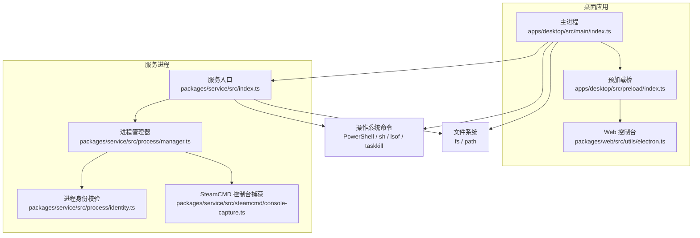
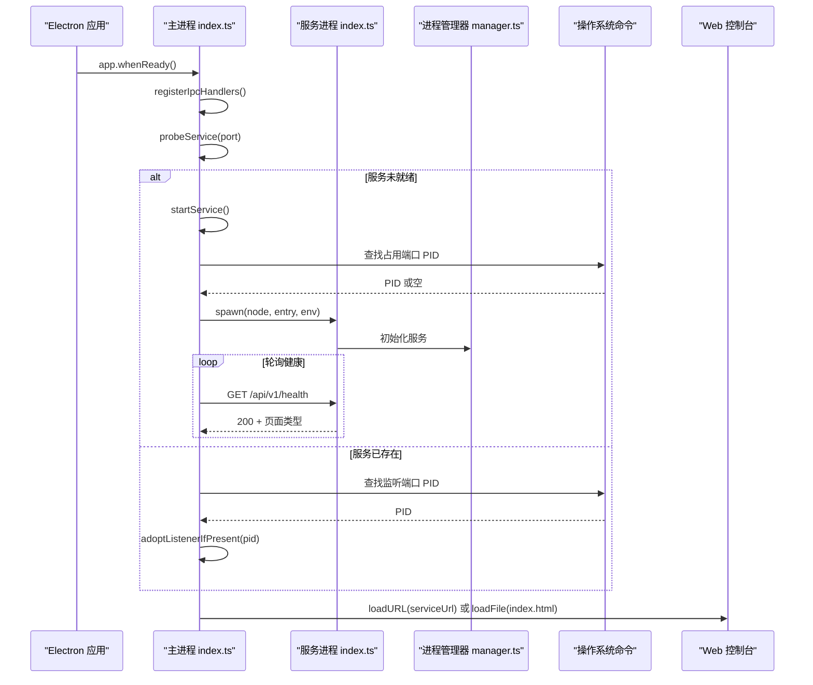
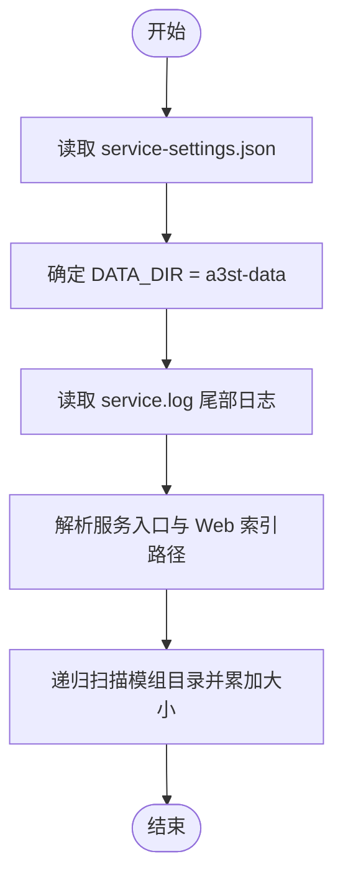
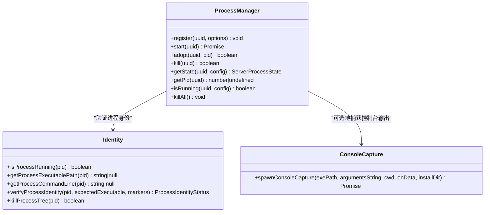
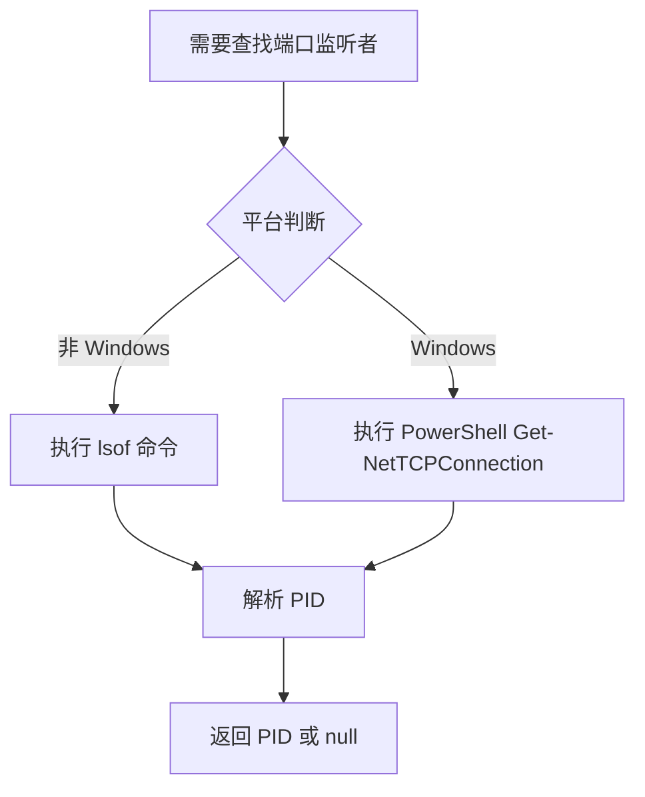
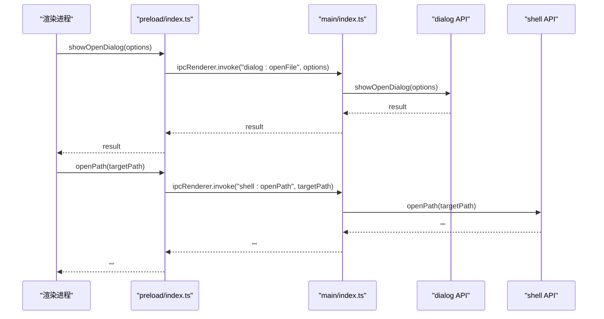
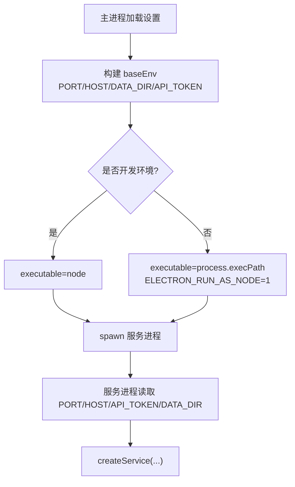
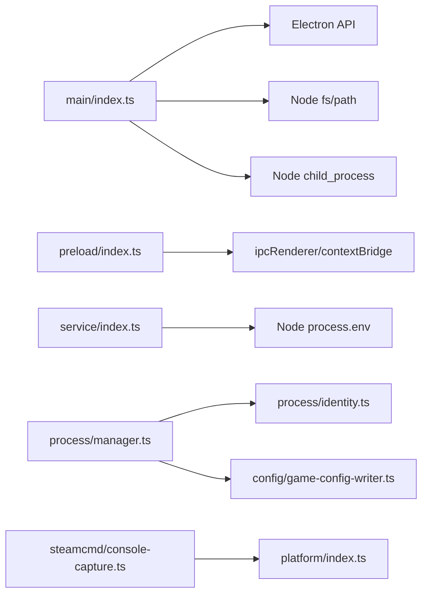

# 系统集成

<cite>
**本文引用的文件**   
- [apps/desktop/src/main/index.ts](file://apps/desktop/src/main/index.ts)
- [apps/desktop/src/preload/index.ts](file://apps/desktop/src/preload/index.ts)
- [packages/service/src/index.ts](file://packages/service/src/index.ts)
- [packages/service/src/process/manager.ts](file://packages/service/src/process/manager.ts)
- [packages/service/src/process/identity.ts](file://packages/service/src/process/identity.ts)
- [packages/service/src/steamcmd/console-capture.ts](file://packages/service/src/steamcmd/console-capture.ts)
- [packages/web/src/utils/electron.ts](file://packages/web/src/utils/electron.ts)
</cite>

## 目录
1. [引言](#引言)
2. [项目结构](#项目结构)
3. [核心组件](#核心组件)
4. [架构总览](#架构总览)
5. [详细组件分析](#详细组件分析)
6. [依赖关系分析](#依赖关系分析)
7. [性能与可扩展性](#性能与可扩展性)
8. [权限与安全](#权限与安全)
9. [故障排查指南](#故障排查指南)
10. [结论](#结论)

## 引言
本文件面向桌面应用“系统集成”能力，围绕文件系统操作、进程管理、操作系统命令执行、Electron 原生 API 集成、环境变量传递、权限与安全以及最佳实践展开。该项目的桌面端基于 Electron，主进程负责启动被控服务、监听端口、管理 UI 窗口和托盘；服务进程提供 HTTP API 与 Web 控制台；系统工具（如 SteamCMD、游戏专用服务器）通过子进程方式运行，并在 Windows 与类 Unix 平台间做差异化处理。

## 项目结构
本项目采用多包结构：
- `apps/desktop`：Electron 桌面应用，包含主进程、预加载脚本与打包配置。
- `packages/service`：Node.js 被控服务，暴露 HTTP API，管理游戏进程与 SteamCMD。
- `packages/web`：Web 控制台前端，通过 Electron 桥接调用系统能力。
- `scripts`：构建与发布脚本，包含 PowerShell 集成入口。

**图表来源**
- [apps/desktop/src/main/index.ts:1-10](file://apps/desktop/src/main/index.ts#L1-L10)
- [apps/desktop/src/preload/index.ts:1-10](file://apps/desktop/src/preload/index.ts#L1-L10)
- [packages/service/src/index.ts:1-23](file://packages/service/src/index.ts#L1-L23)
- [packages/service/src/process/manager.ts:1-10](file://packages/service/src/process/manager.ts#L1-L10)
- [packages/service/src/process/identity.ts:1-12](file://packages/service/src/process/identity.ts#L1-L12)
- [packages/service/src/steamcmd/console-capture.ts:1-13](file://packages/service/src/steamcmd/console-capture.ts#L1-L13)
- [packages/web/src/utils/electron.ts:1-11](file://packages/web/src/utils/electron.ts#L1-L11)

**章节来源**
- [apps/desktop/src/main/index.ts:1-10](file://apps/desktop/src/main/index.ts#L1-L10)
- [packages/service/src/index.ts:1-23](file://packages/service/src/index.ts#L1-L23)

## 核心组件
- 桌面主进程：负责 Electron 应用生命周期、IPC 桥接、服务启动与监控、UI 加载策略、托盘图标与菜单。
- 预加载脚本：向渲染进程暴露受限的 `electronAPI`，包括设置读写、服务状态、对话框、路径打开、文本文件读取等。
- 服务进程：从环境变量读取配置，创建 HTTP 服务，管理游戏进程与 SteamCMD，支持优雅退出。
- 进程管理器：封装跨平台子进程启动、日志输出、状态查询、终止与回收。
- 进程身份模块：跨平台获取进程可执行路径与命令行，验证进程是否匹配预期标识。
- SteamCMD 控制台捕获：Windows 下轮询日志文件，非 Windows 下管道捕获 stdout/stderr。
- Web 工具函数：检测 Electron 环境并调用桥接方法选择目录或文件。

**章节来源**
- [apps/desktop/src/main/index.ts:38-93](file://apps/desktop/src/main/index.ts#L38-L93)
- [apps/desktop/src/preload/index.ts:10-47](file://apps/desktop/src/preload/index.ts#L10-L47)
- [packages/service/src/index.ts:4-23](file://packages/service/src/index.ts#L4-L23)
- [packages/service/src/process/manager.ts:11-34](file://packages/service/src/process/manager.ts#L11-L34)
- [packages/service/src/process/identity.ts:14-32](file://packages/service/src/process/identity.ts#L14-L32)
- [packages/service/src/steamcmd/console-capture.ts:18-33](file://packages/service/src/steamcmd/console-capture.ts#L18-L33)
- [packages/web/src/utils/electron.ts:1-11](file://packages/web/src/utils/electron.ts#L1-L11)

## 架构总览
桌面主进程在应用就绪后：
1. 检查安装路径是否包含中文字符。
2. 注册 IPC 处理器，启用系统主题同步。
3. 探测本地服务端口健康状态。
4. 若服务未就绪则启动 Node 服务，注入环境变量并等待就绪。
5. 根据服务响应决定 UI 加载策略（优先 http://127.0.0.1:port/，失败回退到 file://）。
6. 创建窗口与托盘，处理单实例锁与二次实例激活。

**图表来源**
- [apps/desktop/src/main/index.ts:673-715](file://apps/desktop/src/main/index.ts#L673-L715)
- [apps/desktop/src/main/index.ts:95-137](file://apps/desktop/src/main/index.ts#L95-L137)
- [apps/desktop/src/main/index.ts:139-179](file://apps/desktop/src/main/index.ts#L139-L179)
- [apps/desktop/src/main/index.ts:323-378](file://apps/desktop/src/main/index.ts#L323-L378)
- [packages/service/src/index.ts:18-23](file://packages/service/src/index.ts#L18-L23)

**章节来源**
- [apps/desktop/src/main/index.ts:647-715](file://apps/desktop/src/main/index.ts#L647-L715)

## 详细组件分析

### 文件系统操作：读取、遍历、路径处理
- 设置与数据目录
  - 设置文件位于用户数据目录下的 `service-settings.json`。
  - 数据目录为 `a3st-data`，用于存放服务日志与运行时数据。
- 服务日志读取
  - 读取 `service.log` 末尾若干行，便于错误诊断。
- 路径解析
  - 开发环境与打包环境的资源路径不同，使用 `repoRoot()`、`getServiceRoot()`、`getWebIndexPath()` 统一处理。
  - 预加载脚本路径在 asar 与 unpacked 场景下自动适配。
- 服务扫描与大小计算（服务侧）
  - 使用递归目录遍历统计模组文件大小，忽略不可访问项。
  - 对 Steam Workshop 内容根进行规范化与目标展开。

**图表来源**
- [apps/desktop/src/main/index.ts:38-44](file://apps/desktop/src/main/index.ts#L38-L44)
- [apps/desktop/src/main/index.ts:224-234](file://apps/desktop/src/main/index.ts#L224-L234)
- [apps/desktop/src/main/index.ts:66-93](file://apps/desktop/src/main/index.ts#L66-L93)
- [packages/service/src/mods/scanner.ts:309-329](file://packages/service/src/mods/scanner.ts#L309-L329)

**章节来源**
- [apps/desktop/src/main/index.ts:38-44](file://apps/desktop/src/main/index.ts#L38-L44)
- [apps/desktop/src/main/index.ts:224-234](file://apps/desktop/src/main/index.ts#L224-L234)
- [apps/desktop/src/main/index.ts:66-93](file://apps/desktop/src/main/index.ts#L66-L93)
- [packages/service/src/mods/scanner.ts:309-329](file://packages/service/src/mods/scanner.ts#L309-L329)

### 进程管理：启动、监控、终止与跨平台差异
- 桌面主进程中的服务进程管理
  - 通过 `child_process.spawn` 启动 Node 服务，将标准输出与错误输出重定向到日志文件。
  - 监听 `exit` 与 `error` 事件，维护服务状态与日志句柄。
  - 端口占用清理：在非 Windows 平台使用 `lsof`，Windows 使用 PowerShell `Get-NetTCPConnection`。
  - 进程树终止：Windows 使用 `taskkill /T /F`，类 Unix 使用 `SIGTERM`。
- 服务进程中的游戏进程管理
  - `ProcessManager.start` 根据平台设置 stdio：Windows 忽略管道以避免专用服务器不写 logFile；Linux 保留管道以写入日志。
  - 支持传入完整命令行参数（Windows 使用 `windowsVerbatimArguments`），非 Windows 使用命令行拆分。
  - 支持“收养”已有进程 PID，以便重启后仍可停止。
  - 终止逻辑：Windows 使用 `taskkill`，非 Windows 先 SIGTERM，超时后 SIGKILL。
- SteamCMD 控制台捕获
  - Windows：通过轮询 `logs/console_log.txt` 增量读取输出。
  - 非 Windows：管道捕获 stdout/stderr，逐行回调。

**图表来源**
- [packages/service/src/process/manager.ts:32-109](file://packages/service/src/process/manager.ts#L32-L109)
- [packages/service/src/process/identity.ts:14-32](file://packages/service/src/process/identity.ts#L14-L32)
- [packages/service/src/steamcmd/console-capture.ts:18-33](file://packages/service/src/steamcmd/console-capture.ts#L18-L33)

**章节来源**
- [apps/desktop/src/main/index.ts:139-201](file://apps/desktop/src/main/index.ts#L139-L201)
- [apps/desktop/src/main/index.ts:323-396](file://apps/desktop/src/main/index.ts#L323-L396)
- [packages/service/src/process/manager.ts:45-109](file://packages/service/src/process/manager.ts#L45-L109)
- [packages/service/src/process/manager.ts:115-161](file://packages/service/src/process/manager.ts#L115-L161)
- [packages/service/src/process/identity.ts:14-32](file://packages/service/src/process/identity.ts#L14-L32)
- [packages/service/src/steamcmd/console-capture.ts:22-33](file://packages/service/src/steamcmd/console-capture.ts#L22-L33)

### 操作系统特定功能：Windows PowerShell 与 Unix shell
- 端口监听者查找
  - 非 Windows：`sh -c "lsof -t -iTCP:${port} -sTCP:LISTEN"`。
  - Windows：`powershell -NoProfile -Command "(Get-NetTCPConnection ...)"`。
- 进程信息查询
  - Windows：`tasklist`、`Get-Process`、`Get-CimInstance Win32_Process`。
  - 类 Unix：`/proc/${pid}/exe`、`/proc/${pid}/cmdline`。
- 进程终止
  - Windows：`taskkill /PID ${pid} /T /F`。
  - 类 Unix：`process.kill(pid, "SIGTERM")`，必要时 `SIGKILL`。
- SteamCMD 清理
  - Windows：PowerShell 脚本编码后执行，按 root 目录过滤进程并强制终止。
  - 类 Unix：`ps -eo pid=,args=` 解析进程列表并终止匹配项。

**图表来源**
- [apps/desktop/src/main/index.ts:139-179](file://apps/desktop/src/main/index.ts#L139-L179)
- [packages/service/src/process/identity.ts:14-32](file://packages/service/src/process/identity.ts#L14-L32)
- [packages/service/src/process/identity.ts:60-85](file://packages/service/src/process/identity.ts#L60-L85)
- [packages/service/src/steamcmd/manager.ts:719-765](file://packages/service/src/steamcmd/manager.ts#L719-L765)

**章节来源**
- [apps/desktop/src/main/index.ts:139-179](file://apps/desktop/src/main/index.ts#L139-L179)
- [packages/service/src/process/identity.ts:14-32](file://packages/service/src/process/identity.ts#L14-L32)
- [packages/service/src/process/identity.ts:60-85](file://packages/service/src/process/identity.ts#L60-L85)
- [packages/service/src/steamcmd/manager.ts:719-765](file://packages/service/src/steamcmd/manager.ts#L719-L765)

### 原生模块集成：nativeImage、shell、dialog 等 Electron API
- nativeImage
  - 托盘图标加载：优先从资源路径加载，不存在时创建空图像。
- shell
  - 打开系统路径：通过 `shell.openPath` 暴露给渲染进程。
- dialog
  - 打开文件/目录选择对话框：通过 `dialog.showOpenDialog` 暴露给渲染进程。
- 预加载桥
  - 暴露 `openPath`、`showOpenDialog`、`readTextFile`、`getServiceSettings`、`saveServiceSettings`、`getServiceStatus`、`restartService`、`getThemeDark`、`onThemeChanged` 等方法。
- Web 工具函数
  - 检测 Electron 环境，封装 `openPath`、`pickDirectory`、`pickFile` 等调用。

**图表来源**
- [apps/desktop/src/main/index.ts:456-467](file://apps/desktop/src/main/index.ts#L456-L467)
- [apps/desktop/src/preload/index.ts:22-35](file://apps/desktop/src/preload/index.ts#L22-L35)
- [packages/web/src/utils/electron.ts:13-44](file://packages/web/src/utils/electron.ts#L13-L44)

**章节来源**
- [apps/desktop/src/main/index.ts:618-645](file://apps/desktop/src/main/index.ts#L618-L645)
- [apps/desktop/src/main/index.ts:456-467](file://apps/desktop/src/main/index.ts#L456-L467)
- [apps/desktop/src/preload/index.ts:22-35](file://apps/desktop/src/preload/index.ts#L22-L35)
- [packages/web/src/utils/electron.ts:13-44](file://packages/web/src/utils/electron.ts#L13-L44)

### 环境变量配置：DATA_DIR、PORT、HOST、API_TOKEN
- 桌面主进程注入
  - 从设置中读取 `port`、`host`、`apiToken`、`remoteAccessEnabled`。
  - 构造基础环境变量：`PORT`、`HOST`、`DATA_DIR`、`API_TOKEN`。
  - 打包环境下额外注入 `WEB_ROOT`。
  - 开发环境使用 `node` 启动服务；生产环境使用 `process.execPath` 并设置 `ELECTRON_RUN_AS_NODE=1`。
- 服务进程读取
  - 从 `process.env` 读取 `PORT`、`HOST`、`API_TOKEN`。
  - `DATA_DIR` 优先来自环境变量，否则回退到当前工作目录下的 `.a3st-dev-data`。
  - 服务启动后创建 HTTP 服务，并将这些配置注入到服务上下文。

**图表来源**
- [apps/desktop/src/main/index.ts:281-321](file://apps/desktop/src/main/index.ts#L281-L321)
- [packages/service/src/index.ts:4-23](file://packages/service/src/index.ts#L4-L23)

**章节来源**
- [apps/desktop/src/main/index.ts:281-321](file://apps/desktop/src/main/index.ts#L281-L321)
- [packages/service/src/index.ts:4-23](file://packages/service/src/index.ts#L4-L23)

### 权限管理与安全考虑
- 安装路径安全检查
  - 检测安装路径是否包含中文字符，避免潜在兼容性问题。
- 预加载安全
  - 启用 `contextIsolation` 与 `nodeIntegration=false`，仅通过 `contextBridge` 暴露必要 API。
- 网络请求限制
  - 服务健康检查与 UI 加载均限定于 `http://127.0.0.1`，避免外部网络风险。
- 文件访问权限
  - 读取设置与服务日志使用 `fs.readFileSync`，需确保用户数据目录具有读写权限。
  - 递归目录扫描忽略不可访问的文件与目录，防止权限错误中断流程。
- 进程命令注入防护
  - 所有外部命令调用均使用固定参数数组或受控字符串拼接，避免直接拼接用户输入。
  - 使用 `windowsHide=true` 隐藏子进程控制台窗口，减少干扰面。

**章节来源**
- [apps/desktop/src/main/index.ts:647-657](file://apps/desktop/src/main/index.ts#L647-L657)
- [apps/desktop/src/main/index.ts:474-489](file://apps/desktop/src/main/index.ts#L474-L489)
- [apps/desktop/src/main/index.ts:95-137](file://apps/desktop/src/main/index.ts#L95-L137)
- [apps/desktop/src/main/index.ts:224-234](file://apps/desktop/src/main/index.ts#L224-L234)
- [packages/service/src/mods/scanner.ts:309-329](file://packages/service/src/mods/scanner.ts#L309-L329)

## 依赖关系分析
- 主进程依赖 Electron API（app、BrowserWindow、Tray、Menu、nativeImage、dialog、ipcMain、shell、nativeTheme）、Node fs/path/child_process/http/url。
- 预加载脚本依赖 contextBridge/ipcRenderer，向渲染进程暴露受限 API。
- 服务进程依赖 Node child_process/fs/path/events，并通过 platform 工具区分 Windows 与非 Windows。
- 进程管理器依赖 identity 模块进行进程身份校验，依赖 game-config-writer 获取可执行路径与命令行拆分。
- SteamCMD 控制台捕获依赖 platform 工具与 argv 拆分。

**图表来源**
- [apps/desktop/src/main/index.ts:1-6](file://apps/desktop/src/main/index.ts#L1-L6)
- [apps/desktop/src/preload/index.ts:1-2](file://apps/desktop/src/preload/index.ts#L1-L2)
- [packages/service/src/index.ts:1-2](file://packages/service/src/index.ts#L1-L2)
- [packages/service/src/process/manager.ts:1-9](file://packages/service/src/process/manager.ts#L1-L9)
- [packages/service/src/steamcmd/console-capture.ts:1-7](file://packages/service/src/steamcmd/console-capture.ts#L1-L7)

**章节来源**
- [apps/desktop/src/main/index.ts:1-6](file://apps/desktop/src/main/index.ts#L1-L6)
- [apps/desktop/src/preload/index.ts:1-2](file://apps/desktop/src/preload/index.ts#L1-L2)
- [packages/service/src/index.ts:1-2](file://packages/service/src/index.ts#L1-L2)
- [packages/service/src/process/manager.ts:1-9](file://packages/service/src/process/manager.ts#L1-L9)
- [packages/service/src/steamcmd/console-capture.ts:1-7](file://packages/service/src/steamcmd/console-capture.ts#L1-L7)

## 性能与可扩展性
- 健康检查与重试
  - 服务就绪前轮询 `/api/v1/health`，间隔 250ms，最长 30s，避免阻塞 UI 启动。
- 日志优化
  - 服务日志追加写入，避免频繁打开关闭文件句柄。
  - SteamCMD 在 Windows 下轮询日志文件，非 Windows 下管道流式输出，减少内存占用。
- 进程终止策略
  - 非 Windows 平台先 SIGTERM，5s 后 SIGKILL，兼顾优雅退出与强制回收。
- 扩展建议
  - 将端口监听者查找与进程终止逻辑抽象为平台无关接口，便于测试与替换实现。
  - 对大目录扫描引入异步迭代与并发控制，避免 UI 卡顿。
  - 对健康检查增加重试指数退避，降低短周期内高频请求。

[本节为通用指导，不直接分析具体文件]

## 权限与安全
- 最小权限原则
  - 预加载仅暴露必要 API，渲染进程无法直接访问 Node 模块。
- 路径与命令白名单
  - 外部命令调用使用固定可执行名与参数数组，避免任意命令注入。
- 网络隔离
  - 服务健康检查与 UI 加载仅访问本地环回地址。
- 敏感信息保护
  - `API_TOKEN` 通过环境变量注入，不在 UI 中明文展示。
- 异常处理
  - 文件读取与命令执行均包裹 try/catch，记录错误但不崩溃主进程。

**章节来源**
- [apps/desktop/src/main/index.ts:474-489](file://apps/desktop/src/main/index.ts#L474-L489)
- [apps/desktop/src/main/index.ts:139-201](file://apps/desktop/src/main/index.ts#L139-L201)
- [apps/desktop/src/main/index.ts:95-137](file://apps/desktop/src/main/index.ts#L95-L137)

## 故障排查指南
- 服务未找到
  - 提示缺少 TypeScript 被控服务，需先执行构建命令生成服务入口。
- 界面加载失败
  - 优先尝试 http://127.0.0.1:port/，失败则回退到 file:// 本地静态页；若仍失败，显示错误对话框并引导查看 `service.log`。
- 服务未就绪
  - 若健康检查失败，弹出对话框并附带日志尾部内容，帮助定位端口占用或服务启动错误。
- 控制台页面未就绪
  - 服务已响应但首页不是 HTML，提示更换端口后重启服务。
- 渲染进程异常
  - 捕获 `render-process-gone`，提示用户并尝试重新加载 UI。

**章节来源**
- [apps/desktop/src/main/index.ts:331-340](file://apps/desktop/src/main/index.ts#L331-L340)
- [apps/desktop/src/main/index.ts:499-526](file://apps/desktop/src/main/index.ts#L499-L526)
- [apps/desktop/src/main/index.ts:528-537](file://apps/desktop/src/main/index.ts#L528-L537)
- [apps/desktop/src/main/index.ts:697-712](file://apps/desktop/src/main/index.ts#L697-L712)

## 结论
该桌面应用通过 Electron 主进程与 Node 服务进程的协作，实现了文件系统操作、跨平台进程管理、系统命令执行与原生 API 集成的完整系统集成能力。设计上强调安全性（最小权限、路径与命令白名单、网络隔离）与健壮性（健康检查、日志追踪、优雅退出）。在生产环境中，建议继续完善平台抽象层、增强异步 I/O 与并发控制，并持续优化错误提示与用户体验。