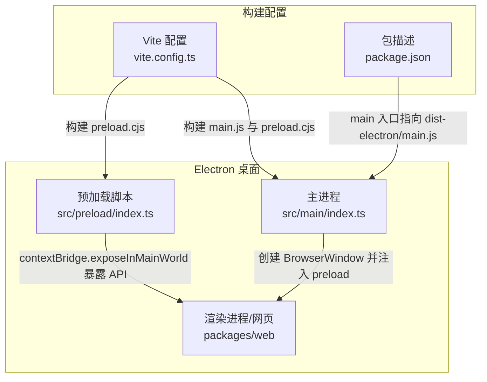
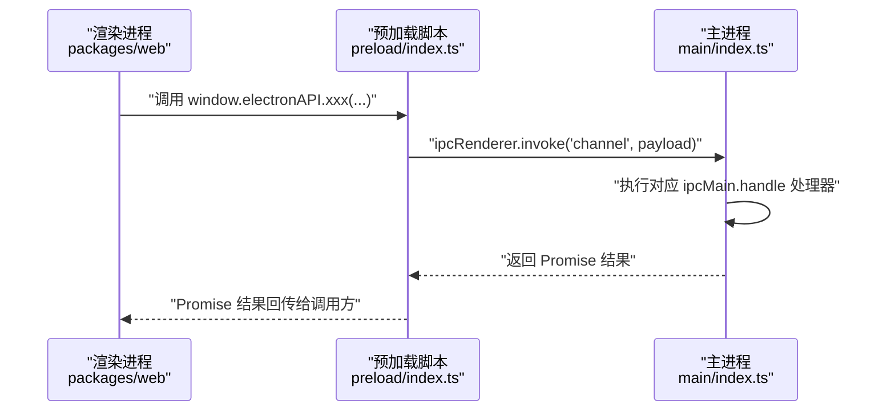
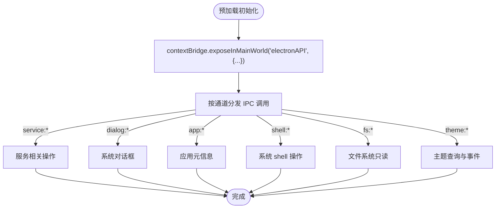
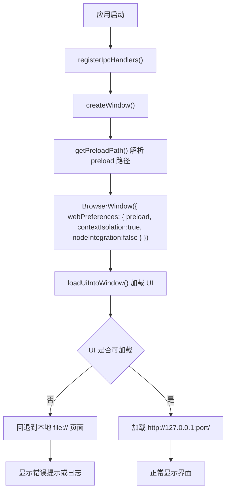
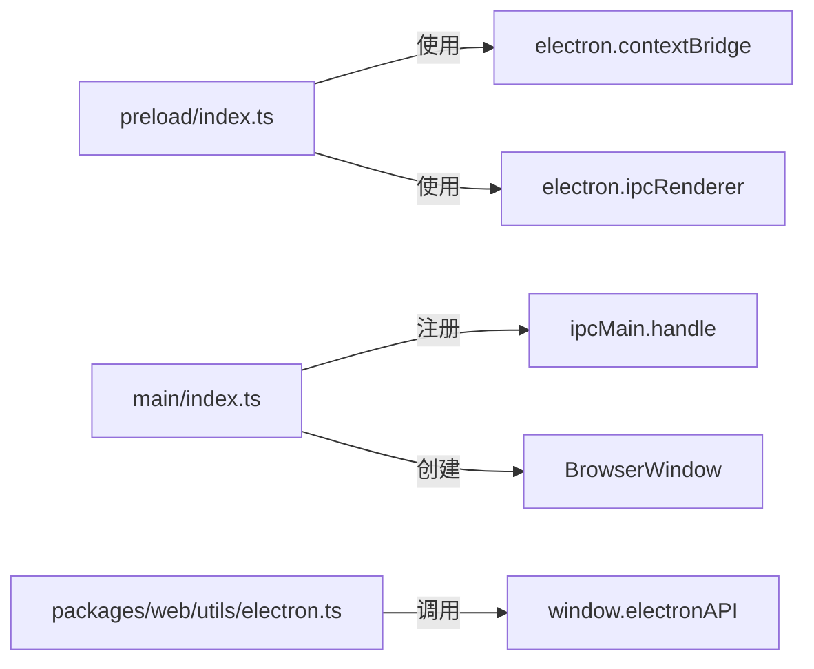

# 预加载脚本

<cite>
**本文引用的文件**   
- [apps/desktop/src/preload/index.ts](file://apps/desktop/src/preload/index.ts)
- [apps/desktop/src/main/index.ts](file://apps/desktop/src/main/index.ts)
- [apps/desktop/vite.config.ts](file://apps/desktop/vite.config.ts)
- [apps/desktop/package.json](file://apps/desktop/package.json)
- [packages/web/src/utils/electron.ts](file://packages/web/src/utils/electron.ts)
</cite>

## 目录
1. [引言](#引言)
2. [项目结构](#项目结构)
3. [核心组件](#核心组件)
4. [架构总览](#架构总览)
5. [详细组件分析](#详细组件分析)
6. [依赖关系分析](#依赖关系分析)
7. [性能与安全考量](#性能与安全考量)
8. [故障排查指南](#故障排查指南)
9. [结论](#结论)
10. [附录：API 白名单与最佳实践](#附录api-白名单与最佳实践)

## 引言
本文件聚焦 Electron 桌面应用中的“预加载脚本”安全模型，围绕以下目标展开：
- 解释预加载脚本在 Electron 安全架构中的作用与重要性。
- 详细说明上下文隔离机制（contextIsolation=true）的安全语义。
- 阐述通过 window.api 暴露的 IPC 桥接模式。
- 说明内容安全策略（CSP）与权限控制在该工程中的体现。
- 梳理预加载脚本在不同打包环境下的路径解析与加载机制。
- 给出最小权限、API 白名单、输入校验等安全最佳实践。
- 提供调试技巧与常见问题解决方案。

## 项目结构
本项目采用多包结构，Electron 桌面端位于 apps/desktop，预加载脚本与主进程分别位于 src/preload 与 src/main；Web 控制台位于 packages/web。

图示来源
- [apps/desktop/src/main/index.ts:470-489](file://apps/desktop/src/main/index#L470-L489)
- [apps/desktop/src/preload/index.ts:1-48](file://apps/desktop/src/preload/index.ts#L1-L48)
- [apps/desktop/vite.config.ts:8-46](file://apps/desktop/vite.config.ts#L8-L46)
- [apps/desktop/package.json:1-18](file://apps/desktop/package.json#L1-L18)

章节来源
- [apps/desktop/package.json:1-18](file://apps/desktop/package.json#L1-L18)
- [apps/desktop/vite.config.ts:8-46](file://apps/desktop/vite.config.ts#L8-L46)

## 核心组件
- 预加载脚本：通过 contextBridge 向渲染进程暴露受限的 window.electronAPI，仅允许调用明确列出的方法。
- 主进程：注册 ipcMain.handle 处理器，实现服务管理、设置读写、对话框、文件系统访问、主题同步等能力。
- Web 层工具：封装对 window.electronAPI 的调用，并提供 Electron 检测与降级逻辑。

章节来源
- [apps/desktop/src/preload/index.ts:1-48](file://apps/desktop/src/preload/index.ts#L1-L48)
- [apps/desktop/src/main/index.ts:423-468](file://apps/desktop/src/main/index.ts#L423-L468)
- [packages/web/src/utils/electron.ts:1-44](file://packages/web/src/utils/electron.ts#L1-L44)

## 架构总览
下图展示从渲染进程到主进程的完整 IPC 调用链，以及预加载脚本在其中的桥梁作用。

图示来源
- [apps/desktop/src/preload/index.ts:10-47](file://apps/desktop/src/preload/index.ts#L10-L47)
- [apps/desktop/src/main/index.ts:423-468](file://apps/desktop/src/main/index.ts#L423-L468)

## 详细组件分析

### 预加载脚本：安全的 API 白名单
预加载脚本使用 contextBridge.exposeInMainWorld 将一组受控方法暴露给渲染进程，形成“API 白名单”。所有敏感系统能力均通过 IPC 转发至主进程处理，避免直接暴露 Node.js API。

关键职责
- 定义 ServiceSettings 类型，确保跨进程参数类型一致。
- 暴露平台信息、服务状态、设置读写、重启服务、文件选择、应用版本/路径、打开路径、读取文本文件、主题查询与监听等能力。
- 为 onThemeChanged 提供订阅/取消订阅回调，避免内存泄漏。

图示来源
- [apps/desktop/src/preload/index.ts:1-48](file://apps/desktop/src/preload/index.ts#L1-L48)

章节来源
- [apps/desktop/src/preload/index.ts:1-48](file://apps/desktop/src/preload/index.ts#L1-L48)

### 主进程：IPC 处理器与资源路径解析
主进程负责：
- 注册所有 ipcMain.handle 处理器，实现最小权限的 API 映射。
- 根据运行环境（开发/生产）解析预加载脚本路径，兼容 asar 与 asar.unpacked。
- 启动/停止被控服务，探测 UI/API 就绪状态，并在失败时回退到本地静态页面。
- 监听主题变化并向渲染进程推送 theme:changed 事件。

图示来源
- [apps/desktop/src/main/index.ts:258-279](file://apps/desktop/src/main/index.ts#L258-L279)
- [apps/desktop/src/main/index.ts:423-468](file://apps/desktop/src/main/index.ts#L423-L468)
- [apps/desktop/src/main/index.ts:470-489](file://apps/desktop/src/main/index.ts#L470-L489)
- [apps/desktop/src/main/index.ts:567-616](file://apps/desktop/src/main/index.ts#L567-L616)

章节来源
- [apps/desktop/src/main/index.ts:258-279](file://apps/desktop/src/main/index.ts#L258-L279)
- [apps/desktop/src/main/index.ts:423-468](file://apps/desktop/src/main/index.ts#L423-L468)
- [apps/desktop/src/main/index.ts:470-489](file://apps/desktop/src/main/index.ts#L470-L489)
- [apps/desktop/src/main/index.ts:567-616](file://apps/desktop/src/main/index.ts#L567-L616)

### 构建与打包：预加载脚本输出为 CommonJS
Vite 配置将预加载脚本单独构建为 CommonJS（cjs），因为 Electron 预加载脚本需要 CJS 格式；ESM import 在打包后会静默失败，导致 window.electronAPI 不可用。

要点
- 预加载脚本 entry 为 src/preload/index.ts。
- 输出文件名固定为 preload.cjs，位于 dist-electron。
- electron 模块被 external，避免重复打包。

章节来源
- [apps/desktop/vite.config.ts:24-43](file://apps/desktop/vite.config.ts#L24-L43)

### Web 层：对 window.electronAPI 的安全封装
Web 层通过 utils/electron.ts 封装对 window.electronAPI 的调用，并提供 Electron 检测与降级逻辑：
- isElectron：判断是否在 Electron 环境中。
- isElectronShellWithoutBridge：识别 Electron 外壳但预加载未注入的情况（常见于旧安装包 ESM preload 失败）。
- openPath/pickFile/pickDirectory：统一封装系统交互，避免在业务代码中直接访问 window.electronAPI。

章节来源
- [packages/web/src/utils/electron.ts:1-44](file://packages/web/src/utils/electron.ts#L1-L44)

## 依赖关系分析
- 预加载脚本依赖 electron 的 contextBridge 与 ipcRenderer。
- 主进程依赖 electron 的 app、BrowserWindow、ipcMain、shell、nativeTheme、dialog 等。
- Web 层依赖 window.electronAPI，并通过 utils/electron.ts 进行统一调用。

图示来源
- [apps/desktop/src/preload/index.ts:1-48](file://apps/desktop/src/preload/index.ts#L1-L48)
- [apps/desktop/src/main/index.ts:423-468](file://apps/desktop/src/main/index.ts#L423-L468)
- [packages/web/src/utils/electron.ts:1-44](file://packages/web/src/utils/electron.ts#L1-L44)

章节来源
- [apps/desktop/src/preload/index.ts:1-48](file://apps/desktop/src/preload/index.ts#L1-L48)
- [apps/desktop/src/main/index.ts:423-468](file://apps/desktop/src/main/index.ts#L423-L468)
- [packages/web/src/utils/electron.ts:1-44](file://packages/web/src/utils/electron.ts#L1-L44)

## 性能与安全考量

### 上下文隔离（contextIsolation=true）
- 渲染进程默认不拥有 Node.js 全局对象，无法直接 require 或访问 fs、child_process 等危险 API。
- 预加载脚本作为唯一可信中介，通过 contextBridge 暴露最小化 API。
- 该工程显式启用 contextIsolation=true，同时关闭 nodeIntegration=false，符合现代 Electron 安全基线。

章节来源
- [apps/desktop/src/main/index.ts:470-489](file://apps/desktop/src/main/index.ts#L470-L489)

### 内容安全策略（CSP）与权限控制
- 当前工程未在 BrowserWindow 中显式设置 CSP，因此使用 Chromium 默认策略。
- 由于 UI 主要加载自 http://127.0.0.1:port/（开发时为 localhost:5173），预加载脚本在 HTTP 环境下可用，避免了 file:// 下部分动态 chunk 路由问题。
- 建议在生产环境显式声明 CSP，限制脚本来源、禁用内联脚本、仅允许必要的远程资源。

章节来源
- [apps/desktop/src/main/index.ts:567-616](file://apps/desktop/src/main/index.ts#L567-L616)

### 预加载脚本路径解析与加载机制
- getPreloadPath 优先尝试与 main.js 同级的 preload.cjs/preload.js，其次尝试 dist-electron 目录，并兼容 asar 与 asar.unpacked。
- 若找不到预加载脚本，会打印错误日志并返回第一个候选路径，便于定位构建产物缺失问题。

章节来源
- [apps/desktop/src/main/index.ts:258-279](file://apps/desktop/src/main/index.ts#L258-L279)

### 最小权限原则与输入校验
- 预加载脚本仅暴露必要方法，遵循最小权限原则。
- 主进程对 service:settings:save 的参数进行规范化处理，防止非法值写入配置文件。
- 对 fs:readTextFile 等文件系统操作应继续加强路径白名单与长度限制，避免任意文件读取。

章节来源
- [apps/desktop/src/main/index.ts:430-438](file://apps/desktop/src/main/index.ts#L430-L438)
- [apps/desktop/src/main/index.ts:465-467](file://apps/desktop/src/main/index.ts#L465-L467)

## 故障排查指南

### 现象：window.electronAPI 不存在
可能原因
- 预加载脚本未正确构建为 CJS，导致 Electron 加载失败。
- 预加载脚本路径解析失败，未找到 preload.cjs。
- 旧安装包存在 ESM preload 失败问题。

排查步骤
- 检查 vite.config.ts 中预加载脚本的输出格式是否为 cjs，文件名是否为 preload.cjs。
- 确认主进程 getPreloadPath 能定位到实际产物路径。
- 在浏览器 DevTools 控制台查看是否出现 preload-error 日志。
- 使用 isElectronShellWithoutBridge 判断是否为 Electron 外壳但无 bridge 的情况。

章节来源
- [apps/desktop/vite.config.ts:24-43](file://apps/desktop/vite.config.ts#L24-L43)
- [apps/desktop/src/main/index.ts:258-279](file://apps/desktop/src/main/index.ts#L258-L279)
- [apps/desktop/src/main/index.ts:494-496](file://apps/desktop/src/main/index.ts#L494-L496)
- [packages/web/src/utils/electron.ts:5-11](file://packages/web/src/utils/electron.ts#L5-L11)

### 现象：UI 白屏或加载失败
可能原因
- 本机服务未启动或端口占用。
- 远程 UI 页面不可用，回退到本地 file:// 页面仍失败。
- 渲染进程崩溃触发 render-process-gone。

排查步骤
- 检查服务健康接口与首页响应。
- 查看 service.log 与 did-fail-load 日志。
- 确认 loadUiIntoWindow 的回退逻辑是否生效。

章节来源
- [apps/desktop/src/main/index.ts:95-137](file://apps/desktop/src/main/index.ts#L95-L137)
- [apps/desktop/src/main/index.ts:498-526](file://apps/desktop/src/main/index.ts#L498-L526)
- [apps/desktop/src/main/index.ts:528-537](file://apps/desktop/src/main/index.ts#L528-L537)
- [apps/desktop/src/main/index.ts:567-616](file://apps/desktop/src/main/index.ts#L567-L616)

### 现象：主题未同步或闪烁
可能原因
- nativeTheme 更新后未同步到窗口背景色。
- 预加载侧 onThemeChanged 未正确移除监听器。

排查步骤
- 检查 registerIpcHandlers 中 theme:shouldUseDarkColors 处理器。
- 检查 syncWindowTheme 与 onThemeChanged 的实现。

章节来源
- [apps/desktop/src/main/index.ts:408-421](file://apps/desktop/src/main/index.ts#L408-L421)
- [apps/desktop/src/preload/index.ts:37-46](file://apps/desktop/src/preload/index.ts#L37-L46)

## 结论
本工程的预加载脚本以 contextBridge 为核心，构建了严格的最小权限 API 白名单，配合 contextIsolation=true 与 nodeIntegration=false，有效隔离了渲染进程与系统能力。主进程集中处理 IPC 请求，并对参数进行规范化与校验。构建阶段将预加载脚本输出为 CJS，保证在 Electron 环境稳定加载。建议在后续迭代中显式配置 CSP、强化文件系统与路径校验、完善错误上报与遥测，进一步提升安全性与可观测性。

## 附录：API 白名单与最佳实践

### 已暴露的 window.electronAPI 方法
- platform / isElectron：平台与环境标识。
- getServiceSettings / saveServiceSettings / getServiceStatus / restartService：服务配置与生命周期管理。
- openFile / showOpenDialog：系统文件选择对话框。
- getAppVersion / getAppPath：应用元信息。
- openPath：打开系统路径。
- readTextFile：读取文本文件（只读）。
- getThemeDark / onThemeChanged：主题查询与事件订阅。

章节来源
- [apps/desktop/src/preload/index.ts:10-47](file://apps/desktop/src/preload/index.ts#L10-L47)

### 安全最佳实践清单
- 最小权限原则：仅在预加载脚本中暴露必要 API，避免暴露 Node.js 原生模块。
- API 白名单：对所有 IPC 通道进行命名规范与权限分级，定期审计。
- 输入验证：在主进程对所有传入参数进行类型与范围校验，拒绝非法值。
- 路径与文件访问：对 fs 操作实施白名单与相对路径规范化，禁止任意路径读取。
- CSP 与远程资源：显式声明 CSP，限制脚本来源，禁用内联脚本，谨慎使用远程资源。
- 错误处理与日志：记录 preload-error、did-fail-load、render-process-gone 等关键事件，便于快速定位。
- 构建一致性：确保预加载脚本输出为 CJS，避免 ESM 导致的静默失败。

章节来源
- [apps/desktop/src/main/index.ts:423-468](file://apps/desktop/src/main/index.ts#L423-L468)
- [apps/desktop/vite.config.ts:24-43](file://apps/desktop/vite.config.ts#L24-L43)