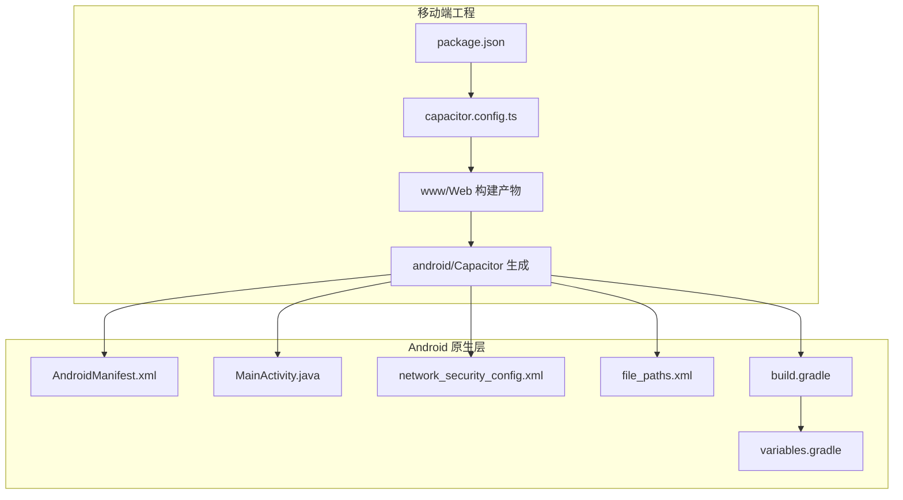
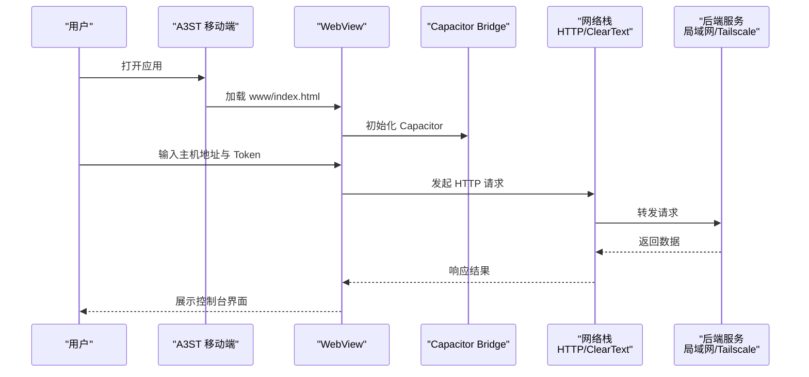
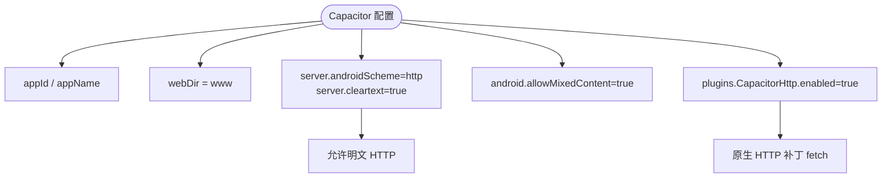
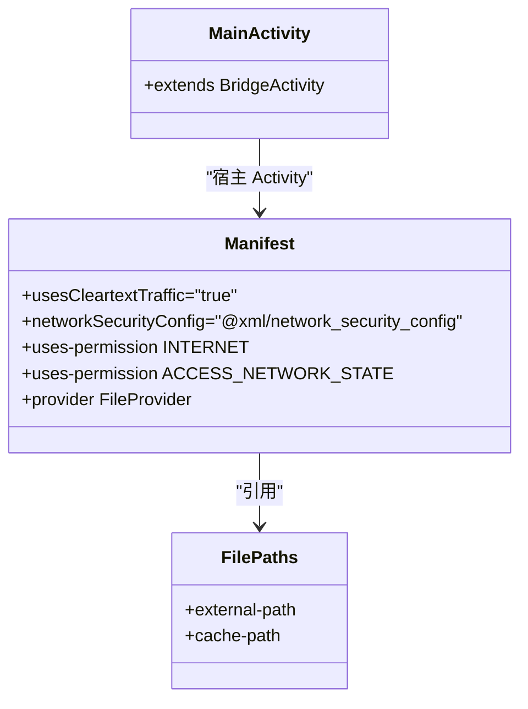
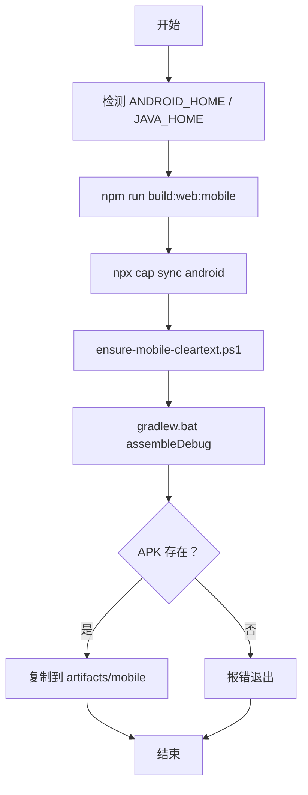
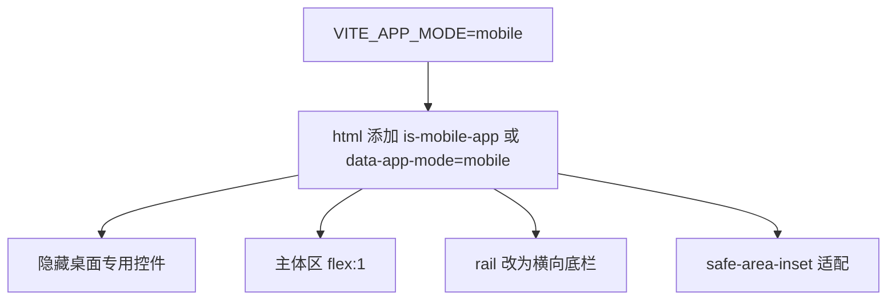
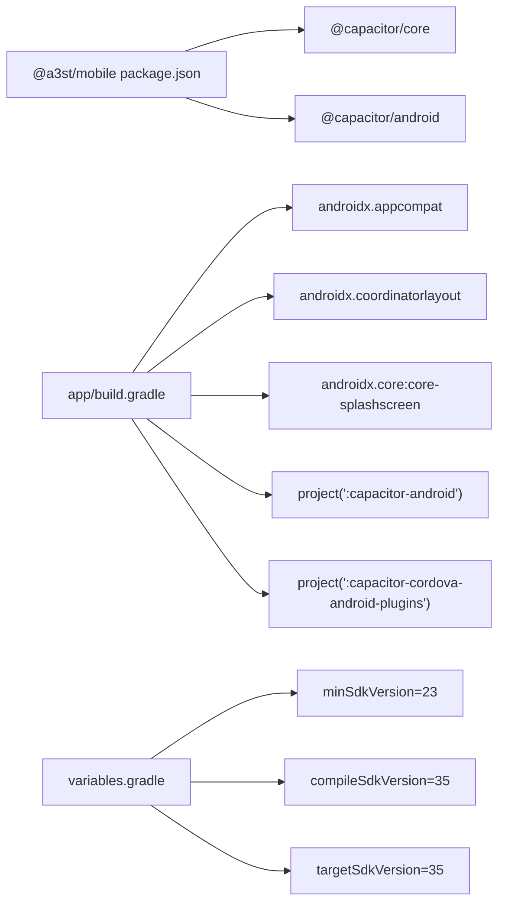
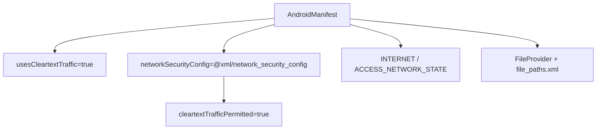

# 移动应用

<cite>
**本文引用的文件**   
- [apps/mobile/capacitor.config.ts](file://apps/mobile/capacitor.config.ts)
- [apps/mobile/package.json](file://apps/mobile/package.json)
- [apps/mobile/android/app/src/main/AndroidManifest.xml](file://apps/mobile/android/app/src/main/AndroidManifest.xml)
- [apps/mobile/android/app/src/main/java/com/vivi141/a3st/MainActivity.java](file://apps/mobile/android/app/src/main/java/com/vivi141/a3st/MainActivity.java)
- [apps/mobile/android/app/build.gradle](file://apps/mobile/android/app/build.gradle)
- [apps/mobile/android/variables.gradle](file://apps/mobile/android/variables.gradle)
- [apps/mobile/android/app/src/main/res/xml/network_security_config.xml](file://apps/mobile/android/app/src/main/res/xml/network_security_config.xml)
- [apps/mobile/android/app/src/main/res/xml/file_paths.xml](file://apps/mobile/android/app/src/main/res/xml/file_paths.xml)
- [scripts/ensure-mobile-cleartext.ps1](file://scripts/ensure-mobile-cleartext.ps1)
- [scripts/pack-mobile-apk.ps1](file://scripts/pack-mobile-apk.ps1)
- [docs/mobile-android.md](file://docs/mobile-android.md)
- [packages/web/src/styles/shell-v2.css](file://packages/web/src/styles/shell-v2.css)
</cite>

## 目录
1. [简介](#简介)
2. [项目结构](#项目结构)
3. [核心组件](#核心组件)
4. [架构总览](#架构总览)
5. [详细组件分析](#详细组件分析)
6. [依赖关系分析](#依赖关系分析)
7. [性能与体验优化](#性能与体验优化)
8. [打包、签名与发布](#打包签名与发布)
9. [权限与网络安全](#权限与网络安全)
10. [调试与排错](#调试与排错)
11. [结论](#结论)

## 简介
本项目为 Arma3 Server Tools 的 Capacitor 移动端壳工程，运行在 Android 上，通过 WebView 加载前端 Web 应用，并连接局域网或 Tailscale 上的后端服务进行服务器管理。移动端不承载业务后端，仅作为控制端。

Capacitor 在此项目中承担以下职责：
- 将 Web 构建产物（www）注入原生容器
- 提供网络、文件系统、系统能力等桥接
- 管理 Android 原生配置（清单、安全策略、Activity 入口）

## 项目结构
移动端位于 apps/mobile，包含 Capacitor 配置、包脚本以及由 Capacitor 生成的 Android 工程。Web 资源经 Vite 构建后输出到 www，再由 Capcitor 同步至 Android 工程。

图表来源
- [apps/mobile/capacitor.config.ts:1-24](file://apps/mobile/capacitor.config.ts#L1-L24)
- [apps/mobile/package.json:1-23](file://apps/mobile/package.json#L1-L23)
- [apps/mobile/android/app/src/main/AndroidManifest.xml:1-45](file://apps/mobile/android/app/src/main/AndroidManifest.xml#L1-L45)
- [apps/mobile/android/app/src/main/java/com/vivi141/a3st/MainActivity.java:1-6](file://apps/mobile/android/app/src/main/java/com/vivi141/a3st/MainActivity.java#L1-L6)
- [apps/mobile/android/app/build.gradle:1-55](file://apps/mobile/android/app/build.gradle#L1-L55)
- [apps/mobile/android/variables.gradle:1-16](file://apps/mobile/android/variables.gradle#L1-L16)
- [apps/mobile/android/app/src/main/res/xml/network_security_config.xml:1-9](file://apps/mobile/android/app/src/main/res/xml/network_security_config.xml#L1-L9)
- [apps/mobile/android/app/src/main/res/xml/file_paths.xml:1-5](file://apps/mobile/android/app/src/main/res/xml/file_paths.xml#L1-L5)

章节来源
- [docs/mobile-android.md:1-60](file://docs/mobile-android.md#L1-L60)

## 核心组件
- Capacitor 配置：定义应用标识、Web 目录、Android Scheme、明文 HTTP 开关、插件启用等。
- Android 清单与 Activity：声明应用图标、主题、启动 Activity、FileProvider、网络权限与安全策略。
- 构建脚本：负责 Web 构建、Capacitor 同步、Cleartext 补丁、Gradle 打包与 APK 复制。
- 样式适配：根据 mobile 模式切换底部导航布局与间距。

章节来源
- [apps/mobile/capacitor.config.ts:1-24](file://apps/mobile/capacitor.config.ts#L1-L24)
- [apps/mobile/android/app/src/main/AndroidManifest.xml:1-45](file://apps/mobile/android/app/src/main/AndroidManifest.xml#L1-L45)
- [scripts/pack-mobile-apk.ps1:1-76](file://scripts/pack-mobile-apk.ps1#L1-L76)
- [packages/web/src/styles/shell-v2.css:665-717](file://packages/web/src/styles/shell-v2.css#L665-L717)

## 架构总览
移动端采用“WebView + Capacitor”的混合架构：
- 前端：Vite 构建的 Web 应用，按 mode=mobile 渲染移动端 UI。
- 容器：Capacitor BridgeActivity 承载 WebView，桥接原生能力。
- 网络：允许明文 HTTP 访问局域网 Service；可选启用 CapacitorHttp 绕过部分 WebView 限制。
- 存储：通过 FileProvider 暴露受控路径，供系统分享或外部调用。

图表来源
- [apps/mobile/capacitor.config.ts:1-24](file://apps/mobile/capacitor.config.ts#L1-L24)
- [apps/mobile/android/app/src/main/AndroidManifest.xml:1-45](file://apps/mobile/android/app/src/main/AndroidManifest.xml#L1-L45)
- [docs/mobile-android.md:37-44](file://docs/mobile-android.md#L37-L44)

## 详细组件分析

### Capacitor 配置与 Web 集成
- 应用标识与名称：用于 Android 包名与应用显示名。
- Web 目录：指向 www，由 Capacitor 同步。
- 服务器设置：
  - androidScheme 设为 http，避免与内网 http 服务产生混合内容问题。
  - cleartext 开启，允许明文流量。
- 插件：启用 CapacitorHttp，用原生 HTTP 打补丁 window.fetch，绕过 WebView CORS 或部分 cleartext 限制。

图表来源
- [apps/mobile/capacitor.config.ts:1-24](file://apps/mobile/capacitor.config.ts#L1-L24)

章节来源
- [apps/mobile/capacitor.config.ts:1-24](file://apps/mobile/capacitor.config.ts#L1-L24)

### Android 原生入口与清单
- MainActivity：继承 BridgeActivity，作为 Capacitor 的宿主 Activity。
- AndroidManifest：
  - Application 级别启用 usesCleartextTraffic 与 networkSecurityConfig。
  - Activity 声明 LAUNCHER 入口，支持横竖屏与多语言等配置变更。
  - 声明 INTERNET 与 ACCESS_NETWORK_STATE 权限。
  - 注册 FileProvider，配合 file_paths.xml 暴露图片与缓存路径。

图表来源
- [apps/mobile/android/app/src/main/java/com/vivi141/a3st/MainActivity.java:1-6](file://apps/mobile/android/app/src/main/java/com/vivi141/a3st/MainActivity.java#L1-L6)
- [apps/mobile/android/app/src/main/AndroidManifest.xml:1-45](file://apps/mobile/android/app/src/main/AndroidManifest.xml#L1-L45)
- [apps/mobile/android/app/src/main/res/xml/file_paths.xml:1-5](file://apps/mobile/android/app/src/main/res/xml/file_paths.xml#L1-L5)

章节来源
- [apps/mobile/android/app/src/main/java/com/vivi141/a3st/MainActivity.java:1-6](file://apps/mobile/android/app/src/main/java/com/vivi141/a3st/MainActivity.java#L1-L6)
- [apps/mobile/android/app/src/main/AndroidManifest.xml:1-45](file://apps/mobile/android/app/src/main/AndroidManifest.xml#L1-L45)
- [apps/mobile/android/app/src/main/res/xml/file_paths.xml:1-5](file://apps/mobile/android/app/src/main/res/xml/file_paths.xml#L1-L5)

### 构建与打包流程
pack-mobile-apk.ps1 执行步骤：
1. 校验 Android SDK 与 JDK 环境。
2. 构建 Web（VITE_APP_MODE=mobile）。
3. 执行 cap sync android 同步 Web 资源与 Capacitor 配置。
4. 调用 ensure-mobile-cleartext.ps1 确保明文 HTTP 与网络状态权限。
5. 使用 Gradle assembleDebug 构建 Debug APK。
6. 复制 APK 到 artifacts/mobile。

图表来源
- [scripts/pack-mobile-apk.ps1:1-76](file://scripts/pack-mobile-apk.ps1#L1-L76)
- [scripts/ensure-mobile-cleartext.ps1:1-49](file://scripts/ensure-mobile-cleartext.ps1#L1-L49)

章节来源
- [scripts/pack-mobile-apk.ps1:1-76](file://scripts/pack-mobile-apk.ps1#L1-L76)
- [scripts/ensure-mobile-cleartext.ps1:1-49](file://scripts/ensure-mobile-cleartext.ps1#L1-L49)

### 移动端界面适配
- 通过 CSS 选择器 html.is-mobile-app 或 html[data-app-mode="mobile"] 切换布局。
- 顶部区域隐藏 relay/picker，主体区占满空间。
- 底部 rail 改为横向六宫格导航，适配触摸操作。
- 使用 env(safe-area-inset-*) 适配刘海屏与底部手势条。

图表来源
- [packages/web/src/styles/shell-v2.css:665-717](file://packages/web/src/styles/shell-v2.css#L665-L717)

章节来源
- [packages/web/src/styles/shell-v2.css:665-717](file://packages/web/src/styles/shell-v2.css#L665-L717)

## 依赖关系分析
- 包依赖：@capacitor/core 与 @capacitor/android 提供运行时桥接。
- Android 依赖：appcompat、coordinatorlayout、core-splashscreen、capacitor-android、capacitor-cordova-android-plugins。
- 版本变量：minSdkVersion=23，compile/targetSdkVersion=35。

图表来源
- [apps/mobile/package.json:1-23](file://apps/mobile/package.json#L1-L23)
- [apps/mobile/android/app/build.gradle:1-55](file://apps/mobile/android/app/build.gradle#L1-L55)
- [apps/mobile/android/variables.gradle:1-16](file://apps/mobile/android/variables.gradle#L1-L16)

章节来源
- [apps/mobile/package.json:1-23](file://apps/mobile/package.json#L1-L23)
- [apps/mobile/android/app/build.gradle:1-55](file://apps/mobile/android/app/build.gradle#L1-L55)
- [apps/mobile/android/variables.gradle:1-16](file://apps/mobile/android/variables.gradle#L1-L16)

## 性能与体验优化
- 触摸交互
  - 使用底部横向 rail 提升拇指可达性。
  - 增大触控目标尺寸，减少误触。
- 屏幕适配
  - 使用 safe-area-inset 适配刘海屏与底部手势条。
  - 使用 dvh 单位避免滚动条高度不一致。
- 电池优化
  - 避免长时间轮询，改用事件驱动或长连接（如 WebSocket），降低 CPU 唤醒频率。
  - 后台任务尽量延迟到前台恢复时处理。
- 网络与离线
  - 对关键列表与配置做本地缓存，断网时展示上次可用数据。
  - 失败重试与退避策略，避免频繁请求导致电量与带宽浪费。
- 用户体验
  - 首屏快速加载，骨架屏替代空白页。
  - 错误提示友好，并提供重试与反馈入口。

[本节为通用指导，不涉及具体代码文件]

## 打包、签名与发布
- Debug 构建
  - 使用 scripts/pack-mobile-apk.ps1 一键构建 Debug APK。
  - 产物位于 artifacts/mobile/a3st-mobile-debug.apk。
- 安装与测试
  - 通过 adb install 安装到真机或模拟器。
- 正式签名与上架
  - 当前以 Debug 为主，后续可引入 assembleRelease 与签名配置。
  - 建议：
    - 使用独立 keystore，妥善保管密钥。
    - 关闭 minifyEnabled 或谨慎配置 ProGuard/R8 规则。
    - 生产环境禁用 cleartext，改用 HTTPS 或可信自签证书。

章节来源
- [docs/mobile-android.md:11-25](file://docs/mobile-android.md#L11-L25)
- [scripts/pack-mobile-apk.ps1:1-76](file://scripts/pack-mobile-apk.ps1#L1-L76)

## 权限与网络安全
- 权限
  - INTERNET：允许网络访问。
  - ACCESS_NETWORK_STATE：检测网络状态，便于优化请求策略。
- 明文 HTTP
  - AndroidManifest 中 usesCleartextTraffic="true"。
  - network_security_config.xml 允许 base-config cleartextTrafficPermitted="true"。
  - ensure-mobile-cleartext.ps1 自动注入上述配置，保证局域网 HTTP 可用。
- FileProvider
  - 暴露 external-path 与 cache-path，便于系统分享或外部应用读取图片与缓存。

图表来源
- [apps/mobile/android/app/src/main/AndroidManifest.xml:1-45](file://apps/mobile/android/app/src/main/AndroidManifest.xml#L1-L45)
- [apps/mobile/android/app/src/main/res/xml/network_security_config.xml:1-9](file://apps/mobile/android/app/src/main/res/xml/network_security_config.xml#L1-L9)
- [apps/mobile/android/app/src/main/res/xml/file_paths.xml:1-5](file://apps/mobile/android/app/src/main/res/xml/file_paths.xml#L1-L5)
- [scripts/ensure-mobile-cleartext.ps1:1-49](file://scripts/ensure-mobile-cleartext.ps1#L1-L49)

章节来源
- [apps/mobile/android/app/src/main/AndroidManifest.xml:1-45](file://apps/mobile/android/app/src/main/AndroidManifest.xml#L1-L45)
- [apps/mobile/android/app/src/main/res/xml/network_security_config.xml:1-9](file://apps/mobile/android/app/src/main/res/xml/network_security_config.xml#L1-L9)
- [apps/mobile/android/app/src/main/res/xml/file_paths.xml:1-5](file://apps/mobile/android/app/src/main/res/xml/file_paths.xml#L1-L5)
- [scripts/ensure-mobile-cleartext.ps1:1-49](file://scripts/ensure-mobile-cleartext.ps1#L1-L49)

## 调试与排错
- 开发迭代
  - npm -w @a3st/mobile run sync 同步 Web 与原生。
  - npm -w @a3st/mobile run open 打开 Android Studio 调试。
- 常见问题
  - 无法访问局域网 HTTP：确认 Cleartext 已启用，检查 ensure-mobile-cleartext.ps1 是否成功注入。
  - 构建失败：检查 ANDROID_HOME、JAVA_HOME 与 SDK/JDK 版本。
  - 白屏或样式异常：确认 VITE_APP_MODE=mobile 且 Web 构建成功。
- 日志与诊断
  - 使用 Chrome DevTools 远程调试 WebView。
  - 查看 Gradle 构建日志定位编译问题。

章节来源
- [docs/mobile-android.md:27-35](file://docs/mobile-android.md#L27-L35)
- [scripts/ensure-mobile-cleartext.ps1:1-49](file://scripts/ensure-mobile-cleartext.ps1#L1-L49)
- [scripts/pack-mobile-apk.ps1:1-76](file://scripts/pack-mobile-apk.ps1#L1-L76)

## 结论
该移动端基于 Capacitor 将现有 Web 控制台无缝移植到 Android，通过清晰的配置与脚本实现局域网 HTTP 访问、基础权限与安全策略、移动端 UI 适配与 Debug 打包。后续可在生产环境引入 HTTPS、签名与更完善的离线策略，进一步提升稳定性与用户体验。