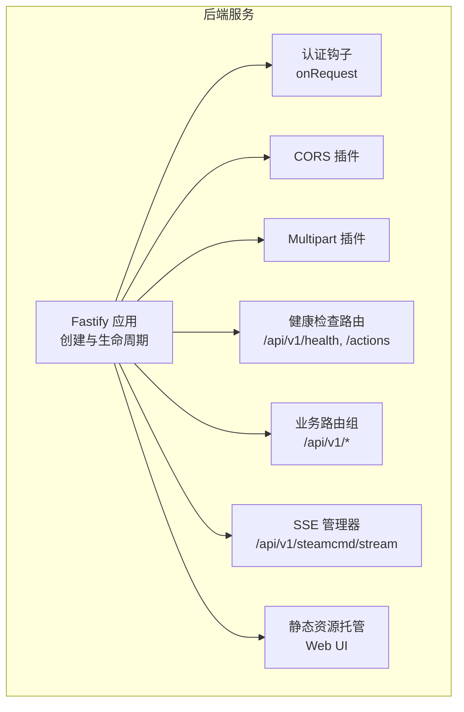
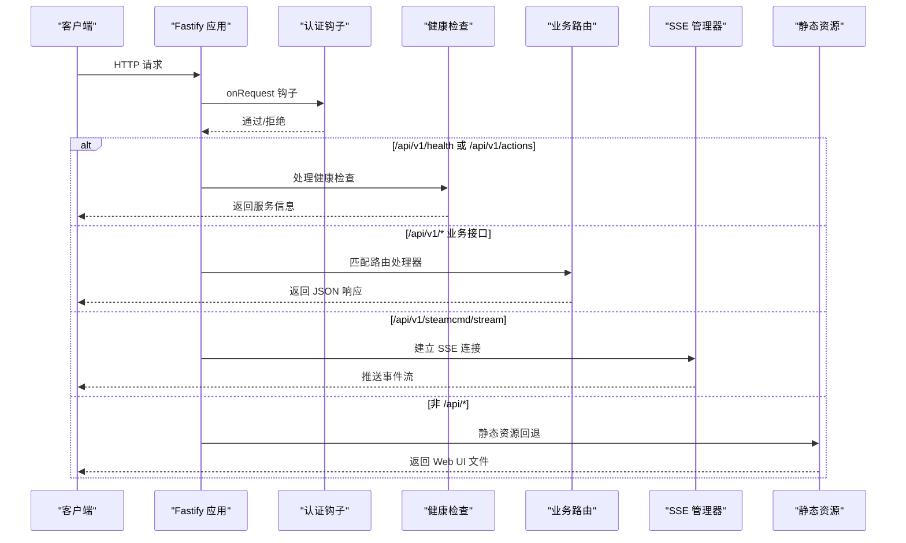
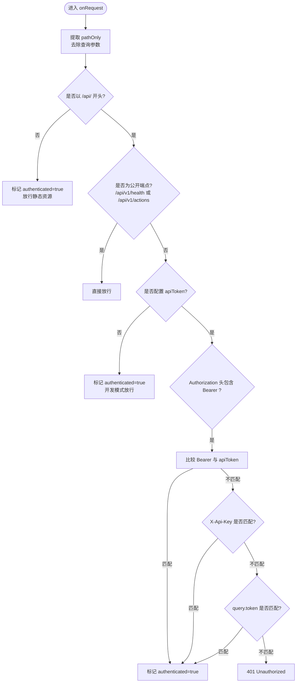
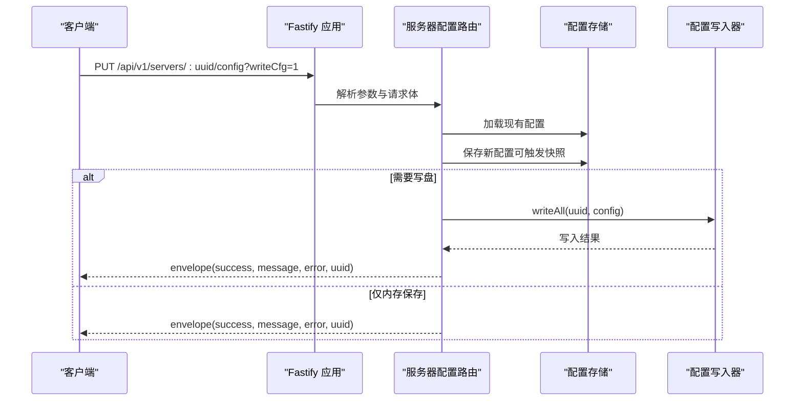
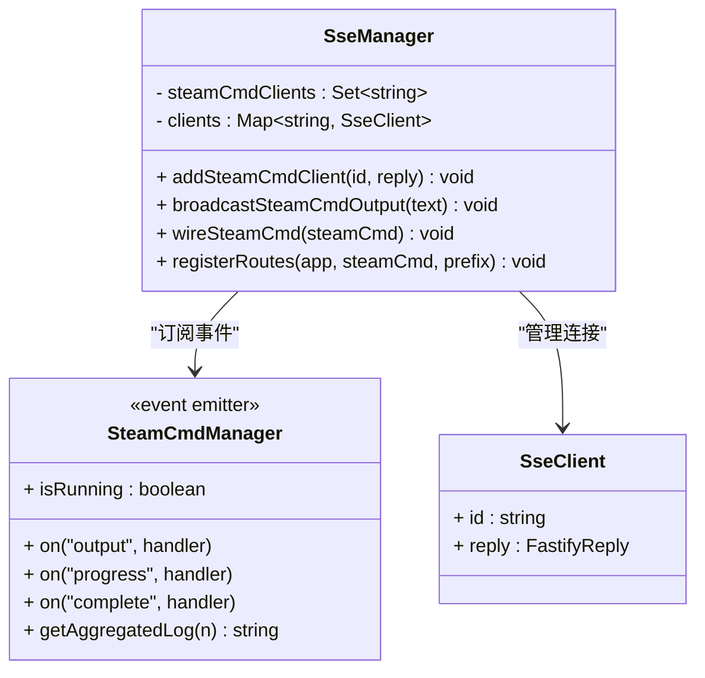
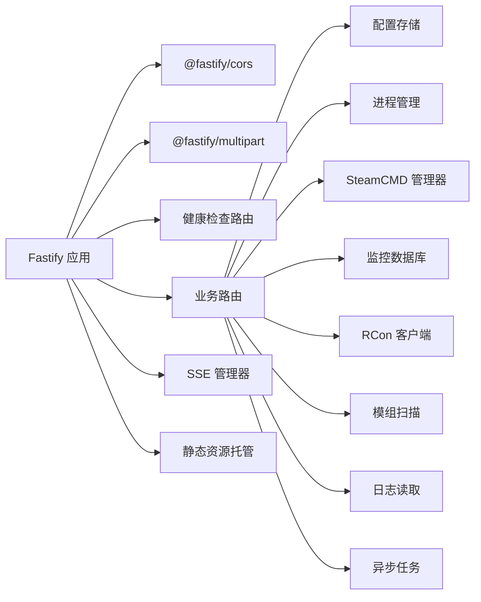

# API 层设计

<cite>
**本文引用的文件**   
- [README.md](file://README.md)
- [app.ts](file://packages/service/src/app.ts)
- [routes.ts](file://packages/service/src/api/routes.ts)
- [health.ts](file://packages/service/src/api/health.ts)
- [sse.ts](file://packages/service/src/api/sse.ts)
- [web-static.ts](file://packages/service/src/web-static.ts)
</cite>

## 目录
1. [引言](#引言)
2. [项目结构](#项目结构)
3. [核心组件](#核心组件)
4. [架构总览](#架构总览)
5. [详细组件分析](#详细组件分析)
6. [依赖关系分析](#依赖关系分析)
7. [性能与优化](#性能与优化)
8. [故障排查指南](#故障排查指南)
9. [结论](#结论)
10. [附录：API 版本、文档与示例](#附录api-版本文档与示例)

## 引言
本文件面向后端 API 层的设计与实现，聚焦 Fastify 中间件架构、路由组织、请求处理流程、认证机制（Bearer Token、API Key、查询参数）、CORS 配置、错误处理与日志策略，以及 SSE（Server-Sent Events）实时通信的实现细节。同时给出版本控制策略、API 文档生成方式与性能优化建议，帮助读者快速理解并扩展该服务。

## 项目结构
后端服务位于 packages/service，采用 Fastify 作为 HTTP 框架，结合 SQLite、RCon、SteamCMD、任务调度等子系统。API 以 /api/v1 为统一前缀，健康检查与动作清单在 health 模块中暴露；业务路由集中在 routes 模块；SSE 流式输出由 sse 模块提供；静态 Web UI 由 web-static 模块托管。

图示来源
- [app.ts:57-171](file://packages/service/src/app.ts#L57-L171)
- [health.ts:5-66](file://packages/service/src/api/health.ts#L5-L66)
- [sse.ts:9-94](file://packages/service/src/api/sse.ts#L9-L94)
- [web-static.ts:62-93](file://packages/service/src/web-static.ts#L62-L93)

章节来源
- [README.md:1-108](file://README.md#L1-L108)
- [app.ts:57-171](file://packages/service/src/app.ts#L57-L171)

## 核心组件
- Fastify 应用实例：负责插件注册、装饰器注入、全局钩子、路由挂载与服务监听。
- 认证中间件：基于 onRequest 钩子统一校验 Bearer Token、X-Api-Key 与查询 token。
- CORS 配置：允许 Capacitor WebView 与局域网访问场景下的跨域请求。
- Multipart 支持：用于大文件上传（如模组 HTML 列表）。
- 健康检查与动作清单：对外暴露服务状态与可用端点清单。
- 业务路由：服务器管理、SteamCMD、监控、日志、任务等 REST 接口。
- SSE 管理器：将 SteamCMD 事件广播到前端，提供连接管理与保活。
- 静态资源托管：自动定位 Web UI 根目录并提供 SPA 回退。

章节来源
- [app.ts:57-171](file://packages/service/src/app.ts#L57-L171)
- [health.ts:5-66](file://packages/service/src/api/health.ts#L5-L66)
- [sse.ts:9-94](file://packages/service/src/api/sse.ts#L9-L94)
- [web-static.ts:17-93](file://packages/service/src/web-static.ts#L17-L93)

## 架构总览
Fastify 启动后依次完成以下工作：
1. 初始化各子系统（配置存储、进程管理、SteamCMD、模组扫描、监控数据库、调度器等）。
2. 通过 app.decorate 将服务实例挂载到请求上下文。
3. 注册认证钩子，对 /api/* 路径进行鉴权，静态页面与特定公开端点放行。
4. 注册 CORS 与 multipart 插件。
5. 将 SSE 与 SteamCMD 事件绑定，并挂载 SSE 路由。
6. 挂载 /api/v1 健康检查与业务路由。
7. 尝试托管静态 Web UI，若未找到则记录错误。
8. 启动服务并监听端口，启动定时任务。

图示来源
- [app.ts:96-171](file://packages/service/src/app.ts#L96-L171)
- [health.ts:5-66](file://packages/service/src/api/health.ts#L5-L66)
- [sse.ts:51-91](file://packages/service/src/api/sse.ts#L51-L91)
- [web-static.ts:62-93](file://packages/service/src/web-static.ts#L62-L93)

## 详细组件分析

### 认证机制与请求拦截
- 拦截范围：所有 /api/* 路径默认需要认证；静态资源（/、/assets/*）不要求 Bearer。
- 公开端点：/api/v1/health 与 /api/v1/actions 无需认证。
- 认证方式（按优先级）：
  - Authorization: Bearer <token>
  - X-Api-Key: <token>
  - 查询参数 token=<token>
- 失败响应：401 + { success: false, message: "Unauthorized" }。
- 未配置 apiToken 时，所有请求视为已认证（便于本地开发）。

图示来源
- [app.ts:96-130](file://packages/service/src/app.ts#L96-L130)

章节来源
- [app.ts:96-130](file://packages/service/src/app.ts#L96-L130)

### CORS 配置
- 目标场景：Capacitor WebView Origin 多为 http://localhost；手机连 LAN 时也允许反射任意 Origin；file:// 与 null Origin 使用 *。
- 行为：
  - origin 回调：无 Origin 或值为 null 时返回 *；否则回显请求 Origin。
  - methods：GET、HEAD、POST、PUT、PATCH、DELETE、OPTIONS。
  - allowedHeaders：Authorization、Content-Type、X-Api-Key、Accept。

章节来源
- [app.ts:132-144](file://packages/service/src/app.ts#L132-L144)

### 路由组织与请求处理
- 路由分组：
  - 健康检查：/api/v1/health、/api/v1/actions。
  - 业务路由：/api/v1/*，包括服务器 CRUD、SteamCMD、监控、日志、任务等。
  - SSE：/api/v1/steamcmd/stream。
- 请求体与响应：
  - 统一 envelope 包装成功/失败响应，携带 success、data/message、error code、requestId。
  - 常见错误码：NOT_FOUND、INVALID_BODY、WRITE_CFG_FAILED、SAVE_FAILED、RCON_NOT_CONFIGURED、RCON_FAILED 等。
- 典型流程（以服务器配置更新为例）：
  1. 读取 UUID 与请求体。
  2. 可选强制刷新磁盘配置。
  3. 保存配置（可能触发自动快照）。
  4. 若 query.writeCfg=1，调用 writeAll 写入配置文件。
  5. 返回 envelope 结果。

图示来源
- [routes.ts:112-145](file://packages/service/src/api/routes.ts#L112-L145)

章节来源
- [routes.ts:62-195](file://packages/service/src/api/routes.ts#L62-L195)
- [routes.ts:1115-1120](file://packages/service/src/api/routes.ts#L1115-L1120)

### SSE（Server-Sent Events）实时通信
- 连接建立：
  - GET /api/v1/steamcmd/stream
  - 设置 Content-Type: text/event-stream，Cache-Control: no-cache，Connection: keep-alive。
  - 首次推送 connected 事件，随后发送历史日志片段（最多 150 行），若 SteamCMD 正在运行则提示后台同步。
- 事件类型：
  - type: "connected"：连接成功。
  - type: "output"：SteamCMD 输出或进度/完成消息。
- 连接管理：
  - 维护客户端集合 Map/Set，关闭连接时自动清理。
  - 每 15 秒发送 ": keepalive\n\n" 保活。
- 错误处理：
  - 向客户端写入失败时捕获异常并移除对应客户端。
- 与 SteamCMD 集成：
  - wireSteamCmd 订阅 output、progress、complete 事件并广播。

图示来源
- [sse.ts:4-94](file://packages/service/src/api/sse.ts#L4-L94)

章节来源
- [sse.ts:9-94](file://packages/service/src/api/sse.ts#L9-L94)

### 静态资源与 SPA 回退
- 自动查找 Web UI 根目录：优先环境变量 WEB_ROOT，其次 packages/web/dist 等候选路径。
- 安全校验：防止目录穿越（isSafeUnderRoot）。
- 404 回退：非 /api/* 的 GET/HEAD 请求回退到 index.html，便于 SPA 路由。
- MIME 映射：根据扩展名设置 Content-Type。

章节来源
- [web-static.ts:17-93](file://packages/service/src/web-static.ts#L17-L93)

## 依赖关系分析
- Fastify 核心：提供插件体系、装饰器、钩子、路由与日志。
- @fastify/cors：跨域控制。
- @fastify/multipart：大文件上传。
- 内部模块：
  - steamcmd：SteamCMD 进程管理与事件。
  - process：进程管理。
  - config：配置存储与快照。
  - monitoring：监控数据入库与导出。
  - scheduling：定时任务。
  - rcon：BattlEye RCon 远程控制。
  - mods：模组扫描与 Bikey 管理。
  - logs：RPT 日志读取。
  - task：异步任务管理。

图示来源
- [app.ts:57-171](file://packages/service/src/app.ts#L57-L171)
- [routes.ts:1-61](file://packages/service/src/api/routes.ts#L1-L61)

章节来源
- [app.ts:57-171](file://packages/service/src/app.ts#L57-L171)
- [routes.ts:1-61](file://packages/service/src/api/routes.ts#L1-L61)

## 性能与优化
- 插件选择：
  - fast-json-stringify 与 AJV 编译器提升序列化与校验性能。
  - find-my-way 路由引擎提高匹配效率。
- I/O 优化：
  - 静态资源使用 createReadStream 流式传输。
  - SSE 使用 keepalive 心跳降低长连接超时风险。
- 并发与锁：
  - SteamCMD 下载操作持有全局互斥锁，避免并发冲突。
- 缓存与快照：
  - 配置读写支持自动快照，减少误改风险。
- 建议：
  - 对高频只读接口启用合理缓存（如仪表盘摘要）。
  - 对大文件上传增加速率限制与白名单校验。
  - 对 SSE 客户端数量做上限控制与淘汰策略。

[本节为通用指导，不直接分析具体文件]

## 故障排查指南
- 401 Unauthorized：
  - 检查 Authorization、X-Api-Key、query.token 是否与 apiToken 一致。
  - 确认请求路径不是公开端点且未被静态资源绕过。
- 404 Not Found：
  - 确认路由前缀为 /api/v1。
  - 静态资源回退仅在非 /api/* 路径生效。
- 配置写入失败：
  - 检查 writeCfg 参数与文件系统权限。
  - 查看 WRITE_CFG_FAILED 错误码与 message。
- RCon 连接失败：
  - 检查 RCON 配置与服务器连通性。
  - 关注 RCON_NOT_CONFIGURED 与 RCON_FAILED。
- SSE 断连：
  - 检查 keepalive 是否被代理或防火墙丢弃。
  - 观察客户端 close 事件是否触发清理逻辑。

章节来源
- [app.ts:96-130](file://packages/service/src/app.ts#L96-L130)
- [routes.ts:112-195](file://packages/service/src/api/routes.ts#L112-L195)
- [sse.ts:51-91](file://packages/service/src/api/sse.ts#L51-L91)

## 结论
该 API 层以 Fastify 为核心，通过统一的认证钩子、清晰的 /api/v1 路由分组、完善的 CORS 与错误处理，提供了稳定易用的后端能力。SSE 实现了与 SteamCMD 的实时联动，静态资源托管简化了部署。建议在后续迭代中引入更严格的输入校验、限流与审计日志，进一步提升安全性与可观测性。

[本节为总结性内容，不直接分析具体文件]

## 附录：API 版本、文档与示例

### 版本控制策略
- 所有 REST 接口统一以 /api/v1 前缀命名，便于未来演进至 v2。
- 健康检查与动作清单提供当前版本与服务元信息。

章节来源
- [health.ts:5-66](file://packages/service/src/api/health.ts#L5-L66)

### API 文档生成
- 通过 /api/v1/actions 获取可用的任务动作与 REST 端点清单，可作为动态 API 文档源。
- 建议结合 OpenAPI/Swagger 工具在构建阶段生成静态文档站点。

章节来源
- [health.ts:21-66](file://packages/service/src/api/health.ts#L21-L66)

### 代码示例（路径引用）
- 路由装饰器（Fastify 风格）：
  - [routes.ts:65-85](file://packages/service/src/api/routes.ts#L65-L85)
  - [routes.ts:112-145](file://packages/service/src/api/routes.ts#L112-L145)
- 中间件注册（CORS、Multipart、SSE）：
  - [app.ts:132-153](file://packages/service/src/app.ts#L132-L153)
- 请求拦截器（认证钩子）：
  - [app.ts:96-130](file://packages/service/src/app.ts#L96-L130)
- SSE 连接与事件：
  - [sse.ts:51-91](file://packages/service/src/api/sse.ts#L51-L91)