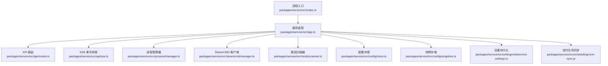
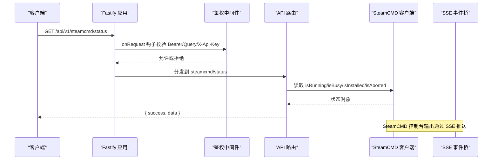
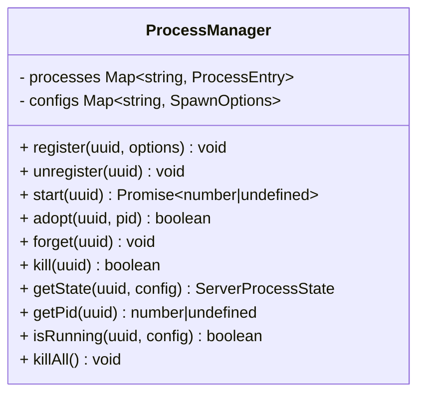
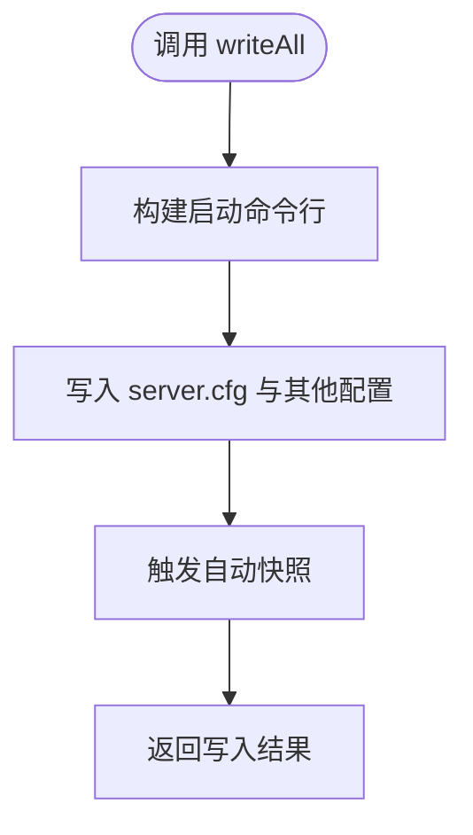
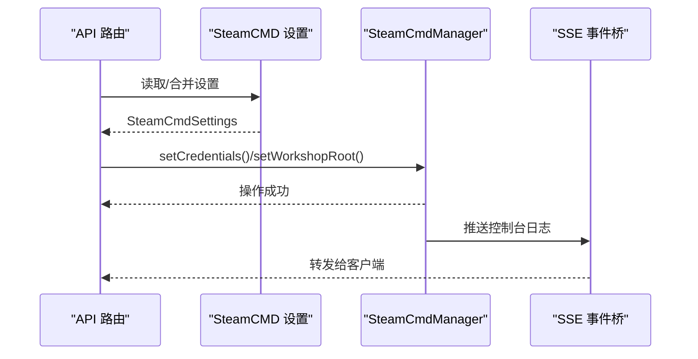
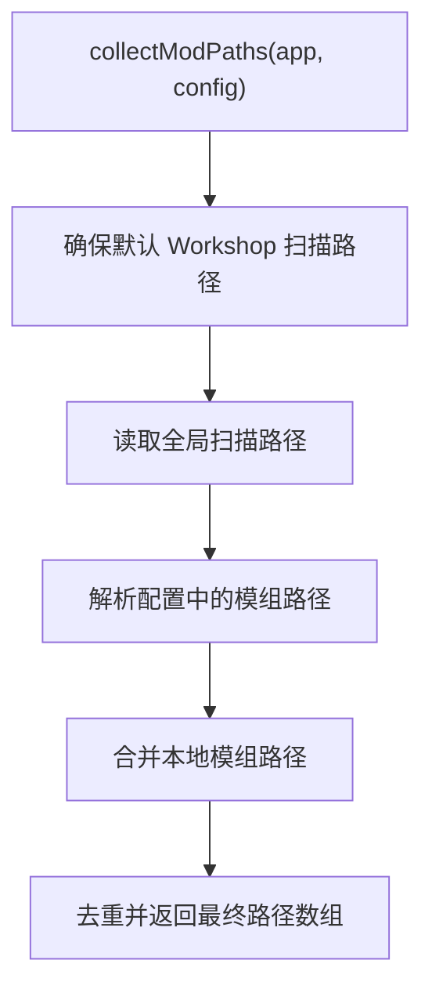
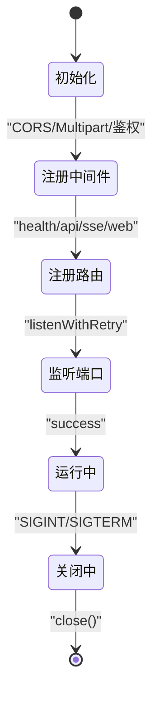
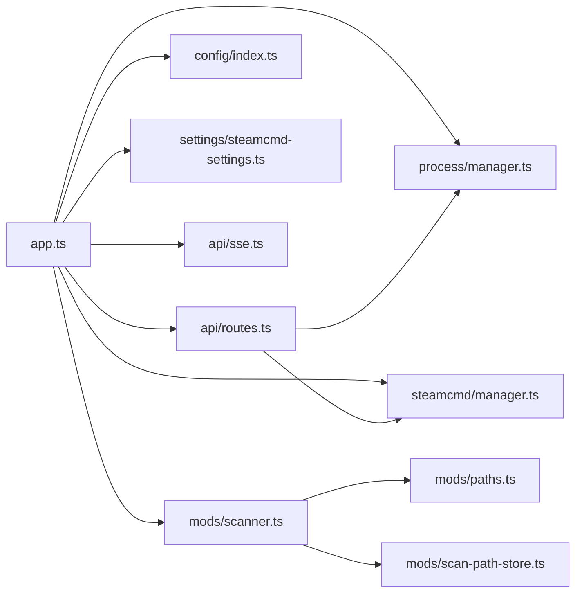

# Service 层设计

<cite>
**本文引用的文件**   
- [index.ts](file://packages/service/src/index.ts)
- [app.ts](file://packages/service/src/app.ts)
- [routes.ts](file://packages/service/src/api/routes.ts)
- [manager.ts](file://packages/service/src/process/manager.ts)
- [index.ts](file://packages/service/src/config/index.ts)
- [game-config-writer.ts](file://packages/service/src/config/game-config-writer.ts)
- [store.ts](file://packages/service/src/config/store.ts)
- [snapshot.ts](file://packages/service/src/config/snapshot.ts)
- [auto-snapshot.ts](file://packages/service/src/config/auto-snapshot.ts)
- [index.ts](file://packages/service/src/steamcmd/index.ts)
- [manager.ts](file://packages/service/src/steamcmd/manager.ts)
- [apply-steamcmd-settings.ts](file://packages/service/src/settings/apply-steamcmd-settings.ts)
- [steamcmd-settings.ts](file://packages/service/src/settings/steamcmd-settings.ts)
- [index.ts](file://packages/service/src/mods/index.ts)
- [scanner.ts](file://packages/service/src/mods/scanner.ts)
- [paths.ts](file://packages/service/src/mods/paths.ts)
- [scan-path-store.ts](file://packages/service/src/mods/scan-path-store.ts)
- [bikey-service.ts](file://packages/service/src/mods/bikey-service.ts)
- [enabler.ts](file://packages/service/src/mods/enabler.ts)
- [mod-command-line.ts](file://packages/service/src/mods/mod-command-line.ts)
- [sse.ts](file://packages/service/src/api/sse.ts)
- [cron-sync.js](file://packages/service/src/scheduling/cron-sync.js)
</cite>

## 目录
1. [引言](#引言)
2. [项目结构](#项目结构)
3. [核心组件](#核心组件)
4. [架构总览](#架构总览)
5. [详细组件分析](#详细组件分析)
6. [依赖关系分析](#依赖关系分析)
7. [性能与可扩展性](#性能与可扩展性)
8. [故障排查指南](#故障排查指南)
9. [结论](#结论)
10. [附录：关键接口与数据流](#附录关键接口与数据流)

## 引言
本文面向 Arma 3 服务器管理工具 v2 的 Service 层，聚焦业务逻辑层的职责边界、领域模型与服务协作模式。重点覆盖以下核心服务模块：进程管理器、配置存储、SteamCMD 客户端、模组扫描器，并说明依赖注入机制、服务生命周期管理、错误处理策略、事务与一致性保障、缓存策略、监控指标与故障恢复。文档以代码级事实为依据，通过图示和路径引用帮助读者快速定位实现位置。

## 项目结构
Service 层位于 `packages/service`，采用 Fastify 作为 HTTP 框架，结合 SQLite（sql.js）、Croner 定时任务、undici 网络库等依赖。入口脚本负责解析环境变量、创建服务实例、注册优雅关闭钩子；应用装配在 `createService` 中完成，所有服务通过 Fastify 装饰器注入到请求上下文。

**图表来源**
- [index.ts:18-40](file://packages/service/src/index.ts#L18-L40)
- [app.ts:57-171](file://packages/service/src/app.ts#L57-L171)

**章节来源**
- [index.ts:1-41](file://packages/service/src/index.ts#L1-L41)
- [app.ts:1-178](file://packages/service/src/app.ts#L1-L178)

## 核心组件
本节概述 Service 层的关键组件及其职责边界：

- 进程管理器：封装 Arma 3 专用进程的启动、停止、状态查询、PID 回收与跨平台差异处理，支持“接管”已存在进程并在服务重启后恢复控制。
- 配置存储：提供服务器配置 JSON 的读写、自动快照、命令行构建与 server.cfg 写入。
- SteamCMD 客户端：封装 SteamCMD 下载、安装、更新、Workshop 下载、凭据与工作目录管理，并通过 SSE 暴露实时日志。
- 模组扫描器：扫描本地与 Workshop 模组、生成启动参数、复制 Bikey、维护扫描路径与启用状态。
- 设置与持久化：UI 设置、SteamCMD 设置、扫描路径设置的持久化与合并策略。
- 异步任务与调度：统一异步任务管理与 Cron 定时任务同步。
- API 与鉴权：Fastify 路由、Bearer/Query/X-Api-Key 鉴权、健康检查、SSE 事件桥接。

**章节来源**
- [manager.ts:32-218](file://packages/service/src/process/manager.ts#L32-L218)
- [index.ts:1-14](file://packages/service/src/config/index.ts#L1-L14)
- [index.ts:1-2](file://packages/service/src/steamcmd/index.ts#L1-L2)
- [index.ts:1-2](file://packages/service/src/mods/index.ts#L1-L2)

## 架构总览
Service 层采用“装配 + 装饰器”的依赖注入模式：`createService` 集中构造各服务实例，并通过 `app.decorate` 挂载到 Fastify 实例上；路由模块通过 `app.steamCmd`、`app.processManager` 等访问服务，避免全局单例耦合。

**图表来源**
- [app.ts:96-130](file://packages/service/src/app.ts#L96-L130)
- [routes.ts:370-376](file://packages/service/src/api/routes.ts#L370-L376)
- [sse.ts](file://packages/service/src/api/sse.ts)

**章节来源**
- [app.ts:57-171](file://packages/service/src/app.ts#L57-L171)
- [routes.ts:368-406](file://packages/service/src/api/routes.ts#L368-L406)

## 详细组件分析

### 进程管理器（ProcessManager）
职责边界：
- 进程生命周期：注册、启动、停止、接管、遗忘、批量终止。
- 状态判定：基于 PID 存活检测与进程身份验证（可执行名、端口、配置文件）。
- 平台差异：Windows 使用 taskkill，Linux/macOS 使用 SIGTERM/SIGKILL 与管道重定向。
- 日志落盘：非 Windows 平台将 stdout/stderr 追加写入 server_{uuid}.log。

**图表来源**
- [manager.ts:32-218](file://packages/service/src/process/manager.ts#L32-L218)

关键实现要点：
- 启动时根据平台选择 stdio 策略，Windows 忽略管道以避免专用服不写 logFile。
- 进程退出或错误时清理跟踪记录并触发事件。
- 接管已运行进程用于服务重启后的状态恢复。
- 状态查询会比对配置中的端口与可执行名，确保 PID 归属正确。

**章节来源**
- [manager.ts:1-219](file://packages/service/src/process/manager.ts#L1-L219)

### 配置存储（ConfigStore、GameConfigWriter、Snapshot）
职责边界：
- 配置存储：按 UUID 保存/加载服务器配置 JSON。
- 配置写入：构建启动命令行、写入 server.cfg、判断 server.cfg 是否存在。
- 快照机制：自动快照与手动快照，便于回滚与审计。

**图表来源**
- [index.ts:3-12](file://packages/service/src/config/index.ts#L3-L12)
- [game-config-writer.ts](file://packages/service/src/config/game-config-writer.ts)
- [auto-snapshot.ts](file://packages/service/src/config/auto-snapshot.ts)

关键实现要点：
- `writeAll` 组合命令行构建与配置落盘，配合自动快照保证变更可追溯。
- `splitCommandLine` 兼容 C# `ProcessStartInfo.Arguments` 风格参数。
- 快照存储独立于主配置，便于版本对比与回滚。

**章节来源**
- [index.ts:1-14](file://packages/service/src/config/index.ts#L1-L14)
- [game-config-writer.ts](file://packages/service/src/config/game-config-writer.ts)
- [store.ts](file://packages/service/src/config/store.ts)
- [snapshot.ts](file://packages/service/src/config/snapshot.ts)
- [auto-snapshot.ts](file://packages/service/src/config/auto-snapshot.ts)

### SteamCMD 客户端（SteamCmdManager）
职责边界：
- 安装/更新 Arma 3 服务器与依赖。
- Workshop 内容下载、代理与结果解析。
- 凭据与工作目录管理（workshopRoot、serverInstallPath）。
- 控制台输出聚合与中止信号。

**图表来源**
- [routes.ts:379-395](file://packages/service/src/api/routes.ts#L379-L395)
- [apply-steamcmd-settings.ts:5-20](file://packages/service/src/settings/apply-steamcmd-settings.ts#L5-L20)
- [index.ts:1-2](file://packages/service/src/steamcmd/index.ts#L1-L2)

关键实现要点：
- `applySteamCmdSettings` 将工作目录、安装路径与凭据应用到 SteamCmdManager。
- `/steamcmd/status` 暴露运行态、忙碌态、安装态与中止标志。
- `/steamcmd/log` 聚合最新日志行供前端轮询或 SSE 推送。
- `/steamcmd/stop` 发送中止信号以便中断长时间下载/更新。

**章节来源**
- [routes.ts:368-406](file://packages/service/src/api/routes.ts#L368-L406)
- [apply-steamcmd-settings.ts:1-20](file://packages/service/src/settings/apply-steamcmd-settings.ts#L1-L20)
- [steamcmd-settings.ts](file://packages/service/src/settings/steamcmd-settings.ts)
- [manager.ts](file://packages/service/src/steamcmd/manager.ts)

### 模组扫描器（ModScanner）
职责边界：
- 扫描本地模组与 Workshop 内容，生成模组路径集合。
- 生成启动参数（含模组顺序、Bikey 复制、启用开关）。
- 维护扫描路径与默认 Workshop 根目录。
- 与 SteamCMD 设置联动，确保 Workshop 下载路径一致。

**图表来源**
- [paths.ts:137-161](file://packages/service/src/mods/paths.ts#L137-L161)

关键实现要点：
- 若设置了 `workshopRoot`，自动确保其 content 目录存在并加入扫描列表。
- 全局扫描路径与配置内 localMods 合并，去重后返回。
- 其他模组相关能力包括 Bikey 复制、启用开关、命令行拼装。

**章节来源**
- [index.ts:1-2](file://packages/service/src/mods/index.ts#L1-L2)
- [scanner.ts](file://packages/service/src/mods/scanner.ts)
- [paths.ts:112-161](file://packages/service/src/mods/paths.ts#L112-L161)
- [scan-path-store.ts](file://packages/service/src/mods/scan-path-store.ts)
- [bikey-service.ts](file://packages/service/src/mods/bikey-service.ts)
- [enabler.ts](file://packages/service/src/mods/enabler.ts)
- [mod-command-line.ts](file://packages/service/src/mods/mod-command-line.ts)

### 依赖注入与服务生命周期
- 依赖注入：`createService` 构造服务实例并通过 `app.decorate` 挂载；路由通过 `app.*` 访问服务，避免全局变量。
- 生命周期：
  - 启动：注册 CORS、Multipart、鉴权钩子、SSE 桥接、路由、静态资源、监听端口、同步 Cron 任务。
  - 关闭：SIGINT/SIGTERM 钩子中中止 SteamCMD、终止所有进程、调用 `service.close()`。
- 重试监听：端口占用/权限不足时自动重试最多 15 次。

**图表来源**
- [app.ts:57-171](file://packages/service/src/app.ts#L57-L171)
- [index.ts:25-40](file://packages/service/src/index.ts#L25-L40)

**章节来源**
- [app.ts:57-171](file://packages/service/src/app.ts#L57-L171)
- [index.ts:18-40](file://packages/service/src/index.ts#L18-L40)

### 错误处理与一致性
- 进程异常：`exit`/`error` 事件清理跟踪记录并广播事件，便于上层订阅处理。
- 端口冲突：`listenWithRetry` 捕获常见错误码并重试，避免启动失败。
- 配置一致性：`writeAll` 与自动快照配合，保证配置变更可回溯；SteamCMD 设置通过 `applySteamCmdSettings` 集中应用，避免分散修改导致不一致。
- 进程归属：`getState` 使用可执行名与端口进行身份校验，防止误杀 PID 复用进程。

**章节来源**
- [manager.ts:95-105](file://packages/service/src/process/manager.ts#L95-L105)
- [manager.ts:168-199](file://packages/service/src/process/manager.ts#L168-L199)
- [app.ts:28-55](file://packages/service/src/app.ts#L28-L55)
- [apply-steamcmd-settings.ts:5-20](file://packages/service/src/settings/apply-steamcmd-settings.ts#L5-L20)

### 事务处理、缓存策略与数据一致性
- 事务处理：当前 Service 层未引入显式数据库事务；SQLite 由 sql.js 在内存或文件中运行，配置与监控数据以 JSON/简单表形式持久化。建议在涉及多步写操作的场景（如配置写入+快照）使用应用层事务语义（先写临时文件，再原子替换）。
- 缓存策略：
  - 进程状态：基于内存映射（UUID→PID），必要时从配置中持久化 PID 恢复。
  - 模组路径：每次请求计算合并路径，无长期缓存；可通过扫描路径存储减少重复 IO。
  - SteamCMD 设置：持久化到磁盘，启动时加载并应用到客户端。
- 数据一致性：
  - 配置：`writeAll` 与自动快照保证变更可回滚。
  - 进程：`adopt`/`forget` 与身份校验确保 PID 归属正确。
  - SteamCMD：设置与应用分离，避免部分生效。

[本节为通用指导，不直接分析具体文件]

### 监控、指标与故障恢复
- 监控：MonitoringDb 用于采集统计趋势；RPT 日志读取器提供 RPT 日志解析。
- 指标：SSE 推送 SteamCMD 控制台输出，便于前端可视化进度与错误。
- 故障恢复：
  - 进程：服务重启后通过 `adopt` 恢复对已有进程的控制。
  - SteamCMD：`requestAbort` 中断长时间任务；`getLatestLog` 获取最近日志辅助诊断。
  - 定时任务：启动时同步 Cron 任务，确保计划任务可用。

**章节来源**
- [sse.ts](file://packages/service/src/api/sse.ts)
- [index.ts:25-40](file://packages/service/src/index.ts#L25-L40)
- [cron-sync.js](file://packages/service/src/scheduling/cron-sync.js)

## 依赖关系分析
Service 层内部依赖如下：

**图表来源**
- [app.ts:57-94](file://packages/service/src/app.ts#L57-L94)
- [routes.ts:368-406](file://packages/service/src/api/routes.ts#L368-L406)
- [paths.ts:137-161](file://packages/service/src/mods/paths.ts#L137-L161)

**章节来源**
- [app.ts:57-94](file://packages/service/src/app.ts#L57-L94)
- [routes.ts:368-406](file://packages/service/src/api/routes.ts#L368-L406)
- [paths.ts:137-161](file://packages/service/src/mods/paths.ts#L137-L161)

## 性能与可扩展性
- I/O 优化：
  - 非 Windows 平台将进程输出追加写入日志文件，避免频繁 UI 刷新。
  - SteamCMD 日志聚合仅返回最近 N 行，降低传输开销。
- 并发控制：
  - 进程管理器使用 Map 维护进程条目，避免重复启动。
  - SteamCMD 通过 `isBusy` 与 `isAborted` 标识避免并发冲突。
- 可扩展点：
  - 新增服务：在 `createService` 中构造并 `decorate`，路由通过 `app.*` 访问。
  - 新增 API：在 `api/routes.ts` 中注册端点，遵循鉴权钩子规则。
  - 新增定时任务：在 `scheduling/cron-sync.js` 中同步 Cron 作业。

[本节为通用指导，不直接分析具体文件]

## 故障排查指南
常见问题与定位建议：
- 端口占用：查看 `listenWithRetry` 的错误日志，确认是否被其他进程占用或权限不足。
- 进程无法停止：检查 PID 是否被复用，使用 `getState` 的身份校验结果判断归属。
- SteamCMD 下载失败：通过 `/steamcmd/log` 查看最近日志，确认凭据与工作目录是否正确。
- 模组未生效：检查 `collectModPaths` 合并结果与扫描路径设置，确认 Bikey 是否复制。
- 配置未保存：确认 `writeAll` 是否触发自动快照，检查快照目录权限。

**章节来源**
- [app.ts:28-55](file://packages/service/src/app.ts#L28-L55)
- [manager.ts:168-199](file://packages/service/src/process/manager.ts#L168-L199)
- [routes.ts:398-402](file://packages/service/src/api/routes.ts#L398-L402)
- [paths.ts:137-161](file://packages/service/src/mods/paths.ts#L137-L161)

## 结论
Service 层以 Fastify 为核心，通过集中装配与装饰器注入实现松耦合的服务组织。进程管理器、配置存储、SteamCMD 客户端与模组扫描器各司其职，配合 SSE 与 Cron 提供实时监控与自动化能力。当前实现注重实用性与可维护性，未来可在事务语义、缓存策略与指标收集方面进一步增强。

[本节为总结性内容，不直接分析具体文件]

## 附录：关键接口与数据流
- 进程管理接口：
  - 启动/停止/状态/接管/遗忘/批量终止。
  - 参考实现：`ProcessManager` 类方法。
- 配置写入接口：
  - `writeAll`、`buildStartCommandLine`、`splitCommandLine`、`serverCfgExists`、`serverCfgPath`、`getConfigRoot`、`getServerExecutablePath`。
  - 参考实现：`config/index.ts` 导出。
- SteamCMD 接口：
  - 凭据设置、工作目录设置、状态查询、日志获取、中止信号。
  - 参考实现：`steamcmd/index.ts` 与 `routes.ts` 端点。
- 模组扫描接口：
  - `collectModPaths`、扫描路径存储、Bikey 复制、启用开关、命令行拼装。
  - 参考实现：`mods/paths.ts`、`mods/scan-path-store.ts`、`mods/bikey-service.ts`、`mods/enabler.ts`、`mods/mod-command-line.ts`。

**章节来源**
- [manager.ts:32-218](file://packages/service/src/process/manager.ts#L32-L218)
- [index.ts:3-12](file://packages/service/src/config/index.ts#L3-L12)
- [routes.ts:370-406](file://packages/service/src/api/routes.ts#L370-L406)
- [paths.ts:137-161](file://packages/service/src/mods/paths.ts#L137-L161)