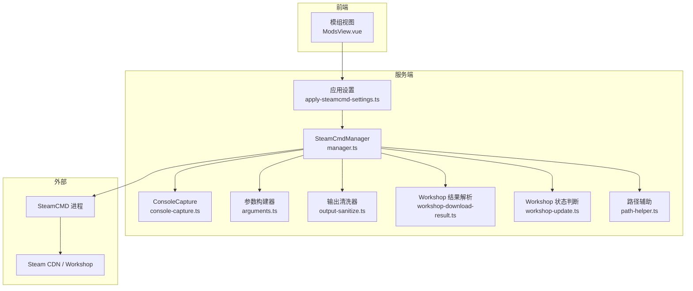
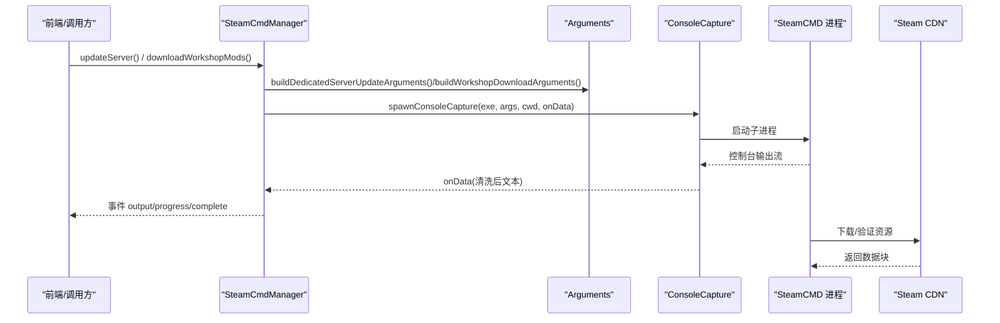
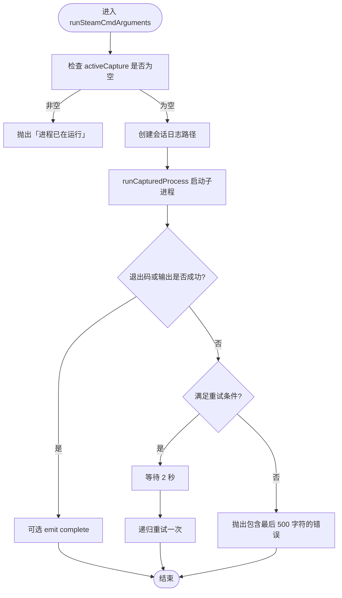
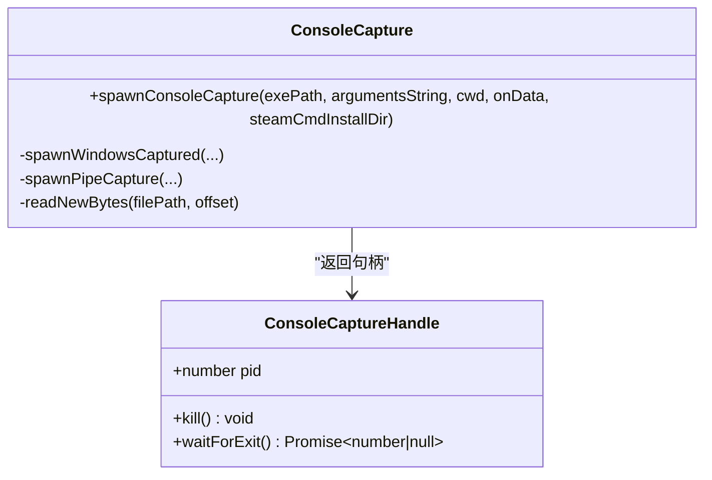
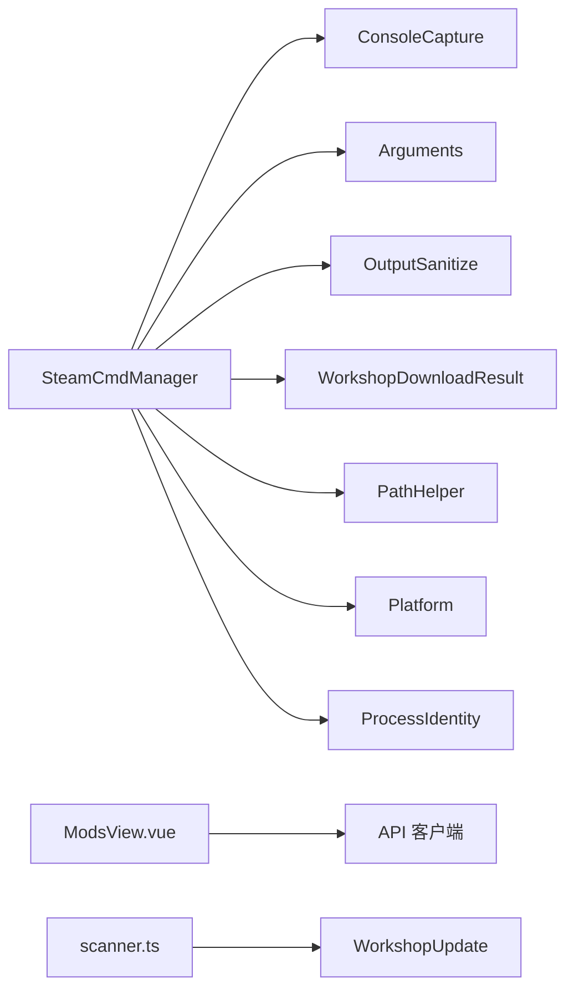
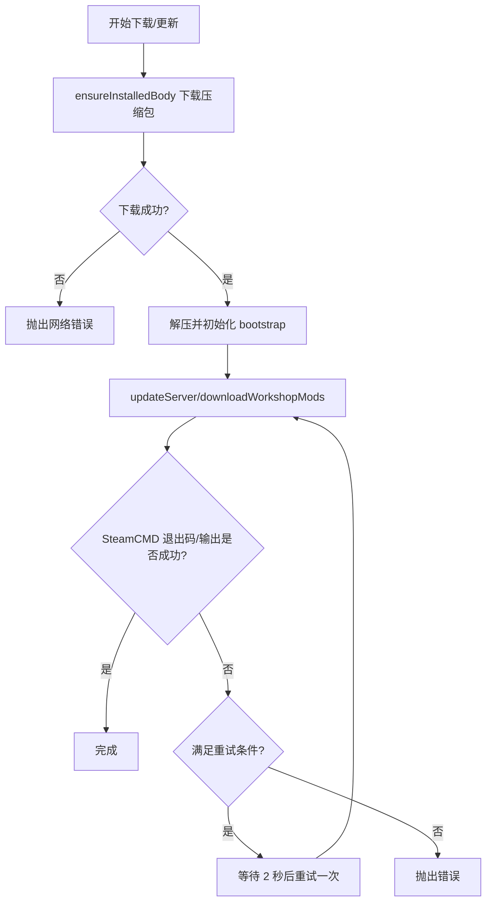
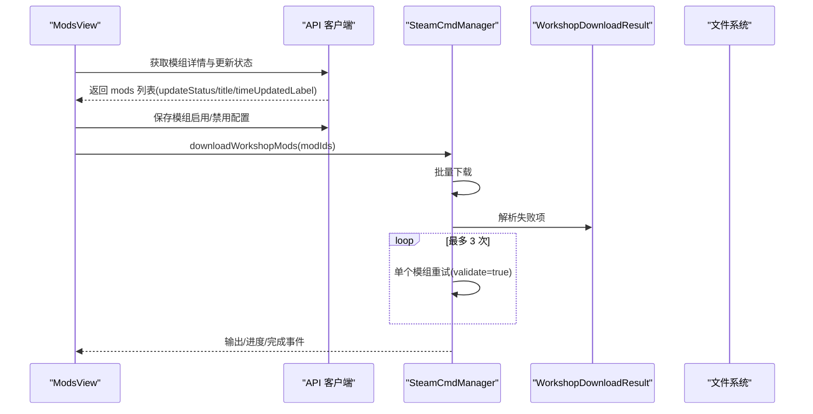

# SteamCMD 客户端

<cite>
**本文引用的文件**   
- [packages/service/src/steamcmd/manager.ts](file://packages/service/src/steamcmd/manager.ts)
- [packages/service/src/steamcmd/console-capture.ts](file://packages/service/src/steamcmd/console-capture.ts)
- [packages/service/src/steamcmd/arguments.ts](file://packages/service/src/steamcmd/arguments.ts)
- [packages/service/src/steamcmd/output-sanitize.ts](file://packages/service/src/steamcmd/output-sanitize.ts)
- [packages/service/src/steamcmd/workshop-download-result.ts](file://packages/service/src/steamcmd/workshop-download-result.ts)
- [packages/service/src/steamcmd/workshop-update.ts](file://packages/service/src/steamcmd/workshop-update.ts)
- [packages/service/src/steamcmd/path-helper.ts](file://packages/service/src/steamcmd/path-helper.ts)
- [packages/service/src/settings/apply-steamcmd-settings.ts](file://packages/service/src/settings/apply-steamcmd-settings.ts)
- [packages/web/src/views/ModsView.vue](file://packages/web/src/views/ModsView.vue)
- [packages/service/src/mods/scanner.ts](file://packages/service/src/mods/scanner.ts)
- [packages/service/src/api/sse.test.ts](file://packages/service/src/api/sse.test.ts)
</cite>

## 目录
1. [简介](#简介)
2. [项目结构](#项目结构)
3. [核心组件](#核心组件)
4. [架构总览](#架构总览)
5. [详细组件分析](#详细组件分析)
6. [依赖关系分析](#依赖关系分析)
7. [性能与并发控制](#性能与并发控制)
8. [网络超时、断点续传与重试策略](#网络超时断点续传与重试策略)
9. [模组同步与 Workshop 内容管理](#模组同步与-workshop-内容管理)
10. [故障排查指南](#故障排查指南)
11. [结论](#结论)

## 简介
本文件面向使用或扩展本项目的开发者，系统性说明 SteamCMD 客户端的集成方式、命令封装、异步任务处理、服务器下载/更新/验证流程、Workshop 模组同步与本地缓存策略，以及进度监控、错误重试、并发控制和故障恢复机制。文档以代码级实现为依据，配合架构图和流程图帮助读者快速理解并安全扩展该子系统。

## 项目结构
SteamCMD 相关能力集中在后端服务包中，主要位于 `packages/service/src/steamcmd` 目录，并与设置模块、Web 前端和模组扫描模块协作：

**图表来源** 
- [packages/service/src/steamcmd/manager.ts:50-127](file://packages/service/src/steamcmd/manager.ts#L50-L127)
- [packages/service/src/steamcmd/console-capture.ts:22-33](file://packages/service/src/steamcmd/console-capture.ts#L22-L33)
- [packages/service/src/steamcmd/arguments.ts:16-57](file://packages/service/src/steamcmd/arguments.ts#L16-L57)
- [packages/service/src/steamcmd/output-sanitize.ts:9-21](file://packages/service/src/steamcmd/output-sanitize.ts#L9-L21)
- [packages/service/src/steamcmd/workshop-download-result.ts:7-41](file://packages/service/src/steamcmd/workshop-download-result.ts#L7-L41)
- [packages/service/src/steamcmd/workshop-update.ts:39-58](file://packages/service/src/steamcmd/workshop-update.ts#L39-L58)
- [packages/service/src/steamcmd/path-helper.ts:17-55](file://packages/service/src/steamcmd/path-helper.ts#L17-L55)
- [packages/service/src/settings/apply-steamcmd-settings.ts:5-20](file://packages/service/src/settings/apply-steamcmd-settings.ts#L5-L20)
- [packages/web/src/views/ModsView.vue:339-386](file://packages/web/src/views/ModsView.vue#L339-L386)

**章节来源**
- [packages/service/src/steamcmd/manager.ts:50-127](file://packages/service/src/steamcmd/manager.ts#L50-L127)
- [packages/service/src/steamcmd/console-capture.ts:22-33](file://packages/service/src/steamcmd/console-capture.ts#L22-L33)
- [packages/service/src/steamcmd/arguments.ts:16-57](file://packages/service/src/steamcmd/arguments.ts#L16-L57)
- [packages/service/src/steamcmd/output-sanitize.ts:9-21](file://packages/service/src/steamcmd/output-sanitize.ts#L9-L21)
- [packages/service/src/steamcmd/workshop-download-result.ts:7-41](file://packages/service/src/steamcmd/workshop-download-result.ts#L7-L41)
- [packages/service/src/steamcmd/workshop-update.ts:39-58](file://packages/service/src/steamcmd/workshop-update.ts#L39-L58)
- [packages/service/src/steamcmd/path-helper.ts:17-55](file://packages/service/src/steamcmd/path-helper.ts#L17-L55)
- [packages/service/src/settings/apply-steamcmd-settings.ts:5-20](file://packages/service/src/settings/apply-steamcmd-settings.ts#L5-L20)
- [packages/web/src/views/ModsView.vue:339-386](file://packages/web/src/views/ModsView.vue#L339-L386)

## 核心组件
- SteamCmdManager：SteamCMD 业务入口，负责安装、更新、Workshop 下载、日志、取消、互斥与重试。
- ConsoleCapture：跨平台启动 SteamCMD 子进程，捕获控制台输出并暴露 kill/waitForExit。
- Arguments：构造 SteamCMD 命令行参数（专用服务器更新、Workshop 批量下载）。
- OutputSanitize：清理 ANSI 颜色码等不可见字符，保证 Web 终端可读。
- WorkshopDownloadResult：从控制台输出解析成功/失败项 ID，用于增量重试。
- WorkshopUpdate：根据远程更新时间和本地时间戳判定模组是否最新。
- PathHelper：Workshop 根目录解析与安全校验，避免写入受保护目录。
- ApplySteamCmdSettings：将用户设置应用到 SteamCmdManager。

**章节来源**
- [packages/service/src/steamcmd/manager.ts:50-127](file://packages/service/src/steamcmd/manager.ts#L50-L127)
- [packages/service/src/steamcmd/console-capture.ts:9-13](file://packages/service/src/steamcmd/console-capture.ts#L9-L13)
- [packages/service/src/steamcmd/arguments.ts:16-57](file://packages/service/src/steamcmd/arguments.ts#L16-L57)
- [packages/service/src/steamcmd/output-sanitize.ts:9-21](file://packages/service/src/steamcmd/output-sanitize.ts#L9-L21)
- [packages/service/src/steamcmd/workshop-download-result.ts:7-41](file://packages/service/src/steamcmd/workshop-download-result.ts#L7-L41)
- [packages/service/src/steamcmd/workshop-update.ts:39-58](file://packages/service/src/steamcmd/workshop-update.ts#L39-L58)
- [packages/service/src/steamcmd/path-helper.ts:17-55](file://packages/service/src/steamcmd/path-helper.ts#L17-L55)
- [packages/service/src/settings/apply-steamcmd-settings.ts:5-20](file://packages/service/src/settings/apply-steamcmd-settings.ts#L5-L20)

## 架构总览
SteamCMD 客户端采用“管理器 + 子进程捕获 + 参数构建 + 结果解析”的分层设计。上层通过 SteamCmdManager 暴露统一 API；内部通过 ConsoleCapture 启动真实 SteamCMD 进程；参数由 Arguments 生成；输出经 OutputSanitize 清洗后向上广播；Workshop 下载结果由 WorkshopDownloadResult 解析，驱动重试逻辑。

**图表来源**
- [packages/service/src/steamcmd/manager.ts:237-249](file://packages/service/src/steamcmd/manager.ts#L237-L249)
- [packages/service/src/steamcmd/manager.ts:253-349](file://packages/service/src/steamcmd/manager.ts#L253-L349)
- [packages/service/src/steamcmd/arguments.ts:16-57](file://packages/service/src/steamcmd/arguments.ts#L16-L57)
- [packages/service/src/steamcmd/console-capture.ts:22-33](file://packages/service/src/steamcmd/console-capture.ts#L22-L33)

## 详细组件分析

### SteamCmdManager：任务编排、互斥与重试
- 职责
  - 安装/初始化 SteamCMD：下载压缩包、解压、执行 bootstrap 更新、权限设置。
  - 更新专用服务器：组装 app_update 参数并运行。
  - 下载 Workshop 模组：批量下载 + 失败项单独重试。
  - 生命周期：kill、requestAbort、clearAbort、isAborted。
  - 日志：会话日志写入、最近日志读取、聚合输出。
- 关键行为
  - withExclusiveLock：全局互斥，防止同时多个 SteamCMD 业务操作。
  - runSteamCmdArguments：统一执行入口，支持 isWorkshop/isAppUpdate/emitComplete 标志，内置一次条件重试。
  - shouldRetrySteamCmd：当退出码为 7 且出现特定提示时触发重试。
  - isSteamCmdOutputSuccess：按场景判断成功（含 App 233780 Success、fully installed/already up to date、Workshop Success）。
  - purgeOrphanSteamCmdProcesses：清理残留进程，避免目录占用。

**图表来源**
- [packages/service/src/steamcmd/manager.ts:376-440](file://packages/service/src/steamcmd/manager.ts#L376-L440)
- [packages/service/src/steamcmd/manager.ts:442-469](file://packages/service/src/steamcmd/manager.ts#L442-L469)
- [packages/service/src/steamcmd/manager.ts:504-535](file://packages/service/src/steamcmd/manager.ts#L504-L535)

**章节来源**
- [packages/service/src/steamcmd/manager.ts:129-209](file://packages/service/src/steamcmd/manager.ts#L129-L209)
- [packages/service/src/steamcmd/manager.ts:237-349](file://packages/service/src/steamcmd/manager.ts#L237-L349)
- [packages/service/src/steamcmd/manager.ts:355-367](file://packages/service/src/steamcmd/manager.ts#L355-L367)
- [packages/service/src/steamcmd/manager.ts:376-440](file://packages/service/src/steamcmd/manager.ts#L376-L440)
- [packages/service/src/steamcmd/manager.ts:504-535](file://packages/service/src/steamcmd/manager.ts#L504-L535)
- [packages/service/src/steamcmd/manager.ts:593-619](file://packages/service/src/steamcmd/manager.ts#L593-L619)

### ConsoleCapture：跨平台子进程捕获
- Windows 模式：以静默方式启动，轮询 console_log.txt 增量读取新字节，避免管道重定向问题。
- Unix 模式：直接 pipe stdout/stderr，逐行转发。
- 统一接口：pid、kill、waitForExit，并在退出前短暂 drain，确保尾部输出完整。

**图表来源**
- [packages/service/src/steamcmd/console-capture.ts:9-13](file://packages/service/src/steamcmd/console-capture.ts#L9-L13)
- [packages/service/src/steamcmd/console-capture.ts:22-33](file://packages/service/src/steamcmd/console-capture.ts#L22-L33)
- [packages/service/src/steamcmd/console-capture.ts:35-108](file://packages/service/src/steamcmd/console-capture.ts#L35-L108)
- [packages/service/src/steamcmd/console-capture.ts:110-173](file://packages/service/src/steamcmd/console-capture.ts#L110-L173)
- [packages/service/src/steamcmd/console-capture.ts:182-199](file://packages/service/src/steamcmd/console-capture.ts#L182-L199)

**章节来源**
- [packages/service/src/steamcmd/console-capture.ts:22-33](file://packages/service/src/steamcmd/console-capture.ts#L22-L33)
- [packages/service/src/steamcmd/console-capture.ts:35-108](file://packages/service/src/steamcmd/console-capture.ts#L35-L108)
- [packages/service/src/steamcmd/console-capture.ts:110-173](file://packages/service/src/steamcmd/console-capture.ts#L110-L173)
- [packages/service/src/steamcmd/console-capture.ts:182-199](file://packages/service/src/steamcmd/console-capture.ts#L182-L199)

### Arguments：命令参数构建
- 专用服务器更新：Linux 使用 validate，Windows 额外带 creatordlc beta 分支。
- Workshop 批量下载：支持可选 validate 模式，自动去重 modId，末尾 +quit。
- 密码脱敏：日志中替换密码为占位符。

**章节来源**
- [packages/service/src/steamcmd/arguments.ts:16-57](file://packages/service/src/steamcmd/arguments.ts#L16-L57)
- [packages/service/src/steamcmd/arguments.ts:59-77](file://packages/service/src/steamcmd/arguments.ts#L59-L77)

### OutputSanitize：输出清洗
- 去除 ANSI CSI、孤立 SGR、孤立 ESC 等控制序列，统一换行符，保障 Web 终端渲染稳定。

**章节来源**
- [packages/service/src/steamcmd/output-sanitize.ts:9-21](file://packages/service/src/steamcmd/output-sanitize.ts#L9-L21)

### WorkshopDownloadResult：下载结果解析
- 从控制台输出提取成功/失败项 ID，计算未成功请求集合，供上层进行逐项重试。

**章节来源**
- [packages/service/src/steamcmd/workshop-download-result.ts:7-41](file://packages/service/src/steamcmd/workshop-download-result.ts#L7-L41)
- [packages/service/src/steamcmd/workshop-download-result.ts:43-57](file://packages/service/src/steamcmd/workshop-download-result.ts#L43-L57)

### WorkshopUpdate：更新状态判定
- 基于远程更新时间与本地 mtime/updatedAt 比较，给出 missing/up_to_date/outdated/unknown 状态，并提供中文标签。

**章节来源**
- [packages/service/src/steamcmd/workshop-update.ts:39-58](file://packages/service/src/steamcmd/workshop-update.ts#L39-L58)
- [packages/service/src/steamcmd/workshop-update.ts:60-71](file://packages/service/src/steamcmd/workshop-update.ts#L60-L71)

### PathHelper：Workshop 根目录解析
- 优先使用已配置根，其次从扫描路径推导，最终回落到 extension 目录。
- 阻止写入 applicationBase 下的路径，避免覆盖应用本体。

**章节来源**
- [packages/service/src/steamcmd/path-helper.ts:17-55](file://packages/service/src/steamcmd/path-helper.ts#L17-L55)
- [packages/service/src/steamcmd/path-helper.ts:57-87](file://packages/service/src/steamcmd/path-helper.ts#L57-L87)

### ApplySteamCmdSettings：设置应用
- 将用户设置的 workshopRoot/serverInstallPath/username/password 应用到 SteamCmdManager。

**章节来源**
- [packages/service/src/settings/apply-steamcmd-settings.ts:5-20](file://packages/service/src/settings/apply-steamcmd-settings.ts#L5-L20)

## 依赖关系分析
- SteamCmdManager 依赖：
  - ConsoleCapture：子进程启动与输出捕获。
  - Arguments：参数构建。
  - OutputSanitize：输出清洗。
  - WorkshopDownloadResult：解析失败项。
  - PathHelper：Workshop 根路径解析。
  - Platform：平台检测、SteamCMD 路径与下载 URL。
  - ProcessIdentity：进程树终止。
- 前端 ModsView 依赖：
  - 通过 API 客户端提交任务、查询模组详情与更新状态。
- 模组扫描 scanner 提供本地模组元信息，辅助更新状态展示。

**图表来源**
- [packages/service/src/steamcmd/manager.ts:1-32](file://packages/service/src/steamcmd/manager.ts#L1-L32)
- [packages/web/src/views/ModsView.vue:521-566](file://packages/web/src/views/ModsView.vue#L521-L566)
- [packages/service/src/mods/scanner.ts:248-296](file://packages/service/src/mods/scanner.ts#L248-L296)

**章节来源**
- [packages/service/src/steamcmd/manager.ts:1-32](file://packages/service/src/steamcmd/manager.ts#L1-L32)
- [packages/web/src/views/ModsView.vue:521-566](file://packages/web/src/views/ModsView.vue#L521-L566)
- [packages/service/src/mods/scanner.ts:248-296](file://packages/service/src/mods/scanner.ts#L248-L296)

## 性能与并发控制
- 全局互斥：withExclusiveLock 保证同一时刻仅一个 SteamCMD 业务操作，避免多进程竞争导致的状态不一致。
- 子进程隔离：activeCapture 与 killProcessTree 确保旧进程被清理，避免目录占用。
- 输出缓冲限制：sessionOutput 最大长度限制，避免内存无限增长。
- 批量下载优化：先批量下载，再对失败项逐个重试，减少重复登录与握手开销。
- 建议
  - 大体积模组（如地形类）建议分批下载，降低单次任务失败影响面。
  - 合理设置工作目录到高速磁盘，减少 I/O 瓶颈。
  - 在低带宽环境下优先使用 validate 模式，利用 SteamCDN 增量校验。

[本节为通用指导，不直接分析具体文件]

## 网络超时、断点续传与重试策略
- 下载 SteamCMD 压缩包：
  - 使用代理抓取，设置较长超时；分块写入文件，实时计算百分比进度。
- Bootstrap 初始化：
  - 独立超时计时器，异常时主动 kill 子进程，避免卡死。
- SteamCMD 子进程：
  - 统一 runSteamCmdArguments 内对特定退出码与输出进行最多一次重试，间隔 2 秒。
- Workshop 批量下载：
  - 若存在失败项，最多进行 3 次单独重试，每次间隔 1.5 秒，并开启 validate 增强校验。
- 断点续传：
  - 依赖 SteamCMD 自身机制；本客户端通过 validate 与增量日志定位未完成项，间接实现“断点续传”。

**图表来源**
- [packages/service/src/steamcmd/manager.ts:135-209](file://packages/service/src/steamcmd/manager.ts#L135-L209)
- [packages/service/src/steamcmd/manager.ts:211-234](file://packages/service/src/steamcmd/manager.ts#L211-L234)
- [packages/service/src/steamcmd/manager.ts:376-440](file://packages/service/src/steamcmd/manager.ts#L376-L440)
- [packages/service/src/steamcmd/manager.ts:253-349](file://packages/service/src/steamcmd/manager.ts#L253-L349)

**章节来源**
- [packages/service/src/steamcmd/manager.ts:135-209](file://packages/service/src/steamcmd/manager.ts#L135-L209)
- [packages/service/src/steamcmd/manager.ts:211-234](file://packages/service/src/steamcmd/manager.ts#L211-L234)
- [packages/service/src/steamcmd/manager.ts:376-440](file://packages/service/src/steamcmd/manager.ts#L376-L440)
- [packages/service/src/steamcmd/manager.ts:253-349](file://packages/service/src/steamcmd/manager.ts#L253-L349)

## 模组同步与 Workshop 内容管理
- 前端交互：
  - ModsView 收集启用/禁用列表，调用 API 保存模组配置，并拉取 Workshop 模组详情与更新状态。
- 本地元数据：
  - scanner 读取 meta.cpp 中的 publishedid/name/timestamp，结合文件系统 mtime 推断更新时间。
- 更新状态：
  - workshop-update 根据远程更新时间与本地时间戳判定是否 outdated，并提供中文标签。
- 下载流程：
  - manager.downloadWorkshopMods 批量下载，失败项单独重试，validate 模式增强一致性。

**图表来源**
- [packages/web/src/views/ModsView.vue:339-386](file://packages/web/src/views/ModsView.vue#L339-L386)
- [packages/web/src/views/ModsView.vue:521-566](file://packages/web/src/views/ModsView.vue#L521-L566)
- [packages/service/src/steamcmd/manager.ts:253-349](file://packages/service/src/steamcmd/manager.ts#L253-L349)
- [packages/service/src/steamcmd/workshop-download-result.ts:7-41](file://packages/service/src/steamcmd/workshop-download-result.ts#L7-L41)
- [packages/service/src/mods/scanner.ts:248-296](file://packages/service/src/mods/scanner.ts#L248-L296)

**章节来源**
- [packages/web/src/views/ModsView.vue:339-386](file://packages/web/src/views/ModsView.vue#L339-L386)
- [packages/web/src/views/ModsView.vue:521-566](file://packages/web/src/views/ModsView.vue#L521-L566)
- [packages/service/src/steamcmd/manager.ts:253-349](file://packages/service/src/steamcmd/manager.ts#L253-L349)
- [packages/service/src/steamcmd/workshop-download-result.ts:7-41](file://packages/service/src/steamcmd/workshop-download-result.ts#L7-L41)
- [packages/service/src/mods/scanner.ts:248-296](file://packages/service/src/mods/scanner.ts#L248-L296)

## 故障排查指南
- 常见错误与定位
  - 无法下载 SteamCMD：检查域名是否被 hosts 拦截、能否访问 Steam CDN、HTTPS_PROXY 配置；也可手动放置压缩包。
  - SteamCMD 初始化未完成：确认 public 资源可访问，必要时重试。
  - Workshop 下载失败：查看会话日志末尾 500 字符；大体积模组建议单独重试。
  - 账号未配置：请在设置中填写用户名和密码。
- 日志与调试
  - 会话日志：manager.writeSessionLogFile 记录程序、参数、退出码、成功标记与 console 片段。
  - 最近日志：getAggregatedLog 优先返回内存中 sessionOutput，否则读取最新日志尾部。
  - 输出清洗：sanitizeSteamCmdOutput 去除 ANSI 控制符，便于 Web 终端显示。
- 进程与取消
  - requestAbort：设置 _aborted 并提升 runId，使旧协程失效；kill 当前进程并清理孤儿。
  - clearAbort：允许新的操作继续。
  - purgeOrphanSteamCmdProcesses：清理残留进程，避免目录占用。

**章节来源**
- [packages/service/src/steamcmd/manager.ts:146-151](file://packages/service/src/steamcmd/manager.ts#L146-L151)
- [packages/service/src/steamcmd/manager.ts:197-209](file://packages/service/src/steamcmd/manager.ts#L197-L209)
- [packages/service/src/steamcmd/manager.ts:369-373](file://packages/service/src/steamcmd/manager.ts#L369-L373)
- [packages/service/src/steamcmd/manager.ts:476-502](file://packages/service/src/steamcmd/manager.ts#L476-L502)
- [packages/service/src/steamcmd/manager.ts:542-574](file://packages/service/src/steamcmd/manager.ts#L542-L574)
- [packages/service/src/steamcmd/manager.ts:593-619](file://packages/service/src/steamcmd/manager.ts#L593-L619)
- [packages/service/src/steamcmd/output-sanitize.ts:9-21](file://packages/service/src/steamcmd/output-sanitize.ts#L9-L21)

## 结论
本 SteamCMD 客户端通过清晰的职责划分与稳健的进程管理，实现了可靠的服务器下载、更新与 Workshop 模组同步。其关键优势包括：
- 全局互斥与进程清理，避免并发冲突与僵尸进程。
- 统一的参数构建与输出清洗，保证跨平台一致性与 Web 可读性。
- 分层重试与失败项单独重试，提高大体积模组的成功率。
- 完善的日志与错误提示，便于快速定位问题。
在实际使用中，建议结合网络环境与磁盘性能调优批量大小与重试策略，并充分利用 validate 模式提升增量更新效率。