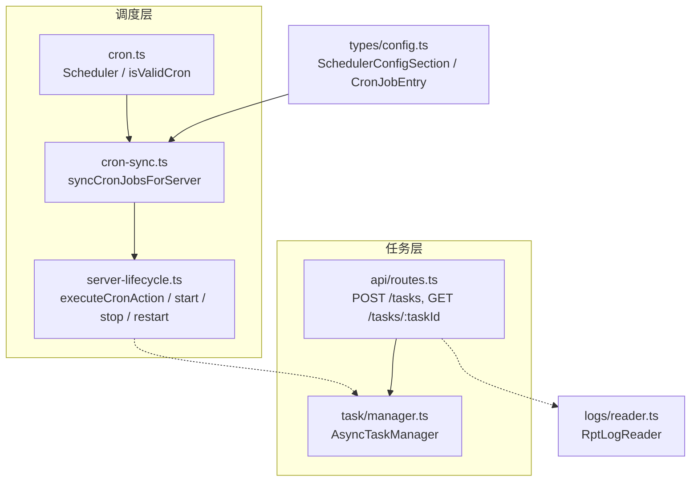
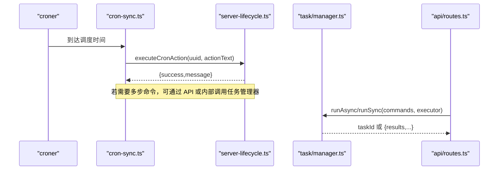
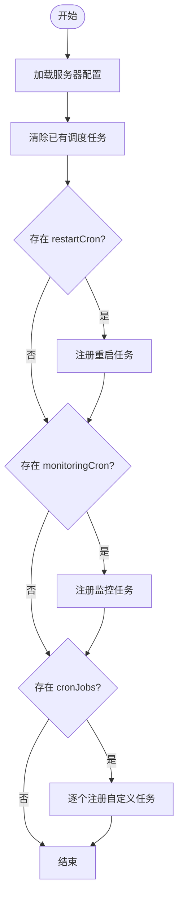
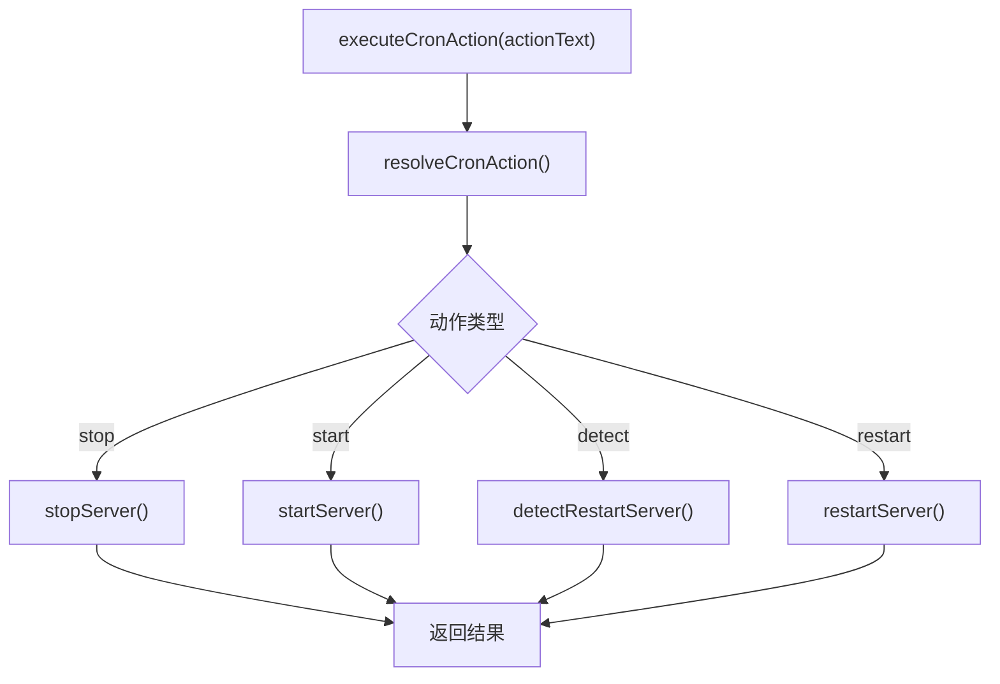
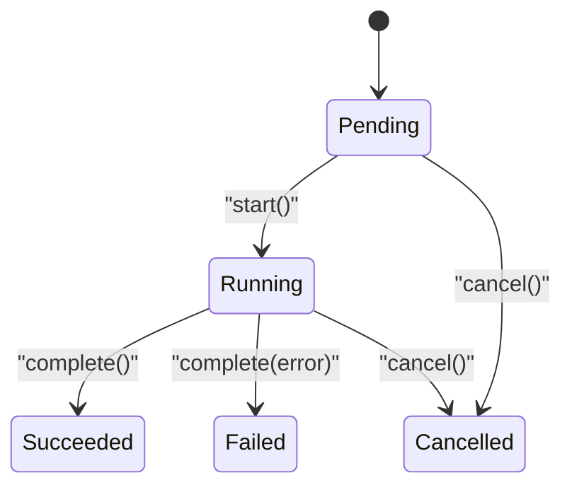
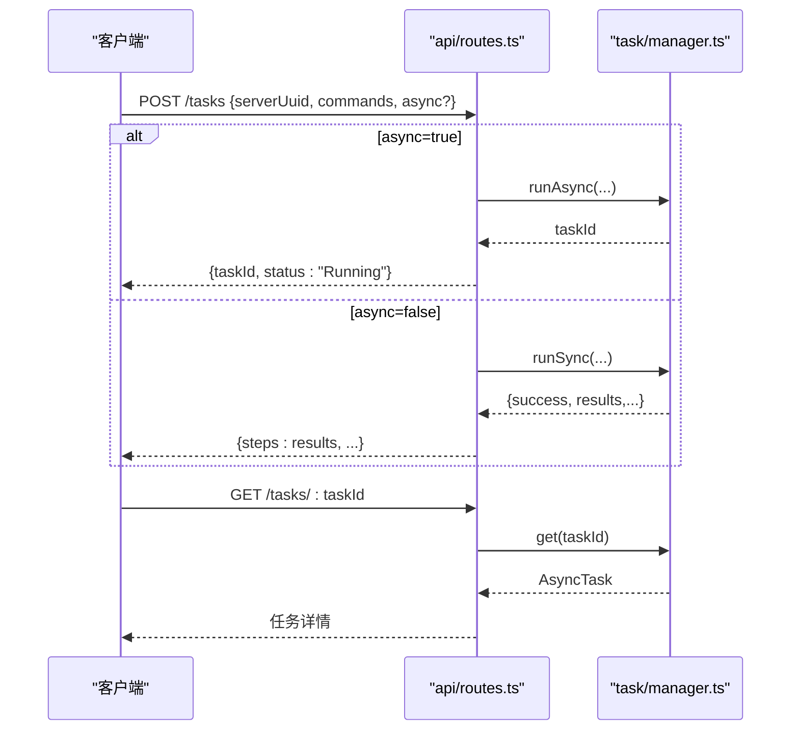
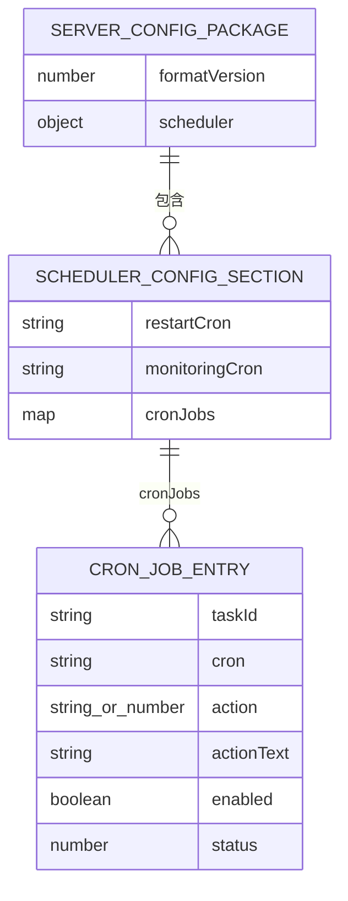
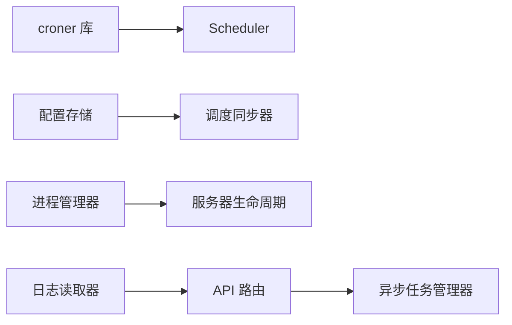
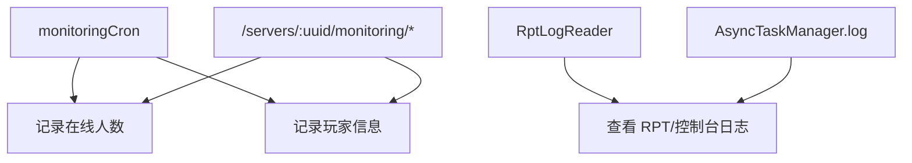

# 任务调度器

<cite>
**本文引用的文件**   
- [README.md](file://README.md)
- [cron.ts](file://packages/service/src/scheduling/cron.ts)
- [cron-sync.ts](file://packages/service/src/scheduling/cron-sync.ts)
- [server-lifecycle.ts](file://packages/service/src/scheduling/server-lifecycle.ts)
- [index.ts（调度导出）](file://packages/service/src/scheduling/index.ts)
- [config.ts（配置类型）](file://packages/service/src/types/config.ts)
- [manager.ts（异步任务管理器）](file://packages/service/src/task/manager.ts)
- [routes.ts（任务路由）](file://packages/service/src/api/routes.ts)
- [reader.ts（日志读取器）](file://packages/service/src/logs/reader.ts)
</cite>

## 目录
1. [简介](#简介)
2. [项目结构](#项目结构)
3. [核心组件](#核心组件)
4. [架构总览](#架构总览)
5. [详细组件分析](#详细组件分析)
6. [依赖关系分析](#依赖关系分析)
7. [性能与并发特性](#性能与并发特性)
8. [监控、日志与可观测性](#监控日志与可观测性)
9. [故障排查指南](#故障排查指南)
10. [编排模式与最佳实践](#编排模式与最佳实践)
11. [结论](#结论)

## 简介
本文件面向 Arma 3 服务器管理工具 v2 的任务调度子系统，系统性说明定时任务执行、任务队列管理与并发控制机制。重点覆盖：
- Cron 表达式解析与校验
- 任务优先级与串行化执行
- 执行状态跟踪与结果记录
- 异步任务处理、取消与失败处理
- 错误重试与失败补偿策略建议
- 任务监控、日志记录与性能分析
- 任务编排模式与最佳实践

该子系统由“定时调度层”和“异步任务层”组成：前者负责按 Cron 表达式触发操作，后者负责将一组命令作为任务串行执行并追踪状态。

**章节来源**
- [README.md:37-47](file://README.md#L37-L47)

## 项目结构
调度相关代码集中在后端服务包中，主要涉及以下模块：
- 调度核心：Cron 表达式校验、任务注册与生命周期管理
- 调度同步：从服务器配置加载调度项，映射到具体动作
- 服务器生命周期：启动、停止、重启、检测等动作实现
- 异步任务管理器：任务创建、状态机、步骤记录、取消与完成
- API 路由：任务提交、查询、异步/同步执行入口
- 配置类型：调度配置、任务条目、服务器配置结构
- 日志读取：RPT 与控制台日志采集



**图表来源**
- [cron.ts:1-100](file://packages/service/src/scheduling/cron.ts#L1-L100)
- [cron-sync.ts:1-126](file://packages/service/src/scheduling/cron-sync.ts#L1-L126)
- [server-lifecycle.ts:1-270](file://packages/service/src/scheduling/server-lifecycle.ts#L1-L270)
- [manager.ts:1-237](file://packages/service/src/task/manager.ts#L1-L237)
- [routes.ts:1038-1074](file://packages/service/src/api/routes.ts#L1038-L1074)
- [config.ts:99-127](file://packages/service/src/types/config.ts#L99-L127)
- [reader.ts:109-139](file://packages/service/src/logs/reader.ts#L109-L139)

**章节来源**
- [README.md:50-66](file://README.md#L50-L66)

## 核心组件
- Scheduler（基于 croner）：提供 Cron 表达式校验、任务注册、移除、清空与列表能力；保证单个非法表达式不会导致服务崩溃。
- 调度同步器：从服务器配置读取 scheduler.restartCron、scheduler.monitoringCron、scheduler.cronJobs，并映射为具体动作（重启、监控采集、自定义任务）。
- 服务器生命周期：封装启动、停止、重启、检测逻辑，并提供 executeCronAction 供调度器调用。
- AsyncTaskManager：维护任务状态机（Pending/Running/Succeeded/Failed/Cancelled），支持同步 runSync 与异步 runAsync，记录每步结果与日志。
- API 路由：统一任务提交接口，支持 async 标志选择异步执行，返回 taskId 或步骤结果。
- 配置类型：定义 SchedulerConfigSection、CronJobEntry 等结构，支撑调度配置的结构化。

**章节来源**
- [cron.ts:1-100](file://packages/service/src/scheduling/cron.ts#L1-L100)
- [cron-sync.ts:1-126](file://packages/service/src/scheduling/cron-sync.ts#L1-L126)
- [server-lifecycle.ts:239-270](file://packages/service/src/scheduling/server-lifecycle.ts#L239-L270)
- [manager.ts:1-237](file://packages/service/src/task/manager.ts#L1-L237)
- [routes.ts:1038-1074](file://packages/service/src/api/routes.ts#L1038-L1074)
- [config.ts:99-127](file://packages/service/src/types/config.ts#L99-L127)

## 架构总览
下图展示一次定时触发的完整流程：Cron 触发 → 调度同步器 → 生命周期动作 → 可选地通过任务管理器执行多步命令。



**图表来源**
- [cron-sync.ts:15-114](file://packages/service/src/scheduling/cron-sync.ts#L15-L114)
- [server-lifecycle.ts:239-270](file://packages/service/src/scheduling/server-lifecycle.ts#L239-L270)
- [manager.ts:159-233](file://packages/service/src/task/manager.ts#L159-L233)
- [routes.ts:1038-1074](file://packages/service/src/api/routes.ts#L1038-L1074)

## 详细组件分析

### 定时调度器 Scheduler
- Cron 表达式校验：isValidCron 使用 croner 进行探测式实例化，不实际调度，仅验证合法性。
- 任务注册 add：先校验表达式，再移除同名旧任务，创建 Cron 实例并包装 handler，确保 handler 异常不会泄漏未处理的拒绝。
- 任务管理：remove 停止并清理；clear 批量停止；list 暴露当前已注册任务名与表达式。
- 内置常量：提供常用 Cron 表达式与服务器重启表达式生成器。

```mermaid
classDiagram
class Scheduler {
- Map~string,Cron~ jobs
- Map~string,string~ schedules
+ add(def) boolean
+ remove(name) void
+ clear() void
+ list() {name,schedule}[]
}
class CronJobDef {
+ string name
+ string schedule
+ handler()
}
Scheduler --> CronJobDef : "注册"
```

**图表来源**
- [cron.ts:25-79](file://packages/service/src/scheduling/cron.ts#L25-L79)

**章节来源**
- [cron.ts:1-100](file://packages/service/src/scheduling/cron.ts#L1-L100)

### 调度同步器 syncCronJobsForServer
- 行为：根据服务器配置清除已有调度任务，然后依次注册：
  - restartCron：触发服务器重启
  - monitoringCron：在线人数统计与玩家记录
  - cronJobs：用户自定义任务，按 enabled/status 启用
- 容错：非法 Cron 表达式会被跳过并记录在 skipped 列表中，不影响其他任务。
- 批量同步：syncAllCronJobs 遍历所有服务器并汇总成功数量。



**图表来源**
- [cron-sync.ts:15-114](file://packages/service/src/scheduling/cron-sync.ts#L15-L114)

**章节来源**
- [cron-sync.ts:1-126](file://packages/service/src/scheduling/cron-sync.ts#L1-L126)

### 服务器生命周期 executeCronAction
- 动作解析：resolveCronAction 支持数字与中英文关键字（start/stop/detect/restart）。
- 动作执行：
  - stop：安全停止进程（含 PID 身份校验与孤儿进程保护）
  - start：构建命令行、防双实例、端口就绪检查
  - detect：检测到运行则接管，否则启动
  - restart：先停后启
- 调度入口：executeCronAction 将文本动作映射到上述方法。



**图表来源**
- [server-lifecycle.ts:239-270](file://packages/service/src/scheduling/server-lifecycle.ts#L239-L270)

**章节来源**
- [server-lifecycle.ts:58-237](file://packages/service/src/scheduling/server-lifecycle.ts#L58-L237)
- [server-lifecycle.ts:239-270](file://packages/service/src/scheduling/server-lifecycle.ts#L239-L270)

### 异步任务管理器 AsyncTaskManager
- 状态机：Pending → Running → Succeeded/Failed/Cancelled
- 关键方法：
  - create/start/complete/appendStep/cancel/cancelAllRunning/cancelSteamCmdRelatedRunning
  - runSync：串行执行命令，遇失败即停止
  - runAsync：后台执行，支持取消、异常捕获、步骤记录
- 取消语义：对包含 SteamCMD 的任务提供专用取消集合，避免误杀无关长任务。



**图表来源**
- [manager.ts:3-157](file://packages/service/src/task/manager.ts#L3-L157)

**章节来源**
- [manager.ts:1-237](file://packages/service/src/task/manager.ts#L1-L237)

### API 任务路由
- POST /tasks：接收 serverUuid、commands、async 等字段；
  - async=true：调用 runAsync，返回 taskId 与 Running 状态
  - async=false：调用 runSync，直接返回 steps/results
- GET /tasks/:taskId：查询任务状态与结果



**图表来源**
- [routes.ts:1038-1074](file://packages/service/src/api/routes.ts#L1038-L1074)
- [manager.ts:159-233](file://packages/service/src/task/manager.ts#L159-L233)

**章节来源**
- [routes.ts:1038-1074](file://packages/service/src/api/routes.ts#L1038-L1074)

### 配置模型（调度相关）
- SchedulerConfigSection：包含 restartCron、monitoringCron、cronJobs
- CronJobEntry：包含 taskId、cron、action/actionText、enabled/status 等
- ServerConfigPackage：顶层配置对象，承载 scheduler 字段



**图表来源**
- [config.ts:12-24](file://packages/service/src/types/config.ts#L12-L24)
- [config.ts:99-127](file://packages/service/src/types/config.ts#L99-L127)

**章节来源**
- [config.ts:99-127](file://packages/service/src/types/config.ts#L99-L127)

## 依赖关系分析
- Scheduler 依赖 croner 库进行 Cron 解析与调度。
- 调度同步器依赖配置存储与进程管理器，以读取配置并触发生命周期动作。
- 任务管理器独立于调度层，通过 API 路由被外部调用，也可被生命周期动作间接使用。
- 日志读取器用于 RPT 与控制台日志的列举与读取，辅助问题定位。



**图表来源**
- [cron.ts:1-100](file://packages/service/src/scheduling/cron.ts#L1-L100)
- [cron-sync.ts:1-126](file://packages/service/src/scheduling/cron-sync.ts#L1-L126)
- [server-lifecycle.ts:1-270](file://packages/service/src/scheduling/server-lifecycle.ts#L1-L270)
- [manager.ts:1-237](file://packages/service/src/task/manager.ts#L1-L237)
- [routes.ts:1038-1074](file://packages/service/src/api/routes.ts#L1038-L1074)
- [reader.ts:109-139](file://packages/service/src/logs/reader.ts#L109-L139)

**章节来源**
- [cron.ts:1-100](file://packages/service/src/scheduling/cron.ts#L1-L100)
- [cron-sync.ts:1-126](file://packages/service/src/scheduling/cron-sync.ts#L1-L126)
- [server-lifecycle.ts:1-270](file://packages/service/src/scheduling/server-lifecycle.ts#L1-L270)
- [manager.ts:1-237](file://packages/service/src/task/manager.ts#L1-L237)
- [routes.ts:1038-1074](file://packages/service/src/api/routes.ts#L1038-L1074)
- [reader.ts:109-139](file://packages/service/src/logs/reader.ts#L109-L139)

## 性能与并发特性
- Cron 调度：每个任务独立 Cron 实例，互不阻塞；handler 异常被包裹，避免影响调度器。
- 任务执行：
  - runSync：单线程串行执行命令，遇到失败立即停止，适合短耗时、强一致性的操作。
  - runAsync：后台执行，逐条命令追加步骤与日志；支持取消与异常捕获。
- 并发控制：
  - 同一任务的命令串行执行，避免竞争。
  - 不同任务之间无全局锁，但需注意共享资源（如进程、端口、磁盘）的冲突。
- 优化建议：
  - 对 I/O 密集任务使用 runAsync，避免阻塞事件循环。
  - 合理拆分命令粒度，便于失败定位与重试。
  - 对高频 Cron 任务设置足够间隔，避免频繁 I/O。

[本节为通用指导，不涉及具体文件分析]

## 监控、日志与可观测性
- 监控采集：monitoringCron 会统计在线人数并记录玩家信息，同时提供 REST 接口获取摘要、趋势与玩家列表。
- 日志读取：RptLogReader 支持列举 RPT 与控制台日志，便于定位启动失败、端口未监听等问题。
- 任务日志：AsyncTaskManager 为每个任务维护 results 与 log 数组，记录每一步的成功/失败与消息。



**图表来源**
- [cron-sync.ts:45-79](file://packages/service/src/scheduling/cron-sync.ts#L45-L79)
- [routes.ts:697-727](file://packages/service/src/api/routes.ts#L697-L727)
- [reader.ts:109-139](file://packages/service/src/logs/reader.ts#L109-L139)
- [manager.ts:130-157](file://packages/service/src/task/manager.ts#L130-L157)

**章节来源**
- [cron-sync.ts:45-79](file://packages/service/src/scheduling/cron-sync.ts#L45-L79)
- [routes.ts:697-727](file://packages/service/src/api/routes.ts#L697-L727)
- [reader.ts:109-139](file://packages/service/src/logs/reader.ts#L109-L139)
- [manager.ts:130-157](file://packages/service/src/task/manager.ts#L130-L157)

## 故障排查指南
- Cron 表达式无效：
  - 现象：调度同步返回“已跳过非法表达式”，对应任务未注册。
  - 处理：修正表达式或使用 isValidCron 预校验。
- 服务器启动失败：
  - 现象：端口未监听或进程退出。
  - 处理：检查 server.cfg 是否写入、可执行文件是否存在、端口是否被占用；查看 RPT 日志。
- 任务失败：
  - 现象：runSync 返回失败，runAsync 状态为 Failed。
  - 处理：查看任务 steps/log，定位失败步骤；必要时重试或调整命令顺序。
- 进程残留或 PID 复用：
  - 现象：停止时提示 PID 非本服务器进程。
  - 处理：系统清理残留进程；重新“启动”以接管。

**章节来源**
- [cron-sync.ts:106-114](file://packages/service/src/scheduling/cron-sync.ts#L106-L114)
- [server-lifecycle.ts:114-212](file://packages/service/src/scheduling/server-lifecycle.ts#L114-L212)
- [manager.ts:159-233](file://packages/service/src/task/manager.ts#L159-L233)
- [reader.ts:109-139](file://packages/service/src/logs/reader.ts#L109-L139)

## 编排模式与最佳实践
- 定时重启：
  - 使用 restartCron 配置每日固定时段重启，结合 stringifyServerRestart 生成表达式。
  - 建议在低峰期执行，避免影响玩家体验。
- 监控采集：
  - 使用 monitoringCron 周期性采集在线人数与玩家信息，配合监控接口可视化。
  - 注意频率不宜过高，避免频繁 RCon 请求。
- 自定义任务：
  - 通过 cronJobs 定义多个任务，使用 actionText 指定动作（start/stop/detect/restart）。
  - 对复杂操作拆分为多条命令，利用 runAsync 后台执行，并通过 taskId 轮询状态。
- 错误重试与失败补偿：
  - 当前未内置自动重试；可在上层业务逻辑中根据任务状态与错误信息进行重试。
  - 对于幂等操作（如写配置），可设计补偿逻辑确保最终一致性。
- 并发与隔离：
  - 同一服务器的任务尽量串行执行，避免端口/进程冲突。
  - 跨服务器任务可并行，但需关注共享资源（磁盘、网络）争用。
- 可观测性：
  - 充分利用任务日志与 RPT 日志，结合监控接口进行排障。
  - 对关键任务增加告警与审计记录。

[本节为通用指导，不涉及具体文件分析]

## 结论
该任务调度器通过 Cron 表达式驱动定时任务，结合异步任务管理器实现命令的串行化执行与状态跟踪。其设计强调健壮性（非法表达式不崩溃、handler 异常隔离）、可观测性（任务日志与监控数据）与可扩展性（自定义任务与动作）。在生产环境中，建议结合业务需求制定合理的调度频率、任务拆分与重试补偿策略，并充分利用日志与监控接口提升运维效率。

[本节为总结性内容，不涉及具体文件分析]