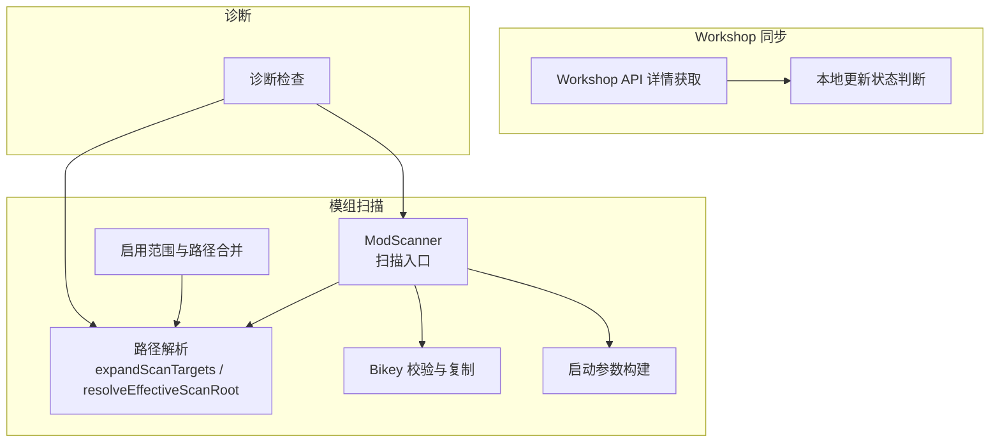
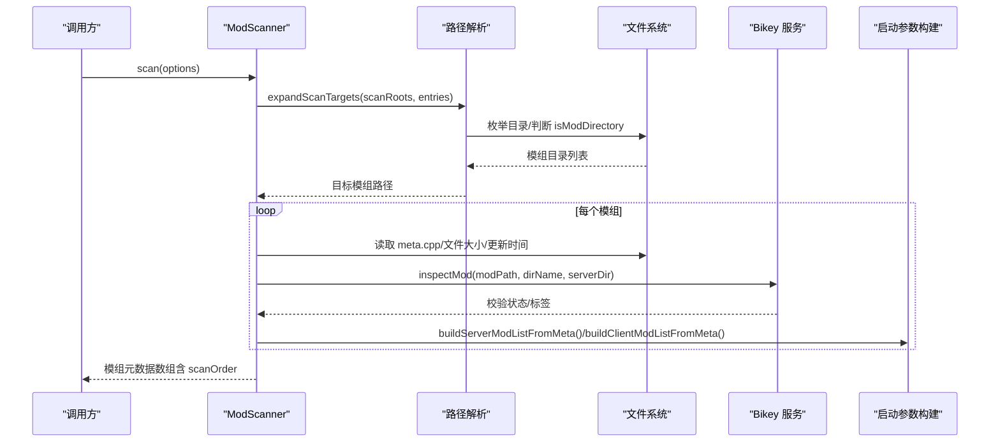
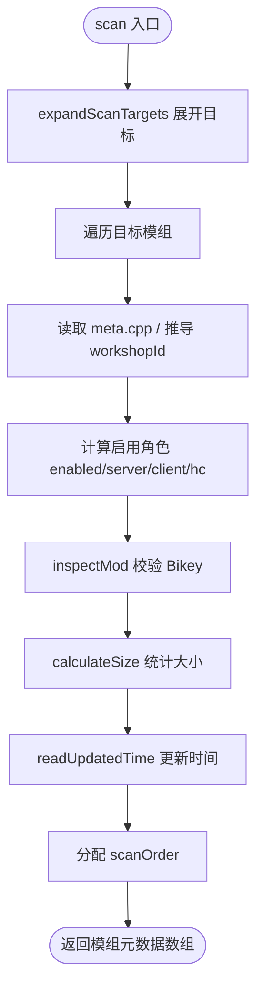
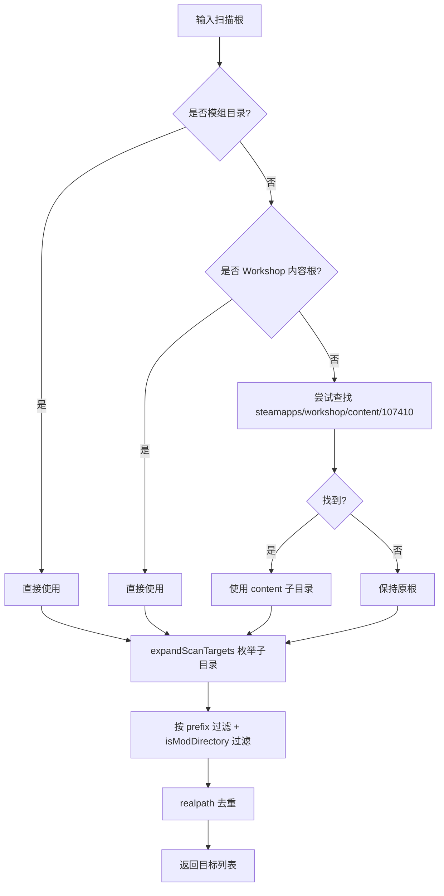
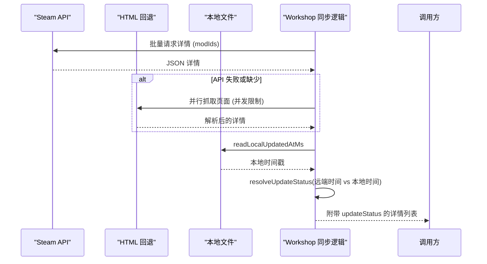
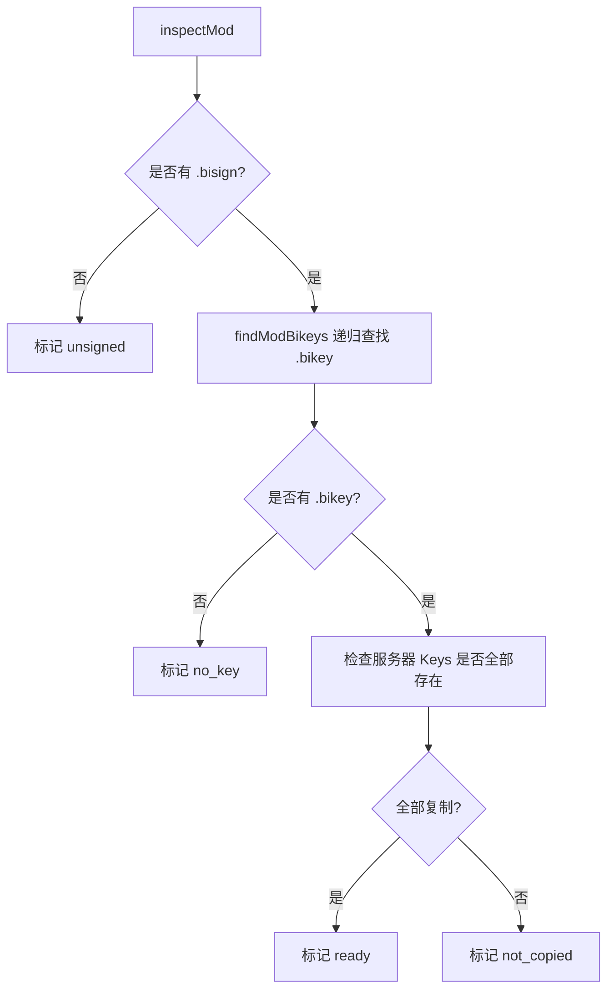
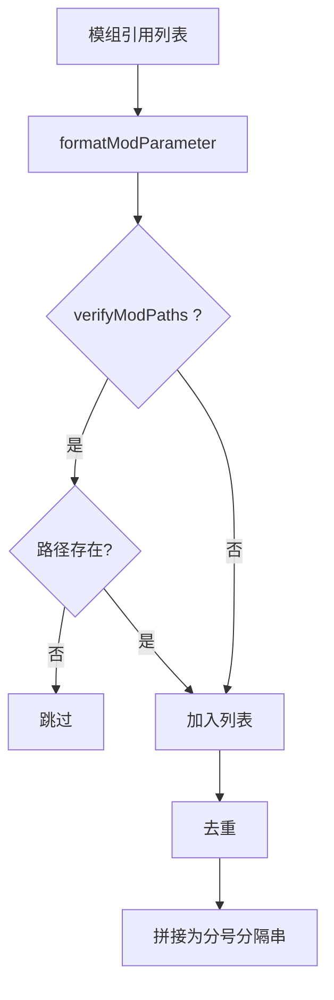

# 模组扫描器

<cite>
**本文引用的文件**   
- [scanner.ts](file://packages/service/src/mods/scanner.ts)
- [paths.ts](file://packages/service/src/mods/paths.ts)
- [bikey-service.ts](file://packages/service/src/mods/bikey-service.ts)
- [enabler.ts](file://packages/service/src/mods/enabler.ts)
- [mod-command-line.ts](file://packages/service/src/mods/mod-command-line.ts)
- [workshop-api.ts](file://packages/service/src/steamcmd/workshop-api.ts)
- [workshop-update.ts](file://packages/service/src/steamcmd/workshop-update.ts)
- [service.ts](file://packages/service/src/diagnostics/service.ts)
- [scanner.test.ts](file://packages/service/src/mods/scanner.test.ts)
- [paths.test.ts](file://packages/service/src/mods/paths.test.ts)
</cite>

## 目录
1. [引言](#引言)
2. [项目结构](#项目结构)
3. [核心组件](#核心组件)
4. [架构总览](#架构总览)
5. [详细组件分析](#详细组件分析)
6. [依赖关系分析](#依赖关系分析)
7. [性能与缓存策略](#性能与缓存策略)
8. [故障排查指南](#故障排查指南)
9. [结论](#结论)
10. [附录：最佳实践与常见问题](#附录最佳实践与常见问题)

## 引言
本文件面向 Arma 3 服务器工具中的“模组扫描器”子系统，系统性说明以下能力：
- 模组文件系统扫描、元数据解析与大小统计
- Workshop 模组同步、本地模组识别与版本冲突检测
- 模组启用角色判定（服务器/客户端/Headless Client）
- Bikey 签名验证与复制流程
- 启动参数构建与模组加载顺序计算
- 诊断与问题定位
- 性能优化与增量扫描建议

该模块位于后端服务中，负责从配置与文件系统推断可用模组集合，并输出供前端展示和服务器启动使用的结构化信息。

## 项目结构
模组扫描相关代码集中在后端服务的 `packages/service/src/mods` 目录，并与 SteamCMD/Workshop 模块协作。

**图示来源**
- [scanner.ts:28-64](file://packages/service/src/mods/scanner.ts#L28-L64)
- [paths.ts:16-54](file://packages/service/src/mods/paths.ts#L16-L54)
- [bikey-service.ts:286-303](file://packages/service/src/mods/bikey-service.ts#L286-L303)
- [mod-command-line.ts:55-80](file://packages/service/src/mods/mod-command-line.ts#L55-L80)
- [enabler.ts:59-77](file://packages/service/src/mods/enabler.ts#L59-L77)
- [workshop-api.ts:203-230](file://packages/service/src/steamcmd/workshop-api.ts#L203-L230)
- [workshop-update.ts:39-58](file://packages/service/src/steamcmd/workshop-update.ts#L39-L58)
- [service.ts:80-106](file://packages/service/src/diagnostics/service.ts#L80-L106)

**章节来源**
- [README.md:37-66](file://README.md#L37-L66)

## 核心组件
- ModScanner：扫描入口，聚合路径展开、元数据读取、Bikey 校验、大小统计与结果排序。
- 路径解析：将配置的扫描根目录解析为实际模组目录，支持 Steam Workshop 内容根自动识别与前缀过滤。
- Bikey 服务：检测 .bisign/.bikey、复制到服务器 Keys 目录、判定验证状态。
- 启动参数构建：根据模组角色生成 -mod/-serverMod 等参数串。
- Workshop 同步：远程详情抓取、HTML 回退解析、本地更新状态对比。
- 诊断：扫描路径存在性检查与 Bikey 状态汇总。

**章节来源**
- [scanner.ts:15-64](file://packages/service/src/mods/scanner.ts#L15-L64)
- [paths.ts:16-54](file://packages/service/src/mods/paths.ts#L16-L54)
- [bikey-service.ts:18-33](file://packages/service/src/mods/bikey-service.ts#L18-L33)
- [mod-command-line.ts:55-80](file://packages/service/src/mods/mod-command-line.ts#L55-L80)
- [workshop-api.ts:170-201](file://packages/service/src/steamcmd/workshop-api.ts#L170-L201)
- [workshop-update.ts:39-58](file://packages/service/src/steamcmd/workshop-update.ts#L39-L58)
- [service.ts:80-134](file://packages/service/src/diagnostics/service.ts#L80-L134)

## 架构总览
模组扫描的整体流程如下：

**图示来源**
- [scanner.ts:28-64](file://packages/service/src/mods/scanner.ts#L28-L64)
- [paths.ts:180-245](file://packages/service/src/mods/paths.ts#L180-L245)
- [bikey-service.ts:286-303](file://packages/service/src/mods/bikey-service.ts#L286-L303)
- [mod-command-line.ts:82-126](file://packages/service/src/mods/mod-command-line.ts#L82-L126)

## 详细组件分析

### 模组扫描与元数据解析
- 扫描入口：ModScanner.scan 接收模组路径、扫描路径条目、启用角色 ID 列表、本地模组映射与服务端目录等选项。
- 路径展开：通过 expandScanTargets 将配置根目录展开为具体模组目录；若根本身是模组目录则直接采用。
- 去重：使用 realpath 归一化后去重，避免符号链接或重复路径导致重复扫描。
- 元数据读取：
  - 优先读取 meta.cpp 中的 publishedid、name、timestamp。
  - 若未解析到 workshopId，尝试从目录名推导（纯数字或带前缀的命名模式）。
- 启用判定：结合 serverModIds/clientModIds/hcModIds 与本地模组覆盖项，计算 enabled 及 isServerMod/isClientMod/isHcMod。
- Bikey 校验：调用 inspectMod 得到 status 与 label，并设置 bikeyPresent 仅当状态为 ready。
- 大小统计：递归遍历模组目录累加文件大小，忽略不可访问文件。
- 更新时间：优先使用 meta.cpp timestamp，否则取文件系统 mtime。
- 扫描顺序：按发现顺序赋予 scanOrder，用于 UI 展示与稳定排序。

**图示来源**
- [scanner.ts:28-64](file://packages/service/src/mods/scanner.ts#L28-L64)
- [scanner.ts:150-221](file://packages/service/src/mods/scanner.ts#L150-L221)
- [scanner.ts:268-307](file://packages/service/src/mods/scanner.ts#L268-L307)
- [scanner.ts:309-329](file://packages/service/src/mods/scanner.ts#L309-L329)

**章节来源**
- [scanner.ts:28-64](file://packages/service/src/mods/scanner.ts#L28-L64)
- [scanner.ts:150-221](file://packages/service/src/mods/scanner.ts#L150-L221)
- [scanner.ts:268-307](file://packages/service/src/mods/scanner.ts#L268-L307)
- [scanner.ts:309-329](file://packages/service/src/mods/scanner.ts#L309-L329)

### 路径解析与 Workshop 内容根识别
- isModDirectory：以是否存在 addons 目录作为模组目录判定。
- isWorkshopContentRoot：匹配 steamapps/workshop/content/107410 后缀。
- resolveEffectiveScanRoot：
  - 若根已是模组目录或 Workshop 内容根，直接返回。
  - 若根包含 steamapps/workshop/content/107410，自动下钻至该子目录。
  - 对 steamapps 根进行兼容处理。
- collectModPaths：合并全局扫描路径、服务端/模组配置路径与本地模组路径，去重后返回。
- expandScanTargets：
  - 支持按扫描路径配置 prefix 过滤子目录。
  - 跳过非模组目录与已见路径。
  - 返回 ExpandedScanTarget 列表供扫描器消费。

**图示来源**
- [paths.ts:16-54](file://packages/service/src/mods/paths.ts#L16-L54)
- [paths.ts:137-161](file://packages/service/src/mods/paths.ts#L137-L161)
- [paths.ts:180-245](file://packages/service/src/mods/paths.ts#L180-L245)

**章节来源**
- [paths.ts:16-54](file://packages/service/src/mods/paths.ts#L16-L54)
- [paths.ts:137-161](file://packages/service/src/mods/paths.ts#L137-L161)
- [paths.ts:180-245](file://packages/service/src/mods/paths.ts#L180-L245)

### Workshop 模组同步与版本冲突检测
- 详情获取：
  - 优先调用 Steam API 批量获取模组详情。
  - 失败时回退 HTML 解析，限制并发度。
  - 最终 fallback 生成基础信息，保证下载流程可继续。
- 本地更新状态：
  - 读取本地 updatedAt 或文件系统 mtimeMs。
  - 与远端 timeUpdated 比较，考虑 120 秒容差，判定 missing/up_to_date/outdated/unknown。
- 本地模组引用：
  - 将本地模组映射到 modId，便于在详情列表中附加本地时间信息。

**图示来源**
- [workshop-api.ts:203-230](file://packages/service/src/steamcmd/workshop-api.ts#L203-L230)
- [workshop-api.ts:233-250](file://packages/service/src/steamcmd/workshop-api.ts#L233-L250)
- [workshop-api.ts:303-334](file://packages/service/src/steamcmd/workshop-api.ts#L303-L334)
- [workshop-update.ts:22-37](file://packages/service/src/steamcmd/workshop-update.ts#L22-L37)
- [workshop-update.ts:39-58](file://packages/service/src/steamcmd/workshop-update.ts#L39-L58)

**章节来源**
- [workshop-api.ts:170-201](file://packages/service/src/steamcmd/workshop-api.ts#L170-L201)
- [workshop-api.ts:203-230](file://packages/service/src/steamcmd/workshop-api.ts#L203-L230)
- [workshop-api.ts:233-250](file://packages/service/src/steamcmd/workshop-api.ts#L233-L250)
- [workshop-api.ts:303-334](file://packages/service/src/steamcmd/workshop-api.ts#L303-L334)
- [workshop-update.ts:22-37](file://packages/service/src/steamcmd/workshop-update.ts#L22-L37)
- [workshop-update.ts:39-58](file://packages/service/src/steamcmd/workshop-update.ts#L39-L58)

### Bikey 签名验证与复制
- 状态判定：
  - 需要同时满足：存在 .bisign、模组内存在 .bikey、已复制到服务器 Keys 目录。
  - 四种状态：unsigned/no_key/not_copied/ready，仅 ready 视为验证通过。
- 复制逻辑：
  - 遍历模组内所有 .bikey，计算目标文件名（规范化 token），复制到服务器 Keys 目录。
  - 已存在则跳过，统计 copied/skipped/total。
- 扫描集成：
  - 扫描过程中调用 inspectMod，填充 bikeyStatus/bikeyLabel/bikeyPresent。
  - 提供 copyMissingBikeys 仅复制缺失键值。

**图示来源**
- [bikey-service.ts:286-303](file://packages/service/src/mods/bikey-service.ts#L286-L303)
- [bikey-service.ts:49-89](file://packages/service/src/mods/bikey-service.ts#L49-L89)
- [bikey-service.ts:159-197](file://packages/service/src/mods/bikey-service.ts#L159-L197)
- [bikey-service.ts:311-348](file://packages/service/src/mods/bikey-service.ts#L311-L348)

**章节来源**
- [bikey-service.ts:18-33](file://packages/service/src/mods/bikey-service.ts#L18-L33)
- [bikey-service.ts:49-89](file://packages/service/src/mods/bikey-service.ts#L49-L89)
- [bikey-service.ts:159-197](file://packages/service/src/mods/bikey-service.ts#L159-L197)
- [bikey-service.ts:286-303](file://packages/service/src/mods/bikey-service.ts#L286-L303)
- [bikey-service.ts:311-348](file://packages/service/src/mods/bikey-service.ts#L311-L348)

### 启动参数构建与模组加载顺序
- 参数格式化：
  - 若 modPath 以 @ 开头则直接使用。
  - 若位于服务器目录下，转换为相对 @folder 形式。
  - 否则保留原始路径。
- 列表构建：
  - 根据模组角色分别构建 client/headless/server 参数串。
  - 去重、可选校验路径存在性。
- 加载顺序：
  - scanOrder 由扫描顺序决定，反映发现次序，可用于 UI 展示与稳定性。
  - 当前实现未做拓扑排序或循环依赖检测。

**图示来源**
- [mod-command-line.ts:10-43](file://packages/service/src/mods/mod-command-line.ts#L10-L43)
- [mod-command-line.ts:55-80](file://packages/service/src/mods/mod-command-line.ts#L55-L80)
- [mod-command-line.ts:82-126](file://packages/service/src/mods/mod-command-line.ts#L82-L126)
- [scanner.ts:42-64](file://packages/service/src/mods/scanner.ts#L42-L64)

**章节来源**
- [mod-command-line.ts:10-43](file://packages/service/src/mods/mod-command-line.ts#L10-L43)
- [mod-command-line.ts:55-80](file://packages/service/src/mods/mod-command-line.ts#L55-L80)
- [mod-command-line.ts:82-126](file://packages/service/src/mods/mod-command-line.ts#L82-L126)
- [scanner.ts:42-64](file://packages/service/src/mods/scanner.ts#L42-L64)

### 本地模组识别与覆盖
- 本地模组映射：
  - 通过 localByPath 将本地模组 path 映射到覆盖项，允许覆盖 name、isServerMod/isClientMod/isHcMod。
  - explicitLocal 传入时优先使用覆盖项。
- 路径合并：
  - resolveModPaths 合并服务端/模组配置路径与全局扫描路径。
  - collectModPaths 再合并本地模组路径，去重后返回。

**章节来源**
- [scanner.ts:31-40](file://packages/service/src/mods/scanner.ts#L31-L40)
- [scanner.ts:173-196](file://packages/service/src/mods/scanner.ts#L173-L196)
- [enabler.ts:59-77](file://packages/service/src/mods/enabler.ts#L59-L77)
- [paths.ts:137-161](file://packages/service/src/mods/paths.ts#L137-L161)

## 依赖关系分析
模组扫描器的关键依赖如下：

```mermaid
classDiagram
class ModScanner {
+scan(options)
+copyBikeys(modPaths, serverDir)
+copyBikeysFromScanned(mods, serverDir)
+summarizeBikeys(options)
+copyMissingBikeys(mods, serverDir)
}
class PathResolver {
+isModDirectory(dirPath)
+resolveEffectiveScanRoot(root)
+collectModPaths(app, config)
+expandScanTargets(scanRoots, entries)
}
class BikeyService {
+inspectMod(modPath, dirName, serverDir)
+copyBikeysForMods(mods, serverDir)
+hasBisignFiles(modPath)
+findModBikeys(modPath)
}
class CommandLineBuilder {
+buildServerModListFromMeta(serverDir, mods)
+buildClientModListFromMeta(serverDir, mods)
+buildHeadlessModListFromMeta(serverDir, mods)
}
ModScanner --> PathResolver : "路径展开"
ModScanner --> BikeyService : "Bikey 校验/复制"
ModScanner --> CommandLineBuilder : "启动参数构建"
```

**图示来源**
- [scanner.ts:28-64](file://packages/service/src/mods/scanner.ts#L28-L64)
- [paths.ts:16-54](file://packages/service/src/mods/paths.ts#L16-L54)
- [bikey-service.ts:286-303](file://packages/service/src/mods/bikey-service.ts#L286-L303)
- [mod-command-line.ts:82-126](file://packages/service/src/mods/mod-command-line.ts#L82-L126)

**章节来源**
- [scanner.ts:28-64](file://packages/service/src/mods/scanner.ts#L28-L64)
- [paths.ts:16-54](file://packages/service/src/mods/paths.ts#L16-L54)
- [bikey-service.ts:286-303](file://packages/service/src/mods/bikey-service.ts#L286-L303)
- [mod-command-line.ts:82-126](file://packages/service/src/mods/mod-command-line.ts#L82-L126)

## 性能与缓存策略
- 当前实现特点：
  - 扫描为同步操作，使用 fs.readdirSync/fs.statSync 遍历目录与统计大小。
  - 无显式内存缓存层；每次 scan 重新计算。
  - Workshop 详情获取使用并发限制（HTML 回退并发度为 3）。
- 潜在优化点：
  - 引入增量扫描：记录上次扫描指纹（目录树哈希/mtime 快照），仅扫描变更模组。
  - 缓存模组大小与更新时间：基于 lastScanAt 与 mtime 差异决定是否重算。
  - 并行扫描：对多个模组目录并行执行 size 统计与 Bikey 检查（注意 I/O 竞争）。
  - 预解析 meta.cpp：对大型模组减少重复 IO。
  - 路径去重与短路：已在 expandScanTargets 中使用 realpath 去重，可减少无效扫描。

[本节为通用性能讨论，不直接分析具体文件]

## 故障排查指南
- 扫描路径未配置或不存在：
  - 诊断会报告“未配置模组扫描路径”或“X/Y 个存在”。
  - 检查 collectModPaths 返回的路径列表与文件系统存在性。
- Bikey 验证失败：
  - 确认模组包含 .bisign 与 .bikey。
  - 确认服务器 Keys 目录中存在对应复制文件。
  - 使用 summarizeBikeys 统计 ready/not_copied/no_key/unsigned/unchecked 数量。
- Workshop 详情无法加载：
  - API 失败时会回退 HTML 解析；仍可能显示 fallback 信息。
  - 检查网络代理与 Steam 访问权限。
- 本地模组未生效：
  - 检查 localMods 映射与 enabledLocalPaths 是否包含该路径。
  - 确认 isModDirectory 判定成功（存在 addons）。

**章节来源**
- [service.ts:80-134](file://packages/service/src/diagnostics/service.ts#L80-L134)
- [scanner.ts:86-148](file://packages/service/src/mods/scanner.ts#L86-L148)
- [workshop-api.ts:203-230](file://packages/service/src/steamcmd/workshop-api.ts#L203-L230)

## 结论
模组扫描器围绕“路径解析—元数据读取—Bikey 校验—参数构建”形成闭环，能够稳定地从配置与文件系统推断可用模组集合，并为服务器启动提供参数串。Workshop 同步具备 API/HTML 双通道与本地更新状态对比，保障可用性。当前实现未包含循环依赖检测与拓扑排序，但提供了稳定的 scanOrder 与诊断能力，便于运维与排错。

[本节为总结性内容，不直接分析具体文件]

## 附录：最佳实践与常见问题

- 最佳实践
  - 明确区分 server/client/hc 角色，避免不必要的客户端模组被注入服务器参数。
  - 确保 Workshop 内容根正确指向 steamapps/workshop/content/107410，以便自动识别。
  - 定期运行 Bikey 复制，确保服务器 Keys 目录完整。
  - 使用本地模组覆盖功能统一名称与角色，提升可读性与一致性。
  - 监控诊断输出，及时处理 missing/outdated 的 Workshop 模组。

- 常见问题
  - 模组未被扫描：检查是否包含 addons 目录，或路径是否被 prefix 过滤排除。
  - Bikey 未生效：确认 .bisign 与 .bikey 齐全且已复制到服务器 Keys。
  - Workshop 详情为空：检查网络与代理，必要时依赖 HTML 回退。
  - 启动参数为空：确认模组路径在服务器目录内或参数格式正确。

[本节为通用指导，不直接分析具体文件]