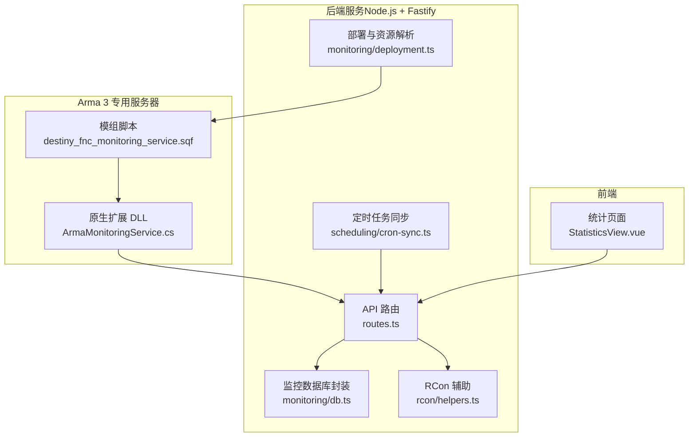
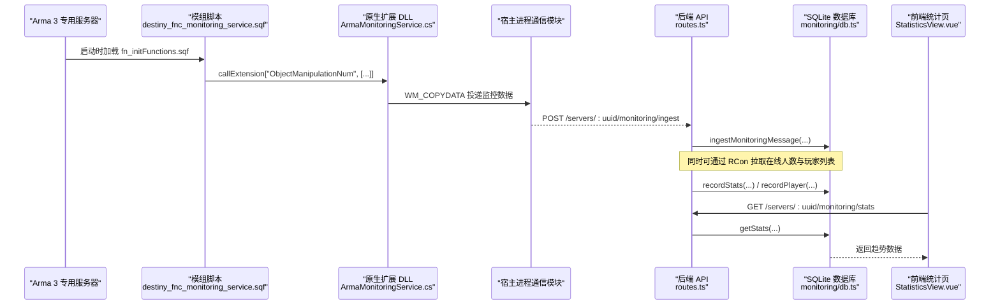
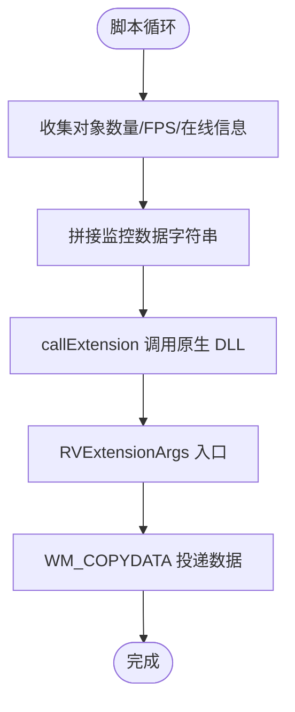
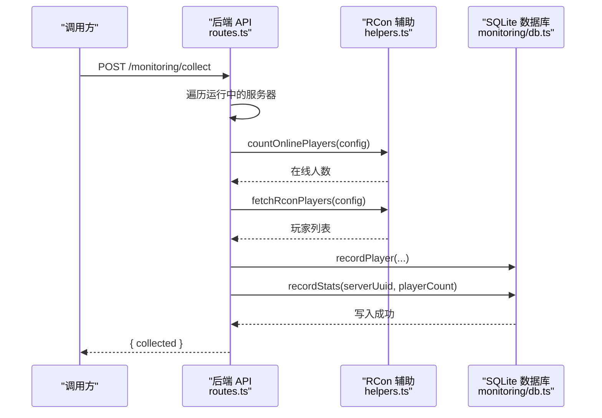
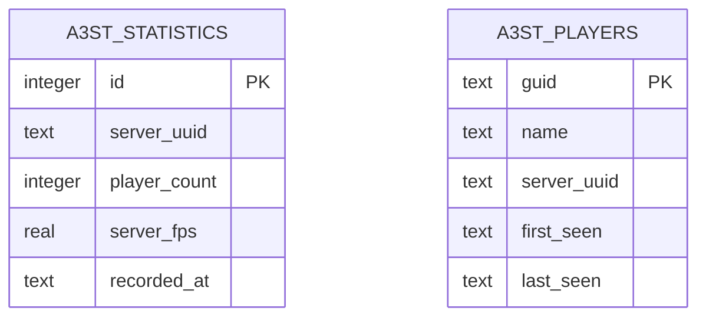
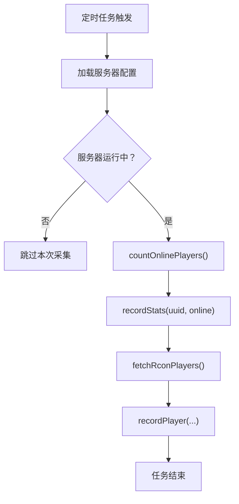
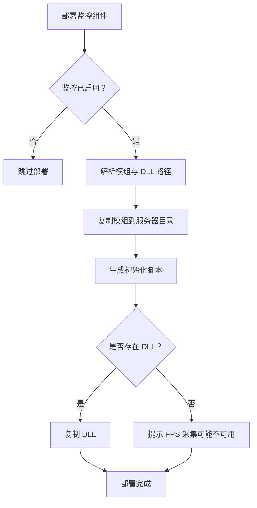
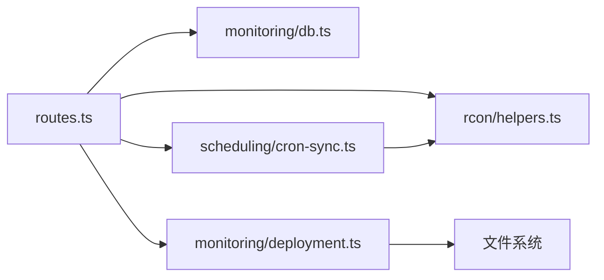

# 监控服务

<cite>
**本文引用的文件**   
- [README.md](file://README.md)
- [monitoring-cpp-dll-build.md](file://docs/monitoring-cpp-dll-build.md)
- [ArmaMonitoringService.cs](file://DestinyServerMonitoring/DestinyServerMonitoring/ArmaMonitoringService.cs)
- [destiny_fnc_monitoring_service.sqf](file://mod/@a3st_monitor/addons/a3st_monitor/script/destiny_fnc_monitoring_service.sqf)
- [fn_initFunctions.sqf](file://mod/@a3st_monitor/addons/a3st_monitor/fn_initFunctions.sqf)
- [db.ts](file://packages/service/src/monitoring/db.ts)
- [index.ts](file://packages/service/src/monitoring/index.ts)
- [routes.ts](file://packages/service/src/api/routes.ts)
- [cron-sync.ts](file://packages/service/src/scheduling/cron-sync.ts)
- [deployment.ts](file://packages/service/src/monitoring/deployment.ts)
- [helpers.ts](file://packages/service/src/rcon/helpers.ts)
- [rcon.ts](file://packages/service/src/types/rcon.ts)
- [StatisticsView.vue](file://packages/web/src/views/StatisticsView.vue)
</cite>

## 目录
1. [引言](#引言)
2. [项目结构](#项目结构)
3. [核心组件](#核心组件)
4. [架构总览](#架构总览)
5. [详细组件分析](#详细组件分析)
6. [依赖关系分析](#依赖关系分析)
7. [性能与存储优化](#性能与存储优化)
8. [告警与可视化集成](#告警与可视化集成)
9. [故障排查指南](#故障排查指南)
10. [结论](#结论)

## 引言
本文件面向 Arma 3 专用服务器监控子系统，系统性说明系统性能指标采集、数据存储与聚合分析机制。重点覆盖：
- CPU、内存、网络、磁盘使用率：当前代码库中通过 RCon 获取在线人数与玩家列表；CPU/内存/网络/磁盘等进程级指标在类型定义中存在字段预留，但未见直接采集实现。
- Arma 3 游戏统计数据：通过模组脚本与原生 DLL 扩展采集 FPS、在线人数、单位/载具数量等，并写入 SQLite。
- SQLite 数据库设计：包含统计快照表与玩家历史表，提供索引与 WAL 模式优化。
- 数据保留策略、索引优化与查询调优：基于现有 schema 与查询给出建议。
- 监控告警配置与可视化图表集成：结合前端统计页与导出接口，说明如何接入外部告警与图表工具。

## 项目结构
监控相关代码分布在以下位置：
- 游戏侧采集：模组脚本与 C# 原生 DLL 扩展
- 后端服务：Fastify API、SQLite 持久化、RCon 辅助、定时任务调度
- 前端界面：Vue 统计页面与配置开关

**图示来源**
- [destiny_fnc_monitoring_service.sqf:1-83](file://mod/@a3st_monitor/addons/a3st_monitor/script/destiny_fnc_monitoring_service.sqf#L1-L83)
- [ArmaMonitoringService.cs:1-148](file://DestinyServerMonitoring/DestinyServerMonitoring/ArmaMonitoringService.cs#L1-L148)
- [routes.ts:697-822](file://packages/service/src/api/routes.ts#L697-L822)
- [db.ts:36-245](file://packages/service/src/monitoring/db.ts#L36-L245)
- [helpers.ts:22-44](file://packages/service/src/rcon/helpers.ts#L22-L44)
- [cron-sync.ts:45-80](file://packages/service/src/scheduling/cron-sync.ts#L45-L80)
- [deployment.ts:48-97](file://packages/service/src/monitoring/deployment.ts#L48-L97)
- [StatisticsView.vue:28-80](file://packages/web/src/views/StatisticsView.vue#L28-L80)

**章节来源**
- [README.md:37-47](file://README.md#L37-L47)
- [monitoring-cpp-dll-build.md:1-42](file://docs/monitoring-cpp-dll-build.md#L1-L42)

## 核心组件
- 游戏侧采集器
  - 模组脚本负责周期性收集对象数量、FPS、在线玩家信息，并通过 callExtension 调用原生 DLL。
  - 原生 DLL 暴露 RVExtensionArgs 入口，将数据通过 Windows 消息投递给宿主进程通信模块。
- 后端服务
  - API 路由提供监控摘要、趋势数据、玩家列表、手动采集、数据入库、导出 HTML/CSV 等接口。
  - MonitoringDb 封装 SQLite 读写，维护统计快照与玩家历史表，并提供索引与 WAL 优化。
  - RCon 辅助用于获取在线人数与玩家列表。
  - 定时任务根据配置周期执行监控采集。
  - 部署模块负责将模组与可选 DLL 复制到服务器目录，并生成初始化脚本。
- 前端界面
  - 统计页面支持读取监控配置、触发采集、展示汇总与趋势图。

**章节来源**
- [db.ts:36-245](file://packages/service/src/monitoring/db.ts#L36-L245)
- [routes.ts:697-822](file://packages/service/src/api/routes.ts#L697-L822)
- [helpers.ts:22-44](file://packages/service/src/rcon/helpers.ts#L22-L44)
- [cron-sync.ts:45-80](file://packages/service/src/scheduling/cron-sync.ts#L45-L80)
- [deployment.ts:48-97](file://packages/service/src/monitoring/deployment.ts#L48-L97)
- [StatisticsView.vue:28-80](file://packages/web/src/views/StatisticsView.vue#L28-L80)

## 架构总览
监控数据流从 Arma 3 服务端到后端 SQLite，再到前端展示与导出：

**图示来源**
- [fn_initFunctions.sqf:1-9](file://mod/@a3st_monitor/addons/a3st_monitor/fn_initFunctions.sqf#L1-L9)
- [destiny_fnc_monitoring_service.sqf:1-83](file://mod/@a3st_monitor/addons/a3st_monitor/script/destiny_fnc_monitoring_service.sqf#L1-L83)
- [ArmaMonitoringService.cs:102-144](file://DestinyServerMonitoring/DestinyServerMonitoring/ArmaMonitoringService.cs#L102-L144)
- [routes.ts:753-763](file://packages/service/src/api/routes.ts#L753-L763)
- [db.ts:121-143](file://packages/service/src/monitoring/db.ts#L121-L143)
- [StatisticsView.vue:73-80](file://packages/web/src/views/StatisticsView.vue#L73-L80)

## 详细组件分析

### 游戏侧采集器（模组脚本与原生 DLL）
- 模组脚本职责
  - 每 60 秒收集一次对象数量、FPS、FPS 最小值等，并拼接为分隔字符串。
  - 监听玩家连接/断开事件，上报在线状态更新。
  - 通过 callExtension 将数据发送到原生 DLL。
- 原生 DLL 职责
  - 暴露 RVExtensionRegisterCallback、RVExtensionVersion、RVExtension、RVExtensionArgs。
  - 接收 callExtensionArgs 参数后，通过 Windows 消息 WM_COPYDATA 将数据投递给宿主进程通信窗口。

**图示来源**
- [destiny_fnc_monitoring_service.sqf:1-83](file://mod/@a3st_monitor/addons/a3st_monitor/script/destiny_fnc_monitoring_service.sqf#L1-L83)
- [ArmaMonitoringService.cs:102-144](file://DestinyServerMonitoring/DestinyServerMonitoring/ArmaMonitoringService.cs#L102-L144)

**章节来源**
- [destiny_fnc_monitoring_service.sqf:1-83](file://mod/@a3st_monitor/addons/a3st_monitor/script/destiny_fnc_monitoring_service.sqf#L1-L83)
- [ArmaMonitoringService.cs:1-148](file://DestinyServerMonitoring/DestinyServerMonitoring/ArmaMonitoringService.cs#L1-L148)
- [fn_initFunctions.sqf:1-9](file://mod/@a3st_monitor/addons/a3st_monitor/fn_initFunctions.sqf#L1-L9)

### 后端 API 与数据入库
- 关键接口
  - GET /servers/:uuid/monitoring/summary：返回平均/峰值在线人数与记录总数。
  - GET /servers/:uuid/monitoring/stats?hours=24：返回指定时间窗口的趋势数据。
  - GET /servers/:uuid/monitoring/players：返回最近玩家列表。
  - POST /monitoring/collect：遍历所有运行中的服务器，通过 RCon 拉取在线人数与玩家列表，写入数据库。
  - POST /servers/:uuid/monitoring/ingest：接收来自宿主的数据消息并入库。
  - GET /servers/:uuid/monitoring/export/html|csv：导出 HTML 日报或 CSV 数据。
- 数据入库流程
  - 通过 RCon 获取在线人数与玩家列表。
  - 调用 MonitoringDb.recordStats 写入统计快照。
  - 调用 MonitoringDb.recordPlayer 或 batchInsertPlayers 写入玩家历史。

**图示来源**
- [routes.ts:719-751](file://packages/service/src/api/routes.ts#L719-L751)
- [helpers.ts:22-44](file://packages/service/src/rcon/helpers.ts#L22-L44)
- [db.ts:121-143](file://packages/service/src/monitoring/db.ts#L121-L143)

**章节来源**
- [routes.ts:697-822](file://packages/service/src/api/routes.ts#L697-L822)
- [helpers.ts:22-44](file://packages/service/src/rcon/helpers.ts#L22-L44)
- [db.ts:121-143](file://packages/service/src/monitoring/db.ts#L121-L143)

### SQLite 数据库设计与查询
- 表结构
  - a3st_statistics：统计快照表，包含 server_uuid、player_count、server_fps、recorded_at。
  - a3st_players：玩家历史表，包含 guid、name、server_uuid、first_seen、last_seen。
- 索引与优化
  - 对 a3st_statistics 建立 (server_uuid, recorded_at) 复合索引，加速按时间与服务器过滤的查询。
  - 启用 WAL 模式提升并发写入性能。
- 主要查询
  - getSummary：计算平均/峰值在线人数与记录总数。
  - getStats：按时间窗口返回趋势数据。
  - listPlayers：按 last_seen 倒序返回最近玩家列表。

**图示来源**
- [db.ts:80-104](file://packages/service/src/monitoring/db.ts#L80-L104)

**章节来源**
- [db.ts:80-104](file://packages/service/src/monitoring/db.ts#L80-L104)
- [db.ts:161-225](file://packages/service/src/monitoring/db.ts#L161-L225)

### 定时任务与自动采集
- 定时任务由 cron-sync.ts 管理，依据配置的 monitoringCron 表达式注册任务。
- 任务执行逻辑：
  - 检查服务器是否运行。
  - 通过 RCon 获取在线人数与玩家列表。
  - 写入统计快照与玩家历史。

**图示来源**
- [cron-sync.ts:45-80](file://packages/service/src/scheduling/cron-sync.ts#L45-L80)
- [helpers.ts:22-44](file://packages/service/src/rcon/helpers.ts#L22-L44)
- [db.ts:121-143](file://packages/service/src/monitoring/db.ts#L121-L143)

**章节来源**
- [cron-sync.ts:45-80](file://packages/service/src/scheduling/cron-sync.ts#L45-L80)

### 部署与资源解析
- 部署模块会检测并复制监控模组与可选 DLL 到服务器目录。
- 自动生成初始化脚本，注入 serverUuid、命令密码、统计开关等变量。
- 若未找到 DLL，仍会部署模组，但 FPS 采集可能不可用。

**图示来源**
- [deployment.ts:48-97](file://packages/service/src/monitoring/deployment.ts#L48-L97)
- [deployment.ts:99-122](file://packages/service/src/monitoring/deployment.ts#L99-L122)

**章节来源**
- [deployment.ts:48-97](file://packages/service/src/monitoring/deployment.ts#L48-L97)
- [deployment.ts:99-122](file://packages/service/src/monitoring/deployment.ts#L99-L122)

### 前端统计页面
- 统计页面支持：
  - 读取监控配置（enabled）。
  - 保存监控开关。
  - 手动触发采集任务。
  - 定时刷新数据（间隔 30 秒）。

**章节来源**
- [StatisticsView.vue:28-80](file://packages/web/src/views/StatisticsView.vue#L28-L80)

## 依赖关系分析
- 组件耦合
  - routes.ts 依赖 monitoring/db.ts、rcon/helpers.ts、scheduling/cron-sync.ts、monitoring/deployment.ts。
  - cron-sync.ts 依赖 rcon/helpers.ts 与 processManager/configStore。
  - deployment.ts 依赖文件系统与配置结构。
- 外部依赖
  - sql.js 用于 SQLite 操作。
  - RCon 协议用于与 Arma 3 服务器通信。
  - Windows User32.dll 用于进程间消息传递（DLL 侧）。

**图示来源**
- [routes.ts:697-822](file://packages/service/src/api/routes.ts#L697-L822)
- [cron-sync.ts:45-80](file://packages/service/src/scheduling/cron-sync.ts#L45-L80)
- [deployment.ts:48-97](file://packages/service/src/monitoring/deployment.ts#L48-L97)

**章节来源**
- [routes.ts:697-822](file://packages/service/src/api/routes.ts#L697-L822)
- [cron-sync.ts:45-80](file://packages/service/src/scheduling/cron-sync.ts#L45-L80)
- [deployment.ts:48-97](file://packages/service/src/monitoring/deployment.ts#L48-L97)

## 性能与存储优化
- 数据库优化
  - 使用 WAL 模式减少写锁竞争，提高并发写入能力。
  - 针对 (server_uuid, recorded_at) 建立复合索引，加速按时间与服务器过滤的趋势查询。
  - 批量插入玩家记录时使用 prepare 语句减少重复编译开销。
- 查询优化
  - getStats 使用 datetime('now', ?) 进行时间窗口过滤，避免全表扫描。
  - listPlayers 限制返回条数，降低前端渲染压力。
- 数据保留策略建议
  - 定期清理早于保留期的 a3st_statistics 记录，例如仅保留 30/90 天数据。
  - 对 a3st_players 表可按 last_seen 做归档或分区，避免单表过大影响查询。
- 进程级指标现状
  - ServerProcessState 类型定义了 cpuUsage、memoryMb 等字段，但当前未见直接采集实现。
  - 建议在 processManager 中补充操作系统 API 或平台工具（如 tasklist/perfmon 或 Linux /proc）以采集 CPU、内存、网络、磁盘使用率，并在 recordStats 中扩展 server_cpu、server_memory_mb、server_net_io、server_disk_usage 等字段。

**章节来源**
- [db.ts:49-64](file://packages/service/src/monitoring/db.ts#L49-L64)
- [db.ts:90-93](file://packages/service/src/monitoring/db.ts#L90-L93)
- [db.ts:145-159](file://packages/service/src/monitoring/db.ts#L145-L159)
- [db.ts:187-201](file://packages/service/src/monitoring/db.ts#L187-L201)
- [db.ts:203-225](file://packages/service/src/monitoring/db.ts#L203-L225)
- [server.ts:1-15](file://packages/service/src/types/server.ts#L1-L15)

## 告警与可视化集成
- 可视化
  - 前端统计页面通过 GET /servers/:uuid/monitoring/stats 获取趋势数据，可接入 ECharts/AntV 等图表库绘制在线人数与 FPS 曲线。
  - 导出 HTML 日报与 CSV 便于离线分析与报表归档。
- 告警配置建议
  - 基于定时任务或外部监控系统（如 Prometheus/Grafana）轮询 GET /servers/:uuid/monitoring/stats。
  - 设置阈值规则：在线人数突增/骤降、FPS 持续低于阈值、玩家长时间无活动。
  - 告警动作：发送邮件/企业微信/钉钉通知，或触发自动重启/扩容。
- 集成步骤
  - 在前端引入图表库，绑定 StatisticsView.vue 中的数据源。
  - 在后端增加告警规则配置项（如 thresholds、channels），并在 cron-sync.ts 中扩展告警执行逻辑。
  - 使用 GET /servers/:uuid/monitoring/export/html|csv 生成报告供 BI 工具消费。

**章节来源**
- [routes.ts:786-812](file://packages/service/src/api/routes.ts#L786-L812)
- [StatisticsView.vue:28-80](file://packages/web/src/views/StatisticsView.vue#L28-L80)

## 故障排查指南
- 无法采集 FPS
  - 确认 DestinyServerMonitoring DLL 已构建并部署到服务器目录。
  - 检查模组 @a3st_monitor 是否正确复制，且 fn_initFunctions.sqf 已生成。
- 数据未入库
  - 检查 POST /monitoring/ingest 是否收到数据，或 POST /monitoring/collect 是否成功。
  - 查看 SQLite 文件权限与 WAL 模式是否正常启用。
- RCon 连接失败
  - 确认 BattlEye RCon 密码与端口配置正确。
  - 检查防火墙与网络连通性。
- 前端无法显示数据
  - 确认 GET /servers/:uuid/monitoring/stats 返回有效数据。
  - 检查前端定时器与错误处理逻辑。

**章节来源**
- [monitoring-cpp-dll-build.md:26-32](file://docs/monitoring-cpp-dll-build.md#L26-L32)
- [deployment.ts:86-92](file://packages/service/src/monitoring/deployment.ts#L86-L92)
- [routes.ts:753-763](file://packages/service/src/api/routes.ts#L753-L763)
- [helpers.ts:22-44](file://packages/service/src/rcon/helpers.ts#L22-L44)

## 结论
该监控服务以 Arma 3 模组脚本与原生 DLL 作为数据采集入口，通过后端 Fastify API 与 SQLite 实现数据的持久化与聚合分析。当前实现聚焦于在线人数、玩家历史与 FPS 等游戏侧指标；进程级 CPU/内存/网络/磁盘指标在类型层预留但未实现。通过 WAL 模式与复合索引优化了写入与查询性能，并结合前端统计页与导出接口形成完整的可视化与分析闭环。未来可在 processManager 中补充系统级指标采集，并扩展告警与可视化集成，以提升运维自动化水平。