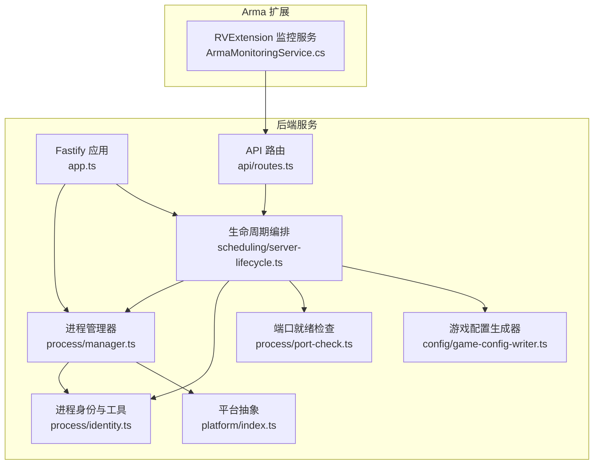
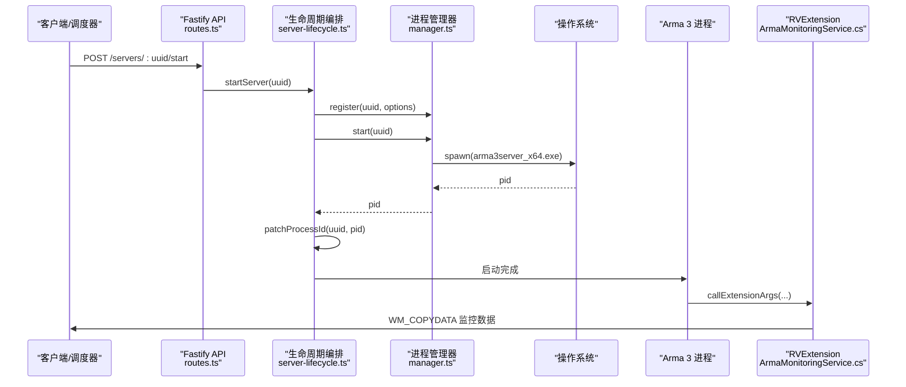
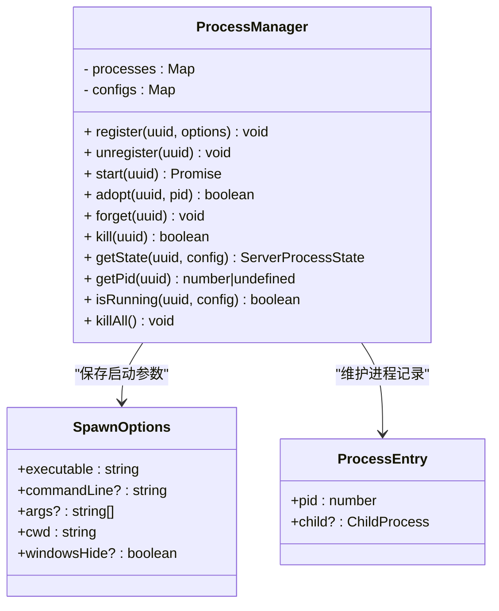
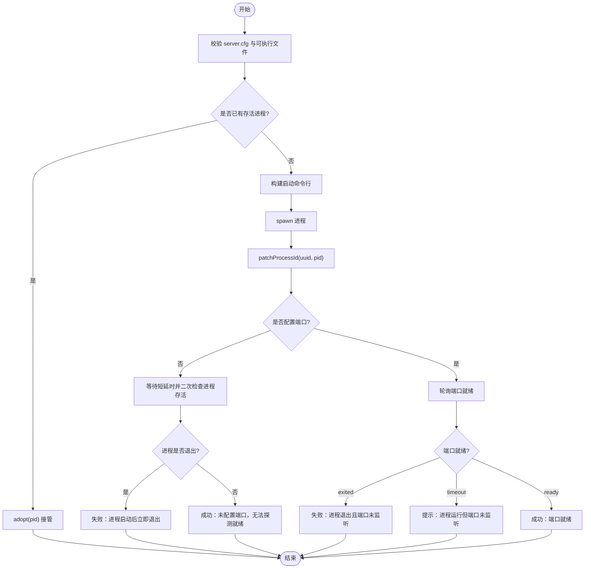
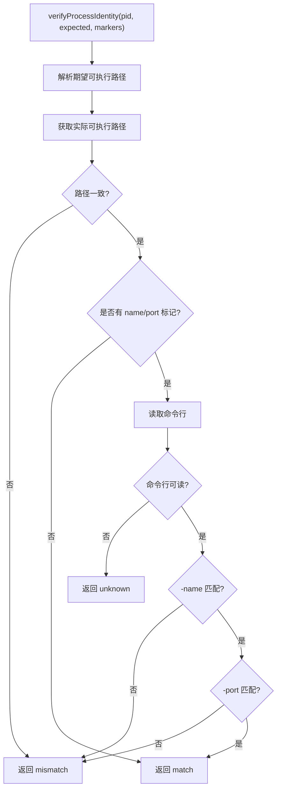
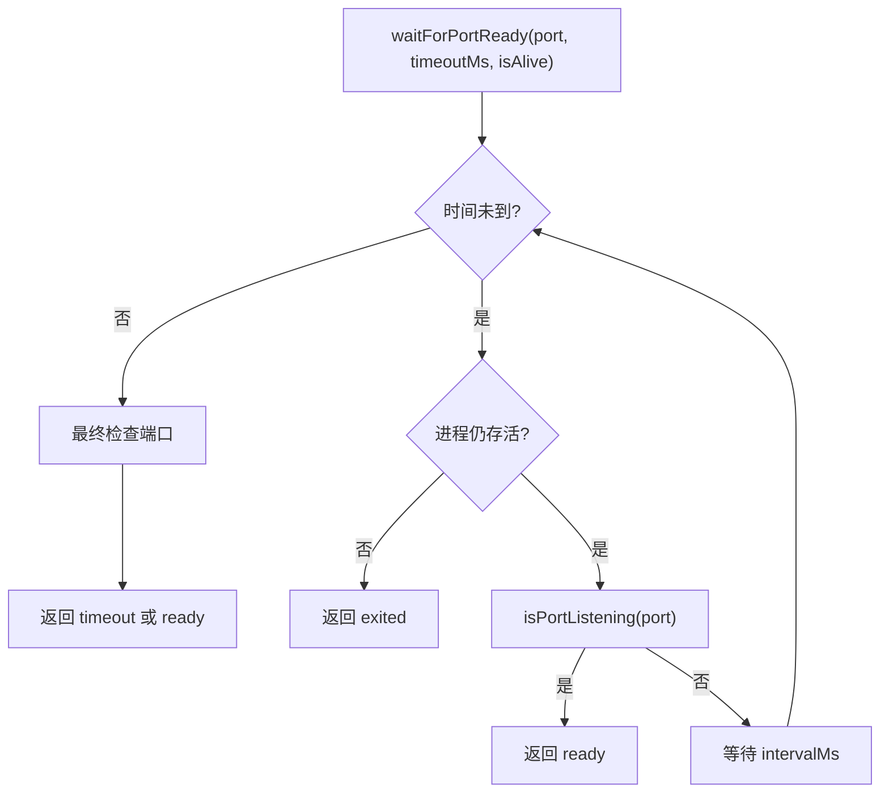
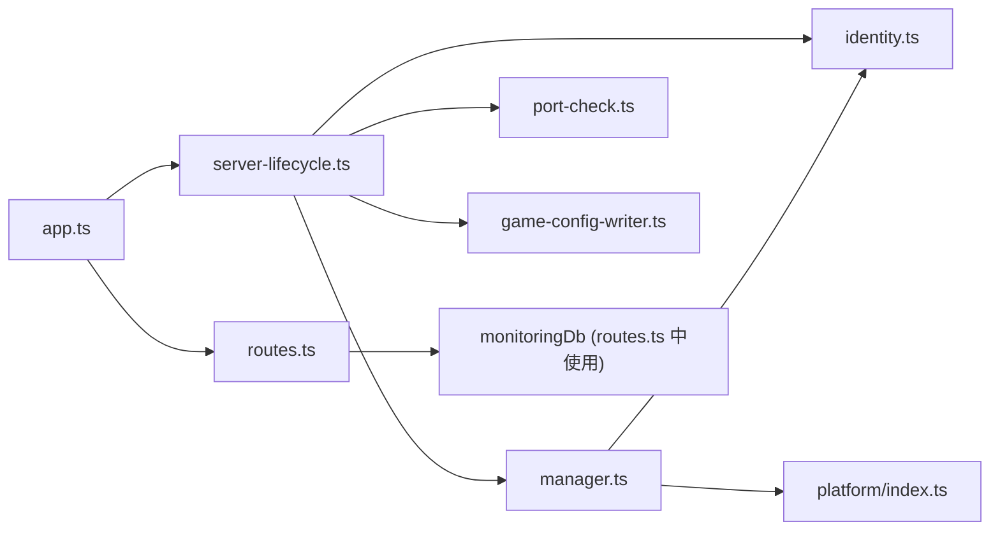

# 进程管理器

<cite>
**本文引用的文件**   
- [packages/service/src/process/manager.ts](file://packages/service/src/process/manager.ts)
- [packages/service/src/scheduling/server-lifecycle.ts](file://packages/service/src/scheduling/server-lifecycle.ts)
- [packages/service/src/process/identity.ts](file://packages/service/src/process/identity.ts)
- [packages/service/src/process/port-check.ts](file://packages/service/src/process/port-check.ts)
- [packages/service/src/config/game-config-writer.ts](file://packages/service/src/config/game-config-writer.ts)
- [packages/service/src/platform/index.ts](file://packages/service/src/platform/index.ts)
- [packages/service/src/types/server.ts](file://packages/service/src/types/server.ts)
- [packages/service/src/app.ts](file://packages/service/src/app.ts)
- [packages/service/src/api/routes.ts](file://packages/service/src/api/routes.ts)
- [DestinyServerMonitoring/DestinyServerMonitoring/ArmaMonitoringService.cs](file://DestinyServerMonitoring/DestinyServerMonitoring/ArmaMonitoringService.cs)
</cite>

## 目录
1. [简介](#简介)
2. [项目结构](#项目结构)
3. [核心组件](#核心组件)
4. [架构总览](#架构总览)
5. [详细组件分析](#详细组件分析)
6. [依赖关系分析](#依赖关系分析)
7. [性能与监控](#性能与监控)
8. [故障排除指南](#故障排除指南)
9. [结论](#结论)

## 简介
本文面向 Arma 3 专用服务器进程的生命周期管理，围绕“启动、停止、重启、监控”四大能力展开，重点解释：
- 进程状态机设计与健壮性保障（PID 复用防护、进程身份校验、优雅关闭与强制终止）
- 进程间通信模式（Windows 窗口消息 + RPT/日志采集）
- 信号处理与优雅关闭流程（SIGTERM/SIGKILL、taskkill /T /F）
- 端口就绪探测与异常恢复（端口监听轮询、超时与退出分支）
- 性能监控指标收集（在线人数、玩家列表入库）
- 自动重启策略（定时任务、检测后重启）
- 调试技巧与常见问题定位

本说明以代码仓库中的服务层实现为依据，结合 C# RVExtension 模块的跨进程数据投递机制进行综合阐述。

## 项目结构
与进程管理直接相关的代码主要位于后端服务的 process 与 scheduling 子系统中，同时涉及配置写入、平台抽象、类型定义以及外部监控注入点。

**图表来源**
- [packages/service/src/app.ts:57-71](file://packages/service/src/app.ts#L57-L71)
- [packages/service/src/process/manager.ts:32-219](file://packages/service/src/process/manager.ts#L32-L219)
- [packages/service/src/scheduling/server-lifecycle.ts:58-270](file://packages/service/src/scheduling/server-lifecycle.ts#L58-L270)
- [packages/service/src/process/identity.ts:14-229](file://packages/service/src/process/identity.ts#L14-L229)
- [packages/service/src/process/port-check.ts:10-81](file://packages/service/src/process/port-check.ts#L10-L81)
- [packages/service/src/config/game-config-writer.ts:152-195](file://packages/service/src/config/game-config-writer.ts#L152-L195)
- [packages/service/src/platform/index.ts:1-51](file://packages/service/src/platform/index.ts#L1-L51)
- [packages/service/src/api/routes.ts:697-764](file://packages/service/src/api/routes.ts#L697-L764)
- [DestinyServerMonitoring/DestinyServerMonitoring/ArmaMonitoringService.cs:15-148](file://DestinyServerMonitoring/DestinyServerMonitoring/ArmaMonitoringService.cs#L15-L148)

**章节来源**
- [packages/service/src/app.ts:57-71](file://packages/service/src/app.ts#L57-L71)
- [packages/service/src/process/manager.ts:32-219](file://packages/service/src/process/manager.ts#L32-L219)
- [packages/service/src/scheduling/server-lifecycle.ts:58-270](file://packages/service/src/scheduling/server-lifecycle.ts#L58-L270)

## 核心组件
- 进程管理器 ProcessManager：负责 spawn、收养、杀死、状态查询、事件广播。
- 生命周期编排 server-lifecycle：对外暴露 start/stop/restart/detect 等高层操作，封装身份校验、端口就绪、持久化 PID 更新。
- 进程身份 identity：跨平台获取进程可执行路径、命令行，校验进程是否属于目标服务器。
- 端口就绪 port-check：跨平台检测 TCP 端口是否处于 LISTEN 状态，提供轮询等待。
- 配置生成器 game-config-writer：构建启动命令行、解析可执行路径、安全参数过滤。
- 平台抽象 platform：判断操作系统、默认可执行名与安装目录。
- 类型 server：统一进程状态数据结构。
- API routes：暴露监控数据采集、RPT 日志读取等接口。
- RVExtension 监控服务：通过 Windows 窗口消息向桌面端投递监控数据。

**章节来源**
- [packages/service/src/process/manager.ts:32-219](file://packages/service/src/process/manager.ts#L32-L219)
- [packages/service/src/scheduling/server-lifecycle.ts:58-270](file://packages/service/src/scheduling/server-lifecycle.ts#L58-L270)
- [packages/service/src/process/identity.ts:14-229](file://packages/service/src/process/identity.ts#L14-L229)
- [packages/service/src/process/port-check.ts:10-81](file://packages/service/src/process/port-check.ts#L10-L81)
- [packages/service/src/config/game-config-writer.ts:152-195](file://packages/service/src/config/game-config-writer.ts#L152-L195)
- [packages/service/src/platform/index.ts:1-51](file://packages/service/src/platform/index.ts#L1-L51)
- [packages/service/src/types/server.ts:1-15](file://packages/service/src/types/server.ts#L1-L15)
- [packages/service/src/api/routes.ts:697-764](file://packages/service/src/api/routes.ts#L697-L764)
- [DestinyServerMonitoring/DestinyServerMonitoring/ArmaMonitoringService.cs:15-148](file://DestinyServerMonitoring/DestinyServerMonitoring/ArmaMonitoringService.cs#L15-L148)

## 架构总览
下图展示从 API 到进程控制、再到 Arma 扩展的数据与控制流。

**图表来源**
- [packages/service/src/api/routes.ts:697-764](file://packages/service/src/api/routes.ts#L697-L764)
- [packages/service/src/scheduling/server-lifecycle.ts:114-212](file://packages/service/src/scheduling/server-lifecycle.ts#L114-L212)
- [packages/service/src/process/manager.ts:45-109](file://packages/service/src/process/manager.ts#L45-L109)
- [DestinyServerMonitoring/DestinyServerMonitoring/ArmaMonitoringService.cs:115-144](file://DestinyServerMonitoring/DestinyServerMonitoring/ArmaMonitoringService.cs#L115-L144)

## 详细组件分析

### 进程管理器 ProcessManager
ProcessManager 是进程控制的中心，职责包括：
- 注册与注销：保存启动选项，支持在注销时尝试终止已跟踪进程。
- 启动：根据平台选择 stdio 重定向策略；Windows 上隐藏控制台以避免阻塞；Linux 上捕获 stdout/stderr 并写入按 uuid 区分的日志文件。
- 收养：将服务重启前已存在的孤儿进程重新纳入跟踪，避免后续 stop/kill 失效。
- 杀死：Windows 使用 taskkill /T /F 递归强杀；非 Windows 优先 SIGTERM，5 秒后未退出则 SIGKILL。
- 状态查询：先查内存句柄，再回退到持久化 PID，并结合进程身份校验决定是否重新收养。
- 事件：exit、error、adopt 事件供上层订阅。

**图表来源**
- [packages/service/src/process/manager.ts:11-30](file://packages/service/src/process/manager.ts#L11-L30)
- [packages/service/src/process/manager.ts:32-219](file://packages/service/src/process/manager.ts#L32-L219)

**章节来源**
- [packages/service/src/process/manager.ts:45-109](file://packages/service/src/process/manager.ts#L45-L109)
- [packages/service/src/process/manager.ts:111-166](file://packages/service/src/process/manager.ts#L111-L166)
- [packages/service/src/process/manager.ts:168-219](file://packages/service/src/process/manager.ts#L168-L219)

### 生命周期编排 server-lifecycle
该模块对外暴露 start/stop/restart/detect 等高层操作，关键行为如下：
- 启动前校验：检查 server.cfg 是否存在、可执行文件是否存在。
- 防双实例：若已有存活进程（含孤儿），直接 adopt 接管，绝不重复 spawn。
- 构建命令行：扫描模组并调用配置生成器组装启动参数。
- 端口就绪：对配置的端口进行轮询监听检测，超时或进程退出分别返回不同结果。
- 停止流程：先校验进程身份（匹配/不匹配/未知），拒绝误杀；必要时降级为命令行标记匹配；确认后再执行树终止。
- 重启与检测：restart 顺序执行 stop+start；detect 若运行中则 adopt，否则 start。

**图表来源**
- [packages/service/src/scheduling/server-lifecycle.ts:114-212](file://packages/service/src/scheduling/server-lifecycle.ts#L114-L212)

**章节来源**
- [packages/service/src/scheduling/server-lifecycle.ts:58-112](file://packages/service/src/scheduling/server-lifecycle.ts#L58-L112)
- [packages/service/src/scheduling/server-lifecycle.ts:114-212](file://packages/service/src/scheduling/server-lifecycle.ts#L114-L212)
- [packages/service/src/scheduling/server-lifecycle.ts:214-270](file://packages/service/src/scheduling/server-lifecycle.ts#L214-L270)

### 进程身份与工具 identity
identity 模块提供跨平台的进程信息读取与身份校验：
- isProcessRunning：Windows 使用 tasklist，Linux 使用 kill(pid, 0)。
- getProcessExecutablePath：Windows 使用 PowerShell，Linux 读取 /proc/<pid>/exe。
- getProcessCommandLine：Windows 使用 CIM/WMI，Linux 读取 /proc/<pid>/cmdline。
- verifyProcessIdentity：比较实际可执行路径与期望路径，并可选校验命令行中的 -name 与 -port 标记。
- commandLineMatchesMarkers：当完整校验不可用时，仅匹配 -name=uuid。
- killProcessTree：Windows 使用 taskkill /T /F，Linux 发送 SIGTERM。

**图表来源**
- [packages/service/src/process/identity.ts:149-212](file://packages/service/src/process/identity.ts#L149-L212)

**章节来源**
- [packages/service/src/process/identity.ts:14-85](file://packages/service/src/process/identity.ts#L14-L85)
- [packages/service/src/process/identity.ts:87-147](file://packages/service/src/process/identity.ts#L87-L147)
- [packages/service/src/process/identity.ts:149-229](file://packages/service/src/process/identity.ts#L149-L229)

### 端口就绪检查 port-check
- isPortListening：Windows 使用 PowerShell 查询 NetTCPConnection；Linux 解析 /proc/net/tcp 与 tcp6。
- waitForPortReady：周期性轮询端口，直到 ready、进程退出或超时。

**图表来源**
- [packages/service/src/process/port-check.ts:10-81](file://packages/service/src/process/port-check.ts#L10-L81)

**章节来源**
- [packages/service/src/process/port-check.ts:10-81](file://packages/service/src/process/port-check.ts#L10-L81)

### 配置生成器 game-config-writer
- 构建启动命令行：拼装 -mod、-cfg、-name、-port 等参数，并注入 a3st_serverconfig 标识。
- 安全参数过滤：isSafeStartupExtraArg 限制额外参数的字符集与长度，防止命令注入。
- 可执行路径解析：getServerExecutablePath 基于平台与 x64 标志确定二进制文件名。

**章节来源**
- [packages/service/src/config/game-config-writer.ts:152-195](file://packages/service/src/config/game-config-writer.ts#L152-L195)
- [packages/service/src/platform/index.ts:11-38](file://packages/service/src/platform/index.ts#L11-L38)

### 平台抽象 platform
- isWindows/isLinux：判断操作系统。
- serverExecutableName/defaultServerExecutable：返回 Arma 3 专用服可执行文件名。
- defaultServerDir：返回默认安装目录。

**章节来源**
- [packages/service/src/platform/index.ts:1-51](file://packages/service/src/platform/index.ts#L1-L51)

### 类型 server
- ServerProcessState：统一表示进程运行状态、pid、uptime、cpuUsage、memoryMb。
- ServerInstance：描述一个服务器实例的基本元数据。

**章节来源**
- [packages/service/src/types/server.ts:1-15](file://packages/service/src/types/server.ts#L1-L15)

### API 路由 routes
- 监控摘要/统计/玩家列表：GET /servers/:uuid/monitoring/*
- 批量采集：POST /monitoring/collect
- 监控数据摄入：POST /servers/:uuid/monitoring/ingest

这些接口用于收集在线人数、玩家 GUID 与名称，并落库以供趋势分析。

**章节来源**
- [packages/service/src/api/routes.ts:697-764](file://packages/service/src/api/routes.ts#L697-L764)

### RVExtension 监控服务 ArmaMonitoringService.cs
- 通过 RVExtensionRegisterCallback 注册回调。
- RVExtension/RVExtensionVersion/RVExtensionArgs 作为扩展入口。
- 使用 User32.dll 的 SendMessage 与 FindWindow，向名为 “A3-Arma3ServerTools-ProcessCommunicationModule” 的窗口投递 WM_COPYDATA 消息，携带监控数据。

**章节来源**
- [DestinyServerMonitoring/DestinyServerMonitoring/ArmaMonitoringService.cs:15-148](file://DestinyServerMonitoring/DestinyServerMonitoring/ArmaMonitoringService.cs#L15-L148)

## 依赖关系分析
- Fastify 应用 app.ts 初始化 ConfigStore、Scheduler、MonitoringDb、RptLogReader 等服务，并将 processManager 注入到生命周期编排中。
- server-lifecycle 依赖 manager、identity、port-check、game-config-writer。
- manager 依赖 identity 与 platform。
- routes 依赖 lifecycle 与 monitoringDb。

**图表来源**
- [packages/service/src/app.ts:57-71](file://packages/service/src/app.ts#L57-L71)
- [packages/service/src/scheduling/server-lifecycle.ts:1-17](file://packages/service/src/scheduling/server-lifecycle.ts#L1-L17)
- [packages/service/src/process/manager.ts:1-10](file://packages/service/src/process/manager.ts#L1-L10)
- [packages/service/src/api/routes.ts:697-764](file://packages/service/src/api/routes.ts#L697-L764)

**章节来源**
- [packages/service/src/app.ts:57-71](file://packages/service/src/app.ts#L57-L71)
- [packages/service/src/scheduling/server-lifecycle.ts:1-17](file://packages/service/src/scheduling/server-lifecycle.ts#L1-L17)
- [packages/service/src/process/manager.ts:1-10](file://packages/service/src/process/manager.ts#L1-L10)
- [packages/service/src/api/routes.ts:697-764](file://packages/service/src/api/routes.ts#L697-L764)

## 性能与监控
- 监控指标采集：
  - 通过 cron 调度或 API 触发，读取在线人数与玩家列表，写入 SQLite 数据库。
  - 支持按小时维度查询统计数据。
- 进程资源观测：
  - ServerProcessState 预留 uptime/cpuUsage/memoryMb 字段，便于未来扩展系统级资源采集。
- 日志与诊断：
  - Linux 下将 stdout/stderr 追加写入 server_<uuid>.log。
  - RPT 日志读取接口可用于排查启动错误与断言弹窗。

建议实践：
- 合理设置端口就绪超时（默认 45 秒），避免长时间阻塞。
- 对频繁调用的 isProcessRunning/getProcessCommandLine 增加缓存或节流，降低系统调用开销。
- 监控采集频率不宜过高，避免对服务器造成额外压力。

[本节为通用指导，不直接分析具体文件]

## 故障排除指南
- 启动后立即退出：
  - 现象：waitForPortReady 返回 exited。
  - 排查：检查 server.cfg 是否已写入、模组配置是否正确、RPT 日志是否有报错。
  - 参考：生命周期编排中对进程存活与端口就绪的判断逻辑。
- 端口未就绪但进程仍在运行：
  - 现象：waitForPortReady 返回 timeout。
  - 排查：查看服务器窗口是否有需要人工确认的错误弹窗；必要时开启显示服务器窗口。
  - 参考：端口就绪轮询与超时处理。
- PID 被复用导致误判：
  - 现象：stop 时发现 PID 不是本服务器进程。
  - 处理：清理持久化 PID 与内存跟踪，不执行停止，避免误杀其他进程。
  - 参考：进程身份校验与命令行标记匹配。
- Windows 控制台窗口卡住：
  - 现象：spawn 隐藏控制台导致错误弹窗无法确认。
  - 处理：启用 windowsHide=false 或开启“显示服务器窗口”。
  - 参考：ProcessManager 的 stdio 与 windowsHide 策略。
- 监控数据未入库：
  - 现象：/monitoring/collect 或 cron 未产生数据。
  - 排查：确认服务器处于运行状态、RCon 连接正常、cron 配置正确。
  - 参考：API 路由与调度同步逻辑。

**章节来源**
- [packages/service/src/scheduling/server-lifecycle.ts:188-212](file://packages/service/src/scheduling/server-lifecycle.ts#L188-L212)
- [packages/service/src/process/identity.ts:149-212](file://packages/service/src/process/identity.ts#L149-L212)
- [packages/service/src/process/manager.ts:54-93](file://packages/service/src/process/manager.ts#L54-L93)
- [packages/service/src/api/routes.ts:719-764](file://packages/service/src/api/routes.ts#L719-L764)

## 结论
本进程管理器以 ProcessManager 为核心，配合生命周期编排、进程身份校验与端口就绪探测，实现了稳健的 Arma 3 服务器进程控制。其设计强调：
- 安全性：严格的进程身份校验与命令行标记匹配，防止误杀。
- 健壮性：孤儿进程收养、优雅关闭与强制终止并重。
- 可观测性：端口就绪探测、RPT 日志与监控指标入库。
- 可扩展性：预留资源指标字段，支持未来更丰富的监控与自愈策略。

在实际部署中，建议结合定时任务与 API 采集，建立完整的监控闭环，并在出现异常时优先查看 RPT 日志与服务器窗口输出，快速定位问题。

[本节为总结性内容，不直接分析具体文件]